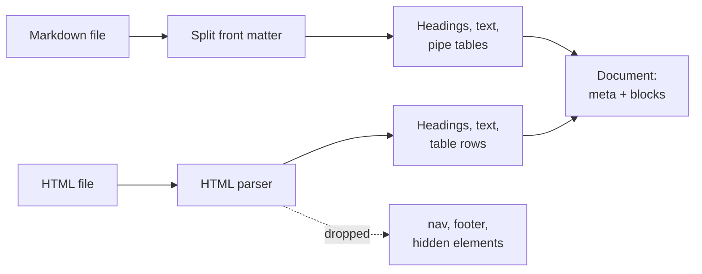
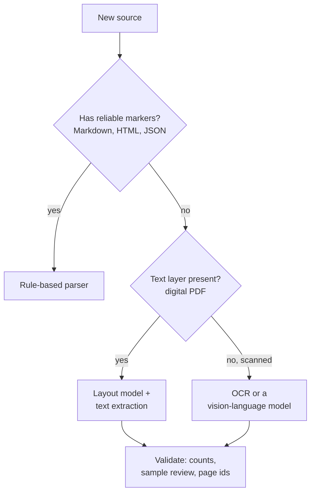
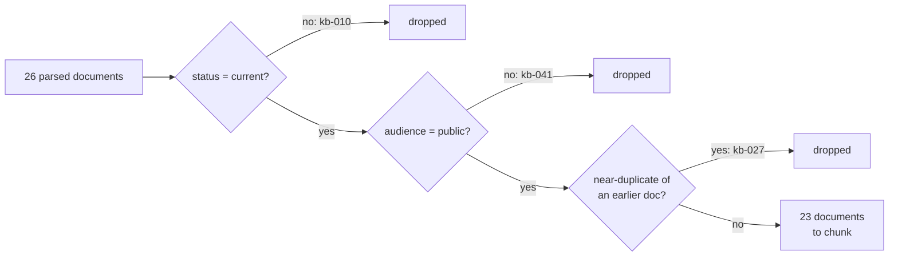
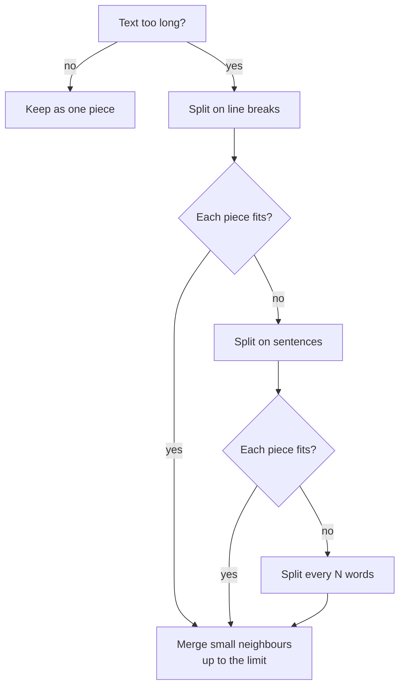

🌐 English · [Español](02-parsing-and-chunking.es.md)

# Lesson 5.2 — Parsing and chunking the help centre

> **Module 05 · Lesson 2 of 4** · ⏱️ about 60 min · 🧪 Lab: [step 2](lab/README.md#step-2--filter-and-chunk)

## 📨 Situation

> **From:** Dani Ruiz · Data Scientist, owns evaluation
> **Channel:** #support-ai
>
> I opened the folder you plan to index. It holds the 2023 returns policy marked `superseded`, an
> internal escalation playbook, the account FAQ twice (Markdown and an HTML export), a shipping page
> that exists only in Spanish, and a comparison table that is the only place the product weights
> appear. If you feed that to an index one blob per file, every number you report afterwards measures
> the mess, not your retriever. Before anyone picks an embedding model: show me how you parse and cut
> these documents, and show me the eval for each choice. Not one configuration. All of them.

## 🎯 Objectives

By the end of this lesson you can:

- Parse Markdown front matter and HyperText Markup Language (HTML) pages (metadata, headings, tables,
  hidden elements) with rules,
  and explain when an AI-based (artificial intelligence) parser is worth its cost.
- Filter documents by `status` and `audience` and remove near-duplicates before indexing, then measure
  what changed.
- Implement and compare five chunking strategies: fixed-size with overlap, recursive, heading-aware,
  semantic and table-row.
- Explain a difference between two chunkers in an evaluation table by reading the chunks themselves.

## 🤔 Predict first

Write your answers down before reading on. You will check them in the self-check.

1. Removing three documents (the old policy, the internal playbook and the duplicate FAQ) before
   indexing: will recall@5 go up, go down or stay the same?
2. The product weights appear only in one HTML table. If the whole table becomes one chunk, will
   keyword search find "How much does the Watcher S1 weigh?"
3. Smaller chunks or bigger chunks: which retrieve better?

## 1. Rule-based parsing: from files to structured documents

**Parsing** turns a raw file into something a program can reason about: metadata (who, when, for whom)
and structure (headings, paragraphs, tables). Most retrieval bugs that look mysterious later start
here, when a parser silently flattens a table or keeps a navigation bar.

The Hearthwise help centre comes in two formats, and both are friendly to **rule-based parsing**,
meaning hand-written rules that rely on the format's own markers:

| Format | Metadata | Structure | Noise to drop |
|---|---|---|---|
| Markdown | Front matter between `---` lines (`id`, `status`, `audience`, `lang`, `effective_date`...) | `#` headings, paragraphs, `-` lists, `|` pipe tables | Almost none |
| HTML | `<meta name=... content=...>` tags and `<title>` | `<h1>`–`<h6>`, `<p>`, `<li>`, `<table>` rows and cells | `<nav>`, `<footer>`, scripts, styles, hidden elements |

The lab's parser keeps that structure as a list of **blocks**. A block is a heading (with its level),
a text paragraph or a table (with its rows, header first). Keeping tables as rows instead of a run of
words is what makes table-aware chunking possible in section 4.

**Analogy:** a post room. Before anyone reads a letter, a clerk reads the envelope (sender, date,
"confidential") and sorts it. Front matter and `<meta>` tags are the envelope; blocks are the letter,
already split into paragraphs.



Front matter is the simplest rule of all: everything between the first two `---` lines is `key: value`.

```python
def split_front_matter(raw: str) -> tuple[dict[str, str], str]:
    """Split ``---``-delimited ``key: value`` front matter from the Markdown body."""
    if not raw.startswith("---\n"):
        return {}, raw
    end = raw.index("\n---\n", 4)
    meta: dict[str, str] = {}
    for line in raw[4:end].splitlines():
        key, sep, value = line.partition(":")
        if sep:
            meta[key.strip()] = value.strip()
    return meta, raw[end + len("\n---\n"):]
```

Run over the whole help centre, the parser finds 26 documents, 13 tables with 80 data rows, and drops
1 hidden HTML element. That hidden element is a paragraph styled `display:none` in a community page
(`kb-025`): invisible to customers, but full of instructions aimed at AI assistants. A parser that
keeps it hands an attack to your chatbot. Module 06 deals with injection in depth; the cheapest defence
starts here, by indexing only what a human reader would see.

> ⚠️ **Common mistake:** stripping HTML with a regular expression such as `<[^>]+>`. You keep the
> navigation links and the hidden paragraph, and you turn a table into a stream of numbers with no
> column names. Use a real HTML parser and decide, element by element, what to keep.

## 2. AI-based parsing: when the format fights back

Rules work when the source has reliable markers. Many companies also have portable document format
(PDF) files exported from word processors, scanned warranty cards, and slide decks with tables drawn as
images. There the
markers are gone: a PDF stores characters at positions on a page, not "this is a heading".
**AI-based parsing** uses models to recover the structure:

| Approach | What it does | Good at | Watch out for |
|---|---|---|---|
| OCR (optical character recognition) | Turns pixels into characters | Scanned pages | Reading order, columns, tables |
| Layout models | Detect regions on a page (title, paragraph, table, figure) and their order | Multi-column PDFs, forms | Need a separate step to read each table |
| Vision-language models (VLMs) | Read a page image and write Markdown or JavaScript Object Notation (JSON) | Messy tables, mixed content | Cost per page, speed, and invented or merged cells |

AI parsers are slower and more expensive than rules, and they can be wrong in fluent ways: a VLM may
"tidy" a table by merging two rows, and nothing in the output tells you. Treat their output like any
model output. Keep the page number as metadata so a citation can point back to the original, check
counts (rows, pages) against the source, and spot-check a sample by hand.

**Analogy:** a form scanner versus a human transcriber. The scanner is fast and exact on the form it
was built for, and useless on anything else. The transcriber handles anything, costs more, and
occasionally "corrects" what they read.



Hearthwise is lucky: its help centre is Markdown and HTML, so the lab uses rules only. The decision
is not about fashion; it is about what the source gives you.

> 💡 **Production tip:** run the expensive parser once, offline, and cache its output next to a hash
> of the source file. Re-parse only when the hash changes. Parsing cost then scales with edits, not
> with the size of the library.

## 3. Metadata: filter and de-duplicate before you index

Every Hearthwise document carries metadata that a retriever should respect:

| Field | Values in the help centre | What to do with it |
|---|---|---|
| `status` | `current`, `superseded` | Index only `current` |
| `audience` | `public`, `internal` | A customer bot indexes only `public` |
| `lang` | `en`, `es` | Keep both; use it to route or to pick an answer language |
| `effective_date` | dates such as 2025-03-01 | Break ties between conflicting current documents |
| `source` | `official`, `community` | Trust and display official sources first |

Two documents fail the first two rules: `kb-010` (the 2023 returns policy, `superseded`) and `kb-041`
(the escalation playbook, `internal`). A third problem has no metadata flag: the account FAQ exists
twice. To catch copies of this FAQ (frequently asked questions) page, the lab compares every pair of
documents by **Jaccard similarity** of their word 5-grams (the share of five-word sequences they have in
common). The Markdown FAQ (`kb-026`) and
its HTML export (`kb-027`) score 0.884, far above anything else, so the export is dropped.

**Analogy:** cleaning a fridge before cooking. Throwing out the expired milk does not make the soup
taste better on its own, and occasionally the soup was relying on it. You still throw it out.



```python
from m05_retrieval.chunking import is_servable, prepare_corpus
from m05_retrieval.parsing import load_kb

docs = load_kb()
print([d.doc_id for d in docs if not is_servable(d)])  # ['kb-010', 'kb-041']
kept, report = prepare_corpus(docs)  # metadata filters + near-duplicate removal
print(len(kept))  # 23
for doc_id, reason in sorted(report.dropped.items()):
    print(doc_id, reason)
# kb-010 status=superseded
# kb-027 near-duplicate of kb-026 (Jaccard 0.884)
# kb-041 audience=internal
```

Did it help? Measure two things, not one. **Exposure** counts the questions (all 40) whose top 5
documents include a superseded or internal one. With heading-level chunks and no filters, that is 15
questions: the old policy shows up in 11 of them and the internal playbook in 4. With the filters, it
is 0. **Recall@5** (is a relevant document in the top 5?) moves the other way, from 0.917 to 0.889.

That drop is real and worth understanding. Removing documents changes the statistics a keyword index
uses to weight words (lesson 5.3), and one borderline question, q004 about the standard warranty,
slipped from fifth to sixth place. With 36 answerable questions, one question is worth about 0.028 of
recall. The filters are a correctness decision: you would not put the internal playbook back to win
one question, any more than you would reopen a security hole because a benchmark got faster.

> 💡 **Production tip:** copy the document's metadata onto every chunk, and filter again at query
> time. The index-time filter protects you from mistakes in the corpus; the query-time filter lets one
> index serve customers and support agents with different permissions.

## 4. Chunking strategies

A **chunk** is the unit you index, retrieve and quote. Whole documents are too coarse: the installation
manual, with 13 headings, would compete as one block, and the prompt would carry pages the question does
not need. Single sentences are too fine: "Then release." means nothing without the step before it.
Chunking is the choice of where to cut.

| Strategy | Where it cuts | Strength | Weakness |
|---|---|---|---|
| Fixed-size with overlap | Every N words; consecutive chunks share M words | Simple, predictable size | Cuts mid-sentence and mid-table; ignores structure |
| Recursive | Paragraphs, then sentences, then words, until each piece fits; small neighbours are merged back | Respects natural boundaries | Size varies; still blind to headings |
| Heading-aware (structure) | At every heading, so one section is one chunk | Coherent, citable sections | A long section or a big table becomes one oversized chunk |
| Semantic | Where consecutive sentences stop being similar (by embedding) | Follows topic shifts in long prose | Only as good as the embedding; costs an embedding per sentence |
| Table-row | Each row of a wide table becomes its own chunk, prefixed with the table's headers | Every value keeps its column name | Many tiny chunks from one document |

**Overlap** deserves a note: with 80-word windows and 20 words of overlap, the last 20 words of one
chunk are the first 20 of the next. A fact that straddles a cut survives intact in at least one chunk.
The price is duplicated text in the index.

**Analogy:** cutting a cookbook into index cards. You can cut every 10 centimetres (fixed), at the end
of paragraphs (recursive), at each recipe title (heading), where the topic changes from dough to sauce
(semantic), or give every row of the conversion table its own card with the column names written on
top (table-row).



The table-row chunker is the one built for Dani's comparison table. Each row is written out with its
headers, so the chunk reads like a sentence a model can quote:

```python
def row_to_text(title: str, header: tuple[str, ...], row: tuple[str, ...]) -> str:
    """Serialise one table row so that every value keeps its column name."""
    pairs = "; ".join(f"{h}: {v}" for h, v in zip(header[1:], row[1:]))
    return f"{title} | {row[0]} | {pairs}"
```

Two-column key/value tables (a product's `Spec | Value` list) read fine when flattened, so the lab
splits only tables with three or more columns. Here is what each strategy produces on the 23 filtered
documents:

| Chunker | Chunks | Mean words per chunk | Largest chunk (words) |
|---|---|---|---|
| fixed (80 words, 20 overlap) | 65 | 72.1 | 94 |
| recursive (at most 100 words) | 52 | 73.5 | 100 |
| heading | 111 | 34.4 | 153 |
| semantic (hashing embeddings) | 98 | 39.0 | 120 |
| table-row (heading + wide-table rows) | 128 | 31.1 | 96 |

> ⚠️ **Common mistake:** picking a chunk size because a blog post used it. The right size depends on
> your documents, your questions and your embedding model's input limit. Treat chunk size as a
> parameter you measure, like everything else in this lesson.

## 5. Measuring chunkers on the evaluation set

The evaluation set lists, for each answerable question, the documents that contain the answer. The
lab ranks chunks, collapses them into a ranked list of documents, and computes:

- **Recall@k**: the share of questions with a relevant document in the top k documents. (Some texts
  call this the hit rate and keep "recall" for the share of all relevant documents found; with one or
  two relevant documents per question, the two nearly coincide.)
- **MRR (mean reciprocal rank)**: the average of 1 / (position of the first relevant document). A
  first-place hit scores 1, second place 0.5, a miss 0.
- **ctx@5**: the share of questions with a relevant document among the first 5 *chunks*, which is
  what a prompt would actually hold.

All rows below use the same keyword retriever (BM25, Best Matching 25, explained in lesson 5.3) and the
same filters; only the chunker changes:

| Chunker | Recall@1 | Recall@5 | MRR | ctx@5 | `table` recall@5 |
|---|---|---|---|---|---|
| heading | 0.667 | 0.889 | 0.770 | 0.861 | 0.00 |
| fixed | 0.750 | 0.972 | 0.840 | 0.944 | 1.00 |
| recursive | 0.778 | 0.972 | 0.863 | 0.972 | 1.00 |
| semantic | 0.639 | 0.917 | 0.768 | 0.917 | 0.00 |
| table-row | 0.667 | 0.944 | 0.786 | 0.917 | 1.00 |

Read the `table` column first. With heading chunks, the whole comparison table is one 153-word chunk
in which "Watcher S1" appears once, and it loses to short chunks that mention the product name
several times. Table-row chunks fix both table questions. Lesson 5.3 shows the arithmetic behind this.

Now the surprise: fixed-size and recursive chunks also score 1.00 on tables, and they top the table on
recall. Do not stop at the number; look at the chunk. Here is the fixed-size chunk that contains the
Watcher S1 row:

```text
2022-03-14 Spark Mini 19 2.4 GHz 0.3 no 85 0 to 35 2022-03-14 Watcher S1 29 none (HomeMesh radio) 0.0 yes 34 -10 to 45 2023-04-03 Lookout C2 89 ...
```

The search found the right document because the window is short, but the header row is in another
chunk. A model reading this has to guess that "34" is grams and not, say, the price. The table-row
chunk says it outright:

```text
Compare Hearthwise devices | Watcher S1 | Price (EUR): 29; Wi-Fi: none (HomeMesh radio); Standby (W): 0.0; Needs hub: yes; Weight (g): 34; Operating temperature (°C): -10 to 45; Launched: 2023-04-03
```

Two more honest observations. The semantic chunker lands close to the heading one (MRR 0.768 against
0.770, and 0.00 on tables), because its only notion of "similar" is the lexical hashing embedding
(lesson 5.3). And a plain recursive splitter is a strong baseline on this small, tidy help centre: try
simple things before clever ones. The rest of the module uses table-row chunks anyway, trading some
recall@1 (0.667 against the recursive chunker's 0.778) for chunks the generator can read without
guessing. That is the kind of trade-off Dani asked to see: written down, with numbers, and
with the chunk text next to them.

**Analogy:** grading a translation only by whether the right words appear. A word-salad answer can
pass. You also have to read it.

> 💡 **Production tip:** after every chunker change, print the chunks of your three hardest documents
> (`uv run lab chunk --show kb-007`). Metrics tell you that something changed; the chunk text tells
> you whether the change is one a reader would welcome.

## 🧪 Try it

Run these from `modules/05-rag-retrieval/lab`.

1. Parse the help centre. The table has one row per document; the last lines summarise it.

   ```bash
   uv run lab parse
   ```

   ```text
   kb-040  markdown en   current    public         13    34      2      0
   kb-041  markdown en   current    internal        4     3      1      0

   26 documents, 13 tables (80 data rows), 1 hidden HTML element(s) dropped
   about 5,070 tokens of parsed text (rough count: words and punctuation)
   ```

2. Filter, de-duplicate and chunk with the table-row chunker, showing the comparison table's chunks.

   ```bash
   uv run lab chunk --chunker table --show kb-007
   ```

   ```text
   near-duplicate: kb-027 ~ kb-026 (Jaccard 0.884)
   dropped kb-010: status=superseded
   dropped kb-027: near-duplicate of kb-026 (Jaccard 0.884)
   dropped kb-041: audience=internal

   chunker=table: 23 documents -> 128 chunks (words per chunk: mean 31.1, max 96)
   wrote outputs/chunks-table.jsonl

   --- kb-007#0 [Compare Hearthwise devices]
   Compare Hearthwise devices
   Use this table to compare the main specifications of every device we sell. Prices include VAT for Spain and Portugal.
   Standby power is measured with the device connected to Wi-Fi and idle.

   --- kb-007#1 [Compare Hearthwise devices]
   Compare Hearthwise devices | Ember T3 | Price (EUR): 149; Wi-Fi: 2.4 GHz; Standby (W): 0.6; Needs hub: no; Weight (g): 210; Operating temperature (°C): 5 to 35; Launched: 2023-10-02
   ```

   The output continues with one chunk per device. Run it again with `--chunker heading` and
   `--chunker fixed` and compare the same document.

3. Evaluate one configuration in detail and read the misses.

   ```bash
   uv run lab eval --chunker heading
   ```

   ```text
   config                       chunks   R@1   R@5   MRR ctx@5 table x-ling exposed
   bm25/heading                    111 0.667 0.889 0.770 0.861  0.00   0.50       0

   recall@5 by category:
     cross_lingual      0.50
     fact               1.00
     injection_exposed  1.00
     long_doc           1.00
     multi_doc          1.00
     policy             0.90
     procedure          1.00
     spanish            1.00
     table              0.00
     version_trap       1.00
   misses at 5: q004, q017, q018, q022
   ```

   Then run `uv run lab eval --chunker table`: q017 and q018 (the table questions) disappear from the
   misses, and q004 and q022 remain.

## 🏭 In the real world

- **Parsers are versioned and re-run.** When a parser improves, teams re-parse and re-chunk the whole
  corpus, then re-run the evaluation before switching the index. Chunk ids that encode the document id
  and position (`kb-007#4`) keep citations stable across rebuilds.
- **Metadata is enforced twice.** Once when building the index (nothing superseded or internal gets
  in) and once per query (the user's permissions filter what may match).
- **Duplicates come from everywhere.** Exports, translations, copied FAQ answers in several product
  pages. Near-duplicate detection with shingles or MinHash runs as part of ingestion.
- **Tables and PDFs get special handling.** Teams keep a table-aware path, and often store both a
  readable row serialisation for search and the original table for display.
- **Chunk size follows the embedding model.** Embedding models have an input limit; text beyond it is
  silently cut. Chunk sizes are chosen to fit, with a margin.

## ✅ Self-check

**1. (Revisits predict-first 1.) What did removing the old policy, the internal playbook and the
duplicate FAQ do to recall@5, and why is that still the right call?**

<details><summary>Answer</summary>

Recall@5 went from 0.917 to 0.889, because one borderline question (q004) dropped from fifth to sixth
place when the word statistics changed. Exposure went from 15 questions to 0. The tempting conclusion,
"filters hurt retrieval", mixes two goals: filters exist for correctness and access control, and a
one-question wobble on a 36-question set is noise compared with leaking an internal voucher code.

</details>

**2. (Revisits predict-first 2.) Why does keyword search miss the Watcher S1 weight when the comparison
table is a single chunk?**

<details><summary>Answer</summary>

The table chunk is long (153 words) and mentions "Watcher S1" once, while other chunks are short and
mention it several times. Keyword scoring rewards that, so the table ranks low. Splitting the table into
rows makes a short chunk about exactly one device, with "Weight (g)" written next to the value.

</details>

**3. (Revisits predict-first 3.) Are smaller chunks always better?**

<details><summary>Answer</summary>

No. The table-row chunker has the smallest chunks (31.1 words on average) but not the best recall@1;
the recursive chunker, with chunks over twice as long, scores higher on recall and MRR here. Small chunks
sharpen matching but lose context and can crowd the top 5 with pieces of one document. Measure on your
own questions, and read the chunks.

</details>

**4. A PDF manual has two columns per page and tables drawn as images. Which parsing approach do you
pick, and what do you check afterwards?**

<details><summary>Answer</summary>

Rules will not work: there are no reliable markers. Use a layout model with text extraction, or a
vision-language model for the image tables. Then validate: compare page and row counts with the source,
spot-check pages by hand, and keep the page number in each chunk's metadata so answers can cite the
original.

</details>

**5. Spot the bug: `chunk_fixed(doc, size=50, overlap=50)`.**

<details><summary>Answer</summary>

With overlap equal to the size, the window would never move forward. The lab's `chunk_fixed` raises a
`ValueError` for this case. Overlap must be smaller than the chunk size; a quarter of it is a common
starting point.

</details>

## 💬 Explain it in your own words

1. Dani asked for "the eval for each choice". Explain to them, in four sentences, why the fixed-size
   chunker's perfect `table` score is not the whole story.
2. Noor asks why you drop hidden HTML elements at parsing time instead of "telling the model to ignore
   them". Answer in two sentences.

## 🔑 Key ideas

- Parse into structure (metadata + headings, text, tables), not into one string per file.
- Use rules when the source has markers; use layout or vision-language models when it does not, and
  validate their output.
- Filter by `status` and `audience` and remove near-duplicates before indexing; measure exposure, not
  only recall.
- Chunking decides where to cut: fixed, recursive, heading, semantic or table-row, each with a cost.
- Evaluate chunkers on your questions, per category, and read the chunks behind the numbers.
- With 36 questions, one question moves recall by about 0.028: treat small differences as noise.

## 📚 Go deeper

- ⭐ [Dense passage retrieval for open-domain question answering](https://arxiv.org/abs/2004.04906) —
  shows how passage-level units (around 100 words) became the standard retrieval granularity.
- [Retrieval-augmented generation for knowledge-intensive NLP tasks](https://arxiv.org/abs/2005.11401)
  — the original RAG setup, built on passages from a chunked encyclopedia.
- [Sentence Transformers documentation](https://www.sbert.net) — check the input length of the
  embedding model you plan to use before choosing a chunk size.

---

[← Previous: 5.1 Why retrieval-augmented generation](01-rag-overview.md) · [🏠 Module 05](README.md) · [Next: 5.3 Indexing: keywords, knowledge and vectors →](03-indexing-and-embeddings.md)
