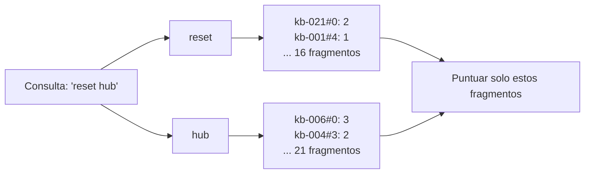
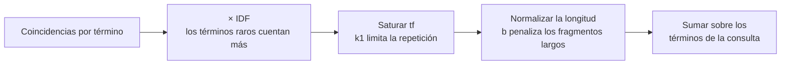
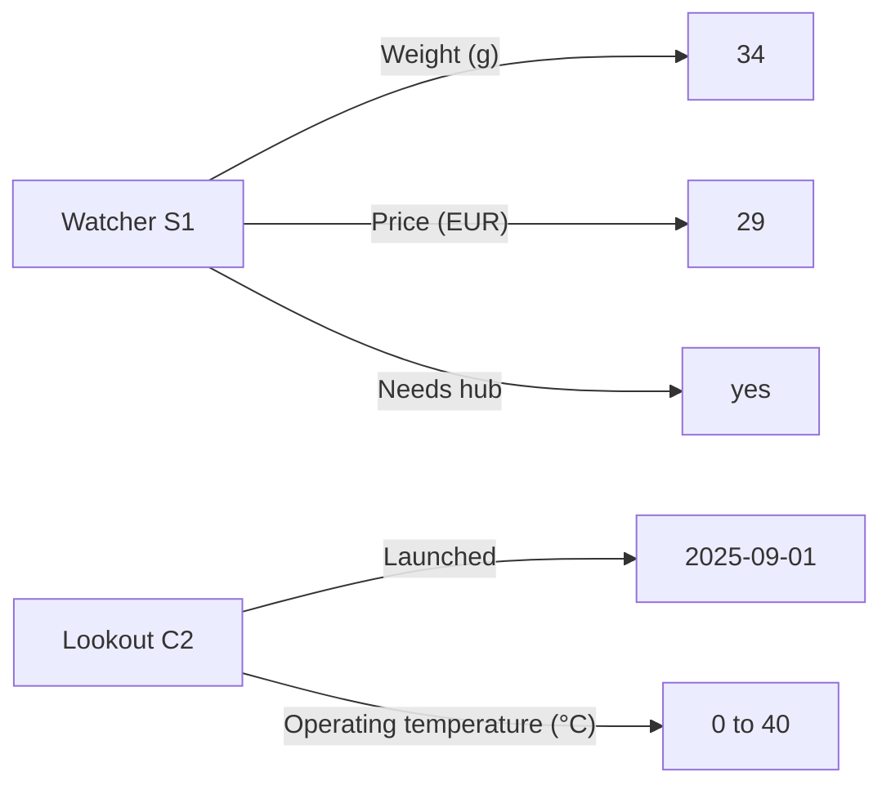
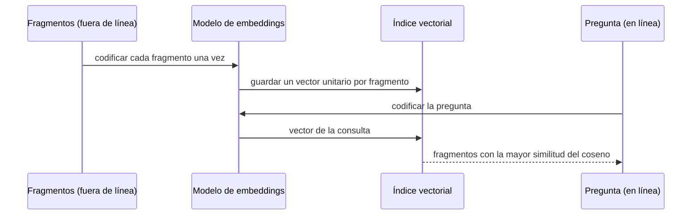
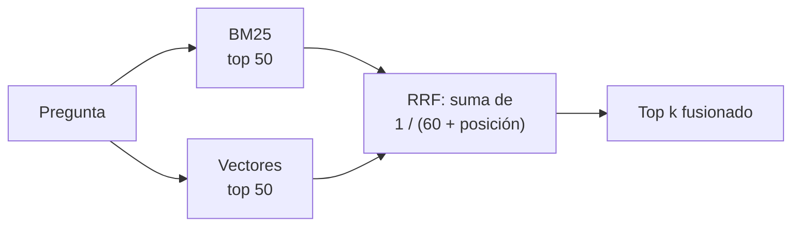

🌐 [English](03-indexing-and-embeddings.md) · Español

# Lección 5.3 — Indexación: palabras clave, conocimiento y vectores

> **Módulo 05 · Lección 3 de 4** · ⏱️ unos 70 min · 🧪 Lab: [paso 3](lab/README.es.md#paso-3--construye-los-índices)

## 📨 Situación

> **De:** Alex Moreau · Responsable de Operaciones de Atención al Cliente
> **Canal:** #support-ai
>
> Probé tu búsqueda con preguntas de los tickets de esta semana. Los pesos de los productos ya
> funcionan, genial. Pero la clientela no habla como nuestro centro de ayuda. Preguntan por el "cost"
> de algo cuando la página dice "price". Alguien de México preguntó, en inglés, quién paga la aduana, y
> la única respuesta que tenemos está en una página en español que dice "aduanas". Y el equipo no para
> de pedir datos sencillos, como qué dispositivo es el más nuevo, que están en una tabla. ¿Puede la
> búsqueda entender lo que la gente quiere decir, y no solo las palabras que escribe? ¿Y cuánto nos
> costará eso en tamaño y velocidad? Sam lo va a preguntar.

## 🎯 Objetivos

Al terminar esta lección puedes:

- Construir un índice invertido y explicar cómo responde a una consulta (*query*) por palabras clave
  sin leer todos los fragmentos (*chunks*).
- Deducir la fórmula BM25 (*Best Matching 25*) a partir de tres intuiciones y calcular a mano la contribución de un término.
- Guardar hechos de producto como tripletas y explicar cuándo una consulta exacta supera a la búsqueda
  de texto, y cuándo responde a la pregunta equivocada.
- Explicar cómo un modelo de *embeddings* bicodificador (*bi-encoder*) convierte texto en vectores, y
  mostrar con números por qué el codificador por *hashing* del lab, que funciona sin conexión, no puede
  relacionar sinónimos ni idiomas.
- Fusionar dos rankings con la fusión por rango recíproco (RRF, *reciprocal rank fusion*) y explicar por qué una búsqueda híbrida puede perder frente a una de sus entradas.

## 🤔 Predice primero

Apunta tus respuestas antes de seguir leyendo. Las comprobarás en la autoevaluación.

1. La palabra "the" aparece en 75 de los 111 fragmentos por encabezado. ¿Cuánto debería contar una
   coincidencia con "the"?
2. ¿Tratará como parecidos "cost" y "price" una búsqueda vectorial con el codificador por *hashing* del
   lab?
3. Verdadero o falso: combinar la búsqueda por palabras clave y la vectorial siempre es al menos tan
   bueno como la mejor de las dos por separado.

## 1. Búsqueda por palabras clave y el índice invertido

La forma más antigua de buscar en un texto es buscar las palabras de la consulta. Leer todos los
fragmentos para cada pregunta funciona con 128 fragmentos y fracasa con millones. Un **índice
invertido** (*inverted index*) le da la vuelta al problema: construye, una sola vez, un mapa de cada
palabra (un **término**) a la lista de fragmentos que la contienen y cuántas veces. Esa lista son las
**apariciones** (*postings*) del término. Así, una consulta solo toca las apariciones de sus propios
términos.

**Analogía:** el índice al final de un libro de cocina. Para encontrar recetas con azafrán no lees el
libro; buscas "azafrán" y obtienes números de página. El índice del libro se construye una vez, cuando
se imprime.



```python
from collections import Counter, defaultdict

from m05_retrieval.text import tokenize


def build_postings(texts: list[str]) -> dict[str, dict[int, int]]:
    """term -> {chunk position: term frequency}: the core of InvertedIndex.build."""
    postings: dict[str, dict[int, int]] = defaultdict(dict)
    for pos, text in enumerate(texts):
        for term, tf in Counter(tokenize(text)).items():
            postings[term][pos] = tf
    return dict(postings)


postings = build_postings(["reset the hub", "the hub connects devices", "reset the bulb"])
print(postings["hub"], postings["reset"])  # {0: 1, 1: 1} {0: 1, 2: 1}
```

Con los 128 fragmentos que entienden las tablas, el índice contiene 950 términos distintos y 3.361
apariciones (una por cada par de término y fragmento). A 8 bytes por aparición más los propios
términos, son unos 32.064 bytes. Una **consulta booleana** ("fragmentos que contienen *reset* Y *hub*")
es la intersección de dos listas de apariciones. Pruébalo en el centro de ayuda: "reset" está en 16
fragmentos, "hub" en 21, y la intersección está vacía. Los pasos para restablecer el Hearth Hub están en
una sección titulada "Hearth Hub" de una página titulada "Factory reset for every device", así que
ningún fragmento contiene las dos palabras. La búsqueda booleana no puede ordenar ni ser flexible: o un
fragmento coincide con todas las palabras o no coincide. La búsqueda de texto completo añade una
puntuación.

> ⚠️ **Error común:** tokenizar los documentos y las consultas de forma distinta, por ejemplo pasando
> a minúsculas unos y no las otras. Entonces el índice nunca coincide. En el lab, una única función
> `tokenize` sirve a los dos lados; cámbiala en un solo sitio o no la cambies.

## 2. BM25: una fórmula de ranking que puedes deducir

**BM25** (*Best Matching 25*, de una serie numerada de funciones de ranking) es la función de
puntuación estándar para texto completo. Puedes reconstruirla a partir de tres intuiciones, usando la
pregunta del Watcher S1 de la lección 5.2 sobre
los 111 fragmentos por encabezado (longitud media: 34.4 palabras).

**Intuición 1: las palabras raras importan más.** Contar las palabras que coinciden deja que "the"
domine. Pondera cada término por su **frecuencia inversa de documento** (IDF, *inverse document
frequency*): cuantos menos fragmentos lo contienen, más significa una coincidencia.

```text
IDF(t) = ln(1 + (N - df + 0.5) / (df + 0.5))      N = chunks, df = chunks containing t
"the":      df = 75 of 111  ->  IDF = 0.39
"watcher":  df = 4 of 111   ->  IDF = 3.21
```

**Intuición 2: la repetición se satura.** Un fragmento que dice "Watcher" cinco veces trata más del
Watcher que uno que lo dice una vez, pero no cinco veces más. BM25 sustituye el recuento bruto `tf` por
`tf × (k1 + 1) / (tf + k1)`. Con `k1 = 1.5`, una aparición puntúa 1.0, dos puntúan 1.43, diez puntúan
2.17, y ningún número de repeticiones supera nunca 2.5.

**Intuición 3: los fragmentos largos se diluyen.** Una mención en 17 palabras dice más que una mención
en 153. BM25 escala `k1` según la longitud del fragmento respecto a la media, controlada por `b` (0 =
ignorar la longitud, 1 = corrección completa; el valor habitual es 0.75):

```text
score(q, d) = sum over query terms t of
              IDF(t) × tf × (k1 + 1) / (tf + k1 × (1 - b + b × len(d) / avg_len))
```

Ahora, la aritmética que hay detrás del fallo con la tabla de la lección 5.2. "Watcher" aparece una vez
tanto en el fragmento de la tabla comparativa (`kb-007#0`, 153 palabras) como en la sección de
restablecimiento del Watcher S1 (`kb-021#4`, 17 palabras). Su contribución es 1.26 en el fragmento
largo de la tabla y 4.16 en el fragmento corto del restablecimiento: el factor de longitud por sí solo
divide la puntuación por más de tres. La palabra "weigh" no está en ningún fragmento (la tabla dice
"Weight"), así que no suma nada en ninguna parte. El fragmento de la tabla acaba en el puesto 12, fuera
del top 5.

**Analogía:** juzgar cuánto trata un artículo de periódico de una ciudad. Un nombre de ciudad que
aparece en todos los artículos (la ciudad donde se edita el periódico) te dice poco: eso es la IDF. Un
artículo que nombra la ciudad diez veces trata de ella, pero no diez veces más que uno que la nombra
tres: eso es la saturación. Y una mención en un aviso de dos líneas pesa más que una mención en un
suplemento de doce páginas: eso es la normalización por longitud.



Puedes comprobar la aritmética con el propio índice del lab:

```python
from m05_retrieval.bm25 import idf
from m05_retrieval.retrieval import Config, build_pipeline

bm = build_pipeline(Config("bm25", "heading")).retriever.bm25
watcher_idf = idf(bm.index.n_docs, len(bm.index.postings["watcher"]))
print(round(watcher_idf, 2))                         # 3.21
print(round(bm.term_score(1, 153, watcher_idf), 2))  # 1.26: one mention in 153 words
print(round(bm.term_score(1, 17, watcher_idf), 2))   # 4.16: one mention in 17 words
```

`term_score` son tres líneas en `bm25.py`; ábrelo y asocia cada factor con una de las intuiciones de
arriba.

BM25 funciona bien en el centro de ayuda de Hearthwise porque la clientela y el centro de ayuda
comparten casi siempre el vocabulario: nombres de producto, "reset", "warranty". Sus puntos ciegos son
las palabras que nunca coinciden: "weigh" frente a "weight", "cost" frente a "price", "Mexico" frente a
"México". La IDF también puede sorprenderte en el otro sentido: "how" aparece solo en 7 de los 111
fragmentos, así que su IDF es 2.70, y "How do I factory reset the Ember T3?" devuelve dos entradas de la
FAQ (preguntas frecuentes, *frequently asked questions*) de la cuenta que empiezan por "How do I" antes
que cualquier instrucción de restablecimiento. Raro no es lo mismo que importante.

> 💡 **Consejo de producción:** BM25 no necesita entrenamiento ni descargar ningún modelo, y cuesta
> microsegundos por consulta. Mantenlo en todo sistema de recuperación como línea base (*baseline*) y
> como una de las dos mitades de un híbrido, y compara con él cualquier cosa más sofisticada.

## 3. Un índice de conocimiento: hechos como tripletas

Algunas preguntas no tratan de pasajes en absoluto: "How much does the Watcher S1 weigh?" tiene una sola
respuesta, un número en una celda de una tabla. Un **índice basado en conocimiento** (*knowledge-based
index*) guarda hechos como **tripletas** (sujeto, predicado, objeto), cada una con un puntero al
documento del que salió: `(Watcher S1, Weight (g), 34)` de `kb-007`.
Un conjunto de tripletas es un pequeño **grafo de conocimiento** (*knowledge graph*): los productos son
nodos y los predicados son aristas etiquetadas que llevan a sus valores.

El lab extrae tripletas con reglas de dos tipos de tablas: la tabla comparativa ancha (fila = producto,
columna = predicado) y la tabla `Spec | Value` de dos columnas de cada página de producto. Eso da 90
tripletas sobre 6 productos. Una pregunta se resuelve encontrando un nombre de producto y una palabra
pista ("weigh" se asocia con "weight", "cost" con "price", "newest" con "launched").

**Analogía:** una hoja de cálculo junto a una biblioteca. Para "¿cuánto pesa?" consultas una celda, no
un libro. Pero la hoja de cálculo solo responde a las preguntas para las que a alguien se le ocurrió
crear una columna.



```python
from m05_retrieval.chunking import prepare_corpus
from m05_retrieval.knowledge import KnowledgeIndex, extract_triples
from m05_retrieval.parsing import load_kb

docs, _ = prepare_corpus(load_kb())
kg = KnowledgeIndex(extract_triples(docs))
for question in ("How much does the Watcher S1 weigh?",
                 "Which Hearthwise device was launched most recently?",
                 "What is the price of the Lookout C2 in Mexico?"):
    print(question, "->", [(t.subject, t.predicate, t.object, t.doc_id) for t in kg.lookup(question)])
```

Las dos primeras respuestas son exactas y llevan cita: 34 gramos, de `kb-007`, y el Lookout C2, lanzado
el 2025-09-01. Una pregunta de "lo más reciente" es una comparación entre filas, algo que la búsqueda de
texto hace mal y una tabla de hechos resuelve de forma trivial. La tercera respuesta es la trampa: el
centro de ayuda nunca indica un precio en México (q037 no tiene respuesta), pero la consulta devuelve
tan tranquila €89, el precio en euros. El índice reconoció "Lookout C2" y "price" e ignoró "in Mexico",
un matiz que no modela. Las consultas exactas son precisas sobre lo que saben y ciegas ante lo que no.

> ⚠️ **Error común:** devolver un hecho del grafo de conocimiento como respuesta sin comprobar que se
> entendió cada parte de la pregunta. Envía la pregunta al grafo solo cuando todas sus entidades y
> restricciones encajen en el esquema; si no, recurre a la búsqueda de texto y deja que el generador se
> niegue a responder.

## 4. *Embeddings* y el índice vectorial

Para relacionar significados en lugar de ortografía, convierte el texto en un **vector**: una lista de
números, de forma que los textos con significado parecido reciban vectores cercanos. Un **modelo de
*embeddings*** (*embedding model*) hace esa conversión. La recuperación usa un **bicodificador**: el
mismo modelo codifica cada fragmento una vez, fuera de línea (*offline*), y cada pregunta una vez, en
línea (*online*), y la puntuación es la **similitud del coseno** (*cosine similarity*) entre los dos
vectores (su producto escalar después de escalar ambos a longitud 1). Como los fragmentos se codifican
sin depender de la pregunta, sus vectores se pueden calcular de antemano y guardar: esa tabla de
vectores es el **índice vectorial**.

**Analogía:** coordenadas en un mapa. Dos cafeterías con nombres distintos pueden estar en la misma
calle. Un *embedding* da a cada fragmento una dirección en un "espacio de significados", y buscar se
convierte en "¿qué está más cerca de esta dirección?".



Los bicodificadores aprendidos como [Sentence-BERT](https://arxiv.org/abs/1908.10084) y la recuperación
densa de pasajes ([DPR](https://arxiv.org/abs/2004.04906)) se entrenan con pares de textos
relacionados, y así aprenden que "cost" y "price" van juntos. El lab no puede descargar un modelo, así que `providers.py` incluye
un sustituto que funciona sin conexión: el **codificador por *hashing*** (*hashing embedder*). Divide el
texto en palabras y trigramas de caracteres ("weigh" da `#we`, `wei`, `eig`, `igh`, `gh#`), asigna cada
rasgo mediante un *hash* a una de 256 posiciones con un signo pseudoaleatorio,
y escala el resultado a longitud 1. Es determinista y gratuito, y muestra exactamente lo que puede y no
puede hacer un *embedding* sin aprendizaje:

| Par | Coseno (*hashing*) | Por qué |
|---|---|---|
| "weigh" / "weight" | 0.62 | Comparten trigramas de caracteres |
| "Mexico" / "México" | 0.43 | Comparten trigramas; los que llevan acento difieren |
| "price" / "cost" | 0.00 | No comparten patrones de letras; el significado es invisible |
| "return window" / "plazo de devolución" | -0.11 | Idioma distinto, nada en común |

```python
from m05_retrieval.vectors import HashingEmbedder, VectorIndex

texts = ["Price: €29", "How much does it cost?", "Weight (g): 34"]
index = VectorIndex(texts, HashingEmbedder())  # one unit vector per text: a (3, 256) matrix
for position, cosine in index.search("how much does it weigh", k=2):
    print(texts[position], round(cosine, 2))
# How much does it cost? 0.78
# Weight (g): 34 0.23
```

La pregunta trata del peso, pero el codificador por *hashing* prefiere la frase que comparte las
palabras "how much does it". Por dentro, `VectorIndex.scores` es un único producto de matrices: la
matriz de vectores unitarios de los fragmentos multiplicada por el vector unitario de la consulta da a
la vez el coseno con cada fragmento.

En el conjunto de evaluación, los vectores por *hashing* sobre fragmentos por filas de tabla alcanzan un
*recall@1* de 0.722, mejor que el 0.667 de BM25: los trigramas rescatan los casi aciertos ortográficos.
Pero el *recall@5* baja a 0.861 (BM25: 0.944), y las categorías `table` y `cross_lingual` puntúan 0.00.
Con un modelo de *embeddings* multilingüe de verdad, la página de envíos en español debería quedar
cerca de una pregunta en inglés sobre aduanas; puedes probarlo con `--embedder provider` y Ollama
(consulta el README del lab), pero no se ejecutó para esta lección, así que no hay ningún número que
citar.

Para Sam, la parte del tamaño: cada vector son 256 números float32, 1.024 bytes, así que los 128
fragmentos ocupan 131.072 bytes, unas cuatro veces el índice invertido. Los modelos de *embeddings*
reales usan desde cientos hasta unos pocos miles de dimensiones, y el tamaño crece linealmente tanto con
las dimensiones como con los fragmentos.

> 💡 **Consejo de producción:** guarda el nombre y la versión del modelo de *embeddings* junto al
> índice, y no mezcles nunca en un índice vectores de dos modelos. Un vector de consulta del modelo B
> comparado con vectores de fragmento del modelo A devuelve disparates con total aplomo, y nada falla.

## 5. Búsqueda híbrida con fusión por rango recíproco

La búsqueda por palabras clave y la vectorial fallan de forma distinta, así que ejecutar las dos y
combinar los resultados es una idea natural. Sus puntuaciones no se pueden sumar: las de BM25 no tienen
un rango fijo (la lección 5.1 mostró 20.474 y 6.756), mientras que los cosenos están entre -1 y 1. La
**fusión por rango recíproco (RRF)** ignora las puntuaciones y usa solo las posiciones: cada lista da a
cada elemento `1 / (k + rank)`, con `k = 60` por convención, y los elementos se ordenan por la suma. Un
elemento que queda primero en
una lista recibe 1/61; un elemento décimo en las dos listas recibe 2/70, que es más. La RRF premia el
acuerdo.

**Analogía:** dos guías de restaurantes. Un sitio que las dos guías incluyen entre sus diez favoritos es
una apuesta más segura que uno que a una guía le encanta y la otra ni conoce. Normalmente.



El algoritmo completo cabe en unas pocas líneas; abajo gana el elemento 1 porque las dos listas lo
sitúan cerca de arriba:

```python
from collections import defaultdict


def rrf_fuse(rankings: list[list[int]], k: int = 60) -> list[tuple[int, float]]:
    fused: dict[int, float] = defaultdict(float)
    first_seen: dict[int, int] = {}
    for ranking in rankings:
        for rank, item in enumerate(ranking, start=1):
            fused[item] += 1.0 / (k + rank)
            first_seen.setdefault(item, len(first_seen))
    return sorted(fused.items(), key=lambda kv: (-kv[1], first_seen[kv[0]]))


print([(item, round(score, 4)) for item, score in rrf_fuse([[1, 2, 3], [3, 1, 4]])])
# [(1, 0.0325), (3, 0.0323), (2, 0.0161), (4, 0.0159)]
```

Ese "normalmente" esconde mucho. Toma q022, "Who pays customs fees for orders shipped to Mexico?", con
la **normalización de acentos** (*accent folding*) activada (una opción del tokenizador que convierte
"México" en "mexico"). Ahora BM25 sitúa segundo el fragmento de envíos en español `kb-031#0`. Los
vectores por *hashing* lo sitúan en el puesto 98, más allá de los 50 candidatos que lee la fusión. Así
que el fragmento gana 1/62 = 0.0161 solo gracias a BM25, mientras que los fragmentos que los dos
recuperadores (*retrievers*) colocan en una zona media mediocre acumulan más, y `kb-031#0` cae al
puesto 31. La búsqueda híbrida no encuentra ninguna respuesta entre idiomas (0.00). Sin normalización,
la búsqueda híbrida de la comparativa del lab puntúa un *recall@5* de 0.917 frente al 0.944 de BM25. La
fusión solo es tan buena como el acuerdo entre sus entradas; un recuperador flojo también vota.

La normalización de acentos por sí sola cuenta la otra mitad de la historia: BM25 con normalización
alcanza un *recall@5* de 0.972 y resuelve las dos preguntas entre idiomas. Es un parche con suerte, no
una solución: el puente es un nombre propio que comparten los dos idiomas. "Who pays import duties?",
sin nombre de país, no devuelve absolutamente nada: ninguna de sus palabras aparece en ningún sitio del
centro de ayuda.

> ⚠️ **Error común:** concluir que "la búsqueda híbrida es mejor" por una entrada de blog y desplegarla
> sin probarla. La búsqueda híbrida ayuda cuando los dos recuperadores son buenos de formas distintas.
> Pruébala con tus propias preguntas, por categoría, exactamente como pruebas un fragmentador.

## 🧪 Pruébalo

Ejecuta estos comandos desde `modules/05-rag-retrieval/lab`.

1. Construye los dos índices y lee sus tamaños. Las líneas de tiempos varían según la máquina.

   ```bash
   uv run lab index
   ```

   ```text
   chunks:              128
   chunk text:          22,048 bytes
   vocabulary:          950 terms
   postings:            3,361 (term, chunk) pairs
   inverted index:      ~32,064 bytes (8 bytes per posting + the terms)
   vector matrix:       131,072 bytes (128 x 256 float32)

   build time (example, varies by machine): bm25 1.1 ms, vector 12.4 ms
   query time (example, varies by machine): bm25 0.04 ms, vector 0.08 ms
   ```

2. Busca un dato en el grafo de conocimiento.

   ```bash
   uv run lab kg "How much does the Watcher S1 weigh?"
   ```

   ```text
   90 triples about 6 products
   (Watcher S1, Weight (g), 34)  source: kb-007
   ```

   Después prueba `uv run lab kg "What is the price of the Lookout C2 in Mexico?"` y explica la
   respuesta.

3. Observa cómo la normalización de acentos encuentra la página en español.

   ```bash
   uv run lab search "Who pays customs fees for orders shipped to Mexico?" --fold
   ```

   ```text
   config: bm25/table/fold  (128 chunks)
   1. kb-013#1  score=6.493  Spain and Portugal - Standard delivery takes 2 to 4 business days and costs €4.95. - Stand
   2. kb-031#0  score=4.867  Envíos a Latinoamérica Enviamos a México, Colombia y Chile con una tarifa plana de **€14.9
   3. kb-031#1  score=4.468  Plazos de entrega País Plazo México 7 a 10 días hábiles Colombia 8 a 12 días hábiles Chile
   4. kb-026#3  score=4.069  Where can I download an invoice? In the app under Account > Orders. Tap the order and choo
   5. kb-011#2  score=3.762  How to start a return 1. Open the Hearthwise app and go to Account > Orders. 2. Choose the
   query time: 0.11 ms (example, varies by machine)
   ```

4. Ahora añade `--retriever hybrid` al mismo comando y observa cómo `kb-031` sale del top 5.

## 🏭 En el mundo real

- **La búsqueda híbrida es habitual, pero ajustada.** Los equipos fusionan BM25 con un modelo de
  *embeddings* aprendido, miden por categoría y a veces ponderan las listas de forma distinta en lugar
  de usar la RRF tal cual.
- **Los motores de búsqueda se encargan de la parte de palabras clave.** Los índices invertidos con
  BM25 vienen integrados en los motores de texto completo y en muchas bases de datos; pocos equipos
  escriben el suyo, pero conocer la fórmula explica su comportamiento.
- **La normalización del texto es trabajo de producto.** La normalización de acentos, la reducción a la
  raíz (*stemming*: "weigh" y "weight") y las listas de sinónimos son baratas y eficaces, y cada una
  puede crear también coincidencias falsas. Se prueban como el código.
- **Los grafos de conocimiento responden a preguntas estructuradas.** Los catálogos de productos, los
  precios y las tablas de compatibilidad se sirven a menudo desde una base de datos o un grafo, con la
  recuperación de texto como alternativa.
- **Cambiar de modelo de *embeddings* es una migración.** Cambiar el modelo implica volver a codificar
  todos los fragmentos y repetir la evaluación; los equipos mantienen el índice antiguo en servicio
  hasta que el nuevo gana.

## ✅ Autoevaluación

**1. (Retoma la predicción 1.) "The" aparece en 75 de 111 fragmentos. ¿Cuánto cuenta en BM25?**

<details><summary>Respuesta</summary>

Muy poco: su IDF es 0.39, frente a 3.21 para "watcher" (en 4 fragmentos). BM25 no necesita una lista
de palabras vacías (*stop words*) para ignorar las palabras comunes; la IDF lo hace, de forma gradual.
Las palabras que están en casi todos los fragmentos no aportan casi nada.

</details>

**2. (Retoma la predicción 2.) ¿Trata el codificador por *hashing* como parecidos "cost" y "price"?**

<details><summary>Respuesta</summary>

No: su coseno es 0.00. El codificador por *hashing* solo ve palabras y trigramas de caracteres
compartidos, así que ayuda con las variantes ortográficas ("weigh" / "weight", 0.62), pero no sabe nada
de significado ni de idiomas. Ese es el hueco que llena un modelo de *embeddings* aprendido.

</details>

**3. (Retoma la predicción 3.) ¿La búsqueda híbrida es siempre al menos tan buena como el mejor
recuperador?**

<details><summary>Respuesta</summary>

Falso. En el conjunto de Hearthwise, el *recall@5* híbrido (0.917) está por debajo del de BM25
(0.944), y con normalización de acentos la búsqueda híbrida empuja el fragmento en español del puesto 2
(BM25) al 31, porque la RRF premia el acuerdo y los vectores por *hashing* no están de acuerdo. La
fusión ayuda cuando las dos entradas son buenas de formas distintas.

</details>

**4. Calcula el factor de saturación `tf × (k1 + 1) / (tf + k1)` para tf = 2 con k1 = 1.5, sin tener en cuenta la longitud.**

<details><summary>Respuesta</summary>

2 × 2.5 / 3.5 = 1.43. Dos menciones cuentan un 43 % más que una, no el doble. A medida que tf crece,
el factor se acerca a k1 + 1 = 2.5.

</details>

**5. El grafo de conocimiento responde "What is the price of the Lookout C2 in Mexico?" con €89. ¿Qué
falló y cómo lo evitarías?**

<details><summary>Respuesta</summary>

La consulta reconoció el producto y el predicado e ignoró "in Mexico", que el esquema no puede
expresar. El centro de ayuda no tiene precio para México, así que el comportamiento correcto es
decirlo. Protección: envía la pregunta al grafo solo cuando cada entidad y restricción de la pregunta
encaje en el esquema; si no, usa la recuperación de texto y deja que el generador se niegue a
responder.

</details>

## 💬 Explícalo con tus palabras

1. Alex preguntó si la búsqueda puede "entender lo que la gente quiere decir". Explica la diferencia
   entre BM25 y los *embeddings* en tres frases, con "cost" y "price" como ejemplo.
2. Sam pregunta por qué el índice vectorial es más grande que el índice por palabras clave para los
   mismos fragmentos. Responde con los números del lab.

## 🔑 Ideas clave

- Un índice invertido asocia cada término con sus apariciones, así que una consulta solo lee las listas
  de sus propios términos.
- BM25 = IDF (los términos raros importan) × frecuencia del término saturada (la repetición tiene
  límites) × normalización por longitud (los fragmentos largos se diluyen).
- Las tripletas dan respuestas exactas y citadas a preguntas estructuradas, y respuestas equivocadas a
  preguntas con restricciones que el esquema no puede expresar.
- Un bicodificador codifica los fragmentos fuera de línea y las preguntas en línea; la similitud del
  coseno ordena los fragmentos por significado.
- El codificador por *hashing* del lab relaciona ortografía, no significado ni idioma: es un sustituto,
  no un modelo.
- La RRF fusiona rankings por posición; premia el acuerdo, así que un recuperador flojo puede hundir un
  buen resultado.

## 📚 Profundiza

- ⭐ [Sentence-BERT: sentence embeddings using siamese BERT networks](https://arxiv.org/abs/1908.10084) —
  la idea del bicodificador, bien explicada, con la razón por la que es lo bastante rápida para buscar.
- [Dense passage retrieval for open-domain question answering](https://arxiv.org/abs/2004.04906) — un
  recuperador aprendido comparado cara a cara con BM25.
- [ColBERT: efficient and effective passage search](https://arxiv.org/abs/2004.12832) — un punto
  intermedio entre los bicodificadores y la atención cruzada completa, contexto útil para la
  reordenación de la lección 5.4.
- [Documentación de Sentence Transformers](https://www.sbert.net) — guías prácticas sobre modelos de
  *embeddings*, incluidos modelos multilingües que puedes ejecutar en local.

---

[← Anterior: 5.2 Análisis y fragmentación](02-parsing-and-chunking.es.md) · [🏠 Módulo 05](README.es.md) · [Siguiente: 5.4 Búsqueda exacta y aproximada →](04-exact-and-approximate-search.es.md)
