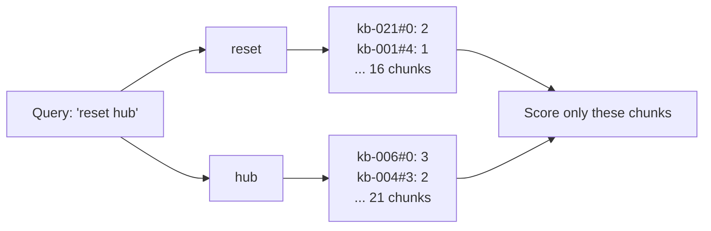
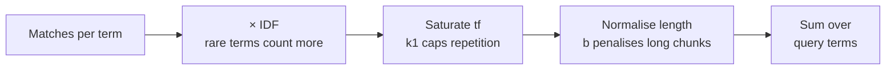
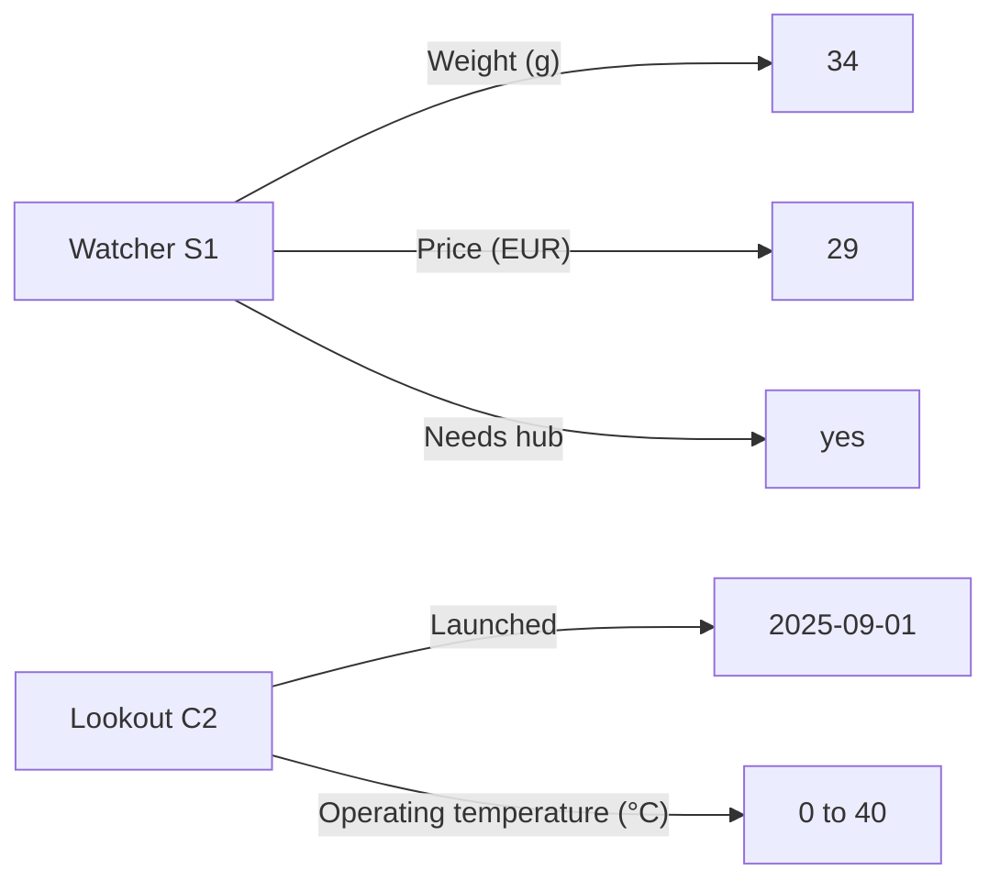
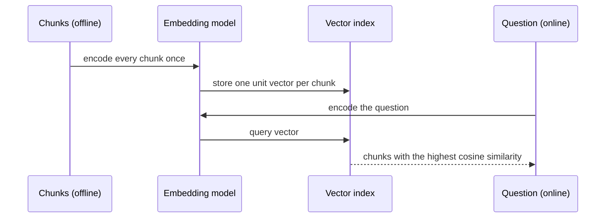
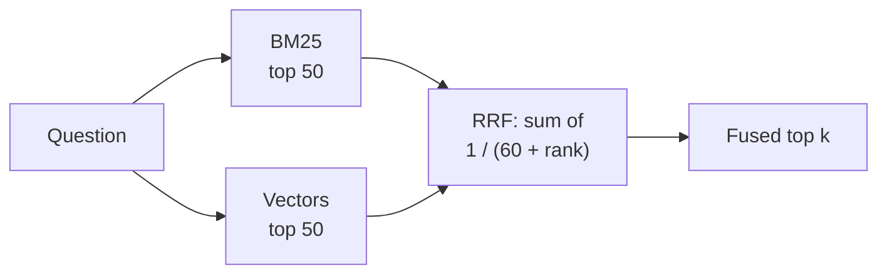

🌐 English · [Español](03-indexing-and-embeddings.es.md)

# Lesson 5.3 — Indexing: keywords, knowledge and vectors

> **Module 05 · Lesson 3 of 4** · ⏱️ about 70 min · 🧪 Lab: [step 3](lab/README.md#step-3--build-the-indexes)

## 📨 Situation

> **From:** Alex Moreau · Customer Support Operations Lead
> **Channel:** #support-ai
>
> I tried your search with questions from this week's tickets. Product weights work now, nice. But
> customers don't talk like our help centre. They ask what something "costs" when the page says
> "price". A customer in Mexico asked, in English, who pays customs, and the only answer we have is
> on a Spanish page that says "aduanas". And the team keeps asking for simple facts, like which device
> is newest, that are sitting in a table. Can search understand what people mean, not just the words
> they type? And what will that cost us in size and speed? Sam will ask.

## 🎯 Objectives

By the end of this lesson you can:

- Build an inverted index and explain how it answers a keyword query without reading every chunk.
- Derive the BM25 (Best Matching 25) formula from three intuitions and compute one term's contribution by hand.
- Store product facts as triples and explain when an exact lookup beats text search, and when it
  answers the wrong question.
- Explain how a bi-encoder embedding model turns text into vectors, and show with numbers why the
  lab's offline hashing embedder cannot match synonyms or languages.
- Fuse two rankings with reciprocal rank fusion (RRF) and explain why a hybrid can lose to one of its inputs.

## 🤔 Predict first

Write your answers down before reading on. You will check them in the self-check.

1. The word "the" appears in 75 of the 111 heading-level chunks. How much should a match on "the"
   count?
2. Will a vector search with the lab's hashing embedder treat "cost" and "price" as similar?
3. True or false: combining keyword and vector search is always at least as good as the better of the
   two on its own.

## 1. Keyword search and the inverted index

The oldest way to search text is to look for the query's words. Reading every chunk for every
question works for 128 chunks and fails for millions. An **inverted index** flips the problem: build,
once, a map from every word (a **term**) to the list of chunks that contain it and how often. That list
is the term's **postings**. A query then touches only the postings of its own terms.

**Analogy:** the index at the back of a cookbook. To find recipes with saffron you do not read the
book; you look up "saffron" and get page numbers. The cookbook index is built once, when the book is
printed.



```python
from collections import Counter, defaultdict

from m05_retrieval.text import tokenize


def build_postings(texts: list[str]) -> dict[str, dict[int, int]]:
    """term -> {chunk position: term frequency}: the core of InvertedIndex.build."""
    postings: dict[str, dict[int, int]] = defaultdict(dict)
    for pos, text in enumerate(texts):
        for term, tf in Counter(tokenize(text)).items():
            postings[term][pos] = tf
    return dict(postings)


postings = build_postings(["reset the hub", "the hub connects devices", "reset the bulb"])
print(postings["hub"], postings["reset"])  # {0: 1, 1: 1} {0: 1, 2: 1}
```

On the 128 table-aware chunks, the index holds 950 distinct terms and 3,361 postings (one per term and
chunk pair). At 8 bytes per posting plus the terms themselves, that is about 32,064 bytes. A **boolean
query** ("chunks that contain *reset* AND *hub*") is the intersection of two postings lists. Try it on
the help centre: "reset" is in 16 chunks, "hub" in 21, and the intersection is empty. The Hearth Hub's
reset steps sit in a section titled "Hearth Hub" of a page titled "Factory reset for every device", so
no single chunk holds both words. Boolean search cannot rank and cannot bend: either a chunk matches
every word or it does not. Full-text search adds a score.

> ⚠️ **Common mistake:** tokenising documents and queries differently, for example lower-casing one
> and not the other. The index then never matches. In the lab, one `tokenize` function serves both
> sides; change it in one place or not at all.

## 2. BM25: a ranking formula you can derive

**BM25** (Best Matching 25, from a numbered series of ranking functions) is the standard full-text
scoring function. You can rebuild it from three intuitions, using the Watcher S1 question from lesson 5.2 on
the 111 heading-level chunks (average length 34.4 words).

**Intuition 1, rare words matter more.** Counting matching words lets "the" dominate. Weight each term
by its **inverse document frequency** (IDF): the fewer chunks contain it, the more a match means.

```text
IDF(t) = ln(1 + (N - df + 0.5) / (df + 0.5))      N = chunks, df = chunks containing t
"the":      df = 75 of 111  ->  IDF = 0.39
"watcher":  df = 4 of 111   ->  IDF = 3.21
```

**Intuition 2, repetition saturates.** A chunk that says "Watcher" five times is more about the Watcher
than one that says it once, but not five times more. BM25 replaces the raw count `tf` with
`tf × (k1 + 1) / (tf + k1)`. With `k1 = 1.5`, one occurrence scores 1.0, two score 1.43, ten score 2.17,
and no number of repetitions ever passes 2.5.

**Intuition 3, long chunks are diluted.** One mention in 17 words says more than one mention in 153.
BM25 scales `k1` by the chunk's length relative to the average, controlled by `b` (0 = ignore length,
1 = full correction; the usual value is 0.75):

```text
score(q, d) = sum over query terms t of
              IDF(t) × tf × (k1 + 1) / (tf + k1 × (1 - b + b × len(d) / avg_len))
```

Now the arithmetic behind lesson 5.2's table failure. "Watcher" appears once in both the comparison
table chunk (`kb-007#0`, 153 words) and the Watcher S1 reset section (`kb-021#4`, 17 words). Its
contribution is 1.26 in the long table chunk and 4.16 in the short reset chunk: the length factor alone
divides the score by more than three. The word "weigh" is in no chunk at all (the table says "Weight"),
so it adds nothing anywhere. The table chunk ends up 12th, outside the top 5.

**Analogy:** judging how much a newspaper article is about a town. A town name that appears in every
article (the city the paper is from) tells you little: that is IDF. An article that names the town ten
times is about it, but not ten times more than one naming it three times: saturation. And one mention in
a two-line notice beats one mention in a twelve-page supplement: length normalisation.



You can check the arithmetic with the lab's own index:

```python
from m05_retrieval.bm25 import idf
from m05_retrieval.retrieval import Config, build_pipeline

bm = build_pipeline(Config("bm25", "heading")).retriever.bm25
watcher_idf = idf(bm.index.n_docs, len(bm.index.postings["watcher"]))
print(round(watcher_idf, 2))                         # 3.21
print(round(bm.term_score(1, 153, watcher_idf), 2))  # 1.26: one mention in 153 words
print(round(bm.term_score(1, 17, watcher_idf), 2))   # 4.16: one mention in 17 words
```

`term_score` is three lines in `bm25.py`; open it and match each factor to an intuition above.

BM25 is strong on the Hearthwise help centre because customers and the help centre mostly share
vocabulary: product names, "reset", "warranty". Its blind spots are words that never match: "weigh"
versus "weight", "cost" versus "price", "Mexico" versus "México". IDF can also surprise you the other
way: "how" appears in only 7 of the 111 chunks, so its IDF is 2.70, and "How do I factory reset the
Ember T3?" returns two account FAQ (frequently asked questions) entries that start with "How do I"
before any reset instructions. Rare is not the same as important.

> 💡 **Production tip:** BM25 has no training, no model download and costs microseconds per query. Keep
> it in every retrieval stack as a baseline and as one half of a hybrid, and measure anything fancier
> against it.

## 3. A knowledge-based index: facts as triples

Some questions are not about passages at all: "How much does the Watcher S1 weigh?" has one answer, a
number in a table cell. A **knowledge-based index** stores facts as **triples** (subject, predicate,
object), each with a pointer to the document it came from: `(Watcher S1, Weight (g), 34)` from `kb-007`.
A set of triples is a small **knowledge graph**: products are nodes, and predicates are labelled edges
to their values.

The lab extracts triples with rules from two kinds of tables: the wide comparison table (row = product,
column = predicate) and each product page's two-column `Spec | Value` table. That gives 90 triples about
6 products. A question is matched by finding a product name and a hint word ("weigh" maps to "weight",
"cost" to "price", "newest" to "launched").

**Analogy:** a spreadsheet next to a library. For "how heavy is it?" you look up one cell, not a book.
But the spreadsheet only answers questions someone thought to make a column for.



```python
from m05_retrieval.chunking import prepare_corpus
from m05_retrieval.knowledge import KnowledgeIndex, extract_triples
from m05_retrieval.parsing import load_kb

docs, _ = prepare_corpus(load_kb())
kg = KnowledgeIndex(extract_triples(docs))
for question in ("How much does the Watcher S1 weigh?",
                 "Which Hearthwise device was launched most recently?",
                 "What is the price of the Lookout C2 in Mexico?"):
    print(question, "->", [(t.subject, t.predicate, t.object, t.doc_id) for t in kg.lookup(question)])
```

The first two answers are exact and cited: 34 grams from `kb-007`, and the Lookout C2, launched on
2025-09-01. A "most recent" question is a comparison across rows, which text search handles badly and a
fact table handles trivially. The third answer is the trap: the help centre never states a price in
Mexico (q037 is unanswerable), but the lookup happily returns €89, the price in euros. The index matched
"Lookout C2" and "price" and ignored "in Mexico", a qualifier it does not model. Exact lookups are
precise about what they know and blind to what they do not.

> ⚠️ **Common mistake:** returning a knowledge-graph fact as the answer without checking that every
> part of the question was understood. Route to the graph only when the question's entities and
> constraints all map to the schema; otherwise fall back to text search and let the generator refuse.

## 4. Embeddings and the vector index

To match meaning rather than spelling, map text to a **vector**: a list of numbers, so that texts with
similar meaning get nearby vectors. An **embedding model** does the mapping. Retrieval uses a
**bi-encoder**: the same model encodes each chunk once, offline, and each question once, online, and
the score is the **cosine similarity** between the two vectors (their dot product after scaling both to
length 1). Because chunks are encoded independently of the question, their vectors can be computed in
advance and stored: that table of vectors is the **vector index**.

**Analogy:** map coordinates. Two cafés with different names can still be on the same street. An
embedding gives every chunk an address in a "meaning space", and search becomes "what is nearest to
this address?"



Learned bi-encoders such as [Sentence-BERT](https://arxiv.org/abs/1908.10084) and dense passage
retrieval ([DPR](https://arxiv.org/abs/2004.04906)) are trained on pairs of related texts, which is how
they learn that "cost" and "price" belong together. The lab cannot download a model, so `providers.py` ships an
offline stand-in: the **hashing embedder**. It splits text into words and character trigrams ("weigh"
gives `#we`, `wei`, `eig`, `igh`, `gh#`), hashes each feature into one of 256 slots with a pseudo-random sign,
and scales the result to length 1. It is deterministic and free, and it shows exactly what an embedding
without learning can and cannot do:

| Pair | Cosine (hashing) | Why |
|---|---|---|
| "weigh" / "weight" | 0.62 | Shared character trigrams |
| "Mexico" / "México" | 0.43 | Shared trigrams; the accented ones differ |
| "price" / "cost" | 0.00 | No shared letter patterns; meaning is invisible |
| "return window" / "plazo de devolución" | -0.11 | Different language, nothing shared |

```python
from m05_retrieval.vectors import HashingEmbedder, VectorIndex

texts = ["Price: €29", "How much does it cost?", "Weight (g): 34"]
index = VectorIndex(texts, HashingEmbedder())  # one unit vector per text: a (3, 256) matrix
for position, cosine in index.search("how much does it weigh", k=2):
    print(texts[position], round(cosine, 2))
# How much does it cost? 0.78
# Weight (g): 34 0.23
```

The question is about weight, yet the hashing embedder prefers the sentence that shares the words "how
much does it". Inside, `VectorIndex.scores` is a single matrix product: the unit matrix of chunk vectors
times the unit query vector gives the cosine with every chunk at once.

On the evaluation set, hashing vectors over table-row chunks reach recall@1 of 0.722, better than BM25's
0.667: trigrams rescue near-misses in spelling. But recall@5 falls to 0.861 (BM25: 0.944), and both the
`table` and `cross_lingual` categories score 0.00. With a real multilingual embedding model, the Spanish
shipping page should sit close to an English customs question; you can try that with
`--embedder provider` and Ollama (see the lab README), but it was not run for this lesson, so there is no
number to quote.

For Sam, the size side: each vector is 256 float32 numbers, 1,024 bytes, so the 128 chunks take
131,072 bytes, about four times the inverted index. Real embedding models use hundreds to a few
thousand dimensions, and size grows linearly with both dimensions and chunks.

> 💡 **Production tip:** store the embedding model's name and version with the index, and never mix
> vectors from two models in one index. A query vector from model B compared with chunk vectors from
> model A returns confident nonsense, and nothing crashes.

## 5. Hybrid search with reciprocal rank fusion

Keyword and vector search fail differently, so running both and merging the results is a natural idea.
Their scores cannot be added: BM25 scores have no fixed range (lesson 5.1 showed 20.474 and 6.756),
while cosines lie between -1 and 1. **Reciprocal rank fusion (RRF)** ignores scores and uses ranks
only: each list gives every item `1 / (k + rank)`, with `k = 60` by convention, and items are sorted by
the sum. An item ranked first in
one list gets 1/61; an item ranked tenth in both lists gets 2/70, which is more. RRF rewards agreement.

**Analogy:** two restaurant guides. A place both guides list in their top ten is a safer bet than a
place one guide loves and the other has never heard of. Usually.



The whole algorithm is a few lines; item 1 wins below because both lists rank it near the top:

```python
from collections import defaultdict


def rrf_fuse(rankings: list[list[int]], k: int = 60) -> list[tuple[int, float]]:
    fused: dict[int, float] = defaultdict(float)
    first_seen: dict[int, int] = {}
    for ranking in rankings:
        for rank, item in enumerate(ranking, start=1):
            fused[item] += 1.0 / (k + rank)
            first_seen.setdefault(item, len(first_seen))
    return sorted(fused.items(), key=lambda kv: (-kv[1], first_seen[kv[0]]))


print([(item, round(score, 4)) for item, score in rrf_fuse([[1, 2, 3], [3, 1, 4]])])
# [(1, 0.0325), (3, 0.0323), (2, 0.0161), (4, 0.0159)]
```

"Usually" is doing a lot of work. Take q022, "Who pays customs fees for orders shipped to Mexico?", with
**accent folding** switched on (a tokenizer option that turns "México" into "mexico"). BM25 now ranks the
Spanish shipping chunk `kb-031#0` second. The hashing vectors rank it 98th, beyond the 50 candidates
fusion reads. So the chunk earns 1/62 = 0.0161 from BM25 alone, while chunks that both retrievers
place in a mediocre middle collect more, and `kb-031#0` falls to 31st. The hybrid finds no cross-lingual
answers at all (0.00). Without folding, the lineup's hybrid scores recall@5 of 0.917 against BM25's
0.944. Fusion is only as good as the agreement between its inputs; a weak retriever votes, too.

Accent folding on its own tells the other half of the story: BM25 with folding reaches recall@5 of
0.972 and fixes both cross-lingual questions. That is a lucky patch, not a solution: the bridge is one
proper noun that both languages share. "Who pays import duties?", with no country name, returns nothing
at all: none of its words appear anywhere in the help centre.

> ⚠️ **Common mistake:** concluding "hybrid is better" from a blog post and shipping it untested. Hybrid
> helps when both retrievers are good in different ways. Test it on your own questions, per category,
> exactly as you test a chunker.

## 🧪 Try it

Run these from `modules/05-rag-retrieval/lab`.

1. Build both indexes and read their sizes. The timing lines vary by machine.

   ```bash
   uv run lab index
   ```

   ```text
   chunks:              128
   chunk text:          22,048 bytes
   vocabulary:          950 terms
   postings:            3,361 (term, chunk) pairs
   inverted index:      ~32,064 bytes (8 bytes per posting + the terms)
   vector matrix:       131,072 bytes (128 x 256 float32)

   build time (example, varies by machine): bm25 1.1 ms, vector 12.4 ms
   query time (example, varies by machine): bm25 0.04 ms, vector 0.08 ms
   ```

2. Look a fact up in the knowledge graph.

   ```bash
   uv run lab kg "How much does the Watcher S1 weigh?"
   ```

   ```text
   90 triples about 6 products
   (Watcher S1, Weight (g), 34)  source: kb-007
   ```

   Then try `uv run lab kg "What is the price of the Lookout C2 in Mexico?"` and explain the answer.

3. Watch accent folding find the Spanish page.

   ```bash
   uv run lab search "Who pays customs fees for orders shipped to Mexico?" --fold
   ```

   ```text
   config: bm25/table/fold  (128 chunks)
   1. kb-013#1  score=6.493  Spain and Portugal - Standard delivery takes 2 to 4 business days and costs €4.95. - Stand
   2. kb-031#0  score=4.867  Envíos a Latinoamérica Enviamos a México, Colombia y Chile con una tarifa plana de **€14.9
   3. kb-031#1  score=4.468  Plazos de entrega País Plazo México 7 a 10 días hábiles Colombia 8 a 12 días hábiles Chile
   4. kb-026#3  score=4.069  Where can I download an invoice? In the app under Account > Orders. Tap the order and choo
   5. kb-011#2  score=3.762  How to start a return 1. Open the Hearthwise app and go to Account > Orders. 2. Choose the
   query time: 0.11 ms (example, varies by machine)
   ```

4. Now add `--retriever hybrid` to the same command and watch `kb-031` leave the top 5.

## 🏭 In the real world

- **Hybrid is common, but tuned.** Teams fuse BM25 with a learned embedding model, measure per
  category, and sometimes weight the lists differently instead of using plain RRF.
- **Search engines do the keyword side.** Inverted indexes with BM25 are built into full-text engines and
  many databases; few teams write their own, but knowing the formula explains their behaviour.
- **Text normalisation is product work.** Accent folding, stemming ("weigh" and "weight") and synonym
  lists are cheap and effective, and each one can also create false matches. They are tested like code.
- **Knowledge graphs answer structured questions.** Product catalogues, prices and compatibility tables
  are often served from a database or graph, with text retrieval as the fallback.
- **Embedding upgrades are migrations.** Changing the model means re-embedding every chunk and
  re-running the evaluation; teams keep the old index serving until the new one wins.

## ✅ Self-check

**1. (Revisits predict-first 1.) "The" appears in 75 of 111 chunks. How much does it count in BM25?**

<details><summary>Answer</summary>

Very little: its IDF is 0.39, against 3.21 for "watcher" (in 4 chunks). BM25 does not need a stop-word
list to ignore common words; IDF does it, smoothly. Words in nearly every chunk contribute almost
nothing.

</details>

**2. (Revisits predict-first 2.) Does the hashing embedder treat "cost" and "price" as similar?**

<details><summary>Answer</summary>

No: their cosine is 0.00. The hashing embedder only sees shared words and character trigrams, so it
helps with spelling variants ("weigh" / "weight", 0.62) but knows nothing about meaning or language.
That is the gap a learned embedding model fills.

</details>

**3. (Revisits predict-first 3.) Is hybrid search always at least as good as the better retriever?**

<details><summary>Answer</summary>

False. On the Hearthwise set, hybrid recall@5 (0.917) is below BM25's (0.944), and with accent folding
the hybrid pushes the Spanish chunk from 2nd (BM25) to 31st, because RRF rewards agreement and the
hashing vectors disagree. Fusion helps when both inputs are good in different ways.

</details>

**4. Compute the saturation factor `tf × (k1 + 1) / (tf + k1)` for tf = 2 with k1 = 1.5, ignoring length.**

<details><summary>Answer</summary>

2 × 2.5 / 3.5 = 1.43. Two mentions count 43% more than one, not twice as much. As tf grows, the factor
approaches k1 + 1 = 2.5.

</details>

**5. The knowledge graph answers "What is the price of the Lookout C2 in Mexico?" with €89. What went
wrong, and how would you guard against it?**

<details><summary>Answer</summary>

The lookup matched the product and the predicate and ignored "in Mexico", which the schema cannot
express. The help centre has no Mexico price, so the correct behaviour is to say so. Guard: route to the
graph only when every entity and constraint in the question maps to the schema; otherwise use text
retrieval and let the generator refuse.

</details>

## 💬 Explain it in your own words

1. Alex asked whether search can "understand what people mean". Explain the difference between BM25 and
   embeddings in three sentences, using "cost" and "price" as your example.
2. Sam asks why the vector index is bigger than the keyword index for the same chunks. Answer with the
   lab's numbers.

## 🔑 Key ideas

- An inverted index maps each term to its postings, so a query reads only the lists of its own terms.
- BM25 = IDF (rare terms matter) × saturated term frequency (repetition has limits) × length
  normalisation (long chunks are diluted).
- Triples give exact, cited answers to structured questions, and wrong answers to questions with
  constraints the schema cannot express.
- A bi-encoder embeds chunks offline and questions online; cosine similarity ranks chunks by meaning.
- The offline hashing embedder matches spelling, not meaning or language: a stand-in, not a model.
- RRF fuses rankings by rank; it rewards agreement, so a weak retriever can drag a good hit down.

## 📚 Go deeper

- ⭐ [Sentence-BERT: sentence embeddings using siamese BERT networks](https://arxiv.org/abs/1908.10084) —
  the bi-encoder idea, clearly explained, with the reason it is fast enough for search.
- [Dense passage retrieval for open-domain question answering](https://arxiv.org/abs/2004.04906) — a
  learned retriever compared head-to-head with BM25.
- [ColBERT: efficient and effective passage search](https://arxiv.org/abs/2004.12832) — a middle ground
  between bi-encoders and full cross-attention, useful context for lesson 5.4's reranking.
- [Sentence Transformers documentation](https://www.sbert.net) — practical guides to embedding models,
  including multilingual ones you can run locally.

---

[← Previous: 5.2 Parsing and chunking](02-parsing-and-chunking.md) · [🏠 Module 05](README.md) · [Next: 5.4 Exact and approximate search →](04-exact-and-approximate-search.md)
