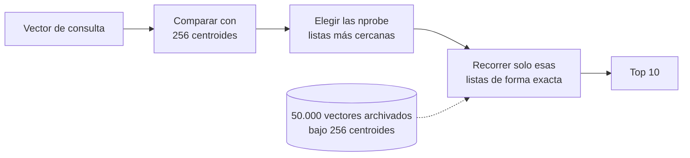
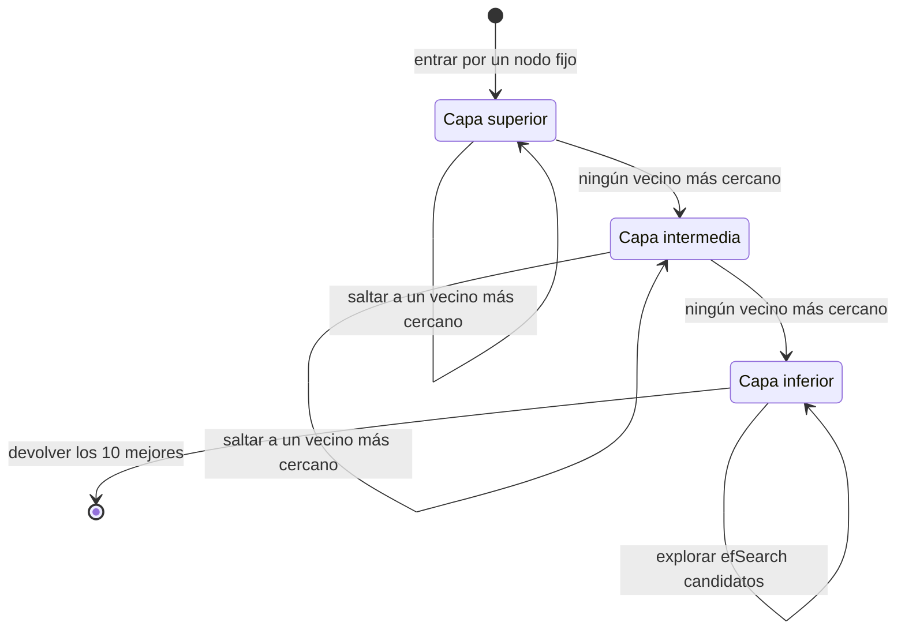
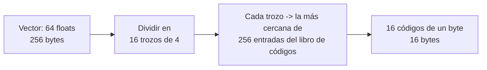
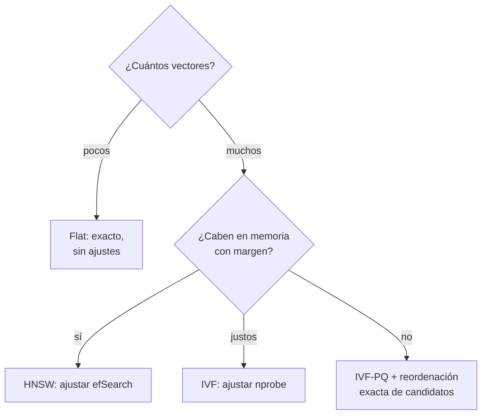
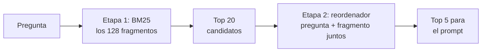

🌐 [English](04-exact-and-approximate-search.md) · Español

# Lección 5.4 — Búsqueda exacta y aproximada

> **Módulo 05 · Lección 4 de 4** · ⏱️ unos 60 min · 🧪 Lab: [paso 7](lab/README.es.md#paso-7--búsqueda-exacta-frente-a-aproximada)

## 📨 Situación

> **De:** Sam Adeyemi · Ingeniería de fiabilidad (SRE, *Site Reliability Engineering*)
> **Canal:** #support-ai
>
> Primero, los números. Tu índice: 128 fragmentos, 131.072 bytes de vectores, búsqueda exacta sobre
> todos ellos. Adorable. Jordan quiere meter ahí manuales, tickets y publicaciones de la comunidad el
> año que viene, y la presentación del proveedor que me han mandado dice "necesitas búsqueda
> aproximada" en cada diapositiva, cada vez con una fuente tipográfica distinta. Antes de aprobar nada:
> con cincuenta mil vectores, ¿cuánto *recall* perdemos con la búsqueda aproximada, cuánto cuesta cada
> índice en memoria y cuánto trabajo hace una consulta? No necesito adjetivos y no necesito una factura
> de tarjetas gráficas. Necesito una tabla.

## 🎯 Objetivos

Al terminar esta lección puedes:

- Implementar con numpy la búsqueda exacta de los k vecinos más cercanos y expresar su coste por
  consulta.
- Explicar cómo los índices de archivo invertido (IVF, *inverted file index*), los grafos jerárquicos
  navegables de mundo pequeño (HNSW, *hierarchical navigable small world*) y la cuantización de
  producto (PQ, *product quantisation*) intercambian *recall* por velocidad o memoria, y ajustar
  `nprobe` y `efSearch`.
- Construir índices `IndexFlatIP`, `IndexIVFFlat`, `IndexHNSWFlat` e `IndexIVFPQ` de FAISS (*Facebook AI Similarity Search*) y medir
  su *recall@10* frente a la búsqueda exacta.
- Elegir un índice para un tamaño, un presupuesto de memoria y un objetivo de *recall* dados, y
  defender la elección con mediciones.
- Añadir una etapa de reordenación (*reranking*) y medir qué cambia.

## 🤔 Predice primero

Apunta tus respuestas antes de seguir leyendo. Las comprobarás en la autoevaluación.

1. Un índice aproximado compara una consulta con unos 1.800 de 50.000 vectores. ¿Qué proporción de los
   10 vecinos más cercanos reales esperas que devuelva, más o menos: un tercio, dos tercios o casi todos?
2. ¿Qué índice necesita más memoria que los propios vectores en bruto: uno que los agrupa en clústeres
   o uno que los enlaza en un grafo?
3. Hearthwise tiene hoy 128 fragmentos. ¿Debería usar búsqueda aproximada?

## 1. La búsqueda exacta, y cuándo basta

La **búsqueda de los k vecinos más cercanos** (k-NN, *k-nearest-neighbour*) devuelve los k vectores
guardados más parecidos a un vector de consulta. La forma exacta es la fuerza bruta: calcular la
similitud con cada vector y quedarse con los k mejores. Con vectores unitarios, la similitud del coseno
es un producto escalar, así que "cada vector" es un solo producto de matrices. El coste por consulta es
el número de vectores por su dimensión, y crece linealmente a medida que crece la colección.

**Analogía:** encontrar los diez libros más parecidos al que tienes en la mano comparándolo con cada
libro de la biblioteca. Perfectamente preciso, y suficiente para una estantería. Para una biblioteca
nacional, quieres un plan más inteligente.

```python
import numpy as np


def exact_knn(base: np.ndarray, queries: np.ndarray, k: int = 10) -> np.ndarray:
    """Brute force: score every vector with a dot product, keep the k best (cosine on unit vectors)."""
    scores = queries @ base.T  # (n_queries, n)
    top = np.argpartition(-scores, k, axis=1)[:, :k]  # k best, unordered
    rows = np.arange(len(queries))[:, None]
    order = np.argsort(-scores[rows, top], axis=1, kind="stable")
    return top[rows, order]
```

`argpartition` encuentra los k mejores en tiempo lineal sin ordenar las n puntuaciones; solo se ordenan
esos k.

Para la pregunta de Sam, el lab genera una colección más grande: 50.000 vectores unitarios de 64
dimensiones, agrupados alrededor de 200 centros aleatorios (los *embeddings* reales también se agrupan
por tema), más 200 consultas de la misma mezcla. Todo lleva semilla, así que cada ejecución produce los
mismos vectores. La búsqueda exacta compara cada consulta con los 50.000 vectores, y los vectores
ocupan 12.80 MB (50.000 × 64 × 4 bytes). Ese resultado exacto es la referencia de verdad (*ground
truth*): el ***recall@10*** de un método aproximado es la proporción de los 10 vecinos más cercanos
reales que devuelve.

Con 128 fragmentos (*chunks*), nada de esto importa. La búsqueda exacta sobre el centro de ayuda es un
único producto de matrices pequeño, y el comando `index` del lab lo cronometra en una fracción de
milisegundo (ejemplo, varía según la máquina). La búsqueda aproximada empieza a compensar cuando la
colección es lo bastante grande como para que recorrerla entera se salga del presupuesto de latencia.

> 💡 **Consejo de producción:** empieza con búsqueda exacta y un cronómetro. Pasa a un índice
> aproximado solo cuando la latencia o el coste medidos con tu tamaño real lo exijan, y conserva el
> índice exacto como referencia de verdad para medir el *recall*.

## 2. IVF: buscar solo en los clústeres más cercanos

Un **índice de archivo invertido (IVF)** toma prestada la idea del índice invertido de la lección 5.3.
Fuera de línea, ejecuta el agrupamiento **k-means** para encontrar `nlist` centroides y archiva cada
vector bajo su centroide más cercano, construyendo una lista por centroide. En línea, compara la
consulta con los centroides, elige los `nprobe` más cercanos y recorre solo sus listas. Si los vecinos
reales viven en una lista que no exploró, se pierden: ahí es donde se va el *recall*.

**Analogía:** una biblioteca organizada por temas. Para encontrar libros como el tuyo, vas a la
estantería más cercana (nprobe = 1) o a las ocho estanterías más cercanas (nprobe = 8). Recorrer más
estanterías encuentra más libros adecuados y lleva más tiempo.



```python
import faiss

from m05_retrieval.ann import exact_knn, make_vectors, recall_at_k

faiss.omp_set_num_threads(1)  # same results on every run
base, queries = make_vectors()  # 50,000 x 64 unit vectors and 200 queries, seeded
truth = exact_knn(base, queries, k=10)

quantizer = faiss.IndexFlatIP(64)  # inner product = cosine on unit vectors
ivf = faiss.IndexIVFFlat(quantizer, 64, 256, faiss.METRIC_INNER_PRODUCT)
ivf.cp.seed = 0
ivf.train(base)  # k-means: 256 centroids
ivf.add(base)  # each vector goes into its nearest centroid's list
for nprobe in (1, 8, 32):
    ivf.nprobe = nprobe
    _, ids = ivf.search(queries, 10)
    print(nprobe, recall_at_k(ids, truth))  # 0.741, 0.917, 0.977
```

Las mediciones, contando como trabajo las 256 comparaciones con los centroides:

| nprobe | Recall@10 | Similitudes calculadas por consulta | Memoria |
|---|---|---|---|
| 1 | 0.741 | 474 | 13.27 MB |
| 8 | 0.917 | 1.814 | 13.27 MB |
| 32 | 0.977 | 6.504 | 13.27 MB |

Con nprobe = 8, cada consulta hace unas 28 veces menos trabajo que la búsqueda exacta y aun así devuelve
0.917 de los vecinos reales. La memoria son los vectores en bruto más los ids y los centroides. El lab
también contiene un IVF corto en numpy (`NumpyIVF` en `ann.py`), y llega al mismo sitio: 0.750 con
nprobe = 1 y 0.917 con nprobe = 8. FAISS no es magia; es la misma idea, escrita en C++ optimizado.

> ⚠️ **Error común:** entrenar los centroides de IVF con una muestra pequeña o poco representativa y
> después añadir millones de vectores distintos. Las listas quedan muy desequilibradas, algunas
> exploraciones recorren listas enormes y el *recall* cae en los temas que la muestra no cubría.
> Entrena con una muestra que se parezca a los datos que vas a añadir.

## 3. HNSW: recorrer un grafo hacia la respuesta

Los grafos **jerárquicos navegables de mundo pequeño (HNSW)** toman otro camino
([el artículo de HNSW](https://arxiv.org/abs/1603.09320)). Cada vector se convierte en un nodo enlazado
con hasta `M` vecinos cercanos. Algunos nodos se copian también en capas superiores más dispersas, con
enlaces de largo alcance. Una búsqueda entra por la capa superior, se mueve de forma voraz al vecino que
esté más cerca de la consulta, baja una capa cuando ya no puede mejorar y, en la capa inferior, explora
una lista de candidatos de tamaño `efSearch`. Un
`efSearch` mayor significa una búsqueda más amplia, más lenta y más precisa.

**Analogía:** pedir indicaciones en una ciudad. Primero tomas la autopista hasta el distrito correcto
(capa superior), luego las avenidas hasta el barrio correcto y después recorres las calles a pie
mirando portales (capa inferior). Mirar más portales (un `efSearch` mayor) hace menos probable que se te
pase el correcto.



```python
hnsw = faiss.IndexHNSWFlat(64, 32, faiss.METRIC_INNER_PRODUCT)  # M = 32 links per node
hnsw.hnsw.efConstruction = 64
hnsw.add(base)  # no training step: the graph is built while adding
for ef in (16, 64, 128):
    hnsw.hnsw.efSearch = ef
    _, ids = hnsw.search(queries, 10)
    print(ef, recall_at_k(ids, truth))  # 0.819, 0.951, 0.981
```

| efSearch | Recall@10 | Similitudes calculadas por consulta | Memoria |
|---|---|---|---|
| 16 | 0.819 | 649 | 26.41 MB |
| 64 | 0.951 | 1.681 | 26.41 MB |
| 128 | 0.981 | 3.055 | 26.41 MB |

Con un trabajo por consulta parecido, aquí HNSW alcanza más *recall* que IVF (0.951 con 1.681
similitudes, frente a 0.917 con 1.814 de IVF). La factura llega en memoria: los enlaces del grafo
ocupan más o menos lo mismo que los propios vectores, así que el índice ocupa 26.41 MB, unas 2.1 veces
los vectores en bruto. HNSW también es más lento de construir que IVF y más difícil de actualizar
mediante borrados. Esos son los compromisos que omite la diapositiva del proveedor.

> 💡 **Consejo de producción:** `efSearch` es un parámetro del momento de la consulta, así que puedes
> subirlo sin reconstruir el índice. Ajústalo frente a tu objetivo de *recall* con un conjunto de
> consultas reservado y después vigila la latencia de cola, no solo la media.

## 4. Cuantización de producto: hacer más pequeño cada vector

IVF y HNSW ahorran *tiempo*. La **cuantización de producto (PQ)** ahorra *memoria*. Divide cada vector
de 64 dimensiones en `m = 16` subvectores de 4 dimensiones, aprende 256 valores típicos (un libro de
códigos, *codebook*) para cada posición de subvector y guarda cada subvector como el id de un byte de su
entrada más cercana del libro de códigos. Un vector que ocupaba 256 bytes ahora ocupa 16. Las distancias
se calculan de forma aproximada a partir de los códigos, con pequeñas tablas de consulta.

**Analogía:** describir un color de pintura por el número de la muestra más cercana de un abanico de
256 muestras en lugar de por su mezcla exacta. Dieciséis números de muestra describen una habitación lo
bastante bien para encontrar habitaciones parecidas, pero dos tonos cercanos pueden recibir el mismo
número.



```python
pq = faiss.IndexIVFPQ(faiss.IndexFlatIP(64), 64, 256, 16, 8, faiss.METRIC_INNER_PRODUCT)
pq.cp.seed = 0
pq.train(base)  # learns the IVF centroids and 16 codebooks of 256 entries
pq.add(base)  # stores 16 one-byte codes per vector
pq.nprobe = 8
_, ids = pq.search(queries, 10)
print(recall_at_k(ids, truth), faiss.serialize_index(pq).nbytes)  # 0.593 1333300
```

El índice IVF + PQ ocupa 1.33 MB, unas 10 veces menos que los vectores en bruto, y el *recall@10* baja
a 0.593. El error de compresión es el precio. En la práctica, PQ se combina con una segunda etapa:
recuperar un conjunto amplio de candidatos con los códigos comprimidos y después volver a puntuarlo con
los vectores exactos (guardados en disco o en un nivel de almacenamiento más barato). Eso es reordenar,
el tema de la sección 5.

Juntando todo el *benchmark* se obtiene la tabla de Sam, y una forma de elegir:

| Índice | Ideal para | Recall@10 aquí | Memoria aquí |
|---|---|---|---|
| Flat (exacto) | Colecciones pequeñas; la referencia de verdad para todo lo demás | 1.000 | 12.80 MB |
| IVF-Flat | Colecciones grandes, memoria moderada, fácil de reconstruir | de 0.741 a 0.977 según `nprobe` | 13.27 MB |
| HNSW | *Recall* alto con baja latencia cuando hay memoria disponible | de 0.819 a 0.981 según `efSearch` | 26.41 MB |
| IVF-PQ | Colecciones muy grandes que tienen que caber en memoria | 0.593 con `nprobe` = 8 | 1.33 MB |



Todos estos son métodos de **vecino más cercano aproximado** (ANN, *approximate nearest neighbour*), y
[FAISS](https://github.com/facebookresearch/faiss) (una biblioteca de código abierto para búsqueda por
similitud, del equipo de investigación de Meta) los implementa todos; su [artículo de diseño](https://arxiv.org/abs/2401.08281) explica a fondo los compromisos. Dos advertencias sobre
este *benchmark*: los vectores son sintéticos y solo tienen 64 dimensiones, y los tiempos de la salida
del lab son ejemplos que varían según la máquina. La lección es el orden de los métodos, no los
decimales.

> ⚠️ **Error común:** usar un índice L2 (euclídeo) con vectores pensados para la similitud del coseno,
> u olvidarse de normalizar. Normaliza cada vector a longitud 1 y usa el producto interno
> (`METRIC_INNER_PRODUCT`), y las dos medidas ordenarán los vecinos de forma idéntica.

## 5. Reordenación: una segunda mirada, más lenta

Todos los recuperadores (*retrievers*) vistos hasta ahora están pensados para ser lo bastante baratos
como para puntuar cada fragmento: BM25 lee apariciones precalculadas y un bicodificador (*bi-encoder*)
compara vectores precalculados. La **reordenación** añade una segunda etapa: toma los primeros candidatos (el lab usa 20) y los reordena con un
puntuador más caro que mira la pregunta y un fragmento juntos. En producción, ese puntuador suele ser
un **codificador cruzado** (*cross-encoder*): un modelo que lee la pregunta y el fragmento en una sola
entrada y devuelve una puntuación de relevancia. Es demasiado lento para ejecutarlo sobre todos los
fragmentos y asequible sobre veinte. (Un punto intermedio, la interacción tardía, se describe en el
[artículo de ColBERT](https://arxiv.org/abs/2004.12832).)

El lab no puede descargar un codificador cruzado, así que `rerank.py` usa un sustituto determinista: la
proporción de palabras con contenido de la pregunta que aparecen en el fragmento, comparando las cinco
primeras letras, para que "weigh" coincida con
"Weight".

**Analogía:** una oferta de empleo. La persona de selección revisa por encima un montón grande de
candidaturas buscando palabras clave (primera etapa). La persona responsable de la contratación lee con
calma las veinte mejores (segunda etapa). Nadie lee con calma el montón entero.



```python
from m05_retrieval.rerank import coverage_score
from m05_retrieval.retrieval import Config, build_pipeline

question = "How much does the Watcher S1 weigh?"
print(coverage_score(question, "Watcher S1 | Weight (g): 34"))  # 0.75: watcher, s1, weigh(t) of 4 terms

pipe = build_pipeline(Config("bm25", "table", rerank=True))
top = pipe.retriever.search(question, k=1)[0]
print(top.chunk.chunk_id, top.score)  # kb-007#4 0.75
```

En la pregunta del Watcher S1, BM25 por sí solo sitúa cuarto el fragmento de fila de tabla `kb-007#4`;
tras la reordenación queda primero. En todo el conjunto de evaluación:

| Configuración | Recall@1 | Recall@5 | MRR |
|---|---|---|---|
| BM25, fragmentos por filas de tabla | 0.667 | 0.944 | 0.786 |
| + reordenador léxico | 0.833 | 0.972 | 0.898 |
| + normalización de acentos + reordenador | 0.833 | 1.000 | 0.905 |

La última fila encuentra un documento relevante en el top 5 para todas las preguntas con respuesta.
Dani preguntaría cómo hemos llegado ahí, y la respuesta honesta importa: estas configuraciones se
construyeron después de mirar las mismas 36 preguntas con las que se puntúan. La regla del prefijo de
cinco letras del reordenador y la normalización de acentos apuntan a fallos que ya habíamos visto. Una
puntuación perfecta en el conjunto con el que ajustaste es un motivo para escribir preguntas nuevas, no
para celebrarlo.

> 💡 **Consejo de producción:** dale al reordenador un presupuesto fijo de candidatos y mide su latencia
> por separado. La primera etapa decide el *recall* (un fragmento que no encuentra nunca podrá entrar al
> reordenar); la segunda decide el orden. Ajústalas como dos sistemas.

## 🧪 Pruébalo

Ejecuta estos comandos desde `modules/05-rag-retrieval/lab`.

1. Ejecuta el *benchmark*. Tarda unos segundos; la última columna varía según la máquina.

   ```bash
   uv run lab ann
   ```

   ```text
   50,000 vectors x 64 dims, 200 queries, recall@10 against exact search

   method               params                    recall@10  compared memory MB ms/query*
   numpy exact          -                             1.000    50,000     12.80     0.472
   numpy IVF            nlist=256 nprobe=1            0.750       484     13.27     0.035
   numpy IVF            nlist=256 nprobe=8            0.917     1,825     13.27     0.179
   faiss IndexFlatIP    -                             1.000    50,000     12.80     0.233
   faiss IndexIVFFlat   nlist=256 nprobe=1            0.741       474     13.27     0.004
   faiss IndexIVFFlat   nlist=256 nprobe=8            0.917     1,814     13.27     0.025
   faiss IndexIVFFlat   nlist=256 nprobe=32           0.977     6,504     13.27     0.048
   faiss IndexHNSWFlat  M=32 efSearch=16              0.819       649     26.41     0.015
   faiss IndexHNSWFlat  M=32 efSearch=64              0.951     1,681     26.41     0.053
   faiss IndexHNSWFlat  M=32 efSearch=128             0.981     3,055     26.41     0.112
   faiss IndexIVFPQ     nlist=256 m=16 nprobe=8       0.593     1,814      1.33     0.017

   * example timings, vary by machine. compared = similarities computed per query
   ```

2. Compara el reordenador en una pregunta.

   ```bash
   uv run lab search "How much does the Watcher S1 weigh?" --rerank
   ```

   ```text
   config: bm25/table/rerank  (128 chunks)
   1. kb-007#4  score=0.750  Compare Hearthwise devices | Watcher S1 | Price (EUR): 29; Wi-Fi: none (HomeMesh radio); S
   2. kb-004#0  score=0.500  Watcher S1 motion sensor The Watcher S1 is a small battery-powered motion sensor. It trigg
   3. kb-021#4  score=0.500  Watcher S1 Insert a paper clip into the pinhole for 5 seconds until the LED flashes blue.
   4. kb-004#3  score=0.500  Setting it up 1. Make sure your Hearth Hub is online. 2. Pull the battery tab out of the W
   5. kb-003#0  score=0.250  Spark Mini smart plug The Spark Mini is a compact smart plug. Plug any appliance into it t
   query time: 0.35 ms (example, varies by machine)
   ```

3. Evalúa la comparativa completa con `uv run lab eval` y busca las filas con reordenación. Después
   prueba una colección más pequeña con `uv run lab ann --n 20000 --no-faiss` y observa cómo cambia el
   *recall* del IVF en numpy.

## 🏭 En el mundo real

- **El *recall* se vigila, no se da por supuesto.** Los equipos pasan periódicamente una muestra de
  consultas de producción tanto por el índice ANN como por la búsqueda exacta, y lanzan una alerta
  cuando el *recall@k* se desvía, por ejemplo después de muchas inserciones.
- **Los parámetros del índice son planificación de capacidad.** `nlist`, `M` y el tamaño del código PQ
  deciden la memoria por vector, que decide cuántas máquinas necesitas. En SRE los dimensionan como
  cualquier otra caché.
- **Los filtros y la búsqueda ANN interactúan.** Filtrar por metadatos (estado, público, idioma)
  después de una búsqueda ANN puede dejar menos de k resultados; las bases de datos vectoriales ofrecen
  modos de búsqueda filtrada, y tú los pruebas con tus filtros.
- **Las reconstrucciones se programan.** Los centroides de IVF y los libros de códigos de PQ se quedan
  obsoletos a medida que cambian los datos; los equipos los vuelven a entrenar con muestras recientes y
  cambian de índice detrás de una opción de configuración (*flag*).
- **Los reordenadores tienen su propio presupuesto de latencia.** Un codificador cruzado sobre el
  conjunto de candidatos suele ser la parte más cara de la recuperación; tiene su propio límite de
  tiempo y una alternativa que conserva el orden de la primera etapa.

## ✅ Autoevaluación

**1. (Retoma la predicción 1.) Comparando unos 1.800 de 50.000 vectores, ¿qué *recall* alcanzó IVF?**

<details><summary>Respuesta</summary>

0.917 con nprobe = 8 (1.814 similitudes por consulta), unas 28 veces menos trabajo que la búsqueda
exacta. La mayoría de las predicciones pecan de pesimistas: como los vectores parecidos se agrupan,
recorrer los pocos clústeres más cercanos encuentra la mayoría de los vecinos reales. La parte que falta
son los vecinos que quedan justo al otro lado del límite de un clúster.

</details>

**2. (Retoma la predicción 2.) ¿Qué índice necesita más memoria que los vectores en bruto, y cuánto
más?**

<details><summary>Respuesta</summary>

HNSW: 26.41 MB frente a 12.80 MB de los vectores en bruto, unas 2.1 veces, porque cada nodo guarda hasta
2 × M enlaces en su capa inferior. IVF solo añade ids y 256 centroides (13.27 MB). PQ va en sentido
contrario y baja hasta 1.33 MB.

</details>

**3. (Retoma la predicción 3.) ¿Debería Hearthwise usar búsqueda aproximada para 128 fragmentos?**

<details><summary>Respuesta</summary>

No. La búsqueda exacta sobre 128 vectores es un producto de matrices diminuto con *recall* perfecto; un
índice aproximado añade ajustes, reconstrucciones y una pérdida de *recall* sin ninguna ganancia
medible. Vuelve a planteártelo cuando la colección crezca hasta un tamaño en el que la latencia o la
memoria medidas lo exijan, y conserva la búsqueda exacta como referencia de verdad.

</details>

**4. El *recall@10* de IVF con nprobe = 1 es 0.741. Nombra dos formas de subirlo y el coste de cada
una.**

<details><summary>Respuesta</summary>

Subir `nprobe` (se recorren más listas: 0.977 con 32, con unas 3.6 veces el trabajo de nprobe = 8), o
pasar a HNSW y ajustar `efSearch` (0.981 con 128, con más o menos el doble de memoria). Una tercera
opción, más centroides con un `nprobe` mayor, cambia tanto el tiempo de construcción como el trabajo
por consulta; mídela.

</details>

**5. La configuración con reordenación y normalización de acentos alcanza un *recall@5* de 1.000. ¿Por
qué Dani todavía no debería fiarse de ese número?**

<details><summary>Respuesta</summary>

Porque se eligió después de mirar los fallos de las mismas 36 preguntas: la regla del prefijo del
reordenador y la normalización apuntan exactamente a esos fallos. Eso es ajustar sobre el conjunto de
test. La solución son preguntas nuevas (idealmente de tickets reales) que nadie haya mirado mientras
construía el flujo.

</details>

## 💬 Explícalo con tus palabras

1. Sam pidió una tabla, no adjetivos. Escribe el resumen de tres filas que le enviarías (plano, IVF,
   HNSW), con una recomendación para hoy y un detonante para cambiarla.
2. Explica a Alex, sin las palabras "vector" ni "*embedding*", por qué un reordenador de segunda etapa
   puede arreglar una respuesta que la primera etapa situó en cuarto lugar.

## 🔑 Ideas clave

- El k-NN exacto es un producto de matrices: *recall* perfecto y un coste lineal en el tamaño de la
  colección.
- IVF recorre solo los clústeres más cercanos; `nprobe` intercambia trabajo por *recall*.
- HNSW recorre un grafo por capas; `efSearch` intercambia trabajo por *recall*, y el grafo cuesta
  memoria.
- PQ comprime cada vector a unos pocos bytes; combínalo con una reordenación exacta de los candidatos.
- Mide el *recall@k* frente a la búsqueda exacta con tus propios datos antes de elegir; con el tamaño de
  Hearthwise, gana la búsqueda exacta.
- La reordenación reordena un conjunto pequeño de candidatos con un puntuador más fuerte; la primera
  etapa sigue poniendo el techo al *recall*.

## 📚 Profundiza

- ⭐ [The Faiss library](https://arxiv.org/abs/2401.08281) — el espacio de diseño de la búsqueda
  vectorial (IVF, grafos, cuantización) explicado por quienes construyeron FAISS.
- [Efficient and robust approximate nearest neighbor search using HNSW graphs](https://arxiv.org/abs/1603.09320)
  — el artículo de HNSW, con figuras claras del grafo por capas.
- [FAISS en GitHub](https://github.com/facebookresearch/faiss) — las páginas de la wiki sobre cómo
  elegir un índice son un complemento práctico de esta lección.
- [ColBERT: efficient and effective passage search](https://arxiv.org/abs/2004.12832) — la interacción
  tardía, entre los bicodificadores y los codificadores cruzados.

---

[← Anterior: 5.3 Indexación: palabras clave, conocimiento y vectores](03-indexing-and-embeddings.es.md) · [🏠 Módulo 05](README.es.md) · [Siguiente: Lab 05 →](lab/README.es.md)
