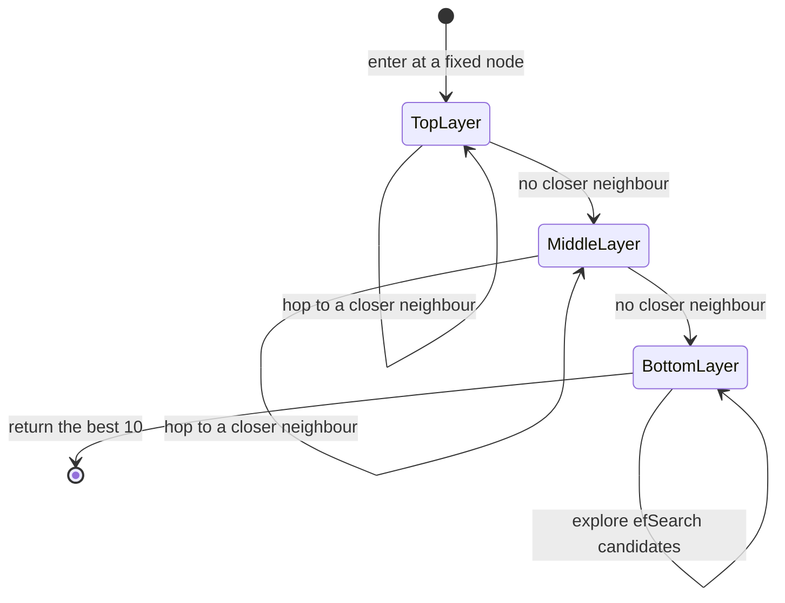
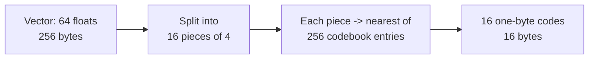
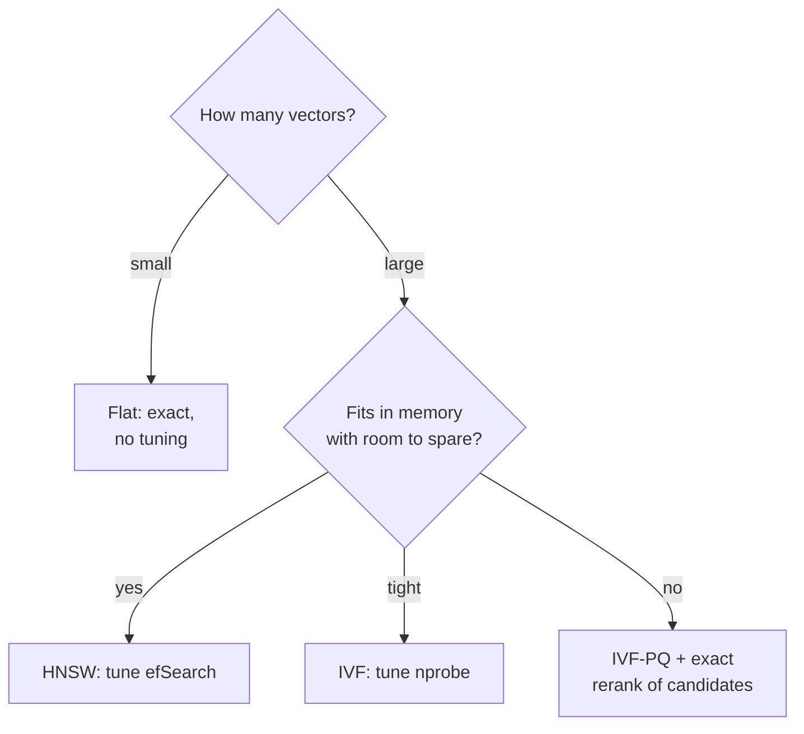
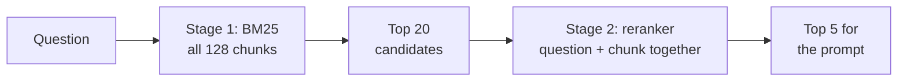

🌐 English · [Español](04-exact-and-approximate-search.es.md)

# Lesson 5.4 — Exact and approximate search

> **Module 05 · Lesson 4 of 4** · ⏱️ about 60 min · 🧪 Lab: [step 7](lab/README.md#step-7--exact-vs-approximate-search)

## 📨 Situation

> **From:** Sam Adeyemi · Site Reliability Engineer (SRE)
> **Channel:** #support-ai
>
> Numbers first. Your index: 128 chunks, 131,072 bytes of vectors, exact search over all of them.
> Adorable. Jordan wants manuals, tickets and community posts in there next year, and the vendor deck
> I was sent says "you need approximate search" on every slide, in a different font each time. Before
> I approve anything: at fifty thousand vectors, how much recall do we lose with approximate search,
> what does each index cost in memory, and how much work does a query do? I do not need adjectives
> and I do not need a bill for graphics cards. I need a table.

## 🎯 Objectives

By the end of this lesson you can:

- Implement exact k-nearest-neighbour search with numpy and state its cost per query.
- Explain how inverted file indexes (IVF), hierarchical navigable small world graphs (HNSW) and
  product quantisation (PQ) trade recall for speed or memory, and tune `nprobe` and `efSearch`.
- Build FAISS (Facebook AI Similarity Search) `IndexFlatIP`, `IndexIVFFlat`, `IndexHNSWFlat` and `IndexIVFPQ` indexes and measure
  recall@10 against exact search.
- Choose an index for a given size, memory budget and recall target, and defend the choice with
  measurements.
- Add a reranking stage and measure what it changes.

## 🤔 Predict first

Write your answers down before reading on. You will check them in the self-check.

1. An approximate index compares a query with about 1,800 of 50,000 vectors. Roughly what share of the
   true 10 nearest neighbours do you expect it to return: a third, two thirds, or nearly all?
2. Which index needs more memory than the raw vectors themselves: one that clusters them, or one that
   links them into a graph?
3. Hearthwise has 128 chunks today. Should it use approximate search?

## 1. Exact search, and when it is enough

**k-nearest-neighbour (k-NN) search** returns the k stored vectors most similar to a query vector. The
exact way is brute force: compute the similarity with every vector, keep the best k. With unit vectors,
cosine similarity is a dot product, so "every vector" is one matrix product. The cost per query is the
number of vectors times their dimension, and it grows linearly as the collection grows.

**Analogy:** finding the ten books most like the one in your hand by comparing it with every book in
the library. Perfectly accurate, and fine for a bookshelf. For a national library, you want a smarter
plan.

```python
import numpy as np


def exact_knn(base: np.ndarray, queries: np.ndarray, k: int = 10) -> np.ndarray:
    """Brute force: score every vector with a dot product, keep the k best (cosine on unit vectors)."""
    scores = queries @ base.T  # (n_queries, n)
    top = np.argpartition(-scores, k, axis=1)[:, :k]  # k best, unordered
    rows = np.arange(len(queries))[:, None]
    order = np.argsort(-scores[rows, top], axis=1, kind="stable")
    return top[rows, order]
```

`argpartition` finds the k best in linear time without sorting all n scores; only those k are sorted.

For Sam's question, the lab generates a larger collection: 50,000 unit vectors of 64 dimensions,
clustered around 200 random centres (real embeddings cluster by topic too), plus 200 queries from the
same mixture. Everything is seeded, so every run produces the same vectors. Exact search compares each
query with all 50,000 vectors, and the vectors take 12.80 MB (50,000 × 64 × 4 bytes). That exact result
is the ground truth: **recall@10** of an approximate method is the share of the true 10 nearest
neighbours it returns.

At 128 chunks, none of this matters. Exact search over the help centre is a single small matrix product,
and the lab's `index` command times it at a fraction of a millisecond (example, varies by machine).
Approximate search starts paying for itself when the collection is large enough that scanning
everything misses the latency budget.

> 💡 **Production tip:** start with exact search and a stopwatch. Move to an approximate index only
> when measured latency or cost at your real size demands it, and keep the exact index around as the
> ground truth for measuring recall.

## 2. IVF: search only the nearest clusters

An **inverted file index (IVF)** borrows the idea of lesson 5.3's inverted index. Offline, it runs
**k-means** clustering to find `nlist` centroids and files every vector under its nearest centroid,
building one list per centroid. Online, it compares the query with the centroids, picks the `nprobe`
closest ones, and scans only their lists. If the true neighbours live in a list it did not probe, they
are missed: that is where recall goes.

**Analogy:** a library organised by subject. To find books like yours, you walk to the closest shelf
(nprobe = 1), or to the eight closest shelves (nprobe = 8). Walking to more shelves finds more of the
right books and takes longer.

```mermaid
flowchart LR
    Q["Query vector"] --> C["Compare with<br/>256 centroids"]
    C --> P["Pick the nprobe<br/>closest lists"]
    P --> S["Scan only those<br/>lists exactly"]
    S --> K["Top 10"]
    B[("50,000 vectors filed<br/>under 256 centroids")] -.-> S
```



```python
import faiss

from m05_retrieval.ann import exact_knn, make_vectors, recall_at_k

faiss.omp_set_num_threads(1)  # same results on every run
base, queries = make_vectors()  # 50,000 x 64 unit vectors and 200 queries, seeded
truth = exact_knn(base, queries, k=10)

quantizer = faiss.IndexFlatIP(64)  # inner product = cosine on unit vectors
ivf = faiss.IndexIVFFlat(quantizer, 64, 256, faiss.METRIC_INNER_PRODUCT)
ivf.cp.seed = 0
ivf.train(base)  # k-means: 256 centroids
ivf.add(base)  # each vector goes into its nearest centroid's list
for nprobe in (1, 8, 32):
    ivf.nprobe = nprobe
    _, ids = ivf.search(queries, 10)
    print(nprobe, recall_at_k(ids, truth))  # 0.741, 0.917, 0.977
```

The measurements, counting the 256 centroid comparisons as work:

| nprobe | Recall@10 | Similarities computed per query | Memory |
|---|---|---|---|
| 1 | 0.741 | 474 | 13.27 MB |
| 8 | 0.917 | 1,814 | 13.27 MB |
| 32 | 0.977 | 6,504 | 13.27 MB |

With nprobe = 8, each query does about 28 times less work than exact search and still returns 0.917 of
the true neighbours. Memory is the raw vectors plus ids and centroids. The lab also contains a short
numpy IVF (`NumpyIVF` in `ann.py`), and it lands in the same place: 0.750 at nprobe = 1 and 0.917 at
nprobe = 8. FAISS is not magic; it is the same idea, written in optimised C++.

> ⚠️ **Common mistake:** training IVF centroids on a small or unrepresentative sample, then adding
> millions of different vectors. Lists become wildly unbalanced, some probes scan huge lists, and recall
> drops for the topics the sample missed. Train on a sample that looks like the data you will add.

## 3. HNSW: walk a graph towards the answer

**Hierarchical navigable small world (HNSW)** graphs take a different route
([the HNSW paper](https://arxiv.org/abs/1603.09320)). Every vector becomes a node linked to up to `M`
near neighbours. A few nodes are also copied into sparser upper layers with long-range links. A search
enters at the top layer, greedily moves to whichever neighbour is closer to the query, drops a layer
when it cannot improve, and at the bottom layer explores a candidate list of size `efSearch`. Larger
`efSearch` means a wider, slower, more accurate search.

**Analogy:** asking for directions in a city. First you take the motorway to the right district (top
layer), then main roads to the right neighbourhood, then you walk the streets checking doors (bottom
layer). Checking more doors (higher `efSearch`) makes it less likely you miss the right one.



```python
hnsw = faiss.IndexHNSWFlat(64, 32, faiss.METRIC_INNER_PRODUCT)  # M = 32 links per node
hnsw.hnsw.efConstruction = 64
hnsw.add(base)  # no training step: the graph is built while adding
for ef in (16, 64, 128):
    hnsw.hnsw.efSearch = ef
    _, ids = hnsw.search(queries, 10)
    print(ef, recall_at_k(ids, truth))  # 0.819, 0.951, 0.981
```

| efSearch | Recall@10 | Similarities computed per query | Memory |
|---|---|---|---|
| 16 | 0.819 | 649 | 26.41 MB |
| 64 | 0.951 | 1,681 | 26.41 MB |
| 128 | 0.981 | 3,055 | 26.41 MB |

At similar work per query, HNSW reaches higher recall than IVF here (0.951 with 1,681 similarities,
against IVF's 0.917 with 1,814). The bill arrives in memory: the graph's links take about as much space
as the vectors themselves, so the index is 26.41 MB, about 2.1 times the raw vectors. HNSW is also
slower to build than IVF and harder to update by deletion. Those are the trade-offs a vendor slide
leaves out.

> 💡 **Production tip:** `efSearch` is a query-time knob, so you can raise it without rebuilding the
> index. Tune it against your recall target on a held-out query set, then watch tail latency, not just
> the average.

## 4. Product quantisation: make every vector smaller

IVF and HNSW save *time*. **Product quantisation (PQ)** saves *memory*. It splits each 64-dimension
vector into `m = 16` sub-vectors of 4 dimensions, learns 256 typical values (a codebook) for each
sub-vector position, and stores each sub-vector as the one-byte id of its closest codebook entry. A
vector that took 256 bytes now takes 16. Distances are computed approximately from the codes, using
small lookup tables.

**Analogy:** describing a paint colour by the nearest swatch number in a 256-swatch fan instead of its
exact mix. Sixteen swatch numbers describe a room well enough to find similar rooms, but two close
shades can get the same number.



```python
pq = faiss.IndexIVFPQ(faiss.IndexFlatIP(64), 64, 256, 16, 8, faiss.METRIC_INNER_PRODUCT)
pq.cp.seed = 0
pq.train(base)  # learns the IVF centroids and 16 codebooks of 256 entries
pq.add(base)  # stores 16 one-byte codes per vector
pq.nprobe = 8
_, ids = pq.search(queries, 10)
print(recall_at_k(ids, truth), faiss.serialize_index(pq).nbytes)  # 0.593 1333300
```

The IVF + PQ index takes 1.33 MB, about 10 times less than the raw vectors, and recall@10 drops to
0.593. The compression error is the price. In practice PQ is paired with a second stage: retrieve a
generous candidate set with the compressed codes, then re-score it with the exact vectors (kept on disk
or in a cheaper tier). That is reranking, the subject of section 5.

Putting the whole benchmark together gives Sam's table, and a way to choose:

| Index | Best for | Recall@10 here | Memory here |
|---|---|---|---|
| Flat (exact) | Small collections; the ground truth for everything else | 1.000 | 12.80 MB |
| IVF-Flat | Large collections, moderate memory, easy to rebuild | 0.741 to 0.977 by `nprobe` | 13.27 MB |
| HNSW | High recall at low latency when memory is available | 0.819 to 0.981 by `efSearch` | 26.41 MB |
| IVF-PQ | Very large collections that must fit in memory | 0.593 at `nprobe` = 8 | 1.33 MB |



All of these are **approximate nearest-neighbour (ANN)** methods, and
[FAISS](https://github.com/facebookresearch/faiss) (an open-source similarity-search library from Meta's
research team) implements every one of them; its [design paper](https://arxiv.org/abs/2401.08281) explains the trade-offs in depth. Two cautions about
this benchmark: the vectors are synthetic and only 64-dimensional, and the timings in the lab's output
are examples that vary by machine. The ranking of methods is the lesson, not the decimals.

> ⚠️ **Common mistake:** using an L2 (Euclidean) index with vectors that were meant for cosine
> similarity, or forgetting to normalise. Normalise every vector to length 1 and use inner product
> (`METRIC_INNER_PRODUCT`), and the two measures rank neighbours identically.

## 5. Reranking: a second, slower look

Every retriever so far is built to be cheap enough to score every chunk: BM25 reads precomputed
postings and a bi-encoder compares precomputed vectors. **Reranking** adds a second stage: take the top candidates (the lab uses 20) and reorder them with a
more expensive scorer that looks at the question and one chunk together. In production that scorer is
usually a **cross-encoder**: a model that reads the question and the chunk in one input and outputs a
relevance score. It is too slow to run on every chunk and affordable on twenty. (A middle ground,
late interaction, is described in the [ColBERT paper](https://arxiv.org/abs/2004.12832).)

The lab cannot download a cross-encoder, so `rerank.py` uses a deterministic stand-in: the share of the
question's content words found in the chunk, matching on the first five letters, so that "weigh" meets
"Weight".

**Analogy:** a job opening. A recruiter skims a big pile of applications for keywords (first stage).
The hiring manager reads the top twenty properly (second stage). Nobody reads the whole pile properly.



```python
from m05_retrieval.rerank import coverage_score
from m05_retrieval.retrieval import Config, build_pipeline

question = "How much does the Watcher S1 weigh?"
print(coverage_score(question, "Watcher S1 | Weight (g): 34"))  # 0.75: watcher, s1, weigh(t) of 4 terms

pipe = build_pipeline(Config("bm25", "table", rerank=True))
top = pipe.retriever.search(question, k=1)[0]
print(top.chunk.chunk_id, top.score)  # kb-007#4 0.75
```

On the Watcher S1 question, BM25 alone places the table-row chunk `kb-007#4` fourth; after reranking it
is first. On the full evaluation set:

| Configuration | Recall@1 | Recall@5 | MRR |
|---|---|---|---|
| BM25, table-row chunks | 0.667 | 0.944 | 0.786 |
| + lexical reranker | 0.833 | 0.972 | 0.898 |
| + accent folding + reranker | 0.833 | 1.000 | 0.905 |

The last row finds a relevant document in the top 5 for every answerable question. Dani would ask how
we got there, and the honest answer matters: these configurations were built after looking at the same
36 questions they are scored on. The reranker's five-letter prefix rule and the accent folding both
target failures we had already seen. A perfect score on the set you tuned on is a reason to write new
questions, not a reason to celebrate.

> 💡 **Production tip:** give the reranker a fixed candidate budget and measure its latency separately.
> The first stage decides recall (a chunk it misses can never be reranked in); the second decides
> order. Tune them as two systems.

## 🧪 Try it

Run these from `modules/05-rag-retrieval/lab`.

1. Run the benchmark. It takes a few seconds; the last column varies by machine.

   ```bash
   uv run lab ann
   ```

   ```text
   50,000 vectors x 64 dims, 200 queries, recall@10 against exact search

   method               params                    recall@10  compared memory MB ms/query*
   numpy exact          -                             1.000    50,000     12.80     0.472
   numpy IVF            nlist=256 nprobe=1            0.750       484     13.27     0.035
   numpy IVF            nlist=256 nprobe=8            0.917     1,825     13.27     0.179
   faiss IndexFlatIP    -                             1.000    50,000     12.80     0.233
   faiss IndexIVFFlat   nlist=256 nprobe=1            0.741       474     13.27     0.004
   faiss IndexIVFFlat   nlist=256 nprobe=8            0.917     1,814     13.27     0.025
   faiss IndexIVFFlat   nlist=256 nprobe=32           0.977     6,504     13.27     0.048
   faiss IndexHNSWFlat  M=32 efSearch=16              0.819       649     26.41     0.015
   faiss IndexHNSWFlat  M=32 efSearch=64              0.951     1,681     26.41     0.053
   faiss IndexHNSWFlat  M=32 efSearch=128             0.981     3,055     26.41     0.112
   faiss IndexIVFPQ     nlist=256 m=16 nprobe=8       0.593     1,814      1.33     0.017

   * example timings, vary by machine. compared = similarities computed per query
   ```

2. Compare the reranker on one question.

   ```bash
   uv run lab search "How much does the Watcher S1 weigh?" --rerank
   ```

   ```text
   config: bm25/table/rerank  (128 chunks)
   1. kb-007#4  score=0.750  Compare Hearthwise devices | Watcher S1 | Price (EUR): 29; Wi-Fi: none (HomeMesh radio); S
   2. kb-004#0  score=0.500  Watcher S1 motion sensor The Watcher S1 is a small battery-powered motion sensor. It trigg
   3. kb-021#4  score=0.500  Watcher S1 Insert a paper clip into the pinhole for 5 seconds until the LED flashes blue.
   4. kb-004#3  score=0.500  Setting it up 1. Make sure your Hearth Hub is online. 2. Pull the battery tab out of the W
   5. kb-003#0  score=0.250  Spark Mini smart plug The Spark Mini is a compact smart plug. Plug any appliance into it t
   query time: 0.35 ms (example, varies by machine)
   ```

3. Evaluate the whole lineup with `uv run lab eval` and find the reranked rows. Then try a smaller
   collection with `uv run lab ann --n 20000 --no-faiss` and see how the numpy IVF's recall changes.

## 🏭 In the real world

- **Recall is monitored, not assumed.** Teams periodically run a sample of production queries through
  both the ANN index and exact search and alert when recall@k drifts, for example after many inserts.
- **Index parameters are capacity planning.** `nlist`, `M` and PQ code size decide memory per vector,
  which decides how many machines you need. SREs size them like any other cache.
- **Filters and ANN interact.** Filtering by metadata (status, audience, language) after an ANN search
  can leave fewer than k results; vector databases offer filtered search modes, and you test them on
  your filters.
- **Rebuilds are scheduled.** IVF centroids and PQ codebooks go stale as the data drifts; teams retrain
  them on fresh samples and swap indexes behind a flag.
- **Rerankers have their own latency budget.** A cross-encoder over the candidate set is often the most
  expensive part of retrieval; it gets its own timeout and a fallback to first-stage order.

## ✅ Self-check

**1. (Revisits predict-first 1.) With about 1,800 of 50,000 vectors compared, what recall did IVF reach?**

<details><summary>Answer</summary>

0.917 at nprobe = 8 (1,814 similarities per query), roughly 28 times less work than exact search. Most
guesses are too pessimistic: because similar vectors cluster together, scanning the few closest clusters
finds most true neighbours. The missing share is the neighbours that sit just across a cluster boundary.

</details>

**2. (Revisits predict-first 2.) Which index needs more memory than the raw vectors, and by how much?**

<details><summary>Answer</summary>

HNSW: 26.41 MB against 12.80 MB for the raw vectors, about 2.1 times, because every node stores up to
2 × M links on its bottom layer. IVF adds only ids and 256 centroids (13.27 MB). PQ goes the other way,
down to 1.33 MB.

</details>

**3. (Revisits predict-first 3.) Should Hearthwise use approximate search for 128 chunks?**

<details><summary>Answer</summary>

No. Exact search over 128 vectors is one tiny matrix product with perfect recall; an approximate index
adds tuning, rebuilds and a recall loss for no measurable gain. Revisit when the collection grows to a
size where measured latency or memory demands it, and keep exact search as the ground truth.

</details>

**4. Recall@10 with IVF at nprobe = 1 is 0.741. Name two ways to raise it and the cost of each.**

<details><summary>Answer</summary>

Raise `nprobe` (more lists scanned: 0.977 at 32, with about 3.6 times the work of nprobe = 8), or switch
to HNSW and tune `efSearch` (0.981 at 128, with about double the memory). A third option, more centroids
with a higher `nprobe`, changes both build time and work per query; measure it.

</details>

**5. The reranked configuration with accent folding reaches recall@5 of 1.000. Why should Dani not trust
that number yet?**

<details><summary>Answer</summary>

Because it was chosen after looking at the failures of the same 36 questions: the reranker's prefix rule
and the folding target exactly those misses. That is tuning on the test set. The fix is new questions
(ideally from real tickets) that nobody looked at while building the pipeline.

</details>

## 💬 Explain it in your own words

1. Sam asked for a table, not adjectives. Write the three-row summary you would send them (flat, IVF,
   HNSW), with one recommendation for today and one trigger for changing it.
2. Explain to Alex, without the words "vector" or "embedding", why a second-stage reranker can fix an
   answer that the first stage ranked fourth.

## 🔑 Key ideas

- Exact k-NN is one matrix product: perfect recall, cost linear in the collection size.
- IVF scans only the closest clusters; `nprobe` trades work for recall.
- HNSW walks a layered graph; `efSearch` trades work for recall, and the graph costs memory.
- PQ compresses each vector to a few bytes; pair it with an exact rerank of candidates.
- Measure recall@k against exact search on your own data before choosing; at Hearthwise's size, exact
  wins.
- Reranking reorders a small candidate set with a stronger scorer; the first stage still caps recall.

## 📚 Go deeper

- ⭐ [The Faiss library](https://arxiv.org/abs/2401.08281) — the design space of vector search (IVF,
  graphs, quantisation) explained by the people who built FAISS.
- [Efficient and robust approximate nearest neighbor search using HNSW graphs](https://arxiv.org/abs/1603.09320)
  — the HNSW paper, with clear figures of the layered graph.
- [FAISS on GitHub](https://github.com/facebookresearch/faiss) — the wiki pages on choosing an index are
  a practical companion to this lesson.
- [ColBERT: efficient and effective passage search](https://arxiv.org/abs/2004.12832) — late interaction,
  between bi-encoders and cross-encoders.

---

[← Previous: 5.3 Indexing: keywords, knowledge and vectors](03-indexing-and-embeddings.md) · [🏠 Module 05](README.md) · [Next: Lab 05 →](lab/README.md)
