🌐 [English](README.md) · Español

# Módulo 05 — RAG I: recuperación

> Convierte un centro de ayuda desordenado en un sistema de recuperación medido: analízalo, fíltralo,
> fragméntalo, indéxalo de tres maneras y elige entre búsqueda exacta y aproximada con números en lugar
> de eslóganes.

## 🗺️ Mapa del curso

```mermaid
flowchart LR
    subgraph P1["Parte 1 · Fundamentos"]
        M01["01 · Cómo se construyen los LLM"] --> M02["02 · Del modelo base al asistente"] --> M03["03 · Playground de LLM"]
    end
    subgraph P2["Parte 2 · Adaptación y RAG"]
        M04["04 · Prompting y fine-tuning"] --> M05["05 · RAG I: recuperación"] --> M06["06 · RAG II: bot de soporte"]
    end
    subgraph P3["Parte 3 · Agentes"]
        M07["07 · Workflows y herramientas"] --> M08["08 · Agente Ask-the-Web"]
    end
    subgraph P4["Parte 4 · Razonamiento"]
        M09["09 · Modelos de razonamiento"] --> M10["10 · Deep research y local"]
    end
    M03 --> M04
    M06 --> M07
    M08 --> M09
    M10 --> CAP["🎓 Proyecto final"]
    classDef current fill:#ffb300,stroke:#e65100,stroke-width:3px,color:#000
    class M05 current
```



## 📖 La historia

Gracias al enrutador del módulo 04, los tickets ya llegan a la cola correcta, y Alex se ha dado cuenta
de que muchos preguntan cosas que el centro de ayuda ya responde. Hearthwise quiere un chatbot de
soporte que responda a partir de sus propios artículos y los cite. Este módulo construye la mitad que
decide todo lo demás: qué llega a leer el chatbot.

El centro de ayuda parece sencillo y no lo es. Contiene una política de devoluciones sustituida que
sigue saliendo primera al buscar "return window" (plazo de devolución), un manual interno con un código
de vale, la misma FAQ dos veces, una página de envíos que solo existe en español y los pesos de los
productos escondidos en una tabla HTML. Dani quiere que cada decisión de diseño se mida con las
preguntas de evaluación compartidas, por categoría. Sam quiere saber cuánto ocupa el índice, lo rápido
que responde y si la búsqueda aproximada con FAISS merece la pena. Al terminar tendrás respuestas para
Dani y para Sam, y un recuperador que el módulo 06 convierte en un chatbot fundamentado.

## 🎯 Objetivos de aprendizaje

Al terminar este módulo puedes:

- Explicar por qué un bot de conocimiento necesita recuperación, y dibujar sus flujos de indexación
  fuera de línea y de consulta en línea.
- Analizar Markdown y HTML para convertirlos en documentos estructurados, filtrarlos por metadatos y
  eliminar casi duplicados.
- Implementar y comparar la fragmentación de tamaño fijo, recursiva, por encabezados, semántica y por
  filas de tabla.
- Construir y explicar un índice invertido con BM25, un índice de conocimiento hecho de tripletas y un
  índice vectorial.
- Fusionar rankings con la fusión por rango recíproco y añadir una etapa de reordenación.
- Medir la recuperación con *recall@k*, MRR y resultados por categoría, y reconocer un número demasiado
  bueno.
- Comparar en FAISS la búsqueda exacta con IVF, HNSW y la cuantización de producto, y elegir un índice.

## 🗂️ Lecciones

| # | Lección | Tiempo | Qué aprenderás |
|---|---|---|---|
| 5.1 | [Por qué la generación aumentada por recuperación](01-rag-overview.es.md) | 45 min | Por qué RAG, los dos flujos, cómo falla RAG, RAG frente a *fine-tuning* frente a contexto largo |
| 5.2 | [Análisis y fragmentación del centro de ayuda](02-parsing-and-chunking.es.md) | 60 min | Análisis basado en reglas y basado en IA, filtros de metadatos, duplicados, cinco fragmentadores y cómo evaluarlos |
| 5.3 | [Indexación: palabras clave, conocimiento y vectores](03-indexing-and-embeddings.es.md) | 70 min | Índice invertido, BM25 deducido paso a paso, tripletas, *embeddings* y sus límites, búsqueda híbrida con RRF |
| 5.4 | [Búsqueda exacta y aproximada](04-exact-and-approximate-search.es.md) | 60 min | k-NN exacto, IVF, HNSW, cuantización de producto, FAISS, reordenación |

## 🧪 Lab

Construyes el flujo de recuperación que hay detrás del chatbot de soporte de Hearthwise y las
mediciones que lo justifican: un analizador, cinco fragmentadores, recuperadores BM25, vectorial e
híbrido, un pequeño grafo de conocimiento, un arnés de evaluación y un *benchmark* de búsqueda
aproximada con FAISS. Todo funciona sin conexión en una CPU.

```bash
cd modules/05-rag-retrieval/lab
uv sync
uv run pytest
uv run lab eval
```

Instrucciones completas: [Lab 05 — Recuperación para el centro de ayuda de Hearthwise](lab/README.es.md).

Definición de terminado (*Definition of Done*):

- [ ] `uv run pytest` pasa.
- [ ] Reescribiste al menos cuatro funciones de **Constrúyelo** y sus tests pasan.
- [ ] Sabes explicar, con el texto de los fragmentos, por qué los fragmentos por encabezado fallan en
      las preguntas de tabla.
- [ ] Ejecutaste todos los experimentos de **Rómpelo** y sabes decir qué enseña cada uno.
- [ ] Sabes recomendar un índice para 128 fragmentos y para 50.000 vectores, con números de
      `uv run lab ann`.

## 📏 Rúbrica de autoevaluación

| Criterio | 1 Inicial | 2 En desarrollo | 3 Competente | 4 Avanzado |
|---|---|---|---|---|
| Arquitectura RAG | Sabe definir RAG | Sabe seguir los dos flujos en el lab | Sabe situar un fallo nuevo en el paso correcto del flujo y explicar la solución | Sabe diseñar el flujo para un corpus nuevo, incluidos el control de acceso y la frescura de los datos |
| Análisis y metadatos | Sabe decir qué es el *front matter* | Sabe ejecutar el analizador y los filtros | Sabe explicar de qué protege cada filtro y medir la exposición | Sabe elegir entre el análisis basado en reglas y el basado en IA para una fuente nueva, y validarlo |
| Fragmentación | Sabe nombrar dos fragmentadores | Sabe ejecutar la comparación de fragmentadores | Sabe explicar una diferencia en las métricas leyendo los fragmentos | Sabe elegir y defender una estrategia de fragmentación con resultados por categoría |
| Indexación y búsqueda | Sabe decir qué son BM25 y los *embeddings* | Sabe ejecutar búsquedas por palabras clave, vectoriales e híbridas | Sabe calcular a mano un término de BM25 y explicar por qué la búsqueda híbrida puede perder | Sabe diseñar una ruta híbrida o de grafo de conocimiento y probarla por categoría |
| Búsqueda exacta y aproximada | Sabe definir la búsqueda de vecinos más cercanos | Sabe ejecutar el *benchmark* de FAISS | Sabe explicar cómo `nprobe` y `efSearch` intercambian *recall* por trabajo | Sabe dimensionar un índice para un objetivo de *recall*, memoria y latencia, y defenderlo |
| Honestidad en la evaluación | Sabe definir *recall@k* | Sabe leer la tabla de evaluación | Sabe explicar por qué aquí una pregunta mueve el *recall* unos 0.028 | Sabe detectar el ajuste sobre el conjunto de test y proponer una reevaluación justa |

## 🎤 Rincón de entrevistas

**1. ¿Cuándo no usarías RAG?**

<details><summary>Respuesta</summary>

Cuando lo que hace falta es un comportamiento y no hechos (tono, formato, una habilidad de
clasificación), encaja mejor el *fine-tuning* o el *prompting*. Cuando el corpus es diminuto, estático
y público, ponerlo entero en el *prompt* es una línea base sólida; mídela antes de construir la
recuperación. RAG se gana su sitio con hechos que cambian, citas, control de acceso por persona usuaria
y corpus que no paran de crecer.

</details>

**2. Explícame BM25. ¿Por qué no contar sin más las palabras que coinciden?**

<details><summary>Respuesta</summary>

Contar deja que dominen las palabras comunes y premia los textos largos o repetitivos. BM25 pondera
cada término por su frecuencia inversa de documento (los términos raros importan más), satura la
frecuencia del término con `k1` (la repetición tiene rendimientos decrecientes) y normaliza por la
longitud con `b` (una mención en un fragmento corto significa más que en uno largo). En el lab, una
mención de "watcher" vale 4.16 en un fragmento de 17 palabras y 1.26 en uno de 153.

</details>

**3. Tu recuperador híbrido puntúa menos que BM25 solo. ¿Cómo es posible?**

<details><summary>Respuesta</summary>

La fusión por rango recíproco premia el acuerdo. Si el segundo recuperador es flojo en algunas
preguntas, los elementos que solo encuentra BM25 pierden frente a elementos que los dos sitúan en mitad
de la lista. En el lab, el fragmento de envíos en español es segundo para BM25 con normalización de
acentos, está muy abajo en la lista vectorial y queda en el puesto 31 tras la fusión. La búsqueda
híbrida ayuda cuando las dos entradas son buenas de formas distintas; hay que medirla por categoría.

</details>

**4. ¿Cómo eliges entre un índice plano, IVF y HNSW?**

<details><summary>Respuesta</summary>

Empieza por el plano: exacto, sencillo y la referencia de verdad. Pasa a la búsqueda aproximada solo
cuando la latencia o el coste medidos con tu tamaño real lo exijan. IVF consume poca memoria y se ajusta
con `nprobe`; HNSW da un *recall* alto con baja latencia, pero cuesta memoria extra para el grafo (2.1
veces los vectores en bruto en el *benchmark* del lab); añade cuantización de producto cuando los
vectores tengan que encoger, con una reordenación exacta de los candidatos. Mide el *recall@k* frente a
la búsqueda exacta con tus propios datos.

</details>

**5. Tu recuperador alcanza un *recall@5* de 1.0 en el conjunto de evaluación. ¿Qué haces a
continuación?**

<details><summary>Respuesta</summary>

Desconfía. Pregunta si la configuración se eligió después de mirar las mismas preguntas (en el lab, sí),
cuántas preguntas hay (36, así que cada una vale unos 0.028) y si el conjunto cubre el tráfico real.
Después escribe preguntas nuevas, idealmente a partir de tickets reales, y vuelve a ejecutar la
evaluación sin cambiar el flujo.

</details>

## ✅ Antes de seguir

- 📝 Haz el [quiz](quiz.es.md): 13 preguntas, incluidas preguntas de repaso de los módulos 02, 03 y 04.
- 📄 Ten la [chuleta](cheatsheet.es.md) a mano para el módulo 06.
- 📓 Añade una entrada a tu [diario de progreso](../../docs/progress-journal.es.md): ¿qué decisión de
  recuperación te sorprendió más, y qué número te convenció?

---

[← Módulo 04](../04-prompting-context-and-fine-tuning/README.es.md) · [🏠 Inicio del curso](../../README.es.md) · [Empieza: Lección 5.1 →](01-rag-overview.es.md)
