🌐 English · [Español](README.es.md)

# Module 05 — RAG I: Retrieval

> Turn a messy help centre into a measured retrieval system: parse it, filter it, chunk it, index it
> three ways, and choose between exact and approximate search with numbers instead of slogans.

## 🗺️ Course map

```mermaid
flowchart LR
    subgraph P1["Part 1 · Foundations"]
        M01["01 · How LLMs are built"] --> M02["02 · Base model to assistant"] --> M03["03 · LLM playground"]
    end
    subgraph P2["Part 2 · Adapting and RAG"]
        M04["04 · Prompting and fine-tuning"] --> M05["05 · RAG I: retrieval"] --> M06["06 · RAG II: support bot"]
    end
    subgraph P3["Part 3 · Agents"]
        M07["07 · Workflows and tools"] --> M08["08 · Ask-the-Web agent"]
    end
    subgraph P4["Part 4 · Reasoning"]
        M09["09 · Reasoning models"] --> M10["10 · Deep research and local"]
    end
    M03 --> M04
    M06 --> M07
    M08 --> M09
    M10 --> CAP["🎓 Capstone"]
    classDef current fill:#ffb300,stroke:#e65100,stroke-width:3px,color:#000
    class M05 current
```



## 📖 The story

Tickets now reach the right queue thanks to the router from module 04, and Alex has noticed that
many of them ask things the help centre already answers. Hearthwise wants a support chatbot that answers
from its own articles and cites them. This module builds the half that decides everything else: what
the chatbot gets to read.

The help centre looks simple and is not. It contains a superseded returns policy that still ranks first
for "return window", an internal playbook with a voucher code, the same FAQ twice, a shipping page that
exists only in Spanish, and product weights hidden in an HTML table. Dani wants every design choice
measured on the shared evaluation questions, per category. Sam wants to know how big the index is, how
fast it answers, and whether approximate search with FAISS is worth it. By the end you will have answers
for both, and a retriever that module 06 turns into a grounded chatbot.

## 🎯 Learning objectives

After this module you can:

- Explain why a knowledge bot needs retrieval, and draw its offline indexing and online query pipelines.
- Parse Markdown and HTML into structured documents, filter them by metadata and remove near-duplicates.
- Implement and compare fixed-size, recursive, heading-aware, semantic and table-row chunking.
- Build and explain an inverted index with BM25, a knowledge-based index of triples, and a vector index.
- Fuse rankings with reciprocal rank fusion and add a reranking stage.
- Measure retrieval with recall@k, MRR and per-category results, and recognise a number that is too good.
- Benchmark exact search against IVF, HNSW and product quantisation in FAISS, and choose an index.

## 🗂️ Lessons

| # | Lesson | Time | You will learn |
|---|---|---|---|
| 5.1 | [Why retrieval-augmented generation](01-rag-overview.md) | 45 min | Why RAG, the two pipelines, how RAG fails, RAG vs fine-tuning vs long context |
| 5.2 | [Parsing and chunking the help centre](02-parsing-and-chunking.md) | 60 min | Rule-based and AI-based parsing, metadata filters, duplicates, five chunkers and how to evaluate them |
| 5.3 | [Indexing: keywords, knowledge and vectors](03-indexing-and-embeddings.md) | 70 min | Inverted index, BM25 derived, triples, embeddings and their limits, hybrid search with RRF |
| 5.4 | [Exact and approximate search](04-exact-and-approximate-search.md) | 60 min | Exact k-NN, IVF, HNSW, product quantisation, FAISS, reranking |

## 🧪 Lab

You build the retrieval pipeline behind the Hearthwise support chatbot and the measurements that justify
it: a parser, five chunkers, BM25, vector and hybrid retrievers, a small knowledge graph, an evaluation
harness and an approximate-search benchmark with FAISS. Everything runs offline on a CPU.

```bash
cd modules/05-rag-retrieval/lab
uv sync
uv run pytest
uv run lab eval
```

Full instructions: [Lab 05 — Retrieval for the Hearthwise help centre](lab/README.md).

Definition of Done:

- [ ] `uv run pytest` passes.
- [ ] You rewrote at least four **Build it** functions and their tests pass.
- [ ] You can explain, with the chunk text, why heading chunks miss the table questions.
- [ ] You ran every **Break it** experiment and can say what each one teaches.
- [ ] You can recommend an index for 128 chunks and for 50,000 vectors, with numbers from `uv run lab ann`.

## 📏 Self-assessment rubric

| Criterion | 1 Beginning | 2 Developing | 3 Proficient | 4 Advanced |
|---|---|---|---|---|
| RAG architecture | Can define RAG | Can follow the two pipelines in the lab | Can place a new failure in the right pipeline step and explain the fix | Can design the pipeline for a new corpus, including access control and freshness |
| Parsing and metadata | Can say what front matter is | Can run the parser and the filters | Can explain what each filter protects against and measure exposure | Can choose between rule-based and AI-based parsing for a new source and validate it |
| Chunking | Can name two chunkers | Can run the chunk comparison | Can explain a metric difference by reading the chunks | Can pick and defend a chunking strategy with per-category results |
| Indexing and search | Can say what BM25 and embeddings are | Can run keyword, vector and hybrid search | Can compute a BM25 term by hand and explain why hybrid can lose | Can design a hybrid or knowledge-graph route and test it per category |
| Exact and approximate search | Can define nearest-neighbour search | Can run the FAISS benchmark | Can explain how `nprobe` and `efSearch` trade recall for work | Can size an index for a recall, memory and latency target and defend it |
| Evaluation honesty | Can define recall@k | Can read the evaluation table | Can explain why one question moves recall by about 0.028 here | Can spot tuning on the test set and propose a fair re-evaluation |

## 🎤 Interview corner

**1. When would you not use RAG?**

<details><summary>Answer</summary>

When the need is behaviour rather than facts (tone, format, a classification skill), fine-tuning or
prompting fits better. When the corpus is tiny, static and public, putting it all in the prompt is a
strong baseline; measure it before building retrieval. RAG earns its place with changing facts,
citations, per-user access control and corpora that keep growing.

</details>

**2. Walk me through BM25. Why not just count matching words?**

<details><summary>Answer</summary>

Counting lets common words dominate and rewards long or repetitive texts. BM25 weights each term by
inverse document frequency (rare terms matter more), saturates term frequency with `k1` (repetition has
diminishing returns) and normalises by length with `b` (one mention in a short chunk means more than in a
long one). In the lab, one mention of "watcher" is worth 4.16 in a 17-word chunk and 1.26 in a 153-word
one.

</details>

**3. Your hybrid retriever scores lower than BM25 alone. How can that be?**

<details><summary>Answer</summary>

Reciprocal rank fusion rewards agreement. If the second retriever is weak on some questions, items that
only BM25 finds lose to items both rank in the middle. In the lab, the Spanish shipping chunk is second
for BM25 with accent folding, far down the vector list, and 31st after fusion. Hybrid helps when both
inputs are good in different ways; it has to be measured per category.

</details>

**4. How do you choose between a flat index, IVF and HNSW?**

<details><summary>Answer</summary>

Start flat: exact, simple, and the ground truth. Move to approximate search only when measured latency or
cost at your real size demands it. IVF is light on memory and tuned with `nprobe`; HNSW gives high recall
at low latency but costs extra memory for the graph (2.1 times the raw vectors in the lab's benchmark);
add product quantisation when vectors must shrink, with an exact rerank of candidates. Measure recall@k
against exact search on your own data.

</details>

**5. Your retriever reaches recall@5 of 1.0 on the evaluation set. What do you do next?**

<details><summary>Answer</summary>

Distrust it. Ask whether the configuration was chosen after looking at the same questions (in the lab it
was), how many questions there are (36, so each is worth about 0.028), and whether the set covers real
traffic. Then write fresh questions, ideally from real tickets, and re-run the evaluation without changing
the pipeline.

</details>

## ✅ Before you move on

- 📝 Take the [quiz](quiz.md): 13 questions, including review questions from modules 02, 03 and 04.
- 📄 Keep the [cheatsheet](cheatsheet.md) next to you for module 06.
- 📓 Add an entry to your [progress journal](../../docs/progress-journal.md): which retrieval choice
  surprised you most, and what number convinced you?

---

[← Module 04](../04-prompting-context-and-fine-tuning/README.md) · [🏠 Course home](../../README.md) · [Start: Lesson 5.1 →](01-rag-overview.md)
