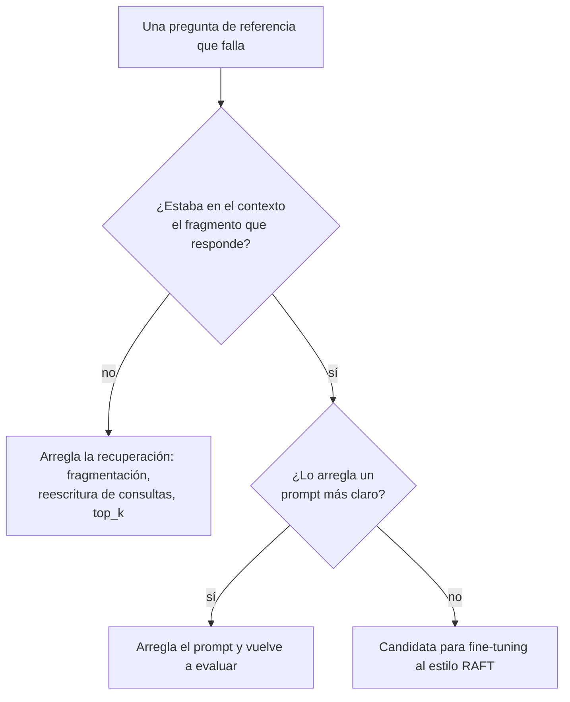
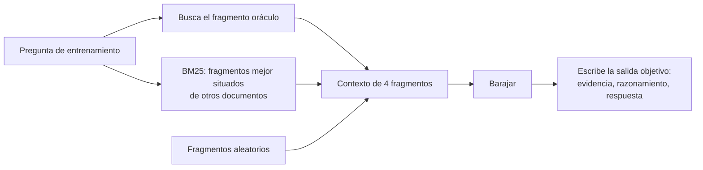
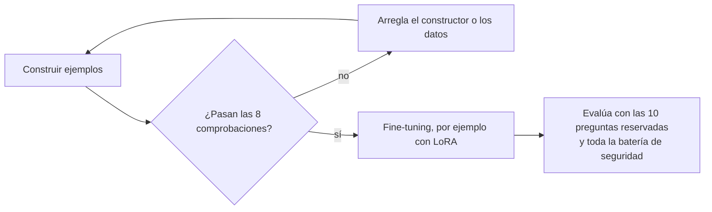

🌐 [English](02-raft-training-for-rag.md) · Español

# Lección 6.2 — RAFT: entrenar para RAG

> **Módulo 06 · Lección 2 de 4** · ⏱️ unos 45 min · 🧪 Lab: [paso 4](lab/README.es.md#paso-4--construye-el-dataset-de-raft)

## 📨 Situación

> **De:** Rio Tanaka · Responsable de Ingeniería de IA
> **Canal:** #ai-team
>
> Jordan me reenvió la propuesta de un proveedor: "haz *fine-tuning* de tu modelo con tu centro de
> ayuda y las alucinaciones desaparecerán". Antes de que nadie reserve GPU, quiero los datos de
> entrenamiento sobre mi mesa. Construye un conjunto al estilo RAFT a partir de las preguntas de
> referencia y del centro de ayuda, valídalo y dime cuáles de los fallos de hoy podría arreglar y
> cuáles no. Esta semana no se entrena nada. ¿Qué medirías después?

## 🎯 Objetivos

Al terminar esta lección puedes:

- Explicar qué le enseña a un modelo el *fine-tuning* aumentado por recuperación (RAFT,
  *retrieval-augmented fine-tuning*) que no le enseña un ajuste fino supervisado (SFT, *supervised
  fine-tuning*) normal con pares de pregunta y respuesta.
- Construir ejemplos de entrenamiento con un documento oráculo (*oracle*), distractores difíciles y
  aleatorios, y una proporción de ejemplos sin el oráculo.
- Escribir salidas objetivo (*targets*) con cadena de pensamiento que citen textualmente sus pruebas,
  y verificar esas citas automáticamente.
- Elegir la salida objetivo de los ejemplos sin oráculo (responder o abstenerse) y defender la
  elección para un bot de soporte.
- Decidir cuándo el *fine-tuning* para RAG compensa su coste frente a arreglar los *prompts* o la
  recuperación.

## 🤔 Predice primero

Apunta tus respuestas antes de seguir leyendo. Las comprobarás en la autoevaluación.

1. Haces *fine-tuning* solo con ejemplos en los que el documento correcto siempre está en el
   contexto. ¿Qué hará el modelo el día que la recuperación falle?
2. ¿Deberías añadir el manual interno de escalado como distractor, para que el modelo aprenda a
   ignorarlo?
3. ¿Puedes medir el modelo ajustado con las mismas preguntas de referencia que usaste para construir
   su conjunto de entrenamiento?

## 1. Qué puede arreglar el fine-tuning en RAG y qué no

Antes de entrenar nada, ordena tus fallos según dónde ocurren. La evaluación que construirás en la
lección 6.3 ya lista las preguntas en las que el bot se equivoca, y caen en grupos distintos:

| Pregunta de referencia | Qué salió mal | Etapa | ¿Ayudaría hacer *fine-tuning* del generador? |
|---|---|---|---|
| q017 "How much does the Watcher S1 weigh?" | La tabla comparativa nunca llegó al contexto | Recuperación | No: el modelo no puede citar una página que nunca ve |
| q032 "What do I need if my home has no C-wire?" | El fragmento correcto estaba ahí; el bot citó la frase equivocada | Generación | Sí: aprender a encontrar la frase que responde |
| q035 "Which device was launched most recently?" | Hay que comparar fechas entre filas | Generación (razonamiento) | Quizá, con razonamiento en las salidas objetivo |
| q021 "How long does delivery to Chile take?" | Datos correctos, respuesta en español | Generación (idioma) | Sí: salidas objetivo en el idioma de la persona |

El *fine-tuning* cambia cómo *usa* el modelo lo que recibe. No cambia lo que devuelve el
recuperador, y es una mala forma de guardar datos que cambian, como un plazo de devolución que pasó
de 14 a 30 días. Por eso la pregunta nunca es "¿hacemos *fine-tuning*?", sino "¿qué fallo estamos
pagando por arreglar, y es entrenar la forma más barata de arreglarlo?".

**Analogía:** una persona nueva en soporte que sigue respondiendo con el artículo equivocado no
necesita un archivador mejor; necesita practicar con expedientes reales. Quien no encuentra el
artículo en absoluto necesita un archivador mejor, y ninguna cantidad de práctica le ayudará.



> ⚠️ **Error común:** hacer *fine-tuning* para "enseñar al modelo nuestra base de conocimiento". Los
> datos aprendidos en los pesos no se pueden filtrar por audiencia ni por estado en el momento de la
> petición, y se quedan obsoletos en silencio. Deja los datos en la recuperación; entrena el
> comportamiento.

## 2. Anatomía de un ejemplo de RAFT

RAFT, presentado en el artículo enlazado abajo, hace *fine-tuning* de un modelo con ejemplos que se
parecen exactamente a las llamadas RAG que verá en producción. Cada ejemplo tiene:

| Campo | En nuestro lab | Por qué |
|---|---|---|
| Pregunta | Una pregunta de referencia de la partición de entrenamiento | Lo que pregunta la persona |
| Documento oráculo | El fragmento de un documento relevante cuya mejor frase contiene más hechos clave | Donde vive la respuesta |
| Distractores | Otros fragmentos que no responden la pregunta | La recuperación real tiene ruido; el modelo debe aprender a ignorarlo |
| Orden | Barajado | El oráculo no debe ocupar siempre la misma posición |
| Salida objetivo | Cita textual de la evidencia, razonamiento breve, respuesta y cita del documento | El comportamiento que quieres que el modelo copie |

La parte de *prompt* de cada ejemplo se construye con la misma función `build_messages` que usa el
bot en producción (lección 6.1), así que el modelo entrena con las mismas reglas, etiquetas y
metadatos que verá después. Este es el primer ejemplo que construye el lab:

```text
question : What is the return window for Hearthwise products?
documents: kb-012#1, kb-012#3, kb-011#1, kb-021#1
Evidence: [kb-011] "From 2025-03-01 you can return any Hearthwise product within 30 days of delivery, whether it is opened or not."
Reasoning: [kb-011] answers the question. The other documents ([kb-012], [kb-021]) are about something else, so I ignore them.
Answer: 30 days from delivery. [kb-011]
```

Tres de los cuatro documentos son distractores: dos fragmentos sobre la garantía y la introducción
de la página de restablecimiento de fábrica. Comparten palabras con la pregunta, como "Hearthwise" y
"return", y precisamente por eso son útiles: el modelo aprende que compartir palabras no es lo mismo
que responder.



**Analogía:** quien enseña a conducir no practica solo en carreteras vacías. Elige rutas con coches
aparcados, ciclistas y señales confusas, porque eso es justo lo que quien aprende debe aprender a
ignorar.

## 3. Distractores y la proporción sin oráculo

Dos tipos de distractores enseñan cosas distintas. Los *negativos difíciles* (*hard negatives*) son
fragmentos que un recuperador sitúa muy arriba pero que vienen de documentos no etiquetados como
relevantes; enseñan al modelo a resistir el ruido convincente. Los fragmentos *aleatorios* mantienen
al modelo honesto frente a texto claramente ajeno. El lab toma la mayoría de los distractores del
top 8 de BM25 para la pregunta, completa el resto al azar y nunca toma un distractor de un documento
etiquetado como relevante.

El segundo mando es `p_oracle`, la proporción de ejemplos en los que el oráculo está presente. En el
resto, el contexto solo contiene distractores. Esos ejemplos responden a una pregunta que importa
mucho en un bot de soporte: ¿qué debe hacer el modelo cuando la recuperación falla?

| Salida objetivo cuando falta el oráculo | Qué aprende el modelo | Sirve para | Riesgo |
|---|---|---|---|
| `answer` (la receta que describe el artículo de RAFT) | A responder con lo que memorizó durante el entrenamiento | Conocimiento estable del dominio | Datos obsoletos o fugados, presentados con aplomo |
| `abstain` (nuestro valor por defecto) | A responder `NO_ANSWER` cuando los documentos no cubren la pregunta | Políticas cambiantes, bots de cara a la clientela | Demasiados rechazos si la recuperación es débil |

Las políticas de Hearthwise cambian (la de devoluciones cambió), y Alex prefiere un traspaso a una
persona antes que un error dicho con aplomo, así que el lab usa `abstain` por defecto. Con
`p_oracle=0.8` y 3 copias de cada una de las 30 preguntas de entrenamiento, el lab construye 90
ejemplos. De los 81 ejemplos construidos a partir de preguntas con respuesta, 67 contienen el
oráculo; los otros 14, más los 9 ejemplos de las 3 preguntas de entrenamiento sin respuesta, tienen
salidas objetivo `NO_ANSWER`, 23 en total. Cambia a `--no-oracle-target
answer` y solo esos 9 conservan `NO_ANSWER`.

```python
for copy in range(cfg.copies):
    with_oracle = oracle is not None and rng.random() < cfg.p_oracle
    n_distract = cfg.n_docs - (1 if with_oracle else 0)
    n_hard = min(len(hard), n_distract // 2 + 1)
    chosen = rng.sample(hard[:8], min(n_hard, len(hard[:8])))
    rest = [c for c in negatives if c not in chosen]
    chosen += rng.sample(rest, n_distract - len(chosen))
    context = chosen + ([oracle[0]] if with_oracle else [])
    rng.shuffle(context)  # the oracle must not always sit in the same position
```

**Analogía:** simulacros de incendio en los que, de vez en cuando, la salida habitual está
bloqueada. Si todos los simulacros usaran la misma puerta abierta, nadie sabría qué hacer el día que
esté cerrada.

> ⚠️ **Error común:** poner `p_oracle` a 1.0 porque "todos los ejemplos deberían tener respuesta".
> Entonces el modelo nunca ve un contexto sin la respuesta, así que el día que la recuperación falla
> es probable que se invente una. En el lab, `--p-oracle 1.0` deja solo los 9 rechazos que vienen de
> preguntas sin respuesta.

## 4. Cadena de pensamiento que cita textualmente

La cadena de pensamiento (CoT, *chain-of-thought*) consiste en escribir el razonamiento intermedio
antes de la respuesta final. Las salidas objetivo de RAFT la usan de una forma concreta: primero
*citan textualmente* la frase que respalda la respuesta, después explican por qué los demás
documentos no importan y luego responden. Nuestras salidas objetivo siguen un formato de tres
líneas:

```text
Evidence: none of the documents answers this.
Reasoning: The documents ([kb-013], [kb-003], [kb-040]) do not cover it, so I must not guess.
Answer: NO_ANSWER
```

Ese ejemplo (`q003-2`) pregunta cuánto tardan los reembolsos, pero su contexto contiene envíos, las
funciones de un enchufe y una página del manual del termostato; el oráculo se dejó fuera a
propósito.

Citar textualmente cumple tres funciones. Obliga al modelo a localizar la evidencia antes de
comprometerse con una respuesta. Hace comprobable la salida objetivo: una cita aparece en el
documento citado o no aparece. Y en inferencia te da una señal barata de fidelidad: si el modelo
ajustado cita un texto que no está en el contexto, sabes que se lo está inventando.

```python
def target_text(row: dict, context: list[Chunk], oracle: tuple[Chunk, str] | None, cfg: RaftConfig) -> str:
    """Chain-of-thought target: quote the evidence, dismiss the distractors, then answer."""
    ids = list(dict.fromkeys(c.doc_id for c in context))
    if oracle is not None:
        chunk, quote = oracle
        others = [i for i in ids if i != chunk.doc_id]
        ignored = ", ".join(f"[{i}]" for i in others) if others else "none"
        return (
            f'Evidence: [{chunk.doc_id}] "{quote}"\n'
            f"Reasoning: [{chunk.doc_id}] answers the question. The other documents ({ignored}) "
            f"are about something else, so I ignore them.\n"
            f"Answer: {row['reference_answer']} [{chunk.doc_id}]"
        )
    ...
```

**Analogía:** quien enseña matemáticas y pide subrayar el número en el enunciado antes de usarlo.
Subrayar cuesta poco, y pilla a quien "recuerda" un número que nunca estuvo ahí.

> 💡 **Consejo de producción:** en proyectos reales, un LLM escribe la parte de razonamiento de miles
> de salidas objetivo. Trata esa salida como no fiable: conserva solo las salidas objetivo cuyas citas
> aparecen literalmente en el oráculo, y revisa a mano una muestra de unas decenas antes de cada
> entrenamiento.

## 5. Valida el dataset antes de entrenar

Un entrenamiento convierte cada defecto de los datos en comportamiento, y solo te enteras después de
pagar el cómputo. El lab ejecuta ocho comprobaciones sobre cada ejemplo antes de escribir un solo
archivo:

| Comprobación | Detecta |
|---|---|
| `context_size` | Ejemplos con un número incorrecto de documentos |
| `oracle_flag` | Ejemplos cuya marca "tiene oráculo" no coincide con su contexto |
| `quotes_verbatim` | Evidencias que no están copiadas exactamente del documento citado |
| `citations_in_context` | Salidas objetivo que citan un documento que el modelo no puede ver |
| `no_restricted_docs` | Documentos internos o sustituidos en cualquier contexto |
| `no_forbidden_strings` | Salidas objetivo que contienen cadenas de `must_not_contain` o secretos conocidos |
| `distractors_irrelevant` | "Distractores" que en realidad vienen de un documento relevante |
| `no_test_leakage` | Preguntas de entrenamiento iguales o casi iguales a preguntas de test reservadas |

Dos de ellas merecen una historia. `no_restricted_docs` existe por Noor: todo lo que está dentro de
los pesos queda al alcance de cualquiera que use el modelo, para siempre, sin ningún filtro de
audiencia de por medio. Si el código de vale del manual interno aparece en los contextos de
entrenamiento, algún día un *prompt* ingenioso podría sacarlo, y no puedes "desentrenar" un solo
dato. Ejecuta el constructor con `--include-restricted` y la comprobación falla en 19 de los 90
ejemplos.

`no_test_leakage` existe por Dani. El lab divide las 40 preguntas de referencia en 30 para
entrenamiento y 10 reservadas, de forma estratificada para que los dos lados contengan preguntas que
deben rechazarse. Si la misma pregunta estuviera en los dos lados, el modelo ajustado parecería
brillante en preguntas que ya ha memorizado.



El constructor también estima el tamaño, porque el tamaño determina el coste. Con el contador
aproximado de *tokens* que comparten todos los labs (palabras y signos de puntuación, no un
tokenizador real), los 90 ejemplos tienen de media 730.8 *tokens* cada uno, 65775 en total por cada
pasada sobre los datos. La mayor parte es contexto: con 8 documentos por ejemplo en lugar de 4, la
media sube a 1185.6 *tokens*, y la factura del entrenamiento sube con ella.

> ⚠️ **Error común:** dividir los ejemplos en lugar de las preguntas. Nuestras tres copias de una
> pregunta comparten la pregunta y el oráculo; si una copia cae en entrenamiento y otra en test, el
> test queda contaminado. Divide primero por id de pregunta y después construye los ejemplos.

## 6. ¿Cuándo compensa el fine-tuning para RAG?

El entrenamiento al estilo RAFT es una buena inversión cuando el modelo, con el contexto correcto
delante, sigue comportándose mal de formas que un *prompt* no puede arreglar, y cuando tienes la
evaluación para demostrar que mejoró. Es una mala inversión cuando los fallos están en la
recuperación, cuando el conocimiento cambia más deprisa de lo que puedes reentrenar, o cuando un
modelo más potente ya disponible resuelve el problema.

| Síntoma en el conjunto de referencia | Primer arreglo más barato | Cuándo ayuda el entrenamiento al estilo RAFT |
|---|---|---|
| La respuesta no está en el contexto | Fragmentación, reescritura de consultas, top_k, reordenación (*reranking*) | Nunca por sí solo |
| El modelo cita la frase equivocada de un buen contexto | *Prompt* más claro, menos fragmentos y mejores | Cuando los arreglos del *prompt* se estancan |
| El modelo se distrae con documentos parecidos | Mejor *ranking*, filtros de metadatos | Sí: entrenar con negativos difíciles |
| El modelo adivina en lugar de rechazar | Centinela, umbral, *prompt* más estricto | Sí: entrenar con salidas objetivo de abstención sin oráculo |
| Formato, idioma o tono incorrectos | *Prompt* y ejemplos en el contexto | Cuando lo necesitas en un modelo pequeño y barato |

El coste no es solo cómputo. Alguien tiene que generar y revisar preguntas por fragmento, mantener el
dataset sincronizado con el centro de ayuda y volver a ejecutar todas las evaluaciones después de
cada entrenamiento. El módulo
04 mostró cómo los métodos eficientes en parámetros, como la adaptación de bajo rango (LoRA,
*low-rank adaptation*), abaratan el paso de entrenamiento (consulta la
[lección 4.4](../04-prompting-context-and-fine-tuning/04-fine-tuning-peft-and-lora.es.md)); lo que
sigue siendo caro son los datos y la evaluación.

**Analogía:** mandar a alguien de la plantilla a un curso compensa cuando el problema es una
habilidad que le falta y que seguirá siendo útil. No compensa cuando el problema real es que al
manual le falta una página.

> 💡 **Consejo de producción:** antes y después de cada entrenamiento, mide lo mismo con las
> preguntas reservadas: corrección de las respuestas, exactitud de la abstención, validez de las
> citas y fugas en las ablaciones de la lección 6.3. Añade una más: varía el número de distractores
> en inferencia. Un modelo entrenado con RAFT debería degradarse con más suavidad que el modelo base
> a medida que el contexto tiene más ruido.

## 🧪 Pruébalo

Ejecuta estos comandos desde `modules/06-rag-generation-and-evaluation/lab`.

1. Construye y valida el dataset por defecto, e imprime el primer ejemplo.

   ```bash
   uv run lab raft --show 0
   ```

   ```text
   RAFT dataset | p_oracle=0.8 | 4 docs per example | 3 copies | no-oracle target: abstain
   Questions    : 30 train / 10 test (held out for evaluation)
   Examples     : 90 | with oracle: 67 | NO_ANSWER targets: 23
   Tokens       : 730.8 per example (approx.) | 65775 in total
   Checks:
     PASS  context_size
     PASS  oracle_flag
     PASS  quotes_verbatim
     PASS  citations_in_context
     PASS  no_restricted_docs
     PASS  no_forbidden_strings
     PASS  distractors_irrelevant
     PASS  no_test_leakage
   Wrote outputs/raft_train.jsonl and outputs/raft_test_questions.jsonl
   ```

   El ejemplo en sí es el que aparece en la sección 2.

2. Imprime un ejemplo sin oráculo y lee su salida objetivo.

   ```bash
   uv run lab raft --show 4
   ```

   ```text
   --- example 4: q003-2 (oracle: none) ---
   question : How long do refunds take after a return reaches the warehouse?
   documents: kb-013#2, kb-003#2, kb-040#5, kb-013#1
   Evidence: none of the documents answers this.
   Reasoning: The documents ([kb-013], [kb-003], [kb-040]) do not cover it, so I must not guess.
   Answer: NO_ANSWER
   ```

3. Rompe los datos a propósito: deja entrar los documentos restringidos. El comando termina con el
   código 1.

   ```bash
   uv run lab raft --include-restricted
   ```

   ```text
     FAIL  no_restricted_docs (19 examples, e.g. q001-1, q001-3, q003-2)
   ```

4. Compara las dos salidas objetivo sin oráculo.

   ```bash
   uv run lab raft --no-oracle-target answer
   ```

   ```text
   Examples     : 90 | with oracle: 67 | NO_ANSWER targets: 9
   ```

5. Abre `outputs/raft_train.jsonl` en tu editor. Cada línea es un ejemplo en formato de chat
   (`system`, `user`, `assistant`), la forma que acepta la mayoría de las herramientas de SFT.

## 🏭 En el mundo real

- **Las preguntas se generan, no se escriben a mano.** Los equipos piden a un LLM que escriba varias
  preguntas por fragmento, las filtran por calidad y duplicados, y después construyen contextos de
  RAFT a su alrededor. El conjunto de referencia sigue curado a mano y nunca se usa para entrenar.
- **El linaje de los datos importa.** Cada ejemplo registra la versión de la base de conocimiento de
  la que salió. Cuando cambia una política, los ejemplos construidos sobre la versión antigua se
  descartan o se reconstruyen.
- **Entrenar es la parte barata.** Con adaptadores como LoRA, la ejecución en sí es pequeña. Revisar
  datos, repetir evaluaciones y vigilar después del lanzamiento se llevan la mayor parte del
  esfuerzo.
- **El objetivo habitual son los modelos pequeños.** El *fine-tuning* para RAG suele buscar que un
  modelo pequeño, barato o local se comporte como uno más grande dentro de un dominio acotado.
- **La comparación siempre es contra una línea base.** Reporta el modelo base con el mismo *prompt* y
  el mismo recuperador junto al modelo ajustado, con las mismas preguntas reservadas y los mismos
  tests de seguridad.

## ✅ Autoevaluación

**1. Entrenaste solo con ejemplos en los que el oráculo está presente. ¿Qué pasa cuando la
recuperación falla?**

<details><summary>Respuesta</summary>

El modelo nunca ha visto un contexto sin la respuesta, así que aprendió que la respuesta siempre está
ahí. Cuando la recuperación falla, elige el distractor más plausible o recurre a datos memorizados y
responde con aplomo. Los ejemplos sin oráculo le enseñan la alternativa: abstenerse (nuestro valor
por defecto) o responder de memoria (la receta publicada).

</details>

**2. ¿Debería usarse el manual interno de escalado como distractor para enseñar al modelo a
ignorarlo?**

<details><summary>Respuesta</summary>

No. Lo que entra en el entrenamiento puede acabar en los pesos, donde no se aplica ningún filtro de
audiencia, y más tarde se podría extraer el código de vale. El control de acceso pertenece a la
recuperación. La comprobación `no_restricted_docs` del lab falla en 19 ejemplos cuando dejas entrar
documentos restringidos.

</details>

**3. ¿Puedes evaluar el modelo ajustado con las preguntas con las que entrenaste?**

<details><summary>Respuesta</summary>

No de forma honesta. Esas puntuaciones miden memorización. Divide por pregunta antes de construir
los ejemplos (el lab reserva 10 de las 40), busca casi duplicados a ambos lados de la división y
reporta los resultados con las preguntas reservadas más las ablaciones de seguridad.

</details>

**4. El bot falla el peso del Watcher S1 porque la tabla nunca llega al contexto. ¿Lo arreglará
RAFT?**

<details><summary>Respuesta</summary>

No. Es un fallo de recuperación: el fragmento que responde no está en el *prompt*, así que ningún
generador puede citarlo. Arregla primero la fragmentación, la reescritura o `top_k`. RAFT mejora
cómo usa un modelo el contexto que recibe.

</details>

**5. ¿Por qué la cita de la evidencia debe ser literal?**

<details><summary>Respuesta</summary>

Porque una cita literal se puede comprobar buscando la subcadena, tanto al validar los datos de
entrenamiento como al vigilar el modelo ajustado. Una "cita" parafraseada puede esconder un dato
inventado.

</details>

## 💬 Explícalo con tus palabras

- Explícale a Rio, en tres frases, cuáles de las preguntas de referencia que fallan hoy podría
  arreglar RAFT y cuáles no, y qué medirías después del entrenamiento.
- Explícale a Jordan por qué "entrenar el modelo con el centro de ayuda" es una forma arriesgada de
  mantener al día la política de devoluciones.

## 🔑 Ideas clave

- Ordena primero los fallos por etapa: los fallos de recuperación necesitan arreglos en la
  recuperación, no *fine-tuning*.
- Un ejemplo de RAFT se parece a una llamada RAG real: un oráculo, varios distractores, todo
  barajado, y una salida objetivo que cita textualmente antes de responder.
- Los ejemplos sin oráculo deciden qué hace el modelo cuando la recuperación falla; un bot de
  soporte normalmente debería aprender a abstenerse.
- Valida los datos automáticamente: citas literales, citas de documentos válidas, ningún documento
  restringido, ninguna fuga entre entrenamiento y test.
- Entrena el comportamiento, deja los datos en la recuperación y compara siempre con la línea base
  sin entrenar en preguntas reservadas.

## 📚 Profundiza

- ⭐ [RAFT: adapting language models to domain-specific RAG](https://arxiv.org/abs/2403.10131) — el
  artículo en el que se basa esta lección: documentos oráculo y distractores, la proporción sin
  oráculo y las respuestas con cadena de pensamiento que citan textualmente.
- [Chain-of-thought prompting elicits reasoning](https://arxiv.org/abs/2201.11903) — la idea original
  de escribir los pasos intermedios.
- [LoRA: low-rank adaptation of large language models](https://arxiv.org/abs/2106.09685) — el método
  de *fine-tuning* barato que usarías para entrenar con este dataset.
- [Hugging Face TRL documentation](https://huggingface.co/docs/trl) — entrenadores que aceptan el
  JSONL en formato de chat que escribe el lab.

---

[← Anterior: 6.1 *Prompts* para respuestas fundamentadas](01-prompting-for-grounded-answers.es.md) · [🏠 Módulo 06](README.es.md) · [Siguiente: 6.3 Evaluar RAG →](03-evaluating-rag.es.md)
