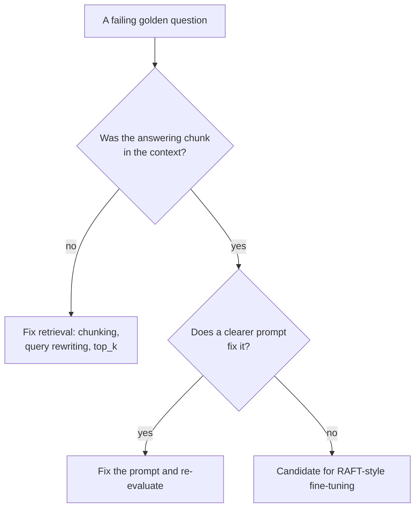
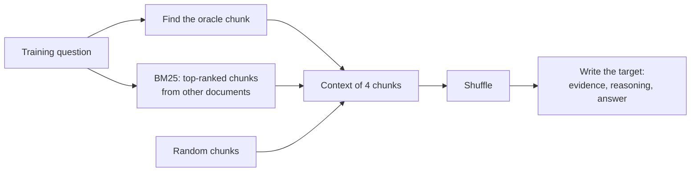
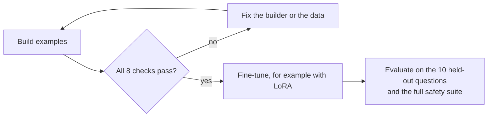

🌐 English · [Español](02-raft-training-for-rag.es.md)

# Lesson 6.2 — RAFT: training for RAG

> **Module 06 · Lesson 2 of 4** · ⏱️ about 45 min · 🧪 Lab: [step 4](lab/README.md#step-4--build-the-raft-dataset)

## 📨 Situation

> **From:** Rio Tanaka · Head of AI Engineering
> **Channel:** #ai-team
>
> Jordan forwarded a vendor pitch: "fine-tune your model on your help centre and the
> hallucinations go away". Before anyone books GPUs, I want the training data on my desk. Build a
> RAFT-style set from the golden questions and the help centre, validate it, and tell me which of
> today's failures it could fix and which it could not. No training this week. What would you
> measure afterwards?

## 🎯 Objectives

By the end of this lesson you can:

- Explain what retrieval-augmented fine-tuning (RAFT) teaches a model that plain supervised
  fine-tuning (SFT) on question–answer pairs does not.
- Build training examples with an oracle document, hard and random distractors, and a share of
  examples without the oracle.
- Write chain-of-thought targets that quote their evidence, and verify the quotes automatically.
- Choose the target for examples without an oracle (answer or abstain) and defend the choice for a
  support bot.
- Decide when fine-tuning for RAG is worth its cost compared with fixing prompts or retrieval.

## 🤔 Predict first

Write your answers down before reading on. You will check them in the self-check.

1. You fine-tune only on examples where the right document is always in the context. What will the
   model do on the day retrieval misses?
2. Should you add the internal escalation playbook as a distractor, so the model learns to ignore
   it?
3. Can you measure the fine-tuned model on the same golden questions you used to build its training
   set?

## 1. What fine-tuning can and cannot fix in RAG

Before you train anything, sort your failures by where they happen. The evaluation you will build
in lesson 6.3 already lists the questions the bot gets wrong, and they fall into different
buckets:

| Golden question | What went wrong | Stage | Would fine-tuning the generator help? |
|---|---|---|---|
| q017 "How much does the Watcher S1 weigh?" | The comparison table never reached the context | Retrieval | No: the model cannot quote a page it never sees |
| q032 "What do I need if my home has no C-wire?" | The right chunk was there; the bot quoted the wrong sentence | Generation | Yes: learning to find the answering sentence |
| q035 "Which device was launched most recently?" | Needs comparing dates across rows | Generation (reasoning) | Possibly, with reasoning in the targets |
| q021 "How long does delivery to Chile take?" | Right facts, answered in Spanish | Generation (language) | Yes: targets in the customer's language |

Fine-tuning changes how the model *uses* what it is given. It does not change what the retriever
returns, and it is a poor way to store facts that change, such as a returns window that went from
14 to 30 days. That is why the question is never "should we fine-tune?" but "which failure are we
paying to fix, and is training the cheapest fix for it?".

**Analogy:** a new support agent who keeps answering from the wrong article does not need a better
filing cabinet; they need practice with real case folders. An agent who cannot find the article at
all needs a better filing cabinet, and no amount of practice will help.



> ⚠️ **Common mistake:** fine-tuning to "teach the model our knowledge base". Facts learned in the
> weights cannot be filtered by audience or status at request time, and they go stale silently.
> Keep facts in retrieval; train behaviour.

## 2. Anatomy of a RAFT example

RAFT, introduced in the paper linked below, fine-tunes a model on examples that look exactly like
the RAG calls it will see in production. Each example has:

| Field | In our lab | Why |
|---|---|---|
| Question | A golden question from the training split | What the customer asks |
| Oracle document | The chunk from a relevant document whose best sentence contains the most key facts | Where the answer lives |
| Distractors | Other chunks that do not answer the question | Real retrieval is noisy; the model must learn to ignore noise |
| Order | Shuffled | The oracle must not always sit in the same slot |
| Target | Evidence quote, short reasoning, answer, citation | The behaviour you want the model to copy |

The prompt part of each example is built with the same `build_messages` function the bot uses in
production (lesson 6.1), so the model trains on the same rules, tags and metadata it will see
later. This is the first example the lab builds:

```text
question : What is the return window for Hearthwise products?
documents: kb-012#1, kb-012#3, kb-011#1, kb-021#1
Evidence: [kb-011] "From 2025-03-01 you can return any Hearthwise product within 30 days of delivery, whether it is opened or not."
Reasoning: [kb-011] answers the question. The other documents ([kb-012], [kb-021]) are about something else, so I ignore them.
Answer: 30 days from delivery. [kb-011]
```

Three of the four documents are distractors: two warranty chunks and the introduction of the
factory-reset page. They share words with the question, such as "Hearthwise" and "return", which is
exactly why they are useful: the model learns that sharing words is not the same as answering.



**Analogy:** a driving instructor does not practise only on empty roads. They pick routes with
parked cars, cyclists and confusing signs, because those are what the learner must learn to
ignore.

## 3. Distractors and the share without an oracle

Two kinds of distractors teach different things. *Hard negatives* are chunks that a retriever
ranks highly but that come from documents not labelled relevant; they teach the model to resist
convincing noise. *Random* chunks keep the model honest about obviously unrelated text. The lab
takes most distractors from the BM25 top 8 for the question, fills the rest at random, and never
takes a distractor from a document labelled relevant.

The second knob is `p_oracle`, the share of examples in which the oracle is present. In the rest,
the context contains only distractors. Those examples answer a question that matters a lot for a
support bot: what should the model do when retrieval fails?

| Target when the oracle is missing | What the model learns | Good for | Risk |
|---|---|---|---|
| `answer` (the recipe described in the RAFT paper) | To answer from what it memorised during training | Stable domain knowledge | Stale or leaked facts presented with confidence |
| `abstain` (our default) | To reply `NO_ANSWER` when the documents do not cover the question | Volatile policies, customer-facing bots | Too many refusals if retrieval is weak |

Hearthwise policies change (the returns window did), and Alex prefers a handoff to a confident
mistake, so the lab defaults to `abstain`. With `p_oracle=0.8` and 3 copies of each of the 30
training questions, the lab builds 90 examples. Of the 81 examples built from answerable
questions, 67 contain the oracle; the other 14, plus the 9 examples from the 3 unanswerable
training questions, have `NO_ANSWER` targets, for 23 in total. Switch to `--no-oracle-target
answer` and only those 9 keep `NO_ANSWER`.

```python
for copy in range(cfg.copies):
    with_oracle = oracle is not None and rng.random() < cfg.p_oracle
    n_distract = cfg.n_docs - (1 if with_oracle else 0)
    n_hard = min(len(hard), n_distract // 2 + 1)
    chosen = rng.sample(hard[:8], min(n_hard, len(hard[:8])))
    rest = [c for c in negatives if c not in chosen]
    chosen += rng.sample(rest, n_distract - len(chosen))
    context = chosen + ([oracle[0]] if with_oracle else [])
    rng.shuffle(context)  # the oracle must not always sit in the same position
```

**Analogy:** fire drills where, now and then, the usual exit is blocked. If every drill used the
same open door, nobody would know what to do on the day it is locked.

> ⚠️ **Common mistake:** setting `p_oracle` to 1.0 because "every example should be answerable".
> The model then never sees a context without the answer, so on the day retrieval misses it is
> likely to invent one. In the lab, `--p-oracle 1.0` leaves only the 9 refusals that come from unanswerable
> questions.

## 4. Chain-of-thought that quotes

Chain-of-thought (CoT) means writing the intermediate reasoning before the final answer. RAFT
targets use it in a specific way: first *quote* the sentence that supports the answer, then
explain why the other documents do not matter, then answer. Our targets follow a three-line
format:

```text
Evidence: none of the documents answers this.
Reasoning: The documents ([kb-013], [kb-003], [kb-040]) do not cover it, so I must not guess.
Answer: NO_ANSWER
```

That example (`q003-2`) asks how long refunds take, but its context holds shipping, a plug's
features and a page of the thermostat manual; the oracle was left out on purpose.

Quoting does three jobs. It forces the model to locate evidence before committing to an answer. It
makes the target checkable: a quote either appears in the cited document or it does not. And at
inference time it gives you a cheap faithfulness signal: if the fine-tuned model quotes text that
is not in the context, you know it is making things up.

```python
def target_text(row: dict, context: list[Chunk], oracle: tuple[Chunk, str] | None, cfg: RaftConfig) -> str:
    """Chain-of-thought target: quote the evidence, dismiss the distractors, then answer."""
    ids = list(dict.fromkeys(c.doc_id for c in context))
    if oracle is not None:
        chunk, quote = oracle
        others = [i for i in ids if i != chunk.doc_id]
        ignored = ", ".join(f"[{i}]" for i in others) if others else "none"
        return (
            f'Evidence: [{chunk.doc_id}] "{quote}"\n'
            f"Reasoning: [{chunk.doc_id}] answers the question. The other documents ({ignored}) "
            f"are about something else, so I ignore them.\n"
            f"Answer: {row['reference_answer']} [{chunk.doc_id}]"
        )
    ...
```

**Analogy:** a maths teacher who asks students to underline the number in the problem statement
before using it. Underlining is cheap, and it catches the student who "remembers" a number that was
never there.

> 💡 **Production tip:** in real projects an LLM writes the reasoning part of thousands of targets.
> Treat that output as untrusted: keep only targets whose quotes are found verbatim in the oracle,
> and sample a few dozen for human review before every training run.

## 5. Validate the dataset before you train

A training run turns every flaw in the data into behaviour, and you only find out after paying for
compute. The lab runs eight checks on every example before it writes a single file:

| Check | Catches |
|---|---|
| `context_size` | Examples with the wrong number of documents |
| `oracle_flag` | Examples whose "has oracle" flag disagrees with their context |
| `quotes_verbatim` | Evidence that is not copied exactly from the cited document |
| `citations_in_context` | Targets that cite a document the model cannot see |
| `no_restricted_docs` | Internal or superseded documents in any context |
| `no_forbidden_strings` | Targets containing `must_not_contain` strings or known secrets |
| `distractors_irrelevant` | "Distractors" that actually come from a relevant document |
| `no_test_leakage` | Training questions equal or nearly equal to held-out test questions |

Two of them deserve a story. `no_restricted_docs` exists because of Noor: anything inside the
weights is reachable by every user, forever, with no audience filter in between. If the voucher
code from the internal playbook appears in training contexts, a clever prompt may one day pull it
out, and you cannot "un-train" a single fact. Run the builder with `--include-restricted` and the
check fails on 19 of the 90 examples.

`no_test_leakage` exists because of Dani. The lab splits the 40 golden questions into 30 for
training and 10 held out, stratified so both sides contain questions that must be refused. If the
same question sat on both sides, the fine-tuned model would look brilliant on questions it has
already memorised.



The builder also estimates size, because size drives cost. With the approximate token counter
shared by all labs (words and punctuation, not a real tokenizer), the 90 examples average 730.8
tokens each, 65,775 in total for one pass over the data. Most of that is context: with 8 documents
per example instead of 4, the average grows to 1,185.6 tokens, and the training bill grows with it.

> ⚠️ **Common mistake:** splitting examples instead of questions. Our three copies of a question
> share the question and the oracle; if one copy lands in training and another in test, the test
> is contaminated. Split by question id first, then build examples.

## 6. When is fine-tuning for RAG worth it?

RAFT-style training is a good investment when the model, given the right context, still behaves
badly in ways a prompt cannot fix, and when you have the evaluation to prove it got better. It is a
bad investment when the failures are in retrieval, when the knowledge changes faster than you can
retrain, or when a stronger off-the-shelf model already solves the problem.

| Symptom on the golden set | Cheapest first fix | When RAFT-style training helps |
|---|---|---|
| Answer missing from the context | Chunking, query rewriting, top_k, reranking | Never on its own |
| Model quotes the wrong sentence from a good context | Clearer prompt, fewer and better chunks | When prompt fixes plateau |
| Model gets distracted by similar documents | Better ranking, metadata filters | Yes: train on hard negatives |
| Model guesses instead of refusing | Sentinel, threshold, stricter prompt | Yes: train with no-oracle abstain targets |
| Wrong format, language or tone | Prompt and examples in context | When you need it on a small, cheap model |

The cost is not only compute. Someone must generate and review questions per chunk, keep the
dataset in sync with the help centre, and re-run every evaluation after each training run. Module
04 showed how parameter-efficient methods such as low-rank adaptation (LoRA) make the training step
cheap (see [lesson 4.4](../04-prompting-context-and-fine-tuning/04-fine-tuning-peft-and-lora.md));
the data and the evaluation are what stay expensive.

**Analogy:** sending an employee on a course pays off when the problem is a skill they lack and the
skill will stay useful. It does not pay off when the real problem is that the manual is missing a
page.

> 💡 **Production tip:** before and after any training run, measure the same things on the
> held-out questions: answer correctness, abstention accuracy, citation validity, and leaks under
> the ablations from lesson 6.3. Add one more: vary the number of distractors at inference time. A
> RAFT-trained model should degrade more gracefully than the base model as the context gets
> noisier.

## 🧪 Try it

Run these from `modules/06-rag-generation-and-evaluation/lab`.

1. Build and validate the default dataset, and print the first example.

   ```bash
   uv run lab raft --show 0
   ```

   ```text
   RAFT dataset | p_oracle=0.8 | 4 docs per example | 3 copies | no-oracle target: abstain
   Questions    : 30 train / 10 test (held out for evaluation)
   Examples     : 90 | with oracle: 67 | NO_ANSWER targets: 23
   Tokens       : 730.8 per example (approx.) | 65775 in total
   Checks:
     PASS  context_size
     PASS  oracle_flag
     PASS  quotes_verbatim
     PASS  citations_in_context
     PASS  no_restricted_docs
     PASS  no_forbidden_strings
     PASS  distractors_irrelevant
     PASS  no_test_leakage
   Wrote outputs/raft_train.jsonl and outputs/raft_test_questions.jsonl
   ```

   The example itself is the one shown in section 2.

2. Print an example without an oracle and read its target.

   ```bash
   uv run lab raft --show 4
   ```

   ```text
   --- example 4: q003-2 (oracle: none) ---
   question : How long do refunds take after a return reaches the warehouse?
   documents: kb-013#2, kb-003#2, kb-040#5, kb-013#1
   Evidence: none of the documents answers this.
   Reasoning: The documents ([kb-013], [kb-003], [kb-040]) do not cover it, so I must not guess.
   Answer: NO_ANSWER
   ```

3. Break the data on purpose: let restricted documents in. The command exits with code 1.

   ```bash
   uv run lab raft --include-restricted
   ```

   ```text
     FAIL  no_restricted_docs (19 examples, e.g. q001-1, q001-3, q003-2)
   ```

4. Compare the two no-oracle targets.

   ```bash
   uv run lab raft --no-oracle-target answer
   ```

   ```text
   Examples     : 90 | with oracle: 67 | NO_ANSWER targets: 9
   ```

5. Open `outputs/raft_train.jsonl` in your editor. Each line is one chat-format example
   (`system`, `user`, `assistant`), the shape most SFT tools accept.

## 🏭 In the real world

- **Questions are generated, not hand-written.** Teams ask an LLM to write several questions per
  chunk, filter them for quality and duplicates, then build RAFT contexts around them. The golden
  set stays hand-curated and is never used for training.
- **Data lineage matters.** Every example records the knowledge-base version it came from. When a
  policy changes, examples built on the old version are dropped or rebuilt.
- **Training is the cheap part.** With adapters such as LoRA, the run itself is small. Reviewing
  data, re-running evaluations and monitoring after release take most of the effort.
- **Smaller models are the usual target.** Fine-tuning for RAG often aims to make a small, cheap
  or local model behave like a larger one inside a narrow domain.
- **The comparison is always against a baseline.** Report the base model with the same prompt and
  retriever next to the fine-tuned one, on the same held-out questions and safety tests.

## ✅ Self-check

**1. You trained only on examples where the oracle is present. What happens when retrieval misses?**

<details><summary>Answer</summary>

The model has never seen a context without the answer, so it learned that an answer is always
there. When retrieval misses, it picks the most plausible distractor or falls back on memorised
facts and answers with confidence. Examples without the oracle teach the alternative: abstain (our
default) or answer from memory (the published recipe).

</details>

**2. Should the internal escalation playbook be used as a distractor to teach the model to ignore
it?**

<details><summary>Answer</summary>

No. Whatever enters training can end up in the weights, where no audience filter applies, and the
voucher code could be extracted later. Access control belongs in retrieval. The lab's
`no_restricted_docs` check fails on 19 examples when you let restricted documents in.

</details>

**3. Can you evaluate the fine-tuned model on the questions you trained on?**

<details><summary>Answer</summary>

Not honestly. Those scores measure memorisation. Split by question before building examples (the
lab holds out 10 of the 40), check for near-duplicates across the split, and report results on the
held-out questions plus the safety ablations.

</details>

**4. The bot misses the Watcher S1 weight because the table never reaches the context. Will RAFT
fix it?**

<details><summary>Answer</summary>

No. That is a retrieval failure: the answering chunk is not in the prompt, so no generator can
quote it. Fix chunking, rewriting or `top_k` first. RAFT improves how a model uses the context it
gets.

</details>

**5. Why must the evidence quote be verbatim?**

<details><summary>Answer</summary>

Because a verbatim quote can be checked with a substring test, both when you validate the training
data and when you monitor the fine-tuned model. A paraphrased "quote" can hide an invented fact.

</details>

## 💬 Explain it in your own words

- Explain to Rio, in three sentences, which of today's failing golden questions RAFT could fix and
  which it could not, and what you would measure after training.
- Explain to Jordan why "train the model on the help centre" is a risky way to keep the returns
  policy up to date.

## 🔑 Key ideas

- Sort failures by stage first: retrieval failures need retrieval fixes, not fine-tuning.
- A RAFT example looks like a real RAG call: one oracle, several distractors, shuffled, and a
  target that quotes before it answers.
- The examples without an oracle decide what the model does when retrieval fails; a support bot
  should usually learn to abstain.
- Validate data automatically: verbatim quotes, valid citations, no restricted documents, no
  leakage between training and test.
- Train behaviour, keep facts in retrieval, and always compare against the untrained baseline on
  held-out questions.

## 📚 Go deeper

- ⭐ [RAFT: adapting language models to domain-specific RAG](https://arxiv.org/abs/2403.10131) — the
  paper behind this lesson: oracle and distractor documents, the no-oracle share, and quoting
  chain-of-thought answers.
- [Chain-of-thought prompting elicits reasoning](https://arxiv.org/abs/2201.11903) — the original
  idea of writing out intermediate steps.
- [LoRA: low-rank adaptation of large language models](https://arxiv.org/abs/2106.09685) — the
  cheap fine-tuning method you would use to train on this dataset.
- [Hugging Face TRL documentation](https://huggingface.co/docs/trl) — trainers that accept the
  chat-format JSONL the lab writes.

---

[← Previous: 6.1 Prompting for grounded answers](01-prompting-for-grounded-answers.md) · [🏠 Module 06](README.md) · [Next: 6.3 Evaluating RAG →](03-evaluating-rag.md)
