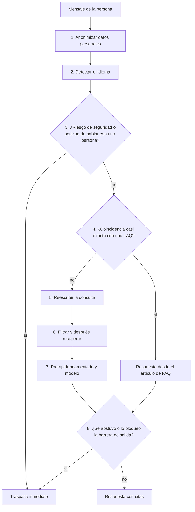
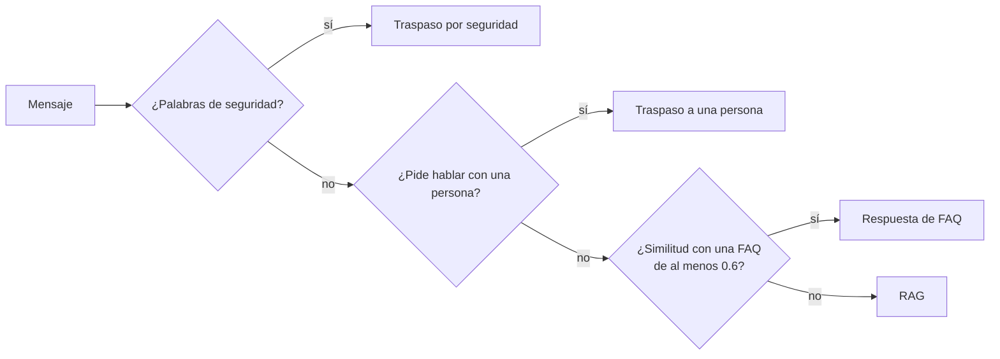
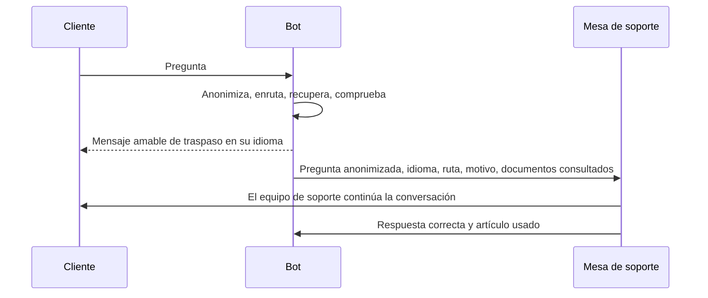

🌐 [English](04-support-chatbot-design.md) · Español

# Lección 6.4 — Diseñar el chatbot de soporte

> **Módulo 06 · Lección 4 de 4** · ⏱️ unos 50 min · 🧪 Lab: [paso 8](lab/README.es.md#paso-8--sigue-las-rutas-y-las-barreras-de-protección)

## 📨 Situación

> **De:** Noor Haddad · Responsable de Seguridad y Privacidad
> **Canal:** #support-ai
>
> Antes del lanzamiento necesito todo el diseño en una página. ¿Dónde se eliminan los datos
> personales? ¿Dónde se aplica el control de acceso, antes o después del *ranking*? ¿Qué hace el bot
> cuando alguien informa de que sale humo? ¿Qué registramos, y en qué forma? Para cada defensa, dime
> qué pasa el día que falle. ¿Cuál es el radio de impacto?

## 🎯 Objetivos

Al terminar esta lección puedes:

- Dibujar el ciclo de vida de una petición en un chatbot de soporte y justificar el orden de sus
  etapas.
- Implementar el enrutamiento entre la vía de preguntas frecuentes (FAQ, *frequently asked
  questions*), la generación aumentada por recuperación (RAG, *retrieval-augmented generation*), un
  traspaso a una persona y una escalada de seguridad.
- Colocar las barreras de protección (*guardrails*: anonimización de datos personales, control de
  acceso, defensas contra la inyección, comprobaciones de salida) donde limitan el radio de impacto
  (*blast radius*), y medir cada una con una ablación.
- Diseñar el traspaso, el bucle de retroalimentación y el panel de monitorización.
- Estimar cómo cambian el tamaño del *prompt* y la calidad con `top_k`, y qué determina el coste y la
  latencia.

## 🤔 Predice primero

Apunta tus respuestas antes de seguir leyendo. Las comprobarás en la autoevaluación.

1. ¿Deberían anonimizarse los datos personales antes o después de la recuperación?
2. Duplicas `top_k` de 4 a 8. ¿Qué pasa, más o menos, con el tamaño del *prompt* y con la corrección?
3. Una regla de seguridad escala cualquier mensaje que contenga la palabra "spark". ¿Qué podría salir
   mal en Hearthwise?

## 1. El ciclo de vida de una petición

Las lecciones 6.1 a 6.3 construyeron las piezas. Esta lección las pone en orden. Cada mensaje de la
clientela recorre la misma secuencia, y el orden es una decisión de diseño con consecuencias para la
seguridad y el coste:



Tres principios explican el orden:

| Principio | Consecuencia |
|---|---|
| Proteger los datos antes de que nada los guarde o los envíe | La anonimización es el paso 1, antes de los registros, la recuperación y el modelo |
| Primero las comprobaciones baratas y decisivas | Las rutas de seguridad y de FAQ pueden terminar la petición antes de cualquier llamada al modelo |
| La última palabra es del código que controlas | La barrera de salida se ejecuta después del modelo, justo antes de llegar a la persona |

El `SupportBot.ask` del lab sigue exactamente este orden:

```python
def ask(self, question: str) -> BotAnswer:
    red = redact_pii(question)
    q = red.text
    lang = detect_language(q)
    out = BotAnswer(question, q, lang, "rag", "answered", "", [], redactions=red.found)
    if is_safety_risk(q):
        out.route = "safety"
        return self._reply(out, "safety")
    if wants_human(q):
        out.route = "human"
        return self._reply(out, "human_request")
    faq = self.match_faq(q) if self.config.faq_route else None
    ...
```

**Analogía:** un aeropuerto. Tu maleta se revisa antes de embarcar, no después de aterrizar; una
urgencia médica en el mostrador de facturación se salta la cola del control de seguridad; y es el
personal de la puerta de embarque, no quien pilota, quien hace la comprobación final de quién sube
al avión.

> ⚠️ **Error común:** registrar el mensaje en bruto "para depurar" antes de anonimizarlo. El registro
> se convierte en el mayor almacén de datos personales del sistema, fuera de todos los controles que
> diseñaste para el modelo.

## 2. Entender la petición

Tres pasos pequeños preparan el mensaje antes de cualquier búsqueda.

**Anonimización.** El lab sustituye las direcciones de correo, los números de tarjeta y los números
de teléfono por marcadores como `[EMAIL]`. El modelo no los necesita para explicar una luz que
parpadea, y los registros tampoco. Las expresiones regulares son una primera capa, no una capa
completa: no detectan nombres ni direcciones postales, y pueden confundir un número de pedido con un
teléfono. Los sistemas en producción añaden un detector entrenado de datos personales (PII,
*personally identifiable information*) y mantienen igualmente la capa basada en reglas como red de
seguridad.

Los marcadores también deben quedarse fuera de la búsqueda. En la primera versión del lab, `[EMAIL]`
se tokenizaba como la palabra "email", y el saludo "Hi, I'm", como dos palabras más. Juntos metían la
página de privacidad en el contexto y bajaban la puntuación de evidencia de "Why is my Lookout C2
blinking orange?" a 0.413, por debajo del umbral, así que el bot rechazaba una pregunta que sí puede
responder. Ahora el tokenizador se salta los marcadores y los saludos habituales, y el mismo mensaje
puntúa 0.765.

```python
def redact_pii(text: str) -> Redaction:
    """Replace e-mail addresses, card numbers and phone numbers with placeholders."""
    found: list[str] = []
    for label, rx in (("EMAIL", EMAIL_RE), ("CARD", CARD_RE), ("PHONE", PHONE_RE)):
        if rx.search(text):
            found.append(label)
            text = rx.sub(f"[{label}]", text)
    return Redaction(text, tuple(found))
```

**La detección de idioma** elige el idioma para la regla del *prompt* y para cada plantilla que envía
el bot. **La reescritura de consultas** salva las diferencias de vocabulario: la clientela dice
"weigh" y el centro de ayuda dice "weight"; una pregunta en inglés sobre Chile tiene que encontrar
una página en español. El lab usa un pequeño glosario; los sistemas en producción suelen pedir a un
modelo que reescriba. La ablación muestra lo que vale el glosario: sin él, la corrección baja de
32/36 a 30/36 y la exactitud de la abstención, de 0.975 a 0.925.

**Analogía:** en recepción, alguien tapa el documento de identidad de la visita antes de fotocopiar
el formulario, anota qué idioma habla y traduce "el cacharro de la pared" por "termostato" antes de
llamar al departamento correcto.

## 3. Enrutamiento: FAQ, RAG, persona, seguridad

No todos los mensajes necesitan recuperación y un modelo. El enrutamiento envía cada uno a la vía más
barata que lo resuelve de forma segura:

| Ruta | Disparador en el lab | Qué pasa | Llamada al modelo |
|---|---|---|---|
| Seguridad | Humo, quemado, fuego, chispas, sobrecalentamiento (en inglés y en español) | Mensaje para desenchufar ya y traspaso inmediato | No |
| Persona | Una petición explícita de hablar con una persona | Traspaso cortés | No |
| FAQ | Las palabras de contenido de la pregunta se solapan con un encabezado de FAQ con una similitud de Jaccard de al menos 0.6 | La respuesta del artículo, citada | No |
| RAG | Todo lo demás | Recuperación, *prompt* fundamentado, modelo, barreras | Sí |

En el conjunto de referencia, 2 de las 40 preguntas toman la ruta FAQ ("How do I download an
invoice?" y el pago fallido de Plus) y 38 toman RAG. Las rutas de seguridad y de atención humana no
aparecen en el conjunto de referencia, lo que ya es un hallazgo: Dani debería añadir filas para ellas.



Las rutas por palabras clave son baratas y predecibles, y chocan con el vocabulario real. La primera
regla de seguridad del lab reconocía "spark", y la evaluación envió de inmediato "What is the maximum
load of the Spark Mini plug?" a la ruta de seguridad: un nombre de producto parecía una emergencia.
Ahora la regla reconoce "sparks" y "sparking", y un test unitario fija el nombre del producto para
que el fallo no vuelva.

**Analogía:** el mostrador de triaje de un hospital. El dolor en el pecho pasa directamente a
consulta médica, la renovación de una receta va al mostrador de farmacia y todo lo demás espera su
turno. El triaje es rápido porque es tosco, así que sus reglas se revisan a menudo.

> ⚠️ **Error común:** escribir reglas de palabras clave sin probarlas contra tu propio catálogo. Los
> nombres de producto, los números de modelo y las palabras de marca ("Spark", "Glow", "Ember") son
> justo las palabras con las que tropieza una lista ingenua de seguridad o de palabras malsonantes.

> 💡 **Consejo de producción:** enruta por significado en cuanto tengas los datos. Un buscador de FAQ
> basado en *embeddings* detecta paráfrasis que la similitud de Jaccard no ve; conserva de todos modos
> la ruta de seguridad por palabras clave, porque una emergencia que se escapa cuesta más que una
> falsa alarma.

## 4. Barreras de protección y control de acceso: limitar el radio de impacto

La pregunta de Noor para cada defensa es: ¿qué pasa el día que falle? Las ablaciones de la lección
6.3 la responden con números, para este conjunto de referencia:

| Defensa | Dónde se ejecuta | Si falla ella sola |
|---|---|---|
| Filtro de estado | Antes del *ranking* | 2 respuestas citan la política sustituida de 2023 (q001, q002) |
| Filtro de audiencia | Antes del *ranking* | El código de vale interno llega a una persona de la clientela (q039) |
| Sanitizador | Al ingerir | La inyección llega al modelo en 2 preguntas; la barrera de salida bloquea las dos |
| Sanitizador y barrera de salida | Ingesta y salida | 2 clientes reciben el texto del ataque (q026, q040) |

Dos decisiones de diseño reducen aún más estos números. Primero, el **mínimo privilegio**: el bot de
la clientela no tiene ninguna herramienta que pueda emitir vales o reembolsos, así que incluso una
inyección perfecta solo puede producir palabras. Segundo, **índices separados por audiencia**: un
manual interno que nunca se indexa para el bot de la clientela no se puede recuperar por error, lo
que es más fuerte que filtrarlo de un índice compartido.

La **barrera de salida** es la última línea. Bloquea las respuestas que piden credenciales a la
clientela y las que contienen direcciones de correo o enlaces fuera del dominio propio de Hearthwise.
La comprobación del dominio debe ser exacta: la dirección inyectada usa `hearthwise-support.example`,
que contiene la palabra "hearthwise" pero no es Hearthwise.

```python
def _domain_allowed(domain: str) -> bool:
    domain = domain.lower().rstrip(".")
    return any(domain == d or domain.endswith("." + d) for d in ALLOWED_DOMAINS)


def check_output(answer: str) -> list[str]:
    """Return the reasons to block an answer (empty list = safe to send)."""
    problems: list[str] = []
    if CREDENTIAL_RE.search(answer):
        problems.append("credential_request")
    domains = [m.group(1) for m in EMAIL_RE.finditer(answer)] + [m.group(1) for m in URL_RE.finditer(answer)]
    if any(not _domain_allowed(d) for d in domains):
        problems.append("foreign_contact")
    return problems
```

Las barreras también tienen falsos positivos. La regla de credenciales necesita un verbo y un
posesivo ("email *your* password") porque la respuesta legítima "Support staff will never ask for
your password, by email, chat or phone." no debe bloquearse; el lab tiene un test exactamente para
esa frase.

**Analogía:** un edificio con una sala de servidores cerrada con llave (control de acceso), una sala
de correo que abre los paquetes sospechosos (sanitizador) y una recepción que nunca deja salir a
nadie con un portátil que no es suyo (comprobación de salida). Cada capa asume que la anterior puede
fallar.

> 💡 **Consejo de producción:** para cada barrera, mantén dos listas de prueba: los ataques que debe
> bloquear y las respuestas legítimas que debe dejar pasar. Una barrera probada solo contra ataques
> acaba bloqueando respuestas buenas, y la gente empieza a desactivarla.

## 5. Traspaso, retroalimentación y monitorización

Un traspaso (*handoff*) es parte del producto, no una página de error. Cuando el bot pasa el caso, la
persona de soporte debería recibir todo lo necesario para continuar sin pedir a la clientela que se
repita:



La última flecha es el **bucle de retroalimentación**. Las correcciones del equipo de soporte, las
valoraciones negativas y los tickets reabiertos se revisan cada semana: algunos revelan un artículo
que falta o está desactualizado (un arreglo de contenido), otros un fallo de recuperación (un arreglo
de fragmentación o de reescritura), y cada uno se convierte en una candidata a pregunta de referencia
para la compuerta de regresión de la lección 6.3.

La **monitorización** vigila en producción las mismas señales que la evaluación mide sin conexión:

| Señal | Por qué importa | Ejemplo de alerta |
|---|---|---|
| Tasa de abstención y de traspaso por tema | Un salto suele indicar un artículo roto o que falta | Subida repentina en un tema |
| Bloqueos de la barrera de salida | Cada bloqueo es un posible ataque o un falso positivo | Cualquier bloqueo en un tema nuevo |
| Texto en cuarentena al ingerir | Alguien está plantando instrucciones | Cualquier cuarentena nueva |
| Validez de las citas | Los ids no válidos significan que el modelo está improvisando | Cualquier cita no válida |
| *Tokens* de *prompt* y de respuesta por petición | Deriva del coste, contexto que se hincha | Deriva constante al alza |
| Latencia por etapa | Te dice qué etapa optimizar | Las peticiones más lentas superan el presupuesto de la etapa |
| Valoración de la clientela y tasa de reapertura | El resultado que le importa a todo el mundo | Tendencia a la baja |

Los registros guardan el texto anonimizado, la ruta, los ids citados, la versión del *prompt* y el
resultado de las barreras, con un periodo de retención acordado con el equipo de Noor.

**Analogía:** la cocina de un restaurante en la que el personal de sala cuenta qué platos volvieron y
por qué. Sin ese bucle, la cocina sigue repitiendo el mismo error.

## 6. Presupuesto de coste y latencia

La mayor palanca de coste en RAG es el tamaño del contexto. Más fragmentos (*chunks*) dan al modelo
más oportunidades de encontrar la respuesta, y cada fragmento se paga en cada petición. El lab mide el
equilibrio con el contador aproximado de *tokens* compartido (palabras y signos de puntuación, no un
tokenizador real):

| `top_k` | *Tokens* medios del *prompt* (ruta RAG) | Exhaustividad del contexto | Correctas |
|---|---|---|---|
| 1 | 301.1 | 0.972 | 27/36 |
| 2 | 392.1 | 0.972 | 31/36 |
| 4 | 582.9 | 0.972 | 32/36 |
| 8 | 1027.0 | 1.000 | 33/36 |

Pasar de 4 a 8 fragmentos cuesta alrededor de un 76 % más de *tokens* de *prompt* por una respuesta
correcta más (q017, cuya tabla por fin llega al contexto). Bajar de 4 a 2 ahorra un tercio de los
*tokens* a cambio de una menos. Ninguna opción es "la correcta"; la tabla permite que Alex y Sam
decidan con números. Un camino intermedio más barato es recuperar más solo cuando el primer intento
tiene poca evidencia, algo que el README del lab ofrece como ampliación.

El coste de la ruta RAG es, más o menos, *peticiones × (tokens del prompt × precio de entrada +
tokens de la respuesta × precio de salida)*. Usa los precios actuales de tu proveedor; no te fíes
nunca de un número de una diapositiva. Las rutas que se saltan el modelo recortan el coste
directamente: la ruta FAQ responde 2 de las 40 preguntas de referencia sin llamar al modelo.

La latencia se suma etapa a etapa: la anonimización y el enrutamiento son despreciables, la
recuperación suele ser rápida y el modelo domina. Transmitir la respuesta en *streaming* hace que la
espera parezca más corta, pero obliga a que la barrera de salida revise el texto mientras llega o a
retener la respuesta hasta el final; en un bot de cara a la clientela con reglas sobre credenciales
y contactos, retener las respuestas cortas suele ser la opción más segura.

**Analogía:** hacer la maleta para un viaje con un límite de equipaje estricto. Cada cosa de más
podría ser útil, pero pagas cada kilo en cada vuelo, así que llevas lo que el viaje necesita y
compras lo excepcional al llegar.

> ⚠️ **Error común:** subir `top_k` para arreglar una pregunta que falla sin volver a ejecutar toda la
> evaluación. Más contexto puede empujar la respuesta al medio de un *prompt* largo, añadir
> distractores y cambiar en otras preguntas la frase que cita el modelo.

> 💡 **Consejo de producción:** pon primero el *prompt* de sistema estable y mantenlo idéntico byte a
> byte entre peticiones; así los proveedores con caché de *prompts* pueden reutilizarlo, lo que
> recorta tanto el coste como el tiempo hasta el primer *token*.

## 🧪 Pruébalo

Ejecuta estos comandos desde `modules/06-rag-generation-and-evaluation/lab`.

1. Envía un mensaje con datos personales y mira cómo desaparecen antes de la recuperación.

   ```bash
   uv run lab ask "Hi, I'm ana@example.com, phone +34 612 345 678. Why is my Lookout C2 blinking orange?"
   ```

   ```text
   Question     : Hi, I'm ana@example.com, phone +34 612 345 678. Why is my Lookout C2 blinking orange?
   Redacted     : Hi, I'm [EMAIL], phone [PHONE]. Why is my Lookout C2 blinking orange?
   Language     : en
   Route        : rag
   Search terms : phon lookout c2 blink orang
   Context      : 1. kb-024#1 Lookout C2 shows as offline > Read the status light [current, public]
                  2. kb-005#1 Lookout C2 indoor camera > Lookout C2 indoor camera [current, public]
                  3. kb-021#6 Factory reset for every device > Lookout C2 [current, public]
                  4. kb-005#4 Lookout C2 indoor camera > Setting it up [current, public]
   Evidence     : 0.765 (threshold 0.50)
   Guardrails   : redactions=EMAIL,PHONE output=ok
   Outcome      : answered
   Answer       : Light: Blinking orange; Meaning: No Wi-Fi connection. [kb-024]
   Citations    : kb-024
   ```

2. Prueba las tres rutas que se saltan el modelo.

   ```bash
   uv run lab ask "My Spark Mini smells like burning plastic"
   uv run lab ask "Can I talk to a human please?"
   uv run lab ask "How do I download an invoice?"
   ```

   ```text
   Route        : safety
   Answer       : For your safety, unplug the device now and keep away from it. I'm connecting you with a support agent straight away.
   ...
   Route        : human
   Answer       : Of course. I'm connecting you with a support agent now.
   ...
   Route        : faq
   Answer       : In the app under Account > Orders. [kb-026] Tap the order and choose Download invoice. [kb-026]
   ```

3. Mira el filtro de audiencia en acción desactivándolo.

   ```bash
   uv run lab ask "Can support give me a goodwill credit code?" --config no_audience_filter
   ```

   ```text
   Answer       : Use voucher code GW20-INTERNAL and log the reason in the ticket. [kb-041]
   ```

4. Mide el presupuesto de contexto.

   ```bash
   uv run lab budget
   ```

   ```text
   top_k  avg prompt tokens (rag route)  context recall  correct
       1                          301.1           0.972    27/36
       2                          392.1           0.972    31/36
       4                          582.9           0.972    32/36
       8                         1027.0           1.000    33/36

   Routes (top_k=4): faq 2 | rag 38 | human 0 | safety 0
   Model calls: 38 of 40 questions (FAQ, human and safety routes skip the model)
   ```

## 🏭 En el mundo real

- **Las revisiones de diseño hacen la pregunta de Noor.** Para cada componente: qué datos ve, qué
  puede hacer y qué pasa cuando falla. Un diagrama de una página con esa tabla es el entregable
  habitual de un lanzamiento.
- **La calidad del traspaso se mide.** Los equipos siguen con qué frecuencia el equipo de soporte
  tiene que pedir a la persona que repita información, y lo tratan como un fallo del bot.
- **Despliegues separados por audiencia.** Los asistentes internos para el equipo de soporte y los
  bots públicos para la clientela suelen compartir código, pero nunca comparten un índice ni un
  conjunto de herramientas.
- **Los presupuestos son por etapa.** Los equipos fijan por separado presupuestos de latencia y de
  *tokens* para la recuperación, la generación y las barreras, de modo que una regresión apunta a su
  etapa.
- **Existen interruptores de emergencia.** Un indicador de funcionalidad (*feature flag*) puede
  convertir el bot en "solo traspaso" en cuestión de minutos cuando la monitorización muestra un
  ataque o un lanzamiento defectuoso.

## ✅ Autoevaluación

**1. ¿Deberían anonimizarse los datos personales antes o después de la recuperación?**

<details><summary>Respuesta</summary>

Antes. Si no, todo lo que viene después (los registros, el motor de búsqueda, el *prompt* y el
proveedor del modelo) los recibiría. El bot no necesita una dirección de correo para explicar una
luz que parpadea. Mantén los marcadores fuera de los términos de búsqueda, o cambiarán la
recuperación.

</details>

**2. Duplicas `top_k` de 4 a 8. ¿Qué pasa?**

<details><summary>Respuesta</summary>

En el lab, los *tokens* del *prompt* pasan de 582.9 a 1027.0 de media (alrededor de un 76 % más), la
exhaustividad del contexto llega a 1.000 y la corrección pasa de 32/36 a 33/36. Una respuesta
correcta más a cambio de un aumento de coste grande y permanente; si compensa es una decisión de
producto, y debes volver a ejecutar la evaluación completa, porque más contexto también puede
cambiar otras respuestas.

</details>

**3. ¿Qué puede salir mal con una regla de seguridad que reconoce "spark"?**

<details><summary>Respuesta</summary>

Salta con el nombre del producto "Spark Mini". En la primera versión del lab, "What is the maximum
load of the Spark Mini plug?" se envió al traspaso por seguridad. Prueba las reglas de palabras clave
contra tu propio catálogo y fija el arreglo con un test unitario.

</details>

**4. El filtro de audiencia funciona. ¿Por qué Noor sigue queriendo el manual interno fuera del
índice de la clientela?**

<details><summary>Respuesta</summary>

Porque un filtro es una línea de código que una refactorización, una funcionalidad nueva o un error
de configuración pueden desactivar; la ablación muestra que el código de vale se filtra en cuanto
ocurre. Un documento que nunca se indexa para el bot de la clientela no puede filtrarse a través de
él. La defensa en profundidad consiste en no depender de un solo interruptor.

</details>

**5. ¿Por qué comprobar la salida si el sanitizador ya eliminó la inyección?**

<details><summary>Respuesta</summary>

Porque el sanitizador solo elimina lo que reconoce: elementos ocultos y formulaciones conocidas.
Pueden colarse instrucciones visibles y redactadas con astucia, o un truco nuevo para ocultarlas. En
la ablación "sin sanitizador", la barrera de salida bloqueó por sí sola las dos respuestas
envenenadas.

</details>

## 💬 Explícalo con tus palabras

- Recorre con Noor el diagrama del ciclo de vida y, para cada etapa, di qué datos ve y qué pasa si
  falla.
- Explícale a Alex por qué el bot pasa los avisos de seguridad a una persona de inmediato, aunque el
  centro de ayuda pueda tener un artículo útil.

## 🔑 Ideas clave

- El orden es diseño: anonimiza primero, ejecuta las rutas baratas y decisivas antes del modelo, y
  deja que tu propio código tenga la última palabra.
- Envía cada mensaje a la vía segura más barata: seguridad, persona, FAQ y, por último, RAG.
- Mide el radio de impacto de cada barrera con ablaciones, y pruébala tanto contra ataques como
  contra respuestas legítimas.
- El mínimo privilegio y los índices separados por audiencia reducen el daño de cualquier fallo
  aislado.
- Los traspasos, la retroalimentación y la monitorización cierran el bucle; cada fallo en producción
  se convierte en una pregunta de referencia.
- El tamaño del contexto es la principal palanca de coste; decide `top_k` con un equilibrio medido,
  no a ojo.

## 📚 Profundiza

- ⭐ [Lost in the middle: how language models use long contexts](https://arxiv.org/abs/2307.03172)
  — por qué "más contexto" no sale gratis, incluso antes de pagarlo.
- [Sentence Transformers documentation](https://www.sbert.net) — modelos de *embeddings* que podrías
  usar para que el enrutador de FAQ pase del solapamiento de palabras al significado.
- [Not what you've signed up for: indirect prompt injection](https://arxiv.org/abs/2302.12173) — el
  modelo de amenazas que hay detrás del sanitizador y de la barrera de salida.

---

[← Anterior: 6.3 Evaluar RAG](03-evaluating-rag.es.md) · [🏠 Módulo 06](README.es.md) · [Siguiente: Lab 06 →](lab/README.es.md)
