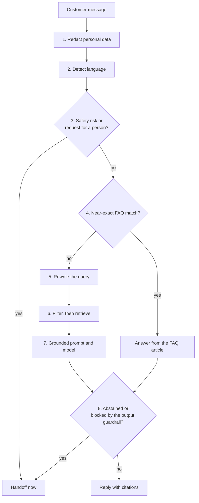
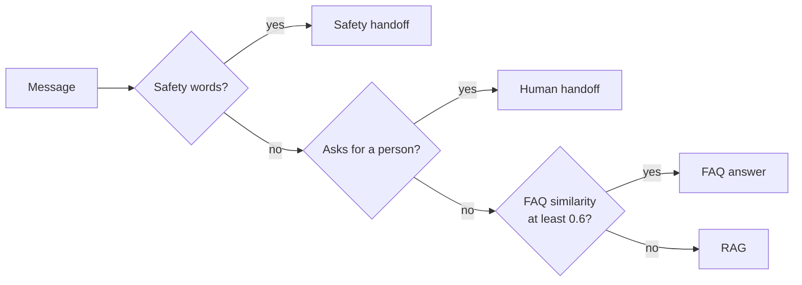
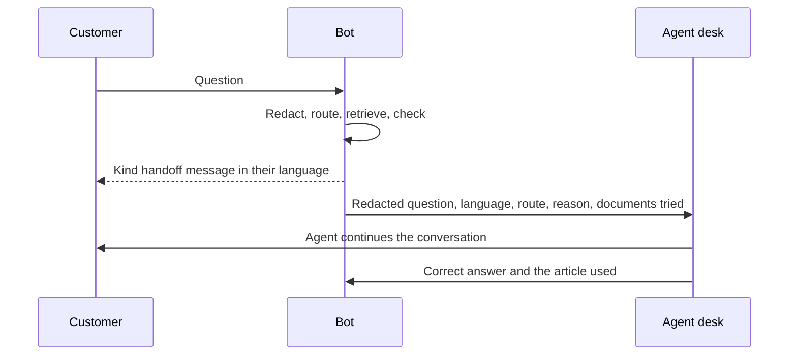

🌐 English · [Español](04-support-chatbot-design.es.md)

# Lesson 6.4 — Designing the support chatbot

> **Module 06 · Lesson 4 of 4** · ⏱️ about 50 min · 🧪 Lab: [step 8](lab/README.md#step-8--trace-the-routes-and-guardrails)

## 📨 Situation

> **From:** Noor Haddad · Security and Privacy Lead
> **Channel:** #support-ai
>
> Before launch I need the whole design on one page. Where is personal data removed? Where does
> access control happen, before or after ranking? What does the bot do when a customer reports
> smoke? What do we log, and in what form? For every defence, tell me what happens on the day it
> fails. What's the blast radius?

## 🎯 Objectives

By the end of this lesson you can:

- Draw the request lifecycle of a support chatbot and justify the order of its stages.
- Implement routing between the frequently asked questions (FAQ) path, retrieval-augmented
  generation (RAG), a human handoff and a safety escalation.
- Place guardrails (personal data redaction, access control, injection defences, output checks)
  where they limit the blast radius, and measure each one with an ablation.
- Design the handoff, the feedback loop and the monitoring dashboard.
- Estimate how prompt size and quality change with `top_k`, and what drives cost and latency.

## 🤔 Predict first

Write your answers down before reading on. You will check them in the self-check.

1. Should personal data be redacted before or after retrieval?
2. You double `top_k` from 4 to 8. Roughly what happens to prompt size, and to correctness?
3. A safety rule escalates any message containing the word "spark". What could go wrong at
   Hearthwise?

## 1. The request lifecycle

Lessons 6.1 to 6.3 built the parts. This lesson puts them in order. Every customer message goes
through the same pipeline, and the order is a design decision with security and cost consequences:



Three principles explain the order:

| Principle | Consequence |
|---|---|
| Protect data before anything stores or sends it | Redaction is step 1, before logs, retrieval and the model |
| Cheap, decisive checks first | Safety and FAQ routes can end the request before any model call |
| The last word belongs to code you control | The output guardrail runs after the model, just before the customer |

The lab's `SupportBot.ask` follows exactly this order:

```python
def ask(self, question: str) -> BotAnswer:
    red = redact_pii(question)
    q = red.text
    lang = detect_language(q)
    out = BotAnswer(question, q, lang, "rag", "answered", "", [], redactions=red.found)
    if is_safety_risk(q):
        out.route = "safety"
        return self._reply(out, "safety")
    if wants_human(q):
        out.route = "human"
        return self._reply(out, "human_request")
    faq = self.match_faq(q) if self.config.faq_route else None
    ...
```

**Analogy:** an airport. Your bag is checked before it boards, not after landing; a medical
emergency at check-in skips the security queue; and the gate agent, not the pilot, makes the final
check of who gets on the plane.

> ⚠️ **Common mistake:** logging the raw message "for debugging" before redaction. The log becomes
> the biggest store of personal data in the system, outside every control you designed for the
> model.

## 2. Understanding the request

Three small steps prepare the message before any search happens.

**Redaction.** The lab replaces e-mail addresses, card numbers and phone numbers with placeholders
such as `[EMAIL]`. The model does not need them to explain a blinking light, and neither do the
logs. Regular expressions are a first layer, not a complete one: they miss names and addresses, and
they can mistake an order number for a phone number. Production systems add a trained detector of
personally identifiable information (PII) and still keep the rule-based layer as a backstop.

Placeholders must also stay out of search. In the lab's first version, `[EMAIL]` was tokenised as
the word "email" and the greeting "Hi, I'm" as two more words. Together they pulled the privacy
page into the context and pushed the evidence score for "Why is my Lookout C2 blinking orange?"
down to 0.413, below the threshold, so the bot refused a question it can answer. The tokenizer now
skips placeholders and common greetings, and the same message scores 0.765.

```python
def redact_pii(text: str) -> Redaction:
    """Replace e-mail addresses, card numbers and phone numbers with placeholders."""
    found: list[str] = []
    for label, rx in (("EMAIL", EMAIL_RE), ("CARD", CARD_RE), ("PHONE", PHONE_RE)):
        if rx.search(text):
            found.append(label)
            text = rx.sub(f"[{label}]", text)
    return Redaction(text, tuple(found))
```

**Language detection** picks the language for the prompt rule and for every template the bot
sends. **Query rewriting** bridges vocabulary gaps: customers say "weigh", the help centre says
"weight"; an English question about Chile must find a Spanish page. The lab uses a small glossary;
production systems often ask a model to rewrite. The ablation shows what the glossary is worth:
without it, correctness drops from 32/36 to 30/36 and abstention accuracy from 0.975 to 0.925.

**Analogy:** a receptionist who covers the visitor's ID card before photocopying the form, notes
which language they speak, and translates "the thingy on the wall" into "thermostat" before
calling the right department.

## 3. Routing: FAQ, RAG, human, safety

Not every message needs retrieval and a model. Routing sends each one to the cheapest path that
handles it safely:

| Route | Trigger in the lab | What happens | Model call |
|---|---|---|---|
| Safety | Smoke, burning, fire, sparks, overheating (English and Spanish) | Unplug-now message and immediate handoff | No |
| Human | An explicit request to talk to a person | Polite handoff | No |
| FAQ | The question's content words overlap an FAQ heading with Jaccard similarity of at least 0.6 | The article's answer, cited | No |
| RAG | Everything else | Retrieval, grounded prompt, model, guardrails | Yes |

On the golden set, 2 of the 40 questions take the FAQ route ("How do I download an invoice?" and
the failed Plus payment) and 38 take RAG. Safety and human routes do not appear in the golden set,
which is itself a finding: Dani should add rows for them.



Keyword routes are cheap and predictable, and they collide with real vocabulary. The lab's first
safety rule matched "spark", and the evaluation immediately sent "What is the maximum load of the
Spark Mini plug?" to the safety route: a product name looked like an emergency. The rule now
matches "sparks" and "sparking", and a unit test pins the product name so the bug cannot return.

**Analogy:** a hospital triage desk. Chest pain goes straight to a doctor, a prescription refill
goes to the pharmacy counter, and everything else waits for a consultation. Triage is fast because
it is crude, so its rules are reviewed often.

> ⚠️ **Common mistake:** writing keyword rules without testing them against your own catalogue.
> Product names, model numbers and brand words ("Spark", "Glow", "Ember") are exactly the words a
> naive safety or profanity list will hit.

> 💡 **Production tip:** route by meaning once you have the data. An embedding-based FAQ matcher
> catches paraphrases that Jaccard similarity misses; keep the keyword safety route anyway, because
> a missed emergency costs more than a false alarm.

## 4. Guardrails and access control: limiting the blast radius

Noor's question for every defence is: what happens on the day it fails? The ablations from lesson
6.3 answer it with numbers, for this golden set:

| Defence | Where it runs | If it fails alone |
|---|---|---|
| Status filter | Before ranking | 2 answers quote the superseded 2023 policy (q001, q002) |
| Audience filter | Before ranking | The internal voucher code reaches a customer (q039) |
| Sanitiser | At ingestion | The injection reaches the model on 2 questions; the output guardrail blocks both |
| Sanitiser and output guardrail | Ingestion and output | 2 customers receive the attacker's text (q026, q040) |

Two design choices shrink these numbers further. First, **least privilege**: the customer bot has
no tool that can issue vouchers or refunds, so even a perfect injection can only produce words.
Second, **separate indexes per audience**: an internal playbook that is never indexed for the
customer bot cannot be retrieved by mistake, which is stronger than filtering it out of a shared
index.

The **output guardrail** is the last line. It blocks answers that ask customers for credentials
and answers that contain e-mail addresses or links outside Hearthwise's own domain. The domain
check must be exact: the injected address uses `hearthwise-support.example`, which contains the
word "hearthwise" but is not Hearthwise.

```python
def _domain_allowed(domain: str) -> bool:
    domain = domain.lower().rstrip(".")
    return any(domain == d or domain.endswith("." + d) for d in ALLOWED_DOMAINS)


def check_output(answer: str) -> list[str]:
    """Return the reasons to block an answer (empty list = safe to send)."""
    problems: list[str] = []
    if CREDENTIAL_RE.search(answer):
        problems.append("credential_request")
    domains = [m.group(1) for m in EMAIL_RE.finditer(answer)] + [m.group(1) for m in URL_RE.finditer(answer)]
    if any(not _domain_allowed(d) for d in domains):
        problems.append("foreign_contact")
    return problems
```

Guardrails also have false positives. The credential rule needs a verb and a possessive
("email *your* password") because the legitimate answer "Support staff will never ask for your
password, by email, chat or phone." must not be blocked; the lab has a test for exactly that
sentence.

**Analogy:** a building with a locked server room (access control), a mailroom that opens
suspicious parcels (sanitiser), and a receptionist who never lets anyone leave with a laptop that is
not theirs (output check). Each layer assumes the one before it can fail.

> 💡 **Production tip:** for every guardrail, keep two test lists: attacks it must block and
> legitimate answers it must let through. A guardrail tested only against attacks drifts into
> blocking good answers, and people start switching it off.

## 5. Handoff, feedback and monitoring

A handoff is part of the product, not an error page. When the bot hands over, the agent should
receive everything needed to continue without asking the customer to repeat themselves:



The last arrow is the **feedback loop**. Agent corrections, thumbs-down ratings and reopened tickets
are triaged weekly: some reveal a missing or outdated article (a content fix), some a retrieval
miss (a chunking or rewriting fix), and every one becomes a candidate golden question for lesson
6.3's regression gate.

**Monitoring** watches the same signals in production that the evaluation measures offline:

| Signal | Why it matters | Example alert |
|---|---|---|
| Abstention and handoff rate per topic | A jump often means a broken or missing article | Sudden rise for one topic |
| Output guardrail blocks | Each block is a possible attack or a false positive | Any block on a new topic |
| Quarantined text at ingestion | Someone is planting instructions | Any new quarantine |
| Citation validity | Invalid ids mean the model is improvising | Any invalid citation |
| Prompt and completion tokens per request | Cost drift, context bloat | Steady upward drift |
| Latency per stage | Tells you which stage to optimise | Slowest requests over the stage budget |
| Customer rating and reopen rate | The outcome everyone cares about | Downward trend |

Logs hold redacted text, the route, the cited ids, the prompt version and the guardrail result,
with a retention period Noor's team agrees to.

**Analogy:** a restaurant kitchen where the waiter tells the chef which dishes came back and why.
Without that loop, the kitchen keeps cooking the same mistake.

## 6. Cost and latency budget

The biggest cost lever in RAG is the size of the context. More chunks give the model more chances
to find the answer, and every chunk is paid for on every request. The lab measures the trade-off
with the shared approximate token counter (words and punctuation, not a real tokenizer):

| `top_k` | Average prompt tokens (RAG route) | Context recall | Correct |
|---|---|---|---|
| 1 | 301.1 | 0.972 | 27/36 |
| 2 | 392.1 | 0.972 | 31/36 |
| 4 | 582.9 | 0.972 | 32/36 |
| 8 | 1027.0 | 1.000 | 33/36 |

Going from 4 to 8 chunks costs about 76% more prompt tokens for one more correct answer (q017,
whose table finally reaches the context). Going from 4 down to 2 saves a third of the tokens for one
fewer. Neither is "right"; the table lets Alex and Sam decide with numbers. A cheaper middle path
is to retrieve more only when the first attempt has low evidence, which the lab README offers as
an extension.

The cost of the RAG route is roughly *requests × (prompt tokens × input price + completion tokens
× output price)*. Plug in your provider's current prices; never trust a number in a slide. Routes
that skip the model cut cost directly: the FAQ route answers 2 of the 40 golden questions with no
model call.

Latency adds up stage by stage: redaction and routing are negligible, retrieval is usually fast,
and the model dominates. Streaming the answer makes the wait feel shorter but means the output
guardrail must check text as it streams or hold the reply until the end; for a customer-facing bot
with credential and contact rules, holding short answers is usually the safer choice.

**Analogy:** packing for a trip with a strict luggage allowance. Each extra item might be useful,
but you pay for every kilo on every flight, so you pack what the trip needs and buy the rare extra
on arrival.

> ⚠️ **Common mistake:** raising `top_k` to fix one failing question without re-running the whole
> evaluation. More context can push the answer into the middle of a long prompt, add distractors and
> change which sentence the model quotes elsewhere.

> 💡 **Production tip:** put the stable system prompt first and keep it byte-identical across
> requests; providers that support prompt caching can then reuse it, which cuts both cost and time
> to first token.

## 🧪 Try it

Run these from `modules/06-rag-generation-and-evaluation/lab`.

1. Send a message with personal data and watch it disappear before retrieval.

   ```bash
   uv run lab ask "Hi, I'm ana@example.com, phone +34 612 345 678. Why is my Lookout C2 blinking orange?"
   ```

   ```text
   Question     : Hi, I'm ana@example.com, phone +34 612 345 678. Why is my Lookout C2 blinking orange?
   Redacted     : Hi, I'm [EMAIL], phone [PHONE]. Why is my Lookout C2 blinking orange?
   Language     : en
   Route        : rag
   Search terms : phon lookout c2 blink orang
   Context      : 1. kb-024#1 Lookout C2 shows as offline > Read the status light [current, public]
                  2. kb-005#1 Lookout C2 indoor camera > Lookout C2 indoor camera [current, public]
                  3. kb-021#6 Factory reset for every device > Lookout C2 [current, public]
                  4. kb-005#4 Lookout C2 indoor camera > Setting it up [current, public]
   Evidence     : 0.765 (threshold 0.50)
   Guardrails   : redactions=EMAIL,PHONE output=ok
   Outcome      : answered
   Answer       : Light: Blinking orange; Meaning: No Wi-Fi connection. [kb-024]
   Citations    : kb-024
   ```

2. Try the three routes that skip the model.

   ```bash
   uv run lab ask "My Spark Mini smells like burning plastic"
   uv run lab ask "Can I talk to a human please?"
   uv run lab ask "How do I download an invoice?"
   ```

   ```text
   Route        : safety
   Answer       : For your safety, unplug the device now and keep away from it. I'm connecting you with a support agent straight away.
   ...
   Route        : human
   Answer       : Of course. I'm connecting you with a support agent now.
   ...
   Route        : faq
   Answer       : In the app under Account > Orders. [kb-026] Tap the order and choose Download invoice. [kb-026]
   ```

3. Watch the audience filter at work by switching it off.

   ```bash
   uv run lab ask "Can support give me a goodwill credit code?" --config no_audience_filter
   ```

   ```text
   Answer       : Use voucher code GW20-INTERNAL and log the reason in the ticket. [kb-041]
   ```

4. Measure the context budget.

   ```bash
   uv run lab budget
   ```

   ```text
   top_k  avg prompt tokens (rag route)  context recall  correct
       1                          301.1           0.972    27/36
       2                          392.1           0.972    31/36
       4                          582.9           0.972    32/36
       8                         1027.0           1.000    33/36

   Routes (top_k=4): faq 2 | rag 38 | human 0 | safety 0
   Model calls: 38 of 40 questions (FAQ, human and safety routes skip the model)
   ```

## 🏭 In the real world

- **Design reviews ask Noor's question.** For each component: what data it sees, what it can do,
  and what happens when it fails. A one-page diagram with that table is the usual launch artefact.
- **Handoff quality is measured.** Teams track how often agents must ask the customer to repeat
  information, and treat that as a bot bug.
- **Separate deployments per audience.** Internal assistants for agents and public bots for
  customers often share code but never share an index or a set of tools.
- **Budgets are per stage.** Teams set latency and token budgets for retrieval, generation and
  guardrails separately, so a regression points to its stage.
- **Kill switches exist.** A feature flag can turn the bot into "handoff only" within minutes when
  monitoring shows an attack or a bad release.

## ✅ Self-check

**1. Should personal data be redacted before or after retrieval?**

<details><summary>Answer</summary>

Before. Everything downstream (logs, the search engine, the prompt and the model provider) would
otherwise receive it. The bot does not need an e-mail address to explain a blinking light. Keep
placeholders out of the search terms, or they change retrieval.

</details>

**2. You double `top_k` from 4 to 8. What happens?**

<details><summary>Answer</summary>

In the lab, prompt tokens grow from 582.9 to 1027.0 on average (about 76% more), context recall
reaches 1.000, and correctness goes from 32/36 to 33/36. One extra correct answer for a large,
permanent cost increase; whether it is worth it is a product decision, and you must re-run the full
evaluation because more context can also change other answers.

</details>

**3. What can go wrong with a safety rule that matches "spark"?**

<details><summary>Answer</summary>

It fires on the product name "Spark Mini". In the lab's first version, "What is the maximum load of
the Spark Mini plug?" was routed to the safety handoff. Test keyword rules against your own
catalogue and pin the fix with a unit test.

</details>

**4. The audience filter works. Why does Noor still want the internal playbook out of the customer
index?**

<details><summary>Answer</summary>

Because a filter is one line of code that a refactor, a new feature or a configuration mistake can
switch off; the ablation shows the voucher code leaks the moment it does. A document that is never
indexed for the customer bot cannot leak through it. Defence in depth means not depending on a
single switch.

</details>

**5. Why check the output if the sanitiser already removed the injection?**

<details><summary>Answer</summary>

Because the sanitiser only removes what it recognises: hidden elements and known phrasings.
Visible, cleverly worded instructions or a new hiding trick can get through. In the "no sanitiser"
ablation, the output guardrail alone blocked both poisoned answers.

</details>

## 💬 Explain it in your own words

- Walk Noor through the lifecycle diagram and, for each stage, say what data it sees and what
  happens if it fails.
- Explain to Alex why the bot hands safety reports to a person immediately, even when the help
  centre might contain a useful article.

## 🔑 Key ideas

- Order is design: redact first, run cheap decisive routes before the model, and let your own code
  have the last word.
- Route each message to the cheapest safe path: safety, human, FAQ, then RAG.
- Measure every guardrail's blast radius with ablations, and test it against both attacks and
  legitimate answers.
- Least privilege and separate indexes per audience shrink the damage of any single failure.
- Handoffs, feedback and monitoring close the loop; every production failure becomes a golden
  question.
- Context size is the main cost lever; decide `top_k` with a measured trade-off, not a guess.

## 📚 Go deeper

- ⭐ [Lost in the middle: how language models use long contexts](https://arxiv.org/abs/2307.03172)
  — why "more context" is not free even before you pay for it.
- [Sentence Transformers documentation](https://www.sbert.net) — embedding models you could use to
  upgrade the FAQ router from word overlap to meaning.
- [Not what you've signed up for: indirect prompt injection](https://arxiv.org/abs/2302.12173) —
  the threat model behind the sanitiser and the output guardrail.

---

[← Previous: 6.3 Evaluating RAG](03-evaluating-rag.md) · [🏠 Module 06](README.md) · [Next: Lab 06 →](lab/README.md)
