🌐 [English](README.md) · Español

# Módulo 06 — RAG II: generación fundamentada, RAFT y evaluación

> Lanza un chatbot de soporte que responde desde el centro de ayuda con citas, dice "no lo sé" cuando
> debe, resiste la inyección de *prompts* oculta y viene con un informe de evaluación que lo
> demuestra.

## 🗺️ Mapa del curso

```mermaid
flowchart LR
    subgraph P1["Parte 1 · Fundamentos"]
        M01["01 · Cómo se construyen los LLM"] --> M02["02 · Del modelo base al asistente"] --> M03["03 · Playground de LLM"]
    end
    subgraph P2["Parte 2 · Adaptación y RAG"]
        M04["04 · Prompting y fine-tuning"] --> M05["05 · RAG I: recuperación"] --> M06["06 · RAG II: bot de soporte"]
    end
    subgraph P3["Parte 3 · Agentes"]
        M07["07 · Workflows y herramientas"] --> M08["08 · Agente Ask-the-Web"]
    end
    subgraph P4["Parte 4 · Razonamiento"]
        M09["09 · Modelos de razonamiento"] --> M10["10 · Deep research y local"]
    end
    M03 --> M04
    M06 --> M07
    M08 --> M09
    M10 --> CAP["🎓 Proyecto final"]
    classDef current fill:#ffb300,stroke:#e65100,stroke-width:3px,color:#000
    class M06 current
```



## 📖 La historia

En el módulo 05 enseñaste al asistente de Hearthwise a *encontrar* las páginas correctas del centro
de ayuda. Encontrar no es responder. Alex, responsable de atención al cliente, quiere respuestas
correctas, amables y enlazadas al artículo del que salen, y un traspaso honesto a alguien del equipo
cuando el centro de ayuda no tiene nada que decir. Noor, responsable de seguridad y privacidad, ha
encontrado dos trampas en la base de conocimiento: un manual interno de escalado con un código de
vale que la clientela nunca debe ver, y una página de la comunidad con un párrafo oculto a la vista
de las personas que intenta dar órdenes a los asistentes de IA. Dani, responsable de evaluación, no
dará el visto bueno a nada sin un informe sobre las 40 preguntas de referencia, incluidas aquellas en
las que el silencio es la respuesta correcta. Mientras tanto, Rio tiene sobre la mesa la propuesta de
un proveedor que asegura que el *fine-tuning* acaba con las alucinaciones. En este módulo, el chatbot
de soporte se convierte en algo que puedes defender ante esas cuatro personas.

## 🎯 Objetivos de aprendizaje

Al terminar este módulo puedes:

- Escribir un *prompt* fundamentado con reglas, documentos numerados y delimitados con metadatos,
  citas y una abstención legible por máquina.
- Defender un sistema RAG frente a documentos desactualizados, documentos restringidos e inyección
  indirecta de *prompts*, y medir lo que vale cada defensa.
- Construir y validar un conjunto de *fine-tuning* al estilo RAFT, y decidir cuándo compensa el
  *fine-tuning* para RAG.
- Evaluar un sistema RAG etapa por etapa: recuperación, relevancia del contexto, fidelidad,
  corrección, abstención y seguridad, con un juez calibrado y una compuerta de regresión.
- Diseñar el chatbot de soporte completo: enrutamiento, barreras de protección, traspaso a una
  persona, bucle de retroalimentación, monitorización y un presupuesto de *tokens*.

## 🗂️ Lecciones

| # | Lección | Tiempo | Qué aprenderás |
|---|---|---|---|
| 6.1 | [*Prompts* para respuestas fundamentadas](01-prompting-for-grounded-answers.es.md) | 50 min | El *prompt* de RAG, las citas, la abstención y el traspaso, los documentos contradictorios, la inyección en el texto recuperado, responder en el idioma de la clientela |
| 6.2 | [RAFT: entrenar para RAG](02-raft-training-for-rag.es.md) | 45 min | Documentos oráculo y distractores, ejemplos sin el oráculo, cadena de pensamiento que cita textualmente, validación del dataset, cuándo compensa el *fine-tuning* |
| 6.3 | [Evaluar RAG](03-evaluating-rag.es.md) | 55 min | hit@k y MRR, relevancia del contexto, fidelidad por afirmación, corrección por hechos clave, métricas de abstención y de seguridad, calibración del juez, ablaciones y compuertas |
| 6.4 | [Diseñar el chatbot de soporte](04-support-chatbot-design.es.md) | 50 min | El ciclo de vida de la petición, el enrutamiento, el control de acceso y las barreras de protección, el traspaso y la retroalimentación, la monitorización, el coste y la latencia |

## 🧪 Lab

Construyes un bot de soporte completo y sin conexión sobre `datasets/kb`, con un modelo sustituto
determinista que cita sus fuentes, se abstiene por debajo de un umbral y, a propósito, obedece las
instrucciones que encuentra en su contexto. A su alrededor construyes el arnés de evaluación, las
ablaciones, una calibración del juez y un constructor de datasets de RAFT. Sin claves de API, sin
GPU, sin red y con tests rápidos.

```bash
cd modules/06-rag-generation-and-evaluation/lab
uv sync && uv run pytest
uv run lab eval
```

Instrucciones completas: [lab/README.es.md](lab/README.es.md).

Definición de terminado (*Definition of Done*):

- [ ] `uv run pytest` pasa y `uv run lab eval --gate` imprime `Regression gate: PASS`.
- [ ] Puedes mostrar cómo se cuela cada trampa (política sustituida, vale interno, inyección oculta)
      cuando su defensa está desactivada.
- [ ] Completaste al menos dos tareas "Tu turno" del lab y los tests siguen pasando.
- [ ] Puedes explicar cada línea del resumen de `lab eval`.
- [ ] Elegiste un umbral de abstención a partir del barrido y puedes defenderlo.
- [ ] `lab raft` pasa todas las comprobaciones y puedes explicar cada una.
- [ ] Puedes dibujar el ciclo de vida de una petición y dar el radio de impacto de cada defensa.

## 📏 Rúbrica de autoevaluación

| Criterio | 1 Inicial | 2 En desarrollo | 3 Competente | 4 Avanzado |
|---|---|---|---|---|
| *Prompts* fundamentados | Sabe nombrar las partes de un *prompt* de RAG | Ejecuta el lab y lee el *prompt* que construye | Escribe un *prompt* fundamentado con citas y abstención para una base de conocimiento nueva y explica cada regla | Versiona, prueba y defiende un cambio de *prompt* con resultados de evaluación |
| Contenido desactualizado, restringido e inyectado | Sabe definir la inyección de *prompts* | Reproduce las tres trampas con las ablaciones | Elige dónde va cada defensa y explica qué no puede detener | Diseña una defensa en profundidad para una fuente de datos nueva y mide su radio de impacto |
| RAFT y *fine-tuning* para RAG | Sabe decir qué significa RAFT | Construye el dataset del lab y lee un ejemplo | Ajusta `p_oracle`, los distractores y las salidas objetivo para un caso de uso nuevo y valida los datos | Decide, con pruebas, si el *fine-tuning* supera a los arreglos del *prompt* o de la recuperación |
| Evaluación de RAG | Sabe enumerar métricas como la fidelidad y el *recall* | Ejecuta `lab eval` y lee el informe | Atribuye cada fallo a una etapa y calibra un juez | Diseña un conjunto de referencia, compuertas y ablaciones en los que un equipo confía |
| Diseño del bot de soporte | Sabe describir un chatbot a alto nivel | Sigue una petición a través del bot del lab | Diseña el enrutamiento, las barreras y el traspaso para un producto nuevo | Defiende un diseño, su monitorización y su presupuesto de *tokens* en una revisión de lanzamiento |

## 🎤 Rincón de entrevistas

**1. ¿Cómo evitas que un asistente RAG responda con una política desactualizada?**

<details><summary>Respuesta</summary>

Marca los documentos con metadatos (`status`, `effective_date`) y filtra los sustituidos antes del
*ranking*, para que nunca lleguen al *prompt*. Muestra los metadatos en el *prompt* y añade una regla
para preferir el documento vigente y más reciente, como respaldo para los conflictos que los
metadatos no recogen. Demuéstralo con una ablación: en el lab de este módulo, quitar el filtro de
estado hace que 2 de las 40 respuestas de referencia citen la política de 2023.

</details>

**2. ¿Qué es la inyección indirecta de *prompts* y cómo defiendes de ella un sistema RAG?**

<details><summary>Respuesta</summary>

Son instrucciones plantadas en contenido que el modelo leerá más tarde, como una página web o un
documento, en lugar de escritas por quien usa el sistema. Defiéndete con capas que no dependan todas
del modelo: sanitiza el contenido al ingerirlo (elementos ocultos, texto con forma de instrucción),
delimita y escapa los documentos en el *prompt*, deja claro que los documentos son datos, no le des
al modelo herramientas peligrosas y comprueba las salidas (nada de peticiones de credenciales ni de
datos de contacto desconocidos). Mide cada capa con una ablación.

</details>

**3. ¿Qué diferencia hay entre la fidelidad y la corrección de la respuesta?**

<details><summary>Respuesta</summary>

La fidelidad pregunta si cada afirmación está respaldada por el contexto recuperado; la corrección
pregunta si la respuesta es correcta comparada con una referencia. No coinciden cuando el contexto
está mal: una respuesta puede citar fielmente una política sustituida y ser incorrecta. Mide la
fidelidad afirmación por afirmación contra el contexto, y la corrección con hechos clave o con un
juez calibrado contra referencias.

</details>

**4. ¿Cuándo compensa el *fine-tuning* en un sistema RAG?**

<details><summary>Respuesta</summary>

Cuando el contexto correcto ya está en el *prompt* y el modelo sigue usándolo mal (se distrae con
documentos parecidos, adivina en lugar de rechazar, usa un formato incorrecto) y los cambios en el
*prompt* se han estancado. Los datos al estilo RAFT, con documentos oráculo y distractores, algunos
ejemplos sin el oráculo y salidas objetivo que citan textualmente, entrenan ese comportamiento. No
arregla los fallos de recuperación y es un mal almacén para datos que cambian.

</details>

**5. ¿Cómo comprobarías un LLM como juez (*LLM-as-a-judge*) antes de usarlo en tu evaluación?**

<details><summary>Respuesta</summary>

Construye un conjunto etiquetado (etiquetas humanas, o corrupciones con etiquetas conocidas, como
números cambiados, afirmaciones ajenas y negaciones, más paráfrasis fieles), ejecuta el juez y mide
la concordancia, las falsas alarmas y la tasa de detección por tipo de error. Elige los ajustes a
partir de esos números, reporta la concordancia del juez junto a sus puntuaciones y vuelve a
calibrarlo cuando cambien el modelo juez o el *prompt*.

</details>

## ✅ Antes de seguir

- Haz el [quiz del módulo](quiz.es.md) (14 preguntas).
- Ten la [chuleta](cheatsheet.es.md) a mano para el módulo 07, donde el asistente empieza a usar
  herramientas.

---

[← Módulo 05](../05-rag-retrieval/README.es.md) · [🏠 Inicio del curso](../../README.es.md) · [Empieza: Lección 6.1 →](01-prompting-for-grounded-answers.es.md)
