🌐 English · [Español](README.es.md)

# Module 06 — RAG II: Grounded Generation, RAFT and Evaluation

> Ship a support chatbot that answers from the help centre with citations, says "I don't know"
> when it should, resists hidden prompt injection, and comes with an evaluation report that proves
> it.

## 🗺️ Course map

```mermaid
flowchart LR
    subgraph P1["Part 1 · Foundations"]
        M01["01 · How LLMs are built"] --> M02["02 · Base model to assistant"] --> M03["03 · LLM playground"]
    end
    subgraph P2["Part 2 · Adapting and RAG"]
        M04["04 · Prompting and fine-tuning"] --> M05["05 · RAG I: retrieval"] --> M06["06 · RAG II: support bot"]
    end
    subgraph P3["Part 3 · Agents"]
        M07["07 · Workflows and tools"] --> M08["08 · Ask-the-Web agent"]
    end
    subgraph P4["Part 4 · Reasoning"]
        M09["09 · Reasoning models"] --> M10["10 · Deep research and local"]
    end
    M03 --> M04
    M06 --> M07
    M08 --> M09
    M10 --> CAP["🎓 Capstone"]
    classDef current fill:#ffb300,stroke:#e65100,stroke-width:3px,color:#000
    class M06 current
```



## 📖 The story

In module 05 you taught the Hearthwise assistant to *find* the right help-centre pages. Finding is
not answering. Alex, who runs customer support, wants answers that are correct, kind and linked to
the article they came from, and an honest handoff to a colleague when the help centre has nothing
to say. Noor, the security and privacy lead, has found two traps in the knowledge base: an internal
escalation playbook with a voucher code that customers must never see, and a community page with a
paragraph hidden from humans that tries to give orders to AI assistants. Dani, who owns evaluation,
will not sign off on anything without a report on the 40 golden questions, including the ones where
silence is the right answer. Meanwhile Rio has a vendor pitch on the table claiming that fine-tuning
fixes hallucinations. This module is where the support chatbot becomes something you can defend in
front of all four of them.

## 🎯 Learning objectives

By the end of this module you can:

- Write a grounded prompt with rules, numbered and delimited documents with metadata, citations and
  a machine-readable abstention.
- Defend a RAG system against outdated documents, restricted documents and indirect prompt
  injection, and measure what each defence is worth.
- Build and validate a RAFT-style fine-tuning set, and decide when fine-tuning for RAG is worth it.
- Evaluate a RAG system stage by stage: retrieval, context relevance, faithfulness, correctness,
  abstention and safety, with a calibrated judge and a regression gate.
- Design the full support chatbot: routing, guardrails, handoff, feedback loop, monitoring and a
  token budget.

## 🗂️ Lessons

| # | Lesson | Time | You will learn |
|---|---|---|---|
| 6.1 | [Prompting for grounded answers](01-prompting-for-grounded-answers.md) | 50 min | The RAG prompt, citations, abstention and handoff, conflicting documents, injection in retrieved text, answering in the customer's language |
| 6.2 | [RAFT: training for RAG](02-raft-training-for-rag.md) | 45 min | Oracle and distractor documents, examples without the oracle, quoting chain-of-thought, dataset validation, when fine-tuning pays off |
| 6.3 | [Evaluating RAG](03-evaluating-rag.md) | 55 min | hit@k and MRR, context relevance, claim-level faithfulness, key-fact correctness, abstention and safety metrics, judge calibration, ablations and gates |
| 6.4 | [Designing the support chatbot](04-support-chatbot-design.md) | 50 min | The request lifecycle, routing, access control and guardrails, handoff and feedback, monitoring, cost and latency |

## 🧪 Lab

You build a complete, offline support bot over `datasets/kb` with a deterministic stand-in model
that cites its sources, abstains below a threshold and, on purpose, obeys instructions it finds in
its context. Around it you build the evaluation harness, the ablations, a judge calibration and a
RAFT dataset builder. No API keys, no GPU, no network, and fast tests.

```bash
cd modules/06-rag-generation-and-evaluation/lab
uv sync && uv run pytest
uv run lab eval
```

Full instructions: [lab/README.md](lab/README.md).

Definition of Done:

- [ ] `uv run pytest` passes and `uv run lab eval --gate` prints `Regression gate: PASS`.
- [ ] You can show how each trap (superseded policy, internal voucher, hidden injection) gets
      through when its defence is off.
- [ ] You completed at least two "Your turn" tasks in the lab and the tests still pass.
- [ ] You can explain every line of the `lab eval` summary.
- [ ] You chose an abstention threshold from the sweep and can defend it.
- [ ] `lab raft` passes all checks and you can explain each check.
- [ ] You can draw the request lifecycle and give the blast radius of each defence.

## 📏 Self-assessment rubric

| Criterion | 1 Beginning | 2 Developing | 3 Proficient | 4 Advanced |
|---|---|---|---|---|
| Grounded prompting | Can name the parts of a RAG prompt | Can run the lab and read the prompt it builds | Can write a grounded prompt with citations and abstention for a new knowledge base and explain each rule | Can version, test and defend a prompt change with evaluation results |
| Outdated, restricted and injected content | Can define prompt injection | Can reproduce the three traps with the ablations | Can choose where each defence belongs and explain what it cannot stop | Can design defence in depth for a new data source and measure its blast radius |
| RAFT and fine-tuning for RAG | Can say what RAFT stands for | Can build the lab's dataset and read an example | Can tune `p_oracle`, distractors and targets for a new use case and validate the data | Can decide, with evidence, whether fine-tuning beats prompt or retrieval fixes |
| RAG evaluation | Can list metrics such as faithfulness and recall | Can run `lab eval` and read the report | Can attribute each failure to a stage and calibrate a judge | Can design a golden set, gates and ablations that a team trusts |
| Support bot design | Can describe a chatbot at a high level | Can trace a request through the lab bot | Can design routing, guardrails and handoff for a new product | Can defend a design, its monitoring and its token budget in a launch review |

## 🎤 Interview corner

**1. How do you stop a RAG assistant from answering with an outdated policy?**

<details><summary>Answer</summary>

Mark documents with metadata (`status`, `effective_date`) and filter superseded ones out before
ranking, so they never reach the prompt. Show the metadata in the prompt and add a rule to prefer
the current, newest document, as a backup for conflicts the metadata does not capture. Prove it with
an ablation: in this module's lab, removing the status filter makes 2 of 40 golden answers quote
the 2023 policy.

</details>

**2. What is indirect prompt injection, and how do you defend a RAG system against it?**

<details><summary>Answer</summary>

Instructions planted in content the model will read later, such as a web page or a document, rather
than typed by the user. Defend in layers that do not all depend on the model: sanitise content at
ingestion (hidden elements, instruction-like text), delimit and escape documents in the prompt,
state that documents are data, give the model no dangerous tools, and check outputs (no credential
requests, no unknown contact details). Measure each layer with an ablation.

</details>

**3. What is the difference between faithfulness and answer correctness?**

<details><summary>Answer</summary>

Faithfulness asks whether every claim is supported by the retrieved context; correctness asks
whether the answer is right compared with a reference. They disagree when the context is wrong: an
answer can faithfully quote a superseded policy and be wrong. Measure faithfulness claim by claim
against the context, and correctness with key facts or a calibrated judge against references.

</details>

**4. When is fine-tuning worth it for a RAG system?**

<details><summary>Answer</summary>

When the right context is already in the prompt and the model still misuses it (distracted by
similar documents, guessing instead of refusing, wrong format) and prompt changes have plateaued.
RAFT-style data with oracle and distractor documents, some examples without the oracle and quoting
targets trains that behaviour. It does not fix retrieval misses, and it is a poor store for facts
that change.

</details>

**5. How would you check an LLM-as-a-judge before using it in your evaluation?**

<details><summary>Answer</summary>

Build a labelled set (human labels, or corruptions with known labels such as swapped numbers,
foreign claims and negations, plus faithful paraphrases), run the judge, and measure agreement,
false alarms and catch rate per error type. Pick settings from those numbers, report the judge's
agreement next to its scores, and re-calibrate when the judge model or prompt changes.

</details>

## ✅ Before you move on

- Take the [module quiz](quiz.md) (14 questions).
- Keep the [cheatsheet](cheatsheet.md) next to you for module 07, where the assistant starts using
  tools.

---

[← Module 05](../05-rag-retrieval/README.md) · [🏠 Course home](../../README.md) · [Start: Lesson 6.1 →](01-prompting-for-grounded-answers.md)
