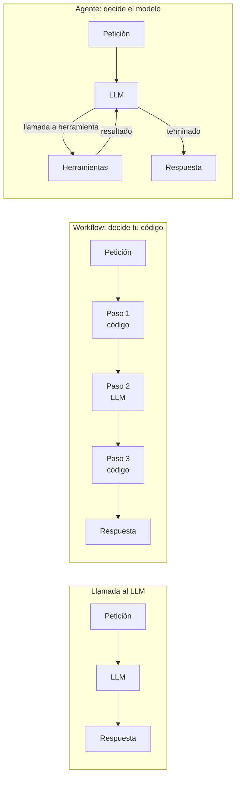
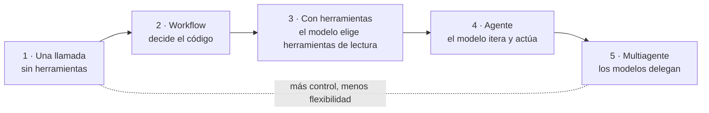
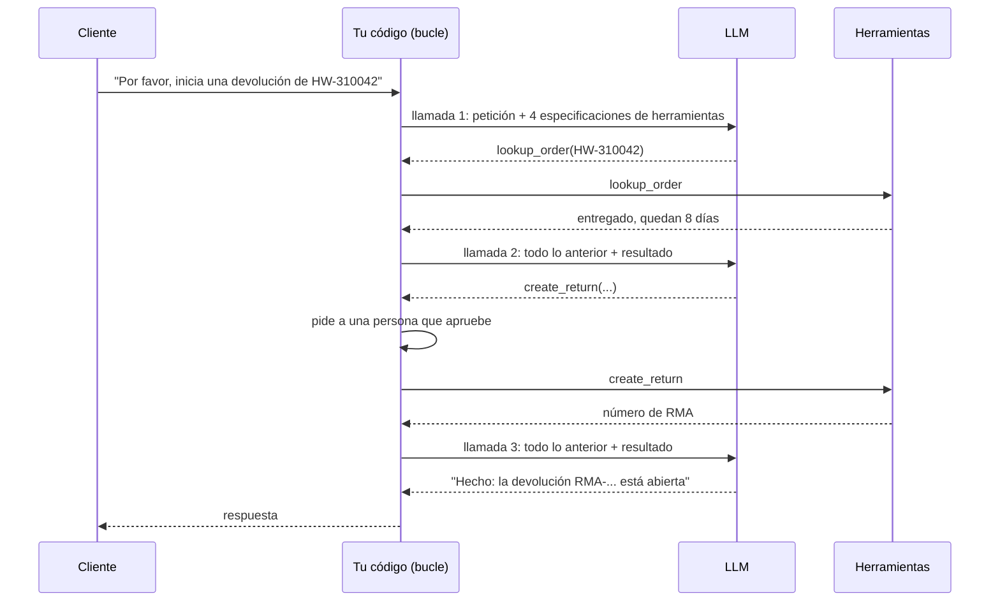
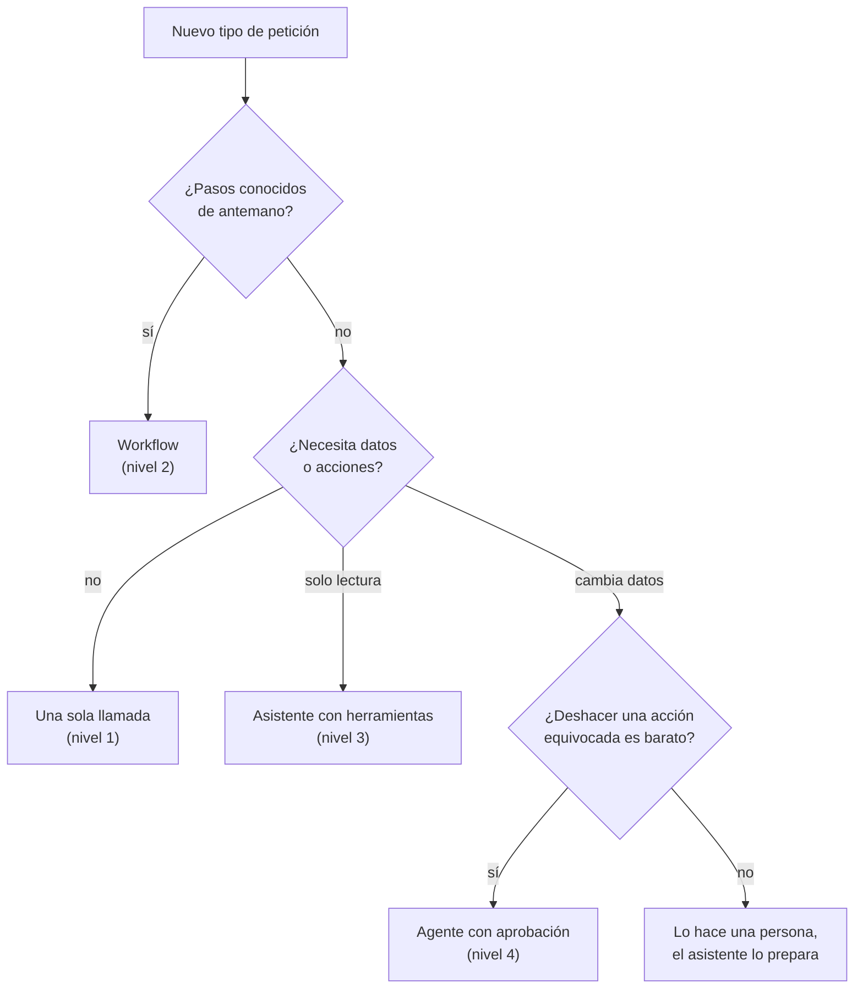

🌐 [English](01-agents-overview.md) · Español

# Lección 7.1 — Agentes, sistemas agénticos y la escalera de autonomía

> **Módulo 07 · Lección 1 de 4** · ⏱️ unos 45 min · 🧪 Lab: [paso 2](lab/README.es.md#paso-2--sube-la-escalera-de-autonomía)

## 📨 Situación

> **De:** Jordan Kim · Responsable de Producto y Estrategia
> **Canal:** #hearthwise-assist
>
> El chatbot de soporte del módulo 06 responde preguntas de maravilla. Pero mira lo que escribe la
> clientela: "dónde está mi pedido", "inicia mi devolución", "qué bombillas funcionan con el
> termostato". Quieren que las cosas se *hagan*, no párrafos. Quiero un asistente que consulte datos y
> actúe. Todo el mundo dice "agente", así que construyamos un agente. Noor ya ha preguntado quién
> aprueba las acciones, y Sam quiere saber cuánto cuesta por conversación. ¿Me dices para el viernes
> qué deberíamos construir primero y cuánto nos costaría en dinero, velocidad y riesgo?

## 🎯 Objetivos

Al terminar esta lección puedes:

- Explicar la diferencia entre una llamada a un modelo de lenguaje grande (LLM, *large language
  model*), un *workflow* y un agente con una sola pregunta: ¿quién decide el siguiente paso?
- Situar una funcionalidad en una escalera de autonomía (*agency ladder*) de cinco niveles y justificar
  el nivel que eliges.
- Medir con el lab cómo crecen con la autonomía las llamadas al LLM, los *tokens* y el poder de cambiar
  datos.
- Decidir cuándo *no* construir un agente, con una lista de comprobación breve.
- Asociar cada riesgo de la autonomía (coste, latencia, radio de impacto o *blast radius*) con un
  control que puedes implementar.

## 🤔 Predice primero

Apunta tus respuestas antes de seguir leyendo. Las comprobarás en la autoevaluación.

1. La petición de Jordan "inicia una devolución del pedido HW-310042" se puede resolver con una sola
   llamada al LLM o con un bucle en el que el modelo decide qué herramientas llamar. ¿Cuántos *tokens*
   más usa, más o menos, el bucle: unas 2 veces, 10 veces o 50 veces más?
2. Verdadero o falso: un "agente" es un tipo especial de modelo entrenado para ser autónomo.
3. ¿Qué funcionalidad tiene mayor radio de impacto: un asistente que puede *leer* todos los pedidos, o
   un *workflow* fijo que puede *crear* devoluciones después de que una persona pulse Aprobar?

## 1. Llamada al LLM, workflow, agente: ¿quién decide el siguiente paso?

Se usa la palabra "agente" para casi cualquier cosa que lleve un LLM dentro. Eso hace confusas las
reuniones de diseño. Una distinción más útil plantea una sola pregunta: **¿quién decide qué pasa
después?**

- Una **llamada al LLM** es un *prompt* de entrada y una respuesta de salida. Nadie decide un
  "siguiente paso", porque no lo hay. El chatbot del módulo 06 es una llamada más una recuperación que
  tu código ejecuta siempre antes, lo que, en sentido estricto, lo convierte en un *workflow* diminuto.
- Un ***workflow*** es una secuencia de pasos que define *tu código*. Algunos pasos llaman a un LLM,
  otros a bases de datos o herramientas, y el camino entre ellos está escrito de antemano. El LLM
  rellena los huecos.
- Un **agente** es un sistema en el que *el modelo* decide el siguiente paso en tiempo de ejecución:
  qué herramienta llamar, con qué argumentos, si llamar a otra y cuándo ha terminado. Tu código ejecuta
  un bucle y hace lo que el modelo pide, dentro de los límites que tú fijas.

**Sistema agéntico** (*agentic system*) es el término general que abarca *workflows* y agentes:
cualquier sistema en el que la salida de un LLM determina lo que hace el software. El modelo es el
mismo en los tres casos. "Agente" es una propiedad del *sistema que rodea al modelo*, no de los pesos.

**Analogía:** Piensa en una cocina. Preguntar a quien cocina "¿qué combina bien con el salmón?" es una
llamada al LLM. Entregarle una ficha de receta con los pasos numerados es un *workflow*: esa persona
pica y corta, pero el orden está fijado. Decirle "prepara la cena para seis con lo que haya en el
refrigerador" es un agente: abre el refrigerador, decide, prueba, ajusta y avisa cuando la cena está lista.



En el código, la diferencia se ve a simple vista. Este es el corazón del *workflow* de nivel 2 del lab:
tu código extrae el id del pedido y consulta el almacén de pedidos siempre, y el LLM solo redacta la
respuesta.

```python
order_id = re.search(r"HW-\d{6}", request).group(0)  # code decides: always look the order up
order = store.lookup(order_id, DEMO_CUSTOMER)
reply = provider.complete([Message("system", "Write a short reply from these facts."),
                           Message("user", json.dumps(order))])
```

Y este es el corazón del bucle del agente de `loop.py`, sin la contabilidad: la respuesta del modelo
decide si hay otra ronda y qué contiene.

```python
for _ in range(max_steps):
    reply = provider.complete(trace.messages, tools=tools)
    if not reply.tool_calls:  # the model decided it is done
        return trace
    results = executor.execute_all(reply.tool_calls)  # the model decided what to run
    trace.messages.extend(r.to_message() for r in results)
```

> ⚠️ **Error común:** Llamar "agente" a un *workflow* en una revisión de diseño porque usa un LLM.
> Quienes revisan suponen entonces que el sistema puede improvisar (no puede) o temen que actúe por su
> cuenta (no lo hace). Nombra el nivel con precisión; los riesgos y los tests son distintos.

## 2. La escalera de autonomía

La autonomía no es un interruptor de encendido y apagado. Crece por escalones, y cada escalón pasa una
decisión más de tu código al modelo. Este curso usa una escalera de autonomía de cinco niveles.

| Nivel | Quién decide el siguiente paso | Qué puede tocar el modelo | Ejemplo en Hearthwise |
|---|---|---|---|
| 1 · Una sola llamada al LLM | Nadie, solo hay un paso | Solo el *prompt* | "Explica nuestra política de devoluciones con palabras sencillas" |
| 2 · *Workflow* | Tu código | Lo que tu código le pasa | Extraer el id del pedido → consultar el pedido → redactar la respuesta |
| 3 · Asistente con herramientas | El modelo, durante unos pocos pasos | Las herramientas de solo lectura que expones | "¿Dónde está mi pedido?" con `lookup_order` |
| 4 · Agente de varios pasos | El modelo, hasta que dice que ha terminado | Herramientas de lectura y escritura, tras una aprobación | "Inicia mi devolución" con `create_return` |
| 5 · Sistema multiagente | Varios modelos que se delegan tareas entre sí | Lo que se le dé a cada agente | Un agente investigador más un agente redactor (módulo 08) |

La escalera es una herramienta de diseño. Cuando alguien te pida "un agente", sitúa la petición en un
escalón. La mayoría de las peticiones resultan ser de nivel 2 o 3 en cuanto escribes los pasos. El
nivel 4 está justificado cuando el número y el orden de los pasos dependen de verdad de lo que el
modelo va descubriendo por el camino.

**Analogía:** Una persona recién contratada en el equipo de soporte de Hearthwise sube la misma
escalera. La primera semana responde preguntas de memoria (nivel 1). Después sigue la lista de
comprobación para escalar casos (nivel 2). Luego recibe acceso de lectura al sistema de pedidos (nivel
3). Más adelante puede tramitar devoluciones por su cuenta, con supervisión que firma los reembolsos
(nivel 4). Con el tiempo, coordina un pequeño equipo que se reparte el trabajo (nivel 5). A nadie le
dan la tarjeta de la empresa el primer día.



El lab ejecuta una misma petición en los niveles 1 a 4 con la misma familia de modelos falsos y los
mismos datos. La petición es *"I bought an Ember T3 (order HW-310042) and changed my mind. Please
start a return."* ("Compré un Ember T3 (pedido HW-310042) y he cambiado de opinión. Por favor, inicia
una devolución"). Cada nivel es una función de `agency.py` que devuelve un `Rung`:

```python
def ladder(request: str = LADDER_REQUEST) -> list[Rung]:
    """Run the same request at levels 1 to 4 (level 5, multi-agent, is module 08)."""
    return [
        single_call(request),
        workflow(request),
        _loop_rung("3 tool-using (read-only)", allow_writes=False, request=request),
        _loop_rung("4 agent (can act, approved)", allow_writes=True, request=request),
    ]
```

Los niveles 3 y 4 ejecutan el *mismo* bucle. La única diferencia es un permiso: en el nivel 3, el
ejecutor deniega `create_return`, así que el modelo ni siquiera la ve. Es un tema que se repite en todo
el módulo: la autonomía es algo que concedes, herramienta a herramienta.

## 3. Lo que cuesta la autonomía: tokens, tiempo y radio de impacto

Esto es lo que mide el lab para esa petición:

| Nivel | Llamadas al LLM | Llamadas a herramientas | *Tokens* | Datos modificados |
|---|---|---|---|---|
| 1 · Una sola llamada al LLM | 1 | 0 | 63 | no |
| 2 · *Workflow* | 1 | 1 | 154 | no |
| 3 · Con herramientas (solo lectura) | 2 | 1 | 1.416 | no |
| 4 · Agente (puede actuar, con aprobación) | 3 | 2 | 3.314 | sí |

Los recuentos de *tokens* salen del contador aproximado del lab (palabras y signos de puntuación), así
que tómalos como tamaños relativos, no como una factura. Al subir de nivel crecen tres costes
distintos.

**Dinero (*tokens*).** La sorpresa es el salto del nivel 2 al 3. Un modelo con herramientas necesita las
definiciones de las herramientas en cada petición, y solo las cuatro definiciones del lab ocupan 872
*tokens*. Además, cada ronda del bucle vuelve a enviar toda la conversación hasta ese momento: la
petición, cada llamada a herramienta y cada resultado. El nivel 4 hace tres llamadas al LLM, y cada una
es más larga que la anterior. Así es como 3 llamadas se convierten en 3.314 *tokens*, más de 50 veces
lo que gasta la llamada única.

**Tiempo (latencia).** Las llamadas al LLM dentro de un bucle son secuenciales: el modelo no puede
decidir el paso 2 antes de leer el resultado del paso 1. La latencia crece con el número de rondas, no
solo con el número de *tokens*. El nivel 4 necesita tres idas y vueltas al modelo más dos llamadas a
herramientas entre medias.

**Riesgo (radio de impacto).** Solo el nivel 4 modificó datos. La pregunta de Noor, "¿cuál es el radio
de impacto?", significa: si esto sale mal, ¿qué es lo peor que puede pasar y a cuántos
clientes afecta? Un bot de nivel 1 puede *decir* algo incorrecto. Un agente de nivel 4 puede *hacer*
algo incorrecto, como abrir una devolución sobre el pedido equivocado.

Además, los errores se acumulan de un paso a otro. Si cada paso de una tarea es correcto con
probabilidad 0,95, una tarea de 10 pasos es correcta por completo con probabilidad 0,95¹⁰ ≈ 0,60 (un
cálculo ilustrativo, no una medición). Las ejecuciones autónomas más largas necesitan comprobaciones
entre pasos, que es justo lo que aportan los patrones de *workflow* de la lección 7.2.

**Analogía:** Darle la tarjeta de la empresa a una persona recién contratada. El dinero para el
almuerzo (nivel 1) es inofensivo. Una tarjeta para proveedores aprobados de antemano (nivel 2) es
segura porque tú escribiste la lista. Una tarjeta que puede usar en cualquier sitio (nivel 4) necesita
límites, recibos y alguien responsable que revise el extracto.



El bucle de `loop.py` suma el coste de cada ronda para que puedas registrarlo por conversación:

```python
reply = provider.complete(trace.messages, tools=tools, temperature=0.0)
trace.llm_calls += 1
trace.prompt_tokens += reply.prompt_tokens  # grows every round: history + tool specs
trace.completion_tokens += reply.completion_tokens
```

> ⚠️ **Error común:** Estimar el coste de un agente a partir de la longitud de su respuesta final. La
> respuesta final del nivel 4 es una frase; casi todos los *tokens* son contexto reenviado y
> definiciones de herramientas. Mide los *tokens* del *prompt* por conversación, no la longitud de la
> respuesta.

> 💡 **Consejo de producción:** Pon tres presupuestos a cada ejecución de un agente: un número máximo
> de llamadas al LLM (`max_steps`), un límite de tiempo por llamada a herramienta y un tope de *tokens*
> o de coste por conversación. Registra los tres en cada ejecución, para que Sam pueda graficarlos
> antes de que nadie lo pida.

## 4. Cuándo no construir un agente

Un agente es la herramienta adecuada cuando los pasos no se pueden conocer de antemano y un paso
equivocado es barato o reversible. Muchas peticiones no superan alguna de esas pruebas. Repasa esta
lista antes de elegir el nivel 4.

| Pregunta | Si la respuesta es... | Entonces |
|---|---|---|
| ¿Puedes escribir los pasos de antemano? | Sí | Construye un *workflow* (nivel 2); es más barato, más rápido y testeable |
| ¿La tarea necesita datos recientes o privados? | No | Basta con una sola llamada, quizá con recuperación |
| ¿Ya existe un botón para eso? | Sí | Enlázalo. La app ya tiene Cuenta > Pedidos > Devolver un artículo |
| ¿Una acción equivocada se puede deshacer de forma barata? | No | Mantén a una persona en el bucle, o no automatices la acción |
| ¿Puedes evaluarlo sin conexión antes del lanzamiento? | No | No lo lances todavía; construye primero la evaluación (módulo 08) |
| ¿El presupuesto de latencia es de uno o dos segundos? | Sí | Evita los bucles de varias rondas; precalcula o usa un *workflow* |

Para los tres ejemplos de Jordan, la lista da un plan claro. "Dónde está mi pedido" tiene pasos
conocidos: un *workflow* o un asistente de nivel 3 con una herramienta de solo lectura. "Inicia mi
devolución" tiene un camino corto y conocido, pero cambia datos, así que necesita aprobación, sea cual
sea el nivel. "Qué bombillas funcionan con el termostato" puede necesitar varias consultas cuyo orden
depende de lo que encuentre el modelo, lo que la convierte en una candidata razonable para un bucle con
herramientas.

**Analogía:** No contratas un servicio de compras personales para comprar leche. Lo contratas cuando
todavía no sabes qué quieres y te parece bien pagar por la búsqueda.



> 💡 **Consejo de producción:** Escribe el nivel en el documento de diseño (el curso tiene una
> plantilla en `templates/`). Cuando el nivel cambie más adelante, por ejemplo porque un asistente de
> solo lectura gana una herramienta de escritura, trátalo como un lanzamiento nuevo con una nueva
> revisión de seguridad.

## 5. Controles que hacen la autonomía lo bastante segura

Cada coste de la sección 3 tiene un control, y cada control son unas pocas líneas de código en el lab
de este módulo. Los construirás en las lecciones 7.3 y 7.4.

| Riesgo | Control | Dónde está en el lab |
|---|---|---|
| El modelo llama a una herramienta que no debería | Mínimo privilegio: anunciar solo las herramientas permitidas | `Permission.DENY` en `executor.py` |
| El modelo cambia datos por error | Aprobación humana para los efectos secundarios | *Callback* `approver` en `ToolExecutor` |
| El modelo envía argumentos mal formados | Validar contra un JSON Schema | `schema.validate` antes de ejecutar cualquier *handler* |
| Una herramienta se cuelga o falla | Límites de tiempo, reintentos acotados con espera exponencial | `timeout_s`, `max_retries`, `backoff_s` |
| Un reintento repite una acción | Claves de idempotencia | `idempotency_key()` en `executor.py` |
| El bucle no termina nunca | Un presupuesto de pasos | `max_steps` en `run_tool_loop` |
| Nadie sabe qué pasó | Un registro de auditoría de cada llamada | `ToolExecutor.audit` |

El patrón es el mismo en todas partes: **el modelo propone y tu código dispone.** El modelo solo emite
una petición como `create_return({"order_id": "HW-310042", ...})`. Tu ejecutor decide si se ejecuta, en
nombre de quién, con qué límites y qué queda registrado.

**Analogía:** En la ventanilla de un banco se puede teclear cualquier importe en la pantalla de
transferencias. Es el sistema del banco el que decide si la transferencia sale: comprueba los límites,
pide una segunda persona para los importes grandes y lo registra todo. El riesgo del banco no es la
libertad para teclear; lo serían las comprobaciones que faltaran.

```python
def permission(self, tool: Tool) -> Permission:
    """Explicit policy first; otherwise read-only tools are allowed and side effects need approval."""
    return self.policy.get(tool.name, Permission.APPROVE if tool.side_effect else Permission.ALLOW)
```

> ⚠️ **Error común:** Poner las reglas de seguridad solo en el *prompt* de sistema ("no inicies nunca
> una devolución sin preguntar"). Un *prompt* es una petición al modelo, no un mecanismo de
> cumplimiento. Haz cumplir las reglas en el ejecutor y mantén la regla del *prompt* como una segunda
> capa.

## 🧪 Pruébalo

1. Prepara el lab una vez (consulta el [paso 1 del lab](lab/README.es.md#paso-1--instala-y-ejecuta-los-tests))
   y después ejecuta la escalera:

   ```bash
   cd modules/07-agents-workflows-and-tools/lab
   uv run lab ladder
   ```

   Salida esperada:

   ```text
   Request: I bought an Ember T3 (order HW-310042) and changed my mind. Please start a return.

   Level                         Decides     LLM calls  Tools  Tokens  Data changed
   1 single LLM call             nobody              1      0      63  no
   2 workflow                    your code           1      1     154  no
   3 tool-using (read-only)      the model           2      1    1416  no
   4 agent (can act, approved)   the model           3      2    3314  yes

   [1 single LLM call] Hearthwise accepts returns within 30 days of delivery. I cannot see your order, so please check the delivery date in the app under Accoun...
   [2 workflow] Order HW-310042 can be returned (8 days left). Open the app, go to Account > Orders and tap Return an item.
   [3 tool-using (read-only)] Order HW-310042 is delivered (delivered on 2025-10-23). You can still return it (8 days left): open the app, go to Account > Orders and t...
   [4 agent (can act, approved)] Done: return RMA-2A7E64 is open for 1 x HW-EMB-T3. You will get €149 back within 5 to 7 business days after it reaches our warehouse.
   ```

2. Lee las cuatro respuestas. ¿Cuáles resuelven de verdad el problema del cliente? ¿Cuáles son
   *correctas*, pero no ayudan? El nivel 1 es honesto, pero no puede conocer la fecha de entrega.

3. Abre `src/m07_agents_tools/agency.py` y encuentra la única línea que convierte el nivel 4 en el
   nivel 3. (Pista: busca `Permission.DENY`).

4. Opcional: en `_loop_rung`, cambia el aprobador por `lambda call: False` y vuelve a ejecutar la
   escalera. El nivel 4 sigue haciendo tres llamadas al LLM, pero "Data changed" pasa a `no`.

## 🏭 En el mundo real

Los equipos que lanzan asistentes con éxito casi siempre empiezan en el nivel 2 o 3 y solo suben cuando
tienen pruebas. Un recorrido típico para un asistente como Hearthwise Assist:

- **Empieza con *workflows*** para los tipos de petición más frecuentes, porque son predecibles y
  fáciles de testear. Registra lo que pide la clientela y los *workflows* no saben resolver.
- **Añade herramientas de solo lectura** cuando la cola larga de peticiones necesite consultas en un
  orden que el código no puede prever. Las herramientas de solo lectura tienen un radio de impacto
  pequeño, siempre que respeten quién es el cliente.
- **Añade las herramientas de escritura de una en una**, cada una al principio con aprobación humana.
  Sigue la tasa de aprobación: si durante semanas se aprueba casi cada propuesta y las auditorías de
  errores salen limpias, puedes relajar la aprobación para las acciones de poco valor.

Qué vigilar en cualquier sistema de nivel 3 o 4:

| Señal | Por qué importa |
|---|---|
| Llamadas al LLM por conversación (la distribución, no solo la media) | Los bucles que llegan a `max_steps` suelen ser *bugs* |
| *Tokens* del *prompt* por conversación | El verdadero motor del coste, como mostró la escalera |
| Tasa de errores de herramientas por herramienta y por tipo de error | Los errores de validación apuntan a descripciones o esquemas malos |
| Tasa de aprobación y tiempo hasta aprobar | Las tasas bajas indican que el modelo propone acciones equivocadas |
| Acciones revertidas después (devoluciones canceladas, reembolsos recuperados) | El coste real de los errores |

Los modos de fallo típicos son bucles que nunca convergen, el modelo llamando a la herramienta correcta
con argumentos sutilmente equivocados e instrucciones escondidas en los resultados de las herramientas
(la lección 7.4 y el módulo 06 tratan la inyección). Nada de esto aparece en una demo con tres
preguntas del camino feliz; todo aparece en producción.

## ✅ Autoevaluación

**1. Retoma la predicción 1: ¿cuántos *tokens* más que la llamada única usó el bucle, y por qué?**

<details><summary>Respuesta</summary>

El nivel 4 usó 3.314 *tokens* frente a 63 de la llamada única, más de 50 veces más. La respuesta final
es corta; el coste viene de enviar las cuatro definiciones de herramientas (872 *tokens*) con cada
llamada y de reenviar la conversación, cada vez más larga, en cada una de las tres rondas. Si
respondiste "unas 2 veces", estabas pensando en la longitud de la respuesta, que es el error común de
la sección 3.

</details>

**2. Retoma la predicción 2: ¿un agente es un tipo especial de modelo?**

<details><summary>Respuesta</summary>

No. Un agente es una propiedad del sistema que rodea al modelo: un bucle que deja que la salida del
modelo decida el siguiente paso, más las herramientas y los límites que tú proporcionas. En el lab, los
niveles 3 y 4 usan exactamente el mismo modelo falso; solo cambian los permisos del ejecutor.

</details>

**3. Retoma la predicción 3: ¿qué tiene mayor radio de impacto?**

<details><summary>Respuesta</summary>

Depende de qué signifique "leer todos los pedidos". Una herramienta que puede leer los pedidos de
*cualquier* cliente es un incidente de privacidad esperando a ocurrir: una sola conversación manipulada
podría filtrar datos de otras personas, sin ningún paso de aprobación por medio. El *workflow* que crea
devoluciones solo después de que una persona las apruebe tiene un radio de impacto más estrecho y
supervisado. Solo lectura no significa automáticamente seguro; por eso el `lookup_order` del lab solo
devuelve pedidos de quien ha iniciado sesión.

</details>

**4. Jordan quiere que "¿dónde está mi pedido?" se responda automáticamente. ¿Qué nivel propones y cuál
es la única herramienta que necesita?**

<details><summary>Respuesta</summary>

Nivel 2 (extraer el id del pedido en código, consultarlo y dejar que el LLM redacte la respuesta) o
nivel 3 con una única herramienta de solo lectura, `lookup_order`. Los pasos se conocen de antemano,
así que un agente completo añade coste y latencia sin ningún beneficio.

</details>

**5. Tu agente de nivel 4 a veces hace 6 llamadas al LLM para una pregunta sencilla. ¿Qué compruebas
primero?**

<details><summary>Respuesta</summary>

Las trazas de esas ejecuciones: qué herramientas se llamaron, con qué argumentos y qué devolvieron. Las
llamadas repetidas a la misma herramienta suelen indicar que la herramienta devolvió un error que el
modelo no supo aprovechar (por ejemplo, un error de validación con un mensaje poco claro) o una
descripción que no le dice al modelo cuándo parar. Confirma también que `max_steps` detiene el bucle y
que esas ejecuciones se cuentan en tu monitorización.

</details>

## 💬 Explícalo con tus palabras

1. Explícale a Jordan, en cuatro frases y sin la palabra "agente", por qué la primera versión debería
   ser un *workflow* más una herramienta de solo lectura en lugar de un asistente totalmente autónomo.
2. Explícale a Sam por qué el nivel 4 cuesta más de 50 veces los *tokens* del nivel 1 cuando su
   respuesta ocupa una sola frase.

## 🔑 Ideas clave

- La pregunta útil es **quién decide el siguiente paso**: nadie (llamada al LLM), tu código
  (*workflow*) o el modelo (agente). "Sistema agéntico" abarca tanto los *workflows* como los agentes.
- La autonomía es una escalera: una sola llamada, *workflow*, asistente con herramientas, agente de
  varios pasos, multiagente. Sube un escalón cada vez, con pruebas.
- Los *tokens*, la latencia y el radio de impacto crecen con la autonomía. En el lab, el nivel 4 usó 3
  llamadas al LLM y 3.314 *tokens*, y fue el único nivel que modificó datos.
- Las definiciones de herramientas y el historial reenviado dominan el coste de un bucle con
  herramientas.
- No construyas un agente cuando los pasos se conocen, ya existe un botón, una acción equivocada sale
  cara o no puedes evaluarlo.
- El modelo propone y tu código dispone: los permisos, la validación, la aprobación, los límites de
  tiempo, la idempotencia, los presupuestos de pasos y los registros de auditoría viven en el ejecutor,
  no en el *prompt*.

## 📚 Profundiza

- ⭐ [ReAct: Synergizing Reasoning and Acting in Language Models](https://arxiv.org/abs/2210.03629) —
  el artículo detrás del bucle "pensar, actuar, observar" que todavía siguen la mayoría de los agentes
  con herramientas; el módulo 08 se basa en él.
- [Toolformer](https://arxiv.org/abs/2302.04761) — muestra un modelo de lenguaje que aprende cuándo
  llamar a herramientas externas, como una calculadora o un buscador.
- [WebGPT](https://arxiv.org/abs/2112.09332) — un estudio temprano de un modelo que navega por la web
  con un conjunto fijo de acciones y cita sus fuentes; una buena muestra del comportamiento de nivel 3.
- [Inyección indirecta de *prompts*](https://arxiv.org/abs/2302.12173) — por qué todo lo que devuelve
  una herramienta debe tratarse como datos no confiables en cuanto un modelo puede actuar.

---

[← Anterior: Presentación del módulo 07](README.es.md) · [🏠 Módulo 07](README.es.md) · [Siguiente: 7.2 Patrones de workflow →](02-workflow-patterns.es.md)
