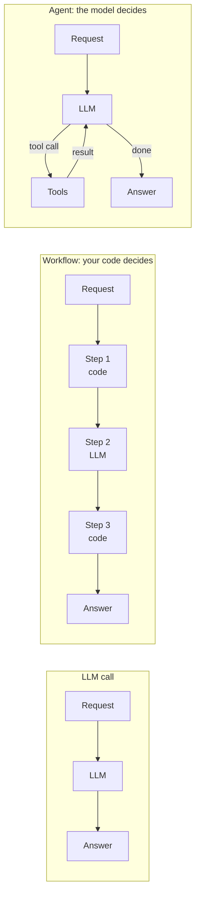
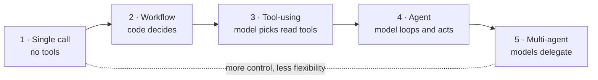
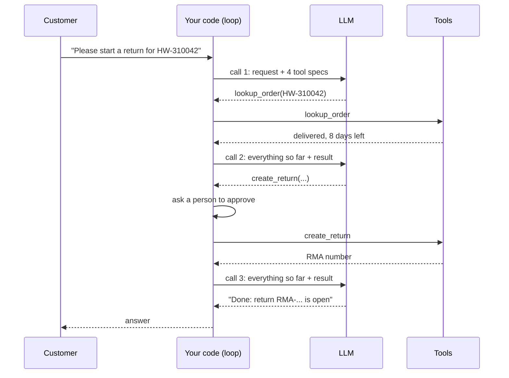
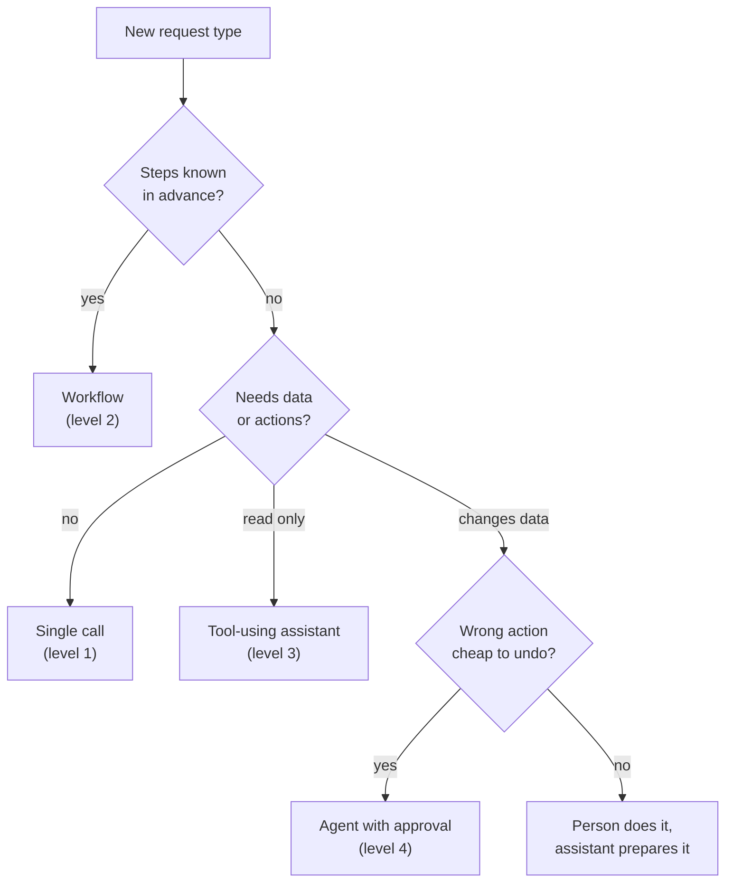

🌐 English · [Español](01-agents-overview.es.md)

# Lesson 7.1 — Agents, agentic systems and the agency ladder

> **Module 07 · Lesson 1 of 4** · ⏱️ about 45 min · 🧪 Lab: [step 2](lab/README.md#step-2--climb-the-agency-ladder)

## 📨 Situation

> **From:** Jordan Kim · Product and Strategy Lead
> **Channel:** #hearthwise-assist
>
> The support chatbot from module 06 is great at answering questions. But look at what customers type:
> "where is my order", "start my return", "which bulbs work with the thermostat". They want things
> *done*, not paragraphs. I want an assistant that looks things up and takes actions. Everyone keeps
> saying "agent", so let's build an agent. Noor has already asked who approves the actions, and Sam
> wants to know what it costs per conversation. Can you tell me by Friday what we should build first,
> and what it would cost us in money, speed and risk?

## 🎯 Objectives

By the end of this lesson you can:

- Explain the difference between a large language model (LLM) call, a workflow and an agent by asking
  one question: who decides the next step?
- Place a feature on a five-level agency ladder and justify the level you picked.
- Measure how LLM calls, tokens and the power to change data grow with autonomy, using the lab.
- Decide when *not* to build an agent, with a short checklist.
- Match each risk of autonomy (cost, latency, blast radius) to a control you can implement.

## 🤔 Predict first

Write your answers down before reading on. You will check them in the self-check.

1. Jordan's request "start a return for order HW-310042" can be handled by one LLM call or by a loop in
   which the model decides which tools to call. Roughly how many more tokens does the loop use: about
   2 times, 10 times or 50 times?
2. True or false: an "agent" is a special kind of model that was trained to be autonomous.
3. Which feature has the larger blast radius: an assistant that can *read* every order, or a fixed
   workflow that can *create* returns after a person clicks Approve?

## 1. LLM call, workflow, agent: who decides the next step?

People use the word "agent" for almost anything that has an LLM inside. That makes design meetings
confusing. A more useful distinction asks one question: **who decides what happens next?**

- An **LLM call** is one prompt in, one completion out. Nobody decides a "next step", because there is
  none. The chatbot from module 06 is one call plus retrieval that your code always runs first, which
  strictly speaking makes it a tiny workflow.
- A **workflow** is a sequence of steps that *your code* defines. Some steps call an LLM, some call
  databases or tools, and the path between them is written in advance. The LLM fills in the blanks.
- An **agent** is a system in which *the model* decides the next step at run time: which tool to call,
  with which arguments, whether to call another one, and when it is finished. Your code runs a loop and
  executes what the model asks for, within limits you set.

**Agentic system** is the umbrella term for both workflows and agents: any system where an LLM's output
shapes what the software does. The model itself is the same in all three cases. "Agent" is a property
of the *system around the model*, not of the weights.

**Analogy:** Think of a kitchen. Asking the cook "what goes well with salmon?" is an LLM call. Handing
the cook a recipe card with numbered steps is a workflow: the cook does the chopping, but the order is
fixed. Saying "make dinner for six from whatever is in the fridge" is an agent: the cook opens the
fridge, decides, tastes, adjusts and says when dinner is ready.



In code, the difference is visible at a glance. Here is the heart of the lab's level-2 workflow: your
code extracts the order id and calls the order store every single time, and the LLM only writes the
reply.

```python
order_id = re.search(r"HW-\d{6}", request).group(0)  # code decides: always look the order up
order = store.lookup(order_id, DEMO_CUSTOMER)
reply = provider.complete([Message("system", "Write a short reply from these facts."),
                           Message("user", json.dumps(order))])
```

And here is the heart of the agent loop from `loop.py`, with the bookkeeping removed: the model's
reply decides whether there is another round and what it contains.

```python
for _ in range(max_steps):
    reply = provider.complete(trace.messages, tools=tools)
    if not reply.tool_calls:  # the model decided it is done
        return trace
    results = executor.execute_all(reply.tool_calls)  # the model decided what to run
    trace.messages.extend(r.to_message() for r in results)
```

> ⚠️ **Common mistake:** Calling a workflow an "agent" in a design review because it uses an LLM.
> Reviewers then assume the system can improvise (it cannot) or worry that it acts on its own (it
> does not). Name the level precisely; the risks and the tests are different.

## 2. The agency ladder

Autonomy is not on or off. It grows in steps, and each step hands one more decision from your code to
the model. This course uses a five-level ladder.

| Level | Who decides the next step | What the model can touch | Hearthwise example |
|---|---|---|---|
| 1 · Single LLM call | Nobody, there is one step | Only the prompt | "Explain our returns policy in plain words" |
| 2 · Workflow | Your code | What your code passes in | Extract order id → look up order → draft reply |
| 3 · Tool-using assistant | The model, for a few steps | Read-only tools you expose | "Where is my order?" with `lookup_order` |
| 4 · Multi-step agent | The model, until it says it is done | Read and write tools, behind approval | "Start my return" with `create_return` |
| 5 · Multi-agent system | Several models that delegate to each other | Whatever each agent is given | A researcher agent plus a writer agent (module 08) |

The ladder is a design tool. When someone asks for "an agent", place the request on a rung. Most
requests turn out to be level 2 or 3 once you write down the steps. Level 4 is justified when the
number and order of steps really depend on what the model discovers along the way.

**Analogy:** A new support hire at Hearthwise climbs the same ladder. In week one they answer questions
from memory (level 1). Then they follow the escalation checklist (level 2). Next they get read access to
the order system (level 3). Later they may process returns alone, with a supervisor signing off on
refunds (level 4). Eventually they lead a small team that splits the work (level 5). Nobody gets the
company card on day one.



The lab runs one request at levels 1 to 4 with the same fake model family and the same data. The
request is *"I bought an Ember T3 (order HW-310042) and changed my mind. Please start a return."* Each
level is a function in `agency.py` that returns a `Rung`:

```python
def ladder(request: str = LADDER_REQUEST) -> list[Rung]:
    """Run the same request at levels 1 to 4 (level 5, multi-agent, is module 08)."""
    return [
        single_call(request),
        workflow(request),
        _loop_rung("3 tool-using (read-only)", allow_writes=False, request=request),
        _loop_rung("4 agent (can act, approved)", allow_writes=True, request=request),
    ]
```

Levels 3 and 4 run the *same* loop. The only difference is a permission: at level 3 the executor
denies `create_return`, so the model never even sees it. That is a recurring theme of this module:
autonomy is something you grant, tool by tool.

## 3. What autonomy costs: tokens, time and blast radius

Here is what the lab measures for that one request:

| Level | LLM calls | Tool calls | Tokens | Data changed |
|---|---|---|---|---|
| 1 · Single LLM call | 1 | 0 | 63 | no |
| 2 · Workflow | 1 | 1 | 154 | no |
| 3 · Tool-using (read-only) | 2 | 1 | 1,416 | no |
| 4 · Agent (can act, approved) | 3 | 2 | 3,314 | yes |

Token counts come from the lab's approximate counter (words and punctuation), so treat them as
relative sizes, not a bill. Three different costs grow as you climb.

**Money (tokens).** The jump from level 2 to level 3 is the surprise. A tool-using model needs the tool
definitions in every request, and the lab's four tool definitions alone are 872 tokens. Every round of
the loop also re-sends the whole conversation so far: the request, each tool call and each tool result.
Level 4 makes three LLM calls, and each one is longer than the one before. That is how 3 calls become
3,314 tokens, more than 50 times the single call.

**Time (latency).** LLM calls in a loop are sequential: the model cannot decide step 2 before it has
read the result of step 1. Latency grows with the number of rounds, not just with the number of
tokens. Level 4 needs three round trips to the model plus two tool calls in between.

**Risk (blast radius).** Only level 4 changed data. Noor's question "what's the blast radius?" means:
if this goes wrong, what is the worst thing that happens, and to how many customers? A level-1 bot can
say something wrong. A level-4 agent can *do* something wrong, like open a return on the wrong order.

Errors also compound across steps. If each step of a task is right with probability 0.95, a 10-step
task is entirely right with probability 0.95¹⁰ ≈ 0.60 (an illustrative calculation, not a measurement).
Longer autonomous runs need checks between steps, which is exactly what the workflow patterns in lesson
7.2 provide.

**Analogy:** Giving a new hire the company card. Lunch money (level 1) is harmless. A card for
pre-approved suppliers (level 2) is safe because you wrote the list. A card they can use anywhere
(level 4) needs limits, receipts and a manager who looks at the statement.



The loop in `loop.py` adds up the cost of each round, so you can log it per conversation:

```python
reply = provider.complete(trace.messages, tools=tools, temperature=0.0)
trace.llm_calls += 1
trace.prompt_tokens += reply.prompt_tokens  # grows every round: history + tool specs
trace.completion_tokens += reply.completion_tokens
```

> ⚠️ **Common mistake:** Estimating the cost of an agent from the length of its final answer. The final
> answer of level 4 is one sentence; almost all the tokens are re-sent context and tool definitions.
> Measure prompt tokens per conversation, not answer length.

> 💡 **Production tip:** Put three budgets on every agent run: a maximum number of LLM calls
> (`max_steps`), a timeout per tool call and a token or cost ceiling per conversation. Log all three for
> every run, so Sam can chart them before anyone asks.

## 4. When not to build an agent

An agent is the right tool when the steps cannot be known in advance and a wrong step is cheap or
reversible. Many requests fail one of those tests. Go through this checklist before you pick level 4.

| Question | If the answer is... | Then |
|---|---|---|
| Can you write the steps down in advance? | Yes | Build a workflow (level 2); it is cheaper, faster and testable |
| Does the task need fresh or private data? | No | A single call, maybe with retrieval, is enough |
| Is there already a button for it? | Yes | Link to it. The app already has Account > Orders > Return an item |
| Can a wrong action be undone cheaply? | No | Keep a person in the loop, or do not automate the action |
| Can you evaluate it offline before launch? | No | Do not ship it yet; build the evaluation first (module 08) |
| Is the latency budget a second or two? | Yes | Avoid multi-round loops; precompute or use a workflow |

For Jordan's three examples the checklist gives a clear plan. "Where is my order" has known steps: a
workflow or a level-3 assistant with one read-only tool. "Start my return" has a short, known path, but
it changes data, so it needs approval, whatever the level. "Which bulbs work with the thermostat" may
need several lookups whose order depends on what the model finds, which makes it a reasonable
candidate for a tool-using loop.

**Analogy:** You do not hire a personal shopper to buy milk. You hire one when you do not know what you
want yet and are happy to pay for the search.



> 💡 **Production tip:** Write the level into the design document (the course has a template in
> `templates/`). When the level changes later, for example a read-only assistant gains a write tool,
> treat it as a new launch with a new security review.

## 5. Controls that make autonomy safe enough

Each cost from section 3 has a control, and each control is a few lines of code in this module's lab.
You will build them in lessons 7.3 and 7.4.

| Risk | Control | Where in the lab |
|---|---|---|
| The model calls a tool it should not | Least privilege: only advertise allowed tools | `Permission.DENY` in `executor.py` |
| The model changes data by mistake | Human approval for side effects | `approver` callback in `ToolExecutor` |
| The model sends malformed arguments | Validate against a JSON Schema | `schema.validate` before any handler runs |
| A tool hangs or fails | Timeouts, bounded retries with backoff | `timeout_s`, `max_retries`, `backoff_s` |
| A retry repeats an action | Idempotency keys | `idempotency_key()` in `executor.py` |
| The loop never ends | A step budget | `max_steps` in `run_tool_loop` |
| Nobody knows what happened | An audit log of every call | `ToolExecutor.audit` |

The pattern is the same everywhere: **the model proposes, your code disposes.** The model only ever
emits a request such as `create_return({"order_id": "HW-310042", ...})`. Your executor decides whether
it runs, as whom, with what limits, and what is recorded.

**Analogy:** A bank teller can type any amount into the transfer screen. The bank's system decides
whether the transfer goes through: it checks limits, asks a second person for large amounts and logs
everything. The teller's freedom to type is not the bank's risk; the missing checks would be.

```python
def permission(self, tool: Tool) -> Permission:
    """Explicit policy first; otherwise read-only tools are allowed and side effects need approval."""
    return self.policy.get(tool.name, Permission.APPROVE if tool.side_effect else Permission.ALLOW)
```

> ⚠️ **Common mistake:** Putting the safety rules only in the system prompt ("never start a return
> without asking"). A prompt is a request to the model, not an enforcement mechanism. Enforce rules in
> the executor, and keep the prompt rule as a second layer.

## 🧪 Try it

1. Set up the lab once (see [lab step 1](lab/README.md#step-1--install-and-run-the-tests)), then run the
   ladder:

   ```bash
   cd modules/07-agents-workflows-and-tools/lab
   uv run lab ladder
   ```

   Expected output:

   ```text
   Request: I bought an Ember T3 (order HW-310042) and changed my mind. Please start a return.

   Level                         Decides     LLM calls  Tools  Tokens  Data changed
   1 single LLM call             nobody              1      0      63  no
   2 workflow                    your code           1      1     154  no
   3 tool-using (read-only)      the model           2      1    1416  no
   4 agent (can act, approved)   the model           3      2    3314  yes

   [1 single LLM call] Hearthwise accepts returns within 30 days of delivery. I cannot see your order, so please check the delivery date in the app under Accoun...
   [2 workflow] Order HW-310042 can be returned (8 days left). Open the app, go to Account > Orders and tap Return an item.
   [3 tool-using (read-only)] Order HW-310042 is delivered (delivered on 2025-10-23). You can still return it (8 days left): open the app, go to Account > Orders and t...
   [4 agent (can act, approved)] Done: return RMA-2A7E64 is open for 1 x HW-EMB-T3. You will get €149 back within 5 to 7 business days after it reaches our warehouse.
   ```

2. Read the four answers. Which ones actually solve the customer's problem? Which ones are *correct*
   but unhelpful? Level 1 is honest but cannot know the delivery date.

3. Open `src/m07_agents_tools/agency.py` and find the single line that turns level 4 into level 3.
   (Hint: look for `Permission.DENY`.)

4. Optional: in `_loop_rung`, change the approver to `lambda call: False` and run the ladder again.
   Level 4 still makes three LLM calls, but "Data changed" becomes `no`.

## 🏭 In the real world

Teams that ship assistants successfully almost always start at level 2 or 3 and climb only when they
have evidence. A typical path for an assistant like Hearthwise Assist:

- **Start with workflows** for the top request types, because they are predictable and easy to test.
  Log what customers ask for that the workflows cannot handle.
- **Add read-only tools** when the long tail of requests needs lookups in an order the code cannot
  predict. Read-only tools have a small blast radius, as long as they respect who the customer is.
- **Add write tools one at a time**, each behind human approval at first. Track the approval rate: if
  people approve nearly every proposal for weeks and the error audits are clean, you may relax approval
  for low-value actions.

What to monitor for any level 3 or 4 system:

| Signal | Why it matters |
|---|---|
| LLM calls per conversation (distribution, not just the average) | Loops that hit `max_steps` are usually bugs |
| Prompt tokens per conversation | The real cost driver, as the ladder showed |
| Tool error rate by tool and by error type | Validation errors point at bad descriptions or schemas |
| Approval rate and time to approve | Low rates mean the model proposes wrong actions |
| Actions later reversed (returns cancelled, refunds clawed back) | The true cost of mistakes |

Typical failure modes are loops that never converge, the model calling the right tool with subtly wrong
arguments, and instructions hidden in tool results (lesson 7.4 and module 06 cover injection). None of
these show up in a demo with three happy-path questions; all of them show up in production.

## ✅ Self-check

**1. Revisit prediction 1: how many more tokens did the loop use than the single call, and why?**

<details><summary>Answer</summary>

Level 4 used 3,314 tokens against 63 for the single call, more than 50 times as many. The final answer
is short; the cost comes from sending the four tool definitions (872 tokens) with every call and from
re-sending the growing conversation on each of the three rounds. If you guessed "about 2 times", you
were thinking of the answer length, which is the common mistake from section 3.

</details>

**2. Revisit prediction 2: is an agent a special kind of model?**

<details><summary>Answer</summary>

No. An agent is a property of the system around the model: a loop that lets the model's output decide
the next step, plus the tools and limits you provide. In the lab, levels 3 and 4 use exactly the same
fake model; only the executor's permissions differ.

</details>

**3. Revisit prediction 3: which has the larger blast radius?**

<details><summary>Answer</summary>

It depends on what "read every order" means. A tool that can read *any* customer's orders is a privacy
incident waiting to happen: one manipulated conversation could leak other people's data, with no
approval step in the way. The workflow that creates returns only after a person approves has a
narrower, supervised blast radius. Read-only is not automatically safe; the lab's `lookup_order` only
returns orders of the signed-in customer for this reason.

</details>

**4. Jordan wants "where is my order?" answered automatically. Which level do you propose, and what is
the one tool it needs?**

<details><summary>Answer</summary>

Level 2 (extract the order id in code, look it up, let the LLM phrase the answer) or level 3 with a
single read-only `lookup_order` tool. The steps are known in advance, so a full agent adds cost and
latency for no benefit.

</details>

**5. Your level-4 agent sometimes makes 6 LLM calls for a simple question. What do you check first?**

<details><summary>Answer</summary>

The traces of those runs: which tools were called, with which arguments, and what came back. Repeated
calls to the same tool usually mean the tool returned an error the model could not use (for example a
validation error with an unclear message) or a description that does not tell the model when to stop.
Also confirm that `max_steps` stops the loop and that such runs are counted in your monitoring.

</details>

## 💬 Explain it in your own words

1. Explain to Jordan, in four sentences and without the word "agent", why the first release should be a
   workflow plus one read-only tool rather than a fully autonomous assistant.
2. Explain to Sam why level 4 costs more than 50 times as many tokens as level 1 when its answer is
   only one sentence long.

## 🔑 Key ideas

- The useful question is **who decides the next step**: nobody (LLM call), your code (workflow) or the
  model (agent). "Agentic system" covers both workflows and agents.
- Autonomy is a ladder: single call, workflow, tool-using assistant, multi-step agent, multi-agent.
  Climb one rung at a time, with evidence.
- Tokens, latency and blast radius all grow with autonomy. In the lab, level 4 used 3 LLM calls and
  3,314 tokens and was the only level that changed data.
- Tool definitions and re-sent history dominate the cost of a tool-using loop.
- Do not build an agent when the steps are known, a button already exists, a wrong action is expensive
  or you cannot evaluate it.
- The model proposes and your code disposes: permissions, validation, approval, timeouts, idempotency,
  step budgets and audit logs live in the executor, not in the prompt.

## 📚 Go deeper

- ⭐ [ReAct: Synergizing Reasoning and Acting in Language Models](https://arxiv.org/abs/2210.03629) —
  the paper behind the "think, act, observe" loop most tool-using agents still follow; module 08 builds
  on it.
- [Toolformer](https://arxiv.org/abs/2302.04761) — shows a language model learning when to call
  external tools such as a calculator or a search engine.
- [WebGPT](https://arxiv.org/abs/2112.09332) — an early study of a model that browses the web with a
  fixed set of actions and cites its sources; a good look at level-3 behaviour.
- [Indirect prompt injection](https://arxiv.org/abs/2302.12173) — why everything a tool returns must be
  treated as untrusted data once a model can act.

---

[← Previous: Module 07 overview](README.md) · [🏠 Module 07](README.md) · [Next: 7.2 Workflow patterns →](02-workflow-patterns.md)
