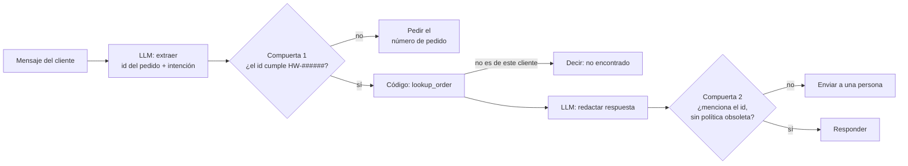
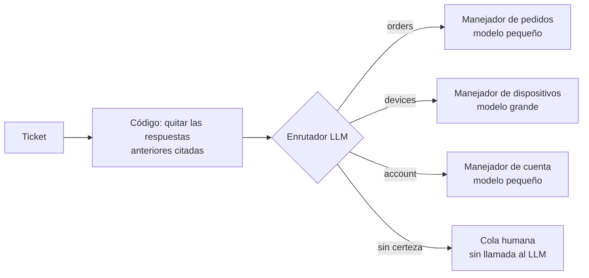
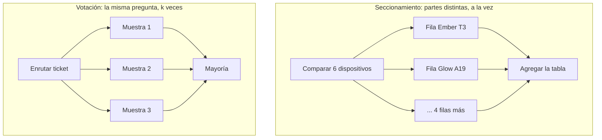
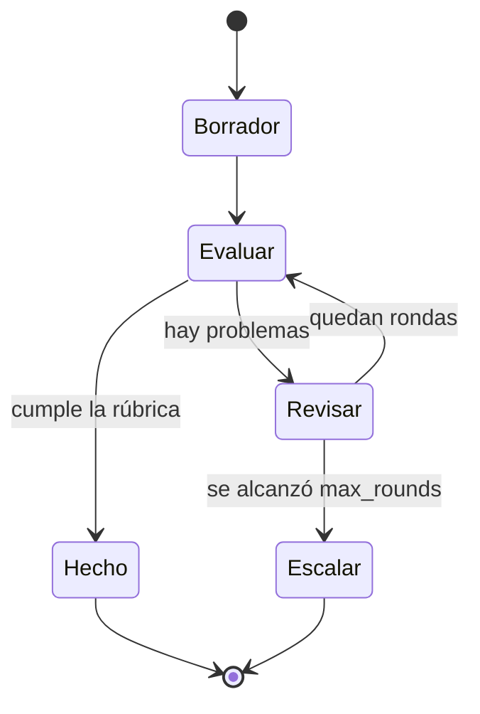
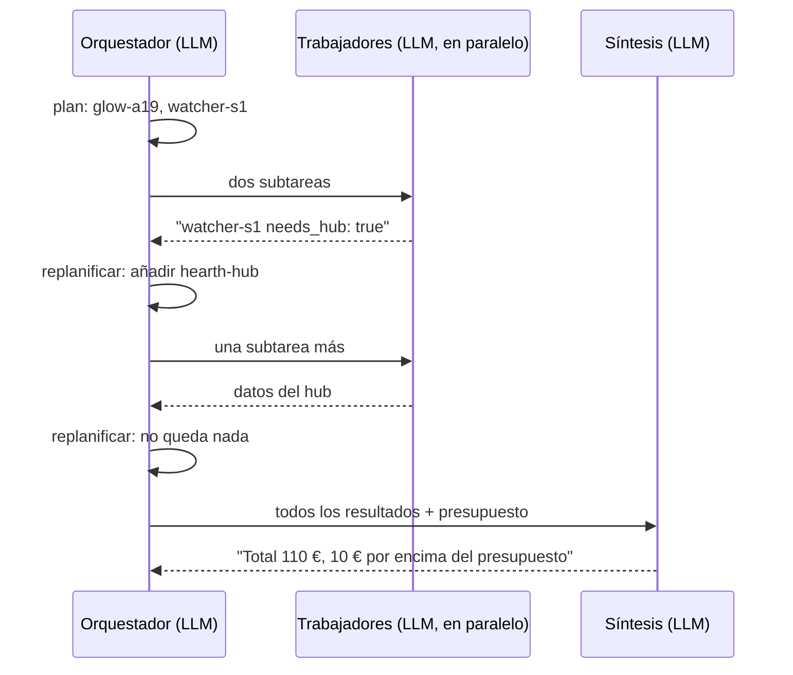

🌐 [English](02-workflow-patterns.md) · Español

# Lección 7.2 — Patrones de *workflow*: encadenar, enrutar, paralelizar, reflexionar, orquestar

> **Módulo 07 · Lección 2 de 4** · ⏱️ unos 60 min · 🧪 Lab: [paso 3](lab/README.es.md#paso-3--ejecuta-los-patrones-de-workflow)

## 📨 Situación

> **De:** Sam Adeyemi · Ingeniería de fiabilidad
> **Canal:** #hearthwise-assist
>
> He leído el hilo de Jordan. Antes de que nadie lance un agente suelto, una petición de números:
> tenemos 1.224 tickets de 2025 para reproducir. Para cada diseño quiero saber cuántas llamadas al
> modelo cuesta una petición, cuántas ocurren una detrás de otra (eso es mi latencia) y dónde se para
> antes de tiempo cuando la entrada es basura. Un bucle que "normalmente termina en tres llamadas" no
> es un número, es un estado de ánimo. Dame primero *pipelines* aburridos con un peor caso fijo.
> Después hablamos de autonomía.

## 🎯 Objetivos

Al terminar esta lección puedes:

- Implementar el encadenamiento de *prompts* (*prompt chaining*) con compuertas (*gates*) y contar las
  llamadas al LLM que ahorra una compuerta.
- Construir un enrutador (*router*) que envía cada petición a un manejador especializado y a un nivel de modelo,
  y medirlo sobre los 1.224 tickets.
- Aplicar la paralelización por seccionamiento (*sectioning*) y por votación (*voting*), y explicar por qué la votación no puede
  corregir errores sistemáticos.
- Construir un bucle de reflexión (evaluador-optimizador, *evaluator-optimizer*) con una regla de parada explícita.
- Elegir entre un *workflow* fijo, un diseño orquestador-trabajadores (*orchestrator-worker*) y un agente para una petición
  dada.

## 🤔 Predice primero

Apunta tus respuestas antes de seguir leyendo. Las comprobarás en la autoevaluación.

1. Preguntas 5 veces a un clasificador de tickets ruidoso y te quedas con la respuesta mayoritaria.
   ¿Puede la votación ser más exacta que el mismo clasificador *sin* ruido?
2. Seis consultas de productos más un resumen final: si las consultas se ejecutan en paralelo, ¿cuántas
   rondas *secuenciales* de llamadas al modelo necesita todo el trabajo?
3. Un evaluador revisa un borrador, que se reescribe hasta que el evaluador queda satisfecho. ¿Qué
   podría hacer que este bucle no terminara nunca, y cómo lo detendrías?

## 1. Encadenamiento de prompts con compuertas

Una **cadena de *prompts*** divide una tarea en pasos fijos, en los que la salida de cada paso es la
entrada del siguiente. Cada paso con LLM recibe un trabajo más pequeño y más claro que el que tendría
un único *prompt* gigante. Entre los pasos colocas **compuertas** (*gates*): comprobaciones en código
normal que deciden si seguir, parar antes de tiempo o pasar el caso a una persona.

La cadena del lab responde mensajes de clientes sobre pedidos en cinco pasos. El LLM extrae el id del
pedido y la intención en notación de objetos de JavaScript (JSON, *JavaScript Object Notation*). La
compuerta 1 comprueba el formato del id. El código consulta el pedido. El LLM redacta una respuesta.
La compuerta 2 revisa el borrador antes de enviarlo.

**Analogía:** Una cadena de montaje con inspectores. Cada estación hace un solo trabajo, y entre
estaciones hay una inspección que retira las piezas defectuosas antes de que se malgaste más trabajo
en ellas.



```python
def chain_one(meter: Meter, store: OrderStore, message: str) -> dict[str, Any]:
    """extract (LLM) -> gate -> lookup (code) -> draft (LLM) -> gate."""
    fields = json.loads(meter.ask("extract", message))
    order_id = fields.get("order_id")
    if not order_id or not re.match(ORDER_PATTERN, order_id):  # gate 1: stop early, ask the customer
        return {"outcome": "asked_for_order_id", "reply": "Could you share your order number (HW-xxxxxx)?"}
    try:
        order = store.lookup(order_id, DEMO_CUSTOMER)
    except NotFoundError:
        return {"outcome": "not_found", "reply": f"I could not find {order_id} in your account."}
    reply = meter.ask("draft_reply", json.dumps({"intent": fields["intent"], "order": order}))
    if order_id not in reply or "14 days" in reply:  # gate 2: check the draft before sending
        return {"outcome": "needs_human", "reply": reply}
    return {"outcome": "replied", "reply": reply}
```

Con los seis mensajes de ejemplo de `workflows.py`, 3 reciben respuesta, 2 se detienen en la
compuerta 1 (uno no tiene número de pedido y otro escribió `310155` sin el prefijo `HW-`) y 1 pedido
pertenece a otro cliente. La cadena hace 9 llamadas al LLM; sin las salidas anticipadas, cada mensaje
costaría 2 llamadas, 12 en total. El peor caso está fijado: 2 llamadas al LLM y 2 rondas secuenciales
por mensaje. Es justo lo que pidió Sam.

> ⚠️ **Error común:** Poner la regla de la compuerta en el *prompt* siguiente ("si falta el id del
> pedido, pídelo") en lugar de en código. El modelo normalmente obedecerá, lo que significa que a veces
> no lo hará. Una compuerta que se puede comprobar con una expresión regular o una consulta pertenece al
> código.

## 2. Enrutamiento

El **enrutamiento** (*routing*) primero clasifica una entrada y luego la envía por un camino
especializado: un *prompt* distinto, otro conjunto de herramientas, otro tamaño de modelo o una cola
atendida por personas. Cada manejador puede ser más sencillo porque solo ve un tipo de petición. En el
módulo 04 clasificaste tickets por intención; aquí, la salida del clasificador se convierte en una
bifurcación del flujo de control.

El lab enruta los 1.224 tickets por tres carriles: `orders` (estado y devoluciones), `devices`
(conectividad, preguntas sobre productos y garantía) y `account` (facturación, inicio de sesión y
suscripciones). El carril `devices` necesita más razonamiento, así que recibe el nivel de modelo
"grande"; los otros dos reciben el nivel "pequeño". Si el enrutador no está seguro (sin ninguna pista,
o con un empate entre carriles), el ticket pasa a una persona.

**Analogía:** El triaje de urgencias de un hospital. El personal de enfermería dedica un minuto a
decidir adónde vas; el equipo de especialistas nunca ve a quienes corresponden a otro servicio.



```python
for t in tickets:
    lane = meter.ask("route", ticket_text(t, strip))
    lanes[lane] += 1
    correct += lane == LANE_OF_INTENT[t["intent"]]
    if lane != "human":  # a human queue costs no LLM call
        tiers[MODEL_TIER[lane]] += 1
        meter.ask(f"answer_{lane}", t["body"])
```

Dos resultados merecen tu atención. Primero, importa un paso de código barato antes del paso con LLM.
Muchos tickets citan una respuesta anterior de soporte que dice "Could you share your order number?"
("¿Puedes indicarnos tu número de pedido?"). Si no se eliminan esas líneas citadas, el enrutador ve la
palabra "order" en una pregunta de facturación; si se eliminan, la exactitud sobre todos los tickets
sube de 0.818 a 0.848 y la cola humana baja de 165 a 136 tickets. Segundo, cuando el enrutador sí
elige un carril, acierta con una exactitud de 0.954. Enviar a personas los 136 tickets dudosos es un
intercambio deliberado: menos cobertura, más precisión.

El enrutador del lab es un sustituto basado en palabras clave de un modelo real, así que los números
absolutos son del modelo falso; lo que se traslada al mundo real es la fontanería y la forma de
medirla.

> 💡 **Consejo de producción:** Mide un enrutador dos veces: la exactitud sobre todo y la exactitud
> sobre lo que de verdad enrutó, además de la proporción enviada a personas. Un enrutador que lo manda
> todo a personas nunca se equivoca cuando enruta, y no sirve para nada. Sigue los tres números a lo
> largo del tiempo; la deriva aparece aquí primero.

## 3. Paralelización: seccionamiento y votación

La **paralelización** ejecuta varias llamadas al LLM a la vez y combina sus salidas en código. Tiene
dos variantes con objetivos distintos.

El **seccionamiento** (*sectioning*) divide una tarea en partes *independientes* y las ejecuta a la
vez. El lab construye una tabla comparativa de productos: un trabajador por dispositivo lee la página
de ese dispositivo y escribe una fila de la tabla, y después una llamada agregadora monta la tabla. Son
7 llamadas al LLM, pero solo 2 rondas secuenciales, en lugar de 7 rondas si las ejecutaras una detrás
de otra. La latencia sigue a las rondas, así que el seccionamiento es una herramienta de latencia.

La **votación** (*voting*) hace la *misma* pregunta varias veces y se queda con la respuesta
mayoritaria. Es una herramienta de exactitud, y la pagas en llamadas: con k votos, cada ticket cuesta
k llamadas.

**Analogía:** El seccionamiento es un equipo de un concurso de preguntas que se reparte las rondas:
una persona se encarga de la música y otra de la geografía. La votación es hacerles la misma pregunta
a tres amistades y quedarte con lo que diga la mayoría: útil cuando cada una se despista a veces,
inútil cuando todas aprendieron el mismo dato falso.



```python
def vote_tickets(k: int, noise: float = 0.3, tickets: list[dict[str, str]] | None = None) -> dict[str, Any]:
    """Ask the noisy router ``k`` times per ticket and keep the majority answer."""
    meter = Meter()
    tickets = tickets if tickets is not None else load_tickets()
    correct = 0
    for t in tickets:
        text = ticket_text(t)
        votes = [meter.ask(f"route_noisy\nSAMPLE {s}\nNOISE {noise}", text) for s in range(k)]
        winner = Counter(votes).most_common(1)[0][0]
        correct += winner == LANE_OF_INTENT[t["intent"]]
    return {"k": k, "noise": noise, "accuracy": round(correct / len(tickets), 3), **meter.usage()}
```

El experimento de votación del lab añade ruido aleatorio al enrutador: cada muestra se equivoca con
probabilidad 0,3, de forma independiente. Esto es lo que pasa con los 1.224 tickets:

| Votos por ticket | Exactitud | Llamadas al LLM |
|---|---|---|
| Enrutador sin ruido (el techo) | 0.848 | — |
| k = 1 | 0.613 | 1.224 |
| k = 3 | 0.697 | 3.672 |
| k = 5 | 0.770 | 6.120 |

La votación recupera buena parte de lo que se llevó el ruido aleatorio, a cinco veces el coste. Pero
nunca puede superar 0.848, porque los errores propios del enrutador sin ruido son *sistemáticos*: todas
las muestras cometen el mismo. Las muestras de un modelo real están en parte correlacionadas de la
misma manera, así que la votación suele ayudar menos de lo que sugiere el experimento con ruido
independiente.

> ⚠️ **Error común:** Usar la votación para arreglar un *prompt* malo. Si el *prompt* o el contexto
> recuperado están mal, todas las muestras heredan el error y la votación coincide consigo misma con
> total confianza. Corrige los errores sistemáticos en su origen; usa la votación para los despistes
> aleatorios en decisiones de alto riesgo.

## 4. Reflexión: el bucle evaluador-optimizador

La **reflexión**, también llamada patrón **evaluador-optimizador** (*evaluator-optimizer*), empareja un
generador con un evaluador. El generador escribe un borrador. El evaluador lo contrasta con las pruebas
y con una rúbrica y devuelve comentarios concretos. El generador lo reescribe a partir de esos
comentarios. El bucle termina cuando el evaluador da el borrador por bueno o tras un número fijo de
rondas.

El ejemplo del lab usa una trampa que lleva escondida en el centro de ayuda desde el módulo 05: una
política de devoluciones desactualizada. El primer
borrador del generador "recuerda" la política sustituida de 2023: 14 días y un cargo por reposición
(*restocking fee*) del 10 % para los artículos abiertos. El evaluador lo compara con la política vigente
(kb-011: 30 días, sin cargo por reposición) y con una rúbrica (citar el documento, como mucho 70
palabras). Encuentra 3 problemas. El segundo borrador los corrige todos y pasa. Dos rondas cuestan 4
llamadas al LLM y 4 rondas secuenciales.

**Analogía:** Quien escribe y quien edita. Quien edita no reescribe el artículo; devuelve una lista de
problemas concretos, y quien escribe los corrige. Es la fecha de entrega, y no el humor de quien edita,
lo que pone fin al proceso.



```python
for round_no in range(1, max_rounds + 1):
    draft = meter.ask("draft_policy_answer",
                      json.dumps({"question": question, "feedback": feedback, "evidence": evidence}))
    verdict = json.loads(meter.ask("evaluate", json.dumps({"draft": draft, "evidence": evidence})))
    history.append({"round": round_no, "draft": draft, "issues": verdict["issues"]})
    if verdict["pass"]:
        break
    feedback = verdict["issues"]
```

La reflexión funciona cuando el evaluador tiene algo que le falta al generador: pruebas (la política
vigente), una rúbrica comprobable o una herramienta, como un ejecutor de tests. Un evaluador que no es
más que el mismo modelo con la pregunta "¿está bien esto?" tiende a aprobar sus propios errores. Aquí,
las comprobaciones clave del evaluador son simples comparaciones de cadenas con las pruebas, y por eso
son fiables.

> 💡 **Consejo de producción:** Registra los problemas de cada ronda. Si el primer borrador falla la
> misma comprobación la mayoría de las veces, corrige el *prompt* o el contexto del generador en lugar
> de pagar una segunda ronda en cada petición. El bucle de reflexión es una red de seguridad, no un
> sustituto de un buen primer paso.

## 5. Orquestador-trabajadores

En el seccionamiento, *tu código* decide las subtareas. En el patrón **orquestador-trabajadores**
(*orchestrator-worker*), un LLM (el orquestador) lee la petición, decide qué subtareas hacen falta, se
las envía a los trabajadores, lee sus resultados y puede añadir más subtareas antes de un paso final de
síntesis. El número y el tipo de subtareas no se conocen de antemano.

El lab le pide al orquestador que sugiera paquetes de dispositivos. Para "luces inteligentes y control
de la calefacción, presupuesto de 200 €" planifica dos trabajadores (Glow A19 y Ember T3) y la síntesis
da 161 €, dentro del presupuesto, en 5 llamadas al LLM. Para "luces activadas por movimiento en el
pasillo, presupuesto de 100 €" planifica dos trabajadores (Glow A19 y Watcher S1). El trabajador del
Watcher S1 informa de que el sensor necesita el Hearth Hub, así que el orquestador añade un tercer
trabajador para el hub. El total es de 110 €, 10 € por encima del presupuesto, tras 7 llamadas al LLM.
El plan cambió por algo que encontró un trabajador.

**Analogía:** La dirección de un periódico con la hora de cierre encima. Decide a qué periodistas
enviar y adónde, lee lo que vuelve y envía a alguien más cuando una noticia abre un ángulo nuevo.



```python
plan: list[str] = json.loads(meter.ask("plan", request))
results: list[dict[str, Any]] = []
rounds, todo = 1, plan
while todo:
    with ThreadPoolExecutor(max_workers=len(todo)) as pool:
        results.extend(pool.map(worker, todo))
    todo = json.loads(meter.ask("replan", json.dumps({"request": request, "results": results})))
    rounds += 2
answer = meter.ask("synthesise", json.dumps({"budget_eur": budget_of(request), "results": results}))
```

Este es el patrón de *workflow* más autónomo y el más parecido a un agente: el modelo da forma al flujo
de control. Lo que lo mantiene como *workflow* es la estructura que lo rodea: solo existe un tipo de
trabajador, los trabajadores no pueden llamarse entre sí y el bucle termina cuando el orquestador deja
de añadir subtareas. Una versión de producción necesita además un límite estricto de rondas, que esta
versión del lab omite a propósito para que lo añadas en la sección Amplíalo del lab.

> ⚠️ **Error común:** Dejar que el plan del orquestador crezca sin límite. Un modelo que no para de
> "descubrir" subtareas nuevas gastará tu presupuesto encantado. Limita el número de trabajadores y de
> rondas, y trata el hecho de llegar al límite como una señal para registrar y revisar.

## 6. Elegir un patrón

Los patrones se combinan libremente: un enrutador puede enviar un ticket a una cadena, un paso de una
cadena puede usar votación y los trabajadores de un orquestador pueden ser cadenas. Empieza por el
patrón más sencillo que resuelva la petición, mídelo y añade estructura solo cuando una medición diga
que la necesitas.

| Patrón | Úsalo cuando | Llamadas al LLM (ejemplo del lab) | Rondas secuenciales | Riesgo principal |
|---|---|---|---|---|
| Encadenamiento de *prompts* | Los pasos se conocen y se pueden comprobar | 2 por mensaje, 1 cuando la compuerta 1 lo detiene | 2 | Sin compuertas, los errores pasan de un paso a otro |
| Enrutamiento | Las entradas se dividen en tipos distintos | 1 enrutador + 1 manejador | 2 | Enrutamientos erróneos; deriva en la mezcla de entradas |
| Seccionamiento | Partes independientes de una misma tarea | 6 trabajadores + 1 agregador | 2 | Partes que en realidad no son independientes |
| Votación | Despistes aleatorios en una decisión de alto riesgo | k por decisión | 1 si los votos van en paralelo | Coste; errores correlacionados |
| Reflexión | Existe una rúbrica comprobable o hay pruebas | 2 por ronda | 2 por ronda | Sin regla de parada; autoaprobación |
| Orquestador-trabajadores | Las subtareas dependen de la entrada | 5 o 7 en el lab | 4 o 6 | Planes sin límite |

**Analogía:** Una caja de herramientas, no una escalera. No usas una sierra porque ya tienes un
martillo; primero miras el trabajo.

```python
from m07_agents_tools import workflows as wf

report = wf.section_compare()
print(report["llm_calls"], report["sequential_rounds"], report["sequential_rounds_if_serial"])  # 7 2 7
```

> 💡 **Consejo de producción:** Dale a cada ejecución de un *workflow* un informe como el del lab:
> llamadas al LLM, rondas secuenciales y *tokens*. Las rondas secuenciales multiplicadas por la
> latencia mediana de tu modelo son una buena primera estimación de la latencia que percibe quien usa el sistema,
> y es algo que puedes calcular antes de llamar nunca a un modelo real.

## 🧪 Pruébalo

1. Ejecuta la cadena y fíjate en qué mensajes se detienen en la compuerta 1:

   ```bash
   uv run lab workflow chain
   ```

   Salida esperada:

   ```text
   == chain ==
   - Hi, can I still return the Ember T3 from order HW-310042? It has be... -> replied
       Your order HW-310042 can be returned: 8 days left. Open the app, go to Account > Orders and tap Retur...
   - The Glow bulbs from order HW-310077 are too warm for my taste, I wa... -> replied
       Sorry, order HW-310077 cannot be returned: delivered 49 days ago; the window is 30 days.
   - Where is my camera? Order HW-310108.                                   -> replied
       Your order HW-310108 is shipped.
   - I want to return my plug but I do not have the order number at hand.   -> asked_for_order_id
       Could you share your order number (HW-xxxxxx)?
   - Return order 310155 please.                                            -> asked_for_order_id
       Could you share your order number (HW-xxxxxx)?
   - Can you check order HW-418230 for me?                                  -> not_found
       I could not find HW-418230 in your account.
   Outcomes: {'replied': 3, 'asked_for_order_id': 2, 'not_found': 1}
   LLM calls: 9 | sequential rounds: 2 | tokens: 729
   ```

2. Ejecuta el enrutador sobre todos los tickets y compara las dos líneas de exactitud:

   ```bash
   uv run lab workflow route
   ```

   Salida esperada:

   ```text
   == route ==
   Tickets: 1224
   Without stripping quoted replies: accuracy 0.818, to human 165
   With stripping quoted replies:    accuracy 0.848, to human 136
   Lanes: {'orders': 344, 'devices': 447, 'account': 297, 'human': 136}
   Accuracy on tickets routed to a lane: 0.954
   Model tiers: {'small': 641, 'large': 447}
   LLM calls: 2312 | sequential rounds: 2 | tokens: 96096
   ```

3. Ejecuta la votación y la reflexión:

   ```bash
   uv run lab workflow vote
   uv run lab workflow reflect
   ```

   Salida esperada:

   ```text
   == vote ==
   Noise-free router accuracy (the ceiling): 0.848
   k=1 votes, noise 0.3: accuracy 0.613, LLM calls 1224
   k=3 votes, noise 0.3: accuracy 0.697, LLM calls 3672
   k=5 votes, noise 0.3: accuracy 0.770, LLM calls 6120

   == reflect ==
   Round 1 draft: Yes, you can return it within 14 days of delivery. Because the box is opened, a 10% restocking fee applies to your refund.
       issue: states a 14-day window; the current policy (kb-011) says 30 days
       issue: charges a restocking fee; kb-011 says there is none
       issue: no citation of the policy document
   Round 2 draft: Yes. Under our current returns policy you can return any product within 30 days of delivery, opened or not, with no restocking fee. Order...
       issue: none: passed
   Rounds: 2 | passed: True
   LLM calls: 4 | sequential rounds: 4 | tokens: 538
   ```

4. Ejecuta el orquestador y observa cómo crece el segundo plan:

   ```bash
   uv run lab workflow orchestrate
   ```

   Salida esperada:

   ```text
   == orchestrate ==
   Request: A customer renting a flat wants smart lights and heating control. Budget €200.
     first plan: ['glow-a19', 'ember-t3'] | workers run: ['glow-a19', 'ember-t3']
     Suggested bundle: Glow A19 (€12), Ember T3 (€149). Total €161, within budget (€200).
     LLM calls: 5 | sequential rounds: 4 | tokens: 721
   Request: A customer wants motion-activated lights in the hallway. Budget €100.
     first plan: ['glow-a19', 'watcher-s1'] | workers run: ['glow-a19', 'watcher-s1', 'hearth-hub']
     Suggested bundle: Glow A19 (€12), Watcher S1 (€29), Hearth Hub (€69). Total €110, over budget by €10 (€100).
     LLM calls: 7 | sequential rounds: 6 | tokens: 1127
   ```

5. Después haz el [paso 4 del lab](lab/README.es.md#paso-4--añade-una-compuerta-a-la-cadena): añade tu
   propia compuerta a la cadena.

## 🏭 En el mundo real

La mayoría de las "funcionalidades de IA" en producción son *workflows*, a menudo con varios patrones
apilados: un enrutador delante, cadenas detrás y un paso de reflexión en las salidas de más riesgo. Los
equipos eligen *workflows* porque se pueden testear como el software normal: puedes escribir un test
unitario para una compuerta y un test de regresión para un enrutador.

Lo que sale mal en la práctica:

- **Compuertas demasiado estrictas.** La compuerta del lab rechaza `310155` sin el prefijo `HW-`, así
  que a un cliente que sabe su número de pedido se le vuelve a pedir. Revisa a mano los rechazos de las
  compuertas cada semana; algunos son un paso de normalización que olvidaste.
- **Enrutadores que derivan.** El lanzamiento de un producto nuevo cambia la mezcla de peticiones. El
  dataset de tickets tiene exactamente esta trampa: el lanzamiento de la Lookout C2 cambia el
  vocabulario a partir de septiembre de 2025. Sigue a lo largo del tiempo la proporción de cada carril
  y de la cola humana.
- **Latencia oculta.** Las llamadas en paralelo comparten límites de tasa. Si tu proveedor acepta menos
  peticiones simultáneas de las que envías, las llamadas sobrantes esperan en cola y tus "dos rondas" se
  convierten, sin que se note, en más. Mide; no supongas.
- **Reflexión que nunca converge.** Sin `max_rounds`, un evaluador estricto y un generador débil
  discuten para siempre. Escala a una persona cuando se alcance el límite.

Qué vigilar: llamadas y rondas por petición, tasa de rechazo de cada compuerta, proporción de cada
ruta, número de rondas de reflexión y con qué frecuencia los orquestadores llegan a sus límites.

## ✅ Autoevaluación

**1. Retoma la predicción 1: ¿puede una votación por mayoría superar al clasificador sin ruido?**

<details><summary>Respuesta</summary>

No. En el lab, k = 5 votos llegaron a 0.770 frente a un techo de 0.848. La votación elimina errores
*aleatorios e independientes*; los errores sistemáticos del clasificador aparecen en todas las
muestras, así que la votación coincide con ellos. Si predijiste "sí, con suficientes votos", estabas
imaginando errores que nunca se repiten.

</details>

**2. Retoma la predicción 2: seis consultas en paralelo más un resumen, ¿cuántas rondas secuenciales
necesitan?**

<details><summary>Respuesta</summary>

Dos: una ronda para los seis trabajadores a la vez y otra para el agregador. El número total de
llamadas al LLM sigue siendo 7; la paralelización cambia la latencia, no el coste.

</details>

**3. Retoma la predicción 3: ¿qué detiene un bucle de reflexión?**

<details><summary>Respuesta</summary>

Dos cosas: que el evaluador dé por bueno el borrador y un límite estricto `max_rounds`. Sin ese límite,
un evaluador que nunca queda satisfecho (o un generador que no sabe corregir el problema) itera para
siempre. Cuando se alcance el límite, escala a una persona en lugar de enviar el último borrador
fallido.

</details>

**4. ¿Por qué quitar las respuestas citadas mejora el enrutamiento, y por qué es un paso de código y no
un paso con LLM?**

<details><summary>Respuesta</summary>

Las respuestas anteriores citadas no son palabras del cliente; contienen frases de soporte como "share
your order number" que confunden al enrutador. Eliminar las líneas que empiezan por `>` es
determinista, gratis y testeable, así que pertenece al código. En el lab, subió la exactitud de 0.818 a
0.848.

</details>

**5. Jordan quiere una funcionalidad para "comparar dos dispositivos cualesquiera". ¿Seccionamiento u
orquestador-trabajadores?**

<details><summary>Respuesta</summary>

Seccionamiento. Las subtareas (una consulta por cada dispositivo mencionado) se conocen en cuanto
analizas la petición, así que el código puede repartirlas y agregar los resultados. El patrón
orquestador-trabajadores solo justifica sus llamadas extra cuando las subtareas dependen de lo que
revelan los resultados anteriores, como el requisito del hub en el lab.

</details>

## 💬 Explícalo con tus palabras

1. Explícale a Sam por qué el seccionamiento reduce la latencia pero no el coste, y por qué la votación
   aumenta el coste pero no la latencia (si los votos se ejecutan en paralelo).
2. Explícale a Rio qué patrón usarías para "¿dónde está mi pedido?" y cuál es el número de llamadas al
   LLM en el peor caso.

## 🔑 Ideas clave

- Los *workflows* mantienen el flujo de control en tu código; los pasos con LLM rellenan el trabajo. Su
  peor caso se conoce.
- Las compuertas son comprobaciones en código entre pasos. Detienen pronto las entradas malas y ahorran
  llamadas (9 en lugar de 12 en la cadena del lab).
- El enrutamiento envía cada entrada por un camino especializado; mide la exactitud global, la
  exactitud cuando enruta y la proporción enviada a personas.
- El seccionamiento ejecuta a la vez partes independientes (latencia); la votación hace la misma
  pregunta k veces (exactitud, k veces el coste) y no puede corregir errores sistemáticos.
- La reflexión necesita un evaluador con pruebas o una rúbrica comprobable, más una parada
  `max_rounds`.
- El patrón orquestador-trabajadores deja que el modelo dé forma al plan; limita los trabajadores y las
  rondas.

## 📚 Profundiza

- ⭐ [Self-Refine](https://arxiv.org/abs/2303.17651) — un estudio claro del bucle generar, comentar y
  refinar, que incluye dónde ayuda y dónde no.
- [Autoconsistencia (*self-consistency*)](https://arxiv.org/abs/2203.11171) — muestrear varios caminos
  de razonamiento y quedarse con la respuesta mayoritaria; la versión de investigación del patrón de
  votación.
- [Reflexion](https://arxiv.org/abs/2303.11366) — agentes que escriben comentarios sobre sus propios
  intentos fallidos y los reutilizan; un puente hacia el módulo 08.
- [AutoGen](https://arxiv.org/abs/2308.08155) — un artículo sobre un *framework* que muestra
  conversaciones de estilo orquestador entre varios trabajadores LLM.

---

[← Anterior: 7.1 Agentes, sistemas agénticos y la escalera de autonomía](01-agents-overview.es.md) · [🏠 Módulo 07](README.es.md) · [Siguiente: 7.3 Llamada a herramientas →](03-tool-calling.es.md)
