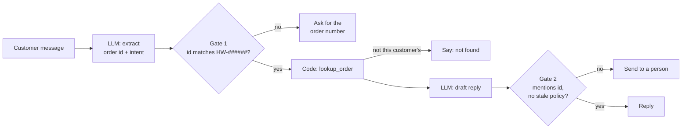
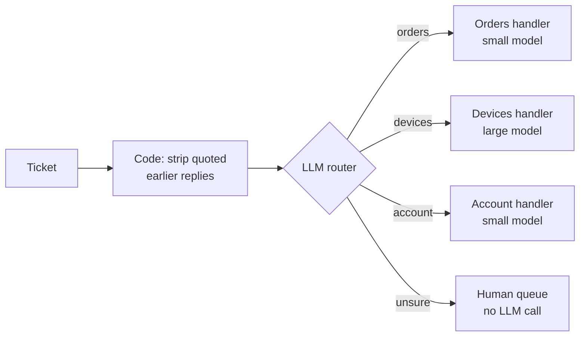
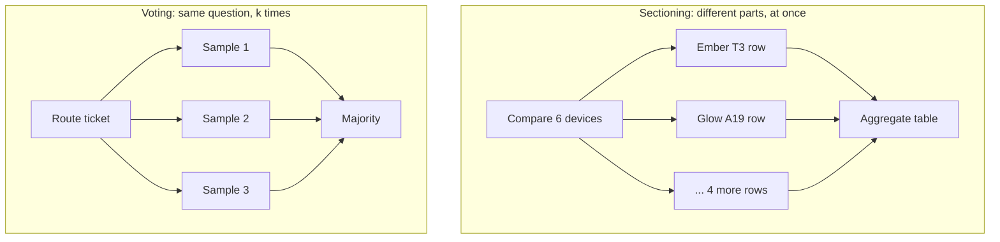
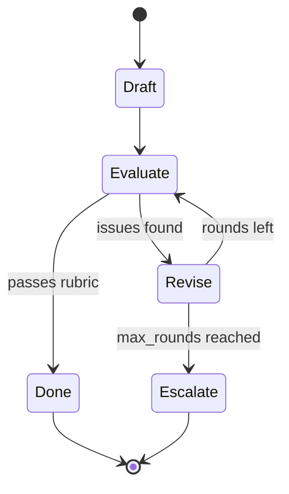
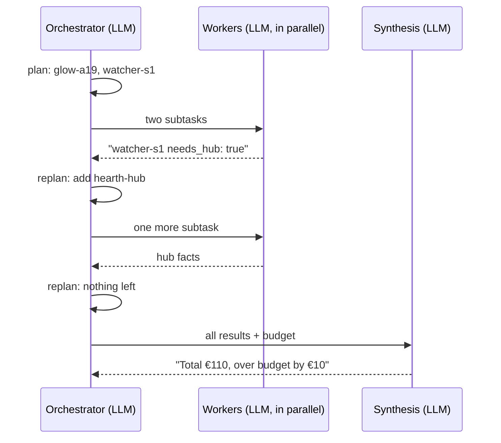

🌐 English · [Español](02-workflow-patterns.es.md)

# Lesson 7.2 — Workflow patterns: chain, route, parallelize, reflect, orchestrate

> **Module 07 · Lesson 2 of 4** · ⏱️ about 60 min · 🧪 Lab: [step 3](lab/README.md#step-3--run-the-workflow-patterns)

## 📨 Situation

> **From:** Sam Adeyemi · Site Reliability Engineer
> **Channel:** #hearthwise-assist
>
> Read Jordan's thread. Before anyone ships a free-range agent, a request for numbers: we have 1,224
> tickets from 2025 to replay. For every design I want to know how many model calls one request costs,
> how many of them happen one after another (that is my latency), and where it stops early when the
> input is junk. A loop that "usually finishes in three calls" is not a number, it is a mood. Give me
> boring pipelines with a fixed worst case first. Then we can talk about autonomy.

## 🎯 Objectives

By the end of this lesson you can:

- Implement prompt chaining with gates and count the LLM calls a gate saves.
- Build a router that sends each request to a specialised handler and model tier, and measure it on
  the 1,224 tickets.
- Apply parallelization by sectioning and by voting, and explain why voting cannot fix systematic
  errors.
- Build a reflection (evaluator-optimizer) loop with an explicit stopping rule.
- Choose between a fixed workflow, an orchestrator-worker design and an agent for a given request.

## 🤔 Predict first

Write your answers down before reading on. You will check them in the self-check.

1. You ask a noisy ticket classifier 5 times and keep the majority answer. Can the vote be more accurate
   than the same classifier *without* noise?
2. Six product lookups plus one final summary: if the lookups run in parallel, how many *sequential*
   rounds of model calls does the whole job need?
3. A draft is checked by an evaluator and rewritten until the evaluator is happy. What could make this
   loop run forever, and how would you stop it?

## 1. Prompt chaining with gates

A **prompt chain** splits a task into fixed steps, where each step's output is the next step's input.
Each LLM step gets a smaller, clearer job than one giant prompt would. Between steps you place **gates**:
plain code checks that decide whether to continue, stop early or hand over to a person.

The lab's chain answers customer messages about orders in five steps. The LLM extracts the order id
and intent as JavaScript Object Notation (JSON). Gate 1 checks the id format. Code looks the order up.
The LLM drafts a reply. Gate 2 checks the draft before it is sent.

**Analogy:** An assembly line with inspectors. Each station does one job, and an inspector between
stations pulls bad parts off the line before more work is wasted on them.



```python
def chain_one(meter: Meter, store: OrderStore, message: str) -> dict[str, Any]:
    """extract (LLM) -> gate -> lookup (code) -> draft (LLM) -> gate."""
    fields = json.loads(meter.ask("extract", message))
    order_id = fields.get("order_id")
    if not order_id or not re.match(ORDER_PATTERN, order_id):  # gate 1: stop early, ask the customer
        return {"outcome": "asked_for_order_id", "reply": "Could you share your order number (HW-xxxxxx)?"}
    try:
        order = store.lookup(order_id, DEMO_CUSTOMER)
    except NotFoundError:
        return {"outcome": "not_found", "reply": f"I could not find {order_id} in your account."}
    reply = meter.ask("draft_reply", json.dumps({"intent": fields["intent"], "order": order}))
    if order_id not in reply or "14 days" in reply:  # gate 2: check the draft before sending
        return {"outcome": "needs_human", "reply": reply}
    return {"outcome": "replied", "reply": reply}
```

On the six sample messages in `workflows.py`, 3 get a reply, 2 are stopped at gate 1 (one has no order
number, one wrote `310155` without the `HW-` prefix) and 1 order belongs to another customer. The chain
makes 9 LLM calls; without the early exits every message would cost 2 calls, 12 in total. The worst case
is fixed: 2 LLM calls and 2 sequential rounds per message. That is exactly what Sam asked for.

> ⚠️ **Common mistake:** Putting the gate's rule in the next prompt ("if the order id is missing, ask
> for it") instead of in code. The model will usually comply, which means it sometimes will not. A gate
> that can be checked with a regular expression or a lookup belongs in code.

## 2. Routing

**Routing** classifies an input first and then sends it to a specialised path: a different prompt, a
different set of tools, a different model size or a human queue. Each handler can be simpler because it
only sees one kind of request. In module 04 you classified tickets by intent; here the classifier's
output becomes a switch in the control flow.

The lab routes the 1,224 tickets into three lanes: `orders` (status and returns), `devices`
(connectivity, product questions and warranty) and `account` (billing, sign-in and subscriptions).
The `devices` lane needs more reasoning, so it gets the "large" model tier; the other two get the
"small" tier. If the router is unsure (no clue, or a tie between lanes), the ticket goes to a human.

**Analogy:** The triage desk in a hospital emergency room. A nurse spends one minute deciding where you
go; the specialists never see the patients who belong elsewhere.



```python
for t in tickets:
    lane = meter.ask("route", ticket_text(t, strip))
    lanes[lane] += 1
    correct += lane == LANE_OF_INTENT[t["intent"]]
    if lane != "human":  # a human queue costs no LLM call
        tiers[MODEL_TIER[lane]] += 1
        meter.ask(f"answer_{lane}", t["body"])
```

Two results are worth your attention. First, a cheap code step before the LLM step matters. Many
tickets quote an earlier support reply that says "Could you share your order number?". Without removing
those quoted lines the router sees the word "order" in a billing question; with them removed, accuracy
on all tickets rises from 0.818 to 0.848 and the human queue shrinks from 165 to 136 tickets. Second,
when the router does pick a lane, it is right 0.954 of the time. Routing the uncertain 136 tickets to
people is a deliberate trade: lower coverage, higher precision.

The lab's router is a keyword stand-in for a real model, so the absolute numbers belong to the fake;
the plumbing and the way you measure it are what carry over.

> 💡 **Production tip:** Measure a router twice: accuracy over everything, and accuracy over what it
> actually routed, plus the share sent to people. A router that sends everything to humans is never
> wrong when it routes, and useless. Track all three numbers over time; drift shows up here first.

## 3. Parallelization: sectioning and voting

**Parallelization** runs several LLM calls at the same time and combines their outputs in code. It has
two flavours with different goals.

**Sectioning** splits a task into *independent* parts and runs them at once. The lab builds a product
comparison table: one worker per device reads that device's page and writes one table row, then one
aggregator call assembles the table. That is 7 LLM calls but only 2 sequential rounds, instead of 7
rounds if you ran them one after another. Latency follows rounds, so sectioning is a latency tool.

**Voting** asks the *same* question several times and keeps the majority answer. It is an accuracy
tool, and you pay for it in calls: with k votes, every ticket costs k calls.

**Analogy:** Sectioning is a pub quiz team that splits the rounds: one person takes music, another
takes geography. Voting is asking three friends the same question and going with the majority: useful
when each friend sometimes slips, useless when they all learned the same wrong fact.



```python
def vote_tickets(k: int, noise: float = 0.3, tickets: list[dict[str, str]] | None = None) -> dict[str, Any]:
    """Ask the noisy router ``k`` times per ticket and keep the majority answer."""
    meter = Meter()
    tickets = tickets if tickets is not None else load_tickets()
    correct = 0
    for t in tickets:
        text = ticket_text(t)
        votes = [meter.ask(f"route_noisy\nSAMPLE {s}\nNOISE {noise}", text) for s in range(k)]
        winner = Counter(votes).most_common(1)[0][0]
        correct += winner == LANE_OF_INTENT[t["intent"]]
    return {"k": k, "noise": noise, "accuracy": round(correct / len(tickets), 3), **meter.usage()}
```

The lab's voting experiment adds random noise to the router: each sample is wrong with probability 0.3,
independently. Here is what happens on the 1,224 tickets:

| Votes per ticket | Accuracy | LLM calls |
|---|---|---|
| Noise-free router (the ceiling) | 0.848 | — |
| k = 1 | 0.613 | 1,224 |
| k = 3 | 0.697 | 3,672 |
| k = 5 | 0.770 | 6,120 |

Voting recovers much of what the random noise took away, at five times the cost. But it can never pass
0.848, because the noise-free router's own mistakes are *systematic*: every sample makes the same one.
Real model samples are partly correlated in the same way, so voting usually helps less than the
independent-noise experiment suggests.

> ⚠️ **Common mistake:** Using voting to fix a bad prompt. If the prompt or the retrieved context is
> wrong, every sample inherits the error and the vote confidently agrees with itself. Fix systematic
> errors at their source; use voting for random slips on high-stakes decisions.

## 4. Reflection: the evaluator-optimizer loop

**Reflection**, also called the **evaluator-optimizer** pattern, pairs a generator with an evaluator.
The generator writes a draft. The evaluator checks it against evidence and a rubric and returns
concrete feedback. The generator rewrites using the feedback. The loop stops when the evaluator passes
the draft or after a fixed number of rounds.

The lab's example uses a trap that has been hiding in the help centre since module 05: an outdated
returns policy. The generator's first
draft "remembers" the superseded 2023 policy: 14 days and a 10% restocking fee for opened items. The
evaluator compares it with the current policy (kb-011: 30 days, no restocking fee) and a rubric (cite the
document, at most 70 words). It finds 3 issues. The second draft fixes all of them and passes. Two rounds
cost 4 LLM calls and 4 sequential rounds.

**Analogy:** A writer and an editor. The editor does not rewrite the article; they return a list of
specific problems, and the writer fixes them. The deadline, not the editor's mood, ends the process.



```python
for round_no in range(1, max_rounds + 1):
    draft = meter.ask("draft_policy_answer",
                      json.dumps({"question": question, "feedback": feedback, "evidence": evidence}))
    verdict = json.loads(meter.ask("evaluate", json.dumps({"draft": draft, "evidence": evidence})))
    history.append({"round": round_no, "draft": draft, "issues": verdict["issues"]})
    if verdict["pass"]:
        break
    feedback = verdict["issues"]
```

Reflection works when the evaluator has something the generator lacks: evidence (the current policy),
a checkable rubric, or a tool such as a test runner. An evaluator that is just the same model asked "is
this good?" tends to approve its own mistakes. Here, the evaluator's key checks are plain string tests
against the evidence, which is why they are reliable.

> 💡 **Production tip:** Log every round's issues. If the first draft fails the same check most of the
> time, fix the generator's prompt or context instead of paying for a second round on every request.
> The reflection loop is a safety net, not a substitute for a good first step.

## 5. Orchestrator-worker

In sectioning, *your code* decides the subtasks. In the **orchestrator-worker** pattern, an LLM (the
orchestrator) reads the request, decides which subtasks are needed, sends them to workers, reads their
results and may add more subtasks before a final synthesis step. The number and type of subtasks are
not known in advance.

The lab asks the orchestrator to suggest device bundles. For "smart lights and heating control, budget
€200" it plans two workers (Glow A19 and Ember T3) and the synthesis says €161, within budget, in 5 LLM
calls. For "motion-activated lights in the hallway, budget €100" it plans two workers (Glow A19 and
Watcher S1). The Watcher S1 worker reports that the sensor needs the Hearth Hub, so the orchestrator
adds a third worker for the hub. The total is €110, over budget by €10, after 7 LLM calls. The plan
changed because of what a worker found.

**Analogy:** A newspaper editor on deadline. They decide which reporters to send where, read what comes
back, and send someone else when a story opens a new angle.



```python
plan: list[str] = json.loads(meter.ask("plan", request))
results: list[dict[str, Any]] = []
rounds, todo = 1, plan
while todo:
    with ThreadPoolExecutor(max_workers=len(todo)) as pool:
        results.extend(pool.map(worker, todo))
    todo = json.loads(meter.ask("replan", json.dumps({"request": request, "results": results})))
    rounds += 2
answer = meter.ask("synthesise", json.dumps({"budget_eur": budget_of(request), "results": results}))
```

This is the most autonomous workflow pattern and the closest to an agent: the model shapes the control
flow. What keeps it a workflow is the structure around it: only one kind of worker exists, workers
cannot call each other, and the loop ends when the orchestrator stops adding subtasks. A production
version also needs a hard cap on rounds, which this lab version leaves out on purpose so that you can
add it in the lab's Extend-it section.

> ⚠️ **Common mistake:** Letting the orchestrator's plan grow without a limit. A model that keeps
> "discovering" new subtasks will happily spend your budget. Cap the number of workers and rounds, and
> treat hitting the cap as a signal to log and review.

## 6. Picking a pattern

The patterns combine freely: a router can send a ticket to a chain, a chain step can use voting, and an
orchestrator's workers can be chains. Start from the simplest pattern that handles the request, measure
it, and add structure only when a measurement says you need it.

| Pattern | Use it when | LLM calls (lab example) | Sequential rounds | Main risk |
|---|---|---|---|---|
| Prompt chaining | The steps are known and checkable | 2 per message, 1 when gate 1 stops it | 2 | Errors pass between steps without gates |
| Routing | Inputs fall into distinct types | 1 router + 1 handler | 2 | Misroutes; drift in the input mix |
| Sectioning | Independent parts of one task | 6 workers + 1 aggregator | 2 | Parts that are not really independent |
| Voting | Random slips on a high-stakes decision | k per decision | 1 if votes run in parallel | Cost; correlated errors |
| Reflection | A checkable rubric or evidence exists | 2 per round | 2 per round | No stopping rule; self-approval |
| Orchestrator-worker | Subtasks depend on the input | 5 or 7 in the lab | 4 or 6 | Unbounded plans |

**Analogy:** A toolbox, not a ladder. You do not use a saw because you already own a hammer; you look at
the job first.

```python
from m07_agents_tools import workflows as wf

report = wf.section_compare()
print(report["llm_calls"], report["sequential_rounds"], report["sequential_rounds_if_serial"])  # 7 2 7
```

> 💡 **Production tip:** Give every workflow run a report like the lab's: LLM calls, sequential rounds
> and tokens. Sequential rounds times your median model latency is a good first estimate of user-facing
> latency, and it is something you can compute before you ever call a real model.

## 🧪 Try it

1. Run the chain and look at which messages stop at gate 1:

   ```bash
   uv run lab workflow chain
   ```

   Expected output:

   ```text
   == chain ==
   - Hi, can I still return the Ember T3 from order HW-310042? It has be... -> replied
       Your order HW-310042 can be returned: 8 days left. Open the app, go to Account > Orders and tap Retur...
   - The Glow bulbs from order HW-310077 are too warm for my taste, I wa... -> replied
       Sorry, order HW-310077 cannot be returned: delivered 49 days ago; the window is 30 days.
   - Where is my camera? Order HW-310108.                                   -> replied
       Your order HW-310108 is shipped.
   - I want to return my plug but I do not have the order number at hand.   -> asked_for_order_id
       Could you share your order number (HW-xxxxxx)?
   - Return order 310155 please.                                            -> asked_for_order_id
       Could you share your order number (HW-xxxxxx)?
   - Can you check order HW-418230 for me?                                  -> not_found
       I could not find HW-418230 in your account.
   Outcomes: {'replied': 3, 'asked_for_order_id': 2, 'not_found': 1}
   LLM calls: 9 | sequential rounds: 2 | tokens: 729
   ```

2. Run the router over all tickets and compare the two accuracy lines:

   ```bash
   uv run lab workflow route
   ```

   Expected output:

   ```text
   == route ==
   Tickets: 1224
   Without stripping quoted replies: accuracy 0.818, to human 165
   With stripping quoted replies:    accuracy 0.848, to human 136
   Lanes: {'orders': 344, 'devices': 447, 'account': 297, 'human': 136}
   Accuracy on tickets routed to a lane: 0.954
   Model tiers: {'small': 641, 'large': 447}
   LLM calls: 2312 | sequential rounds: 2 | tokens: 96096
   ```

3. Run voting and reflection:

   ```bash
   uv run lab workflow vote
   uv run lab workflow reflect
   ```

   Expected output:

   ```text
   == vote ==
   Noise-free router accuracy (the ceiling): 0.848
   k=1 votes, noise 0.3: accuracy 0.613, LLM calls 1224
   k=3 votes, noise 0.3: accuracy 0.697, LLM calls 3672
   k=5 votes, noise 0.3: accuracy 0.770, LLM calls 6120

   == reflect ==
   Round 1 draft: Yes, you can return it within 14 days of delivery. Because the box is opened, a 10% restocking fee applies to your refund.
       issue: states a 14-day window; the current policy (kb-011) says 30 days
       issue: charges a restocking fee; kb-011 says there is none
       issue: no citation of the policy document
   Round 2 draft: Yes. Under our current returns policy you can return any product within 30 days of delivery, opened or not, with no restocking fee. Order...
       issue: none: passed
   Rounds: 2 | passed: True
   LLM calls: 4 | sequential rounds: 4 | tokens: 538
   ```

4. Run the orchestrator and watch the second plan grow:

   ```bash
   uv run lab workflow orchestrate
   ```

   Expected output:

   ```text
   == orchestrate ==
   Request: A customer renting a flat wants smart lights and heating control. Budget €200.
     first plan: ['glow-a19', 'ember-t3'] | workers run: ['glow-a19', 'ember-t3']
     Suggested bundle: Glow A19 (€12), Ember T3 (€149). Total €161, within budget (€200).
     LLM calls: 5 | sequential rounds: 4 | tokens: 721
   Request: A customer wants motion-activated lights in the hallway. Budget €100.
     first plan: ['glow-a19', 'watcher-s1'] | workers run: ['glow-a19', 'watcher-s1', 'hearth-hub']
     Suggested bundle: Glow A19 (€12), Watcher S1 (€29), Hearth Hub (€69). Total €110, over budget by €10 (€100).
     LLM calls: 7 | sequential rounds: 6 | tokens: 1127
   ```

5. Then do [lab step 4](lab/README.md#step-4--add-a-gate-to-the-chain): add your own gate to the chain.

## 🏭 In the real world

Most production "AI features" are workflows, often several patterns stacked: a router in front, chains
behind it, a reflection step on the riskiest outputs. Teams pick workflows because they can be tested
like normal software: you can write a unit test for a gate and a regression test for a router.

Things that go wrong in practice:

- **Gates that are too strict.** The lab's gate rejects `310155` without the `HW-` prefix, so a
  customer who knows their order number is asked for it again. Check gate rejections by hand every week;
  some of them are a normalisation step you forgot.
- **Routers that drift.** A new product launch changes the mix of requests. The tickets dataset has
  exactly this trap: the Lookout C2 launch changes the vocabulary from September 2025. Track the share
  of each lane and of the human queue over time.
- **Hidden latency.** Parallel calls share rate limits. If your provider accepts fewer concurrent
  requests than you send, the extra calls wait in line and your "two rounds" quietly become more.
  Measure, do not assume.
- **Reflection that never converges.** Without `max_rounds`, a strict evaluator and a weak generator
  argue forever. Escalate to a person when the cap is reached.

What to monitor: calls and rounds per request, gate rejection rate per gate, the share of each route,
the number of reflection rounds, and how often orchestrators hit their caps.

## ✅ Self-check

**1. Revisit prediction 1: can a majority vote beat the noise-free classifier?**

<details><summary>Answer</summary>

No. In the lab, k = 5 votes reached 0.770 against a ceiling of 0.848. Voting removes *random,
independent* errors; the classifier's systematic mistakes appear in every sample, so the vote agrees
with them. If you predicted "yes, with enough votes", you were imagining errors that never repeat.

</details>

**2. Revisit prediction 2: six parallel lookups plus a summary need how many sequential rounds?**

<details><summary>Answer</summary>

Two: one round for all six workers at once and one for the aggregator. The total number of LLM calls is
still 7; parallelization changes latency, not cost.

</details>

**3. Revisit prediction 3: what stops a reflection loop?**

<details><summary>Answer</summary>

Two things: the evaluator passing the draft, and a hard `max_rounds` cap. Without the cap, an evaluator
that is never satisfied (or a generator that cannot fix the issue) loops forever. When the cap is hit,
escalate to a person instead of sending the last failed draft.

</details>

**4. Why does stripping quoted replies improve routing, and why is it a code step rather than an LLM
step?**

<details><summary>Answer</summary>

Quoted earlier replies are not the customer's words; they contain support phrases such as "share your
order number" that mislead the router. Removing lines that start with `>` is deterministic, free and
testable, so it belongs in code. In the lab it raised accuracy from 0.818 to 0.848.

</details>

**5. Jordan wants a "compare any two devices" feature. Sectioning or orchestrator-worker?**

<details><summary>Answer</summary>

Sectioning. The subtasks (one lookup per named device) are known as soon as you parse the request, so
code can fan out and aggregate. Orchestrator-worker earns its extra calls only when the subtasks depend
on what earlier results reveal, like the hub requirement in the lab.

</details>

## 💬 Explain it in your own words

1. Explain to Sam why sectioning lowers latency but not cost, and why voting raises cost but not
   latency (if the votes run in parallel).
2. Explain to Rio which pattern you would use for "where is my order?" and what the worst-case number
   of LLM calls is.

## 🔑 Key ideas

- Workflows keep control flow in your code; LLM steps fill in the work. Their worst case is known.
- Gates are code checks between steps. They stop bad inputs early and save calls (9 instead of 12 in
  the lab's chain).
- Routing sends each input to a specialised path; measure accuracy overall, accuracy when routed and
  the share sent to people.
- Sectioning runs independent parts at once (latency); voting asks the same question k times
  (accuracy, k times the cost) and cannot fix systematic errors.
- Reflection needs an evaluator with evidence or a checkable rubric, plus a `max_rounds` stop.
- Orchestrator-worker lets the model shape the plan; cap workers and rounds.

## 📚 Go deeper

- ⭐ [Self-Refine](https://arxiv.org/abs/2303.17651) — a clear study of the generate, give feedback,
  refine loop, including where it helps and where it does not.
- [Self-consistency](https://arxiv.org/abs/2203.11171) — sampling several reasoning paths and taking the
  majority answer; the research version of the voting pattern.
- [Reflexion](https://arxiv.org/abs/2303.11366) — agents that write feedback on their own failed attempts
  and reuse it; a bridge to module 08.
- [AutoGen](https://arxiv.org/abs/2308.08155) — a framework paper that shows orchestrator-style
  conversations between several LLM workers.

---

[← Previous: 7.1 Agents, agentic systems and the agency ladder](01-agents-overview.md) · [🏠 Module 07](README.md) · [Next: 7.3 Tool calling →](03-tool-calling.md)
