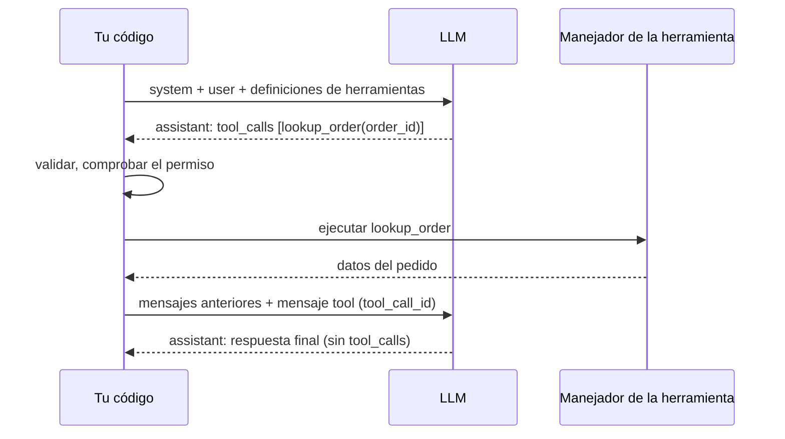
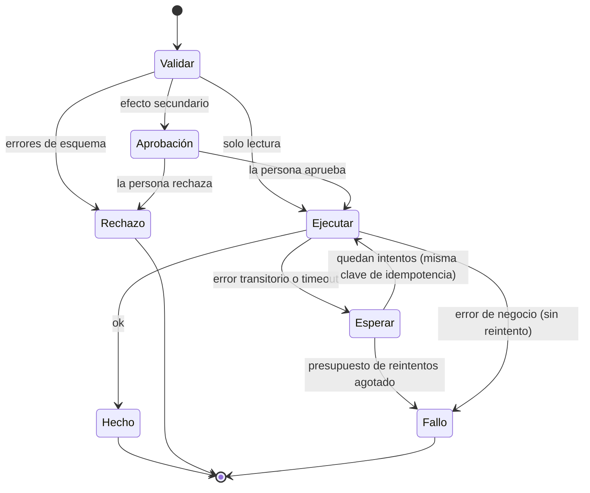
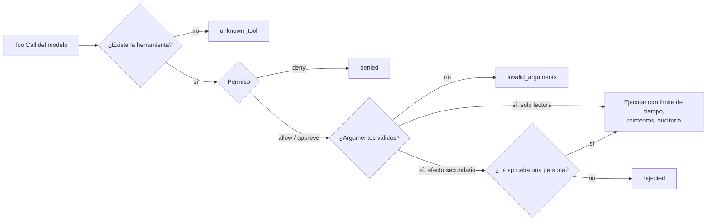

🌐 [English](03-tool-calling.md) · Español

# Lección 7.3 — Llamada a herramientas: formato, ejecución y protección de herramientas

> **Módulo 07 · Lección 3 de 4** · ⏱️ unos 60 min · 🧪 Lab: [paso 5](lab/README.es.md#paso-5--inspecciona-la-caja-de-herramientas-y-el-bucle-de-herramientas)

## 📨 Situación

> **De:** Noor Haddad · Responsable de Seguridad y Privacidad
> **Canal:** #hearthwise-assist
>
> He leído la lista de herramientas de Hearthwise Assist: cuatro herramientas, y una de ellas cambia
> datos. Estas son mis condiciones antes de que nada de esto llegue a un cliente. El modelo nunca elige
> *de quién* son los datos que lee. `create_return` solo se ejecuta después de que una persona lo
> apruebe. Cada llamada se valida y se registra. Y un reintento nunca debe crear una segunda devolución;
> Sam me avisa de que habrá *timeouts*. Dos preguntas para tu revisión de diseño: ¿qué pasa cuando el
> modelo envía argumentos basura, y qué pasa cuando el sistema de pedidos agota el tiempo de espera a
> mitad de una devolución? ¿Cuál es el radio de impacto en cada caso?

## 🎯 Objetivos

Al terminar esta lección puedes:

- Seguir el bucle de llamada a herramientas mensaje a mensaje: entran las definiciones de
  herramientas, salen llamadas a herramientas y vuelven los resultados.
- Escribir una definición de herramienta en JSON Schema (nombre, descripción, parámetros, *enums*,
  campos obligatorios) y explicar cómo orienta al modelo cada parte.
- Validar los argumentos y devolver los errores al modelo para que pueda corregirse.
- Hacer robusta la ejecución con límites de tiempo, reintentos acotados, espera exponencial (*exponential backoff*) y
  claves de idempotencia (*idempotency keys*).
- Aplicar el mínimo privilegio (*least privilege*) y la aprobación humana a las herramientas con efectos secundarios, y
  ejecutar llamadas a herramientas en paralelo.

## 🤔 Predice primero

Apunta tus respuestas antes de seguir leyendo. Las comprobarás en la autoevaluación.

1. El modelo llama a `lookup_order({"order_id": "310108"})`, sin el prefijo `HW-`. ¿Debería tu código
   corregirlo en silencio, lanzar una excepción que termine la conversación o devolver un error al
   modelo?
2. `create_return` agota su tiempo de espera a los 0,2 segundos. ¿Es seguro volver a intentarlo sin
   más?
3. ¿De dónde debería salir el id de cliente que necesita `lookup_order`: de los argumentos del modelo o
   de otro sitio?

## 1. El bucle de llamada a herramientas

Un modelo no puede ejecutar código. La **llamada a herramientas** (*tool calling*), también llamada
llamada a funciones (*function calling*), es un contrato entre tu aplicación y el modelo: describes las
herramientas en la petición, el modelo responde con una petición estructurada para llamar a una o
varias de ellas, *tu código* las ejecuta y devuelves los resultados como mensajes nuevos. Después, el
modelo pide más herramientas o escribe la respuesta final.

Intervienen cuatro roles de mensaje. Los mensajes `system` y `user` inician la conversación. Un mensaje
`assistant` puede llevar `tool_calls`, cada una con un id, el nombre de una herramienta y argumentos en
JSON. Un mensaje `tool` lleva un resultado y el id de la llamada a la que responde, para que el modelo
pueda emparejar resultados y peticiones.

**Analogía:** La jefatura de una cocina y una persona de apoyo que nunca sale del almacén. Quien dirige
la cocina no llega a las estanterías, así que da órdenes precisas en voz alta ("dos kilos de arroz, del
basmati"), la persona del almacén trae exactamente eso, y quien dirige la cocina decide qué preparar a
continuación con lo que ha llegado.



La capa de proveedores del lab lo modela con dos *dataclasses* pequeñas (de `providers.py`, compartido
por todos los labs del curso):

```python
@dataclass(frozen=True)
class ToolCall:
    """A request from the model to run one tool with JSON arguments."""

    id: str
    name: str
    arguments: dict[str, Any]


@dataclass(frozen=True)
class Message:
    """One chat message. ``tool_calls`` is only used on assistant messages."""

    role: Role
    content: str
    name: str | None = None
    tool_call_id: str | None = None
    tool_calls: tuple[ToolCall, ...] = ()
```

En el lab, un *responder* con guion del `FakeProvider` hace de modelo: lee la petición y los mensajes
`tool` recibidos hasta el momento y emite objetos `ToolCall`, exactamente como lo haría un modelo real a
través de los proveedores de Ollama o compatibles con OpenAI. Como es determinista, todas las trazas de
esta lección son reproducibles.

> ⚠️ **Error común:** Perder el `tool_call_id` o enviar los resultados en otro orden. Con llamadas en
> paralelo, el modelo no puede saber entonces qué resultado corresponde a cada petición, y las API
> reales a menudo rechazan la conversación. Envía exactamente un mensaje `tool` por cada id de llamada.

## 2. Formato de las herramientas: JSON Schema y descripciones

El modelo decide *qué* herramienta llamar y *cómo* solo a partir de lo que le envías: el nombre, la
descripción y un JSON Schema para los parámetros. JSON Schema es una forma estándar de describir la
forma de unos datos JSON: tipos, campos obligatorios, valores permitidos y formatos. Esta es la
herramienta `lookup_order` del lab:

```python
Tool(
    name="lookup_order",
    description=(
        "Get the status, delivery date, items and return eligibility of one order that belongs to "
        "the signed-in customer. Use it before answering anything about a specific order. Read-only."
    ),
    parameters=_obj({"order_id": ORDER_ID}, ["order_id"]),
    handler=lambda a, s: store.lookup(a["order_id"], s.customer_id),
    timeout_s=timeout_s,
),
```

`ORDER_ID` es `{"type": "string", "pattern": "^HW-\\d{6}$", "description": "Order id, for example
HW-310042."}`, y `_obj` construye un esquema de objeto con `required` y `"additionalProperties": false`.
Cada parte de una definición orienta al modelo de una forma distinta:

| Parte | Qué hace por el modelo | Ejemplo del lab |
|---|---|---|
| `name` | Un verbo más un sustantivo dicen qué hace la herramienta | `lookup_order`, no `orders_v2` |
| `description` | Cuándo usarla, cuándo no, qué devuelve, unidades | "Use it before answering anything about a specific order" |
| `type` | La forma básica de cada argumento | `quantity` es un `integer` |
| `enum` | Una lista cerrada de valores válidos: nada de adivinar | `product` es uno de seis *slugs* |
| `pattern` | Un formato que el valor debe cumplir | `^HW-\d{6}$` para los ids de pedido |
| `minimum`, `maximum` | Límites numéricos | `quantity` entre 1 y 10 |
| `required` | Qué argumentos deben estar presentes | los cuatro en `create_return` |
| `additionalProperties: false` | Nada de argumentos inventados | rechaza `{"colour": "red"}` |

**Las descripciones importan más que cualquier otra parte.** El modelo las lee como documentación
escrita para una persona nueva en el equipo. La descripción de `create_return` dice que cambia datos,
que una persona debe aprobarla, que solo debe ir después de un `lookup_order` correcto y que los
dispositivos averiados van por una reclamación de garantía. Esas frases evitan clases enteras de
errores antes de que se ejecute ningún código.

Las descripciones también cuestan *tokens* en cada llamada. El lab los mide:

| Herramienta | Cambia datos | *Tokens* de la especificación |
|---|---|---|
| `get_product` | no | 192 |
| `search_help_centre` | no | 194 |
| `lookup_order` | no | 150 |
| `create_return` | sí | 331 |
| Las cuatro, enviadas con cada llamada al LLM | | 872 |

**Analogía:** Un buen formulario en una oficina pública. Etiquetas claras ("fecha de nacimiento,
DD/MM/AAAA"), casillas para marcar en lugar de texto libre cuando las respuestas se conocen y una nota
que dice qué ventanilla se ocupa de qué. La gente comete menos errores, y el personal de ventanilla
rechaza el resto antes de archivarlo.

Fíjate en lo que *no* es un parámetro: el id de cliente. Si lo fuera, se podría convencer al modelo de
que pasara el id de otra persona. El *handler* lo obtiene de la `Session`, que tu aplicación fija
cuando el cliente inicia sesión.

> 💡 **Consejo de producción:** Revisa las descripciones de las herramientas como si fueran código, en
> *pull requests* y con tests. Un cambio de una palabra ("may" en lugar de "must") puede cambiar el
> comportamiento del modelo más que un cambio de código. Mantén un pequeño conjunto de conversaciones de
> prueba que deban seguir produciendo las llamadas correctas después de cada edición.

## 3. Valida y devuelve los errores al modelo

Los argumentos del modelo son entradas no confiables. Valídalos contra el esquema antes de ejecutar
ningún *handler*. Cuando la validación falle, no hagas que el programa falle y no "arregles" el valor en
silencio: devuelve un error claro *como resultado de la herramienta*. Un buen mensaje de error le dice
al modelo qué estaba mal y qué hacer, y los modelos se corrigen bien a sí mismos a partir de mensajes
así.

El ejecutor del lab convierte cada resultado en un `ToolResult` con un estado. Cada estado implica un
siguiente paso distinto para el modelo:

| Estado | Significado | ¿Debería reintentar el modelo? |
|---|---|---|
| `ok` | La herramienta se ejecutó | No, usa los datos |
| `unknown_tool` | No hay ninguna herramienta con ese nombre | Elige entre las herramientas listadas |
| `denied` | No está permitida en este contexto | No; explícalo o pasa el caso a otra persona |
| `invalid_arguments` | Falló la validación del esquema | Sí, con los argumentos corregidos |
| `rejected` | Una persona no la aprobó | No; díselo al cliente |
| `timeout` / `error` | Falló después de los reintentos del propio ejecutor | Normalmente no; explícalo o escala |

```python
problems = validate(call.arguments, tool.parameters)
if problems:
    return ToolResult(call.id, call.name, "invalid_arguments",
                      error="; ".join(problems) + ". Fix the arguments and call the tool again.")
```

Esta es la traza del lab para "Where is my order 310108?" ("¿Dónde está mi pedido 310108?"). El modelo
con guion primero copia lo que escribió el cliente, el validador lo rechaza y el modelo se corrige a
partir del mensaje de error:

```text
LLM call 1 -> lookup_order({"order_id": "310108"})
    invalid_arguments $.order_id: '310108' does not match pattern ^HW-\d{6}$. Fix the arguments and call the tool a...
LLM call 2 -> lookup_order({"order_id": "HW-310108"})
    ok (1 attempt)
LLM call 3 -> answer: Order HW-310108 is shipped.
```

La reparación costó una llamada extra al LLM: 3 llamadas en lugar de 2. Es un seguro barato, y además
es una señal. Si en producción `invalid_arguments` es frecuente en una herramienta, mejora su
descripción o su esquema (por eso la descripción de `ORDER_ID` muestra un id de ejemplo).

**Analogía:** Un cajero automático que dice "el PIN debe tener cuatro dígitos" en lugar de tragarse la
tarjeta.

> ⚠️ **Error común:** Lanzar una excepción por un argumento incorrecto y terminar toda la conversación
> o, al contrario, corregir automáticamente los argumentos en el *handler*. Lo primero desperdicia una
> situación recuperable. Lo segundo oculta los problemas y puede convertir un id de pedido equivocado en
> el id válido de un pedido *de otro cliente*.

## 4. Límites de tiempo, reintentos e idempotencia

Las herramientas hablan con bases de datos y servicios que a veces van lentos o dejan de estar
disponibles un momento. Tres mecanismos mantienen el asistente ágil sin causar daños.

- Un **límite de tiempo** (*timeout*) por herramienta limita cuánto puede durar una llamada
  (`timeout_s`).
- Los **reintentos acotados con espera exponencial** (*exponential backoff*) vuelven a intentarlo tras
  un fallo transitorio, esperando más cada vez: el lab espera `backoff_s × 2^(attempt − 1)`, es decir,
  0,05 s y luego 0,1 s, como mucho dos veces. Los errores de negocio ("delivered 49 days ago",
  "entregado hace 49 días") nunca se reintentan; volver a intentarlo no puede cambiar la respuesta.
- Una **clave de idempotencia** (*idempotency key*) hace que un efecto secundario se pueda repetir sin
  peligro. El ejecutor deriva una clave a partir de la conversación, la herramienta y sus argumentos. El
  almacén recuerda las claves: una segunda llamada con la misma clave devuelve el primer resultado en
  lugar de crear una devolución nueva.

Por qué importa la clave: un *timeout* en una herramienta con efectos secundarios es *ambiguo*. Puede
que el sistema de pedidos creara la devolución y luego tardara en responder. Si reintentas a ciegas,
puedes crear una segunda devolución y reembolsar dos veces al cliente.

**Analogía:** El botón de un ascensor. Pulsarlo cinco veces no llama a cinco ascensores; el sistema
sabe que la petición ya está registrada. Una clave de idempotencia convierte tu "volver a pulsar" en un
botón de ese tipo.



```python
def idempotency_key(session: Session, call: ToolCall) -> str:
    """Same conversation + same tool + same arguments = same key, so a retry cannot act twice."""
    canonical = json.dumps({"c": session.conversation_id, "t": call.name, "a": call.arguments}, sort_keys=True)
    return hashlib.sha256(canonical.encode()).hexdigest()[:16]
```

El lab inyecta fallos a propósito para mostrar cada mecanismo:

| Demo | Fallo inyectado | Qué pasó |
|---|---|---|
| `retries` | `lookup_order` falla dos veces con un error transitorio | Funcionó en el intento 3 |
| `timeout` | `search_help_centre` duerme 0,5 s; el límite de tiempo es 0,2 s | Agotó el tiempo una vez y funcionó en el intento 2 |
| `idempotency` | `create_return` confirma la operación y después duerme más allá del límite de tiempo | Con claves: 1 devolución en el almacén. Sin claves: 2 devoluciones |

En la última fila, las dos ejecuciones le dicen al cliente "Done" ("Hecho"). Solo el almacén revela
que, sin claves, el cliente tiene ahora dos devoluciones abiertas para un solo Spark Mini. Calcular el
*hash* de los argumentos es un atajo didáctico: también fusionaría dos devoluciones idénticas que sí se
quisieran hacer. Los sistemas en producción suelen crear la clave una vez por cada acción de la persona,
por ejemplo cuando pulsa Aprobar, la guardan con la petición y la reutilizan en cada reintento.

> 💡 **Consejo de producción:** Si una llamada con efectos secundarios no puede llevar una clave de
> idempotencia, no la reintentes automáticamente. Informa de "resultado desconocido", comprueba el
> sistema de registro (*system of record*) y deja que decida una persona. En producción, añade también
> una variación aleatoria (*jitter*) a las esperas para que muchos clientes no reintenten todos a la
> vez.

## 5. Mínimo privilegio y aprobación humana

El **mínimo privilegio** (*least privilege*) significa que cada sesión recibe solo las herramientas y
los datos que necesita. El lab lo expresa con tres permisos por herramienta: `allow`, `approve` (una
persona debe decir que sí) y `deny`. El valor por defecto se deriva de la propia herramienta: las
herramientas de solo lectura se permiten y las que tienen efectos secundarios necesitan aprobación. Las
herramientas denegadas ni siquiera se incluyen en las definiciones que se envían al modelo, así que no
puede caer en la tentación de llamarlas.

```python
tool = self.tools.get(call.name)
if tool is None:
    return ToolResult(call.id, call.name, "unknown_tool",
                      error=f"Unknown tool '{call.name}'. Available: {sorted(self.tools)}")
if self.permission(tool) == Permission.DENY:
    return ToolResult(call.id, call.name, "denied", error="This tool is not allowed in this context.")
problems = validate(call.arguments, tool.parameters)
if problems:
    return ToolResult(call.id, call.name, "invalid_arguments",
                      error="; ".join(problems) + ". Fix the arguments and call the tool again.")
if self.permission(tool) == Permission.APPROVE and not (self.approver and self.approver(call)):
    return ToolResult(call.id, call.name, "rejected",
                      error="A person did not approve this action. Do not retry; tell the customer.")
```

El orden de las comprobaciones es deliberado: existencia, permiso, validación y, por último,
aprobación. Solo se pide a una persona que apruebe una llamada permitida y bien formada, así que nadie
que apruebe ve nunca basura, y la pantalla de aprobación puede mostrar exactamente lo que va a pasar:
`create_return` de 1 x HW-EMB-T3 sobre HW-310042.

La identidad sigue la misma idea. `lookup_order` lee `session.customer_id`, nunca un argumento del
modelo. Cuando el lab pregunta por HW-418230, un pedido que existe pero pertenece al cliente C-0107, la
herramienta responde "No order HW-418230 found for this customer." ("No se encontró el pedido HW-418230
para este cliente"). No revela que el pedido existe. La lección 7.4 muestra por qué esto importa todavía
más cuando las herramientas viven en un servidor aparte.

**Analogía:** La tarjeta de una habitación de hotel. Abre tu habitación y el gimnasio, no las demás
habitaciones, y el minibar sigue pidiéndote una firma.



Cada llamada, sea cual sea su resultado, se añade a `ToolExecutor.audit` con la herramienta, los
argumentos, el estado y los intentos. Noor tiene su registro; Sam saca sus tasas de error de los mismos
datos.

> ⚠️ **Error común:** Pedir la aprobación en el chat ("¿Inicio la devolución? Responde sí") y tratar la
> siguiente llamada a herramienta del modelo como aprobada. Se puede manipular al modelo para que se
> salte ese paso. La aprobación debe llegar por un canal aparte en el que el modelo no pueda escribir,
> como un botón en la consola del agente que llama a tu `approver`.

## 6. Llamadas a herramientas en paralelo

Un modelo puede pedir varias herramientas en un mismo turno cuando las llamadas no dependen unas de
otras. "Compara el Ember T3 y la Lookout C2" necesita dos llamadas a `get_product`; ninguna necesita el
resultado de la otra. El ejecutor del lab las ejecuta a la vez y devuelve los resultados en el orden de
las llamadas:

```python
def execute_all(self, calls: Sequence[ToolCall], parallel: bool = True) -> list[ToolResult]:
    """Run several calls from one model turn; results keep the order of the calls."""
    if not parallel or len(calls) < 2:
        return [self.execute(c) for c in calls]
    with ThreadPoolExecutor(max_workers=len(calls)) as outer:
        return list(outer.map(self.execute, calls))
```

La comparación necesitó 2 llamadas al LLM y 2 llamadas a herramientas. Si el modelo hubiera pedido un
producto por turno, cada producto extra habría costado otra ida y vuelta al LLM. Las llamadas en
paralelo ahorran rondas del modelo, que es donde está la mayor parte de la latencia.

No todos los conjuntos de llamadas deberían ir en paralelo. Las llamadas que dependen unas de otras
(consultar el pedido y, *después*, crear la devolución) tienen que ser secuenciales, y el modelo lo
expresa pidiéndolas en turnos separados. Ten cuidado con varios efectos secundarios en un mismo turno:
si uno falla, tienes que decidir qué pasa con los demás. Una regla sencilla es ejecutar las llamadas con
efectos secundarios de una en una aunque el modelo las pida juntas.

**Analogía:** Enviar a dos personas del equipo a dos tiendas distintas a la vez, en lugar de enviar a
una sola a las dos tiendas, una detrás de otra.

> 💡 **Consejo de producción:** Limita el número de llamadas en paralelo por turno y pon un plazo a todo
> el turno, además de a cada llamada. Un modelo que pide docenas de consultas a la vez debería recibir un
> error que le pida acotar la petición, no docenas de consultas a la base de datos.

## 🧪 Pruébalo

1. Lista la caja de herramientas y el coste en *tokens* de cada definición:

   ```bash
   uv run lab tools
   ```

   Salida esperada:

   ```text
   Tool                Changes data  Required arguments                  Spec tokens
   get_product         no            product                                     192
   search_help_centre  no            query                                       194
   lookup_order        no            order_id                                    150
   create_return       yes           order_id, sku, quantity, reason             331
   All four specs together: 872 tokens, sent with every LLM call.
   ```

2. Observa cómo el modelo corrige sus propios argumentos y, después, una comparación en paralelo:

   ```bash
   uv run lab tools --demo fix-args
   uv run lab tools --demo compare
   ```

   Salida esperada (la parte de la comparación):

   ```text
   == compare ==
   Request: Compare the Ember T3 and the Lookout C2, please.
     LLM call 1 -> get_product({"product": "ember-t3"})
         ok (1 attempt)
     LLM call 1 -> get_product({"product": "lookout-c2"})
         ok (1 attempt)
     LLM call 2 -> answer: Ember T3: €149, Wi-Fi 2.4 GHz, needs hub: no. Lookout C2: €89, Wi-Fi 2.4 GHz and 5 GHz, needs hub: no.
     Totals: 2 LLM calls, 2 tool calls, 2275 prompt tokens, 65 completion tokens
     Returns in the store: 0
   ```

3. Mira cómo una persona rechaza un efecto secundario:

   ```bash
   uv run lab tools --demo return-denied
   ```

   Salida esperada:

   ```text
   == return-denied ==
   Request: Please return the Ember T3 from order HW-310042, I changed my mind.
     LLM call 1 -> lookup_order({"order_id": "HW-310042"})
         ok (1 attempt)
     LLM call 2 -> create_return({"order_id": "HW-310042", "sku": "HW-EMB-T3", "quantity": 1, "reason": "changed_mind"})
         [approval] a person rejected this call
         rejected A person did not approve this action. Do not retry; tell the customer.
     LLM call 3 -> answer: I have not started the return because it was not approved. A colleague will contact you.
     Totals: 3 LLM calls, 2 tool calls, 3185 prompt tokens, 68 completion tokens
     Returns in the store: 0
   ```

4. Rompe la red a propósito y observa cómo te salva la clave de idempotencia (esta demo duerme
   alrededor de un segundo):

   ```bash
   uv run lab tools --demo idempotency
   ```

   Mira la última línea de cada mitad de la salida: `Returns in the store: 1` con claves y
   `Returns in the store: 2` sin ellas.

5. Sigue con el [paso 6 del lab](lab/README.es.md#paso-6--haz-segura-la-ejecución-de-herramientas) y
   el [paso 7 del lab](lab/README.es.md#paso-7--añade-una-quinta-herramienta), donde añades una
   herramienta propia.

## 🏭 En el mundo real

Las capas de herramientas en producción se parecen mucho al ejecutor del lab, con más detalle
operativo:

- **Los esquemas se generan, no se escriben a mano.** Los equipos derivan el JSON Schema de código
  tipado (*dataclasses* o bibliotecas de validación) para que el esquema, el validador y el *handler*
  no puedan desincronizarse.
- **Las herramientas de escritura son servicios aparte.** El *handler* de `create_return` llama a la
  interfaz de programación de aplicaciones (API, *application programming interface*) del propio
  sistema de devoluciones, que aplica sus propias reglas de negocio y su propia idempotencia. El
  asistente es un cliente más, no una puerta trasera privilegiada.
- **Las reglas de aprobación maduran con el tiempo.** Los equipos empiezan con aprobación para cada
  escritura, miden con qué frecuencia se aprueba sin cambios y después aprueban automáticamente casos
  acotados (por ejemplo, devoluciones por debajo de un umbral de valor, dentro del plazo y de quien ha
  iniciado sesión), manteniendo la aprobación para el resto.
- **Los errores son decisiones de producto.** "Pedido no encontrado para este cliente" es más seguro
  que "El pedido pertenece a otra persona". El texto del error llega al modelo y, a través del modelo,
  al cliente.

Qué vigilar en cada herramienta: volumen de llamadas, percentiles de latencia, recuentos de *timeouts*
y de reintentos, la proporción de `invalid_arguments` (un problema de descripción), la proporción de
`rejected` (un problema de criterio del modelo) y con qué frecuencia una clave de idempotencia evitó un
duplicado (un problema de fiabilidad que de otro modo nunca verías).

## ✅ Autoevaluación

**1. Retoma la predicción 1: ¿qué debería pasar cuando el modelo envía `"310108"`?**

<details><summary>Respuesta</summary>

Devolver al modelo un resultado `invalid_arguments` con un mensaje preciso (el patrón que debe
cumplir). El modelo se corrige en el turno siguiente, como muestra la demo `fix-args` del lab, al coste
de una llamada extra al LLM. Corregirlo en silencio oculta el problema y puede llevar al registro
equivocado; una excepción desperdicia una conversación recuperable.

</details>

**2. Retoma la predicción 2: ¿es seguro reintentar `create_return` después de un *timeout*?**

<details><summary>Respuesta</summary>

Solo con una clave de idempotencia. El *timeout* no te dice si la devolución se creó. En el lab, el
almacén confirmó la devolución antes de la respuesta lenta; con claves, el reintento devolvió el mismo
registro (1 devolución); sin claves, creó una segunda (2 devoluciones). Sin clave, informa de
"resultado desconocido" en lugar de reintentar.

</details>

**3. Retoma la predicción 3: ¿de dónde debería salir el id de cliente?**

<details><summary>Respuesta</summary>

De la sesión iniciada, que controla tu aplicación, nunca de los argumentos del modelo. Se puede
convencer a un modelo (por parte de quien lo usa o mediante texto inyectado) de que pase el id de otra persona. En el
lab, `lookup_order` lee `session.customer_id`, y un pedido de otro cliente se notifica como no
encontrado.

</details>

**4. ¿Por qué el ejecutor comprueba el permiso y la validación *antes* de pedir a una persona que
apruebe?**

<details><summary>Respuesta</summary>

Para que quien aprueba solo vea llamadas permitidas y bien formadas, con argumentos concretos y ya
comprobados. Si la aprobación fuera primero, una persona podría aprobar una llamada que luego no pasa la
validación, o recibir preguntas sobre una herramienta que nunca debería ejecutarse en ese contexto.
Además, mantiene baja la fatiga de aprobación.

</details>

**5. Tu herramienta `search_help_centre` devuelve `invalid_arguments` mucho más a menudo que las demás.
¿Qué miras?**

<details><summary>Respuesta</summary>

Los argumentos que fallan en el registro de auditoría, y la descripción y el esquema de la herramienta.
Las causas típicas son un `minLength` o un `maxLength` que la descripción no menciona, un nombre de
parámetro que sugiere otro formato o la falta de ejemplos. Corrige primero la descripción; es más
barato que las llamadas extra al modelo.

</details>

## 💬 Explícalo con tus palabras

1. Explícale a Noor, paso a paso, qué pasa entre que el modelo emite `create_return(...)` y que exista
   una devolución en el almacén, y dónde se hace cumplir cada una de sus cuatro condiciones.
2. Explícale a Sam por qué un *timeout* en una herramienta de solo lectura y un *timeout* en una
   herramienta con efectos secundarios necesitan un tratamiento distinto.

## 🔑 Ideas clave

- El modelo solo *pide* llamadas a herramientas; tu código las valida, las autoriza, las ejecuta y
  devuelve el resultado, con un mensaje `tool` por cada id de llamada.
- Una definición de herramienta es un nombre, una descripción y un JSON Schema. Las descripciones son
  lo que más orienta al modelo; los *enums*, los patrones y `additionalProperties: false` cierran el
  paso a clases enteras de errores.
- Las definiciones de herramientas cuestan *tokens* en cada llamada (872 para las cuatro del lab).
- Devuelve los errores como resultados con mensajes claros; el modelo puede reparar los argumentos con
  una llamada extra.
- Reintenta solo los fallos transitorios, con espera exponencial y un presupuesto. Reintenta los
  efectos secundarios solo con una clave de idempotencia.
- Mínimo privilegio: oculta las herramientas denegadas, toma la identidad de la sesión, exige
  aprobación humana para los efectos secundarios a través de un canal en el que el modelo no pueda
  escribir, y regístralo todo.

## 📚 Profundiza

- ⭐ [JSON Schema](https://json-schema.org) — el sitio oficial del estándar que se usa para los
  parámetros de las herramientas, con una guía para principiantes y la especificación completa.
- [Toolformer](https://arxiv.org/abs/2302.04761) — cómo un modelo puede aprender cuándo merece la pena
  llamar a una herramienta, lo que explica por qué unas descripciones claras cambian el comportamiento.
- [Ollama](https://ollama.com) — ejecuta un modelo local con llamada a herramientas y apunta a él el
  `OllamaProvider` del lab (consulta la sección "Usar un modelo real" del lab).
- [Inyección indirecta de *prompts*](https://arxiv.org/abs/2302.12173) — los resultados de las
  herramientas son entradas no confiables; este artículo muestra qué pasa cuando las aplicaciones lo
  olvidan.

---

[← Anterior: 7.2 Patrones de workflow](02-workflow-patterns.es.md) · [🏠 Módulo 07](README.es.md) · [Siguiente: 7.4 El Model Context Protocol →](04-model-context-protocol.es.md)
