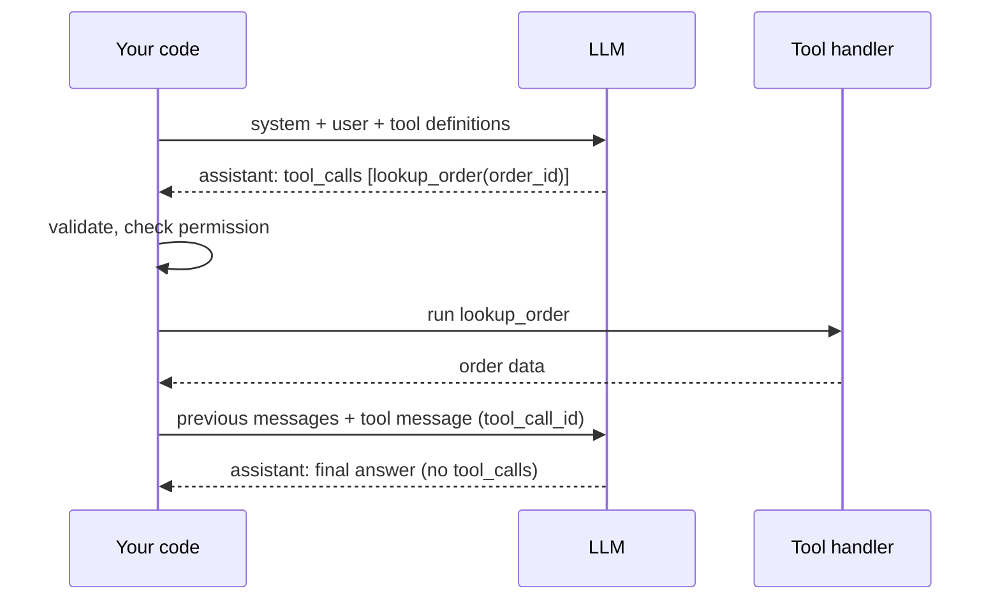
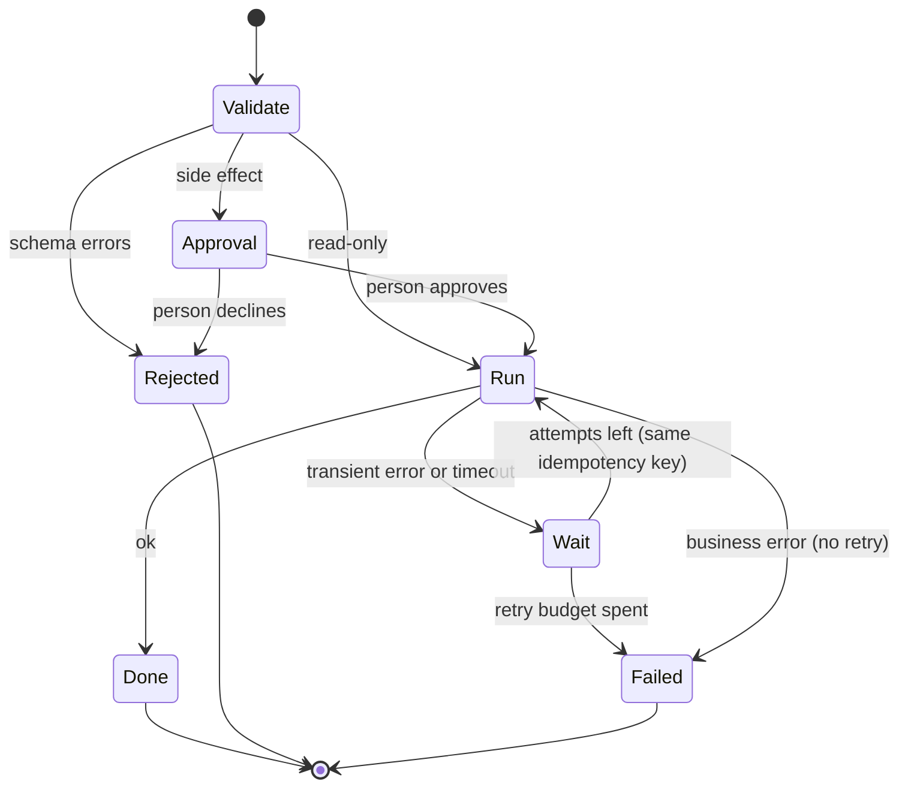
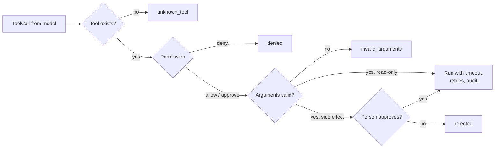

🌐 English · [Español](03-tool-calling.es.md)

# Lesson 7.3 — Tool calling: formatting, executing and guarding tools

> **Module 07 · Lesson 3 of 4** · ⏱️ about 60 min · 🧪 Lab: [step 5](lab/README.md#step-5--inspect-the-toolbox-and-the-tool-loop)

## 📨 Situation

> **From:** Noor Haddad · Security and Privacy Lead
> **Channel:** #hearthwise-assist
>
> I have read the tool list for Hearthwise Assist: four tools, one of which changes data. My conditions
> before any of it reaches a customer. The model never chooses *whose* data it reads. `create_return`
> runs only after a person approves it. Every call is validated and logged. And a retry must never
> create a second return; Sam tells me timeouts will happen. Two questions for your design review: what
> happens when the model sends garbage arguments, and what happens when the order system times out
> halfway through a return? What's the blast radius in each case?

## 🎯 Objectives

By the end of this lesson you can:

- Trace the tool-calling loop message by message: tool definitions in, tool calls out, results back.
- Write a tool definition in JSON Schema (name, description, parameters, enums, required) and explain
  how each part steers the model.
- Validate arguments and return errors to the model so that it can correct itself.
- Make execution robust with timeouts, bounded retries, exponential backoff and idempotency keys.
- Enforce least privilege and human approval for side-effecting tools, and run parallel tool calls.

## 🤔 Predict first

Write your answers down before reading on. You will check them in the self-check.

1. The model calls `lookup_order({"order_id": "310108"})`, without the `HW-` prefix. Should your code
   fix it silently, raise an exception that ends the conversation, or send an error back to the model?
2. `create_return` times out after 0.2 seconds. Is it safe to simply try again?
3. Where should the customer id that `lookup_order` needs come from: from the model's arguments or from
   somewhere else?

## 1. The tool-calling loop

A model cannot run code. **Tool calling** (also called function calling) is a contract between your
application and the model: you describe the tools in the request, the model answers with a structured
request to call one or more of them, *your code* runs them, and you send the results back as new
messages. The model then either asks for more tools or writes the final answer.

Four message roles take part. The `system` and `user` messages start the conversation. An `assistant`
message may carry `tool_calls`, each with an id, a tool name and JSON arguments. A `tool` message
carries one result and the id of the call it answers, so the model can match results to requests.

**Analogy:** A head chef and a kitchen porter who never leaves the storeroom. The chef cannot reach
the shelves, so they shout precise orders ("two kilos of rice, the basmati"), the porter fetches exactly
that, and the chef decides what to cook next from what arrived.



The lab's provider layer models this with two small dataclasses (from `providers.py`, shared by every
lab in the course):

```python
@dataclass(frozen=True)
class ToolCall:
    """A request from the model to run one tool with JSON arguments."""

    id: str
    name: str
    arguments: dict[str, Any]


@dataclass(frozen=True)
class Message:
    """One chat message. ``tool_calls`` is only used on assistant messages."""

    role: Role
    content: str
    name: str | None = None
    tool_call_id: str | None = None
    tool_calls: tuple[ToolCall, ...] = ()
```

In the lab, a scripted `FakeProvider` responder plays the model: it reads the request and the tool
messages so far and emits `ToolCall` objects, exactly as a real model would through the Ollama or
OpenAI-compatible providers. Because it is deterministic, every trace in this lesson is reproducible.

> ⚠️ **Common mistake:** Dropping the `tool_call_id` or sending results in a different order. With
> parallel calls the model then cannot tell which result belongs to which request, and real APIs often
> reject the conversation. Send exactly one `tool` message per call id.

## 2. Tool formatting: JSON Schema and descriptions

The model decides *which* tool to call and *how* only from what you send: the name, the description
and a JSON Schema for the parameters. JSON Schema is a standard way to describe the shape of JSON data:
types, required fields, allowed values and formats. Here is the lab's `lookup_order`:

```python
Tool(
    name="lookup_order",
    description=(
        "Get the status, delivery date, items and return eligibility of one order that belongs to "
        "the signed-in customer. Use it before answering anything about a specific order. Read-only."
    ),
    parameters=_obj({"order_id": ORDER_ID}, ["order_id"]),
    handler=lambda a, s: store.lookup(a["order_id"], s.customer_id),
    timeout_s=timeout_s,
),
```

`ORDER_ID` is `{"type": "string", "pattern": "^HW-\\d{6}$", "description": "Order id, for example
HW-310042."}`, and `_obj` builds an object schema with `required` and `"additionalProperties": false`.
Each part of a definition steers the model in a different way:

| Part | What it does for the model | Lab example |
|---|---|---|
| `name` | A verb plus a noun says what the tool does | `lookup_order`, not `orders_v2` |
| `description` | When to use it, when not to, what comes back, units | "Use it before answering anything about a specific order" |
| `type` | Basic shape of each argument | `quantity` is an `integer` |
| `enum` | A closed list of valid values: no guessing | `product` is one of six slugs |
| `pattern` | A format the value must match | `^HW-\d{6}$` for order ids |
| `minimum`, `maximum` | Numeric bounds | `quantity` between 1 and 10 |
| `required` | Which arguments must be present | all four for `create_return` |
| `additionalProperties: false` | No invented arguments | rejects `{"colour": "red"}` |

**Descriptions matter more than any other part.** The model reads them like documentation written for
a new colleague. The `create_return` description says it changes data, that a person must approve it,
that it should only follow a successful `lookup_order`, and that faulty devices go through a warranty
claim instead. Those sentences prevent whole classes of mistakes before any code runs.

Descriptions also cost tokens on every call. The lab measures them:

| Tool | Changes data | Spec tokens |
|---|---|---|
| `get_product` | no | 192 |
| `search_help_centre` | no | 194 |
| `lookup_order` | no | 150 |
| `create_return` | yes | 331 |
| All four, sent with every LLM call | | 872 |

**Analogy:** A good form at the town hall. Clear labels ("date of birth, DD/MM/YYYY"), tick boxes
instead of free text where the answers are known, and a note saying which office handles what. People
make fewer mistakes, and the clerk rejects the rest before filing.

Notice what is *not* a parameter: the customer id. If it were, the model could be talked into passing
someone else's id. The handler gets it from the `Session`, which your application sets after the
customer signs in.

> 💡 **Production tip:** Review tool descriptions like code, in pull requests, with tests. A one-word
> change ("may" instead of "must") can change model behaviour more than a code change. Keep a small set
> of test conversations that must still produce the right tool calls after every edit.

## 3. Validate, then return errors to the model

The model's arguments are untrusted input. Validate them against the schema before any handler runs.
When validation fails, do not crash and do not silently "fix" the value: return a clear error *as the
tool result*. A good error message tells the model what was wrong and what to do, and models are good at
correcting themselves from such messages.

The lab's executor turns every outcome into a `ToolResult` with a status. Each status implies a
different next step for the model:

| Status | Meaning | Should the model retry? |
|---|---|---|
| `ok` | The tool ran | No, use the data |
| `unknown_tool` | No tool with that name | Pick from the listed tools |
| `denied` | Not allowed in this context | No; explain or hand over |
| `invalid_arguments` | Failed schema validation | Yes, with corrected arguments |
| `rejected` | A person did not approve it | No; tell the customer |
| `timeout` / `error` | It failed after the executor's own retries | Usually no; explain or escalate |

```python
problems = validate(call.arguments, tool.parameters)
if problems:
    return ToolResult(call.id, call.name, "invalid_arguments",
                      error="; ".join(problems) + ". Fix the arguments and call the tool again.")
```

Here is the lab's trace for "Where is my order 310108?". The scripted model first copies what the
customer typed, the validator rejects it, and the model corrects itself from the error message:

```text
LLM call 1 -> lookup_order({"order_id": "310108"})
    invalid_arguments $.order_id: '310108' does not match pattern ^HW-\d{6}$. Fix the arguments and call the tool a...
LLM call 2 -> lookup_order({"order_id": "HW-310108"})
    ok (1 attempt)
LLM call 3 -> answer: Order HW-310108 is shipped.
```

The repair cost one extra LLM call: 3 calls instead of 2. That is cheap insurance, and it is also a
signal. If `invalid_arguments` is frequent for one tool in production, improve its description or
schema (the `ORDER_ID` description shows an example id for this reason).

**Analogy:** A cash machine that says "PIN must be four digits" instead of swallowing the card.

> ⚠️ **Common mistake:** Raising an exception for a bad argument and ending the whole conversation, or
> the opposite, auto-correcting arguments in the handler. The first throws away a recoverable
> situation. The second hides problems and can turn a wrong order id into a *different customer's*
> valid order id.

## 4. Timeouts, retries and idempotency

Tools talk to databases and services that are sometimes slow or briefly unavailable. Three mechanisms
keep the assistant responsive without doing damage.

- A **timeout** per tool limits how long one call may take (`timeout_s`).
- **Bounded retries with exponential backoff** try again after a transient failure, waiting longer each
  time: the lab waits `backoff_s × 2^(attempt − 1)`, so 0.05 s, then 0.1 s, at most twice. Business
  errors ("delivered 49 days ago") are never retried; trying again cannot change the answer.
- An **idempotency key** makes a side effect safe to repeat. The executor derives a key from the
  conversation, the tool and its arguments. The store remembers keys: a second call with the same key
  returns the first result instead of creating a new return.

Why the key matters: a timeout on a side-effecting tool is *ambiguous*. The order system may have
created the return and then been slow to answer. If you retry blindly, you may create a second return
and refund the customer twice.

**Analogy:** A lift button. Pressing it five times does not call five lifts; the system knows the
request is already registered. An idempotency key turns your "press again" into that kind of button.



```python
def idempotency_key(session: Session, call: ToolCall) -> str:
    """Same conversation + same tool + same arguments = same key, so a retry cannot act twice."""
    canonical = json.dumps({"c": session.conversation_id, "t": call.name, "a": call.arguments}, sort_keys=True)
    return hashlib.sha256(canonical.encode()).hexdigest()[:16]
```

The lab injects faults on purpose to show each mechanism:

| Demo | Fault injected | What happened |
|---|---|---|
| `retries` | `lookup_order` fails twice with a transient error | Succeeded on attempt 3 |
| `timeout` | `search_help_centre` sleeps 0.5 s; timeout is 0.2 s | Timed out once, succeeded on attempt 2 |
| `idempotency` | `create_return` commits, then sleeps past the timeout | With keys: 1 return in the store. Keys off: 2 returns |

In the last row, both runs tell the customer "Done". Only the store reveals that, without keys, the
customer now has two open returns for one Spark Mini. Hashing the arguments is a teaching shortcut:
it would also merge two *intended* identical returns. Production systems usually create the key once
per user action, for example when the person clicks Approve, store it with the request and reuse it on
every retry.

> 💡 **Production tip:** If a side-effecting call cannot carry an idempotency key, do not retry it
> automatically. Report "outcome unknown", check the system of record, and let a person decide. Also add
> random jitter to backoff delays in production so that many clients do not retry in lockstep.

## 5. Least privilege and human approval

**Least privilege** means each session gets only the tools and the data it needs. The lab expresses it
with three permissions per tool: `allow`, `approve` (a person must say yes) and `deny`. The default is
derived from the tool itself: read-only tools are allowed, side-effecting tools need approval. Denied
tools are not even included in the definitions sent to the model, so it cannot be tempted to call them.

```python
tool = self.tools.get(call.name)
if tool is None:
    return ToolResult(call.id, call.name, "unknown_tool",
                      error=f"Unknown tool '{call.name}'. Available: {sorted(self.tools)}")
if self.permission(tool) == Permission.DENY:
    return ToolResult(call.id, call.name, "denied", error="This tool is not allowed in this context.")
problems = validate(call.arguments, tool.parameters)
if problems:
    return ToolResult(call.id, call.name, "invalid_arguments",
                      error="; ".join(problems) + ". Fix the arguments and call the tool again.")
if self.permission(tool) == Permission.APPROVE and not (self.approver and self.approver(call)):
    return ToolResult(call.id, call.name, "rejected",
                      error="A person did not approve this action. Do not retry; tell the customer.")
```

The order of the checks is deliberate: existence, permission, validation, then approval. A person is
only asked to approve a call that is allowed and well-formed, so approvers never see garbage, and the
approval screen can show exactly what will happen: `create_return` for 1 x HW-EMB-T3 on HW-310042.

Identity follows the same idea. `lookup_order` reads `session.customer_id`, never a model argument. When
the lab asks about HW-418230, an order that exists but belongs to customer C-0107, the tool answers "No
order HW-418230 found for this customer." It does not reveal that the order exists. Lesson 7.4 shows
why this matters even more once tools live in a separate server.

**Analogy:** A hotel key card. It opens your room and the gym, not the other rooms, and the minibar
still asks you to sign.



Every call, whatever its outcome, is appended to `ToolExecutor.audit` with the tool, arguments, status
and attempts. Noor gets an audit log; Sam gets error rates from the same data.

> ⚠️ **Common mistake:** Asking for approval in the chat ("Shall I start the return? Reply yes") and
> treating the model's next tool call as approved. The model can be manipulated into skipping that
> step. Approval must come from a separate channel that the model cannot write to, such as a button in
> the agent console that calls your `approver`.

## 6. Parallel tool calls

A model may request several tools in one turn when the calls do not depend on each other. "Compare the
Ember T3 and the Lookout C2" needs two `get_product` calls; neither needs the other's result. The lab's
executor runs them at the same time and returns the results in the order of the calls:

```python
def execute_all(self, calls: Sequence[ToolCall], parallel: bool = True) -> list[ToolResult]:
    """Run several calls from one model turn; results keep the order of the calls."""
    if not parallel or len(calls) < 2:
        return [self.execute(c) for c in calls]
    with ThreadPoolExecutor(max_workers=len(calls)) as outer:
        return list(outer.map(self.execute, calls))
```

The comparison needed 2 LLM calls and 2 tool calls. Had the model asked for one product per turn,
every extra product would have cost another LLM round trip. Parallel calls save model rounds, which
is where most of the latency is.

Not every set of calls should run in parallel. Calls that depend on each other (look up the order,
*then* create the return) must be sequential, and the model expresses that by asking for them in
separate turns. Be careful with several side effects in one turn: if one fails, you need to decide what
happens to the others. A simple rule is to run side-effecting calls one at a time even when the model
asks for them together.

**Analogy:** Sending two colleagues to two different shops at the same time, instead of one colleague
to both shops in turn.

> 💡 **Production tip:** Cap the number of parallel calls per turn, and give the whole turn a deadline
> as well as each call. A model that asks for dozens of lookups at once should get an error asking it
> to narrow the request, not dozens of database queries.

## 🧪 Try it

1. List the toolbox and the token cost of each definition:

   ```bash
   uv run lab tools
   ```

   Expected output:

   ```text
   Tool                Changes data  Required arguments                  Spec tokens
   get_product         no            product                                     192
   search_help_centre  no            query                                       194
   lookup_order        no            order_id                                    150
   create_return       yes           order_id, sku, quantity, reason             331
   All four specs together: 872 tokens, sent with every LLM call.
   ```

2. Watch the model fix its own arguments, then a parallel comparison:

   ```bash
   uv run lab tools --demo fix-args
   uv run lab tools --demo compare
   ```

   Expected output (the comparison part):

   ```text
   == compare ==
   Request: Compare the Ember T3 and the Lookout C2, please.
     LLM call 1 -> get_product({"product": "ember-t3"})
         ok (1 attempt)
     LLM call 1 -> get_product({"product": "lookout-c2"})
         ok (1 attempt)
     LLM call 2 -> answer: Ember T3: €149, Wi-Fi 2.4 GHz, needs hub: no. Lookout C2: €89, Wi-Fi 2.4 GHz and 5 GHz, needs hub: no.
     Totals: 2 LLM calls, 2 tool calls, 2275 prompt tokens, 65 completion tokens
     Returns in the store: 0
   ```

3. See a person reject a side effect:

   ```bash
   uv run lab tools --demo return-denied
   ```

   Expected output:

   ```text
   == return-denied ==
   Request: Please return the Ember T3 from order HW-310042, I changed my mind.
     LLM call 1 -> lookup_order({"order_id": "HW-310042"})
         ok (1 attempt)
     LLM call 2 -> create_return({"order_id": "HW-310042", "sku": "HW-EMB-T3", "quantity": 1, "reason": "changed_mind"})
         [approval] a person rejected this call
         rejected A person did not approve this action. Do not retry; tell the customer.
     LLM call 3 -> answer: I have not started the return because it was not approved. A colleague will contact you.
     Totals: 3 LLM calls, 2 tool calls, 3185 prompt tokens, 68 completion tokens
     Returns in the store: 0
   ```

4. Break the network on purpose and watch the idempotency key save you (this demo sleeps for about a
   second):

   ```bash
   uv run lab tools --demo idempotency
   ```

   Look at the last line of each half of the output: `Returns in the store: 1` with keys, and
   `Returns in the store: 2` without them.

5. Continue with [lab step 6](lab/README.md#step-6--make-tool-execution-safe) and
   [lab step 7](lab/README.md#step-7--add-a-fifth-tool), where you add a tool of your own.

## 🏭 In the real world

Production tool layers look a lot like the lab's executor, with more operational detail:

- **Schemas are generated, not hand-written.** Teams derive JSON Schema from typed code (dataclasses
  or validation libraries) so that the schema, the validator and the handler cannot drift apart.
- **Write tools are separate services.** The handler for `create_return` calls the returns system's own
  application programming interface (API), which enforces its own business rules and idempotency. The
  assistant is one more client, not a privileged back door.
- **Approval rules mature over time.** Teams start with approval for every write, measure how often
  people approve unchanged, and then auto-approve narrow cases (for example returns under a value
  threshold, within the window, for the signed-in customer) while keeping approval for the rest.
- **Errors are product decisions.** "Order not found for this customer" is safer than "Order belongs to
  someone else". Error text reaches the model, and through the model, the customer.

What to monitor per tool: call volume, latency percentiles, timeout and retry counts, the share of
`invalid_arguments` (a description problem), the share of `rejected` (a model judgement problem), and
how often an idempotency key prevented a duplicate (a reliability problem you would otherwise never
see).

## ✅ Self-check

**1. Revisit prediction 1: what should happen when the model sends `"310108"`?**

<details><summary>Answer</summary>

Return an `invalid_arguments` result to the model with a precise message (the pattern it must match).
The model corrects itself on the next turn, as the lab's `fix-args` demo shows, at the cost of one extra
LLM call. Silent fixing hides the problem and can resolve to the wrong record; an exception throws away a
recoverable conversation.

</details>

**2. Revisit prediction 2: is it safe to retry `create_return` after a timeout?**

<details><summary>Answer</summary>

Only with an idempotency key. The timeout does not tell you whether the return was created. In the lab
the store committed the return before the slow response; with keys the retry returned the same record
(1 return), without keys it created a second one (2 returns). Without a key, report "outcome unknown"
instead of retrying.

</details>

**3. Revisit prediction 3: where should the customer id come from?**

<details><summary>Answer</summary>

From the signed-in session that your application controls, never from the model's arguments. A model
can be persuaded (by a user or by injected text) to pass someone else's id. In the lab, `lookup_order`
reads `session.customer_id`, and an order of another customer is reported as not found.

</details>

**4. Why does the executor check permission and validation *before* asking a person to approve?**

<details><summary>Answer</summary>

So that approvers only see calls that are allowed and well-formed, with concrete, checked arguments. If
approval came first, a person might approve a call that then fails validation, or be asked about a tool
that should never run in this context. It also keeps approval fatigue low.

</details>

**5. Your `search_help_centre` tool returns `invalid_arguments` far more often than the other tools. What
do you look at?**

<details><summary>Answer</summary>

The failing arguments in the audit log and the tool's description and schema. Typical causes are a
`minLength` or `maxLength` the description does not mention, a parameter name that suggests a
different format, or missing examples. Fix the description first; it is cheaper than extra model calls.

</details>

## 💬 Explain it in your own words

1. Explain to Noor, step by step, what happens between the model emitting `create_return(...)` and a
   return existing in the store, and where each of Noor's four conditions is enforced.
2. Explain to Sam why a timeout on a read-only tool and a timeout on a side-effecting tool need different
   handling.

## 🔑 Key ideas

- The model only *requests* tool calls; your code validates, authorises, runs and reports them, one
  `tool` message per call id.
- A tool definition is a name, a description and a JSON Schema. Descriptions steer the model the most;
  enums, patterns and `additionalProperties: false` close off whole classes of mistakes.
- Tool definitions cost tokens on every call (872 for the lab's four).
- Return errors as results with clear messages; the model can repair arguments in one extra call.
- Retry only transient failures, with backoff and a budget. Retry side effects only with an idempotency
  key.
- Least privilege: hide denied tools, take identity from the session, require human approval for side
  effects through a channel the model cannot write to, and log everything.

## 📚 Go deeper

- ⭐ [JSON Schema](https://json-schema.org) — the official site of the standard used for tool
  parameters, with a beginner-friendly guide and the full specification.
- [Toolformer](https://arxiv.org/abs/2302.04761) — how a model can learn when calling a tool is worth it,
  which explains why clear tool descriptions change behaviour.
- [Ollama](https://ollama.com) — run a local model with tool calling and point the lab's
  `OllamaProvider` at it (see the lab's "Using a real model" section).
- [Indirect prompt injection](https://arxiv.org/abs/2302.12173) — tool results are untrusted input; this
  paper shows what happens when applications forget that.

---

[← Previous: 7.2 Workflow patterns](02-workflow-patterns.md) · [🏠 Module 07](README.md) · [Next: 7.4 The Model Context Protocol →](04-model-context-protocol.md)
