🌐 [English](README.md) · Español

# Módulo 07 — Agentes I: *workflows*, herramientas y MCP

> Construye un asistente que consulta datos y actúa de forma segura: elige el nivel de autonomía
> adecuado, implementa los cinco patrones de *workflow*, escribe y protege herramientas, y compártelas
> mediante el Model Context Protocol (MCP).

## 🗺️ Mapa del curso

```mermaid
flowchart LR
    subgraph P1["Parte 1 · Fundamentos"]
        M01["01 · Cómo se construyen los LLM"] --> M02["02 · Del modelo base al asistente"] --> M03["03 · Playground de LLM"]
    end
    subgraph P2["Parte 2 · Adaptación y RAG"]
        M04["04 · Prompting y fine-tuning"] --> M05["05 · RAG I: recuperación"] --> M06["06 · RAG II: bot de soporte"]
    end
    subgraph P3["Parte 3 · Agentes"]
        M07["07 · Workflows y herramientas"] --> M08["08 · Agente Ask-the-Web"]
    end
    subgraph P4["Parte 4 · Razonamiento"]
        M09["09 · Modelos de razonamiento"] --> M10["10 · Deep research y local"]
    end
    M03 --> M04
    M06 --> M07
    M08 --> M09
    M10 --> CAP["🎓 Proyecto final"]
    classDef current fill:#ffb300,stroke:#e65100,stroke-width:3px,color:#000
    class M07 current
```



## 📖 La historia

El chatbot de soporte fundamentado del módulo 06 ya está en producción y responde con citas. Ahora la
clientela quiere algo más que respuestas: "¿dónde está mi pedido?", "inicia mi devolución", "¿qué
dispositivos funcionan sin el hub?". Jordan Kim, responsable de Producto, quiere un asistente que
pueda consultar datos y actuar, y lo quiere pronto.

Antes de lanzar nada, dos colegas ponen condiciones. Noor Haddad, responsable de Seguridad y
Privacidad, revisa cada herramienta: mínimo privilegio, la identidad del cliente fuera del alcance del
modelo y la aprobación de una persona para todo lo que cambie datos. Sam Adeyemi, de ingeniería de
fiabilidad (SRE, *Site Reliability Engineering*), quiere conocer el peor caso de cada petición: cuántas
llamadas al modelo, cuántas de ellas en secuencia y qué pasa cuando una herramienta agota su tiempo
de espera.

Así que empiezas poco a poco. Sitúas cada petición en una escalera de autonomía, resuelves la mayoría
con *workflows* sencillos, añades cuatro herramientas bien protegidas para el resto y, al final,
expones esas herramientas por MCP para que otros equipos las reutilicen sin copiar código. Después, el
módulo 08 construye un agente de investigación totalmente autónomo sobre estos cimientos.

## 🎯 Objetivos de aprendizaje

Al terminar este módulo puedes:

- Explicar la diferencia entre una llamada a un LLM, un *workflow* y un agente, y situar una
  funcionalidad en una escalera de autonomía de cinco niveles con su coste, su latencia y su riesgo.
- Implementar el encadenamiento de *prompts* con compuertas, el enrutamiento, la paralelización
  (seccionamiento y votación), la reflexión y el patrón orquestador-trabajadores, y medir en cada uno
  las llamadas al LLM y las rondas secuenciales.
- Definir herramientas con JSON Schema y con descripciones que orientan al modelo, y validar los
  argumentos antes de ejecutarlas.
- Ejecutar herramientas de forma segura: permisos, aprobación humana, límites de tiempo, reintentos
  acotados, claves de idempotencia, llamadas en paralelo y un registro de auditoría.
- Describir los roles de *host*, cliente y servidor de MCP, sus primitivas y su flujo de mensajes
  JSON-RPC 2.0, y ejecutar un servidor MCP didáctico sobre stdio.
- Identificar el envenenamiento de herramientas, los permisos demasiado amplios, el *confused deputy*
  y los servidores no confiables, y aplicar una mitigación a cada uno.

## 🗂️ Lecciones

| # | Lección | Tiempo | Qué aprenderás |
|---|---|---|---|
| 7.1 | [Agentes, sistemas agénticos y la escalera de autonomía](01-agents-overview.es.md) | 45 min | Quién decide el siguiente paso; cinco niveles de autonomía; cuándo no construir un agente |
| 7.2 | [Patrones de *workflow*](02-workflow-patterns.es.md) | 60 min | Encadenamiento con compuertas, enrutamiento, seccionamiento, votación, reflexión, orquestador-trabajadores |
| 7.3 | [Llamada a herramientas](03-tool-calling.es.md) | 60 min | El bucle de herramientas, JSON Schema, validación, reintentos, idempotencia, aprobación, llamadas en paralelo |
| 7.4 | [El Model Context Protocol](04-model-context-protocol.es.md) | 60 min | *Host*, cliente y servidor; herramientas, recursos y *prompts*; JSON-RPC sobre stdio; seguridad en MCP |

## 🧪 Lab

Construyes una caja de herramientas sobre los datos de Hearthwise (páginas de producto, el centro de
ayuda y un almacén de pedidos sintético generado con semilla), un ejecutor que protege cada llamada,
los cinco patrones de *workflow* movidos por un modelo falso con guion, y un servidor MCP didáctico con
su *host*, que reutilizan las mismas herramientas sobre stdio. Todo funciona sin conexión en pocos
segundos.

```bash
cd modules/07-agents-workflows-and-tools/lab
uv sync && uv run pytest
uv run lab ladder
uv run lab workflow all
uv run lab tools --demo all
uv run lab mcp-demo
```

Instrucciones completas: [lab/README.es.md](lab/README.es.md).

Definición de terminado (*Definition of Done*):

- [ ] Todos los tests pasan y ejecutaste todos los comandos del lab.
- [ ] Los ids de pedido sin prefijo se normalizan antes de la primera compuerta de la cadena, con un
      test.
- [ ] Una quinta herramienta, `check_warranty`, funciona en local y por MCP.
- [ ] Sabes explicar cada estado del ejecutor y si el modelo debería reintentarlo.
- [ ] Completaste al menos tres experimentos de Rómpelo y un elemento de Amplíalo.

## 📏 Rúbrica de autoevaluación

| Criterio | 1 Inicial | 2 En desarrollo | 3 Competente | 4 Avanzado |
|---|---|---|---|---|
| Elegir un nivel de autonomía | Sabe definir "agente" | Sabe situar los ejemplos del lab en la escalera | Sabe situar una funcionalidad nueva y justificar su coste y su riesgo | Sabe defender un nivel en una revisión de diseño con llamadas, *tokens* y radio de impacto medidos |
| Patrones de *workflow* | Sabe nombrar los cinco patrones | Sabe ejecutar y leer cada patrón del lab | Sabe elegir y combinar patrones para una tarea nueva | Sabe diseñar compuertas, límites y métricas para que el peor caso se conozca antes del lanzamiento |
| Definiciones de herramientas | Sabe que una herramienta tiene un nombre y parámetros | Sabe leer los JSON Schema del lab | Sabe escribir un esquema y una descripción precisos para una herramienta nueva | Sabe mostrar con trazas cómo un cambio en una descripción o un esquema altera el comportamiento del modelo |
| Ejecución segura | Sabe que las herramientas pueden fallar | Sabe explicar los estados del ejecutor del lab | Sabe añadir límites de tiempo, reintentos, aprobación e idempotencia a una herramienta nueva | Sabe definir políticas de reintento, aprobación y auditoría para una capa de herramientas en producción |
| MCP y su seguridad | Sabe desarrollar la sigla | Sabe seguir el saludo inicial y las llamadas a herramientas del lab | Sabe exponer una herramienta por MCP y explicar las responsabilidades de *host*, cliente y servidor | Sabe revisar un servidor de terceros y especificar fijaciones, listas de permitidos y el manejo de la identidad |

## 🎤 Rincón de entrevistas

**1. ¿Qué diferencia hay entre un *workflow* y un agente?**

<details><summary>Respuesta</summary>

Quién decide el siguiente paso. En un *workflow*, tu código define la secuencia y las llamadas al LLM
completan pasos. En un agente, el modelo decide en tiempo de ejecución qué herramientas llamar y cuándo
ha terminado, dentro de los límites que impone tu código. Los *workflows* son más baratos, más rápidos
y más fáciles de testear; los agentes resuelven tareas cuyos pasos no se pueden conocer de antemano.

</details>

**2. Una llamada a una herramienta agota su tiempo de espera. ¿La reintentas?**

<details><summary>Respuesta</summary>

Si la herramienta es de solo lectura, sí: un número acotado de reintentos con espera exponencial y
variación aleatoria (*jitter*). Si la herramienta tiene efectos secundarios, solo si la llamada lleva
una clave de idempotencia, porque el *timeout* no te dice si la acción llegó a ocurrir. Sin clave,
informa de "resultado desconocido" y comprueba el sistema de registro.

</details>

**3. ¿Cómo evitas que un modelo lea los pedidos de otro cliente a través de una herramienta?**

<details><summary>Respuesta</summary>

No conviertas nunca la identidad en un argumento del modelo. La aplicación fija el id de cliente a
partir de la sesión autenticada y la herramienta (o el servidor MCP) comprueba la propiedad,
respondiendo "no encontrado" para los registros de otros clientes. Además, expón solo las
herramientas que la sesión necesita y registra cada llamada.

</details>

**4. ¿Qué problema resuelve MCP y cuál no resuelve?**

<details><summary>Respuesta</summary>

Estandariza cómo las aplicaciones de IA descubren y llaman herramientas y leen contexto de servidores
externos, así que cada proveedor de herramientas escribe un servidor y cada aplicación, un cliente. No
hace que las herramientas sean seguras: la validación, los permisos, la aprobación humana, la identidad
y la revisión de servidores de terceros siguen siendo responsabilidad del *host* y de quienes escriben
los servidores.

</details>

**5. ¿Cuándo deja de mejorar la exactitud una votación por mayoría sobre varias muestras?**

<details><summary>Respuesta</summary>

Cuando los errores están correlacionados: un *prompt* malo, un contexto que falta o un sesgo
sistemático aparecen en todas las muestras, así que la votación coincide con el error. En el lab, la
votación sobre un enrutador ruidoso subió hacia la exactitud del enrutador sin ruido, pero nunca la
superó. La votación corrige despistes aleatorios, no errores sistemáticos.

</details>

## ✅ Antes de seguir

- Haz el [quiz del módulo](quiz.es.md) (unos 20 minutos).
- Ten la [chuleta](cheatsheet.es.md) a mano para el módulo 08.
- Escribe un párrafo en tu diario de progreso: ¿qué petición de tu propio trabajo resolverías con un
  *workflow* y cuál (si hay alguna) necesita un agente?

---

[← Módulo 06](../06-rag-generation-and-evaluation/README.es.md) · [🏠 Inicio del curso](../../README.es.md) · [Empieza: Lección 7.1 →](01-agents-overview.es.md)
