🌐 English · [Español](README.es.md)

# Module 07 — Agents I: Workflows, Tools and MCP

> Build an assistant that looks things up and takes actions safely: pick the right level of autonomy,
> implement the five workflow patterns, write and guard tools, and share them over the Model Context
> Protocol (MCP).

## 🗺️ Course map

```mermaid
flowchart LR
    subgraph P1["Part 1 · Foundations"]
        M01["01 · How LLMs are built"] --> M02["02 · Base model to assistant"] --> M03["03 · LLM playground"]
    end
    subgraph P2["Part 2 · Adapting and RAG"]
        M04["04 · Prompting and fine-tuning"] --> M05["05 · RAG I: retrieval"] --> M06["06 · RAG II: support bot"]
    end
    subgraph P3["Part 3 · Agents"]
        M07["07 · Workflows and tools"] --> M08["08 · Ask-the-Web agent"]
    end
    subgraph P4["Part 4 · Reasoning"]
        M09["09 · Reasoning models"] --> M10["10 · Deep research and local"]
    end
    M03 --> M04
    M06 --> M07
    M08 --> M09
    M10 --> CAP["🎓 Capstone"]
    classDef current fill:#ffb300,stroke:#e65100,stroke-width:3px,color:#000
    class M07 current
```



## 📖 The story

The grounded support chatbot from module 06 is live and answers questions with citations. Customers now
want more than answers: "where is my order?", "start my return", "which devices work without the hub?".
Jordan Kim, the product lead, wants an assistant that can look things up and act, and wants it soon.

Before anything ships, two colleagues set conditions. Noor Haddad, the security and privacy lead,
reviews every tool: least privilege, the customer's identity outside the model's reach, and a person's
approval for anything that changes data. Sam Adeyemi, the site reliability engineer (SRE), wants a known
worst case for every request: how many model calls, how many of them in sequence, and what happens when
a tool times out.

So you start small. You place each request on an agency ladder, solve most of them with plain
workflows, add four carefully guarded tools for the rest, and finally expose those tools over MCP so
that other teams can reuse them without copying code. Module 08 then builds a fully autonomous research
agent on these foundations.

## 🎯 Learning objectives

By the end of this module you can:

- Explain the difference between an LLM call, a workflow and an agent, and place a feature on a
  five-level agency ladder with its cost, latency and risk.
- Implement prompt chaining with gates, routing, parallelization (sectioning and voting), reflection and
  orchestrator-worker, and measure LLM calls and sequential rounds for each.
- Define tools with JSON Schema and descriptions that steer the model, and validate arguments before
  execution.
- Execute tools safely: permissions, human approval, timeouts, bounded retries, idempotency keys,
  parallel calls and an audit log.
- Describe MCP's host, client and server roles, its primitives and its JSON-RPC 2.0 message flow, and
  run a teaching MCP server over stdio.
- Identify tool poisoning, over-broad permissions, confused deputies and untrusted servers, and apply a
  mitigation to each.

## 🗂️ Lessons

| # | Lesson | Time | You will learn |
|---|---|---|---|
| 7.1 | [Agents, agentic systems and the agency ladder](01-agents-overview.md) | 45 min | Who decides the next step; five levels of autonomy; when not to build an agent |
| 7.2 | [Workflow patterns](02-workflow-patterns.md) | 60 min | Chaining with gates, routing, sectioning, voting, reflection, orchestrator-worker |
| 7.3 | [Tool calling](03-tool-calling.md) | 60 min | The tool loop, JSON Schema, validation, retries, idempotency, approval, parallel calls |
| 7.4 | [The Model Context Protocol](04-model-context-protocol.md) | 60 min | Host, client and server; tools, resources, prompts; JSON-RPC over stdio; MCP security |

## 🧪 Lab

You build a toolbox over Hearthwise data (product pages, the help centre and a seeded synthetic order
store), an executor that guards every call, the five workflow patterns driven by a scripted fake model,
and a teaching MCP server plus host that reuse the same tools over stdio. Everything runs offline in a
few seconds.

```bash
cd modules/07-agents-workflows-and-tools/lab
uv sync && uv run pytest
uv run lab ladder
uv run lab workflow all
uv run lab tools --demo all
uv run lab mcp-demo
```

Full instructions: [lab/README.md](lab/README.md).

Definition of Done:

- [ ] All tests pass and you ran every command in the lab.
- [ ] Prefixless order ids are normalised before the chain's first gate, with a test.
- [ ] A fifth tool, `check_warranty`, works locally and over MCP.
- [ ] You can explain every executor status and whether the model should retry it.
- [ ] You completed at least three Break it experiments and one Extend it item.

## 📏 Self-assessment rubric

| Criterion | 1 Beginning | 2 Developing | 3 Proficient | 4 Advanced |
|---|---|---|---|---|
| Choosing a level of agency | Can define "agent" | Can place the lab's examples on the ladder | Can place a new feature and justify cost and risk | Can defend a level in a design review with measured calls, tokens and blast radius |
| Workflow patterns | Can name the five patterns | Can run and read each lab pattern | Can pick and combine patterns for a new task | Can design gates, caps and metrics so the worst case is known before launch |
| Tool definitions | Knows a tool has a name and parameters | Can read the lab's JSON Schemas | Can write a precise schema and description for a new tool | Can show with traces how a description or schema change alters model behaviour |
| Safe execution | Knows tools can fail | Can explain the lab's executor statuses | Can add timeouts, retries, approval and idempotency to a new tool | Can define retry, approval and audit policies for a production tool layer |
| MCP and its security | Can expand the acronym | Can follow the lab's handshake and tool calls | Can expose a tool over MCP and explain host, client and server duties | Can review a third-party server and specify pins, allowlists and identity handling |

## 🎤 Interview corner

**1. What is the difference between a workflow and an agent?**

<details><summary>Answer</summary>

Who decides the next step. In a workflow, your code defines the sequence and LLM calls fill in steps.
In an agent, the model decides at run time which tools to call and when it is finished, inside limits
your code enforces. Workflows are cheaper, faster and easier to test; agents handle tasks whose steps
cannot be known in advance.

</details>

**2. A tool call times out. Do you retry?**

<details><summary>Answer</summary>

For a read-only tool, yes: a bounded number of retries with exponential backoff and jitter. For a
side-effecting tool, only if the call carries an idempotency key, because the timeout does not tell you
whether the action happened. Without a key, report "outcome unknown" and check the system of record.

</details>

**3. How do you stop a model from reading another customer's orders through a tool?**

<details><summary>Answer</summary>

Never make identity a model argument. The application sets the customer id from the authenticated
session and the tool (or the MCP server) enforces ownership, answering "not found" for other customers'
records. Also expose only the tools the session needs and log every call.

</details>

**4. What problem does MCP solve, and what does it not solve?**

<details><summary>Answer</summary>

It standardises how AI applications discover and call tools and read context from external servers, so
each tool provider writes one server and each application one client. It does not make tools safe:
validation, permissions, human approval, identity and the review of third-party servers remain the
responsibility of the host and the server authors.

</details>

**5. When does majority voting over several samples fail to improve accuracy?**

<details><summary>Answer</summary>

When errors are correlated: a bad prompt, missing context or a systematic bias appears in every sample,
so the vote agrees with the mistake. In the lab, voting over a noisy router climbed towards, but never
past, the noise-free router's accuracy. Voting fixes random slips, not systematic errors.

</details>

## ✅ Before you move on

- Take the [module quiz](quiz.md) (about 20 minutes).
- Keep the [cheatsheet](cheatsheet.md) next to you for module 08.
- Write one paragraph in your progress journal: which request at your own workplace would you solve with
  a workflow, and which (if any) needs an agent?

---

[← Module 06](../06-rag-generation-and-evaluation/README.md) · [🏠 Course home](../../README.md) · [Start: Lesson 7.1 →](01-agents-overview.md)
