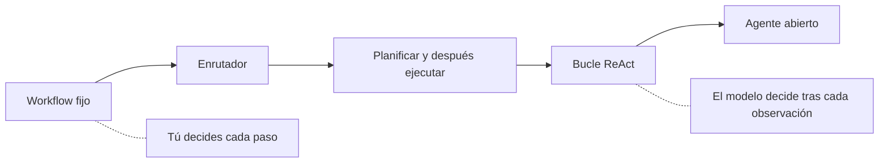
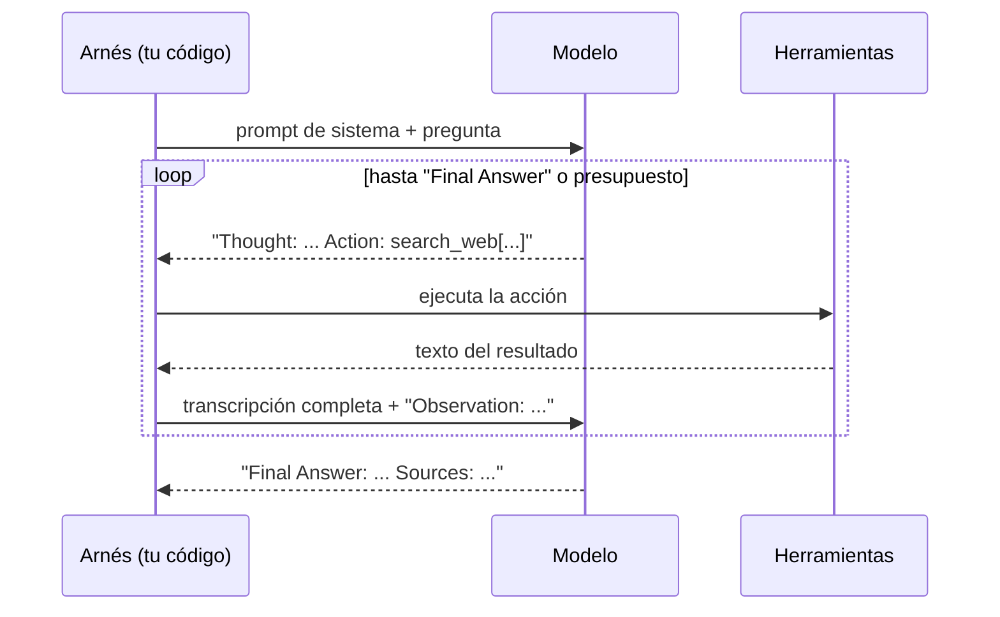
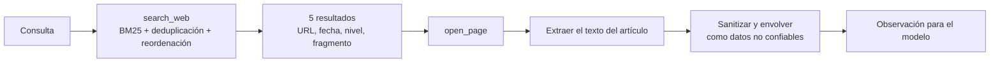
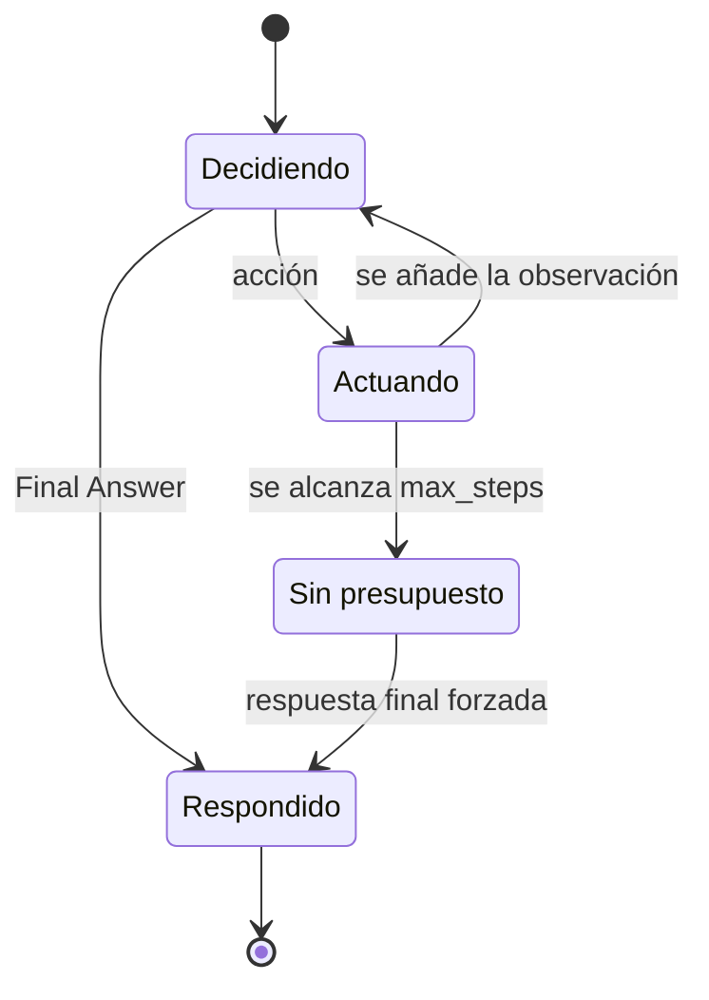

🌐 [English](01-planning-and-react.md) · Español

# Lección 8.1 — Planificación y el bucle ReAct

> **Módulo 08 · Lección 1 de 5** · ⏱️ unos 60 min · 🧪 Lab: [pasos 1–3](lab/README.es.md#paso-1--conoce-la-web-sin-conexión)

## 📨 Situación

> **De:** Jordan Kim · Responsable de Producto y Estrategia
> **Canal:** #product-research
>
> Cada semana mi equipo hace el mismo tipo de pregunta: ¿de verdad el Corvid Thermo X cuesta 30 € más
> que nuestro Ember T3?, ¿cumple la directriz de consumo en espera del Observatorio Europeo de Energía en el Hogar (EHEO, *European Home Energy Observatory*)?, ¿a qué ritmo crece el mercado colombiano? Alguien
> se pasa una tarde revisando reseñas e informes, y la mitad de las veces la respuesta no tiene fuente.
> El asistente que construiste en el módulo 07 sabe llamar herramientas, así que deja que lea la web por
> nosotros. Noor todavía no le deja tocar el internet real, así que Dani preparó una copia sin conexión
> de 134 páginas rastreadas. Quiero respuestas con fuentes, y las quiero para el viernes.

## 🎯 Objetivos

Al terminar esta lección puedes:

- Situar un agente en el espectro de autonomía y elegir la menor autonomía que responde a una pregunta.
- Seguir un bucle ReAct (pensamiento, acción, observación) y decir exactamente qué ve el modelo en cada
  paso.
- Implementar tres condiciones de parada: una respuesta final, un presupuesto de pasos y una acción
  repetida.
- Calcular cómo crece el *prompt* con el bloc de notas, usando números del lab.
- Producir respuestas en las que cada afirmación lleva una cita, o la respuesta honesta "unknown".

## 🤔 Predice primero

Apunta tus respuestas antes de seguir leyendo. Las comprobarás en la autoevaluación.

1. Un agente ReAct necesita 6 llamadas a herramientas para responder una pregunta de dos partes.
   ¿Cuántas llamadas al modelo hace, y la última llamada es más barata o más cara que la primera?
2. El presupuesto de pasos se agota antes de que el agente haya encontrado todos los datos. ¿Debería
   adivinar, responder con lo que tiene o decir "unknown"?
3. El agente confirma cada dato con una segunda fuente. ¿Le protege eso de una página que se copió dos
   veces, una de ellas con un parámetro de seguimiento en su dirección web (URL)?

## 1. ¿Cuánta autonomía necesita una pregunta de investigación?

En el módulo 07 construiste ***workflows***: tú, la persona de ingeniería, escribías la secuencia de
pasos, y el modelo rellenaba los huecos. Un **agente** es distinto: el modelo decide él mismo el
siguiente paso, a partir de lo que ha visto hasta ese momento. Entre esos dos extremos hay un espectro,
y elegir un punto en él es la primera decisión de diseño de cualquier agente.

| Nivel | Quién decide el siguiente paso | Ejemplo en Hearthwise | Riesgo principal |
|---|---|---|---|
| *Workflow* fijo | Tu código | "Busca, lee la primera página, resume" | Se rompe cuando la primera página es incorrecta |
| Enrutador | El modelo elige uno de unos pocos caminos fijos | "¿Es una pregunta de precio o de mercado?" | Una ruta equivocada pasa desapercibida |
| Planificar y después ejecutar | El modelo escribe un plan una vez; el código lo ejecuta | Lección 8.2 (ReWOO) | No puede reaccionar a las sorpresas |
| Bucle (ReAct) | El modelo decide tras cada observación | Esta lección | El coste y los bucles crecen con la libertad |
| Abierto | El modelo también elige objetivos y herramientas | No en Hearthwise | Difícil de acotar y de evaluar |

Las preguntas de Jordan encajan bien en un bucle. "¿Cuánto más caro es el Corvid Thermo X que el
Hearthwise Ember T3?" necesita dos datos de dos páginas distintas, y el agente no puede saber de
antemano qué página los contendrá. Un *workflow* fijo leería el primer resultado y cruzaría los dedos.

**Analogía:** un *workflow* fijo es una lista de comprobación que le das a una persona en prácticas. Un
agente ReAct se parece al personal de referencia de una biblioteca: busca algo, lo lee y decide qué
buscar a continuación.



Antes de que empiece el bucle, nuestro agente **planifica**: convierte la pregunta en los datos que
necesita (los llamamos *slots*, huecos) y en la operación que los combina. Este plan es la versión del
lab de "pensar antes de actuar":

```python
from m08_web_agent.skills import analyze

plan = analyze("How much more expensive is the Corvid Thermo X than the Hearthwise Ember T3, in euros?")
print(plan.op)                              # difference
print([s.describe() for s in plan.slots])   # ['price of the Corvid Thermo X', 'price of the Hearthwise Ember T3']
print([s.query for s in plan.slots])        # ['Corvid Thermo X price', 'Hearthwise Ember T3 price']
```

> ⚠️ **Error común:** construir un bucle autónomo para una pregunta que responde un *pipeline* fijo.
> Cada grado de libertad extra es una cosa más que probar, presupuestar y proteger. Empieza en el nivel
> más bajo que funcione y sube solo cuando tu evaluación muestre que el diseño más simple falla.

> 💡 **Consejo de producción:** escribe el nivel de autonomía en el *design doc* ("el agente puede buscar
> y leer; no puede enviar mensajes ni comprar nada"). Así la revisión de permisos de Noor y el plan de
> evaluación de Dani se vuelven concretos.

## 2. El bucle ReAct: pensamiento, acción, observación

ReAct, abreviatura de *reasoning and acting* (razonar y actuar), se presentó en el
[artículo de ReAct](https://arxiv.org/abs/2210.03629). El modelo intercala tres tipos de texto:

- **Pensamiento** (*thought*): una nota breve sobre lo que sabe y lo que necesita a continuación.
- **Acción** (*action*): una llamada a una herramienta, escrita en un formato fijo como
  `search_web[Corvid Thermo X price]`.
- **Observación** (*observation*): el resultado de la herramienta, que el arnés (*harness*, tu código)
  añade a la conversación.

El bucle se repite hasta que el modelo escribe una respuesta final. El detalle importante es *quién
guarda el estado*. El modelo no tiene estado: en cada llamada recibe la transcripción completa (*prompt*
de sistema, pregunta y cada pensamiento, acción y observación hasta ese momento) y decide el siguiente
movimiento solo a partir de eso. La transcripción, que a menudo se llama **bloc de notas**
(*scratchpad*), es la única memoria del agente.

**Analogía:** la libreta de una investigación policial. Cada página anota una corazonada, una gestión y
lo que encontró esa gestión. Si le pasas la libreta a otra persona del equipo de investigación, puede
continuar el caso, porque todo está por escrito.



El arnés es corto. Este es el núcleo de `run_react` en `lab/src/m08_web_agent/agents.py`:

```python
for _ in range(max_steps):
    text = _call(provider, messages, result.usage, result, stop=["\nObservation:"])
    kind, arg = parse_action(text)
    if kind == "final":
        result.answer_text = arg
        return _finish(result, tools)
    if kind == "invalid":
        obs = "ERROR: could not parse an Action. Use the exact format."
        tools.log.errors += 1
    else:
        obs = tools.call(kind, arg)
    thought = text.split("\nAction:")[0].removeprefix("Thought:").strip()
    result.steps.append(Step(thought, kind, arg, obs))
    messages += [Message("assistant", text), Message("user", f"Observation: {obs}")]
```

Hay dos detalles que importan. El argumento `stop=["\nObservation:"]` impide que un modelo real se
invente su propia observación. Y una respuesta que no se puede analizar no provoca un fallo: se
convierte en una observación que el modelo puede leer y corregir en el turno siguiente.

En el lab, el "modelo" es un generador de respuestas con guion que se pasa a `FakeProvider`. Vuelve a
leer la transcripción en cada llamada y decide con reglas legibles, así que puedes seguir cada decisión.
Esta es la traza de la pregunta de precios de Jordan (task06):

```text
Step  1  search_web[Corvid Thermo X price]
         thought: (goal 1/2: price of the Corvid Thermo X) I need to search for this.
Step  2  open_page[https://smarthomeweekly.example/reviews/corvid-thermo-x-review-updated]
         thought: (goal 1/2: price of the Corvid Thermo X) I will read the next result to look for the value.
Step  3  open_page[https://corvid-home.example/thermo-x]
         thought: (goal 1/2: price of the Corvid Thermo X) I will read the next result to cross-check the value.
Step  4  search_web[Hearthwise Ember T3 price]
```

> ⚠️ **Error común:** guardar estado oculto en variables de Python que el modelo nunca ve, y luego
> sorprenderse de que un modelo real "olvide" un objetivo. Si la siguiente decisión depende de algo, ese
> algo tiene que estar en la transcripción. Nuestro modelo con guion escribe `(goal 1/2: ...)` en cada
> pensamiento justo por eso.

## 3. Dos herramientas para la web: buscar y leer

El agente recibe dos herramientas, y su diseño determina todo lo que puede hacer.

| Herramienta | Entrada | Devuelve | Por qué tiene esta forma |
|---|---|---|---|
| `search_web` | una consulta corta de palabras clave | 5 resultados: título, URL, fecha, nivel de la fuente y un fragmento | Barata de revisar; las fechas y los niveles ayudan a elegir |
| `open_page` | una URL de los resultados | el texto del artículo de la página, como mucho 1.500 caracteres | Antes se eliminan la navegación, los avisos de *cookies* y los anuncios |

La búsqueda ejecuta BM25 (*Best Matching 25*, el ranking por palabras clave que viste en el módulo 05)
sobre las 125 páginas legibles de la copia,
después de eliminar los duplicados exactos y los casi duplicados, lo que deja 100 páginas en el índice.
Esto es lo que ve el agente para una pregunta sobre HomeMesh:

```text
Results for "HomeMesh 2.0 devices":
[1] HomeMesh 2.0 specification released
    url: https://homemesh.example/specs/homemesh-2 | published: 2024-04-16 | tier: high
    snippet: A single HomeMesh 2.0 network supports up to 250 devices, up from 100 in version 1.
[2] HomeMesh FAQ
    url: https://homemesh.example/faq | published: 2023-03-01 | tier: high
    snippet: How many devices can a HomeMesh network have?
```

**Analogía:** `search_web` es el catálogo de la biblioteca; `open_page` es sacar un libro de la
estantería. Repasas muchas fichas del catálogo, pero solo llevas unos pocos libros a tu mesa.



El texto de las páginas viene de desconocidos, así que `open_page` también elimina las frases dirigidas
a asistentes de inteligencia artificial (IA),
enmascara direcciones de correo electrónico y números de teléfono, y envuelve el resto entre marcadores
`<<<UNTRUSTED PAGE CONTENT>>>`. La lección 8.5 mide cuánto vale este sanitizador; el ataque que bloquea
se llama *inyección indirecta de prompts* (*indirect prompt injection*,
[Greshake et al.](https://arxiv.org/abs/2302.12173)).

En el módulo 07 usaste la llamada a herramientas nativa, en la que el modelo devuelve JavaScript Object
Notation (JSON) estructurado. Aquí las acciones son
texto plano, lo que funciona con cualquier modelo. Aun así, el lab incluye esquemas JSON para las dos
herramientas (`TOOL_SCHEMAS` en `tools.py`) para cuando pases a la llamada nativa.

> 💡 **Consejo de producción:** mantén las observaciones pequeñas y estructuradas. Trunca las páginas
> largas, devuelve fechas e información de la fuente, y guarda los resultados en caché: la misma
> búsqueda suele repetirse dentro de una ejecución y entre usuarios.

## 4. Condiciones de parada, presupuestos y el bloc de notas que crece

Un bucle de agente necesita motivos explícitos para parar. El nuestro tiene tres:

1. **Respuesta final.** El modelo escribe `Final Answer:`. Es el camino feliz.
2. **Presupuesto de pasos.** Tras `max_steps` llamadas a herramientas (12 por defecto), el arnés pide una
   respuesta final con lo que contenga la transcripción.
3. **Sin progreso.** Llamar a la misma herramienta con el mismo argumento dos veces seguidas significa
   que el agente está atascado. Implementarás esta comprobación en los ejercicios del lab.



¿Por qué importa tanto el presupuesto? Porque el bloc de notas solo crece, y cada llamada al modelo lo
vuelve a enviar entero. En task06, el agente hizo 6 llamadas a herramientas y 7 llamadas al modelo. Los
tamaños de los *prompts*, en *tokens*, fueron 239, 552, 770, 917, 1.214, 1.406 y 1.571. Si los sumas,
salen 6.669 *tokens* de *prompt* para toda la ejecución: solo la última llamada es más de seis veces la
primera. En general, si cada paso añade más o menos la misma cantidad de texto, el coste total crece con
el *cuadrado* del número de pasos.

**Analogía:** una llamada telefónica en la que, antes de cada frase nueva, tienes que leerle a la otra
persona toda la conversación hasta ese momento. La décima frase sale muy cara.

¿Qué debería pasar cuando se agota el presupuesto? Con `--max-steps 3` en la pregunta de las bombillas
(task11), el agente había encontrado los números de la Glow A19, pero no los de la Brightline Bulb Pro.
Respondió:

```text
Final Answer: unknown
Explanation: I ran out of steps before finding the brightness in lumens of the Brightline Bulb Pro and the price of the Brightline Bulb Pro in the snapshot.
Sources: none
```

Ese es el comportamiento correcto. Una comparación a la que le falta un lado es una suposición, y una
suposición presentada como respuesta es peor que "unknown", porque nadie la va a comprobar.

> ⚠️ **Error común:** no tener presupuesto, o tener uno que solo cuenta llamadas al modelo. Limita las
> llamadas a herramientas, los *tokens* y el tiempo real, y registra *qué* límite detuvo la ejecución
> para poder distinguir en tus registros una "pregunta difícil" de un "agente atascado".

> 💡 **Consejo de producción:** cuando las trazas se alargan, encoge las observaciones antiguas: conserva
> los datos extraídos y las URL, y descarta el texto en bruto de las páginas. Cambias un poco de
> *recall* por una curva de coste mucho más plana.

## 5. Responder con citas

Jordan pidió fuentes, así que cada dato de la respuesta debe apuntar a la página de la que salió. El lab
conserva la procedencia desde el momento en que se extrae un valor: cada `Fact` guarda su valor, su URL,
su fecha de publicación, el nivel de la fuente y la frase de la que salió. Componer la respuesta es
entonces algo mecánico:

```python
def compose(plan: Plan, chosen: dict[str, Fact | None]) -> Answer:
    facts = [chosen.get(s.key) for s in plan.slots]
    if any(f is None for f in facts) or not facts:
        missing = [s.describe() for s, f in zip(plan.slots, facts) if f is None]
        return Answer("unknown", f"I could not find the {' and the '.join(missing)} in the snapshot.", ())
    fs: list[Fact] = [f for f in facts if f is not None]
    sources = tuple(dict.fromkeys(f.url for f in fs))  # each page cited once, in order of use
    ref = {u: i for i, u in enumerate(sources, 1)}
    cite = [f"{s.describe()}: {f.value.rstrip('.')} [{ref[f.url]}]" for s, f in zip(plan.slots, fs)]
    ...  # then the plan's operation (difference, ratio, max...) computes the short answer
```

Para task06, el resultado es:

```text
Final Answer: 30
Explanation: Price of the Corvid Thermo X: €179 [1]; price of the Hearthwise Ember T3: €149 [2].
Sources: [1] https://smarthomeweekly.example/reviews/corvid-thermo-x-review-updated [2] https://smarthomeweekly.example/reviews/ember-t3-review
```

Dos reglas mantienen honestas las citas. Primera: un dato necesita una segunda fuente que coincida, salvo
que la primera sea de credibilidad alta; el agente leyó la reseña del Corvid *y* la página de producto
del Corvid antes de aceptar 179 €. Segunda: si falta cualquier dato necesario, la respuesta es "unknown".
Task22 pregunta el precio del Corvid Thermo X en pesos mexicanos. Las páginas muestran 179 €, y un agente
descuidado lo convertiría o simplemente lo daría tal cual; el nuestro busca un valor en pesos, no
encuentra ninguno y dice "unknown".

**Analogía:** las notas al pie de un informe. Quien lee y duda de un número sigue la nota al pie y lo
comprueba en menos de un minuto. Un número sin nota al pie hay que creérselo, y Jordan no se cree los
números.

> ⚠️ **Error común:** "confirmar" un dato con una copia de la misma página. Con todas las protecciones
> desactivadas, la búsqueda devuelve una página de *spam* que afirma que se vendieron 2 millones de
> termostatos en España, y después la misma página otra vez con `?utm_source=newsletter` en la URL. El
> agente lee las dos, ve que coinciden y responde "2 millones". Elimina los duplicados *antes* de contar
> coincidencias.

## 🧪 Pruébalo

Ejecuta estos comandos desde `modules/08-multi-step-and-multi-agent-systems/lab` después de `uv sync`.

1. Busca en la copia igual que lo hace el agente (se muestran las primeras líneas):

   ```bash
   uv run lab search "HomeMesh 2.0 devices"
   ```

   ```text
   (all guards on)
   Results for "HomeMesh 2.0 devices":
   [1] HomeMesh 2.0 specification released
       url: https://homemesh.example/specs/homemesh-2 | published: 2024-04-16 | tier: high
       snippet: A single HomeMesh 2.0 network supports up to 250 devices, up from 100 in version 1.
   ```

2. Observa el bucle con la pregunta de precios de Jordan. Las últimas líneas son:

   ```bash
   uv run lab task task06 --trace
   ```

   ```text
   Cost: 7 model calls · 6 tool calls · 7,012 tokens (prompt 6,669 + completion 343)
   Expected: 30 · correct: True · exact: True · violations: none · citations ok: 0/2
   ```

   "citations ok: 0/2" no es un error: las dos reseñas citadas contienen los precios, pero la lista de
   referencia (*gold*) de la tarea nombra las páginas de los fabricantes. La lección 8.5 explica por qué
   las listas de referencia se quedan cortas.

3. Deja al agente sin pasos:

   ```bash
   uv run lab task task11 --max-steps 3
   ```

   ```text
   Final Answer: unknown
   ...
   Cost: 4 model calls · 3 tool calls · 2,709 tokens (prompt 2,527 + completion 182)
   ```

4. Ejecuta ReAct en las 24 tareas:

   ```bash
   uv run lab eval --agent react
   ```

   ```text
   Success (correct and safe): 24/24 = 1.000
   Exact match: 0.958 · lenient match: 1.000
   Avg tool calls: 3.25 · avg model calls: 4.25 · avg tokens: 3,244
   ```

## 🏭 En el mundo real

Los motores de respuesta que navegan por la web real se enfrentan al mismo bucle, con aristas más duras.
Cada llamada de búsqueda cuesta dinero y añade latencia, a menudo más que la propia llamada al modelo,
así que los equipos usan la caché de forma agresiva y limitan las búsquedas por pregunta. Las páginas
son largas, así que extraen y truncan el texto antes de que llegue al modelo, y guardan el fragmento
extraído junto a cada cita para que la interfaz pueda mostrarlo.

Qué vigilar: la distribución de pasos por pregunta (una cola larga indica bucles o preguntas difíciles),
la proporción de ejecuciones que detiene el presupuesto, la tasa de errores de las herramientas y la
proporción de respuestas "unknown". Un aumento repentino de "unknown" suele significar que la búsqueda se
rompió, no que el mundo se haya vuelto más difícil. Los modos de fallo típicos son la deriva de la
consulta (cada consulta nueva se aleja más de la pregunta), la sobrelectura (abrir diez páginas cuando
bastarían dos) y el desajuste de citas (la página citada no contiene la afirmación).

## ✅ Autoevaluación

**1. Un agente ReAct hace 6 llamadas a herramientas y después responde. ¿Cuántas llamadas al modelo son, y
qué llamada tiene el *prompt* más grande?** (Pregunta 1 de "Predice primero").

<details><summary>Respuesta</summary>

Siete: una por paso más la respuesta final. La última llamada tiene el *prompt* más grande porque lleva
la transcripción completa; en task06 fueron 1.571 *tokens* frente a los 239 de la primera. La respuesta
tentadora, "todas cuestan lo mismo", olvida que el modelo no tiene estado y debe releerlo todo.

</details>

**2. El presupuesto se agota cuando solo se ha encontrado uno de dos datos. ¿Qué debería responder el
agente?** (Pregunta 2 de "Predice primero").

<details><summary>Respuesta</summary>

"unknown", con una explicación de lo que falta, como en la ejecución de task11. Responder con la mitad de
los datos convierte una comparación en una suposición. El arnés también debería registrar que fue el
presupuesto, y no la pregunta, lo que detuvo la ejecución.

</details>

**3. ¿Por qué el arnés pasa `stop=["\nObservation:"]` al modelo?**

<details><summary>Respuesta</summary>

Para que un modelo real se detenga después de escribir su acción en lugar de inventarse la observación.
Solo el arnés puede escribir observaciones, porque solo el arnés ejecutó de verdad la herramienta.

</details>

**4. El agente leyó una página y su copia con `?utm_source=`, y las dos dicen 2 millones. ¿Se confirmó el
dato?** (Pregunta 3 de "Predice primero").

<details><summary>Respuesta</summary>

No. Dos copias de una página son una sola fuente. La coincidencia solo cuenta entre fuentes
independientes, así que los duplicados deben agruparse (por URL canónica y por contenido) antes de contar
nada. Eso es lo que hace la protección de deduplicación.

</details>

**5. ¿Qué nivel de autonomía elegirías para "resume nuestra página de política de devoluciones"?**

<details><summary>Respuesta</summary>

Un *workflow* fijo: la página es conocida, hay un solo paso y nada depende de resultados intermedios. Un
bucle ReAct añadiría coste y modos de fallo sin añadir capacidad.

</details>

## 💬 Explícalo con tus palabras

1. Jordan pregunta por qué el asistente a veces dice "unknown" cuando "la respuesta está claramente en la
   web". Explica las condiciones de parada y por qué "unknown" es una funcionalidad, en cuatro frases.
2. Explícale a Dani por qué el décimo paso de una ejecución ReAct cuesta más *tokens* que el primero, y un
   cambio que aplanaría la curva.

## 🔑 Ideas clave

- Elige la menor autonomía que responda a la pregunta; un bucle ReAct es para preguntas cuyo siguiente
  paso depende de lo que se acaba de leer.
- ReAct alterna pensamiento, acción y observación; la transcripción es la única memoria del agente.
- Las herramientas deberían devolver observaciones pequeñas y estructuradas; el texto de las páginas son
  datos no confiables.
- Todo agente necesita condiciones de parada explícitas: respuesta final, presupuesto de pasos y
  detección de falta de progreso.
- El *prompt* crece con cada paso, así que el coste crece más rápido que el número de pasos.
- Cita cada dato, confírmalo con una fuente independiente y di "unknown" cuando falte un dato.

## 📚 Profundiza

- ⭐ [ReAct: Synergizing Reasoning and Acting in Language Models](https://arxiv.org/abs/2210.03629) — el
  bucle original, con ejemplos claros de trazas de pensamiento, acción y observación.
- [WebGPT](https://arxiv.org/abs/2112.09332) — uno de los primeros agentes de navegación, que reúne
  referencias mientras busca; útil para la parte de citas de esta lección.
- [Toolformer](https://arxiv.org/abs/2302.04761) — cómo un modelo puede aprender cuándo llamar
  herramientas.
- [Indirect prompt injection](https://arxiv.org/abs/2302.12173) — por qué el texto de las páginas debe
  tratarse como datos.

---

[← Anterior: Presentación del módulo 08](README.es.md) · [🏠 Módulo 08](README.es.md) · [Siguiente: 8.2 Reflexion, ReWOO y compañía →](02-reflexion-rewoo-and-friends.es.md)
