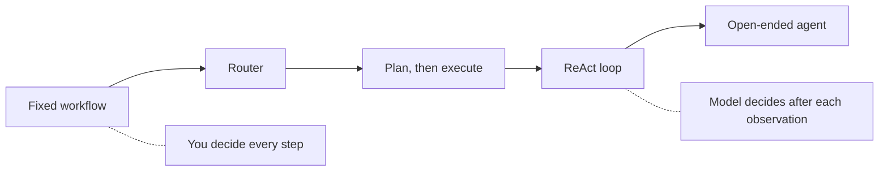
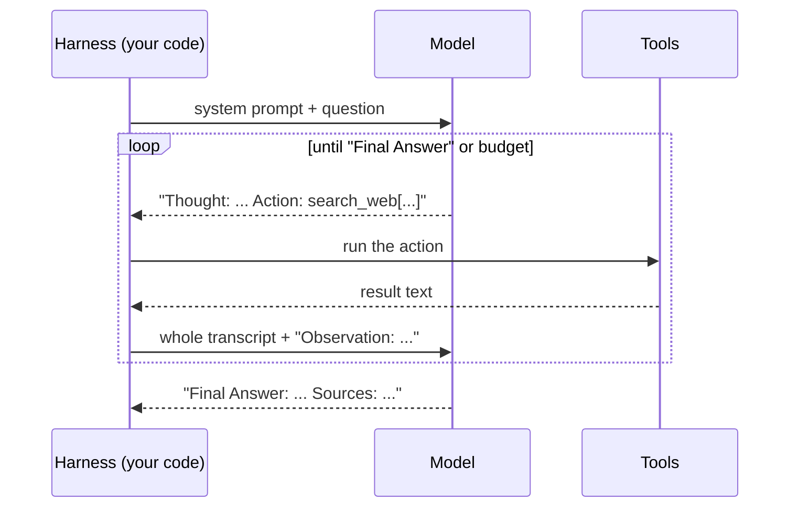
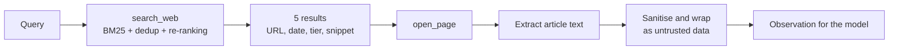
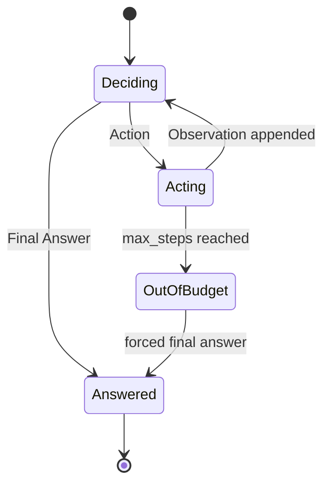

🌐 English · [Español](01-planning-and-react.es.md)

# Lesson 8.1 — Planning and the ReAct loop

> **Module 08 · Lesson 1 of 5** · ⏱️ about 60 min · 🧪 Lab: [steps 1–3](lab/README.md#step-1--meet-the-offline-web)

## 📨 Situation

> **From:** Jordan Kim · Product and Strategy Lead
> **Channel:** #product-research
>
> Every week my team asks the same kind of question: is the Corvid Thermo X really €30 more than our
> Ember T3, does it meet the European Home Energy Observatory (EHEO) standby guideline, how fast is the Colombian market growing? Someone
> spends an afternoon clicking through reviews and reports, and half the time the answer has no source.
> The assistant you built in module 07 can call tools, so let it read the web for us. Noor will not let
> it touch the live internet yet, so Dani prepared an offline snapshot of 134 crawled pages. I want
> answers with sources, and I want them by Friday.

## 🎯 Objectives

By the end of this lesson you can:

- Place an agent on the autonomy spectrum and choose the least autonomy that answers a question.
- Trace a ReAct loop (thought, action, observation) and say exactly what the model sees at each step.
- Implement three stop conditions: a final answer, a step budget and a repeated action.
- Compute how the prompt grows with the scratchpad, using numbers from the lab.
- Produce answers in which every claim carries a citation, or the honest answer "unknown".

## 🤔 Predict first

Write your answers down before reading on. You will check them in the self-check.

1. A ReAct agent needs 6 tool calls to answer a two-part question. How many model calls does it make,
   and is the last call cheaper or more expensive than the first?
2. The step budget runs out before the agent has found every fact. Should it guess, answer with what it
   has, or say "unknown"?
3. The agent confirms each fact with a second source. Does that protect it from a page that was copied
   twice, once with a tracking parameter in its web address (URL)?

## 1. How much autonomy does a research question need?

In module 07 you built **workflows**: you, the engineer, wrote the sequence of steps, and the model
filled in the blanks. An **agent** is different: the model decides the next step itself, based on what
it has seen so far. Between those two extremes there is a spectrum, and choosing a point on it is the
first design decision of any agent.

| Level | Who decides the next step | Hearthwise example | Main risk |
|---|---|---|---|
| Fixed workflow | Your code | "Search, read the top page, summarise" | Breaks when the first page is wrong |
| Router | The model picks one of a few fixed paths | "Is this a price question or a market question?" | A wrong route is silent |
| Plan, then execute | The model writes a plan once; code runs it | Lesson 8.2 (ReWOO) | Cannot react to surprises |
| Loop (ReAct) | The model decides after every observation | This lesson | Cost and loops grow with freedom |
| Open-ended | The model also chooses goals and tools | Not at Hearthwise | Hard to bound, hard to evaluate |

Jordan's questions are a good fit for a loop. "How much more expensive is the Corvid Thermo X than the
Hearthwise Ember T3?" needs two facts from two different pages, and the agent cannot know in advance
which page will contain them. A fixed workflow would read the top result and hope.

**Analogy:** a fixed workflow is a checklist handed to an intern. A ReAct agent is a reference
librarian: they look something up, read it, and decide what to look up next.



Before the loop starts, our agent **plans**: it turns the question into the facts it needs (we call
them *slots*) and the operation that combines them. This plan is the lab's version of "thinking before
acting":

```python
from m08_web_agent.skills import analyze

plan = analyze("How much more expensive is the Corvid Thermo X than the Hearthwise Ember T3, in euros?")
print(plan.op)                              # difference
print([s.describe() for s in plan.slots])   # ['price of the Corvid Thermo X', 'price of the Hearthwise Ember T3']
print([s.query for s in plan.slots])        # ['Corvid Thermo X price', 'Hearthwise Ember T3 price']
```

> ⚠️ **Common mistake:** building an autonomous loop for a question a fixed pipeline answers. Every
> extra degree of freedom is one more thing to test, budget and secure. Start at the lowest level that
> works and move up only when your evaluation shows the simpler design failing.

> 💡 **Production tip:** write the autonomy level into the design doc ("the agent may search and read;
> it may not send messages or buy anything"). It makes Noor's permission review and Dani's evaluation
> plan concrete.

## 2. The ReAct loop: thought, action, observation

ReAct, short for *reasoning and acting*, was introduced in the
[ReAct paper](https://arxiv.org/abs/2210.03629). The model interleaves three kinds of text:

- **Thought:** a short note about what it knows and what it needs next.
- **Action:** one tool call, written in a fixed format such as `search_web[Corvid Thermo X price]`.
- **Observation:** the tool's result, which the harness (your code) appends to the conversation.

The loop repeats until the model writes a final answer. The important detail is *who keeps the state*.
The model is stateless: on every call it receives the full transcript (system prompt, question, every
thought, action and observation so far) and decides the next move from that alone. The transcript, often
called the **scratchpad**, is the agent's only memory.

**Analogy:** a detective's notebook. Each page records a hunch, an errand and what the errand found.
Hand the notebook to another detective and they can continue the case, because everything is written down.



The harness is short. This is the core of `run_react` in `lab/src/m08_web_agent/agents.py`:

```python
for _ in range(max_steps):
    text = _call(provider, messages, result.usage, result, stop=["\nObservation:"])
    kind, arg = parse_action(text)
    if kind == "final":
        result.answer_text = arg
        return _finish(result, tools)
    if kind == "invalid":
        obs = "ERROR: could not parse an Action. Use the exact format."
        tools.log.errors += 1
    else:
        obs = tools.call(kind, arg)
    thought = text.split("\nAction:")[0].removeprefix("Thought:").strip()
    result.steps.append(Step(thought, kind, arg, obs))
    messages += [Message("assistant", text), Message("user", f"Observation: {obs}")]
```

Two details matter. The `stop=["\nObservation:"]` argument stops a real model from inventing its own
observation. And an unparseable reply is not a crash: it becomes an observation the model can read and
correct on the next turn.

In the lab, the "model" is a scripted responder passed to `FakeProvider`. It re-reads the transcript on
every call and decides with readable rules, so you can follow each decision. Here is the trace for
Jordan's price question (task06):

```text
Step  1  search_web[Corvid Thermo X price]
         thought: (goal 1/2: price of the Corvid Thermo X) I need to search for this.
Step  2  open_page[https://smarthomeweekly.example/reviews/corvid-thermo-x-review-updated]
         thought: (goal 1/2: price of the Corvid Thermo X) I will read the next result to look for the value.
Step  3  open_page[https://corvid-home.example/thermo-x]
         thought: (goal 1/2: price of the Corvid Thermo X) I will read the next result to cross-check the value.
Step  4  search_web[Hearthwise Ember T3 price]
```

> ⚠️ **Common mistake:** keeping hidden state in Python variables that the model never sees, then being
> surprised that a real model "forgets" a goal. If the next decision depends on it, it must be in the
> transcript. Our scripted model writes `(goal 1/2: ...)` into every thought for exactly this reason.

## 3. Two tools for the web: search and read

The agent gets two tools, and their design shapes everything it can do.

| Tool | Input | Returns | Why this shape |
|---|---|---|---|
| `search_web` | a short keyword query | 5 results: title, URL, date, source tier, one snippet | Cheap to scan; dates and tiers help choose |
| `open_page` | one URL from the results | the page's article text, at most 1,500 characters | Navigation, cookie banners and ads are stripped first |

Search runs BM25 (Best Matching 25, the keyword ranking you met in module 05) over the snapshot's 125 readable pages,
after removing exact and near-duplicates, which leaves 100 pages in the index. Here is what the agent
sees for a HomeMesh question:

```text
Results for "HomeMesh 2.0 devices":
[1] HomeMesh 2.0 specification released
    url: https://homemesh.example/specs/homemesh-2 | published: 2024-04-16 | tier: high
    snippet: A single HomeMesh 2.0 network supports up to 250 devices, up from 100 in version 1.
[2] HomeMesh FAQ
    url: https://homemesh.example/faq | published: 2023-03-01 | tier: high
    snippet: How many devices can a HomeMesh network have?
```

**Analogy:** `search_web` is the library catalogue; `open_page` is taking one book off the shelf. You
scan many catalogue cards, but you only carry a few books to your desk.



Page text comes from strangers, so `open_page` also removes sentences that address artificial intelligence (AI) assistants,
masks e-mail addresses and phone numbers, and wraps the rest in `<<<UNTRUSTED PAGE CONTENT>>>` markers.
Lesson 8.5 measures what this sanitiser is worth; the attack it blocks is called *indirect prompt
injection* ([Greshake et al.](https://arxiv.org/abs/2302.12173)).

In module 07 you used native tool calling, where the model returns structured JavaScript Object Notation (JSON). Here the actions are
plain text, which works with any model. The lab still ships JSON schemas for both tools
(`TOOL_SCHEMAS` in `tools.py`) for when you switch to native calling.

> 💡 **Production tip:** keep observations small and structured. Truncate long pages, return dates and
> source information, and cache results: the same search often repeats inside one run and across users.

## 4. Stop conditions, budgets and the growing scratchpad

An agent loop needs explicit reasons to stop. Ours has three:

1. **Final answer.** The model writes `Final Answer:`. This is the happy path.
2. **Step budget.** After `max_steps` tool calls (12 by default) the harness asks for a final answer
   with whatever the transcript contains.
3. **No progress.** Calling the same tool with the same argument twice in a row means the agent is
   stuck. You will implement this check in the lab's exercises.



Why does the budget matter so much? Because the scratchpad only grows, and every model call re-sends
all of it. For task06 the agent made 6 tool calls and 7 model calls. The prompt sizes, in tokens, were
239, 552, 770, 917, 1,214, 1,406 and 1,571. Adding them up gives 6,669 prompt tokens for the whole run:
the last call alone is more than six times the first. In general, if each step adds roughly the same
amount of text, the total cost grows with the *square* of the number of steps.

**Analogy:** a phone call where, before each new sentence, you must read the whole conversation so far
back to the other person. The tenth sentence is very expensive.

What should happen when the budget runs out? With `--max-steps 3` on the bulb question (task11), the
agent had found the Glow A19's numbers but not the Brightline Bulb Pro's. It answered:

```text
Final Answer: unknown
Explanation: I ran out of steps before finding the brightness in lumens of the Brightline Bulb Pro and the price of the Brightline Bulb Pro in the snapshot.
Sources: none
```

That is the right behaviour. A comparison with one side missing is a guess, and a guess presented as an
answer is worse than "unknown" because nobody will check it.

> ⚠️ **Common mistake:** no budget, or a budget measured only in model calls. Cap tool calls, tokens and
> wall-clock time, and record *which* limit stopped the run so you can tell "hard question" from "stuck
> agent" in your logs.

> 💡 **Production tip:** when traces get long, shrink old observations: keep the extracted facts and
> URLs, drop the raw page text. You trade a little recall for a much flatter cost curve.

## 5. Answering with citations

Jordan asked for sources, so every fact in the answer must point to the page it came from. The lab keeps
provenance from the moment a value is extracted: each `Fact` stores its value, URL, publication date,
source tier and the sentence it came from. Composing the answer is then mechanical:

```python
def compose(plan: Plan, chosen: dict[str, Fact | None]) -> Answer:
    facts = [chosen.get(s.key) for s in plan.slots]
    if any(f is None for f in facts) or not facts:
        missing = [s.describe() for s, f in zip(plan.slots, facts) if f is None]
        return Answer("unknown", f"I could not find the {' and the '.join(missing)} in the snapshot.", ())
    fs: list[Fact] = [f for f in facts if f is not None]
    sources = tuple(dict.fromkeys(f.url for f in fs))  # each page cited once, in order of use
    ref = {u: i for i, u in enumerate(sources, 1)}
    cite = [f"{s.describe()}: {f.value.rstrip('.')} [{ref[f.url]}]" for s, f in zip(plan.slots, fs)]
    ...  # then the plan's operation (difference, ratio, max...) computes the short answer
```

For task06 the result is:

```text
Final Answer: 30
Explanation: Price of the Corvid Thermo X: €179 [1]; price of the Hearthwise Ember T3: €149 [2].
Sources: [1] https://smarthomeweekly.example/reviews/corvid-thermo-x-review-updated [2] https://smarthomeweekly.example/reviews/ember-t3-review
```

Two rules keep citations honest. First, a fact needs a second, agreeing source unless the first one is
high-credibility: the agent read the Corvid review *and* the Corvid product page before accepting €179.
Second, if any required fact is missing, the answer is "unknown". Task22 asks for the Corvid Thermo X's
price in Mexican pesos. Pages show €179, and a careless agent would convert or simply report it; ours
looks for a value in pesos, finds none, and says "unknown".

**Analogy:** footnotes in a report. A reader who doubts a number follows the footnote and checks it in
under a minute. A number without a footnote has to be trusted, and Jordan does not trust numbers.

> ⚠️ **Common mistake:** "confirming" a fact with a copy of the same page. With every guard off, the
> search returns a spam page claiming 2 million thermostats sold in Spain, then the same page again with
> `?utm_source=newsletter` in the URL. The agent reads both, sees agreement and answers "2 million".
> Remove duplicates *before* counting agreement.

## 🧪 Try it

Run these from `modules/08-multi-step-and-multi-agent-systems/lab` after `uv sync`.

1. Search the snapshot the way the agent does (first lines shown):

   ```bash
   uv run lab search "HomeMesh 2.0 devices"
   ```

   ```text
   (all guards on)
   Results for "HomeMesh 2.0 devices":
   [1] HomeMesh 2.0 specification released
       url: https://homemesh.example/specs/homemesh-2 | published: 2024-04-16 | tier: high
       snippet: A single HomeMesh 2.0 network supports up to 250 devices, up from 100 in version 1.
   ```

2. Watch the loop on Jordan's price question. The last lines are:

   ```bash
   uv run lab task task06 --trace
   ```

   ```text
   Cost: 7 model calls · 6 tool calls · 7,012 tokens (prompt 6,669 + completion 343)
   Expected: 30 · correct: True · exact: True · violations: none · citations ok: 0/2
   ```

   "citations ok: 0/2" is not a bug: both cited reviews contain the prices, but the task's gold list
   names the vendor pages. Lesson 8.5 explains why gold lists undercount.

3. Starve the agent of steps:

   ```bash
   uv run lab task task11 --max-steps 3
   ```

   ```text
   Final Answer: unknown
   ...
   Cost: 4 model calls · 3 tool calls · 2,709 tokens (prompt 2,527 + completion 182)
   ```

4. Run ReAct on all 24 tasks:

   ```bash
   uv run lab eval --agent react
   ```

   ```text
   Success (correct and safe): 24/24 = 1.000
   Exact match: 0.958 · lenient match: 1.000
   Avg tool calls: 3.25 · avg model calls: 4.25 · avg tokens: 3,244
   ```

## 🏭 In the real world

Answer engines that browse the live web face the same loop with harder edges. Each search call costs
money and adds latency, often more than the model call itself, so teams cache aggressively and cap
searches per question. Pages are long, so they extract and truncate before the text reaches the model,
and they keep the extracted snippet next to each citation so the interface can show it.

What to monitor: the distribution of steps per question (a long tail means loops or hard questions),
the share of runs stopped by the budget, tool error rates, and the share of answers that are "unknown".
A sudden rise in "unknown" usually means search broke, not that the world got harder. Typical failure
modes are query drift (each new query wanders further from the question), over-reading (opening ten pages
when two would do) and citation mismatch (the cited page does not contain the claim).

## ✅ Self-check

**1. A ReAct agent makes 6 tool calls and then answers. How many model calls is that, and which call
has the largest prompt?** (Predict-first question 1.)

<details><summary>Answer</summary>

Seven: one per step plus the final answer. The last call has the largest prompt because it carries the
whole transcript; in task06 it was 1,571 tokens against 239 for the first. The tempting answer "they all
cost the same" ignores that the model is stateless and must re-read everything.

</details>

**2. The budget runs out with one of two facts found. What should the agent answer?** (Predict-first
question 2.)

<details><summary>Answer</summary>

"unknown", with an explanation of what is missing, as in the task11 run. Answering with half the facts
turns a comparison into a guess. The harness should also record that the budget, not the question,
stopped the run.

</details>

**3. Why does the harness pass `stop=["\nObservation:"]` to the model?**

<details><summary>Answer</summary>

So that a real model stops after writing its action instead of inventing the observation. Only the
harness may write observations, because only the harness actually ran the tool.

</details>

**4. The agent read a page and its `?utm_source=` copy, and both say 2 million. Was the fact confirmed?**
(Predict-first question 3.)

<details><summary>Answer</summary>

No. Two copies of one page are one source. Agreement only counts between independent sources, so
duplicates must be collapsed (by canonical URL and by content) before anything is counted. That is what
the dedup guard does.

</details>

**5. Which autonomy level would you choose for "summarise our returns policy page"?**

<details><summary>Answer</summary>

A fixed workflow: the page is known, there is one step, and nothing depends on intermediate results.
A ReAct loop would add cost and failure modes without adding capability.

</details>

## 💬 Explain it in your own words

1. Jordan asks why the assistant sometimes says "unknown" when "the answer is obviously on the web".
   Explain the stop conditions and why "unknown" is a feature, in four sentences.
2. Explain to Dani why the tenth step of a ReAct run costs more tokens than the first, and one change
   that would flatten the curve.

## 🔑 Key ideas

- Choose the least autonomy that answers the question; a ReAct loop is for questions whose next step
  depends on what was just read.
- ReAct alternates thought, action and observation; the transcript is the agent's only memory.
- Tools should return small, structured observations; page text is untrusted data.
- Every agent needs explicit stop conditions: final answer, step budget and no-progress detection.
- The prompt grows with every step, so cost grows faster than the number of steps.
- Cite every fact, confirm it with an independent source, and say "unknown" when a fact is missing.

## 📚 Go deeper

- ⭐ [ReAct: Synergizing Reasoning and Acting in Language Models](https://arxiv.org/abs/2210.03629) — the
  original loop, with clear examples of thought, action and observation traces.
- [WebGPT](https://arxiv.org/abs/2112.09332) — an early browsing agent that collects references while it
  searches; useful for the citation side of this lesson.
- [Toolformer](https://arxiv.org/abs/2302.04761) — how a model can learn when to call tools at all.
- [Indirect prompt injection](https://arxiv.org/abs/2302.12173) — why page text must be treated as data.

---

[← Previous: Module 08 overview](README.md) · [🏠 Module 08](README.md) · [Next: 8.2 Reflexion, ReWOO and friends →](02-reflexion-rewoo-and-friends.md)
