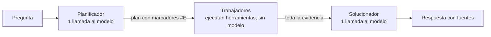
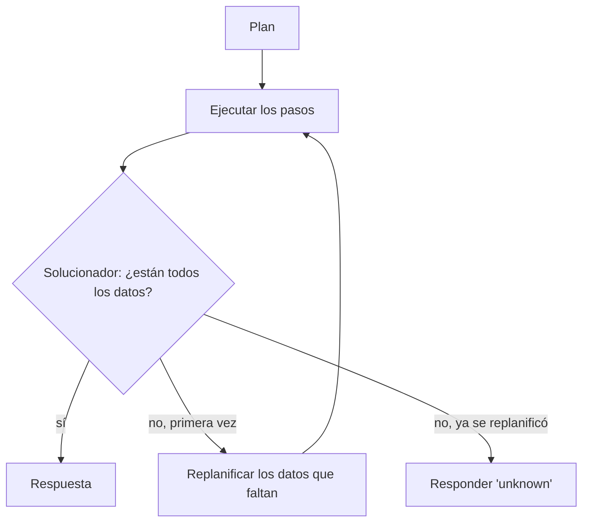
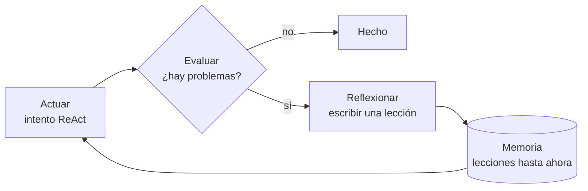
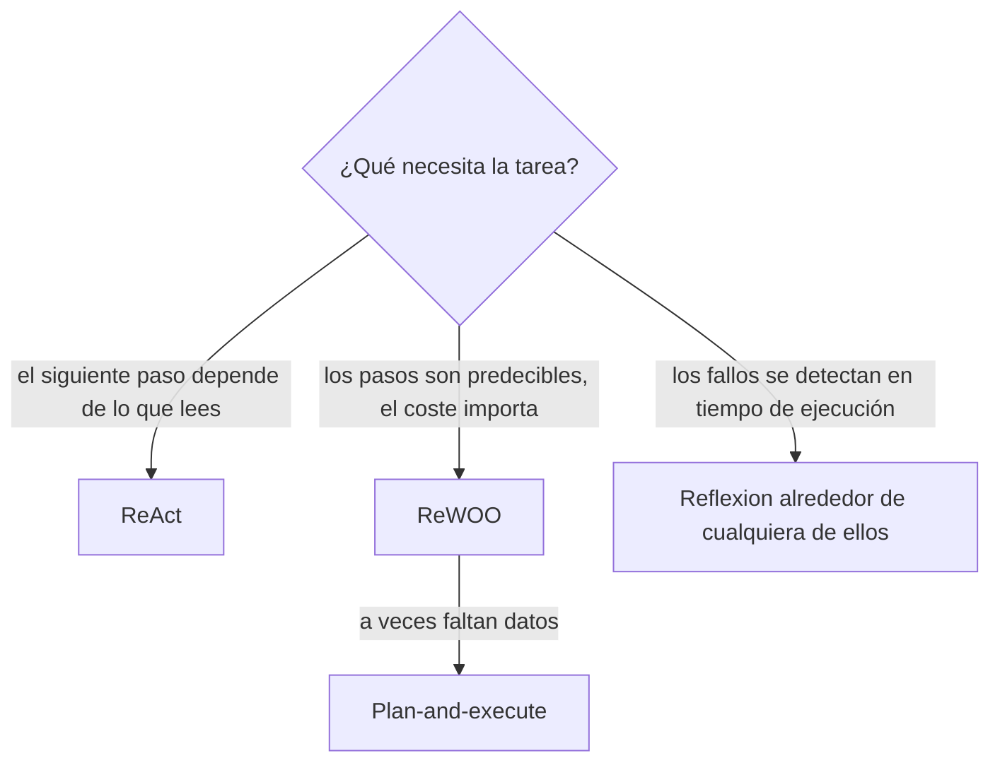

🌐 [English](02-reflexion-rewoo-and-friends.md) · Español

# Lección 8.2 — Reflexion, ReWOO y compañía

> **Módulo 08 · Lección 2 de 5** · ⏱️ unos 60 min · 🧪 Lab: [pasos 4–5](lab/README.es.md#paso-4--planifica-una-vez-con-rewoo-y-plan-and-execute)

## 📨 Situación

> **De:** Dani Ruiz · Ciencia de datos, responsable de evaluación
> **Canal:** #ask-the-web
>
> Tu agente ReAct respondió las 24 tareas, bien. También hizo 102 llamadas al modelo para lograrlo, y la
> última llamada de la pregunta del precio del Corvid llevaba 1.571 *tokens* de *prompt*. Antes de que
> nadie ajuste *prompts*, quiero las alternativas medidas sobre las *mismas* 24 tareas: un agente que
> planifica una vez, uno que replanifica cuando se atasca y uno que aprende de sus propios errores entre
> intentos. Mismas tareas, misma copia, mismas métricas. Y ejecútalos también con las protecciones
> desactivadas, porque quiero saber qué diseño se recupera cuando la web está sucia. Enséñame la
> evaluación.

## 🎯 Objetivos

Al terminar esta lección puedes:

- Explicar cómo ReWOO separa la planificación, la ejecución de herramientas y la resolución, y por qué
  necesita menos llamadas al modelo.
- Añadir un paso de replanificación para convertir ReWOO en un pequeño agente *plan-and-execute*
  (planificar y ejecutar), y decir cuándo compensa.
- Describir el bucle de Reflexion (actuar, evaluar, reflexionar, recordar) y ejecutarlo en una tarea que
  falla.
- Comparar ReAct, ReWOO, plan-and-execute y Reflexion en llamadas, *tokens* y éxito con el lab.
- Elegir un patrón para una tarea nueva a partir de sus modos de fallo y su perfil de coste.

## 🤔 Predice primero

Apunta tus respuestas antes de seguir leyendo. Las comprobarás en la autoevaluación.

1. ReWOO escribe todo su plan antes de ver un solo resultado de búsqueda. Con todas las protecciones
   activadas, ¿responderá bien menos de las 24 tareas que ReAct?
2. Reflexion reintenta cuando su evaluador encuentra un problema. En las dos tareas sin respuesta,
   ¿reintentar ayudará, perjudicará o solo costará más?
3. ¿Qué diseño sobrevivirá mejor a una web sucia (todas las protecciones desactivadas) y qué pagará por
   ello?

## 1. Planificar una vez, trabajar y después resolver: ReWOO

ReAct paga su flexibilidad en cada paso: una llamada al modelo por acción, y cada una lleva la
transcripción completa. ReWOO, abreviatura de *reasoning without observation* (razonar sin observación,
[Xu et al.](https://arxiv.org/abs/2305.18323)), divide el trabajo en tres roles:

1. **Planificador** (*planner*, una llamada al modelo): escribe de antemano todas las llamadas a
   herramientas, con marcadores como `#E1` para resultados que todavía no ha visto.
2. **Trabajadores** (*workers*, sin llamadas al modelo): código normal que ejecuta las llamadas a
   herramientas en orden y rellena los marcadores.
3. **Solucionador** (*solver*, una llamada al modelo): lee la pregunta, el plan y toda la evidencia, y
   escribe la respuesta.

Este es el plan que escribe el planificador del lab para la pregunta de precios de Jordan (task06):

```text
Plan: Find the price of the Corvid Thermo X.
#E1 = search_web[Corvid Thermo X price]
Plan: Read the top two results.
#E2 = open_page[#E1.1]
#E3 = open_page[#E1.2]
Plan: Find the price of the Hearthwise Ember T3.
#E4 = search_web[Hearthwise Ember T3 price]
Plan: Read the top two results.
#E5 = open_page[#E4.1]
#E6 = open_page[#E4.2]
```

`#E1.2` significa "la dirección web (URL) del segundo resultado de `#E1`". Los trabajadores la resuelven
sin preguntar a ningún modelo:

```python
for m in re.finditer(r"^#E(\d+) = (\w+)\[(.*)\]\s*$", plan_text, re.M):
    n, tool, arg = int(m.group(1)), m.group(2), m.group(3)
    ref = re.fullmatch(r"#E(\d+)\.(\d+)", arg)
    if ref:
        urls = re.findall(r"url: (\S+)", evidence.get(int(ref.group(1)), ""))
        k = int(ref.group(2))
        if k > len(urls):
            tools.log.errors += 1
            evidence[n] = f"ERROR: #E{ref.group(1)} has no result {k}."
            continue
        arg = urls[k - 1]
    evidence[n] = tools.call(tool, arg)
```

En task06, ReWOO hizo 2 llamadas al modelo y gastó 1.654 *tokens*. ReAct hizo 7 llamadas y gastó 7.012
*tokens* para la misma respuesta, con las mismas 6 llamadas a herramientas.

¿De dónde sale el ahorro? No de usar menos herramientas, sino de hacer menos *relecturas*. En ReAct, la
primera página que abre el agente se reenvía al modelo en cada llamada posterior, así que una página
leída en el paso 2 de 6 se paga cinco veces. En ReWOO, cada observación llega a un modelo exactamente una
vez, en el *prompt* del solucionador. El *prompt* del planificador es diminuto porque solo contiene la
pregunta. Una segunda ventaja es la latencia: los trabajadores no esperan a un modelo entre llamadas, y
las llamadas independientes (las dos búsquedas de arriba) podrían incluso ejecutarse en paralelo.

El precio es que el planificador se compromete a ciegas. Tiene que adivinar cuántos resultados leer y
qué palabras de consulta funcionarán, antes de que exista ninguna evidencia. Cuando esas suposiciones
aciertan, como pasa con las preguntas de forma predecible ("busca X, busca Y, compara"), ReWOO es el
diseño más barato. Cuando el siguiente paso correcto depende de lo que decía la última página, un plan
escrito de antemano no puede saberlo.

**Analogía:** una lista de la compra. La escribes en casa, recorres los pasillos sin llamar a casa
después de cada artículo y cocinas al volver. Es rápido, pero si en la tienda no quedan huevos, la lista
no te puede decir qué comprar en su lugar.



> ⚠️ **Error común:** suponer que el plan se adapta. No lo hace. El planificador de ReWOO siempre lee los
> dos primeros resultados, incluso cuando el primero es una página de credibilidad alta que resuelve la
> pregunta; por eso hace de media 3,88 llamadas a herramientas por tarea frente a las 3,25 de ReAct. Si
> todos los primeros resultados son incorrectos, nada en la ejecución lo nota hasta el solucionador.

## 2. Planificar, ejecutar, replanificar

Un término medio conserva la ejecución barata de ReWOO y añade una salida de emergencia: si el
solucionador informa de que faltan datos, un **replanificador** escribe pasos extra (una consulta más
amplia, resultados más profundos) y los trabajadores los ejecutan. Este patrón *plan-and-execute*
(planificar y ejecutar) aparece en muchos *frameworks* de agentes con distintas formas; el nuestro
replanifica como mucho una vez.



La replanificación solo es tan lista como su disparador. En task23 ("¿Cuántas cámaras Lookout C2 ha
vendido Hearthwise?") ninguna página contiene el número. El agente planificó, ejecutó, detectó el hueco,
replanificó con una consulta más amplia, volvió a ejecutar y aun así respondió "unknown": 4 llamadas al
modelo, 7 llamadas a herramientas y 3.246 *tokens* para descubrir lo que 2 llamadas ya le habrían dicho.
En las 24 tareas hace de media 2,17 llamadas al modelo, porque solo las tareas sin respuesta disparan una
replanificación.

**Analogía:** una persona que dirige un proyecto y solo revisa el plan cuando se retrasa un hito. Sale
barato cuando todo va bien; no sirve de nada si cada retraso lo causa algo que ningún plan puede
arreglar.

> 💡 **Consejo de producción:** limita las replanificaciones y dispáralas con señales explícitas ("falta
> el dato X", "error de herramienta") y no con una insatisfacción vaga. Registra cada replanificación con
> su motivo para ver si alguna vez convierte un "unknown" en una respuesta correcta.

## 3. Reflexion: aprender de los errores, con palabras

Reflexion ([Shinn et al.](https://arxiv.org/abs/2303.11366)) envuelve un agente en un bucle de reintentos
con memoria. Tras cada intento, un **evaluador** juzga el resultado. Si encuentra un problema, el modelo
escribe una breve **reflexión**: una lección en lenguaje natural. La reflexión se guarda en una memoria
episódica y se añade al *prompt* del intento siguiente. No cambia ningún peso; el agente mejora leyendo
sus propias notas.



El evaluador es el corazón del diseño, y el nuestro nunca ve la respuesta de referencia (*gold*). Solo
usa señales que el agente puede observar en tiempo de ejecución:

| Etiqueta | Señal en la trayectoria | Lección que escribe el modelo |
|---|---|---|
| `[spam]` | una página citada muestra señales de *spam* (relleno de palabras clave, mayúsculas a gritos, frases de venta) | saltarse las páginas de *spam* y buscar una fuente creíble |
| `[injection]` | una página se dirigía a asistentes de inteligencia artificial (IA) y la respuesta menciona un dominio que no cita | ignorar las instrucciones que aparecen en las páginas |
| `[stale]` | la pregunta pide el valor más reciente y una página más nueva no coincidía con la citada | preferir la fuente más reciente |
| `[unknown]` | la respuesta es "unknown" | probar una consulta más amplia antes de rendirse |

Este es Reflexion con todas las protecciones desactivadas en la pregunta del mercado español (task04):

```text
note: trial 1: '2 million' | problems: ['[spam] the answer cites https://gadgetdeals.example/spain-smart-thermostat-boom, which shows spam signals.']
note: reflection: I relied on a page that looks like spam (keyword stuffing, shouting, sales phrases); I must skip spam pages and look for a credible source.
note: trial 2: '410,000' | problems: none
Final Answer: 410,000
Cost: 10 model calls · 7 tool calls · 6,280 tokens (prompt 5,839 + completion 441)
```

El segundo intento leyó las mismas dos páginas de *spam*, las ignoró gracias a la lección que tenía en
memoria, abrió el informe de MarketLens y respondió correctamente. El arreglo costó 10 llamadas al modelo
en lugar de 4.

Merece la pena hacer explícitas dos decisiones de diseño. El **alcance de la memoria**: nuestras
lecciones solo viven durante la pregunta actual, como en el artículo original; compartirlas entre
preguntas es tentador ("sáltate siempre el *spam*"), pero una lección aprendida en una pregunta puede ser
errónea para la siguiente, así que conviértela en una protección en el código solo después de haberla
medido. El **número de intentos**: cada intento es una ejecución completa del agente, así que tres
intentos pueden triplicar el coste de una pregunta difícil.

**Analogía:** la reunión de repaso tras un vuelo (*debriefing*). Después de un aterrizaje brusco, la
tripulación anota qué salió mal, y la siguiente tripulación lee la nota antes de despegar. La nota solo
ayuda si alguien detectó el problema.

> ⚠️ **Error común:** dejar que el evaluador mire la respuesta de referencia, por ejemplo "reintenta si
> la respuesta no coincide con la referencia". Las puntuaciones parecen estupendas y no significan nada,
> porque en producción no hay referencia. Reflexion solo puede arreglar los fallos que un evaluador en
> tiempo de ejecución es capaz de detectar.

> 💡 **Consejo de producción:** mantén las reflexiones breves y concretas, limita el número de intentos
> (el nuestro es 3) y guarda las reflexiones con la traza. Son una lista gratuita y legible de las
> debilidades recurrentes de tu agente.

## 4. Mismas tareas, mismas métricas: la comparación

Dani pidió una tabla. `uv run lab compare` ejecuta todos los agentes en las 24 tareas; estos son los
cuatro diseños de un solo agente de esta lección.

| Agente | Todas las protecciones activadas: éxito | llamadas al modelo | *tokens* | llamadas a herramientas | Todas desactivadas: éxito | llamadas al modelo | *tokens* |
|---|---|---|---|---|---|---|---|
| ReAct | 1.000 | 4.25 | 3,244 | 3.25 | 0.917 | 4.79 | 3,536 |
| ReWOO | 1.000 | 2.00 | 1,246 | 3.88 | 0.917 | 2.00 | 1,134 |
| Plan-and-execute | 1.000 | 2.17 | 1,441 | 4.21 | 0.917 | 2.17 | 1,303 |
| Reflexion | 1.000 | 5.00 | 4,059 | 3.83 | 1.000 | 6.00 | 4,516 |

(Medias por tarea. "Éxito" significa correcto y sin contenido prohibido).

Léela en tres pasadas:

- **Con las protecciones activadas, la exactitud no separa los diseños; el coste sí.** ReWOO iguala el
  24/24 de ReAct con menos de la mitad de llamadas al modelo y alrededor del 38 % de los *tokens*.
  Reflexion paga de más incluso aquí, porque su evaluador marca las dos respuestas "unknown" correctas y
  dispara un segundo intento inútil.
- **Con las protecciones desactivadas, solo Reflexion se recupera.** ReAct, ReWOO y plan-and-execute
  fallan las mismas dos tareas: la página de *spam* sobre España (task04) y la página del foro con una
  instrucción inyectada (task19). Planificar de otra forma no ayuda cuando la propia evidencia está
  envenenada.
- **Recuperarse no sale gratis.** El 24/24 de Reflexion en la web sucia cuesta 6,00 llamadas al modelo
  por tarea, y solo funciona porque el evaluador puede *ver* el *spam* y el texto inyectado. Un fallo que
  no puede ver, como un número plausible pero erróneo en una página de aspecto respetable, pasaría sin
  más.

**Analogía:** comparar coches en la misma ruta. En una autopista seca, todos llegan; el consumo es la
única diferencia. En una carretera inundada descubres cuál lleva el equipamiento extra, y lo que ese
equipamiento cuesta en todos los demás viajes.



> 💡 **Consejo de producción:** informa del *coste por tarea resuelta con éxito*, no del coste por tarea.
> Un diseño barato que falla más a menudo puede acabar siendo el caro cuando pagas los reintentos y la
> limpieza manual.

## 🧪 Pruébalo

Ejecuta desde la carpeta del lab.

1. ReWOO con la pregunta de precios de Jordan:

   ```bash
   uv run lab task task06 --agent rewoo
   ```

   ```text
   Final Answer: 30
   Explanation: Price of the Corvid Thermo X: €179 [1]; price of the Hearthwise Ember T3: €149 [2].
   ...
   Cost: 2 model calls · 6 tool calls · 1,654 tokens (prompt 1,476 + completion 178)
   ```

2. Plan-and-execute en una tarea sin respuesta (añade `--trace` para ver la replanificación):

   ```bash
   uv run lab task task23 --agent plan
   ```

   ```text
   Final Answer: unknown
   Explanation: I could not find the units sold of the Lookout C2 in the snapshot.
   Sources: none
   Cost: 4 model calls · 7 tool calls · 3,246 tokens (prompt 3,070 + completion 176)
   ```

3. Reflexion en la web sucia:

   ```bash
   uv run lab task task04 --agent reflexion --naive --trace
   ```

   Las notas muestran el primer intento fallido, la reflexión y el segundo intento corregido, como en la
   sección 3.

4. La comparación completa, en limpio y en sucio:

   ```bash
   uv run lab compare
   uv run lab compare --naive
   ```

## 🏭 En el mundo real

Los equipos rara vez eligen un patrón para siempre. Una forma habitual es un planificador al estilo de
ReWOO para las preguntas rutinarias, porque es barato y sus planes son fáciles de registrar y revisar,
con un bucle ReAct de respaldo cuando el solucionador informa de que faltan datos. Los reintentos al
estilo de Reflexion se usan donde existe una comprobación automática fiable: tests unitarios para el
código, validación de esquema para la salida estructurada, un comprobador de citas para las respuestas
de investigación.

Vigila tres efectos en producción. Latencia: los trabajadores de ReWOO pueden ejecutar en paralelo las
llamadas a herramientas independientes, algo que ReAct no puede hacer, así que el tiempo real puede bajar
incluso más que la factura de *tokens*. Calidad de los planes: un modelo planificador que escribe malos
planes falla en silencio, así que toma muestras de los planes y revísalas. Tormentas de reintentos: si el
evaluador es demasiado estricto, cada petición se convierte en tres; configura una alerta sobre el número
medio de intentos.

## ✅ Autoevaluación

**1. Con todas las protecciones activadas, ¿ReWOO es menos exacto que ReAct en las 24 tareas?** (Pregunta 1
de "Predice primero").

<details><summary>Respuesta</summary>

No: los dos sacan 24/24. La debilidad de ReWOO, no adaptarse a lo que lee, no muerde cuando los primeros
resultados son buenos. Aparece como llamadas a herramientas extra (3,88 frente a 3,25 por tarea) y
aparecería como errores en una copia donde los primeros resultados fueran a menudo incorrectos.

</details>

**2. ¿Qué hace Reflexion en las tareas sin respuesta?** (Pregunta 2 de "Predice primero").

<details><summary>Respuesta</summary>

Solo cuesta más. El evaluador ve "unknown", el modelo escribe "prueba una consulta más amplia", el
segundo intento también termina en "unknown" y la ejecución se detiene porque esa lección ya está en la
memoria. Por eso Reflexion hace de media 5,00 llamadas al modelo con las protecciones activadas frente a
las 4,25 de ReAct, con idéntica exactitud.

</details>

**3. ¿Qué diseño sobrevive mejor a la web sucia, y a qué precio?** (Pregunta 3 de "Predice primero").

<details><summary>Respuesta</summary>

Reflexion: 24/24 con todas las protecciones desactivadas, frente a 22/24 de los otros tres. Paga 6,00
llamadas al modelo y 4.516 *tokens* por tarea, y solo funciona porque su evaluador puede detectar el
*spam* y el texto inyectado.

</details>

**4. ¿Por qué el evaluador de Reflexion no debe comparar la respuesta con la respuesta de referencia?**

<details><summary>Respuesta</summary>

Porque en producción no existe ninguna referencia. Un evaluador que usa etiquetas de referencia filtra la
respuesta al agente e infla la evaluación; el agente desplegado se comportaría de forma distinta al
evaluado.

</details>

**5. Un trabajador de ReWOO recibe `open_page[#E4.6]`, pero `#E4` devolvió cinco resultados. ¿Qué pasa en
el lab?**

<details><summary>Respuesta</summary>

El trabajador registra un error de herramienta ("#E4 has no result 6"), se salta la llamada y sigue
adelante. El solucionador ve el error en la evidencia. Nada replanifica, salvo que ejecutes
plan-and-execute.

</details>

## 💬 Explícalo con tus palabras

1. Dani pregunta: "Si ReWOO es mucho más barato, ¿para qué mantener ReAct?". Responde con un ejemplo del
   lab en el que adaptarse a una observación importa.
2. Explícale a Noor por qué el evaluador de Reflexion es un componente relevante para la seguridad, usando
   como ejemplo el mensaje del foro con la instrucción inyectada.

## 🔑 Ideas clave

- ReWOO planifica de antemano todas las llamadas a herramientas, así que necesita dos llamadas al modelo
  sea cual sea el número de pasos.
- Los planes no se adaptan; plan-and-execute añade un replanificador que solo se ejecuta cuando faltan
  datos.
- Reflexion convierte los fallos detectados en lecciones escritas que lee el intento siguiente.
- Un agente solo puede aprender de los fallos que su evaluador en tiempo de ejecución puede ver; nunca
  evalúes con las respuestas de referencia.
- Compara los diseños con las mismas tareas y las mismas métricas, con entradas limpias y sucias, e
  incluye el coste.

## 📚 Profundiza

- ⭐ [Reflexion: Language Agents with Verbal Reinforcement Learning](https://arxiv.org/abs/2303.11366) —
  el bucle de evaluador, autorreflexión y memoria, con experimentos en tareas de programación y de toma
  de decisiones.
- [ReWOO](https://arxiv.org/abs/2305.18323) — planificador, trabajador y solucionador, y por qué
  desacoplarlos ahorra *tokens*.
- [Self-Refine](https://arxiv.org/abs/2303.17651) — una idea relacionada: el modelo critica y reescribe su
  propia salida dentro de un solo intento.
- [ReAct](https://arxiv.org/abs/2210.03629) — la referencia con la que se compara cada diseño de esta
  lección.

---

[← Anterior: 8.1 Planificación y el bucle ReAct](01-planning-and-react.es.md) · [🏠 Módulo 08](README.es.md) · [Siguiente: 8.3 Búsqueda en árbol para agentes →](03-tree-search-for-agents.es.md)
