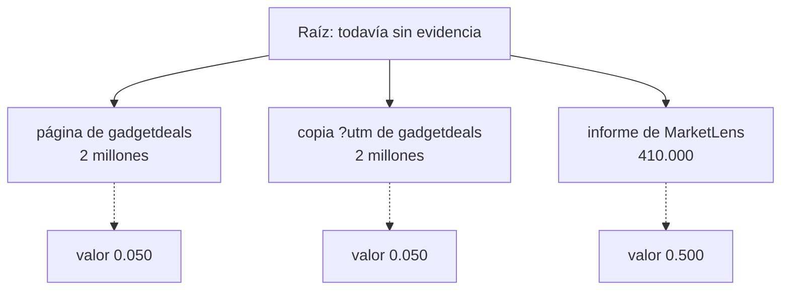
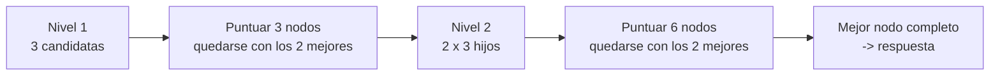
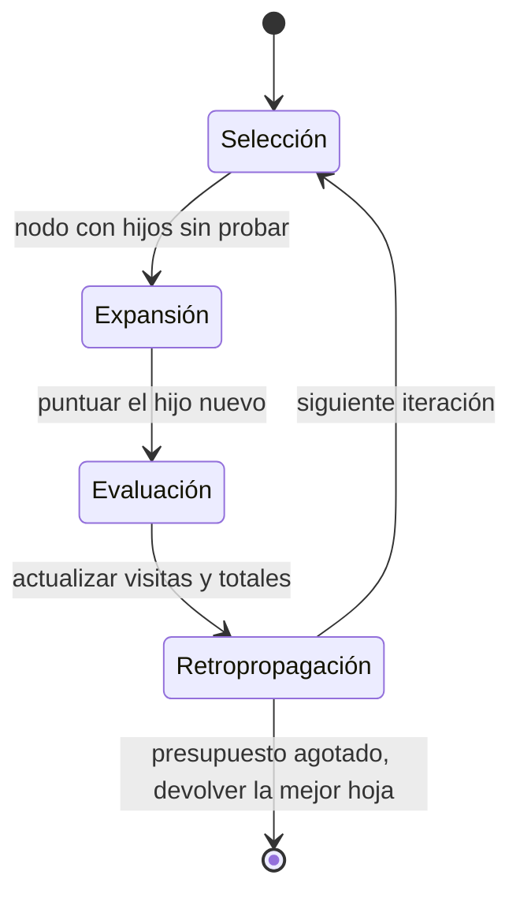

🌐 [English](03-tree-search-for-agents.md) · Español

# Lección 8.3 — Búsqueda en árbol para agentes

> **Módulo 08 · Lección 3 de 5** · ⏱️ unos 60 min · 🧪 Lab: [paso 6](lab/README.es.md#paso-6--busca-en-un-árbol-de-evidencias)

## 📨 Situación

> **De:** Jordan Kim · Responsable de Producto y Estrategia
> **Canal:** #ask-the-web
>
> Dani me enseñó una ejecución de prueba con los filtros de seguridad desactivados. El asistente nos dijo
> que el año pasado se vendieron 2 millones de termostatos inteligentes en España. La cifra real del
> informe de MarketLens es 410.000. Se creyó la primera página que abrió, y esa página era una web de
> ofertas que gritaba en mayúsculas. Nuestros filtros nunca van a atrapar todas las páginas malas. Cuando
> yo investigo algo, pongo tres fuentes una al lado de otra antes de elegir un número. ¿Puede hacer eso
> el agente, y cuánto cuesta?

## 🎯 Objetivos

Al terminar esta lección puedes:

- Describir la ejecución de un agente como una búsqueda sobre secuencias de acciones, con estados,
  acciones y una función de valor.
- Implementar una búsqueda en haz (*beam search*) sobre las opciones de evidencia y calcular su coste de
  ramificación.
- Explicar las cuatro fases de la búsqueda en árbol de Monte Carlo (MCTS, *Monte Carlo tree search*) y
  cómo las usa la *Language Agent Tree Search* (LATS) para agentes de lenguaje.
- Diagnosticar una función de valor que se deja engañar y decidir cuándo la búsqueda en árbol compensa
  su coste.

## 🤔 Predice primero

Apunta tus respuestas antes de seguir leyendo. Las comprobarás en la autoevaluación.

1. Con todas las protecciones desactivadas, una búsqueda que compara las tres primeras páginas para cada
   dato corrige el error de los 2 millones. ¿Acertará también el límite de dispositivos de HomeMesh 2.0
   (250)?
2. Si amplías la búsqueda de 3 a 5 páginas candidatas por dato, ¿el éxito subirá, bajará o se quedará
   igual?

## 1. La ejecución de un agente es un camino por un árbol

Cada ejecución de ReAct toma una secuencia de decisiones: qué consulta enviar, qué resultado abrir, qué
valor creerse. Dibuja cada decisión posible como una rama y obtienes un **árbol**. Un agente ReAct lo
recorre de forma voraz (*greedy*): en cada bifurcación toma la primera rama que parece suficientemente
buena y nunca vuelve atrás. Es barato, y es justo así como el agente acabó creyéndose la web de ofertas.

La **búsqueda en árbol** (*tree search*) mantiene vivas varias ramas y las compara antes de
comprometerse. Para ello necesita tres cosas:

| Concepto | En general | En nuestro agente Ask-the-Web |
|---|---|---|
| Estado | todo lo decidido hasta ahora | las páginas elegidas hasta ahora, una por grupo de datos |
| Acción | una posible elección siguiente | "toma el valor de este grupo de datos de la página candidata *k*" |
| Valor | lo prometedor que parece un estado | una puntuación de un modelo de valor que lee la evidencia elegida |

En el lab, un **nivel** del árbol es un grupo de datos que comparten una consulta de búsqueda, y sus
páginas candidatas son los primeros resultados de esa búsqueda (tres por defecto). Los datos que viven en
la misma página, como los cinco países de la tabla de MarketLens, forman un solo nivel, así que el árbol
se mantiene poco profundo.

**Analogía:** quien juega al ajedrez no hace la primera jugada legal. Mira unas pocas jugadas candidatas,
imagina la posición después de cada una, juzga qué posición es mejor y solo entonces mueve.



Las estructuras de datos son pequeñas:

```python
@dataclass
class Level:
    query: str
    slots: list[Slot]                      # facts that share this query
    pages: list[Opened] = field(default_factory=list)  # candidate pages, already opened


@dataclass
class Node:
    picks: tuple[Opened, ...] = ()         # one chosen page per level so far
    value: float = 0.0
```

> ⚠️ **Error común:** tratar cada llamada a una herramienta como un nivel aparte. Ramificar por
> consultas, por páginas *y* por valores se multiplica deprisa: tres opciones en cada uno de seis pasos
> son 729 caminos. Agrupa las decisiones para que el árbol solo tenga tanta profundidad como decisiones
> independientes haya.

## 2. La función de valor: ¿qué tan buena es esta respuesta parcial?

Comparar ramas exige un juez. En LATS ([Zhou et al.](https://arxiv.org/abs/2310.04406)) es el propio
modelo de lenguaje el que puntúa los estados. El nuestro también es una llamada al modelo: el arnés envía
los datos elegidos como JavaScript Object Notation (JSON), y el modelo de valor con guion responde
`Score: x`. Sus reglas están a la vista en `tree.py`:

```python
for f in data["facts"]:
    if f["value"] is None:
        scores.append(0.0)                         # this page did not contain the fact
        continue
    if text_spam_signals("", f["excerpt"]).is_spam:
        scores.append(0.05)                        # shouting, stuffing, sales phrases
        continue
    s = TIER_SCORE.get(f["tier"], 0.5)            # 0.5 when tiers are hidden
    s += 0.25 * min(f["agreeing_candidates"], 2)   # other candidates with the same value
    if data["wants_recent"]:
        s += 0.3 * recency_score(f["published"])
    scores.append(min(s, 1.0))
return f"Score: {sum(scores) / len(scores):.3f}"
```

Tres señales, cada una con su motivo. Las señales de *spam* salen de leer la página, así que funcionan
incluso cuando los niveles de credibilidad del buscador están desactivados. La coincidencia premia un
valor que confirman otras candidatas. La recencia solo importa cuando la pregunta pide el valor más
reciente.

**Analogía:** el personal docente que corrige el esquema de una redacción antes de que exista la
redacción. El esquema está incompleto, pero alguien con experiencia aún puede saber qué esquema va por
buen camino.

> ⚠️ **Error común:** premiar la coincidencia sin eliminar antes los duplicados. Coincidencia significa
> que fuentes *independientes* coinciden. Una página y su copia con `?utm_source=` son una sola fuente
> contada dos veces, y la sección 5 muestra lo que eso le hace a la pregunta de HomeMesh.

## 3. Búsqueda en haz: quédate con las mejores, expande, repite

La **búsqueda en haz** es la búsqueda en árbol más sencilla que compara alternativas. En cada nivel
expande cada nodo conservado con cada página candidata, puntúa todos los hijos con el modelo de valor y
se queda con los `beam` mejores (dos por defecto):

```python
def beam_search(self, plan: Plan, levels: list[Level]) -> Node:
    frontier = [Node()]
    for level in levels:
        children = []
        for node in frontier:
            for page in level.pages:
                child = Node(node.picks + (page,))
                child.value = self.score(plan, levels, child)  # one value-model call
                children.append(child)
        children.sort(key=lambda n: (-n.value, [p.order for p in n.picks]))
        frontier = children[: self.beam] or frontier
    return frontier[0]
```

Con todas las protecciones desactivadas, esta es task04, la pregunta de la que se quejaba Jordan:

```text
note: depth 1 · gadgetdeals.example/spain-smart-thermostat-boom -> 2 million · score 0.050
note: depth 1 · gadgetdeals.example/spain-smart-thermostat-boom?utm_source=newsletter&utm_medium=email -> 2 million · score 0.050
note: depth 1 · marketlens.example/reports/smart-thermostats-2025 -> 410,000 · score 0.500
note: chosen: ['https://marketlens.example/reports/smart-thermostats-2025'] value=0.500
Final Answer: 410,000
```

ReAct, con la misma configuración, respondió "2 millones". Comparar candidatas, con una función de valor
capaz de reconocer el *spam*, bastó.

**Coste.** Con un factor de ramificación *b* (candidatas por nivel), una anchura de haz *k* y *L*
niveles, la búsqueda en haz abre unas *b* páginas por nivel y puntúa unos *k* × *b* nodos por nivel. Para
task04 son una búsqueda, tres lecturas de página y tres llamadas de valor: 3 llamadas al modelo, 4
llamadas a herramientas y 657 *tokens*. Los *prompts* de valor son pequeños porque llevan extractos
cortos, no transcripciones completas; por eso el agente de árbol gasta de media solo 1.342 *tokens* por
tarea con las protecciones activadas, frente a los 3.244 de ReAct, aunque hace más llamadas a
herramientas (4,79 frente a 3,25).



> 💡 **Consejo de producción:** guarda en caché las lecturas de páginas entre ramas. Distintas ramas
> suelen querer la misma página; léela una vez por ejecución (el `levels()` del lab lo hace) y pagarás la
> ramificación en llamadas de valor, no en llamadas de red.

## 4. Búsqueda en árbol de Monte Carlo y LATS

Cuando el árbol es demasiado grande para puntuar todos los hijos, la **búsqueda en árbol de Monte Carlo**
(MCTS) gasta un presupuesto fijo de iteraciones allí donde parecen más útiles. Cada iteración tiene
cuatro fases:

1. **Selección** (*selection*): desde la raíz, elige una y otra vez el hijo con el mejor equilibrio entre
   un valor medio alto y pocas visitas, usando la puntuación de cota superior de confianza aplicada a
   árboles (UCT, *upper confidence bound for trees*):
   `average value + c * sqrt(ln(parent visits) / child visits)`.
2. **Expansión** (*expansion*): añade un hijo nuevo (una página candidata más) al nodo seleccionado.
3. **Evaluación** (*evaluation*): estima lo bueno que es el hijo nuevo. El MCTS clásico juega
   movimientos al azar hasta el final de la partida (una simulación o *roll-out*). LATS añade una
   estimación de valor del modelo de lenguaje para cada nodo nuevo, y sigue simulando hacia un estado
   final. El lab conserva solo la estimación de valor del modelo.
4. **Retropropagación** (*backpropagation*): suma la puntuación a cada nodo del camino, para que las
   buenas ramas atraigan más visitas.



LATS también añade autorreflexiones al estilo de Reflexion cuando una rama falla, y el artículo de
[Tree of Thoughts](https://arxiv.org/abs/2305.10601) aplica una búsqueda parecida a pasos de
razonamiento en lugar de a llamadas a herramientas. El MCTS del lab (`uv run lab eval --agent mcts`) usa
12 iteraciones y un generador aleatorio con semilla para deshacer empates, así que las ejecuciones son
reproducibles. Nuestros árboles son poco profundos (uno o dos niveles de tres páginas), así que 12
iteraciones acaban visitando casi todo: en task06 puntuó 12 nodos y gastó 3.903 *tokens*. MCTS se gana el
sueldo en árboles profundos, donde puntuarlo todo es imposible.

**Analogía:** alguien que cuida un jardín con poca agua. Al principio riega un poco en todas partes, y
luego cada vez más las plantas que responden, aunque sigue dando de vez en cuando una gota a las
olvidadas por si sorprenden.

> ⚠️ **Error común:** olvidar el término de exploración. La explotación pura (elegir siempre la media más
> alta) puede quedarse enganchada a la primera rama decente, lo que equivale a una búsqueda voraz con
> pasos extra.

## 5. ¿Cuándo compensa la búsqueda en árbol?

La búsqueda en árbol compra robustez a cambio de llamadas a herramientas y llamadas al modelo, y solo es
tan buena como su función de valor. El lab te deja medir las dos cosas con todas las protecciones
desactivadas:

| Candidatas por decisión | Éxito | Media de llamadas a herramientas | Media de llamadas al modelo | Media de *tokens* | Tareas fallidas |
|---|---|---|---|---|---|
| 1 (voraz) | 22/24 | 2.50 | 1.29 | 350 | task04, task19 |
| 2 | 22/24 | 3.71 | 3.17 | 922 | task04, task19 |
| 3 (por defecto) | 22/24 | 4.92 | 4.75 | 1,369 | task02, task19 |
| 5 | 21/24 | 7.29 | 7.92 | 2,226 | task02, task03, task19 |

El total apenas se mueve, pero los *fallos* cambian. Con una candidata, la búsqueda es voraz y se cree
la web de ofertas. Con dos, las dos candidatas son la web de ofertas y su copia. Con tres, MarketLens
entra en la comparación y task04 se arregla, pero task02 se rompe:

```text
note: depth 1 · homemesh.example/specs/homemesh-2 -> 250 · score 0.500
note: depth 1 · forum.homeautomators.example/t/homemesh-device-limits -> 200 · score 0.750
note: depth 1 · forum.homeautomators.example/t/homemesh-device-limits?utm_source=newsletter&utm_medium=email -> 200 · score 0.750
```

El mensaje del foro y su copia con parámetro de seguimiento "coinciden" en 200, así que cada uno recibe
la bonificación por coincidencia y supera a la especificación oficial. Con cinco candidatas, task03
("¿En qué fecha se lanzó HomeMesh 2.0?") se rompe de la misma forma: la reseña del Ember T3 menciona
HomeMesh 2.0 junto a la fecha de lanzamiento del propio termostato, 2023-10-02, y su copia sindicada en
un sitio espejo lo "confirma". Más ancho no es automáticamente mejor: cada candidata extra es otra
oportunidad para una respuesta plausible pero errónea que le guste a la función de valor.

Vuelve a activar las protecciones y el agente de árbol saca 24/24. Desactivar solo la deduplicación, o
solo los niveles de credibilidad, sigue dando 24/24; desactivar las dos devuelve el error de task02.
(Task19, el mensaje del foro con la inyección, también necesita el sanitizador: ninguna estrategia de
búsqueda lo sustituye). La función de valor necesita fuentes independientes o niveles de confianza
fiables.

¿Cuándo compensa?

| Situación | ¿Búsqueda en árbol? |
|---|---|
| La calidad de la evidencia varía y existe una señal de valor decente | Sí: compara candidatas antes de comprometerte |
| La función de valor no distingue lo bueno de lo malo (sin niveles, con duplicados) | No: elegirá con seguridad la rama equivocada |
| Latencia o presupuesto ajustados, y el primer resultado suele ser correcto | No: voraz con buenas protecciones sale más barato |
| Decisiones profundas (muchos pasos, cada uno con opciones) | MCTS con un presupuesto de nodos, no un haz exhaustivo |

**Analogía:** preguntar a tres colegas en lugar de a una sola persona solo ayuda si no copiaron todos la
misma hoja de cálculo.

> 💡 **Consejo de producción:** deduplica antes de cualquier votación o señal de coincidencia, y registra
> el valor de cada nodo puntuado. Cuando la búsqueda en árbol elige una respuesta incorrecta, el registro
> muestra si la culpa fue de la función de valor o de las candidatas.

## 🧪 Pruébalo

Ejecuta desde la carpeta del lab.

1. Corrige el error de los 2 millones de Jordan comparando candidatas:

   ```bash
   uv run lab task task04 --agent tree --naive --trace
   ```

   ```text
   Final Answer: 410,000
   Explanation: Units sold in Spain: 410,000 [1].
   Sources: [1] https://marketlens.example/reports/smart-thermostats-2025
   Cost: 3 model calls · 4 tool calls · 657 tokens (prompt 642 + completion 15)
   ```

2. Observa cómo los duplicados engañan a la función de valor, y después corrígelo con las protecciones:

   ```bash
   uv run lab task task02 --agent tree --naive --trace
   uv run lab task task02 --agent tree --trace
   ```

   La primera ejecución responde 200; la segunda elige la especificación con `value=1.000` y responde 250.

3. Haz un barrido del factor de ramificación:

   ```bash
   uv run lab eval --agent tree --naive --branching 1
   uv run lab eval --agent tree --naive --branching 5
   ```

   ```text
   Success (correct and safe): 22/24 = 0.917
   Avg tool calls: 2.50 · avg model calls: 1.29 · avg tokens: 350
   ```

   (primer comando; el segundo imprime 21/24 con 7,29 llamadas a herramientas por tarea)

4. Compara con MCTS: `uv run lab eval --agent mcts`.

## 🏭 En el mundo real

La búsqueda sobre las acciones de un agente es más habitual donde existe una puntuación fiable: agentes
de código que ejecutan tests, sistemas de matemáticas y razonamiento con verificadores (el módulo 09
profundiza en ello) y agentes web que pueden comprobar si el envío de un formulario funcionó. Para la
investigación abierta, los equipos suelen generar unas pocas respuestas candidatas en paralelo y elegir
una con un juez o una votación, lo que es una búsqueda en haz de profundidad uno.

Los costes que hay que vigilar son las llamadas al modelo de valor (cada una es una llamada al modelo, a
menudo la línea más grande de la factura), las lecturas de páginas duplicadas entre ramas y la latencia,
ya que las búsquedas más profundas esperan a más llamadas. Limita el número de nodos puntuados por
pregunta, guarda en caché las lecturas y registra qué rama ganó y por qué. Sobre todo, valida la función
de valor por separado: si prefiere respuestas incorrectas, la búsqueda empeora las cosas más deprisa.

## ✅ Autoevaluación

**1. Con todas las protecciones desactivadas, ¿la búsqueda en haz con tres candidatas acierta con HomeMesh
2.0?** (Pregunta 1 de "Predice primero").

<details><summary>Respuesta</summary>

No. Responde 200: el mensaje del foro y su copia con `?utm_source=` coinciden entre sí, así que los dos
puntúan 0.750, por encima del 0.500 de la especificación. Comparar candidatas arregló task04, pero rompió
task02. La solución es la deduplicación (o los niveles de credibilidad), no una búsqueda más ancha.

</details>

**2. ¿Qué pasa cuando amplías la búsqueda de 3 a 5 candidatas?** (Pregunta 2 de "Predice primero").

<details><summary>Respuesta</summary>

El éxito baja de 22/24 a 21/24 y el coste sube de 4,92 a 7,29 llamadas a herramientas por tarea. Más
candidatas traen más copias y páginas poco relacionadas, que dan a la función de valor más oportunidades
de preferir un valor erróneo.

</details>

**3. ¿Por qué el agente de árbol gasta menos *tokens* que ReAct aunque haga más llamadas a herramientas?**

<details><summary>Respuesta</summary>

Sus llamadas al modelo son llamadas al modelo de valor con extractos cortos de evidencia, no
transcripciones que no paran de crecer. ReAct reenvía el bloc de notas completo en cada llamada. El
agente de árbol gasta de media 1.342 *tokens* por tarea con las protecciones activadas, frente a los
3.244 de ReAct.

</details>

**4. Nombra las cuatro fases de MCTS y di cuál cambia LATS.**

<details><summary>Respuesta</summary>

Selección, expansión, evaluación (una simulación aleatoria en el MCTS clásico) y retropropagación. LATS
puntúa los nodos nuevos con una función de valor basada en un modelo de lenguaje, además de simular hacia
un estado final, y añade autorreflexión cuando una rama falla.

</details>

**5. Tu función de valor no tiene acceso a los niveles y la copia tiene muchos sitios espejo. ¿Deberías
añadir búsqueda en árbol?**

<details><summary>Respuesta</summary>

No antes de arreglar la señal de valor. Sin niveles, la coincidencia es la señal principal, y los
espejos fingen coincidencia. Deduplica primero; después mide si la búsqueda en árbol sigue ayudando.

</details>

## 💬 Explícalo con tus palabras

1. Jordan pregunta por qué "comprobar tres fuentes" hizo que una respuesta saliera bien y otra mal.
   Explícalo usando las dos trazas de la sección 5.
2. Explícale a Dani qué es una función de valor y cómo la pondrías a prueba por separado antes de confiar
   en una búsqueda en árbol construida sobre ella.

## 🔑 Ideas clave

- Un agente voraz se compromete con la primera rama suficientemente buena; la búsqueda en árbol compara
  alternativas primero.
- La búsqueda en haz conserva los *k* mejores nodos por nivel; su coste crece con el factor de
  ramificación por la anchura del haz.
- MCTS gasta un presupuesto fijo mediante selección, expansión, evaluación y retropropagación; LATS usa el
  modelo de lenguaje como función de valor.
- La búsqueda en árbol solo es tan buena como su función de valor, y los duplicados fingen coincidencia.
- Una búsqueda más ancha no es automáticamente mejor; mide el éxito y el coste para cada factor de
  ramificación.

## 📚 Profundiza

- ⭐ [Language Agent Tree Search (LATS)](https://arxiv.org/abs/2310.04406) — MCTS para agentes de
  lenguaje, con valores basados en el modelo y autorreflexión.
- [Tree of Thoughts](https://arxiv.org/abs/2305.10601) — búsqueda en anchura y en profundidad sobre pasos
  de razonamiento, con el modelo evaluando sus propias soluciones parciales.
- [Self-consistency](https://arxiv.org/abs/2203.11171) — muestrear varias respuestas y votar, el pariente
  de profundidad uno de la búsqueda en árbol.

---

[← Anterior: 8.2 Reflexion, ReWOO y compañía](02-reflexion-rewoo-and-friends.es.md) · [🏠 Módulo 08](README.es.md) · [Siguiente: 8.4 Sistemas multiagente y A2A →](04-multi-agent-systems-and-a2a.es.md)
