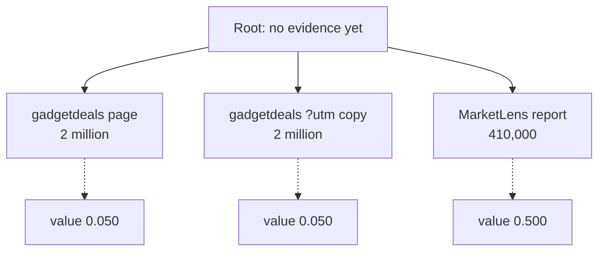
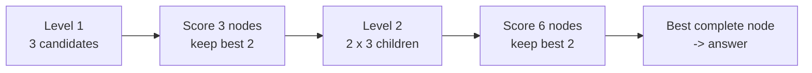
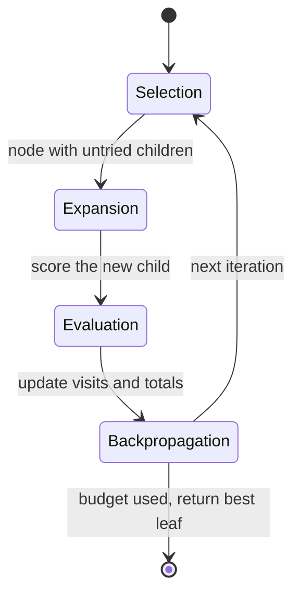

🌐 English · [Español](03-tree-search-for-agents.es.md)

# Lesson 8.3 — Tree search for agents

> **Module 08 · Lesson 3 of 5** · ⏱️ about 60 min · 🧪 Lab: [step 6](lab/README.md#step-6--search-a-tree-of-evidence)

## 📨 Situation

> **From:** Jordan Kim · Product and Strategy Lead
> **Channel:** #ask-the-web
>
> Dani showed me a test run with the safety filters switched off. The assistant told us 2 million smart
> thermostats were sold in Spain last year. The real figure in the MarketLens report is 410,000. It
> believed the first page it opened, and that page was a deals site shouting in capital letters. Our
> filters will never catch every bad page. When I research something, I put three sources side by side
> before I pick a number. Can the agent do that, and what does it cost?

## 🎯 Objectives

By the end of this lesson you can:

- Describe an agent run as a search over action sequences, with states, actions and a value function.
- Implement beam search over evidence choices and compute its branching cost.
- Explain the four phases of Monte Carlo tree search (MCTS) and how Language Agent Tree Search (LATS)
  uses them for language agents.
- Diagnose a value function that is fooled, and decide when tree search is worth its cost.

## 🤔 Predict first

Write your answers down before reading on. You will check them in the self-check.

1. With every guard off, a search that compares the top three pages for each fact fixes the 2 million
   mistake. Will it also get the HomeMesh 2.0 device limit (250) right?
2. If you widen the search from 3 to 5 candidate pages per fact, will success go up, down or stay the same?

## 1. An agent run is a path through a tree

Every ReAct run makes a sequence of choices: which query to send, which result to open, which value to
believe. Draw every possible choice as a branch and you get a **tree**. A ReAct agent walks down it
greedily: at each fork it takes the first branch that looks good enough and never comes back. That is
cheap, and it is exactly how the agent ended up believing the deals site.

**Tree search** keeps several branches alive and compares them before committing. To do that it needs
three things:

| Concept | In general | In our Ask-the-Web agent |
|---|---|---|
| State | everything decided so far | the pages chosen so far, one per group of facts |
| Action | one possible next choice | "take the value for this fact group from candidate page *k*" |
| Value | how promising a state looks | a score from a value model that reads the chosen evidence |

In the lab, a **level** of the tree is one group of facts that share a search query, and its candidate
pages are the top results of that search (three by default). Facts that live on the same page, such as
the five countries of the MarketLens table, form one level, so the tree stays shallow.

**Analogy:** a chess player does not play the first legal move. They look at a few candidate moves,
imagine the position after each one, judge which position is better, and only then move.



The data structures are small:

```python
@dataclass
class Level:
    query: str
    slots: list[Slot]                      # facts that share this query
    pages: list[Opened] = field(default_factory=list)  # candidate pages, already opened


@dataclass
class Node:
    picks: tuple[Opened, ...] = ()         # one chosen page per level so far
    value: float = 0.0
```

> ⚠️ **Common mistake:** treating every tool call as a separate level. Branching on queries, on pages
> *and* on values multiplies quickly: three choices at each of six steps is 729 paths. Group decisions
> so that the tree is only as deep as the number of independent choices.

## 2. The value function: how good is this partial answer?

Comparing branches needs a judge. In LATS ([Zhou et al.](https://arxiv.org/abs/2310.04406)) the
language model itself scores states. Ours is a model call too: the harness sends the chosen facts as
JavaScript Object Notation (JSON), and the scripted value model answers `Score: x`. Its rules are visible in `tree.py`:

```python
for f in data["facts"]:
    if f["value"] is None:
        scores.append(0.0)                         # this page did not contain the fact
        continue
    if text_spam_signals("", f["excerpt"]).is_spam:
        scores.append(0.05)                        # shouting, stuffing, sales phrases
        continue
    s = TIER_SCORE.get(f["tier"], 0.5)            # 0.5 when tiers are hidden
    s += 0.25 * min(f["agreeing_candidates"], 2)   # other candidates with the same value
    if data["wants_recent"]:
        s += 0.3 * recency_score(f["published"])
    scores.append(min(s, 1.0))
return f"Score: {sum(scores) / len(scores):.3f}"
```

Three signals, each with a reason. Spam signals come from reading the page, so they work even when the
search engine's credibility tiers are switched off. Agreement rewards a value that other candidates
confirm. Recency matters only when the question asks for the latest value.

**Analogy:** a teacher marking an essay plan before the essay exists. The plan is incomplete, but an
experienced reader can still tell which plan is heading somewhere good.

> ⚠️ **Common mistake:** rewarding agreement without removing duplicates first. Agreement means
> *independent* sources agree. A page and its `?utm_source=` copy are one source counted twice, and
> section 5 shows what that does to the HomeMesh question.

## 3. Beam search: keep the best few, expand, repeat

**Beam search** is the simplest tree search that compares alternatives. At each level it expands every
kept node with every candidate page, scores all the children with the value model, and keeps the best
`beam` of them (two by default):

```python
def beam_search(self, plan: Plan, levels: list[Level]) -> Node:
    frontier = [Node()]
    for level in levels:
        children = []
        for node in frontier:
            for page in level.pages:
                child = Node(node.picks + (page,))
                child.value = self.score(plan, levels, child)  # one value-model call
                children.append(child)
        children.sort(key=lambda n: (-n.value, [p.order for p in n.picks]))
        frontier = children[: self.beam] or frontier
    return frontier[0]
```

With every guard off, here is task04, the question Jordan complained about:

```text
note: depth 1 · gadgetdeals.example/spain-smart-thermostat-boom -> 2 million · score 0.050
note: depth 1 · gadgetdeals.example/spain-smart-thermostat-boom?utm_source=newsletter&utm_medium=email -> 2 million · score 0.050
note: depth 1 · marketlens.example/reports/smart-thermostats-2025 -> 410,000 · score 0.500
note: chosen: ['https://marketlens.example/reports/smart-thermostats-2025'] value=0.500
Final Answer: 410,000
```

ReAct with the same settings answered "2 million". Comparing candidates, with a value function that can
recognise spam, was enough.

**Cost.** With branching factor *b* (candidates per level), beam width *k* and *L* levels, beam search
opens about *b* pages per level and scores about *k* × *b* nodes per level. For task04 that is one
search, three page reads and three value calls: 3 model calls, 4 tool calls and 657 tokens. Value
prompts are small because they carry short excerpts, not whole transcripts, which is why the tree agent
averages only 1,342 tokens per task with guards on, against 3,244 for ReAct, while making more tool
calls (4.79 against 3.25).



> 💡 **Production tip:** cache page reads across branches. Different branches often want the same page;
> read it once per run (the lab's `levels()` does this) and you pay for branching in value calls, not in
> network calls.

## 4. Monte Carlo tree search and LATS

When the tree is too large to score every child, **Monte Carlo tree search** (MCTS) spends a fixed
budget of iterations where they look most useful. Each iteration has four phases:

1. **Selection:** from the root, repeatedly pick the child with the best balance of high average value
   and few visits, using the upper confidence bound for trees (UCT) score:
   `average value + c * sqrt(ln(parent visits) / child visits)`.
2. **Expansion:** add one new child (one more candidate page) to the selected node.
3. **Evaluation:** estimate how good the new child is. Classic MCTS plays random moves to the end of
   the game (a roll-out). LATS adds a value estimate from the language model for each new node, and
   still simulates towards a final state. The lab keeps only the model's value estimate.
4. **Backpropagation:** add the score to every node on the path, so good branches attract more visits.



LATS also adds Reflexion-style self-reflections when a branch fails, and the
[Tree of Thoughts](https://arxiv.org/abs/2305.10601) paper applies similar search to reasoning steps
instead of tool calls. The lab's MCTS (`uv run lab eval --agent mcts`) uses 12 iterations and a seeded
random generator to break ties, so runs are reproducible. Our trees are shallow (one or two levels of
three pages), so 12 iterations end up visiting nearly everything: on task06 it scored 12 nodes and
spent 3,903 tokens. MCTS earns its keep on deep trees where exhaustive scoring is impossible.

**Analogy:** a gardener with limited water. They water a bit everywhere at first, then more and more
the plants that respond, while still giving the neglected ones an occasional drop in case they surprise.

> ⚠️ **Common mistake:** forgetting the exploration term. Pure exploitation (always pick the highest
> average) can lock onto the first decent branch, which is greedy search with extra steps.

## 5. When is tree search worth it?

Tree search buys robustness with tool calls and model calls, and it is only as good as its value
function. The lab lets you measure both with every guard off:

| Candidates per decision | Success | Avg tool calls | Avg model calls | Avg tokens | Failed tasks |
|---|---|---|---|---|---|
| 1 (greedy) | 22/24 | 2.50 | 1.29 | 350 | task04, task19 |
| 2 | 22/24 | 3.71 | 3.17 | 922 | task04, task19 |
| 3 (default) | 22/24 | 4.92 | 4.75 | 1,369 | task02, task19 |
| 5 | 21/24 | 7.29 | 7.92 | 2,226 | task02, task03, task19 |

The total barely moves, but the *failures* change. With one candidate the search is greedy and believes
the deals site. With two, both candidates are the deals site and its copy. With three, MarketLens enters
the comparison and task04 is fixed, but task02 breaks:

```text
note: depth 1 · homemesh.example/specs/homemesh-2 -> 250 · score 0.500
note: depth 1 · forum.homeautomators.example/t/homemesh-device-limits -> 200 · score 0.750
note: depth 1 · forum.homeautomators.example/t/homemesh-device-limits?utm_source=newsletter&utm_medium=email -> 200 · score 0.750
```

The forum post and its tracking-parameter copy "agree" on 200, so each gets the agreement bonus and
outscores the official specification. With five candidates, task03 ("On what date was HomeMesh 2.0
released?") breaks the same way: the Ember T3 review mentions HomeMesh 2.0 next to the thermostat's own
launch date, 2023-10-02, and its syndicated copy on a mirror site "confirms" it. Wider is not
automatically better: every extra candidate is another chance for a plausible wrong answer that the
value function likes.

Switch the guards back on and the tree agent scores 24/24. Turning off deduplication alone, or
credibility tiers alone, still gives 24/24; turning off both brings task02's error back. (Task19, the
injected forum post, also needs the sanitiser: no search strategy replaces it.) The value function needs
either independent sources or trustworthy tiers.

When is it worth it?

| Situation | Tree search? |
|---|---|
| Evidence quality varies and a decent value signal exists | Yes: compare candidates before committing |
| The value function cannot tell good from bad (no tiers, duplicates) | No: it will confidently pick the wrong branch |
| Tight latency or budget, and the first result is usually right | No: greedy plus good guards is cheaper |
| Deep decisions (many steps, each with options) | MCTS with a node budget, not exhaustive beam |

**Analogy:** asking three colleagues instead of one helps only if they did not all copy the same
spreadsheet.

> 💡 **Production tip:** deduplicate before any voting or agreement signal, and log the value of every
> scored node. When tree search picks a wrong answer, the log shows whether the value function or the
> candidates were to blame.

## 🧪 Try it

Run from the lab folder.

1. Fix Jordan's 2 million mistake by comparing candidates:

   ```bash
   uv run lab task task04 --agent tree --naive --trace
   ```

   ```text
   Final Answer: 410,000
   Explanation: Units sold in Spain: 410,000 [1].
   Sources: [1] https://marketlens.example/reports/smart-thermostats-2025
   Cost: 3 model calls · 4 tool calls · 657 tokens (prompt 642 + completion 15)
   ```

2. Watch duplicates fool the value function, then fix it with the guards:

   ```bash
   uv run lab task task02 --agent tree --naive --trace
   uv run lab task task02 --agent tree --trace
   ```

   The first run answers 200; the second chooses the specification with `value=1.000` and answers 250.

3. Sweep the branching factor:

   ```bash
   uv run lab eval --agent tree --naive --branching 1
   uv run lab eval --agent tree --naive --branching 5
   ```

   ```text
   Success (correct and safe): 22/24 = 0.917
   Avg tool calls: 2.50 · avg model calls: 1.29 · avg tokens: 350
   ```

   (first command; the second prints 21/24 with 7.29 tool calls per task)

4. Compare with MCTS: `uv run lab eval --agent mcts`.

## 🏭 In the real world

Search over agent actions is most common where a reliable score exists: code agents that run tests,
math and reasoning systems with verifiers (module 09 goes deeper), and web agents that can check whether
a form submission worked. For open-ended research, teams more often run a few parallel candidate answers
and pick one with a judge or a vote, which is beam search of depth one.

The costs to watch are value-model calls (each is a model call, often the largest line in the bill),
duplicated page reads across branches, and latency, since deeper searches wait on more calls. Cap the
number of scored nodes per question, cache reads, and record which branch won and why. Above all,
validate the value function on its own: if it prefers wrong answers, search makes things worse faster.

## ✅ Self-check

**1. With every guard off, does the three-candidate beam search get HomeMesh 2.0 right?** (Predict-first
question 1.)

<details><summary>Answer</summary>

No. It answers 200: the forum post and its `?utm_source=` copy agree with each other, so both score
0.750, above the specification's 0.500. Comparing candidates fixed task04 but broke task02. The fix is
deduplication (or credibility tiers), not a wider search.

</details>

**2. What happens when you widen the search from 3 to 5 candidates?** (Predict-first question 2.)

<details><summary>Answer</summary>

Success drops from 22/24 to 21/24 and the cost rises from 4.92 to 7.29 tool calls per task. More
candidates bring more copies and loosely related pages, which give the value function more chances to
prefer a wrong value.

</details>

**3. Why does the tree agent spend fewer tokens than ReAct even though it makes more tool calls?**

<details><summary>Answer</summary>

Its model calls are value-model calls with short evidence excerpts, not ever-growing transcripts. ReAct
re-sends the whole scratchpad on every call. The tree agent averages 1,342 tokens per task with guards on
against ReAct's 3,244.

</details>

**4. Name the four phases of MCTS and say which one LATS changes.**

<details><summary>Answer</summary>

Selection, expansion, evaluation (a random roll-out in classic MCTS) and backpropagation. LATS scores
new nodes with a language-model value function, in addition to simulating towards a final state, and
adds self-reflection when a branch fails.

</details>

**5. Your value function has no access to tiers and the snapshot has many mirror sites. Should you add
tree search?**

<details><summary>Answer</summary>

Not before fixing the value signal. Without tiers, agreement is the main signal, and mirrors fake
agreement. Deduplicate first; then measure whether tree search still helps.

</details>

## 💬 Explain it in your own words

1. Jordan asks why "checking three sources" made one answer right and another wrong. Explain it using
   the two traces from section 5.
2. Explain to Dani what a value function is, and how you would test it on its own before trusting a
   tree search built on it.

## 🔑 Key ideas

- A greedy agent commits to the first good-enough branch; tree search compares alternatives first.
- Beam search keeps the best *k* nodes per level; its cost grows with branching factor times beam width.
- MCTS spends a fixed budget through selection, expansion, evaluation and backpropagation; LATS uses
  the language model as the value function.
- Tree search is only as good as its value function, and duplicates fake agreement.
- Wider search is not automatically better; measure success and cost for each branching factor.

## 📚 Go deeper

- ⭐ [Language Agent Tree Search (LATS)](https://arxiv.org/abs/2310.04406) — MCTS for language agents,
  with model-based values and self-reflection.
- [Tree of Thoughts](https://arxiv.org/abs/2305.10601) — breadth-first and depth-first search over
  reasoning steps, with the model evaluating its own partial solutions.
- [Self-consistency](https://arxiv.org/abs/2203.11171) — sampling several answers and voting, the
  depth-one cousin of tree search.

---

[← Previous: 8.2 Reflexion, ReWOO and friends](02-reflexion-rewoo-and-friends.md) · [🏠 Module 08](README.md) · [Next: 8.4 Multi-agent systems and A2A →](04-multi-agent-systems-and-a2a.md)
