🌐 [English](README.md) · Español

# Módulo 08 — Agentes II: el agente Ask-the-Web

> Construye, compara y evalúa agentes de investigación de varios pasos que navegan por una web sin
> conexión, citan sus fuentes, resisten las instrucciones inyectadas y saben cuándo responder "unknown".

## 🗺️ Mapa del curso

```mermaid
flowchart LR
    subgraph P1["Parte 1 · Fundamentos"]
        M01["01 · Cómo se construyen los LLM"] --> M02["02 · Del modelo base al asistente"] --> M03["03 · Playground de LLM"]
    end
    subgraph P2["Parte 2 · Adaptación y RAG"]
        M04["04 · Prompting y fine-tuning"] --> M05["05 · RAG I: recuperación"] --> M06["06 · RAG II: bot de soporte"]
    end
    subgraph P3["Parte 3 · Agentes"]
        M07["07 · Workflows y herramientas"] --> M08["08 · Agente Ask-the-Web"]
    end
    subgraph P4["Parte 4 · Razonamiento"]
        M09["09 · Modelos de razonamiento"] --> M10["10 · Deep research y local"]
    end
    M03 --> M04
    M06 --> M07
    M08 --> M09
    M10 --> CAP["🎓 Proyecto final"]
    classDef current fill:#ffb300,stroke:#e65100,stroke-width:3px,color:#000
    class M08 current
```



## 📖 La historia

El asistente que construiste en el módulo 07 sabe llamar herramientas, y Jordan quiere apuntarlo a la
web. Cada semana llegan preguntas de producto y estrategia: cuánto cuesta el termostato de un
competidor, si cumple la directriz de consumo en espera del Observatorio Europeo de Energía en el Hogar
(EHEO, *European Home Energy Observatory*), qué mercado de Latinoamérica crece más rápido. Hoy alguien
se pasa una tarde entera revisando reseñas, y la respuesta muchas veces no tiene fuente.

Noor no va a dejar suelto a un agente en el internet real, así que Dani preparó una copia sin conexión
de 134 páginas rastreadas y 24 tareas de evaluación. La copia es realista justo en lo que duele: una web
de ofertas que grita una cifra de ventas inventada, un mensaje de foro que intenta dar órdenes a los
asistentes de inteligencia artificial (IA),
una reseña desactualizada que otra más reciente contradice, sitios espejo que copian páginas y
preguntas que ninguna página puede responder. Tu trabajo en este módulo es construir el agente
Ask-the-Web, comparar diseños que van desde ReAct hasta la búsqueda en árbol y los equipos multiagente,
y producir una evaluación que Dani pueda defender y Noor pueda aprobar.

## 🎯 Objetivos de aprendizaje

Al terminar este módulo puedes:

- Elegir un nivel de autonomía para una tarea e implementar un bucle ReAct con herramientas,
  condiciones de parada y citas.
- Comparar ReAct, ReWOO, *plan-and-execute* y Reflexion en éxito, llamadas al modelo y *tokens*.
- Implementar una búsqueda en haz (*beam search*) sobre las opciones de evidencia, explicar la búsqueda
  en árbol de Monte Carlo (MCTS, *Monte Carlo tree search*) y la *Language Agent Tree Search* (LATS), y
  decidir cuándo la búsqueda en árbol compensa su coste.
- Diseñar un sistema de supervisor y especialistas, medir su sobrecoste de coordinación y contener el
  texto inyectado con traspasos estructurados.
- Explicar el protocolo Agent2Agent (A2A) y en qué se diferencia del Model Context Protocol (MCP).
- Evaluar un agente con métricas de resultado, trayectoria, citas, seguridad y coste, ablaciones, un
  juez basado en un modelo de lenguaje grande (LLM, *large language model*) validado y una batería de
  regresión sin conexión.

## 🗂️ Lecciones

| # | Lección | Tiempo | Qué aprenderás |
|---|---|---|---|
| 8.1 | [Planificación y el bucle ReAct](01-planning-and-react.es.md) | 60 min | Niveles de autonomía, pensamiento-acción-observación, herramientas web, presupuestos, citas |
| 8.2 | [Reflexion, ReWOO y compañía](02-reflexion-rewoo-and-friends.es.md) | 60 min | Planificar una vez, replanificar, aprender de los errores; comparar coste y éxito |
| 8.3 | [Búsqueda en árbol para agentes](03-tree-search-for-agents.es.md) | 60 min | Funciones de valor, búsqueda en haz, MCTS y LATS, coste de ramificar |
| 8.4 | [Sistemas multiagente y A2A](04-multi-agent-systems-and-a2a.es.md) | 60 min | Topologías, sobrecoste de coordinación, acumulación de errores, A2A frente a MCP |
| 8.5 | [Evaluar agentes](05-evaluating-agents.es.md) | 70 min | Métricas de resultado, trayectoria, citas y seguridad, jueces, reproducción |
| Lab | [El agente Ask-the-Web](lab/README.es.md) | 3 h | Construir, romper y evaluar siete diseños de agente sin conexión |

## 🧪 Lab

Construyes `uv run lab`, un asistente de investigación que busca y lee en la copia sin conexión y
responde con citas las 24 tareas de `datasets/agent_tasks/tasks.jsonl`. Siete diseños comparten las
mismas herramientas: ReAct, ReWOO, *plan-and-execute*, Reflexion, búsqueda en haz, MCTS y un supervisor
con un agente investigador y un verificador de hechos (*fact-checker*). Cuatro protecciones
(deduplicación, reordenación por credibilidad, tratamiento de la recencia y un sanitizador de
inyecciones) se pueden desactivar para medir cuánto vale cada una. Todo funciona sin conexión y de forma
determinista; el "modelo" por defecto es un generador de respuestas con guion, y Ollama o un *endpoint*
compatible con OpenAI pueden mover los bucles principales.

```bash
cd modules/08-multi-step-and-multi-agent-systems/lab
uv sync
uv run pytest
uv run lab compare
```

Instrucciones completas: [lab/README.es.md](lab/README.es.md).

Definición de terminado (*Definition of Done*):

- [ ] Todos los tests pasan y implementaste los cinco ejercicios de `exercises.py`.
- [ ] Sabes leer una traza de ReAct y explicar cada paso y su coste.
- [ ] Comparaste los siete diseños con y sin protecciones y sabes nombrar sus compromisos.
- [ ] Sabes explicar por qué los duplicados engañan tanto a la función de valor de la búsqueda en árbol
      como al verificador de hechos.
- [ ] Ejecutaste la ablación y encontraste un comportamiento que las 24 tareas no ponen a prueba.
- [ ] Validaste el juez con etiquetas humanas y reprodujiste una ejecución guardada.

## 📏 Rúbrica de autoevaluación

| Criterio | 1 Inicial | 2 En desarrollo | 3 Competente | 4 Avanzado |
|---|---|---|---|---|
| Bucle ReAct y herramientas | Sabe definir pensamiento, acción y observación | Sabe ejecutar el agente del lab y leer su traza | Sabe explicar cada condición de parada y el coste del bloc de notas que crece | Sabe diseñar herramientas, presupuestos y reglas de parada para un agente nuevo y justificarlos con mediciones |
| Patrones de planificación | Sabe nombrar ReWOO y Reflexion | Sabe ejecutar cada diseño en el lab | Sabe elegir un patrón para una tarea a partir de sus modos de fallo y sus costes | Sabe combinar patrones (por ejemplo, ReWOO con ReAct como plan de respaldo) y demostrar la mejora en una evaluación |
| Búsqueda en árbol | Sabe describir la búsqueda en haz | Sabe ejecutar el barrido del factor de ramificación | Sabe explicar por qué se engañó a una función de valor y corregir la causa | Sabe decidir cuándo la búsqueda compensa su coste y fijar presupuestos de nodos a partir de datos |
| Sistemas multiagente | Sabe enumerar topologías | Sabe ejecutar el sistema con supervisor | Sabe medir el sobrecoste de coordinación y explicar la propagación de errores | Sabe diseñar traspasos y permisos que limitan el radio de impacto, y comparar A2A con MCP para una integración real |
| Evaluación de agentes | Sabe nombrar métricas de resultado | Sabe ejecutar la evaluación y leer el informe | Sabe interpretar citas, seguridad, ablaciones y el acuerdo del juez | Sabe construir un conjunto de tareas versionado, un juez validado y una batería de regresión que bloquean los lanzamientos |

## 🎤 Rincón de entrevistas

**1. ¿Qué diferencia hay entre un *workflow* y un agente, y cómo eliges?**

<details><summary>Respuesta</summary>

En un *workflow*, el código fija la secuencia de pasos; en un agente, el modelo elige el siguiente paso
a partir de lo que ha observado. Elige la menor autonomía que responda a la pregunta: un *workflow* fijo
cuando los pasos se conocen, un bucle como ReAct cuando el siguiente paso depende de lo que se acaba de
leer. Más autonomía significa más coste, más modos de fallo y una evaluación más difícil.

</details>

**2. ¿Por qué el coste de un agente ReAct puede crecer más rápido que su número de pasos?**

<details><summary>Respuesta</summary>

El modelo no guarda estado, así que cada llamada vuelve a enviar la transcripción completa, y la
transcripción crece con un pensamiento, una acción y una observación por paso. En el lab, una ejecución
de seis pasos tuvo *prompts* que crecieron de 239 a 1.571 *tokens*. Diseños como ReWOO envían cada
observación a un modelo una sola vez.

</details>

**3. El crítico de tu agente a veces anula respuestas correctas. ¿Cómo lo investigas?**

<details><summary>Respuesta</summary>

Registra cada veredicto con la evidencia que usó el crítico y evalúa el crítico por separado. En el lab,
el crítico anuló una especificación correcta porque un mensaje de foro y su copia con parámetros de
seguimiento coincidían entre sí. Deduplica las fuentes antes de contar coincidencias, dale al crítico
señales de credibilidad y permítele decir "sin verificar" en lugar de obligarle a elegir.

</details>

**4. ¿Cómo evaluarías un agente de investigación web antes del lanzamiento?**

<details><summary>Respuesta</summary>

Con un conjunto de tareas versionado que cubra los tipos de tarea (un salto, varios saltos,
contradicciones, recencia, inyección, sin respuesta), calificado por exactitud (exacta y flexible),
acierto en "unknown", precisión de las citas, contenido prohibido, métricas de trayectoria y coste. Haz
una ablación de cada protección, valida cualquier juez LLM con etiquetas humanas, graba las ejecuciones
para reproducirlas sin conexión y congela los resultados esperados como tests de regresión.

</details>

**5. ¿Cuándo usarías A2A en lugar de MCP?**

<details><summary>Respuesta</summary>

MCP conecta un agente con herramientas y datos a los que llama directamente. A2A conecta un agente con
otro agente que trabaja por su cuenta en una tarea, que se descubre a través de una tarjeta de agente
(*agent card*), con un ciclo de vida de la tarea y artefactos sobre el protocolo de transferencia de
hipertexto (HTTP, *Hypertext Transfer Protocol*) y la llamada a procedimiento remoto con JSON (JSON-RPC,
*JSON Remote Procedure Call*). Usa A2A cuando al otro lado hay un agente independiente, a menudo de otro equipo,
cuyo interior no ves; usa MCP para exponer herramientas y datos.

</details>

## ✅ Antes de seguir

- Haz el [quiz del módulo](quiz.es.md) (13 preguntas, unos 20 minutos).
- Ten la [chuleta](cheatsheet.es.md) a mano para el próximo módulo.

---
[← Módulo 07](../07-agents-workflows-and-tools/README.es.md) · [🏠 Inicio del curso](../../README.es.md) · [Empieza: Lección 8.1 →](01-planning-and-react.es.md)
