🌐 English · [Español](README.es.md)

# Module 08 — Agents II: The Ask-the-Web agent

> Build, compare and evaluate multi-step research agents that browse an offline web, cite their
> sources, resist injected instructions and know when to answer "unknown".

## 🗺️ Course map

```mermaid
flowchart LR
    subgraph P1["Part 1 · Foundations"]
        M01["01 · How LLMs are built"] --> M02["02 · Base model to assistant"] --> M03["03 · LLM playground"]
    end
    subgraph P2["Part 2 · Adapting and RAG"]
        M04["04 · Prompting and fine-tuning"] --> M05["05 · RAG I: retrieval"] --> M06["06 · RAG II: support bot"]
    end
    subgraph P3["Part 3 · Agents"]
        M07["07 · Workflows and tools"] --> M08["08 · Ask-the-Web agent"]
    end
    subgraph P4["Part 4 · Reasoning"]
        M09["09 · Reasoning models"] --> M10["10 · Deep research and local"]
    end
    M03 --> M04
    M06 --> M07
    M08 --> M09
    M10 --> CAP["🎓 Capstone"]
    classDef current fill:#ffb300,stroke:#e65100,stroke-width:3px,color:#000
    class M08 current
```



## 📖 The story

The assistant you built in module 07 can call tools, and Jordan wants to point it at the web. Product
and strategy questions arrive every week: what a competitor's thermostat costs, whether it meets the
European Home Energy Observatory (EHEO) standby guideline, which Latin American market grows fastest.
Today someone spends an afternoon clicking through reviews, and the answer often has no source.

Noor will not let an agent loose on the live internet, so Dani prepared an offline snapshot of 134
crawled pages and 24 evaluation tasks. The snapshot is realistic in the ways that hurt: a deals site
that shouts a made-up sales figure, a forum post that tries to give orders to artificial intelligence (AI)
assistants, an outdated
review contradicted by a newer one, mirror sites that copy pages, and questions no page can answer.
Your job this module is to build the Ask-the-Web agent, compare designs from ReAct to tree search and
multi-agent teams, and produce an evaluation Dani can defend and Noor can sign off.

## 🎯 Learning objectives

By the end of this module you can:

- Choose an autonomy level for a task and implement a ReAct loop with tools, stop conditions and
  citations.
- Compare ReAct, ReWOO, plan-and-execute and Reflexion on success, model calls and tokens.
- Implement beam search over evidence choices, explain Monte Carlo tree search (MCTS) and Language Agent
  Tree Search (LATS), and decide when tree search is worth its cost.
- Design a supervisor-and-specialists system, measure its coordination overhead and contain injected
  text with structured handoffs.
- Explain the Agent2Agent (A2A) protocol and how it differs from the Model Context Protocol (MCP).
- Evaluate an agent with outcome, trajectory, citation, safety and cost metrics, ablations, a validated
  large language model (LLM) judge and an offline regression suite.

## 🗂️ Lessons

| # | Lesson | Time | You will learn |
|---|---|---|---|
| 8.1 | [Planning and the ReAct loop](01-planning-and-react.md) | 60 min | Autonomy levels, thought-action-observation, web tools, budgets, citations |
| 8.2 | [Reflexion, ReWOO and friends](02-reflexion-rewoo-and-friends.md) | 60 min | Plan once, re-plan, learn from mistakes; compare cost and success |
| 8.3 | [Tree search for agents](03-tree-search-for-agents.md) | 60 min | Value functions, beam search, MCTS and LATS, branching costs |
| 8.4 | [Multi-agent systems and A2A](04-multi-agent-systems-and-a2a.md) | 60 min | Topologies, coordination overhead, error compounding, A2A versus MCP |
| 8.5 | [Evaluating agents](05-evaluating-agents.md) | 70 min | Outcome, trajectory, citation and safety metrics, judges, replay |
| Lab | [The Ask-the-Web agent](lab/README.md) | 3 h | Build, break and evaluate seven agent designs offline |

## 🧪 Lab

You build `uv run lab`, a research assistant that searches and reads the offline snapshot and answers
the 24 tasks in `datasets/agent_tasks/tasks.jsonl` with citations. Seven designs share the same tools:
ReAct, ReWOO, plan-and-execute, Reflexion, beam search, MCTS and a supervisor with a researcher and a
fact-checker. Four guards (deduplication, credibility re-ranking, recency handling and an injection
sanitiser) can be switched off to measure what each one is worth. Everything is offline and
deterministic; the default "model" is a scripted responder, and Ollama or an OpenAI-compatible endpoint
can drive the main loops.

```bash
cd modules/08-multi-step-and-multi-agent-systems/lab
uv sync
uv run pytest
uv run lab compare
```

Full instructions: [lab/README.md](lab/README.md).

Definition of Done:

- [ ] All tests pass and the five exercises in `exercises.py` are implemented.
- [ ] You can read a ReAct trace and explain every step and its cost.
- [ ] You compared the seven designs with and without guards and can name the trade-offs.
- [ ] You can explain why duplicates fool both the tree search value function and the fact-checker.
- [ ] You ran the ablation and found a behaviour the 24 tasks do not test.
- [ ] You validated the judge against human labels and replayed a saved run.

## 📏 Self-assessment rubric

| Criterion | 1 Beginning | 2 Developing | 3 Proficient | 4 Advanced |
|---|---|---|---|---|
| ReAct loop and tools | Can define thought, action and observation | Can run the lab agent and read its trace | Can explain each stop condition and the cost of the growing scratchpad | Can design tools, budgets and stop rules for a new agent and justify them with measurements |
| Planning patterns | Can name ReWOO and Reflexion | Can run each design in the lab | Can choose a pattern for a task from its failure modes and costs | Can combine patterns (for example ReWOO with a ReAct fallback) and prove the gain on an evaluation |
| Tree search | Can describe beam search | Can run the branching sweep | Can explain why a value function was fooled and fix the cause | Can decide when search is worth its cost and set node budgets from data |
| Multi-agent systems | Can list topologies | Can run the supervisor system | Can measure coordination overhead and explain error propagation | Can design handoffs and permissions that limit the blast radius, and compare A2A with MCP for a real integration |
| Agent evaluation | Can name outcome metrics | Can run the evaluation and read the report | Can interpret citations, safety, ablations and judge agreement | Can build a versioned task set, a validated judge and a regression suite that gate releases |

## 🎤 Interview corner

**1. What is the difference between a workflow and an agent, and how do you choose?**

<details><summary>Answer</summary>

In a workflow the code fixes the sequence of steps; in an agent the model chooses the next step from
what it has observed. Choose the least autonomy that answers the question: a fixed workflow when the
steps are known, a loop such as ReAct when the next step depends on what was just read. More autonomy
means more cost, more failure modes and harder evaluation.

</details>

**2. Why can a ReAct agent's cost grow faster than its number of steps?**

<details><summary>Answer</summary>

The model is stateless, so every call re-sends the whole transcript, and the transcript grows by one
thought, action and observation per step. In the lab, one six-step run had prompts growing from 239 to
1,571 tokens. Designs such as ReWOO send each observation to a model only once.

</details>

**3. Your agent's critic sometimes overrules correct answers. How do you investigate?**

<details><summary>Answer</summary>

Log every verdict with the evidence the critic used, and evaluate the critic on its own. In the lab the
critic overruled a correct specification because a forum post and its tracking-parameter copy agreed
with each other. Deduplicate sources before counting agreement, give the critic credibility signals,
and allow it to say "unverified" instead of forcing a choice.

</details>

**4. How would you evaluate a web research agent before launch?**

<details><summary>Answer</summary>

A versioned task set covering task types (single-hop, multi-hop, contradictions, recency, injection,
unanswerable), graded for correctness (exact and lenient), "unknown" accuracy, citation precision,
forbidden content, trajectory metrics and cost. Ablate each guard, validate any LLM judge against human
labels, record runs for offline replay, and freeze expected outcomes as regression tests.

</details>

**5. When would you use A2A rather than MCP?**

<details><summary>Answer</summary>

MCP connects an agent to tools and data it calls directly. A2A connects an agent to another agent that
works on a task on its own, discovered through an agent card, with a task lifecycle and artifacts over
the Hypertext Transfer Protocol (HTTP) and JSON Remote Procedure Call (JSON-RPC). Use A2A when the other side is an independent agent, often owned by another team,
whose internals you do not see; use MCP to expose tools and data.

</details>

## ✅ Before you move on

- Take the [module quiz](quiz.md) (13 questions, about 20 minutes).
- Keep the [cheatsheet](cheatsheet.md) next to you for the next module.

---
[← Module 07](../07-agents-workflows-and-tools/README.md) · [🏠 Course home](../../README.md) · [Start: Lesson 8.1 →](01-planning-and-react.md)
