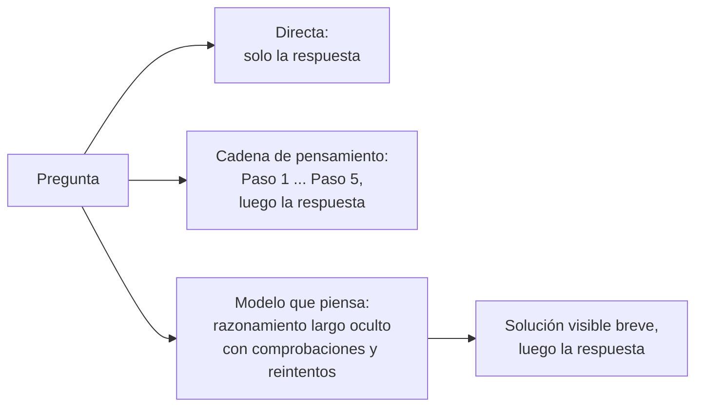
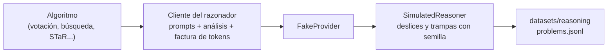
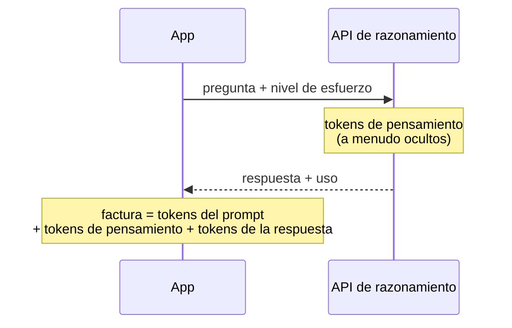
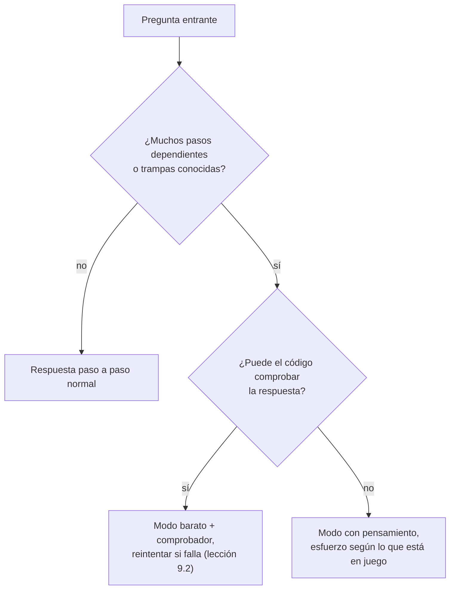

🌐 [English](01-reasoning-models-overview.md) · Español

# Lección 9.1 — Modelos de razonamiento: qué cambia y cuándo compensan

> **Módulo 09 · Lección 1 de 4** · ⏱️ unos 50 min · 🧪 Lab: [pasos 2–3](lab/README.es.md#paso-2--conoce-al-razonador-simulado)

## 📨 Situación

> **De:** Jordan Kim · Responsable de Producto y Estrategia
> **Canal:** #strategy
>
> El agente Ask-the-Web del módulo 08 encuentra datos. Mis preguntas nuevas necesitan cuentas encima
> de esos datos. Alguien que lleva una tienda preguntó si dos plantas de tres habitaciones, cada una con
> un sensor de movimiento, un sensor de puerta y cinco bombillas, caben en un solo Hearth Hub. Nuestro
> asistente dijo que quedaban 22 huecos libres. La respuesta correcta es 52: las bombillas usan Wi-Fi,
> así que no cuentan. También necesito totales de pedidos con códigos de descuento y la regla de envío,
> y plazos de amortización de termostatos para el plan de Latinoamérica. Todo el mundo dice "usa un
> modelo que piense". Sam dice que esos modelos queman *tokens* como una hoguera. ¿Quién tiene razón, y
> para qué preguntas?

## 🎯 Objetivos

Al terminar esta lección puedes:

- Explicar qué hace distinto un modelo de razonamiento frente a un modelo de chat estándar: una cadena de pensamiento larga antes de la respuesta, *tokens* de pensamiento y niveles de esfuerzo.
- Leer una traza de razonamiento y señalar una autocomprobación, una corrección y una lectura errónea que las comprobaciones dejaron pasar.
- Comparar respuestas directas, respuestas paso a paso y respuestas con pensamiento en exactitud y *tokens*, y elegir una para cada tipo de pregunta.
- Evaluar un modelo de razonamiento sobre problemas verificables con un comprobador exacto y las métricas pass@1, pass@k y majority@k.
- Resumir, a partir del informe de DeepSeek-R1, cómo se construyó un modelo de razonamiento abierto y qué muestra en su salida.

## 🤔 Predice primero

Apunta tus respuestas antes de seguir leyendo. Las comprobarás en la autoevaluación.

1. En los 35 problemas de capacidad del hub (cinco pasos cada uno), ¿cuánto ayuda escribir los pasos frente a responder directamente: un poco, más o menos el doble o más del triple?
2. Una respuesta "con pensamiento" cuesta unas 2,7 veces los *tokens* de una respuesta paso a paso normal. ¿Elimina también 2,7 veces más errores?
3. Algunos proveedores ocultan el texto del razonamiento y solo te muestran la respuesta final. ¿Aparecen en tu factura los *tokens* ocultos?

## 1. Por qué ayuda escribir los pasos

Un modelo de lenguaje grande (LLM, *large language model*) produce texto de *token* en *token*. Para
cada *token* ejecuta la misma cantidad fija de cálculo: una pasada por todas sus capas. Ese
presupuesto es generoso para "qué palabra viene ahora" y escaso para "multiplica, resta, compara y
luego decide". Si el modelo tiene que saltar directamente de la pregunta al número, cada resultado
intermedio tiene que caber dentro de esa única pasada.

La **cadena de pensamiento** (CoT, *chain of thought*) es el arreglo sencillo: dejar que el modelo
escriba los resultados intermedios como texto antes de la respuesta. Cada paso escrito pasa a formar
parte de la entrada de los *tokens* siguientes, así que el modelo puede releer "6 habitaciones" y "2
dispositivos por habitación" en lugar de tenerlos en la cabeza. El artículo original de CoT lo mostró
con unos pocos ejemplos resueltos en el *prompt*; un artículo posterior mostró que la simple frase
"Let's think step by step" ("Pensemos paso a paso") ya ayuda a los modelos grandes.

**Analogía:** quien atiende en un restaurante y suma la cuenta de una mesa de cabeza frente a quien la
suma en la libreta. La misma persona, la misma habilidad; la libreta guarda las sumas parciales para
que la atención pueda ir a la siguiente.



En el lab, los tres estilos son tres *prompts* de sistema enviados al mismo modelo:

```python
from m09_reasoning import prompts

prompts.SOLVE_DIRECT  # "Give only the final result. Reply with one line: 'Answer: <value>'."
prompts.SOLVE_COT     # "Solve the problem step by step. Write each step on its own line ..."
prompts.think_prompt("high")  # "Think privately inside <think> ... </think> ... Reasoning effort: high."
```

Un **modelo de razonamiento** (también llamado modelo que piensa, *thinking model*) va un paso más
allá: lo han entrenado para producir una cadena de pensamiento larga antes de responder, normalmente
sin que se lo pidan. Esa cadena no es una lista ordenada de pasos. Planifica, calcula, comprueba, se
da cuenta de los errores, retrocede y vuelve a intentarlo. Solo entonces escribe la respuesta. La
lección 9.4 muestra cómo se entrena ese comportamiento; esta lección trata de lo que cuesta y de lo que
aporta.

> ⚠️ **Error común:** pensar que "cadena de pensamiento" significa que el modelo ya razona
> correctamente. Los pasos son texto que generó el modelo, con la misma probabilidad de estar mal que
> cualquier otro texto. Una cadena puede ser fluida, coherente y estar construida sobre una lectura
> errónea de la pregunta. Sigues necesitando comprobar la respuesta.

## 2. Un simulador por dentro

Para medir estas ideas sin conexión, el lab usa un **razonador simulado**. Ten claro qué es: no es un
modelo de lenguaje y no entiende las preguntas. Es un pequeño programa con semilla, construido para
este curso, que escribe soluciones con el mismo formato que los pasos de referencia de los 160
problemas de Hearthwise y comete errores a propósito. Se conecta al `FakeProvider` del curso como
*responder*, así que todos los algoritmos de este módulo hablan con él a través de la misma interfaz
de chat que usarías con un modelo real. Sus números muestran cómo se comportan los algoritmos; no
dicen nada de cuánto puntúa ningún modelo real.

Comete tres tipos de errores, y distinguirlos es la clave de todo el módulo:

| Error | Qué aspecto tiene | Ejemplo (problema r076) |
|---|---|---|
| **Desliz** (*slip*) | Un resultado erróneo en un paso; los pasos posteriores se construyen sobre él | `HomeMesh devices: 6 x 7 = 52` |
| **Trampa** (*trap*) | Una lectura errónea de la pregunta, ordenada y coherente | contar las 5 bombillas como dispositivos HomeMesh |
| **Acierto por suerte** (*lucky answer*) | Un desliz, pero la respuesta final es correcta de todos modos | los pasos no respaldan la respuesta |

La probabilidad de un desliz crece con el número de pasos (la dificultad del problema, de 2 a 5) y
baja con la habilidad simulada para cada familia de problemas. Cada problema tiene además su propia
probabilidad de trampa, así que algunos problemas se leen mal la mayoría de las veces. **Analogía:**
un simulador de vuelo. Nadie piensa que es un avión, pero te deja practicar fallos de motor a
propósito y ver exactamente qué pasa.



Los mandos están en una sola *dataclass*, así que puedes ver cada suposición:

```python
@dataclass(frozen=True)
class SimConfig:  # excerpt: simulator.py has every field and its default
    skill: dict[str, float]      # chance of writing a step correctly, per family
    trap: dict[str, float]       # average chance of the family's misreading
    growth: float = 0.5          # extra slip risk per step of difficulty above 2
    direct_factor: float = 3.0   # slips are this much likelier without written steps
    lucky: float = 0.15          # after a slip, chance that the answer is right anyway
    catch_slip: float = 0.75     # chance that one self-check catches a slip
    catch_trap: float = 0.6      # chance that re-reading the question catches a trap

    def slip_probability(self, p: Problem) -> float:
        return min(0.9, (1 - self.skill[p.type]) * (1 + self.growth * (p.difficulty - 2)))
```

Ejecuta `uv run lab solve --id r076` y lee las cinco respuestas a la pregunta de Jordan sobre el hub.
La respuesta directa es `12` (3 *tokens*). La respuesta paso a paso cuenta las bombillas en el paso 1,
comete un desliz en el paso 3 (`6 x 7 = 52`) y termina en 12. La respuesta con pensamiento de esfuerzo
bajo escribe `Wait, step 3 does not add up. Redoing it.`, corrige el desliz, pero se queda con las
bombillas y responde 22: exactamente la respuesta errónea que vio Jordan. La respuesta de esfuerzo
medio además relee la pregunta, se fija en el paso 1, rehace la cadena y responde 52 en 329 *tokens*,
254 de ellos dentro de `<think>`.

> 💡 **Consejo de producción:** ten un conjunto pequeño de preguntas propias con respuestas conocidas
> y algunas trampas conocidas, como esta pregunta del hub. Cada vez que cambies de modelo, de *prompt*
> o de nivel de esfuerzo, vuelve a ejecutarlo. Una clasificación pública no puede decirte si un modelo
> cae en *tus* distractores.

## 3. Tokens de pensamiento y niveles de esfuerzo

El texto extra que escribe un modelo de razonamiento antes de su respuesta está hecho de ***tokens* de
pensamiento** (*thinking tokens*, también llamados *tokens* de razonamiento). Se generan como
cualquier otro *token* de salida, así que llevan tiempo y se facturan. Cada proveedor los trata de
forma distinta:

- El informe de DeepSeek-R1 entrena a su modelo para poner el razonamiento entre las etiquetas
  `<think>` y `</think>`, seguido de la respuesta, así que puedes leerlo.
- Los modelos de razonamiento de OpenAI (la serie o y las variantes con pensamiento de GPT-5) no
  devuelven el razonamiento en bruto. Esos *tokens* los pagas igualmente, y la interfaz de
  programación de aplicaciones (API, *application programming interface*) informa de cuántos hubo. A
  menudo puedes elegir un **esfuerzo de razonamiento** (*reasoning effort*; por ejemplo bajo, medio o
  alto) que intercambia *tokens* por exactitud.

**Analogía:** un taxímetro que sigue corriendo mientras quien conduce busca un atajo. No ves las
calles que probó, pero la tarifa las incluye.



El cliente del lab lleva la factura del mismo modo y cuenta por separado lo que se escribió dentro de
`<think>`:

```python
def parse_solution(text: str) -> tuple[tuple[str, ...], str | None, int]:
    """Return (final steps, answer, thinking tokens). A step rewritten later replaces the earlier one."""
    think = _THINK_RE.search(text)
    thinking = count_tokens(think.group(1)) if think else 0
    visible = text[think.end():] if think else text
    steps: dict[int, str] = {}
    for line in visible.splitlines():
        m = _STEP_RE.match(line)
        if m:
            steps[int(m.group(1))] = m.group(2)
    answers = _ANSWER_RE.findall(visible)
    return tuple(steps[k] for k in sorted(steps)), (answers[-1] if answers else None), thinking
```

Aquí tienes una muestra por problema para los 160 problemas, de `uv run lab solve`. En el simulador,
el esfuerzo controla con qué frecuencia se comprueba cada paso (bajo: la mitad de los pasos; medio:
todos los pasos, más una relectura de la pregunta la mitad de las veces; alto: dos comprobaciones por
paso y siempre una relectura):

| Modo | Exactitud | *Tokens* por respuesta | De ellos, de pensamiento |
|---|---|---|---|
| direct | 33.1% | 6.5 | 0.0 |
| cot | 49.4% | 72.7 | 0.0 |
| think-low | 57.5% | 138.3 | 80.5 |
| think-medium | 68.1% | 161.2 | 103.5 |
| think-high | 71.9% | 194.1 | 136.4 |

Destacan tres cosas. Escribir los pasos es el mayor salto individual. Pensar añade más, con
**rendimientos decrecientes**: pasar del esfuerzo medio al alto (de 68.1% a 71.9%) compra menos de 4
puntos por unos 33 *tokens* más por respuesta. Y el esfuerzo alto cuesta unas 2,7 veces los *tokens*
de una CoT normal y unas 30 veces los de la respuesta directa.

> ⚠️ **Error común:** presupuestar un modelo de razonamiento por la longitud de sus respuestas
> visibles. La parte visible de una respuesta think-high es corta aquí; la mayoría de los 194.1
> *tokens* son de pensamiento. Lee los campos de uso, no el texto.

## 4. Cuándo compensa pensar y cuándo es tirar el dinero

Las medias ocultan lo interesante. Divide la misma ejecución por dificultad, es decir, por el número
de pasos de referencia:

| Modo | 2 pasos | 3 pasos | 4 pasos | 5 pasos |
|---|---|---|---|---|
| direct | 44.7% | 28.1% | 40.0% | 22.9% |
| cot | 57.9% | 38.6% | 63.3% | 45.7% |
| think-high | 71.1% | 56.1% | 86.7% | 85.7% |

En los problemas del hub de cinco pasos, pensar lleva la exactitud de 45.7% a 85.7%: 40 puntos. En los
problemas de dos pasos añade 13,2 puntos por el mismo precio por *token*. (Los grupos mezclan
familias: todos los problemas de 5 pasos son preguntas del hub y todos los de 4 pasos son pedidos con
descuento, mientras que los de 2 y 3 pasos incluyen los acertijos de número objetivo, que necesitan
más búsqueda que comprobación. La lección 9.3 se ocupa de ellos).

El patrón es general: el razonamiento extra compensa cuando una pregunta tiene muchos pasos
dependientes, una trampa por la que merece la pena releer o una respuesta errónea cara. Es tirar el
dinero cuando la pregunta es corta, cuando una comprobación barata podría detectar el error o cuando
nadie actúa a partir de la respuesta.



> 💡 **Consejo de producción:** enruta por tipo de pregunta en lugar de elegir un único modelo para
> todo. Envía un cálculo de amortización a un modo barato más una comprobación con calculadora, y
> reserva el esfuerzo alto para las preguntas que no la superen. Registra la ruta de cada petición para
> poder comparar después el coste y la exactitud por ruta.

## 5. Calificar el razonamiento con problemas verificables

Los modelos de razonamiento se miden sobre todo en tareas **verificables**: matemáticas con una única
respuesta numérica, código con tests unitarios, acertijos con un comprobador. Los problemas de
Hearthwise están construidos igual: cada respuesta se calcula, nunca se escribe a mano. Aun así,
calificar requiere cuidado:

- **Números:** compara valores, no cadenas. `175.1` y `175.10` son el mismo importe en euros.
- **Expresiones:** un acertijo de número objetivo (*target puzzle*) como "usa 8, 9, 9 y 13 una vez cada
  uno para obtener 50" tiene muchas respuestas correctas. Comparar con la cadena de referencia daría
  por mala `8 * 9 - (13 + 9)`. Necesitas un **verificador** (*verifier*): un programa que comprueba las
  reglas (cada número una vez, solo + - * /) y el valor.
- **Contaminación:** el README del dataset avisa de que algunos problemas se filtran a la web sin
  conexión del módulo 01. Un modelo que vio las respuestas durante el entrenamiento parece más listo
  de lo que es.

```python
def verify_expression(numbers, target, expr) -> bool:
    try:
        value, used = evaluate_expression(expr)  # walks the syntax tree, allows only + - * /
    except (SyntaxError, ValueError, ZeroDivisionError):
        return False
    return sorted(used) == sorted(numbers) and value == target
```

Como una sola muestra tiene ruido, los informes usan unas pocas métricas estándar:

| Métrica | Significado |
|---|---|
| pass@1 | Probabilidad de que una muestra sea correcta, normalmente promediada sobre varias muestras por problema |
| pass@k | Probabilidad de que al menos una de k muestras sea correcta (necesita un comprobador para ser útil) |
| majority@k | Exactitud de la respuesta más frecuente entre k muestras (también se escribe cons@k) |

El informe de DeepSeek-R1, por ejemplo, estima pass@1 muestreando varias respuestas por problema con
una temperatura distinta de cero, y también informa de una votación por mayoría sobre 64 muestras. El
ejercicio 1 del lab te pide implementar el estimador insesgado estándar de pass@k, del artículo de
HumanEval.

> ⚠️ **Error común:** juzgar un modelo con una muestra por problema sobre unas pocas decenas de
> problemas. Con 50 acertijos, una muestra con suerte o sin ella mueve la puntuación 2 puntos. Muestrea
> varias veces e informa de la dispersión.

## 6. DeepSeek-R1: un ejemplo abierto y documentado

La mayoría de los modelos de razonamiento comerciales no publican cómo se entrenaron. El informe de
DeepSeek-R1 sí lo hace, y por eso este módulo lo usa como referencia. En resumen, según el informe:

- **DeepSeek-R1-Zero** se entrenó con aprendizaje por refuerzo (RL, *reinforcement learning*) a gran
  escala directamente sobre un modelo base, sin ajuste fino supervisado previo. Las recompensas se
  basaban en reglas: si la respuesta final era correcta y si el razonamiento estaba entre las etiquetas
  de pensamiento.
- Durante ese entrenamiento, las respuestas del modelo se alargaron y aparecieron por sí solos
  comportamientos como volver a comprobar y reevaluar un enfoque anterior; el informe llama a uno de
  esos momentos un "momento ajá" (*aha moment*).
- La salida de R1-Zero era difícil de leer y mezclaba idiomas, así que **DeepSeek-R1** añadió una
  pequeña cantidad de datos de razonamiento largo seleccionados antes del RL, y más etapas de
  entrenamiento después.
- El equipo también destiló el razonamiento de R1 en varios modelos abiertos más pequeños.

Reconstruirás versiones pequeñas de estas ideas en la lección 9.4. Por ahora, fíjate en que el
`Wait, step 3 does not add up. Redoing it.` del simulador es una caricatura de la autoverificación que
describe el informe.

## 🧪 Pruébalo

1. Prepara el lab y ejecuta los tests (desde la raíz del repositorio):

   ```bash
   cd modules/09-reasoning-models/lab && uv sync && uv run pytest
   ```

   ```text
   54 passed, 3 skipped
   ```

   Los 3 tests omitidos corresponden a los ejercicios que escribirás más adelante. Pytest también
   imprime un tiempo de ejecución, que varía según la máquina.

2. Mira por dentro un problema en todos los modos:

   ```bash
   uv run lab solve --id r076
   ```

   ```text
   === direct: 3 tokens (0 thinking), wrong
   Answer: 12
   ...
   === think-medium: 329 tokens (254 thinking), correct
   ```

   Busca la línea `Wait, step 3 does not add up` y la línea `Re-reading the question`. ¿Qué modo
   detecta qué error? La línea `[behind the curtain: ...]` muestra el registro que lleva el propio
   simulador de cada paso.

3. Compara los modos en los 160 problemas:

   ```bash
   uv run lab solve
   ```

   ```text
   mode          accuracy  diff 2  diff 3  diff 4  diff 5  tokens/answer  of which thinking
   ------------  --------  ------  ------  ------  ------  -------------  -----------------
   direct           33.1%   44.7%   28.1%   40.0%   22.9%            6.5                0.0
   cot              49.4%   57.9%   38.6%   63.3%   45.7%           72.7                0.0
   think-low        57.5%   63.2%   49.1%   70.0%   54.3%          138.3               80.5
   think-medium     68.1%   65.8%   54.4%   86.7%   77.1%          161.2              103.5
   think-high       71.9%   71.1%   56.1%   86.7%   85.7%          194.1              136.4
   ```

## 🏭 En el mundo real

Los equipos que adoptan modelos de razonamiento suelen pasar por las mismas tres sorpresas. La primera
es la factura: los *tokens* de pensamiento dominan y varían mucho de una pregunta a otra, así que el
coste por petición tiene una cola larga. Fija un presupuesto máximo de salida, registra los *tokens* de
pensamiento como una métrica propia y pon alertas sobre el percentil 95, no sobre la media. La segunda
es la latencia: un modelo que piensa un rato antes de su primer *token* visible rompe las interfaces
diseñadas para un chat en *streaming*. Muestra el progreso o pasa el razonamiento largo a tareas en
segundo plano. La tercera es la depuración: cuando el razonamiento está oculto, no puedes leer por qué
se equivocó el modelo, así que necesitas mejores conjuntos de evaluación y comprobadores de tu lado.

La arquitectura habitual es un enrutador. Los modelos baratos y rápidos atienden la mayor parte del
tráfico; las preguntas con muchos pasos, mucho en juego o una comprobación fallida van a un modelo de
razonamiento con el esfuerzo elegido. Los modelos de razonamiento abiertos destilados, como los
modelos más pequeños entrenados a partir de DeepSeek-R1, permiten ejecutar esto en local, que es lo
que necesita el módulo 10.

## ✅ Autoevaluación

**1. En los 35 problemas del hub, ¿cómo se compararon la escritura paso a paso y el pensamiento con las respuestas directas?**

<details><summary>Respuesta</summary>

Directa: 22.9%. Cadena de pensamiento: 45.7%, más o menos el doble. Pensamiento con esfuerzo alto:
85.7%. Si respondiste "un poco", recuerda que una pregunta de cinco pasos obliga a una respuesta
directa a guardar cada resultado intermedio dentro de una sola pasada hacia delante por *token*;
escribir los pasos elimina ese cuello de botella.

</details>

**2. Pensar (esfuerzo alto) cuesta unas 2,7 veces los *tokens* de la CoT. ¿Eliminó 2,7 veces más errores?**

<details><summary>Respuesta</summary>

No. La exactitud global pasó de 49.4% a 71.9%, así que los errores bajaron de 50,6 % a 28,1 % de los
problemas, unas 1,8 veces menos. En los problemas de dos pasos la ganancia fue de 13,2 puntos. Los
rendimientos decrecen: el último escalón de esfuerzo (de medio a alto) compró menos de 4 puntos por
unos 33 *tokens* más por respuesta.

</details>

**3. ¿Se facturan los *tokens* de razonamiento ocultos?**

<details><summary>Respuesta</summary>

Sí. Ocultos o no, son *tokens* de salida generados. Los datos de uso de la API informan de ellos, y es
ese número el que hay que vigilar. Presupuestar a partir de la longitud de la respuesta visible
subestima mucho el coste.

</details>

**4. En el problema r076, ¿por qué la respuesta con pensamiento de esfuerzo bajo seguía diciendo 22?**

<details><summary>Respuesta</summary>

Sus comprobaciones recalculan la aritmética, así que detectaron el desliz `6 x 7 = 52`. Contar las
bombillas es una lectura errónea con una aritmética perfecta (`1 + 1 + 5 = 7`), así que una
comprobación de pasos no puede verla. Solo releer la pregunta, que el simulador hace con esfuerzo
medio y alto, detectó la trampa.

</details>

**5. ¿Por qué no se pueden calificar los acertijos de número objetivo comparando con la expresión de referencia?**

<details><summary>Respuesta</summary>

Hay muchas expresiones correctas para el mismo acertijo. `8 * 9 - (13 + 9)` y `(8 * 9) - (9 + 13)`
son correctas las dos. Un verificador debe comprobar las reglas (cada número exactamente una vez,
solo + - * /) y el valor, con fracciones exactas para que la división no introduzca redondeos.

</details>

## 💬 Explícalo con tus palabras

- Explícale a Jordan, en cuatro frases y sin la palabra "*token*", por qué un modelo que piensa acertó
  la pregunta del hub y un modelo rápido no, y por qué eso no significa que todas las preguntas deban
  ir al modelo que piensa.
- Explícale a Sam qué es un "*token* de pensamiento" y qué dos números de esta lección debería poner
  en un panel de control.

## 🔑 Ideas clave

- Escribir los pasos intermedios le da al modelo espacio para calcular; aquí fue la mayor ganancia individual (de 33.1% a 49.4%).
- Los modelos de razonamiento están entrenados para pensar largo y tendido antes de responder: planificar, calcular, comprobar, retroceder.
- Los *tokens* de pensamiento son *tokens* de salida: se facturan aunque estén ocultos y son el principal motor del coste y de la latencia.
- Los niveles de esfuerzo intercambian *tokens* por exactitud con rendimientos decrecientes; las ganancias son mayores en preguntas largas y propensas a trampas.
- Las autocomprobaciones detectan deslices; las lecturas erróneas necesitan otro tipo de comprobación, como releer la pregunta.
- Evalúa en tareas verificables con comprobadores exactos e informa de pass@1 sobre varias muestras, no de una ejecución con suerte.

## 📚 Profundiza

- ⭐ [Informe de DeepSeek-R1](https://arxiv.org/abs/2501.12948) — el relato público más detallado de cómo se entrenó un modelo de razonamiento, con sus fallos.
- [*Prompting* con cadena de pensamiento](https://arxiv.org/abs/2201.11903) — el artículo que mostró que incluir pasos resueltos en el *prompt* mejora el razonamiento de varios pasos.
- [Los modelos de lenguaje grandes razonan sin ejemplos](https://arxiv.org/abs/2205.11916) — "Let's think step by step" sin ejemplos.
- [Evaluación de modelos de lenguaje grandes entrenados con código (HumanEval)](https://arxiv.org/abs/2107.03374) — de donde sale el estimador insesgado de pass@k.
- [Documentación de la plataforma de OpenAI](https://platform.openai.com/docs) — cómo se exponen en una API los modelos de razonamiento, el esfuerzo de razonamiento y el uso de *tokens* de razonamiento.

---

[← Anterior: Visión general del módulo 09](README.es.md) · [🏠 Módulo 09](README.es.md) · [Siguiente: 9.2 Escalado en tiempo de inferencia →](02-inference-time-scaling.es.md)
