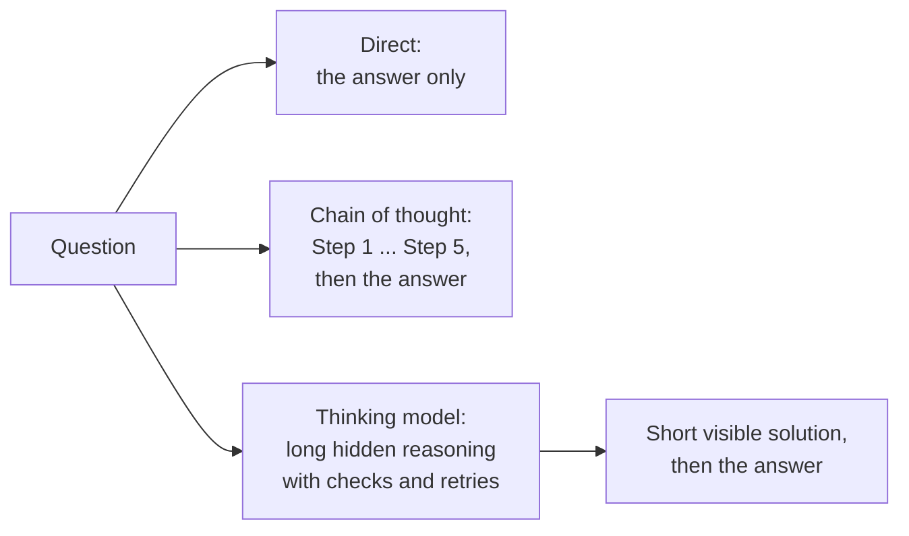
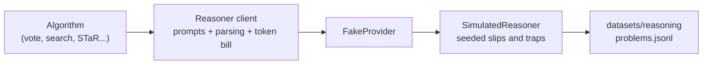
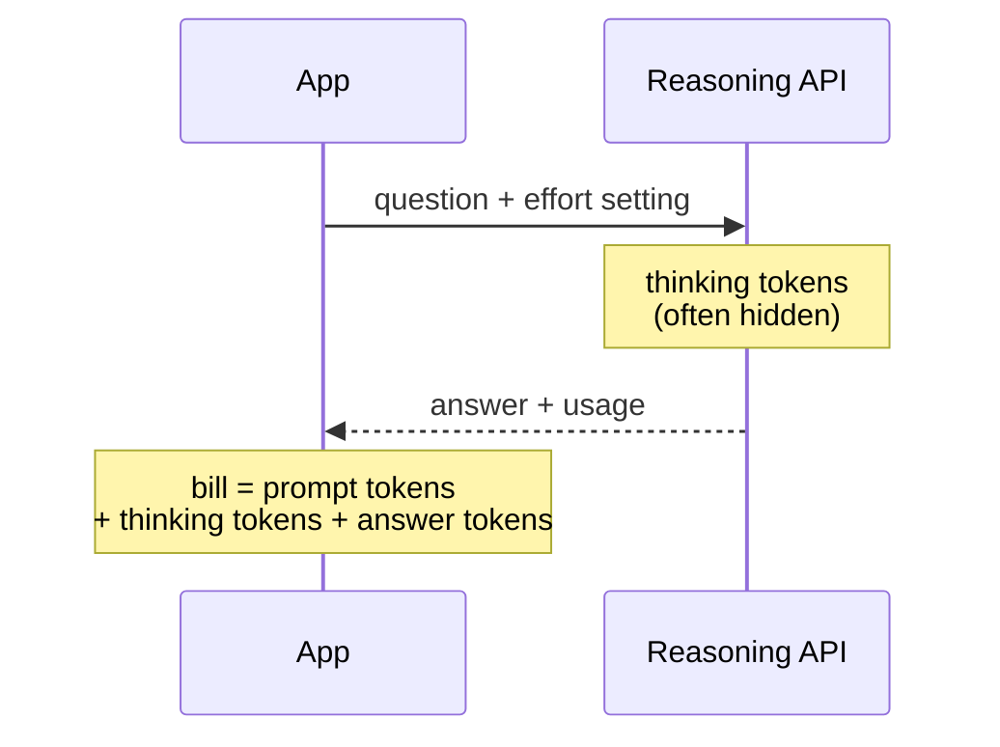
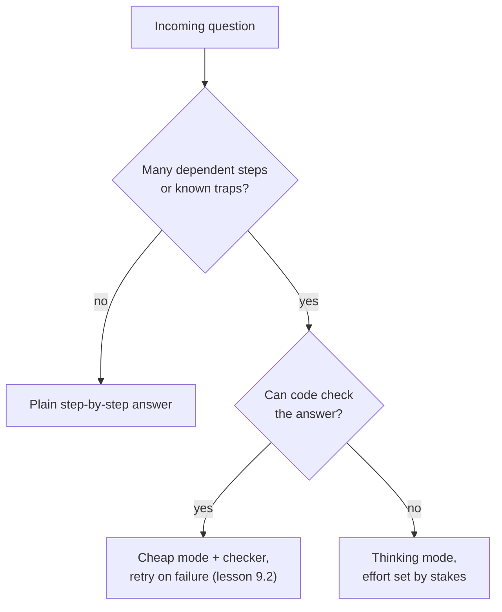

🌐 English · [Español](01-reasoning-models-overview.es.md)

# Lesson 9.1 — Reasoning models: what changes and when they pay off

> **Module 09 · Lesson 1 of 4** · ⏱️ about 50 min · 🧪 Lab: [steps 2–3](lab/README.md#step-2--meet-the-simulated-reasoner)

## 📨 Situation

> **From:** Jordan Kim · Product and Strategy Lead
> **Channel:** #strategy
>
> The Ask-the-Web agent from module 08 finds facts. My new questions need arithmetic on top of them.
> A shop owner asked whether two floors of three rooms, each with a motion sensor, a door sensor and
> five bulbs, fit on one Hearth Hub. Our assistant said 22 free slots. The right answer is 52: bulbs
> use Wi-Fi, so they do not count. I also need order totals with discount codes and the shipping
> rule, and thermostat payback times for the Latin America plan. Everyone says "use a thinking
> model". Sam says thinking models burn tokens like a bonfire. Which one is right, and for which
> questions?

## 🎯 Objectives

By the end of this lesson you can:

- Explain what a reasoning model does differently from a standard chat model: a long chain of thought before the answer, thinking tokens and effort settings.
- Read a reasoning trace and point out a self-check, a correction and a misreading the checks missed.
- Compare direct answers, step-by-step answers and thinking answers on accuracy and tokens, and choose one per type of question.
- Evaluate a reasoning model on verifiable problems with an exact checker and the metrics pass@1, pass@k and majority@k.
- Summarise, from the DeepSeek-R1 report, how an open reasoning model was built and what it shows in its output.

## 🤔 Predict first

Write your answers down before reading on. You will check them in the self-check.

1. On the 35 hub-capacity problems (five steps each), how much does writing the steps out help compared with answering directly: a little, about double, or more than triple?
2. A "thinking" answer costs about 2.7 times the tokens of a plain step-by-step answer. Does it also remove 2.7 times as many errors?
3. Some providers hide the reasoning text and show you only the final answer. Do the hidden tokens appear on your bill?

## 1. Why writing the steps helps

A large language model (LLM) produces text one token at a time. For each token it runs the same
fixed amount of computation: one pass through all its layers. That budget is generous for "what
word comes next" and tight for "multiply, subtract, compare, then decide". If the model must jump
from the question straight to the number, every intermediate result has to live inside that single
pass.

**Chain of thought (CoT)** is the simple fix: let the model write the intermediate results as text
before the answer. Each written step becomes part of the input for the next tokens, so the model can
read back "6 rooms" and "2 devices per room" instead of holding them in its head. The original CoT
paper showed this with a few worked examples in the prompt; a later paper showed that the bare phrase
"Let's think step by step" already helps large models.

**Analogy:** a waiter adding up a table's bill in their head versus on the notepad. Same waiter, same
skill; the notepad holds the partial sums so attention can go to the next one.



In the lab, the three styles are three system prompts sent to the same model:

```python
from m09_reasoning import prompts

prompts.SOLVE_DIRECT  # "Give only the final result. Reply with one line: 'Answer: <value>'."
prompts.SOLVE_COT     # "Solve the problem step by step. Write each step on its own line ..."
prompts.think_prompt("high")  # "Think privately inside <think> ... </think> ... Reasoning effort: high."
```

A **reasoning model** (also called a *thinking model*) goes one step further: it has been trained to
produce a long chain of thought before answering, usually without being asked. That chain is not a
tidy list of steps. It plans, computes, checks, notices mistakes, backtracks and tries again. Only
then does it write the answer. Lesson 9.4 shows how that behaviour is trained; this lesson is about
what it costs and what it buys.

> ⚠️ **Common mistake:** thinking "chain of thought" means the model is now reasoning correctly. The
> steps are text the model generated, with the same chance of being wrong as any other text. A chain
> can be fluent, consistent and built on a misreading of the question. You still need to check the
> answer.

## 2. A simulator you can look inside

To measure these ideas offline, the lab uses a **simulated reasoner**. Be clear about what it is: it
is not a language model, and it does not understand the questions. It is a small seeded program,
built for this course, that writes solutions in the same format as the reference steps of the 160
Hearthwise problems and makes mistakes on purpose. It plugs into the course's `FakeProvider` as a
responder, so every algorithm in this module talks to it through the same chat interface you would
use with a real model. Its numbers show how the algorithms behave; they say nothing about how any
real model scores.

It makes three kinds of mistakes, and keeping them apart is the key to the whole module:

| Mistake | What it looks like | Example (problem r076) |
|---|---|---|
| **Slip** | A wrong result in one step; later steps build on it | `HomeMesh devices: 6 x 7 = 52` |
| **Trap** | A tidy, consistent misreading of the question | counting the 5 bulbs as HomeMesh devices |
| **Lucky answer** | A slip, yet the final answer is right anyway | the steps do not support the answer |

The chance of a slip grows with the number of steps (the problem's difficulty, 2 to 5) and shrinks
with the simulated skill for each problem family. Each problem also has its own trap probability, so
some problems are misread most of the time. **Analogy:** a flight simulator. Nobody thinks it is a
plane, but it lets you practise engine failures on purpose and watch exactly what happens.



The knobs live in one dataclass, so you can see every assumption:

```python
@dataclass(frozen=True)
class SimConfig:  # excerpt: simulator.py has every field and its default
    skill: dict[str, float]      # chance of writing a step correctly, per family
    trap: dict[str, float]       # average chance of the family's misreading
    growth: float = 0.5          # extra slip risk per step of difficulty above 2
    direct_factor: float = 3.0   # slips are this much likelier without written steps
    lucky: float = 0.15          # after a slip, chance that the answer is right anyway
    catch_slip: float = 0.75     # chance that one self-check catches a slip
    catch_trap: float = 0.6      # chance that re-reading the question catches a trap

    def slip_probability(self, p: Problem) -> float:
        return min(0.9, (1 - self.skill[p.type]) * (1 + self.growth * (p.difficulty - 2)))
```

Run `uv run lab solve --id r076` and read the five answers to Jordan's hub question. The direct
answer is `12` (3 tokens). The step-by-step answer counts the bulbs in step 1 and slips in step 3
(`6 x 7 = 52`), and ends at 12. The low-effort thinking answer writes `Wait, step 3 does not add up.
Redoing it.`, fixes the slip, but keeps the bulbs and answers 22: exactly the wrong answer Jordan
saw. The medium-effort answer also re-reads the question, notices step 1, redoes the chain and
answers 52 in 329 tokens, 254 of them inside `<think>`.

> 💡 **Production tip:** keep a small set of your own questions with known answers and a few known
> traps, like this hub question. Every time you change model, prompt or effort setting, rerun it. A
> public leaderboard cannot tell you whether a model falls for *your* distractors.

## 3. Thinking tokens and effort settings

The extra text a reasoning model writes before its answer is made of **thinking tokens** (also
called reasoning tokens). They are generated like any other output tokens, so they take time and they
are billed. Providers handle them differently:

- The DeepSeek-R1 report trains its model to put the reasoning between `<think>` and `</think>` tags,
  followed by the answer, so you can read it.
- OpenAI's reasoning models (the o-series and the thinking variants of GPT-5) do not return the raw
  reasoning. You still pay for those tokens, and the application programming interface (API) reports
  how many there were. You can often
  choose a **reasoning effort** (for example low, medium or high) that trades tokens for accuracy.

**Analogy:** a taxi meter that keeps running while the driver looks for a shortcut. You do not see
the streets they tried, but the fare includes them.



The lab's client keeps the bill the same way, counting what was written inside `<think>`
separately:

```python
def parse_solution(text: str) -> tuple[tuple[str, ...], str | None, int]:
    """Return (final steps, answer, thinking tokens). A step rewritten later replaces the earlier one."""
    think = _THINK_RE.search(text)
    thinking = count_tokens(think.group(1)) if think else 0
    visible = text[think.end():] if think else text
    steps: dict[int, str] = {}
    for line in visible.splitlines():
        m = _STEP_RE.match(line)
        if m:
            steps[int(m.group(1))] = m.group(2)
    answers = _ANSWER_RE.findall(visible)
    return tuple(steps[k] for k in sorted(steps)), (answers[-1] if answers else None), thinking
```

Here is one sample per problem for all 160 problems, from `uv run lab solve`. In the simulator,
effort controls how often each step is checked (low: half the steps; medium: every step, plus a
re-read of the question half of the time; high: two checks per step and always a re-read):

| Mode | Accuracy | Tokens per answer | Of which thinking |
|---|---|---|---|
| direct | 33.1% | 6.5 | 0.0 |
| cot | 49.4% | 72.7 | 0.0 |
| think-low | 57.5% | 138.3 | 80.5 |
| think-medium | 68.1% | 161.2 | 103.5 |
| think-high | 71.9% | 194.1 | 136.4 |

Three things stand out. Writing the steps is the biggest single jump. Thinking adds more, with
**diminishing returns**: going from medium to high effort (68.1% to 71.9%) buys under 4 points for
about 33 more tokens per answer. And high effort costs about 2.7 times the tokens of plain CoT and
about 30 times the direct answer.

> ⚠️ **Common mistake:** budgeting a reasoning model by the length of its visible answers. The
> visible part of a think-high answer here is short; most of the 194.1 tokens are thinking. Read the
> usage fields, not the text.

## 4. When thinking pays and when it wastes money

Averages hide the interesting part. Split the same run by difficulty, the number of reference steps:

| Mode | 2 steps | 3 steps | 4 steps | 5 steps |
|---|---|---|---|---|
| direct | 44.7% | 28.1% | 40.0% | 22.9% |
| cot | 57.9% | 38.6% | 63.3% | 45.7% |
| think-high | 71.1% | 56.1% | 86.7% | 85.7% |

On the five-step hub problems, thinking takes accuracy from 45.7% to 85.7%: 40 points. On the
two-step problems it adds 13.2 points for the same price per token. (The buckets mix families: all
5-step problems are hub questions and all 4-step ones are discounted orders, while 2 and 3 steps
include the target puzzles, which need search more than checking. Lesson 9.3 deals with those.)

The pattern is general: extra reasoning pays when a question has many dependent steps, a trap worth
re-reading for, or a costly wrong answer. It wastes money when the question is short, when a cheap
check could catch the error instead, or when nobody acts on the answer.



> 💡 **Production tip:** route by question type instead of choosing one model for everything. Send a
> payback calculation to a cheap mode plus a calculator check, and keep high effort for the questions
> that fail it. Log the route per request so you can compare cost and accuracy per route later.

## 5. Grading reasoning on verifiable problems

Reasoning models are mostly measured on **verifiable** tasks: maths with a single numeric answer,
code with unit tests, puzzles with a checker. The Hearthwise problems are built the same way: every
answer is computed, never typed by hand. Grading still needs care:

- **Numbers:** compare values, not strings. `175.1` and `175.10` are the same euro amount.
- **Expressions:** a target puzzle such as "use 8, 9, 9 and 13 once each to make 50" has many correct
  answers. Comparing with the reference string would mark `8 * 9 - (13 + 9)` wrong. You need a
  **verifier**: a program that checks the rules (each number once, only + - * /) and the value.
- **Contamination:** the dataset README warns that some problems leak into the offline web of
  module 01. A model that saw the answers during training looks smarter than it is.

```python
def verify_expression(numbers, target, expr) -> bool:
    try:
        value, used = evaluate_expression(expr)  # walks the syntax tree, allows only + - * /
    except (SyntaxError, ValueError, ZeroDivisionError):
        return False
    return sorted(used) == sorted(numbers) and value == target
```

Because one sample is noisy, reports use a few standard metrics:

| Metric | Meaning |
|---|---|
| pass@1 | Chance that one sample is correct, usually averaged over several samples per problem |
| pass@k | Chance that at least one of k samples is correct (needs a checker to be useful) |
| majority@k | Accuracy of the most frequent answer among k samples (also written cons@k) |

The DeepSeek-R1 report, for example, estimates pass@1 by sampling several answers per problem at a
non-zero temperature, and also reports a majority vote over 64 samples. Exercise 1 in the lab asks
you to implement the standard unbiased estimator of pass@k, from the HumanEval paper.

> ⚠️ **Common mistake:** judging a model on one sample per problem over a few dozen problems. With 50
> puzzles, one lucky or unlucky sample moves the score by 2 points. Sample several times and report
> the spread.

## 6. DeepSeek-R1: an open, documented example

Most commercial reasoning models do not publish how they were trained. The DeepSeek-R1 report does,
which is why this module uses it as the reference. In short, according to the report:

- **DeepSeek-R1-Zero** was trained with large-scale reinforcement learning (RL) directly on a base
  model, with no supervised fine-tuning first. The rewards were rule-based: was the final answer
  correct, and was the reasoning placed between the thinking tags.
- During that training, the model's answers grew longer, and behaviours such as re-checking and
  re-evaluating an earlier approach appeared on their own; the report calls one such moment an "aha
  moment".
- R1-Zero's output was hard to read and mixed languages, so **DeepSeek-R1** added a small amount of
  curated long-reasoning data before RL and further training stages afterwards.
- The team also distilled R1's reasoning into several smaller open models.

You will rebuild small versions of these ideas in lesson 9.4. For now, notice that the simulator's
`Wait, step 3 does not add up. Redoing it.` is a cartoon of the self-verification the report
describes.

## 🧪 Try it

1. Set up the lab and run the tests (from the repository root):

   ```bash
   cd modules/09-reasoning-models/lab && uv sync && uv run pytest
   ```

   ```text
   54 passed, 3 skipped
   ```

   The 3 skipped tests belong to the exercises you will write later. Pytest also prints a run time,
   which varies by machine.

2. Look inside one problem in every mode:

   ```bash
   uv run lab solve --id r076
   ```

   ```text
   === direct: 3 tokens (0 thinking), wrong
   Answer: 12
   ...
   === think-medium: 329 tokens (254 thinking), correct
   ```

   Find the `Wait, step 3 does not add up` line and the `Re-reading the question` line. Which mode
   catches which mistake? The `[behind the curtain: ...]` line shows the simulator's own record of
   each step.

3. Compare the modes on all 160 problems:

   ```bash
   uv run lab solve
   ```

   ```text
   mode          accuracy  diff 2  diff 3  diff 4  diff 5  tokens/answer  of which thinking
   ------------  --------  ------  ------  ------  ------  -------------  -----------------
   direct           33.1%   44.7%   28.1%   40.0%   22.9%            6.5                0.0
   cot              49.4%   57.9%   38.6%   63.3%   45.7%           72.7                0.0
   think-low        57.5%   63.2%   49.1%   70.0%   54.3%          138.3               80.5
   think-medium     68.1%   65.8%   54.4%   86.7%   77.1%          161.2              103.5
   think-high       71.9%   71.1%   56.1%   86.7%   85.7%          194.1              136.4
   ```

## 🏭 In the real world

Teams that adopt reasoning models usually go through the same three surprises. The first is the
bill: thinking tokens dominate, and they vary a lot between questions, so the cost per request has a
long tail. Set a maximum output budget, log thinking tokens as their own metric and alert on the 95th
percentile, not the mean. The second is latency: a model that thinks for a while before its first
visible token breaks user interfaces designed for streaming chat. Show progress, or move long
reasoning to background jobs. The third is debuggability: when the reasoning is hidden, you cannot
read why the model went wrong, so you need better evaluation sets and checkers on your side.

The usual architecture is a router. Cheap, fast models handle most traffic; questions with many
steps, high stakes or a failed check go to a reasoning model at a chosen effort. Distilled open
reasoning models, such as the smaller models trained from DeepSeek-R1, make it possible to run this
locally, which module 10 needs.

## ✅ Self-check

**1. On the 35 hub problems, how did step-by-step writing and thinking compare with direct answers?**

<details><summary>Answer</summary>

Direct: 22.9%. Chain of thought: 45.7%, about double. Thinking at high effort: 85.7%. If you guessed
"a little", remember that a five-step question forces a direct answer to keep every intermediate
result inside one forward pass per token; writing the steps removes that bottleneck.

</details>

**2. Thinking (high effort) costs about 2.7 times the tokens of CoT. Did it remove 2.7 times as many errors?**

<details><summary>Answer</summary>

No. Overall accuracy went from 49.4% to 71.9%, so errors fell from 50.6% to 28.1% of problems, about
1.8 times fewer. On two-step problems the gain was 13.2 points. Returns diminish: the last effort step
(medium to high) bought under 4 points for about 33 extra tokens per answer.

</details>

**3. Are hidden reasoning tokens billed?**

<details><summary>Answer</summary>

Yes. Hidden or not, they are generated output tokens. The API's usage data reports them, and that is
the number to monitor. Budgeting from the visible answer length underestimates the cost badly.

</details>

**4. In problem r076, why did the low-effort thinking answer still say 22?**

<details><summary>Answer</summary>

Its checks recompute arithmetic, so they caught the slip `6 x 7 = 52`. Counting the bulbs is a
misreading with perfectly good arithmetic (`1 + 1 + 5 = 7`), so a step check cannot see it. Only
re-reading the question, which the simulator does at medium and high effort, caught the trap.

</details>

**5. Why can the target puzzles not be graded by comparing with the reference expression?**

<details><summary>Answer</summary>

There are many correct expressions for the same puzzle. `8 * 9 - (13 + 9)` and `(8 * 9) - (9 + 13)`
are both right. A verifier must check the rules (each number exactly once, only + - * /) and the
value, with exact fractions so that division does not introduce rounding.

</details>

## 💬 Explain it in your own words

- Explain to Jordan, in four sentences and without the word "token", why a thinking model got the
  hub question right and a fast model did not, and why that does not mean every question should go
  to the thinking model.
- Explain to Sam what a "thinking token" is and which two numbers from this lesson they should put on
  a dashboard.

## 🔑 Key ideas

- Writing intermediate steps gives a model room to compute; it was the largest single gain here (33.1% to 49.4%).
- Reasoning models are trained to think at length before answering: plan, compute, check, backtrack.
- Thinking tokens are output tokens: billed even when hidden, and the main driver of cost and latency.
- Effort settings trade tokens for accuracy with diminishing returns; gains are largest on long, trap-prone questions.
- Self-checks catch slips; misreadings need a different kind of check, such as re-reading the question.
- Evaluate on verifiable tasks with exact checkers and report pass@1 over several samples, not one lucky run.

## 📚 Go deeper

- ⭐ [DeepSeek-R1 report](https://arxiv.org/abs/2501.12948) — the most detailed public account of how a reasoning model was trained, with its failures.
- [Chain-of-thought prompting](https://arxiv.org/abs/2201.11903) — the paper that showed worked steps in the prompt improve multi-step reasoning.
- [Large language models are zero-shot reasoners](https://arxiv.org/abs/2205.11916) — "Let's think step by step" without examples.
- [Evaluating large language models trained on code (HumanEval)](https://arxiv.org/abs/2107.03374) — where the unbiased pass@k estimator comes from.
- [OpenAI platform documentation](https://platform.openai.com/docs) — how reasoning models, reasoning effort and reasoning-token usage are exposed in an API.

---

[← Previous: Module 09 overview](README.md) · [🏠 Module 09](README.md) · [Next: 9.2 Inference-time scaling →](02-inference-time-scaling.md)
