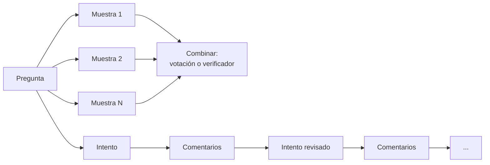
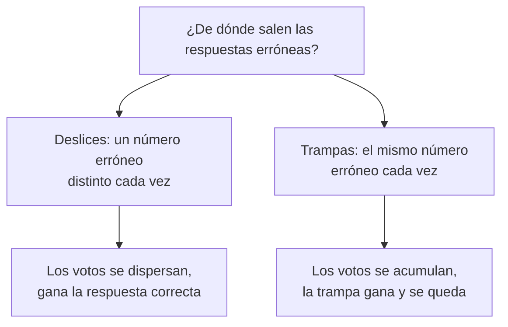
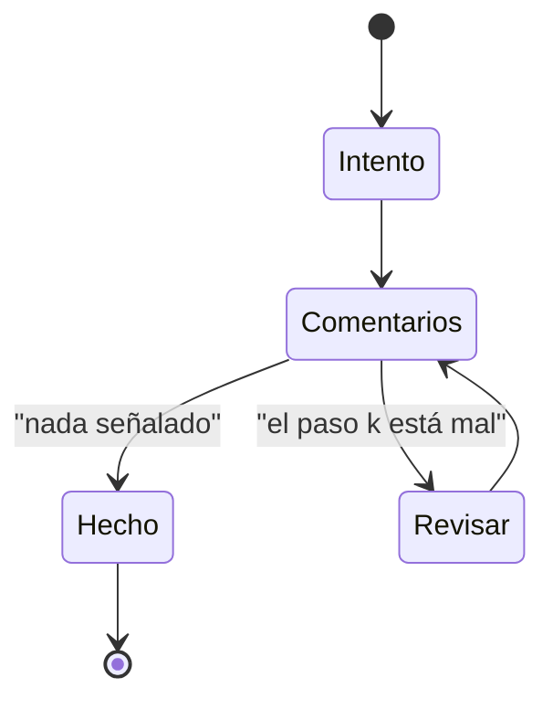

🌐 [English](02-inference-time-scaling.md) · Español

# Lección 9.2 — Escalado en tiempo de inferencia: más muestras, más revisiones

> **Módulo 09 · Lección 2 de 4** · ⏱️ unos 55 min · 🧪 Lab: [pasos 4–5](lab/README.es.md#paso-4--escala-con-muestras-en-paralelo)

## 📨 Situación

> **De:** Dani Ruiz · Ciencia de datos, responsable de evaluación
> **Canal:** #ai-team
>
> La mitad del hilo dice "muestrea más y haz una votación". La otra mitad dice "deja que el modelo
> revise su propio trabajo". Nadie me ha enseñado una curva. Quiero la exactitud frente al cómputo para
> las dos ideas en los 110 problemas numéricos, con *tokens* en el eje x, porque Sam va a preguntar por
> *tokens*, no por "número de muestras". También quiero saber dónde se aplana cada curva y por qué. Si
> la votación deja de ayudar en algún punto, dime qué problemas sigue fallando. Enséñame la evaluación.

## 🎯 Objetivos

Al terminar esta lección puedes:

- Explicar el escalado en tiempo de inferencia y sus dos ejes principales: el muestreo en paralelo y la revisión secuencial.
- Implementar la autoconsistencia (votación por mayoría sobre cadenas de pensamiento muestreadas) y *best-of-N* con un verificador.
- Explicar por qué la votación por mayoría se satura cuando los errores están correlacionados, y encontrar los problemas responsables.
- Comparar bucles de revisión guiados por autocrítica, por una comprobación aritmética exacta y por un modelo de recompensa de proceso, incluida la frecuencia con que estropean respuestas correctas.
- Leer una tabla de exactitud frente a *tokens* y elegir el método más barato que alcanza un objetivo.

## 🤔 Predice primero

Apunta tus respuestas antes de seguir leyendo. Las comprobarás en la autoevaluación.

1. Una sola muestra de cadena de pensamiento acierta el 61.8% de los 110 problemas numéricos. Con 45 muestras y una votación por mayoría, ¿esperas alrededor del 75 %, alrededor del 90 % o cerca del 100 %?
2. Supón que en todos los problemas al menos una de 15 muestras es correcta. ¿Cómo puede una votación por mayoría sobre esas 15 muestras seguir fallando en algunos problemas?
3. Un modelo critica y revisa sus propias respuestas tres veces, sin ningún comprobador externo. ¿Puede bajar la exactitud?

## 1. Gastar cómputo al responder

Hasta ahora, la forma de obtener una respuesta mejor era un modelo mejor: más parámetros, más datos,
más entrenamiento. El **escalado en tiempo de inferencia** (*inference-time scaling*, también llamado
*test-time scaling*) gasta cómputo extra en el momento de responder. Te quedas con el modelo y le
pides que haga más trabajo por pregunta.

Hay dos formas principales de gastar ese cómputo:

- **En paralelo:** sacar varias respuestas independientes y combinarlas (votar, o dejar que elija un
  verificador).
- **En secuencia:** producir una respuesta, recibir comentarios, revisarla y repetir.

Un estudio sobre el cómputo en inferencia en problemas de matemáticas (de Snell y su equipo, enlazado
abajo) encontró que la forma más eficaz de gastar ese cómputo depende de lo difícil que sea la
pregunta para el modelo: en sus experimentos, revisar un primer intento convenía a las preguntas más
fáciles, mientras que las más difíciles ganaban más explorando enfoques distintos. La lección práctica
es que no hay un único mando que sea el mejor; mides por tipo de pregunta.

**Analogía:** preparar un presupuesto difícil para una empresa cliente. Puedes pedir a cinco colegas
estimaciones independientes y compararlas (en paralelo), o escribir un borrador y que alguien lo
revise y lo corrija dos veces (en secuencia).



Muestrear solo funciona si las muestras son distintas. Un modelo que decodifica con una temperatura
mayor que cero escribe una cadena distinta cada vez que se le hace la misma pregunta. El simulador lo
imita: la k-ésima llamada con el mismo *prompt* usa su propio flujo aleatorio con semilla, así que se
comporta como la k-ésima muestra y la ejecución sigue siendo reproducible.

```python
def sample(reasoner: Reasoner, problems: Sequence[Problem], n: int,
           mode: str = "cot") -> dict[str, list[Attempt]]:
    """Draw ``n`` independent samples per problem (the same prompt, called n times)."""
    return {p.id: [reasoner.solve(p, mode) for _ in range(n)] for p in problems}
```

## 2. Autoconsistencia: muestrear muchas cadenas y votar

La **autoconsistencia** (*self-consistency*) muestrea varias cadenas de pensamiento y devuelve la
respuesta final más frecuente. La idea, del artículo de autoconsistencia, es que hay muchas formas de
razonar hasta una respuesta correcta, pero el razonamiento erróneo tiende a dispersarse: deslices
distintos dan números erróneos distintos, así que la respuesta correcta reúne más votos. Ignoras las
cadenas y votas solo sobre las respuestas.

En la práctica importan dos detalles. Las respuestas se tienen que normalizar antes de contarlas, o
`175.1` y `175.10` se reparten los votos. Y los empates necesitan una regla; aquí gana la respuesta
que apareció primero, lo que mantiene deterministas las ejecuciones.

```python
def majority_vote(answers: Sequence[str | None]) -> str | None:
    """Self-consistency: the most frequent answer wins; ties go to the answer seen first."""
    keys = [answer_key(a) for a in answers]  # "175.10" and "175.1" -> the same key
    counts = Counter(k for k in keys if k is not None)
    if not counts:
        return None
    top = max(counts.values())
    for answer, key in zip(answers, keys, strict=True):
        if key is not None and counts[key] == top:
            return answer
    return None
```

**Analogía:** pedir a varias personas que sumen el mismo tique. Dos personas despistadas rara vez
cometen el *mismo* error, así que el total que se repite probablemente es el correcto.

Esta es la curva de `uv run lab scale` en los 110 problemas numéricos. Cada fila reutiliza las N
primeras de las mismas 45 muestras, así que las columnas se pueden comparar directamente. "*Tokens*
por problema" cuenta los *tokens* generados de las N muestras. La columna *best-of-N* (mejor de N) usa
un modelo de recompensa de resultado (ORM, *outcome reward model*) y la columna pass@N es un oráculo;
las secciones 3 y 4 explican las dos:

| N | Votación por mayoría | *Best-of-N* (ORM) | pass@N (oráculo) | *Tokens* por problema |
|---|---|---|---|---|
| 1 | 61.8% | 61.8% | 61.8% | 77.3 |
| 3 | 69.1% | 82.7% | 87.3% | 230.9 |
| 5 | 76.4% | 86.4% | 92.7% | 386.2 |
| 9 | 85.5% | 86.4% | 97.3% | 695.9 |
| 15 | 89.1% | 91.8% | 100.0% | 1,165.0 |
| 45 | 89.1% | 93.6% | 100.0% | 3,515.6 |

La votación por mayoría sube de 61.8% a 89.1% en N = 15 y ahí se para: 45 muestras cuestan unas tres
veces los *tokens* de 15 y no compran nada.

> ⚠️ **Error común:** votar sobre el texto completo de cada respuesta, o sobre números con formatos
> distintos. Los votos se reparten entre `52`, `52.0` y `52 slots`, y la respuesta correcta pierde
> frente a una errónea escrita siempre igual. Extrae la respuesta final y normalízala antes de contar.

## 3. Por qué la votación deja de mejorar

Mira la columna pass@N. **pass@N** pregunta: ¿es correcta al menos una de las N muestras? En N = 15
llega al 100%: en cada uno de los 110 problemas, el modelo produjo la respuesta correcta al menos una
vez. Aun así, la votación falla en algunos. El lab imprime por qué:

```text
At N=45: the most frequent answer is wrong on 12 of 110 problems; 12 of them are trap answers.
Problems never solved: 0.
```

Los 12 fallos son trampas. Una trampa no es un desliz aleatorio; es la misma lectura errónea, que da
el mismo número erróneo, muestra tras muestra. La pregunta de Jordan sobre el hub (r076) es una de las
12: entre sus 45 muestras, la respuesta 22, que cuenta las bombillas, aparece 24 veces, y la respuesta
correcta, 52, solo 3 veces. Cuando la respuesta errónea es la más probable, más muestras hacen que la
votación esté *más* segura de ella, no menos. La votación corrige los errores **independientes** y
amplifica los **correlacionados**.



**Analogía:** preguntar a 45 colegas que leyeron la misma hoja de cálculo engañosa. Su acuerdo mide la
hoja de cálculo, no la verdad.

Así que el techo de la votación por mayoría lo fija la proporción de problemas cuya respuesta más
probable es errónea, y ninguna cantidad de muestras lo mueve. Para ir más allá necesitas una señal que
distinga lo correcto de lo erróneo, no solo lo frecuente de lo raro.

> 💡 **Consejo de producción:** cuando una votación se estanque, haz la lista de los problemas que
> sigue fallando y mira las respuestas erróneas ganadoras. Si gana siempre la misma respuesta errónea,
> tienes una lectura errónea sistemática: corrige el *prompt*, añade el dato que falta o añade una
> comprobación para esa trampa concreta. Más muestras no lo arreglarán.

## 4. Best-of-N: deja que elija un verificador

***Best-of-N*** (mejor de N) saca N muestras y se queda con la que mejor puntúa un **verificador**.
Si el verificador puede reconocer la respuesta correcta aunque sea rara, *best-of-N* puede subir hacia
pass@N. Aquí el verificador es un **modelo de recompensa de resultado (ORM)** simulado: un modelo que
lee una solución completa y devuelve una probabilidad de que sea correcta. El ORM del simulador echa un
vistazo a la respuesta de referencia y añade ruido, y es más fácil engañarlo con una solución errónea
ordenada que con una desordenada, que es lo que hace que las trampas también le resulten difíciles. La
lección 9.3 estudia los verificadores en detalle.

```python
def best_of_n(attempts: Sequence[Attempt], scores: Sequence[float]) -> Attempt:
    """Best-of-N: keep the attempt with the highest verifier score (first one on ties)."""
    best = max(range(len(attempts)), key=lambda i: (scores[i], -i))
    return attempts[best]
```

En la tabla, *best-of-N* con el ORM supera a la votación en todos los N: 82.7% frente a 69.1% con
N = 3, y 93.6% frente a 89.1% con N = 45. Aun así se queda por debajo de pass@N, porque el ORM a veces
prefiere una solución errónea que parece segura. El propio pass@N es un **oráculo**: calcularlo
necesita la clave de respuestas, que nunca tienes en producción. Es la cota superior de cualquier
método que seleccione entre las mismas muestras, no un método que puedas desplegar.

> ⚠️ **Error común:** informar de pass@N como si fuera la exactitud de tu sistema. Responde a "¿podría
> un juez perfecto encontrar una respuesta correcta entre estas muestras?". La exactitud de tu sistema
> es la que consigue tu regla de selección real (votación, ORM, verificador).

## 5. Revisión secuencial: arregla la cadena que tienes

El eje secuencial toma un intento y lo mejora. En **Self-Refine** (enlazado abajo), el mismo modelo
genera una respuesta, escribe comentarios sobre ella y reescribe la respuesta usando esos comentarios,
durante unas pocas rondas y sin ningún entrenamiento. La calidad del bucle depende casi por completo de
la calidad de los comentarios.



El lab ejecuta tres rondas con tres fuentes de comentarios. Las tres señalan un paso; después, el
modelo simulado conserva los pasos anteriores y rehace el resto, con más cuidado en el paso señalado:

```python
def revise_loop(reasoner, problem, first, feedback, rounds=3) -> list[Attempt]:
    history, current = [first], first
    for _ in range(rounds):
        note = feedback(problem, current)  # None means "looks fine"
        if note is not None:
            current = reasoner.revise(problem, current, note)
        history.append(current)
    return history
```

De `uv run lab revise`:

| Comentarios | Ronda 0 | Ronda 1 | Ronda 2 | Ronda 3 | *Tokens* por problema | Llamadas por problema | Correcta → errónea |
|---|---|---|---|---|---|---|---|
| autocrítica | 61.8% | 65.5% | 69.1% | 66.4% | 155.9 | 4.92 | 9 |
| recomprobación aritmética | 61.8% | 81.8% | 85.5% | 85.5% | 101.6 | 1.38 | 0 |
| modelo de recompensa de proceso | 61.8% | 80.9% | 90.0% | 86.4% | 152.8 | 2.27 | 6 |

- **La autocrítica** (*self-critique*: el modelo revisa su propio trabajo) detecta pocos errores reales
  y da falsas alarmas en pasos correctos. Revisar un paso correcto es una nueva ocasión de cometer un
  desliz, así que estropeó 9 respuestas que eran correctas en la ronda 0, y la exactitud bajó en la
  ronda 3.
- **La recomprobación aritmética** (*arithmetic re-check*) es un programa exacto que recalcula cada
  operación de cada paso. Nunca señala un paso correcto, así que nunca estropea nada, y se detiene en
  cuanto la aritmética está limpia: solo 1.38 llamadas por problema. Pero no puede ver las trampas (las
  bombillas suman bien), así que se estanca en 85.5%.
- **Un modelo de recompensa de proceso** (PRM, *process reward model*), que puntúa cada paso, puede
  señalar una lectura errónea, así que llega más alto (90.0% tras la ronda 2). También tiene ruido: sus
  falsas alarmas siguen provocando revisiones, y la ronda 3 vuelve a perder terreno.

**Analogía:** un corrector ortográfico frente a alguien que corrige pruebas con muchos nervios. El
corrector ortográfico nunca toca una palabra correcta, pero se le escapan los datos falsos; quien
corrige pruebas detecta más cosas y también "arregla" frases que estaban bien.

> 💡 **Consejo de producción:** detén un bucle de revisión cuando el comprobador quede satisfecho,
> limita el número de rondas y quédate con el intento mejor puntuado en lugar del último. Sigue en tu
> evaluación el número de respuestas "correctas antes, erróneas después"; es el coste de un revisor
> ruidoso y no se ve en la media.

## 6. Presupuestos: exactitud por token

Dani pidió *tokens* en el eje x. Junta las dos tablas y saltan a la vista algunos hechos:

- La votación por mayoría con N = 9 y la revisión con recomprobación llegan las dos a **85.5%**. La
  votación gasta 695.9 *tokens* generados por problema; la revisión gasta 101.6, casi siete veces
  menos.
- Pasar de 15 a 45 muestras triplica el coste de la votación sin ninguna ganancia.
- Los mejores números del módulo hasta ahora vienen de añadir una *señal* (un comprobador o un modelo
  de recompensa), no de añadir muestras.

Los sistemas reales mezclan los dos ejes. El **muestreo adaptativo** (*adaptive sampling*) saca las
muestras de una en una y se detiene en cuanto una respuesta tiene una ventaja clara, así que las
preguntas fáciles terminan tras unas pocas muestras y solo las disputadas usan todo el presupuesto. El
ejercicio 3 del lab te pide construirlo y medir lo que ahorra. Una política óptima en cómputo
(*compute-optimal*) va más allá y elige la estrategia para cada pregunta a partir de una estimación de
su dificultad.

```python
# Exercise 3 (lab/src/m09_reasoning/exercises.py): stop early when the leader is safe.
def adaptive_vote(draw: Callable[[], str | None], max_n: int, lead: int) -> tuple[str | None, int]:
    """Call draw() one sample at a time; stop when the leader has `lead` more votes than the runner-up."""
```

## 🧪 Pruébalo

1. Dibuja las curvas del muestreo en paralelo:

   ```bash
   uv run lab scale
   ```

   ```text
   N   majority vote  best-of-N (ORM)  pass@N (oracle)  tokens/problem
   --  -------------  ---------------  ---------------  --------------
   1           61.8%            61.8%            61.8%            77.3
   3           69.1%            82.7%            87.3%           230.9
   5           76.4%            86.4%            92.7%           386.2
   9           85.5%            86.4%            97.3%           695.9
   15          89.1%            91.8%           100.0%         1,165.0
   45          89.1%            93.6%           100.0%         3,515.6

   At N=45: the most frequent answer is wrong on 12 of 110 problems; 12 of them are trap answers. Problems never solved: 0.
   ```

2. Ejecuta los tres bucles de revisión:

   ```bash
   uv run lab revise
   ```

   ```text
   feedback              round 0  round 1  round 2  round 3  tokens/problem  calls/problem  right->wrong
   --------------------  -------  -------  -------  -------  --------------  -------------  ------------
   self-critique           61.8%    65.5%    69.1%    66.4%           155.9           4.92             9
   arithmetic re-check     61.8%    81.8%    85.5%    85.5%           101.6           1.38             0
   process reward model    61.8%    80.9%    90.0%    86.4%           152.8           2.27             6
   ```

3. Abre `src/m09_reasoning/simulator.py`, busca `self_detect_slip` y `self_false_alarm` en
   `SimConfig` y predice qué le pasa a la fila de autocrítica si intercambias sus valores. Después
   pruébalo (Rómpelo 2 en el README del lab).

## 🏭 En el mundo real

La autoconsistencia es el método de escalado más fácil de desplegar: ningún modelo nuevo, ningún
entrenamiento, un bucle y un contador. Su coste es lineal en N, y la latencia solo se mantiene si
puedes ejecutar las muestras en paralelo. Los equipos suelen usar un N pequeño con un plan B: si la
votación está dividida, escalan a un modelo más fuerte o a una persona. El principal modo de fallo es el
estancamiento que viste: el acuerdo entre muestras no es una prueba de que la respuesta sea correcta
cuando los errores están correlacionados, algo habitual cuando un *prompt* o un dato que falta engaña a
todas las muestras de la misma manera.

Los bucles de revisión son atractivos porque reutilizan el primer intento, pero solo son tan buenos
como sus comentarios. El código que puede comprobar algo de forma exacta (una calculadora, un test
unitario, un validador de esquemas, una consulta a una base de datos) es el mejor comentario que puedes
conseguir: barato, nunca se equivoca en lo que comprueba y es seguro iterar con él. Las críticas
escritas por un modelo necesitan su propia evaluación. Vigila el número de rondas por petición y la
tasa de cambios de correcta a errónea, no solo la exactitud final.

## ✅ Autoevaluación

**1. ¿Qué alcanzó la votación por mayoría con 45 muestras, y era lo que predijiste?**

<details><summary>Respuesta</summary>

89.1%, exactamente lo mismo que con 15 muestras. Si predijiste cerca del 100 %, supusiste que los
errores son independientes. En 12 problemas la respuesta de la trampa es la más frecuente, y más
muestras solo hacen que gane de forma más fiable.

</details>

**2. pass@15 es 100%, pero la votación por mayoría con N = 15 es 89.1%. Explica la diferencia.**

<details><summary>Respuesta</summary>

pass@15 solo necesita una respuesta correcta entre 15; la votación necesita que la respuesta correcta
sea la más frecuente. En los problemas con trampa, la respuesta correcta aparece, pero pierde frente a
una respuesta errónea que aparece más a menudo. Cerrar esa diferencia exige un juez que reconozca la
corrección, como un verificador.

</details>

**3. ¿Puede la autorrevisión sin un comprobador externo empeorar las cosas?**

<details><summary>Respuesta</summary>

Sí. La autocrítica estropeó 9 respuestas que eran correctas en la ronda 0, y la exactitud bajó de
69.1% tras la ronda 2 a 66.4% tras la ronda 3. Las falsas alarmas mandan pasos correctos a reescribir,
y cada reescritura es otra ocasión de cometer un desliz.

</details>

**4. Sam puede permitirse unos 100 *tokens* generados por problema. ¿Qué método de esta lección elegirías, y sobre qué avisarías?**

<details><summary>Respuesta</summary>

La revisión con la recomprobación aritmética: 85.5% con 101.6 *tokens* por problema, la misma
exactitud que alcanza la votación con 695.9 *tokens*. Avisa de que no puede detectar las lecturas
erróneas, así que las trampas siguen ahí; combínala con una comprobación de las trampas conocidas o
envía esos tipos de pregunta por otra ruta.

</details>

**5. ¿Por qué *best-of-N* necesita algo que la votación por mayoría no necesita?**

<details><summary>Respuesta</summary>

*Best-of-N* necesita un puntuador para cada muestra: un verificador o un modelo de recompensa. La
votación por mayoría solo necesita comparar las respuestas entre sí. Esa señal extra es la razón por la
que *best-of-N* con el ORM llegó a 82.7% con N = 3 cuando la votación estaba en 69.1%.

</details>

## 💬 Explícalo con tus palabras

- Explícale a Dani por qué "el modelo coincide consigo mismo 45 veces de 45" no es una prueba de que la
  respuesta sea correcta, usando como ejemplo los problemas con trampa.
- Explícale a Sam, con dos números de esta lección, por qué añadir un comprobador puede ser más barato
  que añadir muestras.

## 🔑 Ideas clave

- El escalado en tiempo de inferencia gasta más cómputo por pregunta: en paralelo (muchas muestras) o en secuencia (revisiones).
- La autoconsistencia corrige los errores independientes; los correlacionados (trampas) le ponen un techo, aquí 89.1% a partir de N = 15.
- pass@N es una cota superior de oráculo para la selección, no una exactitud que puedas desplegar.
- Un verificador te permite elegir respuestas correctas poco frecuentes: *best-of-N* con un ORM superó a la votación en todos los N.
- Los bucles de revisión solo son tan buenos como sus comentarios; los comentarios ruidosos estropean respuestas correctas.
- Compara métodos por exactitud por *token*, y busca comprobaciones exactas baratas antes de comprar más muestras.

## 📚 Profundiza

- ⭐ [Escalar de forma óptima el cómputo en inferencia de los LLM puede ser más eficaz que escalar los parámetros del modelo](https://arxiv.org/abs/2408.03314) — cómo la mejor mezcla de muestreo, revisión y búsqueda depende de la dificultad.
- [La autoconsistencia mejora el razonamiento con cadena de pensamiento](https://arxiv.org/abs/2203.11171) — el artículo original de la votación por mayoría.
- [Self-Refine: refinamiento iterativo con autorretroalimentación](https://arxiv.org/abs/2303.17651) — generar, criticar y refinar con un solo modelo.
- [Entrenar verificadores para resolver problemas matemáticos con enunciado (GSM8K)](https://arxiv.org/abs/2110.14168) — un caso temprano y claro a favor de muestrear muchas soluciones y dejar que elija un verificador entrenado.

---

[← Anterior: 9.1 Visión general de los modelos de razonamiento](01-reasoning-models-overview.es.md) · [🏠 Módulo 09](README.es.md) · [Siguiente: 9.3 Búsqueda y verificadores →](03-search-and-verifiers.es.md)
