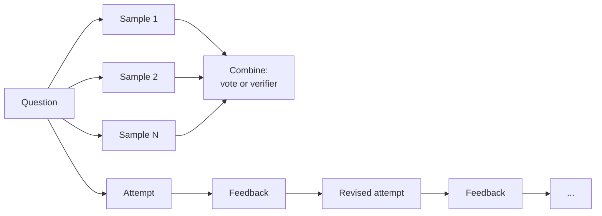
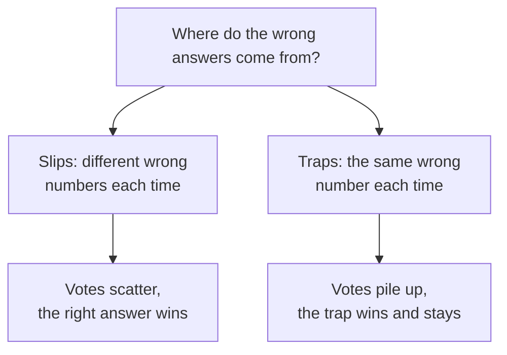
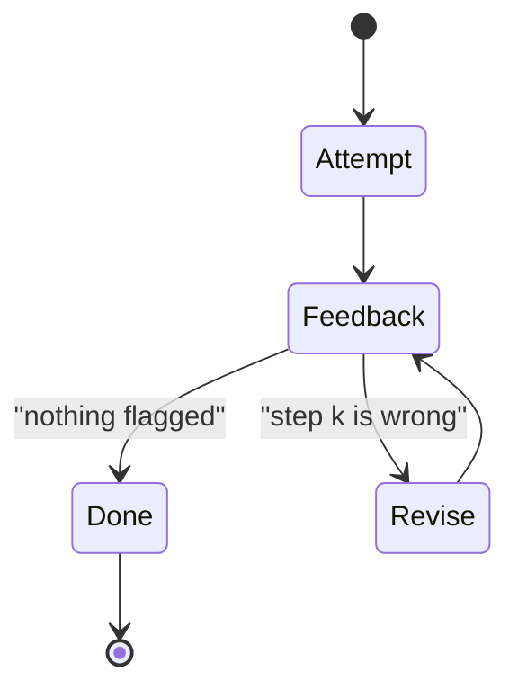

🌐 English · [Español](02-inference-time-scaling.es.md)

# Lesson 9.2 — Inference-time scaling: more samples, more revisions

> **Module 09 · Lesson 2 of 4** · ⏱️ about 55 min · 🧪 Lab: [steps 4–5](lab/README.md#step-4--scale-with-parallel-samples)

## 📨 Situation

> **From:** Dani Ruiz · Data Scientist, owns evaluation
> **Channel:** #ai-team
>
> Half the thread says "just sample more and take a vote". The other half says "let the model check
> its own work". Nobody has shown me a curve. I want accuracy against compute for both ideas on the
> 110 numeric problems, with tokens on the x-axis, because Sam will ask for tokens, not "number of
> samples". I also want to know where each curve goes flat and why. If voting stops helping at some
> point, tell me which problems it keeps getting wrong. Show me the eval.

## 🎯 Objectives

By the end of this lesson you can:

- Explain inference-time scaling and its two main axes: parallel sampling and sequential revision.
- Implement self-consistency (majority vote over sampled chains of thought) and best-of-N with a verifier.
- Explain why majority vote saturates when errors are correlated, and find the problems responsible.
- Compare revision loops driven by self-critique, an exact arithmetic check and a process reward model, including how often they break right answers.
- Read an accuracy-versus-tokens table and pick the cheapest method that meets a target.

## 🤔 Predict first

Write your answers down before reading on. You will check them in the self-check.

1. One chain-of-thought sample gets 61.8% of the 110 numeric problems right. With 45 samples and a majority vote, do you expect about 75%, about 90% or close to 100%?
2. Suppose that for every problem at least one of 15 samples is correct. How can a majority vote over those 15 samples still be wrong on some problems?
3. A model critiques and revises its own answers three times, with no outside checker. Can accuracy go down?

## 1. Spending compute at answer time

Until now, the way to get a better answer was a better model: more parameters, more data, more
training. **Inference-time scaling** (also called test-time scaling) spends extra compute at the
moment of answering instead. You keep the model and ask it to do more work per question.

There are two main ways to spend that compute:

- **Parallel:** draw several independent answers and combine them (vote, or let a verifier choose).
- **Sequential:** produce one answer, get feedback, revise it, and repeat.

A study of test-time compute on maths problems (Snell and colleagues, linked below) found that the
most effective way to spend that compute depends on how hard the question is for the model: in their
experiments, revising a first attempt suited easier questions, while harder ones gained more from
exploring different approaches. The practical lesson is that there is no single best knob; you
measure per type of question.

**Analogy:** preparing a difficult quote for a client. You can ask five colleagues for independent
estimates and compare them (parallel), or write one draft and have a reviewer mark it up twice
(sequential).



Sampling only works if the samples differ. A model decoding at temperature above zero writes a
different chain each time it is asked the same question. The simulator mimics that: the k-th call
with the same prompt uses its own seeded random stream, so it behaves like the k-th sample and the
run is still reproducible.

```python
def sample(reasoner: Reasoner, problems: Sequence[Problem], n: int,
           mode: str = "cot") -> dict[str, list[Attempt]]:
    """Draw ``n`` independent samples per problem (the same prompt, called n times)."""
    return {p.id: [reasoner.solve(p, mode) for _ in range(n)] for p in problems}
```

## 2. Self-consistency: sample many chains, vote

**Self-consistency** samples several chains of thought and returns the most frequent final answer.
The idea, from the self-consistency paper, is that there are many ways to reason to a right answer
but wrong reasoning tends to scatter: different slips give different wrong numbers, so the right
answer collects the most votes. You ignore the chains and vote only on the answers.

Two details matter in practice. Answers must be normalised before counting, or `175.1` and `175.10`
split their votes. And ties need a rule; here the answer seen first wins, which keeps runs
deterministic.

```python
def majority_vote(answers: Sequence[str | None]) -> str | None:
    """Self-consistency: the most frequent answer wins; ties go to the answer seen first."""
    keys = [answer_key(a) for a in answers]  # "175.10" and "175.1" -> the same key
    counts = Counter(k for k in keys if k is not None)
    if not counts:
        return None
    top = max(counts.values())
    for answer, key in zip(answers, keys, strict=True):
        if key is not None and counts[key] == top:
            return answer
    return None
```

**Analogy:** asking several people to add up the same receipt. Two careless people rarely make the
*same* mistake, so the total that keeps coming back is probably right.

Here is the curve from `uv run lab scale` on the 110 numeric problems. Each row reuses the first N of
the same 45 samples, so the columns are directly comparable. "Tokens/problem" counts generated tokens
for all N samples. The best-of-N column uses an outcome reward model (ORM) and the pass@N column is an
oracle; sections 3 and 4 explain both:

| N | Majority vote | Best-of-N (ORM) | pass@N (oracle) | Tokens/problem |
|---|---|---|---|---|
| 1 | 61.8% | 61.8% | 61.8% | 77.3 |
| 3 | 69.1% | 82.7% | 87.3% | 230.9 |
| 5 | 76.4% | 86.4% | 92.7% | 386.2 |
| 9 | 85.5% | 86.4% | 97.3% | 695.9 |
| 15 | 89.1% | 91.8% | 100.0% | 1,165.0 |
| 45 | 89.1% | 93.6% | 100.0% | 3,515.6 |

Majority vote climbs from 61.8% to 89.1% by N = 15 and then stops: 45 samples cost about three times
the tokens of 15 and buy nothing.

> ⚠️ **Common mistake:** voting on the full text of each answer, or on numbers formatted differently.
> Votes split between `52`, `52.0` and `52 slots` and the right answer loses to a wrong one written
> consistently. Extract the final answer and normalise it before you count.

## 3. Why the vote stops improving

Look at the pass@N column. **pass@N** asks: is at least one of the N samples right? By N = 15 it is
100%: for every one of the 110 problems, the model produced the right answer at least once. Yet the
vote is wrong on some of them. The lab prints why:

```text
At N=45: the most frequent answer is wrong on 12 of 110 problems; 12 of them are trap answers.
Problems never solved: 0.
```

All 12 failures are traps. A trap is not a random slip; it is the same misreading, giving the same
wrong number, sample after sample. Jordan's hub question (r076) is one of the 12: among its 45
samples, the bulb-counting answer 22 appears 24 times and the right answer 52 only 3 times. When the
wrong answer is the most likely one, more samples make the vote *more* certain of it, not less.
Voting fixes **independent** errors and amplifies **correlated** ones.



**Analogy:** asking 45 colleagues who all read the same misleading spreadsheet. Their agreement
measures the spreadsheet, not the truth.

So the ceiling of majority vote is set by the share of problems whose most likely answer is wrong,
and no amount of sampling moves it. To go further you need a signal that can tell right from wrong,
not just common from rare.

> 💡 **Production tip:** when a vote plateaus, list the problems it still gets wrong and look at the
> winning wrong answers. If the same wrong answer wins every time, you have a systematic misreading:
> fix the prompt, add the missing fact, or add a check for that specific trap. More samples will not
> fix it.

## 4. Best-of-N: let a verifier choose

**Best-of-N** draws N samples and keeps the one a **verifier** scores highest. If the verifier can
recognise the right answer even when it is rare, best-of-N can climb towards pass@N. The verifier
here is a simulated **outcome reward model (ORM)**: a model that reads a complete solution and
returns a probability that it is correct. The simulator's ORM peeks at the reference answer and adds
noise, and it is easier to fool with a tidy wrong solution than with a messy one, which is what makes
traps hard for it too. Lesson 9.3 looks at verifiers in detail.

```python
def best_of_n(attempts: Sequence[Attempt], scores: Sequence[float]) -> Attempt:
    """Best-of-N: keep the attempt with the highest verifier score (first one on ties)."""
    best = max(range(len(attempts)), key=lambda i: (scores[i], -i))
    return attempts[best]
```

In the table, best-of-N with the ORM beats the vote at every N: 82.7% against 69.1% at N = 3, and
93.6% against 89.1% at N = 45. It still stays below pass@N, because the ORM sometimes prefers a
confident wrong solution. pass@N itself is an **oracle**: computing it needs the answer key, which
you never have in production. It is the upper bound for any method that selects from the same
samples, not a method you can deploy.

> ⚠️ **Common mistake:** reporting pass@N as if it were the accuracy of your system. It answers
> "could a perfect judge find a right answer among these samples?" Your system's accuracy is what
> your actual selection rule (vote, ORM, verifier) achieves.

## 5. Sequential revision: fix the chain you have

The sequential axis takes one attempt and improves it. In **Self-Refine** (linked below), the same
model generates an answer, writes feedback on it, and rewrites the answer using that feedback, for a
few rounds and without any training. The quality of the loop depends almost entirely on the quality
of the feedback.



The lab runs three rounds with three feedback sources. All three point at a step; the simulated
model then keeps the steps before it and redoes the rest, taking extra care at the flagged step:

```python
def revise_loop(reasoner, problem, first, feedback, rounds=3) -> list[Attempt]:
    history, current = [first], first
    for _ in range(rounds):
        note = feedback(problem, current)  # None means "looks fine"
        if note is not None:
            current = reasoner.revise(problem, current, note)
        history.append(current)
    return history
```

From `uv run lab revise`:

| Feedback | Round 0 | Round 1 | Round 2 | Round 3 | Tokens/problem | Calls/problem | Right → wrong |
|---|---|---|---|---|---|---|---|
| self-critique | 61.8% | 65.5% | 69.1% | 66.4% | 155.9 | 4.92 | 9 |
| arithmetic re-check | 61.8% | 81.8% | 85.5% | 85.5% | 101.6 | 1.38 | 0 |
| process reward model | 61.8% | 80.9% | 90.0% | 86.4% | 152.8 | 2.27 | 6 |

- **Self-critique** (the model reviews its own work) spots few real errors and raises false alarms on
  correct steps. Revising a correct step is a fresh chance to slip, so it broke 9 answers that were
  right in round 0, and accuracy fell in round 3.
- **The arithmetic re-check** is an exact program that recomputes every calculation in every step.
  It never flags a correct step, so it never breaks anything, and it stops as soon as the arithmetic
  is clean: only 1.38 calls per problem. But it cannot see traps (the bulbs add up fine), so it
  stalls at 85.5%.
- **A process reward model (PRM)**, which scores each step, can flag a misreading, so it goes
  higher (90.0% after round 2). It is also noisy: its false alarms keep triggering revisions, and
  round 3 loses ground again.

**Analogy:** a spell checker against a nervous proofreader. The spell checker never touches a correct
word but misses wrong facts; the proofreader catches more and also "fixes" sentences that were fine.

> 💡 **Production tip:** stop a revision loop when the checker is satisfied, cap the number of rounds,
> and keep the best-scoring attempt rather than the last one. Track "right before, wrong after" in
> your evaluation; it is the cost of a noisy reviewer and it is invisible in the average.

## 6. Budgets: accuracy per token

Dani asked for tokens on the x-axis. Put the two tables together and a few facts jump out:

- Majority vote at N = 9 and re-check revision both reach **85.5%**. The vote spends 695.9 generated
  tokens per problem; revision spends 101.6, almost seven times fewer.
- Going from 15 to 45 samples triples the vote's cost for no gain.
- The best numbers in the module so far come from adding a *signal* (a checker or a reward model),
  not from adding samples.

Real systems mix both axes. **Adaptive sampling** draws samples one at a time and stops as soon as
one answer has a clear lead, so easy questions stop after a few samples and only contested ones use
the full budget. Exercise 3 in the lab asks you to build it and measure its savings. A compute-optimal policy
goes further and picks the strategy per question from a difficulty estimate.

```python
# Exercise 3 (lab/src/m09_reasoning/exercises.py): stop early when the leader is safe.
def adaptive_vote(draw: Callable[[], str | None], max_n: int, lead: int) -> tuple[str | None, int]:
    """Call draw() one sample at a time; stop when the leader has `lead` more votes than the runner-up."""
```

## 🧪 Try it

1. Draw the parallel-sampling curves:

   ```bash
   uv run lab scale
   ```

   ```text
   N   majority vote  best-of-N (ORM)  pass@N (oracle)  tokens/problem
   --  -------------  ---------------  ---------------  --------------
   1           61.8%            61.8%            61.8%            77.3
   3           69.1%            82.7%            87.3%           230.9
   5           76.4%            86.4%            92.7%           386.2
   9           85.5%            86.4%            97.3%           695.9
   15          89.1%            91.8%           100.0%         1,165.0
   45          89.1%            93.6%           100.0%         3,515.6

   At N=45: the most frequent answer is wrong on 12 of 110 problems; 12 of them are trap answers. Problems never solved: 0.
   ```

2. Run the three revision loops:

   ```bash
   uv run lab revise
   ```

   ```text
   feedback              round 0  round 1  round 2  round 3  tokens/problem  calls/problem  right->wrong
   --------------------  -------  -------  -------  -------  --------------  -------------  ------------
   self-critique           61.8%    65.5%    69.1%    66.4%           155.9           4.92             9
   arithmetic re-check     61.8%    81.8%    85.5%    85.5%           101.6           1.38             0
   process reward model    61.8%    80.9%    90.0%    86.4%           152.8           2.27             6
   ```

3. Open `src/m09_reasoning/simulator.py`, find `self_detect_slip` and `self_false_alarm` in
   `SimConfig`, and predict what happens to the self-critique row if you swap their values. Then try
   it (Break it 2 in the lab README).

## 🏭 In the real world

Self-consistency is the easiest scaling method to deploy: no new model, no training, a loop and a
counter. Its costs are linear in N, and latency stays flat only if you can run the samples in
parallel. Teams often use a small N with a fallback: if the vote is split, escalate
to a stronger model or a human. The main failure mode is the plateau you saw: agreement across
samples is not evidence of correctness when the errors are correlated, which is common when a prompt
or a missing fact misleads every sample the same way.

Revision loops are attractive because they reuse the first attempt, but they are only as good as the
feedback. Code that can check something exactly (a calculator, a unit test, a schema validator, a
database lookup) is the best feedback you can get: cheap, never wrong about what it checks, and safe
to loop on. Model-written critiques need evaluation of their own. Monitor the number of rounds per
request and the flip rate from right to wrong, not only final accuracy.

## ✅ Self-check

**1. What did majority vote reach with 45 samples, and was that what you predicted?**

<details><summary>Answer</summary>

89.1%, exactly the same as with 15 samples. If you predicted close to 100%, you assumed errors are
independent. On 12 problems the trap answer is the most frequent one, and more samples only make it
win more reliably.

</details>

**2. pass@15 is 100%, yet majority vote at N = 15 is 89.1%. Explain the gap.**

<details><summary>Answer</summary>

pass@15 only needs one right answer among 15; the vote needs the right answer to be the most common.
On the trap problems the right answer appears but loses to a wrong answer that appears more often.
Closing that gap requires a judge that recognises correctness, such as a verifier.

</details>

**3. Can self-revision without an outside checker make things worse?**

<details><summary>Answer</summary>

Yes. Self-critique broke 9 answers that were right in round 0, and accuracy fell from 69.1% after
round 2 to 66.4% after round 3. False alarms send correct steps back for rewriting, and every
rewrite is another chance to slip.

</details>

**4. Sam can afford about 100 generated tokens per problem. Which method from this lesson would you pick, and what would you warn about?**

<details><summary>Answer</summary>

Revision with the arithmetic re-check: 85.5% for 101.6 tokens per problem, the same accuracy the
vote reaches with 695.9 tokens. Warn that it cannot catch misreadings, so traps remain; pair it with
a check for known traps or route those question types elsewhere.

</details>

**5. Why does best-of-N need something majority vote does not?**

<details><summary>Answer</summary>

Best-of-N needs a scorer for each sample: a verifier or reward model. Majority vote only needs to
compare answers with each other. That extra signal is why best-of-N with the ORM reached 82.7% at
N = 3 when the vote was at 69.1%.

</details>

## 💬 Explain it in your own words

- Explain to Dani why "the model agrees with itself 45 times out of 45" is not evidence that the
  answer is right, using the trap problems as your example.
- Explain to Sam, with two numbers from this lesson, why adding a checker can be cheaper than adding
  samples.

## 🔑 Key ideas

- Inference-time scaling spends more compute per question: in parallel (many samples) or in sequence (revisions).
- Self-consistency fixes independent errors; correlated errors (traps) cap it, here at 89.1% from N = 15 on.
- pass@N is an oracle upper bound for selection, not a deployable accuracy.
- A verifier lets you pick rare right answers: best-of-N with an ORM beat the vote at every N.
- Revision loops are only as good as their feedback; noisy feedback breaks right answers.
- Compare methods by accuracy per token, and look for cheap exact checks before buying more samples.

## 📚 Go deeper

- ⭐ [Scaling LLM test-time compute optimally can be more effective than scaling model parameters](https://arxiv.org/abs/2408.03314) — how the best mix of sampling, revision and search depends on difficulty.
- [Self-consistency improves chain of thought reasoning](https://arxiv.org/abs/2203.11171) — the original majority-vote paper.
- [Self-Refine: iterative refinement with self-feedback](https://arxiv.org/abs/2303.17651) — generate, critique, refine with one model.
- [Training verifiers to solve math word problems (GSM8K)](https://arxiv.org/abs/2110.14168) — an early, clear case for sampling many solutions and letting a trained verifier choose.

---

[← Previous: 9.1 Reasoning models overview](01-reasoning-models-overview.md) · [🏠 Module 09](README.md) · [Next: 9.3 Search and verifiers →](03-search-and-verifiers.md)
