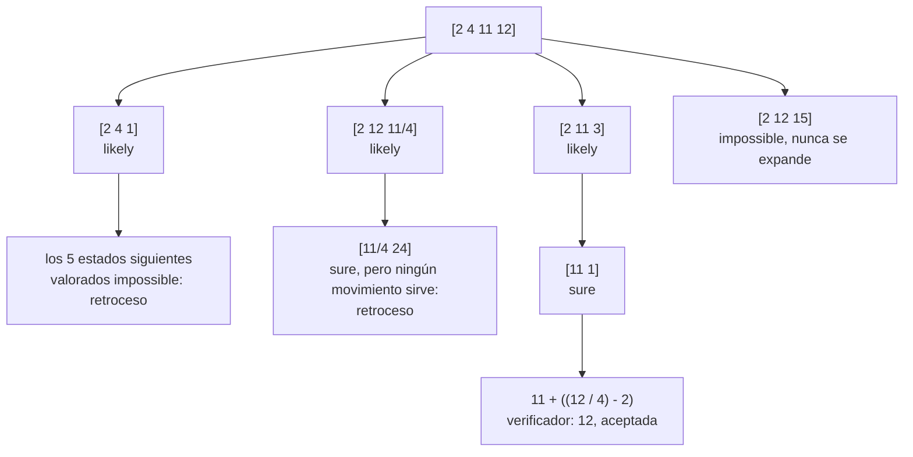
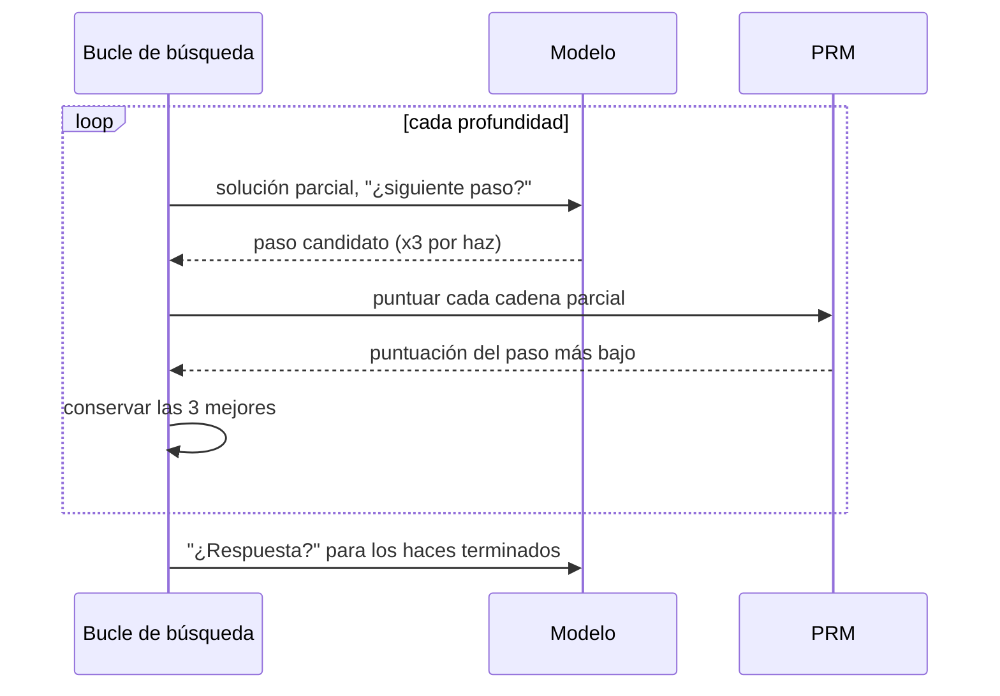
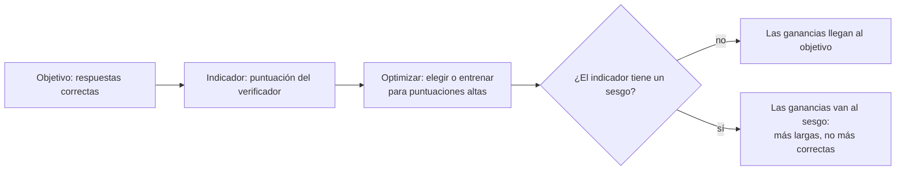

🌐 [English](03-search-and-verifiers.md) · Español

# Lección 9.3 — Búsqueda y verificadores: árboles, modelos de recompensa y explotación de la recompensa

> **Módulo 09 · Lección 3 de 4** · ⏱️ unos 60 min · 🧪 Lab: [pasos 6–7](lab/README.es.md#paso-6--busca-con-verificadores)

## 📨 Situación

> **De:** Sam Adeyemi · Ingeniería de fiabilidad (SRE)
> **Canal:** #platform
>
> Primero los números. *Best-of-9* genera 695.9 *tokens* por pregunta. La búsqueda en haz que nos
> enseñó Dani genera solo 274.3, lo que parecía estupendo hasta que vi que también envía 3,055.8
> *tokens* de *prompt* por pregunta en 20.5 llamadas. A mi panel le da igual de qué tipo sea cada
> *token*. Luego están los acertijos numéricos de Jordan, donde el lab dice que una muestra resuelve 11
> de 50. Dos preguntas: ¿qué búsqueda merece lo que cuesta?, y ¿cómo sé que el "verificador" de en medio
> no es solo un cara o cruz carísimo?

## 🎯 Objetivos

Al terminar esta lección puedes:

- Distinguir los verificadores exactos de los aprendidos (modelos de recompensa de resultado y de proceso, ORM y PRM) y medir sus falsas aceptaciones y sus falsos rechazos.
- Implementar el árbol de pensamientos (*Tree of Thoughts*) con pasos de propuesta y evaluación, usando búsqueda en anchura con un haz y búsqueda en profundidad con poda.
- Comparar la búsqueda contra un verificador exacto con el muestreo simple en acertijos resueltos, *tokens* generados, *tokens* de *prompt* y llamadas.
- Explicar la diferencia entre *best-of-N* con un ORM y la búsqueda en haz por pasos con un PRM, y seguir paso a paso una búsqueda en haz.
- Reconocer la explotación de la recompensa (*reward hacking*) cuando un verificador tiene un sesgo, y nombrar tres defensas.

## 🤔 Predice primero

Apunta tus respuestas antes de seguir leyendo. Las comprobarás en la autoevaluación.

1. Un modelo de recompensa de proceso deja pasar muchas menos soluciones erróneas que un modelo de recompensa de resultado. ¿Esperas que también rechace menos soluciones correctas?
2. El árbol de pensamientos hace entre 11 y 29 llamadas al modelo por acertijo; muestrear hasta que una solución se verifica hace menos de 7. ¿Cuál envía en total más *tokens* de *prompt* al modelo?
3. Un verificador reconoce bien las respuestas correctas, pero también le gustan un poco las respuestas largas. Con más muestras entre las que elegir, ¿*best-of-N* mejora o empeora?

## 1. Verificadores: reglas exactas y jueces aprendidos

Un **verificador** (*verifier*) es cualquier cosa que dice si una respuesta, o un paso, es correcto.
Todo en esta lección depende de lo bueno que sea ese juicio, así que empieza por clasificar los
verificadores en dos tipos:

| Verificador | Tipo | Qué ve | Punto ciego |
|---|---|---|---|
| Comprobador de acertijos de número objetivo | exacto | las reglas y el valor de la expresión final | nada, dentro de sus reglas |
| Recomprobación aritmética | exacto | cada operación escrita en cada paso | lecturas erróneas con una aritmética correcta |
| Modelo de recompensa de resultado (ORM, *outcome reward model*) | aprendido | una solución completa, una puntuación | soluciones erróneas pero ordenadas |
| Modelo de recompensa de proceso (PRM, *process reward model*) | aprendido | cada paso, una puntuación por paso | ruido en pasos sueltos |

Los **verificadores exactos** son programas. Nunca se equivocan en lo que comprueban, pero solo
comprueban aquello para lo que se escribieron. Los **verificadores aprendidos** son modelos entrenados
con soluciones etiquetadas. Pueden juzgar cosas que ninguna regla cubre, como si un paso lee bien la
pregunta, pero se equivocan, y sus errores se pueden explotar. En el lab, el ORM y el PRM son
simulados: echan un vistazo a la respuesta o a los pasos de referencia del dataset y añaden ruido con
semilla, así que su imperfección está controlada. Un ORM o un PRM reales no tienen clave de
respuestas; solo tienen lo que aprendieron.

**Analogía:** una caja registradora que cuenta las monedas frente al tique (exacta, limitada) y una
persona con experiencia al frente del turno que echa un vistazo al cajón (visión amplia, falible; a
veces la engaña un cajón de aspecto ordenado).

El lab puntúa con cada verificador las 4.950 muestras numéricas (45 por problema). 1.854 son
erróneas, y 801 de ellas son trampas:

| Verificador | Erróneas que deja pasar | Correctas que rechaza |
|---|---|---|
| recomprobación aritmética | 572 | 238 |
| ORM (puntuación ≥ 0.5) | 571 | 518 |
| PRM (puntuación del paso más bajo ≥ 0.5) | 64 | 906 |

La recomprobación rechaza 238 respuestas correctas porque son **infieles** (*unfaithful*): la
respuesta final es correcta, pero un paso escrito está mal (los aciertos por suerte del simulador). El
PRM es el juez más estricto: casi no deja pasar nada erróneo, pero también rechaza muchas soluciones
correctas, porque una cadena se puntúa por su paso más débil y basta con una puntuación baja por ruido.

> ⚠️ **Error común:** citar un único número de exactitud para un verificador. Lo que importa es qué
> errores comete. Un verificador que se usa para *filtrar* debe aceptar respuestas erróneas muy pocas
> veces; uno que se usa para *ordenar* solo necesita poner la respuesta correcta por encima de las
> erróneas para la misma pregunta.

## 2. Árbol de pensamientos: proponer, evaluar, buscar

Los acertijos de número objetivo ("usa 2, 4, 11 y 12 una vez cada uno para obtener 12") son problemas
de búsqueda. Un movimiento erróneo al principio deja el resto sin solución, y el modelo solo se entera
al final. El **árbol de pensamientos** (ToT, *Tree of Thoughts*) convierte el modelo en dos
herramientas y deja que un código de búsqueda normal las maneje:

1. **Proponer:** dado un estado (los números que quedan), pide al modelo k posibles movimientos
   siguientes.
2. **Evaluar:** para cada estado nuevo, pregunta al modelo si el objetivo sigue siendo alcanzable:
   `sure` (seguro), `likely` (probable) o `impossible` (imposible).
3. **Buscar:** decide qué estados expandir. La **búsqueda en anchura** (BFS, *breadth-first search*)
   conserva los mejores estados de cada profundidad (la *anchura*, o haz). La **búsqueda en
   profundidad** (DFS, *depth-first search*) sigue el movimiento mejor valorado, se salta los estados
   valorados como `impossible` (poda, *pruning*) y vuelve atrás cuando una rama muere (retroceso,
   *backtracking*).

El verificador exacto comprueba cada expresión terminada, así que una afirmación errónea nunca se
convierte en respuesta.



El árbol está sacado de la ejecución real sobre el problema r113 (`uv run lab tot --id r113`), con las
valoraciones del propio evaluador. Fíjate en su error: valoró `[11/4 24]` como `sure`, y solo al probar
los últimos movimientos se vio que ninguno llega a 12. La DFS volvió atrás y encontró la respuesta en
la tercera rama en 26 llamadas.

**Analogía:** planificar una ruta por una ciudad con alguien de la zona que hace de guía. Tú sugieres
unos cuantos giros siguientes, quien guía dice "callejón sin salida" o "pinta bien", y solo recorres
las calles prometedoras, dando media vuelta cuando una resulta estar cortada.

El bucle de la BFS es corto. El modelo propone y evalúa; el código normal ordena y poda:

```python
VALUE_SCORE = {"sure": 20.0, "likely": 1.0, "impossible": 0.001}

def tot_bfs(reasoner, problem, *, breadth=5, k=5) -> SearchResult:
    start = reasoner.usage.snapshot()
    frontier = [_start(problem)]
    while len(frontier[0]) > 2:
        scored = []
        for state in frontier:
            for child in reasoner.propose(problem, state, k):
                word = reasoner.value(problem, child)
                scored.append((VALUE_SCORE[word], word, child))
        scored.sort(key=lambda t: -t[0])
        frontier = [child for _, _, child in scored[:breadth]]
    for state in frontier:  # last move: no rating needed, the exact verifier decides
        for leaf in reasoner.propose(problem, state, k):
            expr = _leaf_expression(leaf)
            if verify_expression(problem.numbers, problem.target, expr):
                return SearchResult(expr, True, reasoner.usage.minus(start))
    return SearchResult(None, False, reasoner.usage.minus(start))
```

> 💡 **Consejo de producción:** mantén la lógica de búsqueda en el código, no en un *prompt*. Un bucle
> que has escrito tú puede registrar cada estado, imponer un presupuesto de llamadas, guardar en caché
> las evaluaciones repetidas y parar en la primera respuesta verificada. Un *prompt* que dice "explora
> varias opciones" no te da nada de eso.

## 3. Búsqueda contra un verificador exacto: ¿merece la pena el árbol?

Cuando existe un verificador exacto barato, la búsqueda más sencilla es **muestrear hasta que una
solución se verifique**: sacar una cadena de pensamiento, comprobarla y parar en la primera que pase.
El ToT solo merece la pena si supera esa referencia por el mismo dinero. De `uv run lab tot` en los 50
acertijos:

| Método | Resueltos | *Tokens* generados | *Tokens* de *prompt* | Llamadas |
|---|---|---|---|---|
| CoT, 1 muestra | 11/50 | 62.1 | 78.4 | 1.0 |
| muestrear hasta verificar, máx. 5 | 30/50 | 218.6 | 263.7 | 3.4 |
| muestrear hasta verificar, máx. 15 | 41/50 | 406.6 | 485.7 | 6.2 |
| ToT BFS, anchura 1 | 27/50 | 84.6 | 922.7 | 11.1 |
| ToT BFS, anchura 3 | 35/50 | 152.9 | 1,657.5 | 19.9 |
| ToT BFS, anchura 5 | 36/50 | 218.6 | 2,381.9 | 28.6 |
| ToT DFS con poda | 34/50 | 87.9 | 1,032.0 | 12.4 |

(Todas las columnas son por acertijo salvo "Resueltos"). Léelo como lo leería Sam:

- **Por *token* generado, gana el árbol.** Con exactamente 218.6 *tokens* generados por acertijo, la
  BFS con anchura 5 resuelve 36 acertijos y el muestreo resuelve 30. La DFS resuelve 34 con 87.9.
- **Por *token* de *prompt* y por llamada, gana el muestreo.** Cada llamada de propuesta y de
  evaluación reenvía el acertijo, así que la BFS con anchura 5 envía 2,381.9 *tokens* de *prompt* por
  acertijo frente a 263.7, y hace 28.6 llamadas, cada una de las cuales añade latencia.
- **Más muestras siguen funcionando.** Con un presupuesto de 15 muestras, el muestreo simple resuelve
  41, el mejor resultado de la tabla, porque el verificador exacto hace que cada muestra extra sea
  segura.

El artículo de ToT informa de una diferencia mucho mayor en un acertijo parecido (el juego del 24): con
GPT-4, la cadena de pensamiento resolvió el 4 % de las partidas y el ToT, el 74 %. Cuánto ayuda el árbol
depende de lo bueno que sea el modelo proponiendo y evaluando, y de lo caras que sean tus llamadas.
Mídelo con tus propios problemas.

> ⚠️ **Error común:** comparar métodos de búsqueda solo por *tokens* generados. Los métodos por pasos
> hacen muchas llamadas cortas que reenvían el contexto cada vez. Cuenta también los *tokens* de
> *prompt*, las llamadas y la latencia, o un método que parece barato te dará una sorpresa en la
> factura.

## 4. ORM frente a PRM en inferencia

Para los problemas numéricos no hay un verificador exacto de la respuesta final; solo jueces
aprendidos y la limitada recomprobación aritmética. Hay dos formas de usar un modelo de recompensa al
responder:

- ***Best-of-N* con un ORM o un PRM:** muestrea N soluciones completas, puntúa cada una y quédate con
  la mejor. El PRM puntúa cada paso y la cadena recibe la puntuación de su paso más bajo.
- **Búsqueda en haz (*beam search*) por pasos con un PRM:** haz crecer las soluciones paso a paso. En
  cada profundidad, extiende unas cuantas veces cada una de las soluciones parciales conservadas,
  puntúa con el PRM las nuevas cadenas parciales y quédate con las mejores. Los pasos malos se
  descartan en cuanto aparecen, en lugar de al final.



`uv run lab search --id r076` sigue paso a paso la búsqueda en haz sobre la pregunta de Jordan sobre el
hub. En la profundidad 1, los dos candidatos son el primer paso correcto (puntuación 0.95) y la trampa
de contar las bombillas (0.46, una puntuación con ruido que no es lo bastante baja para descartarla).
En la profundidad 5, los tres haces conservados terminan en 52 (0.85), 43 (0.23) y 22 (0.01), y la
búsqueda responde 52.

Estos son los resultados de `uv run lab search` con N = 9:

| Método | Exactitud | *Tokens* generados | *Tokens* de *prompt* | Llamadas |
|---|---|---|---|---|
| CoT, 1 muestra | 61.8% | 77.3 | 110.4 | 1.0 |
| votación por mayoría, N=9 | 85.5% | 695.9 | 993.9 | 9.0 |
| filtro de recomprobación + votación, N=9 | 86.4% | 695.9 | 993.9 | 9.0 |
| *best-of-9*, ORM | 86.4% | 695.9 | 993.9 | 9.0 |
| *best-of-9*, PRM | 95.5% | 695.9 | 993.9 | 9.0 |
| búsqueda en haz con PRM, 3x3 | 93.6% | 274.3 | 3,055.8 | 20.5 |
| pass@9 (necesita la clave de respuestas) | 97.3% | 695.9 | 993.9 | 9.0 |

El PRM es el único juez de aquí que puede ver una lectura errónea, y se nota: *best-of-9* con el PRM se
queda a menos de dos puntos del oráculo. Filtrar con la recomprobación aritmética antes de votar
apenas ayuda, porque los deslices ya perdían la votación; las trampas que hunden la votación pasan la
recomprobación. La búsqueda en haz llega a 93.6% con muchos menos *tokens* generados, pero con muchos
más *tokens* de *prompt* y más llamadas: el mismo compromiso que el ToT.

**Analogía:** un ORM es quien examina y solo corrige la casilla de la respuesta final; un PRM es quien
da clases particulares, lee cada línea del desarrollo y pone una cruz junto a la primera errónea.

> 💡 **Consejo de producción:** si usas un PRM dentro de una búsqueda por pasos, guarda en caché las
> puntuaciones por (pregunta, solución parcial). Los haces comparten prefijos, así que la misma cadena
> parcial se puntúa una y otra vez. El PRM simulado del lab es barato; uno real es una llamada completa
> a un modelo por cada puntuación.

## 5. Errores del verificador y explotación de la recompensa

Elegir la mejor de N respuestas según la puntuación de un verificador es una pequeña optimización:
empujas hacia lo que sea que le guste al verificador. Si al verificador le gusta algo distinto de la
corrección, más presión de selección encuentra más de eso. Esto es la **explotación de la recompensa**
(*reward hacking*), pariente de la ley de Goodhart ("cuando una medida se convierte en objetivo, deja
de ser una buena medida").

El lab construye un segundo ORM idéntico al primero salvo en que también le gustan las respuestas
largas (un sesgo de longitud). En el simulador, las cadenas que se tuercen tienden a divagar con líneas
de cautela extra, así que la longitud y el error están correlacionados, como suele pasar en los modelos
reales. De `uv run lab search`:

| N | ORM honesto | ORM con sesgo de longitud | *Tokens* de la elegida (honesto) | *Tokens* de la elegida (sesgado) |
|---|---|---|---|---|
| 1 | 61.8% | 61.8% | 77.3 | 77.3 |
| 3 | 82.7% | 73.6% | 74.1 | 79.5 |
| 5 | 86.4% | 74.5% | 72.6 | 81.4 |
| 9 | 86.4% | 77.3% | 73.8 | 82.6 |
| 15 | 91.8% | 79.1% | 76.4 | 86.1 |
| 45 | 93.6% | 80.9% | 77.5 | 88.4 |

El juez sesgado desperdicia la mayor parte del beneficio de las muestras extra: con N = 45 se queda
12,7 puntos por detrás del honesto, y las respuestas que elige son cada vez más largas. En el
entrenamiento (lección 9.4) el efecto es más fuerte, porque el propio modelo aprende a producir lo que
le gusta al modelo de recompensa. El informe de DeepSeek-R1 dice que el equipo no usó modelos de
recompensa neuronales de resultado ni de proceso para R1-Zero precisamente porque vieron que esos
modelos pueden sufrir explotación de la recompensa en un RL a gran escala; en su lugar usaron
recompensas basadas en reglas.



Defensas que funcionan en la práctica:

- Prefiere los verificadores exactos siempre que existan; usa los aprendidos solo para lo que las
  reglas no pueden comprobar.
- Mantén una evaluación reservada con la verdad de referencia que el verificador nunca ve, y vigila la
  diferencia entre "lo que dice el verificador" y "lo que de verdad es correcto".
- Combina señales: por ejemplo, una recomprobación exacta como filtro y después un PRM para ordenar lo
  que queda.
- Vigila los efectos secundarios: que la longitud, el formato y el estilo de las respuestas elegidas
  vayan derivando con el tiempo.

> ⚠️ **Error común:** concluir que el sistema mejora porque sube la puntuación del verificador. En la
> tabla, las propias puntuaciones del ORM sesgado subirían con N mientras la exactitud se queda muy por
> debajo de la del juez honesto. Mide siempre contra la verdad de referencia.

## 🧪 Pruébalo

1. Sigue paso a paso el árbol de pensamientos en un acertijo, con BFS y con DFS:

   ```bash
   uv run lab tot --id r113
   ```

   ```text
   === DFS
   try [2 4 1] (rated likely)
     prune [2 3] (rated impossible)
   ...
   try [2 12 11/4] (rated likely)
     try [11/4 24] (rated sure)
       no last move reaches the target: backtrack
   ...
   try [2 11 3] (rated likely)
     try [11 1] (rated sure)
   found: 11 + ((12 / 4) - 2)  ·  26 calls, 201 generated tokens
   ```

2. Compara la búsqueda con el muestreo en los 50 acertijos:

   ```bash
   uv run lab tot
   ```

   ```text
   method                         solved  generated tok  prompt tok  calls  verifier rejections
   -----------------------------  ------  -------------  ----------  -----  -------------------
   CoT, 1 sample                   11/50           62.1        78.4    1.0                   39
   sample until verified, max 5    30/50          218.6       263.7    3.4                  138
   sample until verified, max 15   41/50          406.6       485.7    6.2                  268
   ToT BFS, breadth 1              27/50           84.6       922.7   11.1                    0
   ToT BFS, breadth 3              35/50          152.9     1,657.5   19.9                    0
   ToT BFS, breadth 5              36/50          218.6     2,381.9   28.6                    0
   ToT DFS with pruning            34/50           87.9     1,032.0   12.4                    0
   ```

3. Sigue paso a paso una búsqueda en haz con PRM y después ejecuta la comparación completa de
   verificadores:

   ```bash
   uv run lab search --id r076
   uv run lab search
   ```

   ```text
   depth 1: 2 distinct candidates, keep 2
     keep 0.95  HomeMesh devices per room: 1 motion + 1 door = 2
     keep 0.46  HomeMesh devices per room: 1 motion + 1 door + 5 bulbs = 7
   ...
   Answer 52 (correct), 39 calls, 468 generated tokens, 6391 prompt tokens
   ```

## 🏭 En el mundo real

Los verificadores exactos son la razón por la que los sistemas de razonamiento funcionan tan bien con
código y matemáticas: los tests unitarios, los compiladores, los comprobadores de tipos, las
calculadoras y los *solvers* dan una señal fiable gratis. En entornos de negocio, busca lo mismo
disfrazado: una consulta a la base de datos que confirma un precio, un esquema que valida una
respuesta JSON, un motor de reglas que recalcula una tarifa de envío. Cada uno de ellos convierte un
"quizá" en "verificado" y hace que las muestras extra sean seguras.

La búsqueda en árbol y la búsqueda en haz por pasos se usan donde las llamadas son baratas en relación
con el valor de una respuesta y donde se pueden juzgar los estados intermedios. Complican el
despliegue: muchas llamadas cortas en secuencia, *tokens* de *prompt* que crecen con la profundidad y
una latencia difícil de acotar. La mayoría de los equipos empiezan con muestreo más un verificador,
añaden búsqueda solo donde compensa de forma medible y limitan las llamadas por petición. Los modelos
de recompensa aprendidos necesitan su propio conjunto de evaluación y vigilancia de la deriva y del
sesgo; trátalos como modelos en producción, no como la verdad de referencia.

## ✅ Autoevaluación

**1. El PRM deja pasar muchas menos respuestas erróneas que el ORM. ¿También rechaza menos correctas?**

<details><summary>Respuesta</summary>

No, al contrario: deja pasar 64 muestras erróneas frente a las 571 del ORM, pero rechaza 906 correctas
frente a 518. Puntuar una cadena por su paso más débil lo hace estricto: una sola puntuación baja por
ruido hunde una solución correcta. Como filtro eso sale caro; como criterio para ordenar dentro de una
misma pregunta siguió siendo el que mejor funcionó (95.5% en *best-of-9*).

</details>

**2. ¿Qué envía más *tokens* de *prompt* por acertijo: el ToT o muestrear hasta verificar?**

<details><summary>Respuesta</summary>

El ToT, con diferencia. La BFS con anchura 5 envía 2,381.9 *tokens* de *prompt* por acertijo en 28.6
llamadas; el muestreo con hasta 15 intentos envía 485.7 en 6.2 llamadas. Cada llamada de propuesta y
de evaluación reenvía el acertijo. El ToT solo es más barato en *tokens* generados.

</details>

**3. Con un ORM con sesgo de longitud, ¿ayuda un N mayor?**

<details><summary>Respuesta</summary>

Mucho menos de lo que debería. El ORM sesgado pasó de 73.6% con N = 3 a 80.9% con N = 45, mientras que
el honesto llegó a 93.6%, y las respuestas elegidas por el sesgado crecieron de 79.5 a 88.4 *tokens*.
Las muestras extra le dan al sesgo más ocasiones de ganar. Eso es explotación de la recompensa en
tiempo de inferencia.

</details>

**4. ¿Por qué filtrar con la recomprobación aritmética antes de votar añadió menos de un punto?**

<details><summary>Respuesta</summary>

La votación ya superaba en votos a los deslices aleatorios; sus fallos vienen de las trampas, cuya
aritmética es perfecta, así que la recomprobación las conserva. Pasó de 85.5% a 86.4% con N = 9. Una
comprobación solo ayuda contra los errores que puede ver.

</details>

**5. En la DFS sobre r113, el evaluador dijo `sure` para `[11/4 24]`, y se equivocaba. ¿Por qué eso no produjo una respuesta errónea?**

<details><summary>Respuesta</summary>

Porque el evaluador solo orienta la búsqueda; el verificador exacto decide qué cuenta como respuesta.
Ningún último movimiento desde `[11/4 24]` daba 12, así que nada pasó el verificador, y la DFS volvió
atrás hasta la rama siguiente. Una guía aprendida más una aceptación exacta es la combinación segura.

</details>

## 💬 Explícalo con tus palabras

- Explícale a Sam por qué "el ToT es más barato" y "el ToT es más caro" son verdad las dos cosas,
  usando una fila de la tabla del ToT para cada afirmación.
- Explícale a Dani qué es la explotación de la recompensa, usando el ORM con sesgo de longitud, y qué
  vigilarías en producción para detectarla.

## 🔑 Ideas clave

- Los verificadores exactos nunca se equivocan en lo que comprueban, pero solo comprueban eso; los aprendidos ven más y se equivocan más.
- Juzga un verificador por sus falsas aceptaciones y sus falsos rechazos, no por un único número de exactitud.
- El árbol de pensamientos divide el modelo en un proponente y un evaluador y deja la búsqueda al código; ahorra *tokens* generados y cuesta *tokens* de *prompt*, llamadas y latencia.
- Con un verificador exacto barato, muestrear hasta verificar es una referencia sólida que sigue mejorando con el presupuesto.
- Un PRM puede relegar lecturas erróneas que las votaciones y los ORM no ven; la búsqueda en haz por pasos lo usa durante la generación.
- Optimizar contra un verificador sesgado premia el sesgo: mide contra la verdad de referencia, no contra el verificador.

## 📚 Profundiza

- ⭐ [Tree of Thoughts: resolución deliberada de problemas con modelos de lenguaje grandes](https://arxiv.org/abs/2305.10601) — proponer, evaluar y buscar, con los resultados del juego del 24.
- [Let's verify step by step](https://arxiv.org/abs/2305.20050) — supervisión de proceso frente a supervisión de resultado para modelos de recompensa, y el dataset PRM800K.
- [Escalar de forma óptima el cómputo en inferencia de los LLM](https://arxiv.org/abs/2408.03314) — búsqueda guiada por un PRM frente a *best-of-N* con distintos presupuestos.
- [Informe de DeepSeek-R1](https://arxiv.org/abs/2501.12948) — por qué el equipo eligió recompensas basadas en reglas, y sus notas sobre los intentos fallidos con PRM y búsqueda en árbol.
- [Language agent tree search (LATS)](https://arxiv.org/abs/2310.04406) — búsqueda en árbol para agentes, que conecta esta lección con el módulo 08.

---

[← Anterior: 9.2 Escalado en tiempo de inferencia](02-inference-time-scaling.es.md) · [🏠 Módulo 09](README.es.md) · [Siguiente: 9.4 Entrenar modelos de razonamiento →](04-training-reasoning-models.es.md)
