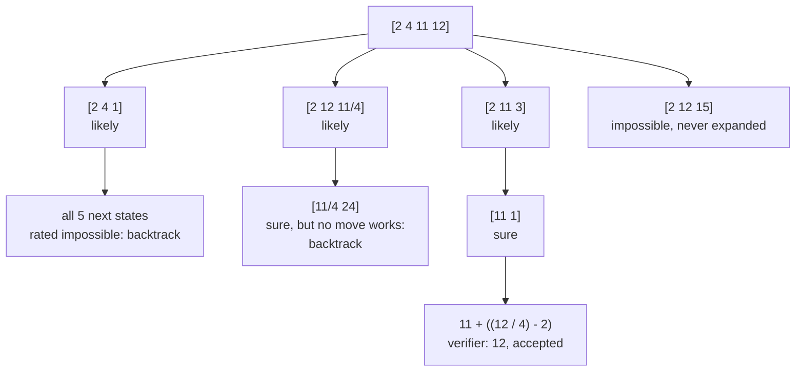
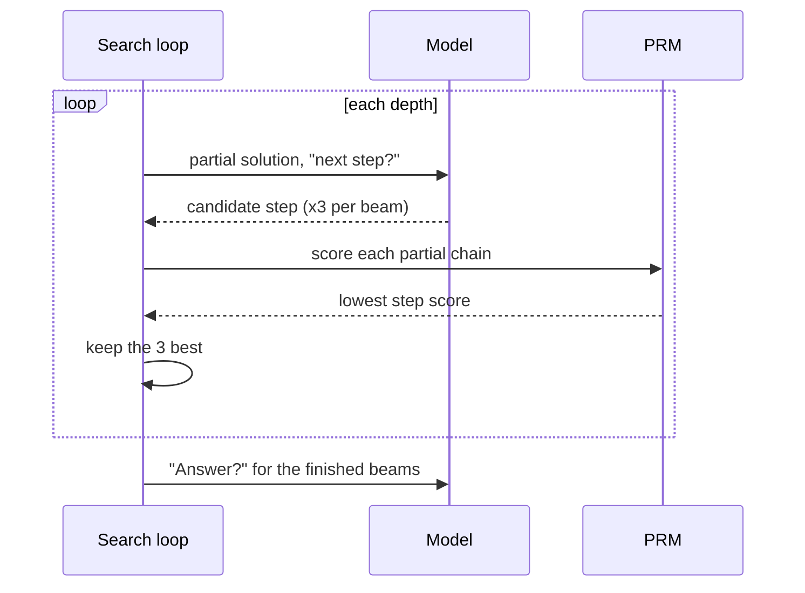
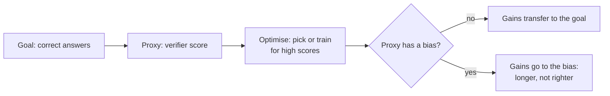

🌐 English · [Español](03-search-and-verifiers.es.md)

# Lesson 9.3 — Search and verifiers: trees, reward models and reward hacking

> **Module 09 · Lesson 3 of 4** · ⏱️ about 60 min · 🧪 Lab: [steps 6–7](lab/README.md#step-6--search-with-verifiers)

## 📨 Situation

> **From:** Sam Adeyemi · Site Reliability Engineer (SRE)
> **Channel:** #platform
>
> Numbers first. Best-of-9 generates 695.9 tokens per question. The beam search Dani demoed generates
> only 274.3, which looked great until I saw it also sends 3,055.8 prompt tokens per question over
> 20.5 calls. My dashboard does not care which kind of token it is. Then there are Jordan's
> number puzzles, where the lab says one sample solves 11 of 50. Two questions: which search is worth
> paying for, and how do I know the "verifier" in the middle is not just a very expensive coin flip?

## 🎯 Objectives

By the end of this lesson you can:

- Distinguish exact verifiers from learned ones (outcome and process reward models, ORMs and PRMs) and measure their false accepts and false rejects.
- Implement Tree of Thoughts with propose and evaluate steps, using breadth-first search with a beam and depth-first search with pruning.
- Compare search against an exact verifier with plain sampling on solved puzzles, generated tokens, prompt tokens and calls.
- Explain the difference between best-of-N with an ORM and step-level beam search with a PRM, and trace one beam search.
- Recognise reward hacking when a verifier has a bias, and name three defences.

## 🤔 Predict first

Write your answers down before reading on. You will check them in the self-check.

1. A process reward model lets through far fewer wrong solutions than an outcome reward model. Do you expect it to also reject fewer right ones?
2. Tree of Thoughts makes 11 to 29 model calls per puzzle; sampling until a solution verifies makes fewer than 7. Which sends more prompt tokens to the model in total?
3. A verifier is good at spotting right answers but also likes long answers a little. With more samples to choose from, does best-of-N get better or worse?

## 1. Verifiers: exact rules and learned judges

A **verifier** is anything that says whether an answer, or a step, is right. Everything in this
lesson depends on how good that judgement is, so start by sorting verifiers into two kinds:

| Verifier | Kind | What it sees | Blind spot |
|---|---|---|---|
| Target-puzzle checker | exact | rules and value of the final expression | nothing, within its rules |
| Arithmetic re-check | exact | every calculation written in every step | misreadings with good arithmetic |
| Outcome reward model (ORM) | learned | a complete solution, one score | tidy wrong solutions |
| Process reward model (PRM) | learned | each step, one score per step | noise on individual steps |

**Exact verifiers** are programs. They are never mistaken about what they check, but they only
check what they were written to check. **Learned verifiers** are models trained on labelled
solutions. They can judge things no rule covers, such as whether a step reads the question
correctly, but they make mistakes, and their mistakes can be exploited. In the lab, the ORM and
the PRM are simulated: they peek at the dataset's reference answer or steps and add seeded noise, so
their imperfection is controlled. A real ORM or PRM has no answer key; it has only what it learned.

**Analogy:** a till that counts the coins against the receipt (exact, narrow) and an experienced
shift manager who glances at the drawer (broad, fallible, sometimes fooled by a neat-looking drawer).

The lab scores all 4,950 numeric samples (45 per problem) with each verifier. 1,854 of them are
wrong, and 801 of those are traps:

| Verifier | Wrong it lets through | Right it rejects |
|---|---|---|
| arithmetic re-check | 572 | 238 |
| ORM (score ≥ 0.5) | 571 | 518 |
| PRM (lowest step score ≥ 0.5) | 64 | 906 |

The re-check rejects 238 right answers because they are **unfaithful**: the final answer is right
but a written step is wrong (the simulator's lucky answers). The PRM is the strictest judge: it lets
almost nothing wrong through, but it also rejects many right solutions, because a chain is scored
by its weakest step and one noisy low score is enough.

> ⚠️ **Common mistake:** quoting one accuracy number for a verifier. What matters is which errors it
> makes. A verifier used to *filter* must rarely accept wrong answers; one used to *rank* only needs
> to put the right answer above the wrong ones for the same question.

## 2. Tree of Thoughts: propose, evaluate, search

The target puzzles ("use 2, 4, 11 and 12 once each to make 12") are search problems. One wrong early
move makes the rest hopeless, and the model only finds out at the end. **Tree of Thoughts (ToT)**
turns the model into two tools and lets ordinary search code drive them:

1. **Propose:** given a state (the numbers left), ask the model for k possible next moves.
2. **Evaluate:** for each new state, ask the model whether the target is still reachable: `sure`,
   `likely` or `impossible`.
3. **Search:** decide which states to expand. **Breadth-first search (BFS)** keeps the best few
   states at each depth (the *breadth*, or beam). **Depth-first search (DFS)** follows the best-rated
   move, skips states rated `impossible` (pruning) and backs up when a branch dies (backtracking).

The exact verifier checks every finished expression, so a wrong claim never becomes an answer.



The tree is drawn from the real run on problem r113 (`uv run lab tot --id r113`), with the
evaluator's own ratings. Notice its mistake: it rated `[11/4 24]` as `sure`, and only trying the last
moves revealed that nothing reaches 12. DFS backed up and found the answer on the third branch in 26
calls.

**Analogy:** planning a route through a city with a local guide. You suggest a few next turns, the
guide says "dead end" or "looks promising", and you only walk down the promising streets, turning back
when one turns out to be closed.

The BFS loop is short. The model proposes and evaluates; plain code ranks and prunes:

```python
VALUE_SCORE = {"sure": 20.0, "likely": 1.0, "impossible": 0.001}

def tot_bfs(reasoner, problem, *, breadth=5, k=5) -> SearchResult:
    start = reasoner.usage.snapshot()
    frontier = [_start(problem)]
    while len(frontier[0]) > 2:
        scored = []
        for state in frontier:
            for child in reasoner.propose(problem, state, k):
                word = reasoner.value(problem, child)
                scored.append((VALUE_SCORE[word], word, child))
        scored.sort(key=lambda t: -t[0])
        frontier = [child for _, _, child in scored[:breadth]]
    for state in frontier:  # last move: no rating needed, the exact verifier decides
        for leaf in reasoner.propose(problem, state, k):
            expr = _leaf_expression(leaf)
            if verify_expression(problem.numbers, problem.target, expr):
                return SearchResult(expr, True, reasoner.usage.minus(start))
    return SearchResult(None, False, reasoner.usage.minus(start))
```

> 💡 **Production tip:** keep the search logic in code, not in a prompt. A loop you wrote can log
> every state, enforce a call budget, cache repeated evaluations and stop at the first verified
> answer. A prompt that says "explore several options" gives you none of that.

## 3. Search against an exact verifier: is the tree worth it?

When a cheap exact verifier exists, the simplest search is to **sample until a solution verifies**:
draw a chain of thought, check it, stop at the first one that passes. ToT is only worth it if it
beats that baseline for the same money. From `uv run lab tot` on the 50 puzzles:

| Method | Solved | Generated tokens | Prompt tokens | Calls |
|---|---|---|---|---|
| CoT, 1 sample | 11/50 | 62.1 | 78.4 | 1.0 |
| sample until verified, max 5 | 30/50 | 218.6 | 263.7 | 3.4 |
| sample until verified, max 15 | 41/50 | 406.6 | 485.7 | 6.2 |
| ToT BFS, breadth 1 | 27/50 | 84.6 | 922.7 | 11.1 |
| ToT BFS, breadth 3 | 35/50 | 152.9 | 1,657.5 | 19.9 |
| ToT BFS, breadth 5 | 36/50 | 218.6 | 2,381.9 | 28.6 |
| ToT DFS with pruning | 34/50 | 87.9 | 1,032.0 | 12.4 |

(All columns are per puzzle except "Solved".) Read it the way Sam would:

- **Per generated token, the tree wins.** At exactly 218.6 generated tokens per puzzle, BFS with
  breadth 5 solves 36 puzzles and sampling solves 30. DFS solves 34 with 87.9.
- **Per prompt token and per call, sampling wins.** Every propose and evaluate call resends the
  puzzle, so BFS with breadth 5 sends 2,381.9 prompt tokens per puzzle against 263.7, and makes 28.6
  calls, each one adding latency.
- **More samples still work.** With a budget of 15 samples, plain sampling solves 41, the best
  result in the table, because the exact verifier makes every extra sample safe.

The ToT paper reports a much larger gap on a similar puzzle (the Game of 24): with GPT-4, chain of
thought solved 4% of the games and ToT 74%. How much the tree helps depends on how good the model is
at proposing and evaluating, and on how expensive your calls are. Measure it on your own problems.

> ⚠️ **Common mistake:** comparing search methods on generated tokens only. Step-level methods make
> many short calls that each resend the context. Count prompt tokens, calls and latency too, or a
> method that looks cheap will surprise you on the invoice.

## 4. ORM versus PRM at inference

For the numeric problems there is no exact verifier for the final answer; only learned judges and the
narrow arithmetic re-check. There are two ways to use a reward model while answering:

- **Best-of-N with an ORM or PRM:** sample N complete solutions, score each one, keep the best. The
  PRM scores each step and the chain gets its lowest step score.
- **Step-level beam search with a PRM:** grow solutions one step at a time. At each depth, extend
  each of the kept partial solutions a few times, score the new partial chains with the PRM, and keep
  the best few. Bad steps are dropped as soon as they appear instead of at the end.



`uv run lab search --id r076` traces the beam search on Jordan's hub question. At depth 1 the two
candidates are the correct first step (score 0.95) and the bulb-counting trap (0.46, a noisy score
that is not low enough to drop it). By depth 5 the three kept beams end in 52 (0.85), 43 (0.23) and
22 (0.01), and the search answers 52.

Here are the results from `uv run lab search` at N = 9:

| Method | Accuracy | Generated tokens | Prompt tokens | Calls |
|---|---|---|---|---|
| CoT, 1 sample | 61.8% | 77.3 | 110.4 | 1.0 |
| majority vote, N=9 | 85.5% | 695.9 | 993.9 | 9.0 |
| re-check filter + vote, N=9 | 86.4% | 695.9 | 993.9 | 9.0 |
| best-of-9, ORM | 86.4% | 695.9 | 993.9 | 9.0 |
| best-of-9, PRM | 95.5% | 695.9 | 993.9 | 9.0 |
| PRM beam search, 3x3 | 93.6% | 274.3 | 3,055.8 | 20.5 |
| pass@9 (needs the answer key) | 97.3% | 695.9 | 993.9 | 9.0 |

The PRM is the only judge here that can see a misreading, and it shows: best-of-9 with the PRM gets
within two points of the oracle. Filtering by the arithmetic re-check before voting barely helps,
because slips were already being outvoted; the traps that sink the vote pass the re-check. Beam
search reaches 93.6% with far fewer generated tokens but many more prompt tokens and calls: the same
trade-off as ToT.

**Analogy:** an ORM is an examiner who only marks the final answer box; a PRM is a tutor who reads
every line of working and puts a cross next to the first wrong one.

> 💡 **Production tip:** if you use a PRM inside a step-level search, cache scores by (question,
> partial solution). Beams share prefixes, so the same partial chain is scored again and again. The
> lab's simulated PRM is cheap; a real one is a full model call per scoring.

## 5. Verifier errors and reward hacking

Selecting the best of N answers by a verifier's score is a small optimisation: you push towards
whatever the verifier likes. If the verifier likes something other than correctness, more selection
pressure finds more of it. This is **reward hacking**, a cousin of Goodhart's law ("when a measure
becomes a target, it ceases to be a good measure").

The lab builds a second ORM that is identical to the first except that it also likes long answers
(a length bias). In the simulator, chains that went wrong tend to ramble with extra hedging lines,
so length and wrongness are correlated, as they often are in real models. From `uv run lab search`:

| N | Honest ORM | Length-biased ORM | Tokens of the pick (honest) | Tokens of the pick (biased) |
|---|---|---|---|---|
| 1 | 61.8% | 61.8% | 77.3 | 77.3 |
| 3 | 82.7% | 73.6% | 74.1 | 79.5 |
| 5 | 86.4% | 74.5% | 72.6 | 81.4 |
| 9 | 86.4% | 77.3% | 73.8 | 82.6 |
| 15 | 91.8% | 79.1% | 76.4 | 86.1 |
| 45 | 93.6% | 80.9% | 77.5 | 88.4 |

The biased judge wastes most of the benefit of extra samples: at N = 45 it is 12.7 points behind the
honest one, and the answers it picks keep getting longer. In training (lesson 9.4) the effect is
stronger, because the model itself learns to produce what the reward model likes. The DeepSeek-R1
report says the team did not use neural outcome or process reward models for R1-Zero precisely
because they found such models can suffer from reward hacking in large-scale RL; they used rule-based
rewards instead.



Defences that work in practice:

- Prefer exact verifiers wherever they exist; use learned ones only for what rules cannot check.
- Keep a held-out evaluation with ground truth that the verifier never sees, and watch the gap
  between "verifier says" and "actually right".
- Combine signals: for example, an exact re-check as a filter, then a PRM to rank what is left.
- Watch the side effects: length, format and style of selected answers drifting over time.

> ⚠️ **Common mistake:** concluding from a rising verifier score that the system is improving. In the
> table, the biased ORM's own scores would rise with N while accuracy stays far below the honest
> judge. Always measure against ground truth.

## 🧪 Try it

1. Trace Tree of Thoughts on one puzzle, with BFS and DFS:

   ```bash
   uv run lab tot --id r113
   ```

   ```text
   === DFS
   try [2 4 1] (rated likely)
     prune [2 3] (rated impossible)
   ...
   try [2 12 11/4] (rated likely)
     try [11/4 24] (rated sure)
       no last move reaches the target: backtrack
   ...
   try [2 11 3] (rated likely)
     try [11 1] (rated sure)
   found: 11 + ((12 / 4) - 2)  ·  26 calls, 201 generated tokens
   ```

2. Compare search with sampling on all 50 puzzles:

   ```bash
   uv run lab tot
   ```

   ```text
   method                         solved  generated tok  prompt tok  calls  verifier rejections
   -----------------------------  ------  -------------  ----------  -----  -------------------
   CoT, 1 sample                   11/50           62.1        78.4    1.0                   39
   sample until verified, max 5    30/50          218.6       263.7    3.4                  138
   sample until verified, max 15   41/50          406.6       485.7    6.2                  268
   ToT BFS, breadth 1              27/50           84.6       922.7   11.1                    0
   ToT BFS, breadth 3              35/50          152.9     1,657.5   19.9                    0
   ToT BFS, breadth 5              36/50          218.6     2,381.9   28.6                    0
   ToT DFS with pruning            34/50           87.9     1,032.0   12.4                    0
   ```

3. Trace a PRM beam search, then run the full verifier comparison:

   ```bash
   uv run lab search --id r076
   uv run lab search
   ```

   ```text
   depth 1: 2 distinct candidates, keep 2
     keep 0.95  HomeMesh devices per room: 1 motion + 1 door = 2
     keep 0.46  HomeMesh devices per room: 1 motion + 1 door + 5 bulbs = 7
   ...
   Answer 52 (correct), 39 calls, 468 generated tokens, 6391 prompt tokens
   ```

## 🏭 In the real world

Exact verifiers are the reason reasoning systems work so well on code and maths: unit tests,
compilers, type checkers, calculators and solvers give a reliable signal for free. In business
settings, look for the same thing in disguise: a database lookup that confirms a price, a schema
that validates a JSON answer, a rule engine that recomputes a shipping fee. Every one of them turns a
"maybe" into "verified" and makes extra samples safe.

Tree search and step-level beam search are used where calls are cheap relative to the value of an
answer, and where intermediate states can be judged. They complicate serving: many short sequential
calls, prompt tokens that grow with depth, and latency that is hard to bound. Most teams start with
sampling plus a verifier, add search only where it measurably pays, and cap calls per request.
Learned reward models need their own evaluation set and monitoring for drift and bias; treat them as
models in production, not as ground truth.

## ✅ Self-check

**1. The PRM lets through far fewer wrong answers than the ORM. Does it also reject fewer right ones?**

<details><summary>Answer</summary>

No, the opposite: it lets through 64 wrong samples against the ORM's 571, but rejects 906 right ones
against 518. Scoring a chain by its weakest step makes it strict: one noisy low step score sinks a
correct solution. As a filter that is costly; as a ranker within one question it still worked best
(95.5% for best-of-9).

</details>

**2. Which sends more prompt tokens per puzzle: ToT or sampling until verified?**

<details><summary>Answer</summary>

ToT, by far. BFS with breadth 5 sends 2,381.9 prompt tokens per puzzle in 28.6 calls; sampling with
up to 15 tries sends 485.7 in 6.2 calls. Every propose and evaluate call resends the puzzle. ToT is
cheaper only in generated tokens.

</details>

**3. With a length-biased ORM, does a bigger N help?**

<details><summary>Answer</summary>

Much less than it should. The biased ORM went from 73.6% at N = 3 to 80.9% at N = 45, while the
honest ORM reached 93.6%, and the biased picks grew from 79.5 to 88.4 tokens. Extra samples give the
bias more chances to win. That is reward hacking at inference time.

</details>

**4. Why did filtering by the arithmetic re-check before voting add less than one point?**

<details><summary>Answer</summary>

The vote was already outvoting random slips; its failures come from traps, whose arithmetic is
perfect, so the re-check keeps them. It went from 85.5% to 86.4% at N = 9. A check only helps against
the errors it can see.

</details>

**5. In DFS on r113 the evaluator said `sure` for `[11/4 24]`, which was wrong. Why did that not produce a wrong answer?**

<details><summary>Answer</summary>

Because the evaluator only steers the search; the exact verifier decides what counts as an answer.
No last move from `[11/4 24]` made 12, so nothing passed the verifier, and DFS backtracked to the next
branch. Learned guidance plus exact acceptance is the safe combination.

</details>

## 💬 Explain it in your own words

- Explain to Sam why "ToT is cheaper" and "ToT is more expensive" are both true, using one row of the
  ToT table for each claim.
- Explain to Dani what reward hacking is, using the length-biased ORM, and what you would monitor in
  production to catch it.

## 🔑 Key ideas

- Exact verifiers are never mistaken about what they check, but they check only that; learned verifiers see more and err more.
- Judge a verifier by its false accepts and false rejects, not by one accuracy number.
- Tree of Thoughts splits the model into a proposer and an evaluator and lets code do the search; it saves generated tokens and costs prompt tokens, calls and latency.
- With a cheap exact verifier, sampling until verified is a strong baseline that keeps improving with budget.
- A PRM can rank away misreadings that votes and ORMs miss; step-level beam search uses it during generation.
- Optimising against a biased verifier rewards the bias: measure against ground truth, not against the verifier.

## 📚 Go deeper

- ⭐ [Tree of Thoughts: deliberate problem solving with large language models](https://arxiv.org/abs/2305.10601) — propose, evaluate and search, with the Game of 24 results.
- [Let's verify step by step](https://arxiv.org/abs/2305.20050) — process versus outcome supervision for reward models, and the PRM800K dataset.
- [Scaling LLM test-time compute optimally](https://arxiv.org/abs/2408.03314) — PRM-guided search versus best-of-N at different budgets.
- [DeepSeek-R1 report](https://arxiv.org/abs/2501.12948) — why the team chose rule-based rewards, and its notes on unsuccessful attempts with PRMs and tree search.
- [Language agent tree search (LATS)](https://arxiv.org/abs/2310.04406) — tree search for agents, which connects this lesson to module 08.

---

[← Previous: 9.2 Inference-time scaling](02-inference-time-scaling.md) · [🏠 Module 09](README.md) · [Next: 9.4 Training reasoning models →](04-training-reasoning-models.md)
