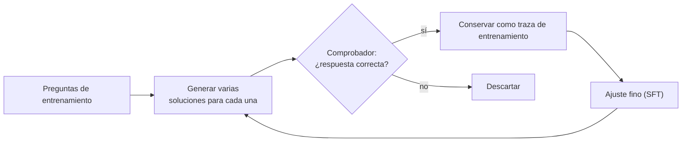
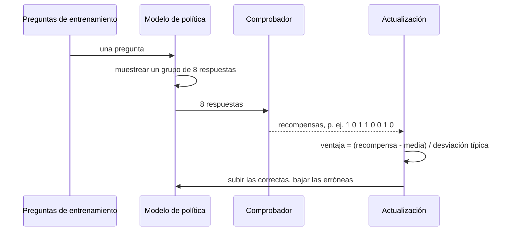
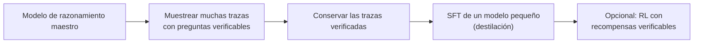

🌐 [English](04-training-reasoning-models.md) · Español

# Lección 9.4 — Entrenar modelos de razonamiento: STaR, RL con recompensas verificables y destilación

> **Módulo 09 · Lección 4 de 4** · ⏱️ unos 60 min · 🧪 Lab: [pasos 8–9](lab/README.es.md#paso-8--entrena-con-star)

## 📨 Situación

> **De:** Jordan Kim · Responsable de Producto y Estrategia
> **Canal:** #strategy
>
> Noor me acaba de decir que los datos de mercado del informe del próximo trimestre no pueden salir de
> nuestros portátiles, así que un gran modelo de razonamiento alojado fuera queda descartado para ese
> trabajo. Todo el mundo repite que "R1 aprendió solo a pensar con aprendizaje por refuerzo". ¿Significa
> eso que podríamos enseñar a un modelo pequeño a razonar con nuestras preguntas de pedidos, de
> amortización y del hub? ¿Qué necesitaría: datos, una recompensa, una granja de unidades de
> procesamiento gráfico (GPU)? Dame las opciones en palabras sencillas, con lo que nos cuesta cada una y
> lo que cambiaría de verdad.

## 🎯 Objetivos

Al terminar esta lección puedes:

- Explicar el ajuste fino supervisado con trazas de razonamiento, el muestreo por rechazo y la destilación, y de dónde salen las trazas.
- Ejecutar un bucle STaR (*Self-Taught Reasoner*: generar, filtrar por corrección, ajustar, racionalizar los fallos) y explicar por qué filtrar solo por la respuesta deja pasar justificaciones infieles.
- Calcular ventajas relativas al grupo como en la optimización de política relativa al grupo (GRPO, *Group Relative Policy Optimization*) y explicar por qué los grupos en los que todas las muestras reciben la misma recompensa no enseñan nada.
- Describir las recetas de DeepSeek-R1-Zero y DeepSeek-R1 tal como se publicaron, y comparar los modelos de recompensa de resultado y de proceso como señales de entrenamiento.
- Explicar el entrenamiento en autorrefinamiento y la búsqueda interiorizada (Meta-CoT, *Meta chain-of-thought*), y elegir una vía de entrenamiento para un modelo local pequeño.

## 🤔 Predice primero

Apunta tus respuestas antes de seguir leyendo. Las comprobarás en la autoevaluación.

1. STaR solo conserva las justificaciones que llegan a la respuesta correcta. ¿Puede ese filtro dejar entrar aun así justificaciones con un paso erróneo?
2. En GRPO, el modelo responde 8 veces a la misma pregunta y las 8 respuestas son correctas. ¿Cuánto le enseña ese grupo al modelo?
3. Un bucle de aprendizaje por refuerzo premia solo las respuestas correctas y no dice nada de la longitud. ¿Las respuestas se alargarán, se acortarán o seguirán igual?

## 1. De dónde salen las trazas de razonamiento

La forma más directa de enseñar a razonar es el **ajuste fino supervisado** (SFT, *supervised
fine-tuning*) con ejemplos de razonamiento: preguntas emparejadas con soluciones resueltas, como viste
en el módulo 02. Lo difícil es conseguir buenas trazas. Hay tres fuentes:

| Fuente | Cómo | Coste y riesgo |
|---|---|---|
| Personas | Personas expertas escriben soluciones paso a paso | Lento y caro; el estilo varía |
| Un modelo más fuerte | Muestrear su razonamiento y quedarse con lo que se verifica (**destilación**) | Barato por traza; hereda sus errores y sus condiciones de licencia |
| El propio modelo | Muestrear, quedarse solo con las soluciones verificadas, entrenar con ellas, repetir | Lo más barato; solo puede aprender lo que ya consigue hacer a veces |

La herramienta común a las dos últimas filas es el **muestreo por rechazo** (*rejection sampling*):
generar varias candidatas por pregunta y quedarse solo con las que acepta un comprobador. En los
problemas verificables, el comprobador es exacto para la respuesta final, y por eso las matemáticas,
el código y los acertijos dominan los datos de entrenamiento de razonamiento.

**Analogía:** una persona aprendiz que estudia con un libro de ejemplos resueltos. Los ejemplos pueden
venir de alguien con mucho oficio, de alguien del equipo con más experiencia o de sus propios trabajos
anteriores que pasaron la inspección.



> ⚠️ **Error común:** filtrar las trazas solo por la respuesta final y dar por hecho que, por tanto, el
> razonamiento es correcto. Una traza puede llegar a la respuesta correcta a través de un paso erróneo,
> o copiar la respuesta de una pista. Entrenar con ella enseña el paso erróneo.

## 2. STaR: el razonador autodidacta

**STaR** (*Self-Taught Reasoner*, razonador autodidacta) convierte el muestreo por rechazo en un
bucle. En cada iteración:

1. **Generar** una justificación (*rationale*) y una respuesta para cada pregunta de entrenamiento.
2. **Filtrar:** conservar las justificaciones cuya respuesta es correcta.
3. **Racionalizar** los fallos (*rationalization*): mostrar al modelo la respuesta correcta como pista
   y pedirle una justificación que llegue a ella; conservar las que lo consigan.
4. **Ajustar** con todo lo conservado y repetir con el modelo mejorado.

El artículo de STaR reinicia el ajuste fino desde el modelo original en cada iteración, entrenando con
los datos que reunió el último modelo, lo que ayuda a evitar el sobreajuste. La racionalización
importa porque, sin ella, el modelo solo entrena con problemas que ya sabía resolver; la pista le da
también ejemplos resueltos de los difíciles.

El lab simula el bucle con 80 problemas de entrenamiento (ids impares) y mide los otros 80 (ids pares).
La generación, el filtrado y la racionalización son llamadas reales al simulador; solo el paso de
ajuste fino es simulado: `finetune` convierte "cuántas justificaciones buenas conservamos de cada
familia" en más habilidad y menos trampas para una nueva configuración del modelo, partiendo siempre
de la configuración base.

```python
def finetune(base: SimConfig, kept: Sequence[Rationale], train: Sequence[Problem], name: str) -> SimConfig:
    size = Counter(p.type for p in train)
    good = Counter(r.problem.type for r in kept if r.faithful)
    bad = Counter(r.problem.type for r in kept if not r.faithful)  # a wrong step teaches a wrong step
    skill, trap = dict(base.skill), dict(base.trap)
    for family in FAMILIES:
        coverage = max(0.0, (good[family] - bad[family]) / size[family]) if size[family] else 0.0
        skill[family] = base.skill[family] + (1 - base.skill[family]) * SFT_GAIN * coverage
        trap[family] = base.trap[family] * (1 - SFT_GAIN * coverage)
    return replace(base, name=name, skill=skill, trap=trap)
```

De `uv run lab star` (exactitud en los 80 problemas reservados):

| Ronda | Exactitud en test | Acertijos de número objetivo | Conservadas (resueltas) | Conservadas (pista) | Infieles conservadas |
|---|---|---|---|---|---|
| 0 | 51.2% | 20.0% | 40 | 27 | 5 |
| 1 | 68.8% | 48.0% | 51 | 21 | 1 |
| 2 | 71.2% | 52.0% | 58 | 19 | 3 |
| 3 | 73.8% | 52.0% | 56 | 21 | 2 |
| 4 | 72.5% | 52.0% | - | - | - |

La mayor parte de la ganancia llega en la primera ronda y luego el bucle se aplana: una vez que el
modelo resuelve lo que puede, cada ronda encuentra más o menos las mismas justificaciones. Dos
variantes, ambas en el lab:

- **Sin racionalización** (`--no-rationalize`), la exactitud final es 62.5% y los acertijos solo
  llegan a 28.0%: el modelo nunca recibe ejemplos de lo que aún no sabe resolver.
- **Con un filtro estricto** (`--strict`), que además exige que cada paso escrito pase la
  recomprobación aritmética, no se conserva ninguna justificación infiel y el bucle termina en 73.8%.

**Analogía:** alguien que estudia y guarda un cuaderno con cada ejercicio que resolvió bien, más los
que supo explicar tras ver la respuesta al final del libro, y solo estudia ese cuaderno.

> 💡 **Consejo de producción:** registra por qué se conservó cada traza (resuelta, con pista,
> comprobación estricta superada) y guarda esas etiquetas en el conjunto de entrenamiento. Cuando un
> modelo ajustado empeore, podrás rastrearlo hasta una clase de datos en lugar de adivinar.

## 3. Aprendizaje por refuerzo con recompensas verificables

STaR tira los fallos. El **aprendizaje por refuerzo** (RL, *reinforcement learning*) los usa: el modelo
muestrea respuestas, una recompensa dice lo buena que fue cada una y la actualización hace más
probables las respuestas buenas y menos probables las malas. Cuando la recompensa viene de un
comprobador (correcta o errónea) y no de personas ni de un modelo aprendido, se habla de **RL con
recompensas verificables** (*RL with verifiable rewards*).

**GRPO** (*Group Relative Policy Optimization*, optimización de política relativa al grupo),
presentado en el artículo de DeepSeekMath, es el algoritmo detrás de DeepSeek-R1. Para cada pregunta
muestrea un **grupo** de respuestas y puntúa cada una. En lugar de entrenar un modelo de valor aparte
para estimar "lo buena que es la respuesta típica a esta pregunta", usa el propio grupo como
referencia: la ventaja (*advantage*) de cada respuesta es su recompensa menos la media del grupo,
dividida por la desviación típica del grupo. Las respuestas mejores que sus hermanas suben; las peores
bajan. El método completo también limita cuánto mueve cada actualización la política (*policy*) y
añade una penalización por alejarse demasiado de un modelo de referencia.

```python
def group_advantages(rewards: Sequence[float]) -> list[float]:
    """GRPO: compare each sample with its own group. (r - mean) / std; all zeros if every reward is equal."""
    mean = sum(rewards) / len(rewards)
    std = math.sqrt(sum((r - mean) ** 2 for r in rewards) / len(rewards))
    if std < 1e-9:
        return [0.0] * len(rewards)
    return [(r - mean) / std for r in rewards]
```

Fíjate en el caso especial: si todas las respuestas del grupo reciben la misma recompensa, todas las
ventajas son cero y el grupo no enseña nada. Las preguntas que siempre se resuelven, o que nunca se
resuelven, no dan señal. El RL aprende de las preguntas que están en el límite de la capacidad del
modelo.



El comando `rl` del lab ejecuta un ejemplo de juguete al estilo de GRPO sobre el simulador. Es
REINFORCE con ventajas relativas al grupo, sin el recorte (*clipping*) ni la penalización de
referencia, y la "política" tiene solo dos parámetros: la probabilidad de comprobar cada paso y la
probabilidad de releer la pregunta al final. Los dos empiezan en 0.10. La recompensa es 1 para una
respuesta correcta y 0 en otro caso, con grupos de 8 por pregunta de entrenamiento. De `uv run lab rl`:

| Paso | Recompensa en entrenamiento | Exactitud en test | *Tokens* por respuesta | P(comprobar paso) | P(releer) | Grupos sin señal |
|---|---|---|---|---|---|---|
| 0 | 0.514 | 53.8% | 77.9 | 0.10 | 0.10 | 10 |
| 2 | 0.503 | 55.0% | 81.2 | 0.09 | 0.38 | 17 |
| 4 | 0.606 | 66.2% | 108.8 | 0.95 | 0.77 | 18 |
| 6 | 0.667 | 67.5% | 112.6 | 0.99 | 0.93 | 18 |
| 8 | - | 68.8% | 113.0 | 0.99 | 0.94 | - |

Nada en la recompensa menciona la comprobación ni la longitud. La política descubre que comprobar
compensa, porque las comprobaciones a veces detectan errores, y las respuestas crecen de 77.9 a 113.0
*tokens*. Conviene tener claro lo que muestra este juguete: el simulador se construyó para que las
comprobaciones puedan detectar deslices. El RL no inventó la comprobación; descubrió que comprobar
vale lo que cuesta en *tokens*. Esa es la forma de lo que describe el informe de DeepSeek-R1 a una
escala muchísimo mayor.

**Analogía:** un equipo de ventas que cobra solo por los acuerdos cerrados. Nadie le dice que revise
dos veces los presupuestos, pero quienes lo hacen cierran más; pronto todo el equipo lo revisa todo dos
veces, y las reuniones se alargan.

El trabajo de R1, según lo publicado:

- **R1-Zero:** GRPO aplicado directamente al modelo base (DeepSeek-V3-Base), con recompensas de
  exactitud y de formato basadas en reglas y sin SFT previo. La longitud media de las respuestas creció
  durante el entrenamiento, y la reflexión y la reevaluación aparecieron sin que nadie las mostrara. La
  legibilidad era mala y los idiomas se mezclaban.
- **R1:** unos pocos miles de ejemplos seleccionados de cadena de pensamiento larga como SFT de
  "arranque en frío" (*cold start*), después RL centrado en el razonamiento (con una recompensa por
  mantenerse en un solo idioma), después muestreo por rechazo para construir un gran conjunto de SFT
  que también cubre tareas sin razonamiento, y por último una etapa final de RL para todo tipo de
  *prompts*.

> ⚠️ **Error común:** leer "el RL enseñó a razonar al modelo" como "el RL crea capacidades de la nada".
> El RL vuelve a ponderar comportamientos que el modelo ya produce a veces. Si ninguna muestra de un
> grupo es correcta nunca, las ventajas son cero y no se aprende nada; por eso primero hace falta un
> modelo base fuerte, o un arranque en frío.

## 4. Modelos de recompensa: resultado frente a proceso

Cuando no existe un comprobador exacto (preguntas abiertas, demostraciones, la mayoría de las tareas
de negocio), la recompensa tiene que venir de un **modelo de recompensa** aprendido, como en el
aprendizaje por refuerzo con retroalimentación humana (RLHF, *reinforcement learning from human
feedback*) del módulo 02. Para el razonamiento hay dos tipos:

| | Modelo de recompensa de resultado (ORM) | Modelo de recompensa de proceso (PRM) |
|---|---|---|
| Puntúa | la respuesta final de una solución completa | cada paso |
| Etiquetas de entrenamiento | correcta o errónea por solución (a menudo gratis con un comprobador) | correcto o erróneo por paso (caro) |
| Punto fuerte | barato, sencillo | señala el primer error; relega las lecturas erróneas |
| Punto débil | premia respuestas correctas alcanzadas con pasos erróneos | es difícil definir los límites de los pasos y sus etiquetas |

El artículo "Let's verify step by step" entrenó los dos tipos con soluciones a problemas de
matemáticas de competición y encontró que la supervisión de proceso daba un modelo de recompensa
claramente mejor; publicó PRM800K, un conjunto de 800.000 etiquetas humanas por paso. El informe de
DeepSeek-R1, en cambio, incluye los PRM entre sus intentos fallidos: definir un paso en el
razonamiento general es difícil, juzgar automáticamente un paso intermedio no es fiable y etiquetar a
mano no escala, y un PRM aprendido invita a la explotación de la recompensa (*reward hacking*) en un
RL a gran escala. Los dos hallazgos son compatibles: los PRM son jueces potentes y objetivos de
entrenamiento frágiles. La lección 9.3 mostró la misma división en tiempo de inferencia.

**Analogía:** pagar a una empresa contratista según la inspección final (ORM) o según inspecciones en
cada fase (PRM). Las inspecciones por fases detectan los problemas pronto, pero necesitan a alguien
que inspeccione y sepa qué aspecto debe tener cada fase.

> 💡 **Consejo de producción:** siempre que puedas, convierte parte de la recompensa en reglas: un
> analizador para el formato de la respuesta, una calculadora para la aritmética, tests para el código.
> Usa un modelo de recompensa aprendido solo para lo que las reglas no pueden expresar, y evalúalo en
> un conjunto reservado que el RL nunca toque.

## 5. Autorrefinamiento, búsqueda interiorizada y destilación

Los métodos en tiempo de inferencia de las lecciones 9.2 y 9.3 se pueden trasladar *dentro* del modelo
mediante el entrenamiento:

- **Entrenamiento en autorrefinamiento** (*self-refinement training*): entrenar con trazas que
  contienen un error, la detección del error y la corrección. El modelo aprende a revisar dentro de su
  propia cadena en lugar de en un bucle externo.
- **Búsqueda interiorizada** (*internalised search*): el artículo de Meta-CoT sostiene que una buena
  cadena de pensamiento es el resultado visible de un proceso de búsqueda (proponer, evaluar,
  retroceder), y propone entrenar los modelos con *trazas de búsqueda linealizadas*, de modo que una
  sola cadena larga contenga la exploración, los callejones sin salida y los retrocesos. El "Wait, that
  does not add up, let me try another way" ("Espera, esto no cuadra, voy a probar de otra forma") de un
  modelo de razonamiento es una búsqueda que ocurre dentro de una sola generación en lugar de en un
  bucle de árbol de pensamientos.

El modo con pensamiento del simulador es una caricatura de esto: `Wait, step 3 does not add up.
Redoing it.` y `Re-reading the question: step 1 misreads it` son revisiones y retrocesos escritos
dentro de una única respuesta.



La **destilación** (*distillation*) es la respuesta práctica a la pregunta de Jordan. El informe de R1
ajustó varios modelos abiertos más pequeños con muestras seleccionadas con R1, y encontró que destilar
desde el modelo grande funcionaba mejor que aplicar directamente el mismo RL a gran escala a un modelo
pequeño. Los modelos destilados son los que puedes ejecutar en un portátil con las herramientas del
módulo 10.

| Opción para Hearthwise | Necesita | Qué cambia |
|---|---|---|
| *Prompting* más comprobadores (lecciones 9.1–9.3) | Ningún entrenamiento | Exactitud por *token*, con cualquier modelo |
| Destilar un modelo pequeño con trazas verificadas | Un modelo maestro, un comprobador, un presupuesto modesto de ajuste fino | Un modelo local pequeño que escribe sus propias cadenas largas |
| Además, RL con recompensas verificables | Muchas horas de GPU, una recompensa estable, una evaluación cuidadosa | Más ganancias en el límite de la capacidad del modelo |

## 🧪 Pruébalo

1. Ejecuta STaR con racionalización, después sin ella y después con el filtro estricto:

   ```bash
   uv run lab star
   uv run lab star --no-rationalize
   uv run lab star --strict
   ```

   ```text
   round  test accuracy  energy  hub_capacity  order_total  target  kept (solved)  kept (hint)  unfaithful kept  tokens spent
   -----  -------------  ------  ------------  -----------  ------  -------------  -----------  ---------------  ------------
   0              51.2%   82.4%         38.9%        75.0%   20.0%             40           27                5         8,625
   1              68.8%  100.0%         55.6%        80.0%   48.0%             51           21                1         7,508
   2              71.2%  100.0%         61.1%        80.0%   52.0%             58           19                3         6,770
   3              73.8%  100.0%         66.7%        85.0%   52.0%             56           21                2         7,178
   4              72.5%  100.0%         61.1%        85.0%   52.0%              -            -                -             -
   ```

2. Ejecuta el juguete al estilo de GRPO y observa cómo se alargan las respuestas:

   ```bash
   uv run lab rl
   ```

   ```text
   step  train reward  test accuracy  tokens/answer  P(check step)  P(re-read)  groups with no signal
   ----  ------------  -------------  -------------  -------------  ----------  ---------------------
   0            0.514          53.8%           77.9           0.10        0.10                     10
   1            0.530          55.0%           79.8           0.11        0.19                     17
   2            0.503          55.0%           81.2           0.09        0.38                     17
   3            0.534          60.0%           90.4           0.38        0.70                     18
   4            0.606          66.2%          108.8           0.95        0.77                     18
   5            0.670          67.5%          112.5           0.98        0.93                     25
   6            0.667          67.5%          112.6           0.99        0.93                     18
   7            0.658          68.8%          113.0           0.99        0.94                     20
   8                -          68.8%          113.0           0.99        0.94                      -
   ```

3. Abre `src/m09_reasoning/training.py`, busca `group_advantages` y calcula a mano las ventajas para
   las recompensas 1, 0, 0, 0. Después comprueba tu resultado en una consola de Python.

## 🏭 En el mundo real

Entrenar un modelo de razonamiento desde cero es un proyecto de laboratorio de frontera. La mayoría
de los equipos usan una de dos vías más ligeras. La primera es la destilación: generar trazas con un
modelo fuerte en tus propias tareas verificables, conservar las verificadas y ajustar con ellas un
modelo abierto pequeño con las herramientas estándar de SFT (la biblioteca de código abierto TRL de
Hugging Face cubre el SFT e incluye también un entrenador de GRPO). La segunda es una fase corta de RL
con recompensas verificables sobre un modelo que ya es capaz, para un dominio estrecho con un
comprobador fiable.

Las dos vías fallan de formas conocidas. Los datos se filtran: los problemas de evaluación, o copias
casi idénticas, acaban en las trazas de entrenamiento y la exactitud parece maravillosa. Las
recompensas se explotan: el modelo encuentra formatos o longitudes que el comprobador juzga mal. La
señal se agota: cuando el modelo resuelve la mayoría de las preguntas de entrenamiento, los grupos
dejan de discrepar y el aprendizaje se estanca, así que necesitas preguntas más difíciles. Vigila a la
vez la recompensa, la exactitud en el conjunto reservado, la longitud de las respuestas y la
proporción de grupos sin señal.

## ✅ Autoevaluación

**1. ¿Puede un filtro que solo mira la respuesta dejar entrar justificaciones con un paso erróneo? ¿Cuántas conservó STaR en la ronda 0?**

<details><summary>Respuesta</summary>

Sí. En la ronda 0, 5 de las justificaciones conservadas tenían un paso cuya aritmética no cuadra,
aunque sus respuestas finales eran correctas (aciertos por suerte, a menudo tras copiar la pista). El
filtro estricto, que además recomprueba cada paso, no conservó ninguna y terminó en 73.8%.

</details>

**2. Las 8 respuestas de un grupo de GRPO son correctas. ¿Cuánto enseña el grupo?**

<details><summary>Respuesta</summary>

Nada: cada recompensa es igual a la media, así que cada ventaja es cero. En el juguete, esos grupos
pasaron de 10 de 80 en el paso 0 a 25 en el paso 5 a medida que la política mejoraba. El RL necesita
preguntas en las que el modelo unas veces acierta y otras falla.

</details>

**3. La recompensa del RL no decía nada de la longitud. ¿Qué les pasó a las respuestas, y por qué?**

<details><summary>Respuesta</summary>

Crecieron de 77.9 a 113.0 *tokens*, porque la probabilidad de comprobar cada paso subió de 0.10 a 0.99.
Comprobar a veces detecta un error, así que las respuestas con comprobaciones acertaban más a menudo y
se reforzaron. Un razonamiento más largo fue un efecto secundario de premiar la corrección, el patrón
que describe el informe de R1.

</details>

**4. ¿Por qué la racionalización ayuda sobre todo en los acertijos de número objetivo?**

<details><summary>Respuesta</summary>

Sin ella, el modelo solo entrena con los acertijos que ya resolvía, que son pocos (20.0% al principio),
así que la exactitud en los acertijos solo llegó a 28.0%. Con la respuesta como pista, produce ejemplos
resueltos de acertijos que no sabía resolver y llegó a 52.0%.

</details>

**5. ¿Por qué DeepSeek-R1-Zero usó recompensas basadas en reglas en lugar de un modelo de recompensa neuronal?**

<details><summary>Respuesta</summary>

Según el informe, los modelos de recompensa neuronales de resultado y de proceso pueden sufrir
explotación de la recompensa durante un RL a gran escala, y volver a entrenarlos añade coste y
complejidad. Para matemáticas y código, una regla (¿es correcta la respuesta?, ¿es correcto el
formato?) es barata y no se deja engañar de la misma manera.

</details>

**6. ¿Qué le recomendarías a Jordan para un modelo local pequeño, y por qué?**

<details><summary>Respuesta</summary>

Empieza con *prompting* más comprobadores para fijar una referencia; después destila: genera trazas
con un modelo fuerte en preguntas verificables al estilo de Hearthwise, conserva solo las trazas
verificadas (idealmente, comprobadas paso a paso) y ajusta un modelo abierto pequeño. El informe de R1
encontró que la destilación superaba a ejecutar el RL directamente sobre un modelo pequeño. Plantéate
el RL solo más adelante, para una tarea estrecha con un comprobador fiable.

</details>

## 💬 Explícalo con tus palabras

- Explícale a Jordan la diferencia entre STaR y el RL con recompensas verificables en cuatro frases,
  usando en tu explicación "cuaderno de ejercicios resueltos" y "grupo de respuestas".
- Explícale a Sam por qué un modelo entrenado con RL podría costar más por respuesta que el modelo del
  que partió, usando la columna de *tokens* de la tabla del RL.

## 🔑 Ideas clave

- El SFT con trazas de razonamiento necesita buenas trazas: de personas, de un modelo más fuerte (destilación) o del propio modelo, filtradas por un comprobador.
- Los bucles STaR generan, filtran, racionalizan y ajustan; la racionalización le da al modelo ejemplos de problemas que aún no sabe resolver.
- Los filtros que solo miran la respuesta dejan pasar justificaciones infieles; comprobar los pasos las elimina.
- GRPO puntúa cada muestra frente a su propio grupo; los grupos sin desacuerdo no dan señal de aprendizaje.
- Premiar solo la corrección puede alargar las respuestas cuando comprobar compensa, como se publicó para R1-Zero.
- Los PRM son jueces fuertes pero objetivos de entrenamiento difíciles; las recompensas basadas en reglas resisten la explotación de la recompensa.
- Para un modelo local pequeño, la destilación con trazas verificadas suele ser la primera y mejor vía.

## 📚 Profundiza

- ⭐ [Informe de DeepSeek-R1](https://arxiv.org/abs/2501.12948) — R1-Zero, el *pipeline* de R1, los resultados de la destilación y los intentos fallidos.
- [DeepSeekMath (GRPO)](https://arxiv.org/abs/2402.03300) — donde se presenta GRPO y se compara con PPO.
- [STaR: el razonamiento como impulso del razonamiento](https://arxiv.org/abs/2203.14465) — el bucle de generar, filtrar y racionalizar.
- [Let's verify step by step](https://arxiv.org/abs/2305.20050) — supervisión de proceso frente a supervisión de resultado y el dataset PRM800K.
- [Hacia un razonamiento de Sistema 2 en los LLM: Meta Chain-of-Thought](https://arxiv.org/abs/2501.04682) — entrenar modelos para interiorizar la búsqueda.
- [Hugging Face TRL](https://huggingface.co/docs/trl) — entrenadores de código abierto para SFT y GRPO.

---

[← Anterior: 9.3 Búsqueda y verificadores](03-search-and-verifiers.es.md) · [🏠 Módulo 09](README.es.md) · [Siguiente: Lab →](lab/README.es.md)
