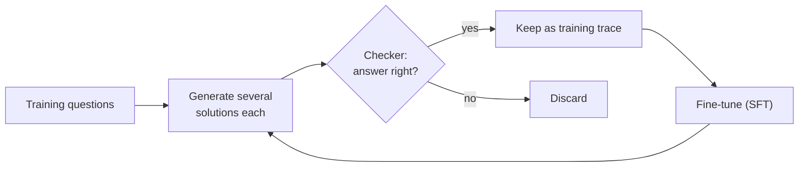
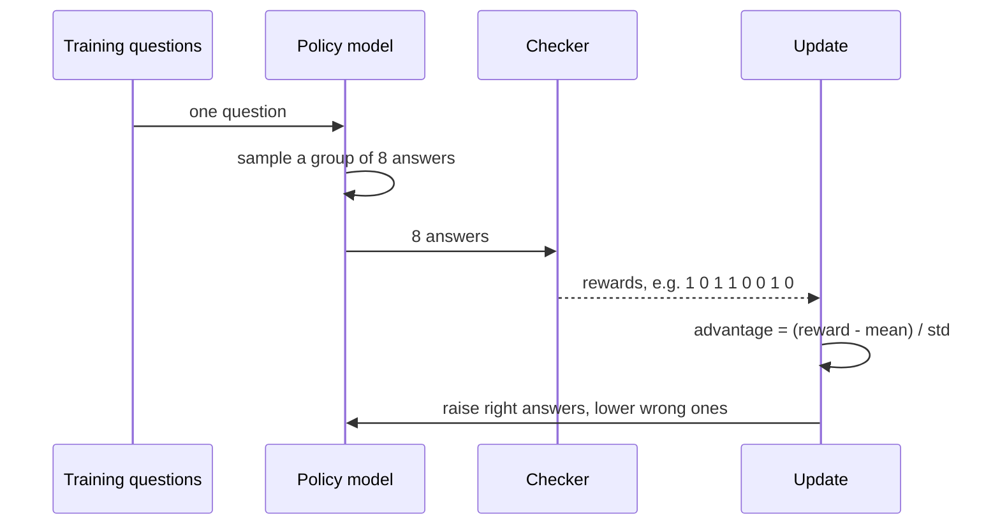
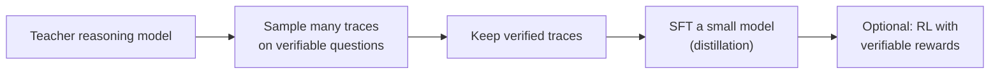

🌐 English · [Español](04-training-reasoning-models.es.md)

# Lesson 9.4 — Training reasoning models: STaR, RL with verifiable rewards and distillation

> **Module 09 · Lesson 4 of 4** · ⏱️ about 60 min · 🧪 Lab: [steps 8–9](lab/README.md#step-8--train-with-star)

## 📨 Situation

> **From:** Jordan Kim · Product and Strategy Lead
> **Channel:** #strategy
>
> Noor just told me the market data for next quarter's report cannot leave our laptops, so a big
> hosted reasoning model is off the table for that work. Everyone keeps quoting "R1 taught itself to
> think with reinforcement learning". Does that mean we could teach a small model to reason through
> our order, payback and hub questions? What would it need: data, a reward, a farm of graphics
> processing units (GPUs)? Give me the options in plain words, with what each one costs us and what
> it would actually change.

## 🎯 Objectives

By the end of this lesson you can:

- Explain supervised fine-tuning on reasoning traces, rejection sampling and distillation, and where the traces come from.
- Run a STaR (Self-Taught Reasoner) loop (generate, filter by correctness, fine-tune, rationalise failures) and explain why answer-only filtering lets unfaithful rationales through.
- Compute group-relative advantages as in Group Relative Policy Optimization (GRPO) and explain why groups where every sample gets the same reward teach nothing.
- Describe the DeepSeek-R1-Zero and DeepSeek-R1 recipes as reported, and compare outcome and process reward models as training signals.
- Explain self-refinement training and internalised search (Meta chain-of-thought, or Meta-CoT), and choose a training route for a small local model.

## 🤔 Predict first

Write your answers down before reading on. You will check them in the self-check.

1. STaR keeps only the rationales that reach the right answer. Can that filter still let in rationales with a wrong step?
2. In GRPO, the model answers the same question 8 times and all 8 answers are right. How much does that group teach the model?
3. A reinforcement-learning loop rewards only right answers and says nothing about length. Will the answers get longer, shorter, or stay the same?

## 1. Where reasoning traces come from

The plainest way to teach reasoning is **supervised fine-tuning (SFT)** on examples of it: questions
paired with worked solutions, as you saw in module 02. The hard part is getting good traces. There
are three sources:

| Source | How | Cost and risk |
|---|---|---|
| People | Experts write step-by-step solutions | Slow and expensive; style varies |
| A stronger model | Sample its reasoning, keep what checks out (**distillation**) | Cheap per trace; inherits its mistakes and licence terms |
| The model itself | Sample, keep only verified solutions, train on them, repeat | Cheapest; can only learn what it can already sometimes do |

The common tool across the last two rows is **rejection sampling**: generate several candidates per
question and keep only those a checker accepts. On verifiable problems the checker is exact for the
final answer, which is why maths, code and puzzles dominate reasoning training data.

**Analogy:** an apprentice who learns from a book of worked examples. The examples can come from a
master, from a senior colleague, or from the apprentice's own past jobs that the inspector passed.



> ⚠️ **Common mistake:** filtering traces only by the final answer and assuming the reasoning is
> therefore right. A trace can reach the right answer through a wrong step, or copy the answer from a
> hint. Training on it teaches the wrong step.

## 2. STaR: the Self-Taught Reasoner

**STaR** (Self-Taught Reasoner) turns rejection sampling into a loop. In each iteration:

1. **Generate** a rationale and answer for every training question.
2. **Filter:** keep the rationales whose answer is right.
3. **Rationalise** the failures: show the model the correct answer as a hint and ask for a
   rationale that reaches it; keep those that do.
4. **Fine-tune** on everything kept, then repeat with the improved model.

The STaR paper restarts fine-tuning from the original model at every iteration, training on the data
gathered by the latest model, which helps avoid overfitting. Rationalisation matters because without
it the model only ever trains on problems it could already solve; the hint gives it worked examples
for the hard ones too.

The lab simulates the loop on 80 training problems (odd ids) and measures the 80 others (even ids).
Generation, filtering and rationalisation are real calls to the simulator; only the fine-tuning step
is simulated: `finetune` turns "how many good rationales did we keep for each family" into higher
skill and fewer traps for a new model config, always starting from the base config.

```python
def finetune(base: SimConfig, kept: Sequence[Rationale], train: Sequence[Problem], name: str) -> SimConfig:
    size = Counter(p.type for p in train)
    good = Counter(r.problem.type for r in kept if r.faithful)
    bad = Counter(r.problem.type for r in kept if not r.faithful)  # a wrong step teaches a wrong step
    skill, trap = dict(base.skill), dict(base.trap)
    for family in FAMILIES:
        coverage = max(0.0, (good[family] - bad[family]) / size[family]) if size[family] else 0.0
        skill[family] = base.skill[family] + (1 - base.skill[family]) * SFT_GAIN * coverage
        trap[family] = base.trap[family] * (1 - SFT_GAIN * coverage)
    return replace(base, name=name, skill=skill, trap=trap)
```

From `uv run lab star` (accuracy on the 80 held-out problems):

| Round | Test accuracy | Target puzzles | Kept (solved) | Kept (hint) | Unfaithful kept |
|---|---|---|---|---|---|
| 0 | 51.2% | 20.0% | 40 | 27 | 5 |
| 1 | 68.8% | 48.0% | 51 | 21 | 1 |
| 2 | 71.2% | 52.0% | 58 | 19 | 3 |
| 3 | 73.8% | 52.0% | 56 | 21 | 2 |
| 4 | 72.5% | 52.0% | - | - | - |

Most of the gain comes in the first round, then the loop flattens: once the model solves what it
can, each round finds about the same rationales. Two variations, both in the lab:

- **Without rationalisation** (`--no-rationalize`), the final accuracy is 62.5% and the puzzles only
  reach 28.0%: the model never gets examples for what it cannot already solve.
- **With a strict filter** (`--strict`), which also requires every written step to pass the
  arithmetic re-check, no unfaithful rationale is kept and the loop ends at 73.8%.

**Analogy:** a student who keeps a notebook of every exercise they got right, plus the ones they
could explain once they saw the answer in the back of the book, and studies only that notebook.

> 💡 **Production tip:** log why each trace was kept (solved, hinted, strict check passed) and keep
> those labels in the training set. When a fine-tuned model regresses, you can trace it back to a
> class of data instead of guessing.

## 3. Reinforcement learning with verifiable rewards

STaR throws away the failures. **Reinforcement learning (RL)** uses them: the model samples answers,
a reward says how good each one was, and the update makes good answers more likely and bad answers
less likely. When the reward comes from a checker (right or wrong) rather than from people or a
learned model, this is called **RL with verifiable rewards**.

**GRPO** (Group Relative Policy Optimization), introduced in the DeepSeekMath paper, is the
algorithm behind DeepSeek-R1. For each question it samples a **group** of answers and scores each
one. Instead of training a separate value model to estimate "how good is this question's typical
answer", it uses the group itself as the baseline: each answer's advantage is its reward minus the
group's mean, divided by the group's standard deviation. Answers better than their siblings are
pushed up; worse ones are pushed down. The full method also limits how far each update moves the
policy and adds a penalty for drifting too far from a reference model.

```python
def group_advantages(rewards: Sequence[float]) -> list[float]:
    """GRPO: compare each sample with its own group. (r - mean) / std; all zeros if every reward is equal."""
    mean = sum(rewards) / len(rewards)
    std = math.sqrt(sum((r - mean) ** 2 for r in rewards) / len(rewards))
    if std < 1e-9:
        return [0.0] * len(rewards)
    return [(r - mean) / std for r in rewards]
```

Look at the special case: if every answer in the group gets the same reward, every advantage is zero
and the group teaches nothing. Questions that are always solved, or never solved, give no signal. RL
learns from questions at the edge of the model's ability.



The lab's `rl` command runs a GRPO-style toy on the simulator. It is REINFORCE with group-relative
advantages, without the clipping and the reference penalty, and the "policy" has just two parameters:
the probability of checking each step and the probability of re-reading the question at the end.
Both start at 0.10. The reward is 1 for a right answer and 0 otherwise, with groups of 8 per
training question. From `uv run lab rl`:

| Step | Train reward | Test accuracy | Tokens/answer | P(check step) | P(re-read) | Groups with no signal |
|---|---|---|---|---|---|---|
| 0 | 0.514 | 53.8% | 77.9 | 0.10 | 0.10 | 10 |
| 2 | 0.503 | 55.0% | 81.2 | 0.09 | 0.38 | 17 |
| 4 | 0.606 | 66.2% | 108.8 | 0.95 | 0.77 | 18 |
| 6 | 0.667 | 67.5% | 112.6 | 0.99 | 0.93 | 18 |
| 8 | - | 68.8% | 113.0 | 0.99 | 0.94 | - |

Nothing in the reward mentions checking or length. The policy discovers that checking pays, because
checks sometimes catch errors, and the answers grow from 77.9 to 113.0 tokens. Be honest about what
this toy shows: the simulator was built so that checks can catch slips. RL did not invent checking;
it found that checking is worth its tokens. That is the shape of what the DeepSeek-R1 report
describes at a vastly larger scale.

**Analogy:** a sales team paid only on closed deals. Nobody tells them to double-check quotes, but the
ones who do close more, and soon everyone double-checks, and meetings get longer.

The R1 work, as reported:

- **R1-Zero:** GRPO applied directly to the base model (DeepSeek-V3-Base), with rule-based accuracy
  and format rewards and no SFT first. Average response length grew during training, and reflection
  and re-evaluation appeared without being demonstrated. Readability was poor and languages mixed.
- **R1:** a few thousand curated long chain-of-thought examples as a "cold start" SFT, then
  reasoning-focused RL (with a reward for staying in one language), then rejection sampling to build
  a large SFT set that also covers non-reasoning tasks, then a final RL stage for all kinds of
  prompts.

> ⚠️ **Common mistake:** reading "RL taught the model to reason" as "RL creates abilities from
> nothing". RL reweights behaviours the model can already produce sometimes. If no sample in a group
> is ever right, the advantages are zero and nothing is learned; that is why a strong base model,
> or a cold start, comes first.

## 4. Reward models: outcome versus process

When no exact checker exists (open-ended questions, proofs, most business tasks), the reward must
come from a learned **reward model**, as in reinforcement learning from human feedback (RLHF) in
module 02. For reasoning there are two kinds:

| | Outcome reward model (ORM) | Process reward model (PRM) |
|---|---|---|
| Scores | the final answer of a whole solution | each step |
| Training labels | right or wrong per solution (often free from a checker) | right or wrong per step (expensive) |
| Strength | cheap, simple | points at the first error; ranks away misreadings |
| Weakness | rewards right answers reached by wrong steps | step boundaries and step labels are hard to define |

The "Let's verify step by step" paper trained both kinds on solutions to competition maths problems
and found that process supervision gave a clearly better reward model; it released PRM800K, a set of
800,000 step-level human labels. The DeepSeek-R1 report, on the other hand, lists PRMs among its
unsuccessful attempts: defining a step in general reasoning is hard, judging an intermediate step
automatically is unreliable and labelling by hand does not scale, and a learned PRM invites reward
hacking under large-scale RL. Both findings are compatible: PRMs are powerful judges and fragile
training targets. Lesson 9.3 showed the same split at inference time.

**Analogy:** paying a contractor on the final inspection (ORM) or on inspections at each stage
(PRM). Stage inspections catch problems early but need an inspector who knows what each stage
should look like.

> 💡 **Production tip:** wherever you can, turn part of the reward into rules: a parser for the
> answer format, a calculator for the arithmetic, tests for code. Use a learned reward model only for
> what rules cannot express, and evaluate it on a held-out set that RL never touches.

## 5. Self-refinement, internalised search and distillation

Inference-time methods from lessons 9.2 and 9.3 can be moved *into* the model by training:

- **Self-refinement training:** train on traces that contain a mistake, the detection of the mistake
  and the fix. The model learns to revise inside its own chain instead of in an outer loop.
- **Internalised search:** the Meta-CoT paper argues that a good chain of thought is the visible
  result of a search process (proposing, evaluating, backtracking), and proposes training models on
  *linearised search traces*, so that one long chain contains the exploration, the dead ends and the
  backtracking. A reasoning model's "Wait, that does not add up, let me try another way" is search
  happening inside one generation instead of in a Tree of Thoughts loop.

The simulator's thinking mode is a cartoon of this: `Wait, step 3 does not add up. Redoing it.` and
`Re-reading the question: step 1 misreads it` are revisions and backtracking written into a single
answer.



**Distillation** is the practical answer to Jordan's question. The R1 report fine-tuned several
smaller open models on samples curated with R1, and found that distilling from the large model worked
better than applying the same large-scale RL directly to a small model. Distilled models are what you
can run on a laptop with the tools of module 10.

| Option for Hearthwise | Needs | Changes |
|---|---|---|
| Prompting plus checkers (lessons 9.1–9.3) | No training | Accuracy per token, with any model |
| Distill a small model on verified traces | A teacher, a checker, a modest fine-tuning budget | A small local model that writes its own long chains |
| RL with verifiable rewards on top | Many GPU hours, a stable reward, careful evaluation | Further gains at the edge of the model's ability |

## 🧪 Try it

1. Run STaR with rationalisation, then without, then with the strict filter:

   ```bash
   uv run lab star
   uv run lab star --no-rationalize
   uv run lab star --strict
   ```

   ```text
   round  test accuracy  energy  hub_capacity  order_total  target  kept (solved)  kept (hint)  unfaithful kept  tokens spent
   -----  -------------  ------  ------------  -----------  ------  -------------  -----------  ---------------  ------------
   0              51.2%   82.4%         38.9%        75.0%   20.0%             40           27                5         8,625
   1              68.8%  100.0%         55.6%        80.0%   48.0%             51           21                1         7,508
   2              71.2%  100.0%         61.1%        80.0%   52.0%             58           19                3         6,770
   3              73.8%  100.0%         66.7%        85.0%   52.0%             56           21                2         7,178
   4              72.5%  100.0%         61.1%        85.0%   52.0%              -            -                -             -
   ```

2. Run the GRPO-style toy and watch the answers get longer:

   ```bash
   uv run lab rl
   ```

   ```text
   step  train reward  test accuracy  tokens/answer  P(check step)  P(re-read)  groups with no signal
   ----  ------------  -------------  -------------  -------------  ----------  ---------------------
   0            0.514          53.8%           77.9           0.10        0.10                     10
   1            0.530          55.0%           79.8           0.11        0.19                     17
   2            0.503          55.0%           81.2           0.09        0.38                     17
   3            0.534          60.0%           90.4           0.38        0.70                     18
   4            0.606          66.2%          108.8           0.95        0.77                     18
   5            0.670          67.5%          112.5           0.98        0.93                     25
   6            0.667          67.5%          112.6           0.99        0.93                     18
   7            0.658          68.8%          113.0           0.99        0.94                     20
   8                -          68.8%          113.0           0.99        0.94                      -
   ```

3. Open `src/m09_reasoning/training.py`, find `group_advantages`, and compute by hand the advantages
   for the rewards 1, 0, 0, 0. Then check your result in a Python shell.

## 🏭 In the real world

Training a reasoning model from scratch is a frontier-lab project. Most teams use one of two lighter
routes. The first is distillation: generate traces with a strong model on your own verifiable tasks,
keep the verified ones, and fine-tune a small open model on them with standard SFT tooling (the
open-source Hugging Face TRL library covers SFT and also includes a GRPO trainer). The second
is a short RL phase with verifiable rewards on top of an already capable model, for a narrow domain
with a reliable checker.

Both routes fail in familiar ways. Data leaks: the evaluation problems, or near copies, end up in the
training traces, and accuracy looks wonderful. Rewards get hacked: the model finds formats or lengths
the checker misjudges. Signal dries up: once the model solves most training questions, groups stop
disagreeing and learning stalls, so you need harder questions. Monitor reward, held-out accuracy,
response length and the share of no-signal groups together.

## ✅ Self-check

**1. Can an answer-only filter let in rationales with a wrong step? How many did STaR keep in round 0?**

<details><summary>Answer</summary>

Yes. In round 0, 5 of the kept rationales had a step whose arithmetic does not check out, even
though their final answers were right (lucky answers, often after copying the hint). The strict
filter, which also re-checks every step, kept none of them and finished at 73.8%.

</details>

**2. All 8 answers in a GRPO group are right. How much does the group teach?**

<details><summary>Answer</summary>

Nothing: every reward equals the mean, so every advantage is zero. In the toy, such groups went from
10 of 80 at step 0 to 25 at step 5 as the policy improved. RL needs questions where the model
sometimes succeeds and sometimes fails.

</details>

**3. The RL reward said nothing about length. What happened to the answers, and why?**

<details><summary>Answer</summary>

They grew from 77.9 to 113.0 tokens, because the probability of checking each step rose from 0.10 to
0.99. Checking sometimes catches an error, so answers with checks were right more often and were
reinforced. Longer reasoning was a side effect of rewarding correctness, the pattern the R1 report
describes.

</details>

**4. Why does rationalisation help most on the target puzzles?**

<details><summary>Answer</summary>

Without it, the model trains only on puzzles it already solved, which are few (20.0% at the start),
so puzzle accuracy only reached 28.0%. With the answer as a hint, it produces worked examples for
puzzles it could not solve and reached 52.0%.

</details>

**5. Why did DeepSeek-R1-Zero use rule-based rewards instead of a neural reward model?**

<details><summary>Answer</summary>

According to the report, neural outcome and process reward models can be reward-hacked during
large-scale RL, and retraining them adds cost and complexity. For maths and code, a rule (is the
answer right, is the format right) is cheap and cannot be fooled in the same way.

</details>

**6. What would you recommend to Jordan for a small local model, and why?**

<details><summary>Answer</summary>

Start with prompting plus checkers to set a baseline; then distil: generate traces with a strong
model on Hearthwise-style verifiable questions, keep only verified (ideally step-checked) traces, and
fine-tune a small open model. The R1 report found distillation beat running RL directly on a small
model. Consider RL only later, for a narrow task with a reliable checker.

</details>

## 💬 Explain it in your own words

- Explain to Jordan the difference between STaR and RL with verifiable rewards in four sentences,
  using "notebook of solved exercises" and "group of answers" in your explanation.
- Explain to Sam why a model trained with RL might cost more per answer than the model it started
  from, using the token column of the RL table.

## 🔑 Key ideas

- SFT on reasoning traces needs good traces: from people, from a stronger model (distillation) or from the model itself, filtered by a checker.
- STaR loops generate, filter, rationalise and fine-tune; rationalisation gives the model examples for problems it cannot yet solve.
- Answer-only filters let unfaithful rationales through; checking steps removes them.
- GRPO scores each sample against its own group; groups with no disagreement give no learning signal.
- Rewarding only correctness can make answers longer when checking pays, as reported for R1-Zero.
- PRMs are strong judges but hard training targets; rule-based rewards resist reward hacking.
- For a small local model, distillation on verified traces is usually the first and best route.

## 📚 Go deeper

- ⭐ [DeepSeek-R1 report](https://arxiv.org/abs/2501.12948) — R1-Zero, the R1 pipeline, distillation results and the unsuccessful attempts.
- [DeepSeekMath (GRPO)](https://arxiv.org/abs/2402.03300) — where GRPO is introduced and compared with PPO.
- [STaR: bootstrapping reasoning with reasoning](https://arxiv.org/abs/2203.14465) — the generate, filter, rationalise loop.
- [Let's verify step by step](https://arxiv.org/abs/2305.20050) — process versus outcome supervision and the PRM800K dataset.
- [Towards System 2 reasoning in LLMs: Meta Chain-of-Thought](https://arxiv.org/abs/2501.04682) — training models to internalise search.
- [Hugging Face TRL](https://huggingface.co/docs/trl) — open-source trainers for SFT and GRPO.

---

[← Previous: 9.3 Search and verifiers](03-search-and-verifiers.md) · [🏠 Module 09](README.md) · [Next: Lab →](lab/README.md)
