🌐 [English](README.md) · Español

# Módulo 09 — Modelos de razonamiento

> Decide cuándo un modelo de razonamiento vale lo que cuestan sus *tokens*, escala la exactitud en el
> momento de responder con muestreo, verificadores y búsqueda, y explica cómo se entrenan estos
> modelos.

## 🗺️ Mapa del curso

```mermaid
flowchart LR
    subgraph P1["Parte 1 · Fundamentos"]
        M01["01 · Cómo se construyen los LLM"] --> M02["02 · Del modelo base al asistente"] --> M03["03 · Playground de LLM"]
    end
    subgraph P2["Parte 2 · Adaptación y RAG"]
        M04["04 · Prompting y fine-tuning"] --> M05["05 · RAG I: recuperación"] --> M06["06 · RAG II: bot de soporte"]
    end
    subgraph P3["Parte 3 · Agentes"]
        M07["07 · Workflows y herramientas"] --> M08["08 · Agente Ask-the-Web"]
    end
    subgraph P4["Parte 4 · Razonamiento"]
        M09["09 · Modelos de razonamiento"] --> M10["10 · Deep research y local"]
    end
    M03 --> M04
    M06 --> M07
    M08 --> M09
    M10 --> CAP["🎓 Proyecto final"]
    classDef current fill:#ffb300,stroke:#e65100,stroke-width:3px,color:#000
    class M09 current
```



## 📖 La historia

El agente Ask-the-Web del módulo 08 encuentra datos. Las siguientes preguntas de Jordan necesitan
*trabajar con* ellos: totales de pedidos con códigos de descuento y la regla de envío gratuito,
ahorros de termostatos y plazos de amortización para el plan de Latinoamérica, la capacidad del Hearth
Hub con dispositivos Wi-Fi que despistan en la pregunta, y acertijos numéricos. Son los 160 problemas
verificables de `datasets/reasoning/`. El asistente falló la pregunta de Jordan sobre el hub al contar
bombillas que no usan el hub.

Todo el mundo dice "usa un modelo que piense". Sam ha visto las facturas y quiere saber qué compran
los *tokens* extra. Dani quiere curvas, no anécdotas: exactitud frente a cómputo, con las razones por
las que cada curva se aplana. Y Jordan, con la regla de Noor de que los datos del próximo trimestre se
quedan en los portátiles, quiere saber si un modelo pequeño podría aprender a razonar así. Este módulo
responde a las tres cosas con un razonador simulado con semilla que comete sus errores a la vista, para
que puedas observar cómo funciona cada algoritmo.

## 🎯 Objetivos de aprendizaje

Al terminar este módulo puedes:

- Explicar qué hacen distinto los modelos de razonamiento (cadenas de pensamiento largas, *tokens* de pensamiento, niveles de esfuerzo) y cuándo compensan.
- Evaluar el razonamiento en problemas verificables con comprobadores exactos y con pass@1, pass@k y majority@k.
- Implementar y comparar la autoconsistencia (*self-consistency*), *best-of-N* con un verificador y la revisión secuencial en exactitud por *token*.
- Implementar el árbol de pensamientos (*Tree of Thoughts*) y la búsqueda en haz guiada por un modelo de recompensa de proceso (PRM, *process reward model*), y medir los errores del verificador y la explotación de la recompensa (*reward hacking*).
- Explicar STaR (*Self-Taught Reasoner*), el aprendizaje por refuerzo (RL, *reinforcement learning*) con recompensas verificables (GRPO), los modelos de recompensa de resultado y de proceso, la búsqueda interiorizada y la destilación, y elegir una vía de entrenamiento.

## 🗂️ Lecciones

| # | Lección | Tiempo | Qué aprenderás |
|---|---|---|---|
| 9.1 | [Modelos de razonamiento: qué cambia y cuándo compensan](01-reasoning-models-overview.es.md) | 50 min | Cadenas de pensamiento, *tokens* de pensamiento, esfuerzo, evaluación en tareas verificables, DeepSeek-R1 |
| 9.2 | [Escalado en tiempo de inferencia: más muestras, más revisiones](02-inference-time-scaling.es.md) | 55 min | Autoconsistencia, *best-of-N*, por qué se satura la votación, bucles de revisión, presupuestos |
| 9.3 | [Búsqueda y verificadores](03-search-and-verifiers.es.md) | 60 min | Verificadores exactos y aprendidos, árbol de pensamientos, ORM frente a PRM, explotación de la recompensa |
| 9.4 | [Entrenar modelos de razonamiento](04-training-reasoning-models.es.md) | 60 min | SFT con trazas, STaR, GRPO, R1-Zero y R1, PRM, Meta-CoT, destilación |

## 🧪 Lab

Construyes y mides, sin conexión y en la CPU de un portátil, las principales técnicas de razonamiento
frente a un razonador simulado con semilla (un *responder* de `FakeProvider` que escribe soluciones
paso a paso y comete deslices y cae en trampas a propósito): respuestas directas frente a cadena de
pensamiento frente a respuestas con pensamiento, curvas de autoconsistencia y de *best-of-N*, bucles
de revisión, una recomprobación aritmética, modelos de recompensa de resultado y de proceso simulados,
búsqueda en haz con PRM, árbol de pensamientos con un verificador exacto, un bucle STaR y un juguete
de RL al estilo de GRPO.

```bash
cd modules/09-reasoning-models/lab
uv sync && uv run pytest
uv run lab solve      # then: scale, revise, search, tot, star, rl
```

Instrucciones completas: [lab/README.es.md](lab/README.es.md) (unas 3 horas).

**Definición de terminado (*Definition of Done*)**

- [ ] `uv run pytest` pasa y sabes explicar qué es el simulador y qué no es.
- [ ] Sabes explicar, a partir de `lab solve --id r076`, qué error detectó o se le escapó a cada modo.
- [ ] Sabes mostrar con `lab scale` por qué la votación por mayoría se para en 89.1% y qué problemas falla.
- [ ] Has seguido paso a paso una búsqueda con árbol de pensamientos y una búsqueda en haz con PRM, y sabes explicar cada decisión.
- [ ] Has ejecutado STaR con y sin racionalización y el juguete de RL, y sabes explicar las dos tablas.
- [ ] Has implementado al menos dos de los tres ejercicios y sus tests pasan.

## 📏 Rúbrica de autoevaluación

| Criterio | 1 Inicial | 2 En desarrollo | 3 Competente | 4 Avanzado |
|---|---|---|---|---|
| Modelos de razonamiento | Sabe definir un modelo de razonamiento | Sabe ejecutar los tres modos y leer la tabla de *tokens* | Sabe explicar, con un conjunto de preguntas nuevo, dónde compensa pensar y dónde se malgastan *tokens* | Sabe diseñar una política de enrutamiento con presupuestos y defenderla con mediciones |
| Escalado en paralelo | Sabe definir la autoconsistencia | Sabe ejecutar las curvas de votación y de *best-of-N* | Sabe explicar la saturación por errores correlacionados y encontrar los problemas que fallan | Sabe elegir N, un verificador y una regla de parada temprana para un objetivo de coste |
| Revisión | Sabe describir un bucle de comentarios | Sabe ejecutar los tres bucles de revisión | Sabe explicar por qué los comentarios ruidosos estropean respuestas correctas | Sabe diseñar un bucle con reglas de parada, selección del mejor intento y vigilancia de la tasa de cambios |
| Búsqueda y verificadores | Sabe nombrar el ORM y el PRM | Sabe ejecutar el ToT y la búsqueda en haz | Sabe comparar métodos por *tokens* generados, *tokens* de *prompt* y llamadas | Sabe elegir verificadores exactos y aprendidos para una tarea nueva y protegerse de la explotación de la recompensa |
| Entrenamiento | Sabe nombrar STaR y GRPO | Sabe ejecutar los comandos de STaR y de RL | Sabe explicar la racionalización, las justificaciones infieles y los grupos sin señal | Sabe recomendar y justificar una vía de entrenamiento (destilación, RL) para un modelo pequeño |

## 🎤 Rincón de entrevistas

**1. ¿Qué diferencia hay entre un modelo de razonamiento y el *prompting* con cadena de pensamiento?**

<details><summary>Respuesta</summary>

El *prompting* con cadena de pensamiento le pide a cualquier modelo que escriba sus pasos. Un modelo
de razonamiento ha sido entrenado, normalmente con RL sobre recompensas verificables, para producir
por sí mismo un razonamiento largo antes de responder, que incluye comprobar, retroceder y revisar. Los
dos gastan *tokens* de salida en razonar; el modelo entrenado lo hace de forma más fiable y con más
extensión, y muchos proveedores facturan esos *tokens* aunque los oculten.

</details>

**2. ¿Por qué se estanca la votación por mayoría y qué haces al respecto?**

<details><summary>Respuesta</summary>

La votación elimina los errores independientes pero amplifica los correlacionados: si la mayoría de
las muestras cometen el mismo error, gana la respuesta errónea y más muestras la hacen ganar con más
seguridad. Se arregla con una señal que reconozca la corrección (un verificador o un modelo de
recompensa para *best-of-N*), corrigiendo la causa sistemática (el *prompt*, un dato que falta) o con
una comprobación específica para ese error.

</details>

**3. ¿ORM o PRM: cuál usarías, y dónde?**

<details><summary>Respuesta</summary>

Un ORM puntúa soluciones completas y es barato de entrenar con etiquetas de un comprobador, pero premia
respuestas correctas alcanzadas con pasos erróneos. Un PRM puntúa cada paso, lo que le permite relegar
las lecturas erróneas y guiar una búsqueda por pasos, pero sus etiquetas son caras y un PRM aprendido
puede ser explotado durante el RL. En inferencia, un PRM ordena muy bien; para el RL en matemáticas o
código, las recompensas basadas en reglas son más seguras.

</details>

**4. ¿En qué se diferencia GRPO de PPO?**

<details><summary>Respuesta</summary>

GRPO prescinde del modelo de valor aprendido de PPO (el crítico, *critic*). Muestrea un grupo de
respuestas por *prompt* y usa la media y la desviación típica de las recompensas del grupo como
referencia para la ventaja de cada respuesta. Mantiene el recorte al estilo de PPO y añade una
penalización KL hacia un modelo de referencia. Un grupo en el que todas las respuestas reciben la misma
recompensa no aporta ningún gradiente.

</details>

**5. Necesitas un modelo pequeño que razone bien en tu dominio y se ejecute en local. ¿Cuál es tu plan?**

<details><summary>Respuesta</summary>

Primero, construye un conjunto de evaluación verificable. Después, destila: muestrea trazas de un
modelo de razonamiento fuerte con preguntas del dominio, conserva solo las verificadas (comprueba
también los pasos, no solo las respuestas) y ajusta un modelo abierto pequeño con SFT. Añade una fase
corta de RL con recompensas basadas en reglas solo si existe un comprobador fiable y la evaluación
muestra margen de mejora. Vigila la contaminación entre las trazas de entrenamiento y el conjunto de
evaluación.

</details>

## ✅ Antes de seguir

- 📝 Haz el [quiz del módulo](quiz.es.md): 13 preguntas, incluidas tres de repaso de módulos anteriores.
- 📄 Ten abierta la [chuleta](cheatsheet.es.md) mientras trabajas en el módulo 10.

---

[← Módulo 08](../08-multi-step-and-multi-agent-systems/README.es.md) · [🏠 Inicio del curso](../../README.es.md) · [Empieza: Lección 9.1 →](01-reasoning-models-overview.es.md)
