🌐 English · [Español](README.es.md)

# Module 09 — Reasoning and Thinking Models

> Decide when a reasoning model is worth its tokens, scale accuracy at answer time with sampling,
> verifiers and search, and explain how such models are trained.

## 🗺️ Course map

```mermaid
flowchart LR
    subgraph P1["Part 1 · Foundations"]
        M01["01 · How LLMs are built"] --> M02["02 · Base model to assistant"] --> M03["03 · LLM playground"]
    end
    subgraph P2["Part 2 · Adapting and RAG"]
        M04["04 · Prompting and fine-tuning"] --> M05["05 · RAG I: retrieval"] --> M06["06 · RAG II: support bot"]
    end
    subgraph P3["Part 3 · Agents"]
        M07["07 · Workflows and tools"] --> M08["08 · Ask-the-Web agent"]
    end
    subgraph P4["Part 4 · Reasoning"]
        M09["09 · Reasoning models"] --> M10["10 · Deep research and local"]
    end
    M03 --> M04
    M06 --> M07
    M08 --> M09
    M10 --> CAP["🎓 Capstone"]
    classDef current fill:#ffb300,stroke:#e65100,stroke-width:3px,color:#000
    class M09 current
```



## 📖 The story

The Ask-the-Web agent from module 08 finds facts. Jordan's next questions need to *work with* them:
order totals with discount codes and the free-shipping rule, thermostat savings and payback times
for the Latin America plan, Hearth Hub capacity with distracting Wi-Fi devices in the question, and
number puzzles. They are the 160 verifiable problems in `datasets/reasoning/`. The assistant got
Jordan's hub question wrong by counting bulbs that do not use the hub.

Everyone says "use a thinking model". Sam has seen the bills and wants to know what the extra tokens
buy. Dani wants curves, not anecdotes: accuracy against compute, with the reasons each curve goes
flat. And Jordan, with Noor's rule that next quarter's data stays on the laptops, wants to know
whether a small model could learn to reason this way. This module answers all three, using a seeded
simulated reasoner that makes its mistakes in the open so you can watch every algorithm work.

## 🎯 Learning objectives

By the end of this module you can:

- Explain what reasoning models do differently (long chains of thought, thinking tokens, effort settings) and when they pay off.
- Evaluate reasoning on verifiable problems with exact checkers and pass@1, pass@k and majority@k.
- Implement and compare self-consistency, best-of-N with a verifier and sequential revision on accuracy per token.
- Implement Tree of Thoughts and beam search guided by a process reward model (PRM), and measure verifier errors and reward hacking.
- Explain STaR (Self-Taught Reasoner), reinforcement learning (RL) with verifiable rewards (GRPO), outcome and process reward models, internalised search and distillation, and choose a training route.

## 🗂️ Lessons

| # | Lesson | Time | You will learn |
|---|---|---|---|
| 9.1 | [Reasoning models: what changes and when they pay off](01-reasoning-models-overview.md) | 50 min | Chains of thought, thinking tokens, effort, evaluation on verifiable tasks, DeepSeek-R1 |
| 9.2 | [Inference-time scaling: more samples, more revisions](02-inference-time-scaling.md) | 55 min | Self-consistency, best-of-N, why voting saturates, revision loops, budgets |
| 9.3 | [Search and verifiers](03-search-and-verifiers.md) | 60 min | Exact and learned verifiers, Tree of Thoughts, ORM vs PRM, reward hacking |
| 9.4 | [Training reasoning models](04-training-reasoning-models.md) | 60 min | SFT on traces, STaR, GRPO, R1-Zero and R1, PRMs, Meta-CoT, distillation |

## 🧪 Lab

You build and measure, offline and on a laptop CPU, the main reasoning techniques against a seeded
simulated reasoner (a `FakeProvider` responder that writes step-by-step solutions and makes slips and
traps on purpose): direct vs chain-of-thought vs thinking answers, self-consistency and best-of-N
curves, revision loops, an arithmetic re-check, simulated outcome and process reward models,
PRM beam search, Tree of Thoughts with an exact verifier, a STaR loop and a GRPO-style RL toy.

```bash
cd modules/09-reasoning-models/lab
uv sync && uv run pytest
uv run lab solve      # then: scale, revise, search, tot, star, rl
```

Full instructions: [lab/README.md](lab/README.md) (about 3 hours).

**Definition of Done**

- [ ] `uv run pytest` passes and you can explain what the simulator is and is not.
- [ ] You can explain, from `lab solve --id r076`, which mistake each mode caught or missed.
- [ ] You can show with `lab scale` why majority vote stops at 89.1% and which problems it gets wrong.
- [ ] You have traced one Tree of Thoughts search and one PRM beam search and can explain each decision.
- [ ] You have run STaR with and without rationalisation and the RL toy, and can explain both tables.
- [ ] You have implemented at least two of the three exercises and their tests pass.

## 📏 Self-assessment rubric

| Criterion | 1 Beginning | 2 Developing | 3 Proficient | 4 Advanced |
|---|---|---|---|---|
| Reasoning models | Can define a reasoning model | Can run the three modes and read the token table | Can explain where thinking pays and where it wastes tokens on a new question set | Can design a routing policy with budgets and defend it with measurements |
| Parallel scaling | Can define self-consistency | Can run the vote and best-of-N curves | Can explain saturation from correlated errors and find the failing problems | Can choose N, a verifier and an early-stopping rule for a cost target |
| Revision | Can describe a feedback loop | Can run the three revision loops | Can explain why noisy feedback breaks right answers | Can design a loop with stop rules, best-attempt selection and flip-rate monitoring |
| Search and verifiers | Can name ORM and PRM | Can run ToT and beam search | Can compare methods on generated tokens, prompt tokens and calls | Can choose exact and learned verifiers for a new task and guard against reward hacking |
| Training | Can name STaR and GRPO | Can run the STaR and RL commands | Can explain rationalisation, unfaithful rationales and zero-signal groups | Can recommend and justify a training route (distillation, RL) for a small model |

## 🎤 Interview corner

**1. What is the difference between a reasoning model and chain-of-thought prompting?**

<details><summary>Answer</summary>

Chain-of-thought prompting asks any model to write its steps. A reasoning model has been trained,
typically with RL on verifiable rewards, to produce long reasoning on its own before answering,
including checking, backtracking and revising. Both spend output tokens on reasoning; the trained
model does it more reliably and at greater length, and many providers bill those tokens even when
they hide them.

</details>

**2. Why does majority voting plateau, and what do you do about it?**

<details><summary>Answer</summary>

Voting removes independent errors but amplifies correlated ones: if most samples make the same
mistake, the wrong answer wins and more samples make it win more surely. Fix it with a signal that
recognises correctness (a verifier or reward model for best-of-N), by fixing the systematic cause
(prompt, missing fact), or with a targeted check for that error.

</details>

**3. ORM or PRM: which would you use, and where?**

<details><summary>Answer</summary>

An ORM scores whole solutions and is cheap to train from checker labels, but it rewards right answers
reached by wrong steps. A PRM scores each step, which lets it rank away misreadings and guide
step-level search, but its labels are expensive and a learned PRM can be reward-hacked during RL. At
inference, a PRM is a strong ranker; for RL on maths or code, rule-based rewards are safer.

</details>

**4. How does GRPO differ from PPO?**

<details><summary>Answer</summary>

GRPO drops PPO's learned value model (critic). It samples a group of answers per prompt and uses the
group's mean and standard deviation of rewards as the baseline for each answer's advantage. It keeps
PPO-style clipping and adds a KL penalty towards a reference model. A group where every answer gets
the same reward contributes no gradient.

</details>

**5. You need a small model that reasons well on your domain and runs locally. What is your plan?**

<details><summary>Answer</summary>

Build a verifiable evaluation set first. Then distil: sample traces from a strong reasoning model on
domain questions, keep only verified ones (check steps too, not only answers), and fine-tune a small
open model with SFT. Add a short RL phase with rule-based rewards only if a reliable checker exists
and the evaluation shows room to improve. Watch for contamination between training traces and the
evaluation set.

</details>

## ✅ Before you move on

- 📝 Take the [module quiz](quiz.md): 13 questions, including three reviews of earlier modules.
- 📄 Keep the [cheatsheet](cheatsheet.md) open while you work through module 10.

---

[← Module 08](../08-multi-step-and-multi-agent-systems/README.md) · [🏠 Course home](../../README.md) · [Start: Lesson 9.1 →](01-reasoning-models-overview.md)
