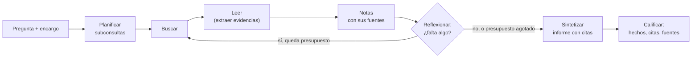
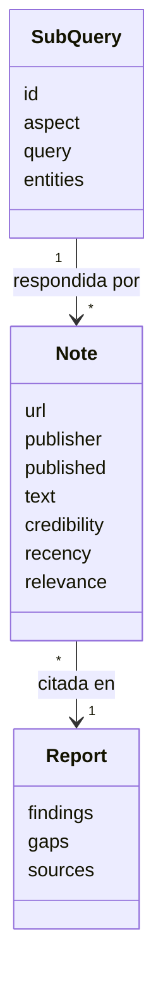
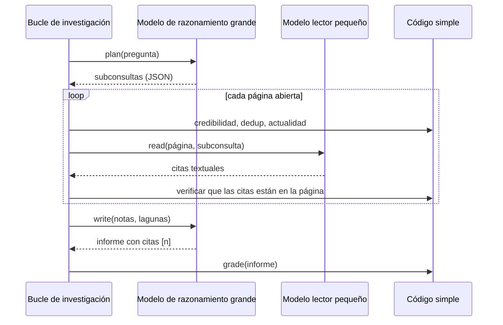
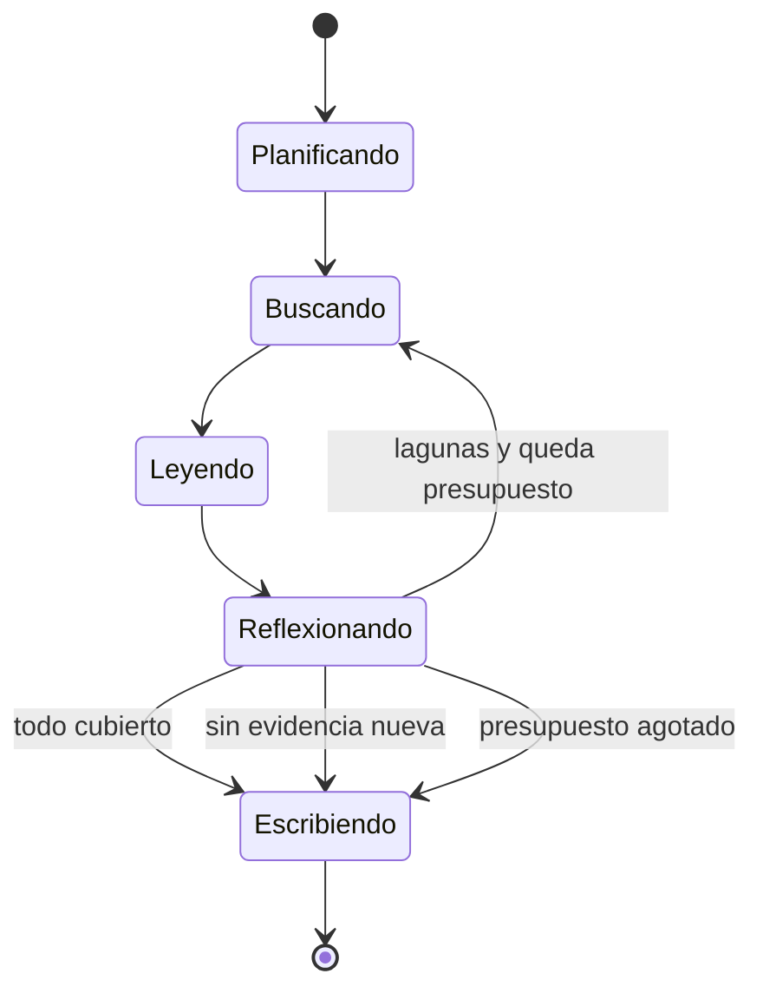
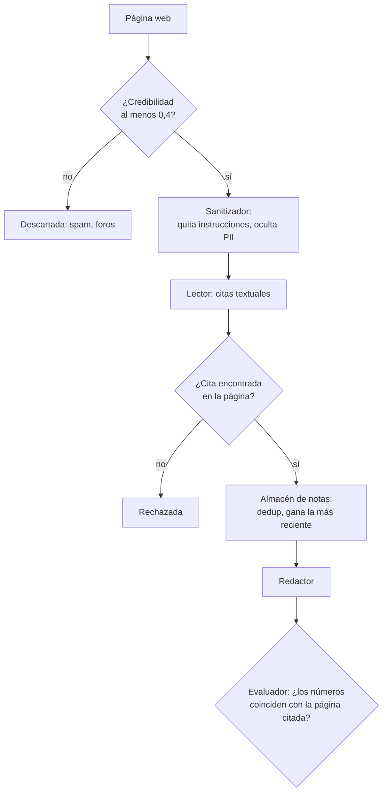

🌐 [English](01-deep-research-architecture.md) · Español

# Lección 10.1 — Arquitectura de *deep research*

> **Módulo 10 · Lección 1 de 4** · ⏱️ unos 50 min · 🧪 Lab: [paso 1](lab/README.es.md#paso-1--ejecuta-tu-primer-informe-de-investigación)

## 📨 Situación

> **De:** Jordan Kim · Responsable de Producto y Estrategia
> **Canal:** #strategy
>
> Reunión del consejo dentro de dos semanas. La pregunta es sencilla: ¿lanzamos el Ember T3 primero
> en México, Colombia o Chile? Se lo pregunté a un chatbot. Me dio un párrafo muy seguro de sí mismo,
> con tamaños de mercado que no encontré en ningún sitio y ni un solo enlace. Necesito un informe de
> verdad: cada número con una fuente en la que pueda hacer clic, lo que no pudimos encontrar y en qué
> fuentes decidimos no confiar. El agente Ask-the-Web del módulo 08 responde una pregunta cada vez.
> Esto necesita decenas de búsquedas y un informe escrito. Además, Noor dice que los datos de mercado
> no pueden salir de nuestros portátiles. ¿Puedes construir algo para el viernes?

## 🎯 Objetivos

Al terminar esta lección puedes:

- Describir las cinco etapas de un sistema de investigación profunda (*deep research*): planificar, buscar, leer, reflexionar y sintetizar, y qué entrega cada etapa a la siguiente.
- Explicar en qué se diferencia el *deep research* de la respuesta de un chatbot, de la generación aumentada por recuperación y de un agente web de una sola pregunta.
- Decidir en qué punto del *pipeline* un modelo de razonamiento compensa su coste y dónde es mejor el código simple.
- Fijar presupuestos de iteraciones, búsquedas y *tokens*, y leer el coste de una ejecución en su traza.
- Nombrar cinco modos de fallo de los agentes de investigación y la defensa contra cada uno.

## 🤔 Predice primero

Apunta tus respuestas antes de seguir leyendo. Las comprobarás en la autoevaluación.

1. La pregunta de Jordan necesita unas 20 páginas web. ¿Cuántas llamadas a un modelo de lenguaje grande (LLM, *large language model*) crees que cuesta un informe: unas 2, unas 20 o unas 200?
2. Si un agente deja de buscar en cuanto tiene *alguna* evidencia, ¿qué esperas que salga peor parado: el número de hechos del informe o el número de fuentes independientes?
3. ¿Qué es peor en un informe para el consejo: un hecho que falta o un hecho con una cita que no lo respalda?

## 1. Qué hace un sistema de deep research

Un **sistema de *deep research*** convierte una pregunta abierta en un informe escrito con citas. Lo
hace en bucle: planifica lo que necesita saber, lo busca, lee las páginas que encuentra, toma notas,
comprueba qué falta todavía y solo entonces escribe. El resultado no es una respuesta en una burbuja
de chat. Es un documento que alguien como Jordan puede reenviar, comprobar y discutir.

Compáralo con los sistemas que construiste antes en el curso:

| Sistema | Entrada | Pasos | Salida | Coste típico |
|---|---|---|---|---|
| Chatbot | Una pregunta | Una llamada al modelo | Un párrafo sacado de la memoria del modelo | 1 llamada |
| Generación aumentada por recuperación (RAG, *retrieval-augmented generation*), módulos 05 y 06 | Una pregunta | Recuperar unos pocos fragmentos (*chunks*) una vez y responder | Una respuesta corta fundamentada | De 1 a 2 llamadas |
| Agente Ask-the-Web, módulo 08 | Una pregunta | Unas pocas llamadas a herramientas hasta encontrar la respuesta | Una respuesta con una fuente | Un puñado de llamadas |
| *Deep research* | Una pregunta *y un encargo* | Muchas búsquedas en varias rondas, notas, reflexión | Un informe estructurado: hallazgos, lagunas, salvedades, fuentes | Decenas de llamadas |

La diferencia clave es **amplitud más rendición de cuentas**. La pregunta de Jordan no tiene una
única página con la respuesta. La respuesta es una comparación construida a partir de tamaños de
mercado, tasas de crecimiento, adopción, precios de la electricidad, plazos de entrega y competidores,
cada uno de una fuente distinta. El informe tiene que mostrar de dónde sale cada pieza, para que
quien lo lea con escepticismo pueda comprobarlo.

**Analogía:** un agente de *deep research* es una persona recién incorporada al equipo de análisis,
con carné de biblioteca y un cuaderno. No responde de memoria. Divide el encargo en preguntas, busca
documentos, copia las líneas útiles en el cuaderno con la referencia al lado de cada una, se da cuenta
de lo que todavía falta, vuelve a las estanterías y, al final, redacta el informe a partir del
cuaderno, no de la memoria.



En el lab, una sola función ejecuta el bucle completo para una pregunta de
`datasets/agent_tasks/research_questions.jsonl` sobre la copia sin conexión de la web:

```python
from m10_deep_research.evaluate import load_workspace, run_and_grade

ws = load_workspace()                      # snapshot, search index, questions, labels
result, grade = run_and_grade(ws, "rq1")   # Jordan's market-entry question
print(result.stats.searches, result.stats.pages_opened, result.stats.llm_calls)
print(grade.facts_covered, "/", grade.facts_total)
print(result.report[:300])
```

Para `rq1` esto imprime 5 búsquedas, 20 páginas abiertas, 22 llamadas al modelo y 7 de 7 hechos clave
cubiertos.

## 2. Los componentes y sus contratos

Cada etapa es un componente aparte con un contrato claro: qué recibe y qué debe entregar. Mantener los
contratos pequeños es lo que te permite probar, sustituir y presupuestar cada parte por separado.

| Componente | Recibe | Entrega | En el lab |
|---|---|---|---|
| Planificador | La pregunta | De 2 a 6 subconsultas en JSON (*JavaScript Object Notation*), cada una con un aspecto y sus entidades | `planner.py` |
| Buscador | Una subconsulta | Las mejores páginas, la mejor primero | `search.py` |
| Filtro de credibilidad | Una página | Una puntuación de 0 a 1 y los motivos | `credibility.py` |
| Lector | Una página y una subconsulta | Citas textuales como evidencia, o nada | `reader.py` |
| Almacén de notas | Pasajes de evidencia | Notas deduplicadas, cada una con su URL, fecha y puntuaciones | `notes.py` |
| Módulo de reflexión | Notas por subconsulta | Lo que todavía falta, como búsquedas nuevas | `loop.py` |
| Redactor | Notas numeradas y lagunas | Un informe en Markdown con citas `[n]` | `synthesise.py` |
| Evaluador (*grader*) | El informe | Cobertura, validez de las citas, calidad de las fuentes, trampas | `grade.py` |

El planificador convierte la pregunta de Jordan en cinco subconsultas, una por cada aspecto de una
decisión de entrada en un mercado. El buscador es Okapi BM25 (*Best Matching 25*), el ranking por
palabras clave que conociste en el módulo 05. El lector es una llamada al modelo que debe copiar
frases palabra por palabra. El almacén de notas es Python normal y corriente. El redactor vuelve a ser
una llamada al modelo. El evaluador nunca ve las piezas internas del agente: solo lee el informe.

Dos contratos importan más que los demás. Primero, **la nota conserva la fuente**. Cada pasaje del
almacén lleva su URL (*uniform resource locator*) canónica, su medio (*publisher*) y su fecha de publicación. Si
la fuente se pierde en este punto, ningún paso posterior puede recuperarla, y el redactor tendrá la
tentación de citar de memoria. Segundo,
**el redactor solo ve notas**, nunca las páginas en bruto. Eso mantiene pequeño el *prompt* final y
permite rastrear cada frase del informe hasta una nota.



> ⚠️ **Error común:** dejar que el redactor lea las páginas completas "para tener contexto". El
> *prompt* crece con cada página, el modelo empieza a mezclar datos de fuentes distintas y pierdes el
> vínculo entre una frase y su fuente. Da al redactor notas, no páginas.

## 3. Dónde encaja un modelo de razonamiento

En el módulo 09 viste que los modelos de razonamiento gastan *tokens* extra en pensar antes de
responder, y que eso compensa en problemas con varios pasos que dependen unos de otros. Un *pipeline*
de investigación tiene pasos de los dos tipos, así que no deberías usar el mismo modelo en todas
partes.

| Paso | Qué necesita | Buena elección | Por qué |
|---|---|---|---|
| Planificar | Entender la pregunta, cubrir todos los aspectos | Modelo de razonamiento | Una llamada por informe; los errores aquí desperdician todas las búsquedas posteriores |
| Leer | Copiar las frases relevantes | Modelo pequeño y rápido | Se llama una vez por página; la tarea es acotada y verificable |
| Deduplicar, puntuar fuentes, sopesar fechas | Reglas exactas | Código simple | Determinista, barato, testeable |
| Reflexionar | Juzgar qué falta | Modelo de razonamiento o código | El código puede comprobar la cobertura; un modelo puede notar lagunas más sutiles |
| Sintetizar | Sopesar evidencias contradictorias, comparar, concluir | Modelo de razonamiento | Una llamada; aquí es donde se ejerce el juicio |
| Comprobar citas | Comparar números con las fuentes | Código simple | Nunca pidas a un modelo que califique sus propias citas |

La traza de la ejecución del lab muestra por qué este reparto importa para el coste. Para `rq1`, el
*pipeline* hizo 22 llamadas al modelo: 1 para planificar, 20 para leer páginas y 1 para escribir. Las
llamadas de lectura son 20 de 22. Si usaras un modelo de razonamiento caro para todas, casi todo el
dinero se iría en copiar frases.

**Analogía:** contratas a una persona sénior de análisis para plantear la pregunta y sacar las
conclusiones. No le pides que fotocopie artículos.



En el lab, el FakeProvider por defecto interpreta los tres roles de modelo con reglas deterministas,
así que cada ejecución imprime los mismos números. El redactor extractivo organiza y cita la
evidencia, pero no la sopesa: nunca dirá "Colombia es la que más crece, pero tiene la adopción más
baja". Sopesar es exactamente el trabajo que darías a un modelo de razonamiento, y exactamente la parte
que debes comprobar, porque es donde aparecen los números inventados.

> 💡 **Consejo de producción:** elige los modelos de cada rol con configuración, no con código. En el
> lab todos los roles pasan por la misma interfaz de proveedor, así que `LLM_PROVIDER=ollama` los
> cambia todos. Un despliegue real tendría un ajuste por rol (planificador, lector, redactor) y
> registraría qué modelo produjo cada paso.

## 4. Presupuestos y parada

Un bucle de investigación siempre puede hacer una búsqueda más. Sin límites seguirá gastando, y con
los límites equivocados se detendrá demasiado pronto. Necesitas un presupuesto y también una regla de
parada.

Los **presupuestos** limitan lo que puede gastar una ejecución:

| Presupuesto | Valor por defecto en el lab | Qué protege |
|---|---|---|
| Iteraciones | 3 | Bucles desbocados |
| Búsquedas | 20 | La cuota y la latencia de la interfaz de programación de aplicaciones (API, *application programming interface*) de búsqueda |
| Páginas abiertas por búsqueda | 4 | Las llamadas al lector, el mayor coste |
| Notas conservadas por subconsulta | 2 | La ventana de contexto del redactor |

Las **reglas de parada** deciden cuándo la evidencia es suficiente:

1. **Cobertura:** cada subconsulta tiene evidencia para cada entidad que nombra. Las subconsultas de mercado de Jordan nombran México, Colombia y Chile, así que una nota debe mencionar los tres.
2. **Sin progreso:** una iteración completa no añadió ninguna nota nueva. Repetir las mismas búsquedas no ayudará.
3. **Presupuesto agotado:** para, y dilo en el informe.



Las cuatro preguntas del lab muestran los tres desenlaces. `rq1` cubre todas las subconsultas en la
primera iteración y se detiene con "all sub-queries covered". `rq4` pregunta por Portugal; la única
página sobre plazos de entrega de la copia de la web cubre Latinoamérica, así que la subconsulta de
logística sigue abierta. El bucle prueba una búsqueda de seguimiento en la iteración 2, no encuentra
nada nuevo y se detiene con "no new evidence". Después, el informe lo dice en "Gaps and caveats" en
lugar de fingir.

El código de parada es corto. El orden importa: primero la cobertura, después el progreso y, al final,
el presupuesto.

```python
if not queue:
    stats.stop_reason = "all sub-queries covered"
    break
if new_notes == 0:
    stats.stop_reason = "no new evidence"
    break
if stats.searches >= config.max_searches:
    stats.stop_reason = "search budget spent"
    break
```

Ahora mira lo que hace un presupuesto demasiado ajustado. Con `--max-searches 2`, `rq1` solo busca el
tamaño de mercado y la adopción. La calificación baja de 7 de 7 hechos a 5 de 7, y el informe cita 2
dominios cuando la pregunta pide al menos 4. No falla nada. El informe simplemente parece más pobre, y
alguien que lo lea sin espíritu crítico no lo notaría. Eso es la **parada prematura**, y es el fallo
más silencioso de todos.

> ⚠️ **Error común:** medir un agente de investigación solo por "¿encontró la respuesta?". Un informe
> puede contener la cifra principal correcta y aun así apoyarse en una sola fuente. Sigue el número de
> fuentes independientes (dominios distintos) junto a la cobertura de hechos.

> 💡 **Consejo de producción:** registra el motivo de parada con cada informe y configura alertas
> sobre su distribución. Un aumento repentino de "presupuesto agotado" significa que tus preguntas se
> han vuelto más difíciles o que un servicio de búsqueda ha empeorado.

## 5. Modos de fallo y sus defensas

Los agentes de investigación fallan de unas pocas maneras reconocibles. La copia sin conexión de la web
contiene, a propósito, un ejemplo real de casi todas.

| Modo de fallo | Ejemplo en la copia de la web | Defensa en el lab | Dónde |
|---|---|---|---|
| Cita alucinada | Una línea del informe cita `[7]` cuando hay 5 fuentes, o da un número que su fuente no contiene | Eliminar los marcadores que no apuntan a nada; el evaluador comprueba cada número contra la página citada | `synthesise.py`, `grade.py` |
| Fuente poco creíble | Una página de ofertas atiborrada de palabras clave que afirma que se vendieron 2 millones de termostatos en España | Política de fuentes más señales de contenido; descartar las páginas por debajo de 0,4 | `credibility.py` |
| Instrucciones inyectadas | Una publicación de un foro que habla a los asistentes de inteligencia artificial (IA) e intenta que el agente recomiende a un competidor | Eliminar las frases con forma de instrucción antes de que ningún modelo lea la página | `reader.py` |
| Datos desactualizados | Una reseña de 2024 midió el Corvid Thermo X en 0,9 W; una nueva prueba de 2025 midió 0,4 W | Ponderación por actualidad; gana la página más reciente del mismo medio | `notes.py` |
| Parada prematura | Dos búsquedas: 5 de 7 hechos y 2 de las 4 fuentes exigidas | Parada basada en la cobertura, presupuestos indicados en la salida | `loop.py` |

Ejecuta `uv run lab search "how much do smart thermostats save"` y mira el segundo resultado: la
página de ofertas puntúa 0.0 porque el evaluador de credibilidad detecta relleno de palabras clave,
gritos en mayúsculas y lenguaje de ventas. La página del observatorio de investigación que está por
encima puntúa 0.9 gracias a la política de fuentes. La credibilidad no es una sensación: es un número
con motivos que puedes imprimir.

El sanitizador también oculta los datos personales (PII, *personally identifiable information*), como
la dirección de correo electrónico y el número de teléfono publicados en un hilo del foro. Un informe
de investigación no tiene ningún motivo para contener ninguno de los dos.

**Analogía:** estas defensas funcionan como las comprobaciones de una redacción periodística. Quien
edita pregunta "¿quién dijo esto?" (citas), "¿nos fiamos?" (credibilidad), "¿sigue siendo cierto?"
(actualidad) y "¿alguien ha colado esto?" (inyección). Ninguna comprobación lo detecta todo, y por eso
hay varias.



```python
from m10_deep_research.grade import grade_report

edited = result.report.replace("260,000", "280,000")      # simulate an invented number
g = grade_report(edited, ws.questions["rq1"], ws.snapshot, ws.labels)
print(g.facts_covered, g.facts_supported, g.valid_cited_lines, g.cited_lines)
```

Esto imprime `6 4 4 5`. Cambiar un número rompe el hecho de México y además invalida toda la línea
citada, así que los hechos de Colombia y Chile de esa línea tampoco quedan ya "respaldados". En la
próxima lección construirás cada defensa y las desactivarás de una en una para medir lo que aporta
cada una.

> ⚠️ **Error común:** pedir al modelo que escribió el informe que compruebe sus propias citas. Lo más
> probable es que se dé la razón a sí mismo. Usa código que compare los números afirmados con la página
> citada.

> 💡 **Consejo de producción:** guarda una copia congelada de las páginas que usó cada informe. Las
> páginas en vivo cambian; si alguien cuestiona una cifra el mes que viene, necesitas el texto exacto
> que vio el agente.

## 🧪 Pruébalo

1. Ejecuta el bucle completo para la pregunta de Jordan y observa la traza:

   ```bash
   cd modules/10-deep-research-and-local-deployment/lab
   uv run lab research rq1 --trace
   ```

   Las últimas líneas deberían ser:

   ```text
   reflect iteration 1: 5 new notes, 0 sub-queries open
   rq1: 5 sub-queries, 1 iteration(s), 5 searches, 20 pages opened, 22 LLM calls
        LLM tokens: 4082 prompt + 1603 completion
        tokens read 1028 -> noted 202 -> kept 202; stop: all sub-queries covered
        notes 5, gaps none; facts 7/7
        report written to outputs/rq1.md
   ```

2. Abre `outputs/rq1.md`. Busca la línea de competencia y contrasta la inferencia
   "Not listed: Colombia." con la fuente que cita.
3. Califica las cuatro preguntas:

   ```bash
   uv run lab grade
   ```

   ```text
   question   facts  supported  valid cites  domains  low-cred  traps  PII
   rq1         7/7         7/7         5/5      4/4         0      0    0
   rq2         4/4         4/4         5/5      4/3         0      0    0
   rq3         2/2         2/2         1/1      1/1         0      0    0
   rq4         4/4         4/4         6/6      4/3         0      0    0
   ```

4. Deja el bucle sin recursos y observa cómo el informe se empobrece sin ningún error:

   ```bash
   uv run lab grade rq1 --max-searches 2
   ```

   ```text
   question   facts  supported  valid cites  domains  low-cred  traps  PII
   rq1         5/7         5/7         4/4      2/4         0      0    0
   ```

## 🏭 En el mundo real

Las funciones comerciales de *deep research* siguen el mismo bucle a mayor escala: más búsquedas por
informe, páginas más largas y minutos en lugar de segundos por ejecución. Las preguntas de ingeniería
son las que has visto aquí.

- **La latencia es una decisión de producto.** Un informe que tarda varios minutos necesita una vista
  de progreso y una notificación, no un indicador que gira. La gente acepta esperar cuando puede ver el
  plan y cómo llegan las fuentes.
- **El coste lo domina la lectura.** La mayoría de las llamadas leen páginas. Los equipos guardan en
  caché las páginas descargadas, usan un modelo más pequeño para la extracción y limitan las páginas
  por búsqueda.
- **La política de fuentes es configuración.** Las listas de medios de confianza, las listas de
  bloqueo de granjas de contenido y las reglas por cliente ("nunca cites blogs de la competencia") viven
  fuera del código y se revisan como cualquier otra política.
- **Registro de auditoría.** Guarda el plan, cada búsqueda, cada versión de página y cada nota. Cuando
  alguien discute un número, reproduces la traza en lugar de volver a ejecutar el agente.
- **La revisión humana se mantiene.** Para decisiones del nivel del consejo, el agente produce el
  primer borrador y la tabla de evidencias; una persona da el visto bueno.

Qué vigilar: fuentes distintas por informe, validez de las citas en una muestra, reparto de los
motivos de parada, tasa de lagunas, coste y latencia por informe, y la proporción de páginas
descartadas por baja credibilidad.

## ✅ Autoevaluación

**1. Retoma la predicción 1: ¿cuántas llamadas al modelo costó un informe en el lab y a dónde fueron?**

<details><summary>Respuesta</summary>

22 llamadas para `rq1`: 1 para planificar, 20 para leer páginas y 1 para escribir. Si pensaste "unas
2", estabas pensando en un chatbot o en una llamada de RAG. El paso de lectura domina, y por eso debería
usar el modelo más barato que sea capaz de copiar frases de forma fiable.

</details>

**2. Retoma la predicción 2: con solo 2 búsquedas, ¿qué salió peor parado?**

<details><summary>Respuesta</summary>

Las dos cosas, pero el recuento de fuentes sufrió más. Los hechos bajaron de 7 de 7 a 5 de 7, mientras
que los dominios distintos bajaron de 4 a 2, por debajo del mínimo de 4 que pide la pregunta. El
informe seguía pareciendo completo, y eso es lo que hace peligrosa la parada prematura.

</details>

**3. ¿Por qué el redactor recibe notas en lugar de páginas completas?**

<details><summary>Respuesta</summary>

Las notas son cortas, llevan su fuente y ya se filtraron por credibilidad, actualidad e inyección. Las
páginas completas harían estallar el *prompt*, mezclarían datos de distintas fuentes y volverían a
introducir texto que el sanitizador había eliminado. La respuesta tentadora, "más contexto siempre es
mejor", ignora tanto el coste como la trazabilidad.

</details>

**4. Retoma la predicción 3: ¿qué es peor, un hecho que falta o una cita que no lo respalda?**

<details><summary>Respuesta</summary>

Una cita que no lo respalda. Un hecho que falta aparece como una laguna que quien lee puede ver y
cubrir. Una cita que no respalda su frase toma prestada la autoridad de una fuente real para una
afirmación que esa fuente nunca hizo, así que quien lee deja de comprobar. Por eso el evaluador cuenta
los hechos "respaldados" aparte de los "cubiertos".

</details>

**5. ¿Qué pasos deberían ser código simple en lugar de una llamada al modelo, y por qué?**

<details><summary>Respuesta</summary>

La deduplicación, la puntuación de credibilidad, la ponderación por actualidad, la verificación de
citas textuales y la comprobación de las citas del informe. Siguen reglas exactas, deben ser
deterministas y no deben dejarse engañar por el texto que inspeccionan. A un modelo al que se le
pregunta "¿es correcta esta cita?" se le puede convencer; a una comprobación de subcadenas, no.

</details>

## 💬 Explícalo con tus palabras

1. Jordan pregunta por qué el informe necesita muchas llamadas al modelo cuando "el chatbot solo
   necesitaba una". Explícalo con la analogía de la persona recién incorporada al equipo de análisis y
   los números de tu traza.
2. Noor pregunta por dónde entra el texto no confiable en el *pipeline* y qué componente es la última
   línea de defensa antes del informe. Recorre con Noor la tabla de modos de fallo.

## 🔑 Ideas clave

- El *deep research* es un bucle: planificar, buscar, leer, tomar notas con sus fuentes, reflexionar y después sintetizar un informe con citas.
- Cada componente tiene un contrato pequeño; el más importante es que cada nota conserve su URL y su fecha.
- Usa modelos de razonamiento para planificar y sintetizar, modelos pequeños para leer y código simple para las comprobaciones.
- Los presupuestos limitan el gasto; las reglas de parada (cobertura, sin progreso, presupuesto) deciden cuándo la evidencia es suficiente.
- Los cinco fallos clásicos son las citas alucinadas, las fuentes poco creíbles, las instrucciones inyectadas, los datos desactualizados y la parada prematura.
- Mide juntas la cobertura de hechos y las fuentes independientes; un informe pobre falla en silencio.

## 📚 Profundiza

- ⭐ [WebGPT: browser-assisted question answering with human feedback](https://arxiv.org/abs/2112.09332) — un ejemplo temprano y claro de un modelo que busca, cita textualmente e indica sus fuentes.
- [ReAct: synergizing reasoning and acting](https://arxiv.org/abs/2210.03629) — el bucle de razonar y después actuar que los agentes de investigación amplían con notas y reflexión.
- [Inyección indirecta de *prompts*](https://arxiv.org/abs/2302.12173) — cómo el texto de las páginas web recuperadas puede secuestrar una aplicación que integra un LLM.
- [Escalar el cómputo en tiempo de prueba](https://arxiv.org/abs/2408.03314) — cuándo compensa gastar más cómputo en inferencia; útil para decidir dónde va un modelo de razonamiento.

---

[← Anterior: Presentación del módulo 10](README.es.md) · [🏠 Módulo 10](README.es.md) · [Siguiente: 10.2 Construir el bucle de investigación →](02-building-the-research-loop.es.md)
