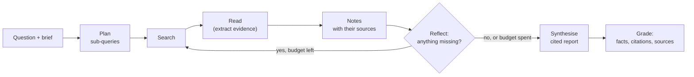
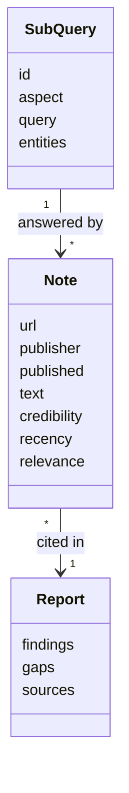
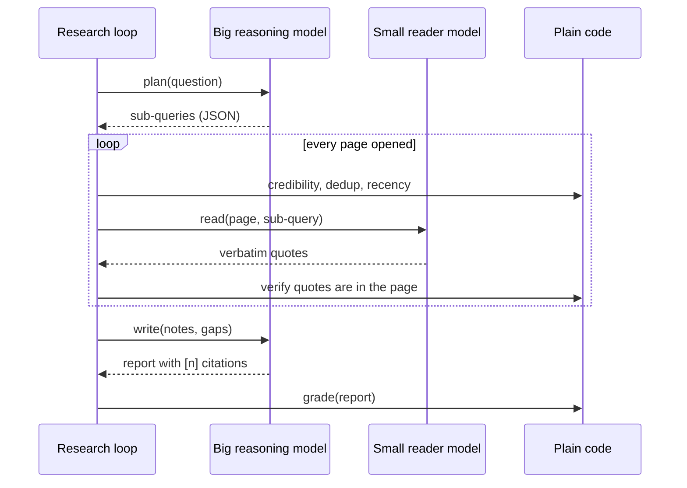
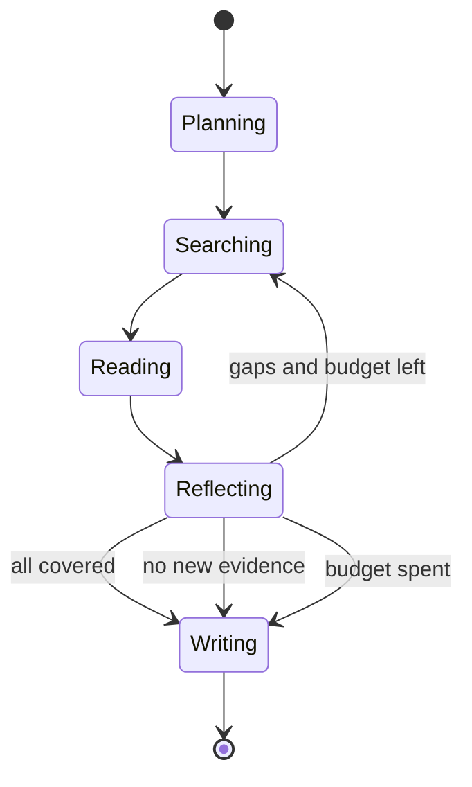
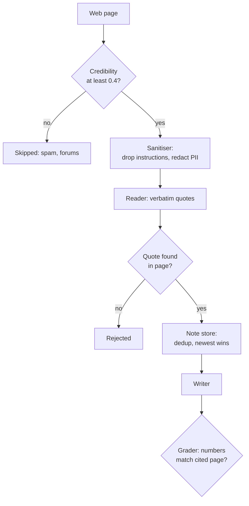

🌐 English · [Español](01-deep-research-architecture.es.md)

# Lesson 10.1 — Deep research architecture

> **Module 10 · Lesson 1 of 4** · ⏱️ about 50 min · 🧪 Lab: [step 1](lab/README.md#step-1--run-your-first-research-report)

## 📨 Situation

> **From:** Jordan Kim · Product and Strategy Lead
> **Channel:** #strategy
>
> Board meeting in two weeks. The question is simple: do we launch the Ember T3 in Mexico, Colombia
> or Chile first? I asked a chatbot. It gave me a confident paragraph with market sizes I could not
> find anywhere, and zero links. I need a real report: every number with a source I can click, what
> we could not find, and which sources we chose not to trust. The Ask-the-Web agent from module 08
> answers one question at a time. This needs dozens of searches and a write-up. Also, Noor says the
> market data cannot leave our laptops. Can you build something by Friday?

## 🎯 Objectives

By the end of this lesson you can:

- Describe the five stages of a deep-research system (plan, search, read, reflect, synthesise) and what each stage hands to the next.
- Explain how deep research differs from a chatbot answer, from retrieval-augmented generation and from a single-question web agent.
- Decide where a reasoning model is worth its cost in the pipeline and where plain code is better.
- Set budgets for iterations, searches and tokens, and read the cost of a run from its trace.
- Name five failure modes of research agents and the defence for each.

## 🤔 Predict first

Write your answers down before reading on. You will check them in the self-check.

1. Jordan's question needs about 20 web pages. How many calls to a large language model (LLM) do you think one report costs: about 2, about 20, or about 200?
2. If an agent stops searching as soon as it has *some* evidence, which do you expect to suffer more: the number of facts in the report, or the number of independent sources?
3. Which is worse in a report for the board: a fact that is missing, or a fact with a citation that does not support it?

## 1. What a deep-research system does

A **deep-research system** turns one open question into a written report with citations. It does
this by looping: it plans what it needs to know, searches for it, reads the pages it finds, takes
notes, checks what is still missing, and only then writes. The output is not an answer in a chat
bubble. It is a document that someone like Jordan can forward, check and argue with.

Compare it with the systems you built earlier in the course:

| System | Input | Steps | Output | Typical cost |
|---|---|---|---|---|
| Chatbot | A question | One model call | A paragraph from the model's memory | 1 call |
| Retrieval-augmented generation (RAG), modules 05 and 06 | A question | Retrieve a few chunks once, then answer | A short grounded answer | 1 to 2 calls |
| Ask-the-Web agent, module 08 | A question | A few tool calls until it finds the answer | One answer with a source | A handful of calls |
| Deep research | A question *and a brief* | Many searches over several rounds, notes, reflection | A structured report: findings, gaps, caveats, sources | Dozens of calls |

The key difference is **breadth plus accountability**. Jordan's question has no single page with
the answer. The answer is a comparison built from market sizes, growth rates, adoption, electricity
prices, delivery times and competitors, each from a different source. The report has to show where
each piece came from, so that a sceptical reader can check it.

**Analogy:** a deep-research agent is a junior analyst with a library card and a notebook. They
do not answer from memory. They split the brief into questions, fetch documents, copy the useful
lines into the notebook with the reference next to each, notice what is still missing, go back to
the shelves, and finally write the memo from the notebook, not from memory.



In the lab, one function runs the whole loop for a question from
`datasets/agent_tasks/research_questions.jsonl` over the offline web snapshot:

```python
from m10_deep_research.evaluate import load_workspace, run_and_grade

ws = load_workspace()                      # snapshot, search index, questions, labels
result, grade = run_and_grade(ws, "rq1")   # Jordan's market-entry question
print(result.stats.searches, result.stats.pages_opened, result.stats.llm_calls)
print(grade.facts_covered, "/", grade.facts_total)
print(result.report[:300])
```

For `rq1` this prints 5 searches, 20 pages opened, 22 model calls and 7 of 7 key facts covered.

## 2. The components and their contracts

Each stage is a separate component with a clear contract: what it receives and what it must hand on.
Keeping the contracts small is what lets you test, swap and budget each part on its own.

| Component | Receives | Hands on | In the lab |
|---|---|---|---|
| Planner | The question | 2 to 6 sub-queries as JSON (JavaScript Object Notation), each with an aspect and its entities | `planner.py` |
| Searcher | One sub-query | The top pages, best first | `search.py` |
| Credibility filter | A page | A score from 0 to 1 and the reasons | `credibility.py` |
| Reader | A page and a sub-query | Verbatim evidence quotes, or nothing | `reader.py` |
| Note store | Evidence passages | Deduplicated notes, each with its URL, date and scores | `notes.py` |
| Reflector | Notes per sub-query | What is still missing, as new searches | `loop.py` |
| Writer | Numbered notes and gaps | A Markdown report with `[n]` citations | `synthesise.py` |
| Grader | The report | Coverage, citation validity, source quality, traps | `grade.py` |

The planner turns Jordan's question into five sub-queries, one per aspect of a market-entry
decision. The searcher is Okapi BM25 (Best Matching 25), the keyword ranking you met in module 05. The
reader is a model call that must copy sentences word for word. The note store is plain Python. The
writer is a model call again. The grader never sees the agent's internals: it only reads the report.

Two contracts matter more than the others. First, **the note keeps the source**. Every passage in
the store carries its canonical URL (uniform resource locator), publisher and publication date. If
the source is dropped at this point, no later step can recover it, and the writer will be tempted
to cite from memory. Second,
**the writer only sees notes**, never the raw pages. That keeps the final prompt small and makes
every sentence of the report traceable to a note.



> ⚠️ **Common mistake:** letting the writer read the full pages "for context". The prompt grows with
> every page, the model starts mixing facts from different sources, and you lose the link between a
> sentence and its source. Give the writer notes, not pages.

## 3. Where a reasoning model fits

In module 09 you saw that reasoning models spend extra tokens thinking before they answer, and that
this pays off on problems with several dependent steps. A research pipeline has steps of both kinds,
so you should not use the same model everywhere.

| Step | What it needs | Good choice | Why |
|---|---|---|---|
| Plan | Understand the question, cover every aspect | Reasoning model | One call per report; mistakes here waste every later search |
| Read | Copy relevant sentences | Small, fast model | Called once per page; the task is narrow and verifiable |
| Deduplicate, score sources, weigh dates | Exact rules | Plain code | Deterministic, cheap, testable |
| Reflect | Judge what is missing | Reasoning model or code | Code can check coverage; a model can notice subtler gaps |
| Synthesise | Weigh conflicting evidence, compare, conclude | Reasoning model | One call; this is where judgement happens |
| Check citations | Compare numbers with sources | Plain code | Never ask a model to grade its own citations |

The trace of the lab run shows why this split matters for cost. For `rq1` the pipeline made 22
model calls: 1 to plan, 20 to read pages and 1 to write. The reading calls are 20 out of 22. If you
used an expensive reasoning model for all of them, almost all of the money would go on copying
sentences.

**Analogy:** you hire a senior analyst to frame the question and to draw the conclusions. You do
not ask them to photocopy articles.



In the lab, the default FakeProvider plays all three model roles with deterministic rules, so every
run prints the same numbers. The extractive writer organises and quotes the evidence, but it does not
weigh it: it will never say "Colombia grows fastest but has the lowest adoption". That weighing is
exactly the job you would give a reasoning model, and exactly the part you must check, because it is
where invented numbers appear.

> 💡 **Production tip:** pick models per role through configuration, not code. In the lab every role
> goes through the same provider interface, so `LLM_PROVIDER=ollama` swaps all of them. A real
> deployment would hold one setting per role (planner, reader, writer) and log which model produced
> each step.

## 4. Budgets and stopping

A research loop can always do one more search. Without limits it will keep spending, and with the
wrong limits it will stop too early. You need both a budget and a stopping rule.

**Budgets** cap what a run may spend:

| Budget | Lab default | What it protects |
|---|---|---|
| Iterations | 3 | Runaway loops |
| Searches | 20 | Search application programming interface (API) quota and latency |
| Pages opened per search | 4 | Reader calls, the biggest cost |
| Notes kept per sub-query | 2 | The writer's context window |

**Stopping rules** decide when the evidence is good enough:

1. **Coverage:** every sub-query has evidence for every entity it names. Jordan's market sub-queries name Mexico, Colombia and Chile, so a note must mention all three.
2. **No progress:** a whole iteration added no new notes. More of the same searches will not help.
3. **Budget spent:** stop, and say so in the report.



The four lab questions show the three outcomes. `rq1` covers every sub-query in the first iteration
and stops with "all sub-queries covered". `rq4` asks about Portugal; the only delivery-time page in
the snapshot covers Latin America, so the logistics sub-query stays open. The loop tries one
follow-up search in iteration 2, finds nothing new, and stops with "no new evidence". The report
then says so under "Gaps and caveats" instead of pretending.

The stopping code is short. The order matters: coverage first, then progress, then budget.

```python
if not queue:
    stats.stop_reason = "all sub-queries covered"
    break
if new_notes == 0:
    stats.stop_reason = "no new evidence"
    break
if stats.searches >= config.max_searches:
    stats.stop_reason = "search budget spent"
    break
```

Now look at what a too-tight budget does. With `--max-searches 2`, `rq1` only searches for market
size and adoption. The grade drops from 7 of 7 facts to 5 of 7, and the report cites 2 domains
where the question asks for at least 4. Nothing crashes. The report simply looks thinner, and an
uncritical reader would not notice. That is **premature stopping**, and it is the quietest failure
of all.

> ⚠️ **Common mistake:** measuring a research agent only by "did it find the answer". A report can
> contain the right headline number and still rest on one source. Track the number of independent
> sources (distinct domains) next to fact coverage.

> 💡 **Production tip:** log the stop reason with every report and alert on its distribution. A
> sudden rise in "budget spent" means your questions got harder or a search back-end got worse.

## 5. Failure modes and their defences

Research agents fail in a small number of recognisable ways. The offline snapshot contains a real
example of almost every one, on purpose.

| Failure mode | Example in the snapshot | Defence in the lab | Where |
|---|---|---|---|
| Hallucinated citation | A report line cites `[7]` when there are 5 sources, or quotes a number its source does not contain | Drop markers that point nowhere; grader checks every number against the cited page | `synthesise.py`, `grade.py` |
| Low-credibility source | A keyword-stuffed deals page claiming 2 million thermostats sold in Spain | Source policy plus content signals; skip pages below 0.4 | `credibility.py` |
| Injected instructions | A forum post that speaks to artificial intelligence (AI) assistants and tries to make the agent recommend a competitor | Remove instruction-like sentences before any model reads the page | `reader.py` |
| Outdated facts | A 2024 review measured the Corvid Thermo X at 0.9 W; a 2025 re-test measured 0.4 W | Recency weighting; newest page of the same publisher wins | `notes.py` |
| Premature stopping | Two searches: 5 of 7 facts and 2 of 4 required sources | Coverage-based stopping, budgets reported in the output | `loop.py` |

Run `uv run lab search "how much do smart thermostats save"` and look at the second result: the
deals page scores 0.0 because the scorer finds keyword stuffing, shouting and sales language. The
research observatory page above it scores 0.9 from the source policy. Credibility is not a feeling:
it is a number with reasons you can print.

The sanitiser also redacts personally identifiable information (PII), such as the e-mail address and
phone number posted in one forum thread. A research report has no reason to contain either.

**Analogy:** these defences work like the checks in a newsroom. An editor asks "who said this?"
(citations), "do we trust them?" (credibility), "is this still true?" (recency), and "did someone
plant this?" (injection). No single check catches everything, which is why there are several.



```python
from m10_deep_research.grade import grade_report

edited = result.report.replace("260,000", "280,000")      # simulate an invented number
g = grade_report(edited, ws.questions["rq1"], ws.snapshot, ws.labels)
print(g.facts_covered, g.facts_supported, g.valid_cited_lines, g.cited_lines)
```

This prints `6 4 4 5`. Changing one number breaks the Mexico fact and also invalidates the whole
cited line, so the Colombia and Chile facts on that line are no longer "supported" either. In the
next lesson you will build each defence and switch them off one at a time to measure what they buy.

> ⚠️ **Common mistake:** asking the model that wrote the report to check its own citations. It is
> likely to agree with itself. Use code that compares the claimed numbers with the cited page.

> 💡 **Production tip:** keep a frozen snapshot of the pages each report used. Live pages change; if a
> reader questions a figure next month, you need the exact text the agent saw.

## 🧪 Try it

1. Run the full loop for Jordan's question and watch the trace:

   ```bash
   cd modules/10-deep-research-and-local-deployment/lab
   uv run lab research rq1 --trace
   ```

   The last lines should be:

   ```text
   reflect iteration 1: 5 new notes, 0 sub-queries open
   rq1: 5 sub-queries, 1 iteration(s), 5 searches, 20 pages opened, 22 LLM calls
        LLM tokens: 4082 prompt + 1603 completion
        tokens read 1028 -> noted 202 -> kept 202; stop: all sub-queries covered
        notes 5, gaps none; facts 7/7
        report written to outputs/rq1.md
   ```

2. Open `outputs/rq1.md`. Find the competition line and check the inference
   "Not listed: Colombia." against the source it cites.
3. Grade all four questions:

   ```bash
   uv run lab grade
   ```

   ```text
   question   facts  supported  valid cites  domains  low-cred  traps  PII
   rq1         7/7         7/7         5/5      4/4         0      0    0
   rq2         4/4         4/4         5/5      4/3         0      0    0
   rq3         2/2         2/2         1/1      1/1         0      0    0
   rq4         4/4         4/4         6/6      4/3         0      0    0
   ```

4. Starve the loop and watch the report get thinner without any error:

   ```bash
   uv run lab grade rq1 --max-searches 2
   ```

   ```text
   question   facts  supported  valid cites  domains  low-cred  traps  PII
   rq1         5/7         5/7         4/4      2/4         0      0    0
   ```

## 🏭 In the real world

Commercial deep-research features follow the same loop, at a larger scale: more searches per
report, longer pages, and minutes rather than seconds per run. The engineering questions are the
ones you met here.

- **Latency is a product decision.** A report that takes several minutes needs a progress view and a
  notification, not a spinner. Users accept waiting when they can see the plan and the sources arrive.
- **Cost is dominated by reading.** Most calls read pages. Teams cache fetched pages, use a smaller
  model for extraction and cap pages per search.
- **Source policy is configuration.** Allowlists of trusted publishers, blocklists of content farms and
  per-customer rules ("never cite competitor blogs") live outside the code and are reviewed like any
  other policy.
- **Audit trail.** Store the plan, every search, every page version and every note. When someone
  disputes a number, you replay the trace rather than re-running the agent.
- **Human review stays.** For board-level decisions, the agent produces the first draft and the
  evidence table; a person signs off.

What to monitor: distinct sources per report, citation validity on a sample, stop-reason mix, gap
rate, cost and latency per report, and the share of pages skipped for low credibility.

## ✅ Self-check

**1. Revisit prediction 1: how many model calls did one report cost in the lab, and where did they go?**

<details><summary>Answer</summary>

22 calls for `rq1`: 1 to plan, 20 to read pages and 1 to write. If you guessed "about 2", you were
thinking of a chatbot or a RAG call. The reading step dominates, which is why it should use the
cheapest model that can copy sentences reliably.

</details>

**2. Revisit prediction 2: with only 2 searches, what suffered?**

<details><summary>Answer</summary>

Both, but the source count suffered more. Facts dropped from 7 of 7 to 5 of 7, while distinct domains
dropped from 4 to 2, below the question's minimum of 4. The report still looked complete, which is
what makes premature stopping dangerous.

</details>

**3. Why does the writer receive notes instead of full pages?**

<details><summary>Answer</summary>

Notes are short, carry their source and were already filtered for credibility, recency and
injection. Full pages would blow up the prompt, mix facts across sources and reintroduce text that
the sanitiser removed. The tempting answer "more context is always better" ignores both cost and
traceability.

</details>

**4. Revisit prediction 3: which is worse, a missing fact or an unsupported citation?**

<details><summary>Answer</summary>

An unsupported citation. A missing fact shows up as a gap that the reader can see and fill. A citation
that does not support its sentence borrows the authority of a real source for a claim it never made,
so the reader stops checking. That is why the grader counts "supported" facts separately from
"covered" ones.

</details>

**5. Which steps should be plain code rather than a model call, and why?**

<details><summary>Answer</summary>

Deduplication, credibility scoring, recency weighting, quote verification and citation checking.
They follow exact rules, must be deterministic and must not be fooled by the text they inspect. A
model asked "is this citation correct?" can be persuaded; a substring check cannot.

</details>

## 💬 Explain it in your own words

1. Jordan asks why the report takes many model calls when "the chatbot only needed one". Explain it
   using the junior-analyst analogy and the numbers from your trace.
2. Noor asks where untrusted text enters the pipeline and which component is the last line of
   defence before the report. Walk them through the failure-mode table.

## 🔑 Key ideas

- Deep research is a loop: plan, search, read, take notes with sources, reflect, then synthesise a cited report.
- Each component has a small contract; the most important is that every note keeps its URL and date.
- Use reasoning models for planning and synthesis, small models for reading, and plain code for checks.
- Budgets cap spending; stopping rules (coverage, no progress, budget) decide when evidence is enough.
- The five classic failures are hallucinated citations, low-credibility sources, injected instructions, outdated facts and premature stopping.
- Measure fact coverage and independent sources together; a thin report fails silently.

## 📚 Go deeper

- ⭐ [WebGPT: browser-assisted question answering with human feedback](https://arxiv.org/abs/2112.09332) — an early, clear example of a model that searches, quotes and cites its sources.
- [ReAct: synergizing reasoning and acting](https://arxiv.org/abs/2210.03629) — the reason-then-act loop that research agents extend with notes and reflection.
- [Indirect prompt injection](https://arxiv.org/abs/2302.12173) — how text on retrieved web pages can hijack an LLM-integrated application.
- [Scaling test-time compute](https://arxiv.org/abs/2408.03314) — when spending more inference compute pays off, useful for deciding where a reasoning model belongs.

---

[← Previous: Module 10 overview](README.md) · [🏠 Module 10](README.md) · [Next: 10.2 Building the research loop →](02-building-the-research-loop.md)
