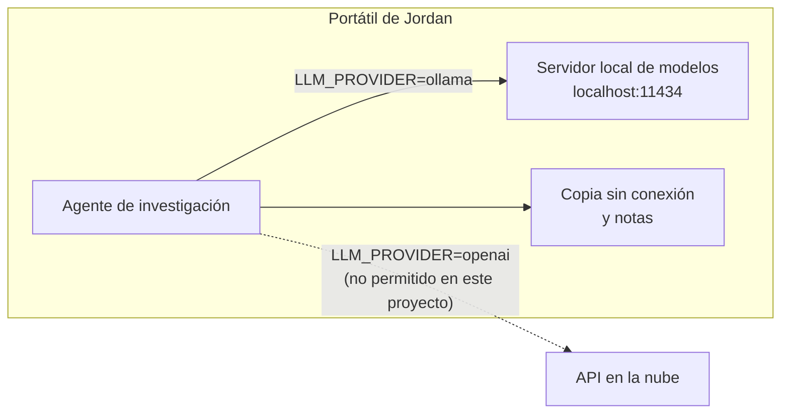
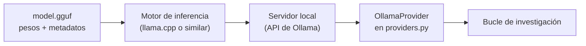
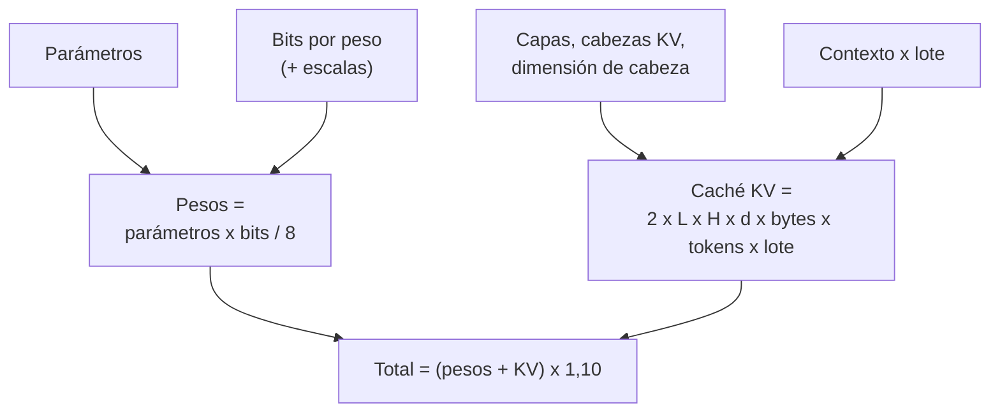
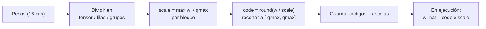
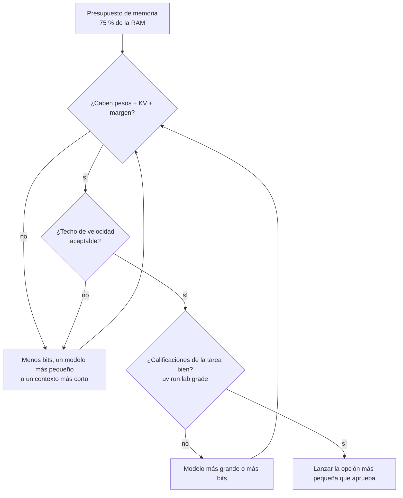

🌐 [English](03-running-models-locally.md) · Español

# Lección 10.3 — Ejecutar modelos en local

> **Módulo 10 · Lección 3 de 4** · ⏱️ unos 55 min · 🧪 Lab: [paso 6](lab/README.es.md#paso-6--dimensiona-un-modelo-para-un-portátil)

## 📨 Situación

> **De:** Noor Haddad · Responsable de Seguridad y Privacidad
> **Canal:** #ai-security
>
> Las preguntas de investigación de Jordan nombran mercados que no hemos anunciado. Eso hace que los
> *prompts* sean tan confidenciales como las respuestas. Así que la regla de este proyecto es sencilla:
> los datos de mercado, los *prompts* y las notas nunca salen del portátil. Eso significa un modelo
> local, no una API. El portátil de Jordan tiene 16 GB de memoria y Sam va a preguntar, antes de una
> hora, qué modelo cabe y qué velocidad tendrá. Me gustaría que respondieras antes de que Sam lo
> pregunte. Y dime con sinceridad: ¿qué protege "local" y qué no? ¿Cuál es el radio de impacto si
> alguien apunta el agente por error a un *endpoint* en la nube?

## 🎯 Objetivos

Al terminar esta lección puedes:

- Explicar qué hacen Ollama y llama.cpp y qué contiene un archivo de modelo GGUF.
- Calcular la memoria que necesita un modelo a partir de sus parámetros, los bits por peso, la forma de la caché de claves y valores y un margen adicional.
- Comparar la cuantización por tensor, por canal y por grupo, y explicar por qué las escalas más finas reducen el error.
- Elegir el tamaño de modelo y el ancho de bits para un portátil de 16 GB y estimar un límite superior de su velocidad.
- Explicar qué protege la inferencia local y qué no.

## 🤔 Predice primero

Apunta tus respuestas antes de seguir leyendo. Las comprobarás en la autoevaluación.

1. ¿Cuánta memoria necesita un modelo de 8.000 millones de parámetros a 4 bits por peso, con un contexto de 8.192 *tokens*: unos 4 GB, unos 6 GB o unos 16 GB?
2. Pasar de pesos de 4 bits a 8 bits, o pasar de un contexto de 8.192 *tokens* a uno de 32.768: ¿qué añade más memoria en ese modelo?
3. ¿La cuantización a 8 bits es siempre "bastante segura" si usas una sola escala para todo el tensor?

## 1. Por qué ejecutar un modelo en local

Todas las lecciones hasta ahora podían funcionar con una interfaz de programación de aplicaciones
(API, *application programming interface*): envías un *prompt* al servidor de un proveedor y recibes
texto. Ejecutar **en local** significa que los pesos del modelo de lenguaje grande (LLM, *large
language model*) están en tu máquina y que la inferencia ocurre allí. Para la regla de Noor, esa es toda la cuestión: el *prompt* nunca cruza la red.

| Motivo | Qué ganas | Qué pagas |
|---|---|---|
| Privacidad | Los *prompts*, las notas y las salidas se quedan en el dispositivo | La seguridad de ese dispositivo pasa a ser tuya |
| Sin conexión | Funciona en un avión, en las oficinas de un cliente, durante una caída del servicio | Tienes que descargar los modelos por adelantado |
| Coste previsible | Sin factura por *token* | *Hardware*, electricidad, tu tiempo |
| Control | Versión del modelo fija, sin actualizaciones silenciosas | Tampoco hay correcciones silenciosas; actualizas a mano |
| Calidad | Suficiente para muchas tareas con modelos pequeños | Los modelos más grandes no caben en un portátil |

**Analogía:** una API es un restaurante: comida excelente, pero tu pedido lo lee la cocina. La
inferencia local es cocinar en casa: la receta se queda en tu cocina, y los platos sucios también.

En el lab, cambiar entre las dos es cuestión de una variable de entorno, porque todos los componentes
hablan con la misma interfaz de proveedor. Por defecto se usa el FakeProvider sin conexión. Fijar
`LLM_PROVIDER=ollama` envía las llamadas del planificador, el lector y el redactor a un servidor local
de Ollama, por defecto en `http://localhost:11434`, y a ningún otro sitio.



```bash
# Default: offline, deterministic, no model needed
uv run lab research rq1
# Local model (needs Ollama running and the model pulled first)
LLM_PROVIDER=ollama OLLAMA_MODEL=llama3.2:1b uv run lab research rq1
```

> ⚠️ **Error común:** suponer que "local" es una propiedad del código. Es una propiedad de la
> configuración. Una sola variable de entorno que apunte a un *endpoint* en la nube envía fuera todos
> los *prompts* confidenciales. Fija el proveedor en la configuración del proyecto y añade una
> comprobación que rechace los *hosts* no locales en este proyecto.

## 2. Las herramientas locales: llama.cpp, GGUF y Ollama

En un portátil suelen trabajar juntas tres piezas:

| Pieza | Qué es | Cómo la usas |
|---|---|---|
| **llama.cpp** | Un motor de inferencia de código abierto escrito en C y C++ que ejecuta modelos de lenguaje en unidades centrales de procesamiento (CPU, *central processing units*) y unidades de procesamiento gráfico (GPU, *graphics processing units*), con muy buen soporte para pesos cuantizados | Lo compilas o usas un binario empaquetado; incluye una herramienta de línea de comandos y un servidor HTTP (*hypertext transfer protocol*) |
| **GGUF** | El nombre del formato de modelo en un solo archivo definido por el proyecto llama.cpp: tensores más metadatos como la arquitectura, el tokenizador y el tipo de cuantización | Descargas un archivo `.gguf`; un archivo es un modelo con una cuantización |
| **Ollama** | Una herramienta que descarga, guarda y sirve modelos en local detrás de una línea de comandos sencilla y una API HTTP | `ollama pull`, `ollama run` y una API en localhost a la que llama el proveedor del lab |

No necesitas conocer las tripas de llama.cpp para usar
Ollama, pero conocer las capas te ayuda a depurar. Si un modelo no carga, suele ser la memoria (esta
lección). Si carga pero responde mal, suele ser el modelo o su cuantización. Si el lab no llega a él,
es el servidor o la configuración del *host*.

**Analogía:** GGUF es un kit de comida sellado con la ficha de la receta dentro, llama.cpp es el
fogón y Ollama es quien ayuda en la cocina: trae los kits de la tienda y enciende el fogón.



El proveedor del lab habla con esa API usando solo la biblioteca estándar. Esta es la petición que
construye (un fragmento del `providers.py` copiado):

```python
options: dict[str, Any] = {"temperature": temperature, "num_predict": max_tokens}
if seed is not None:
    options["seed"] = seed
payload = {"model": self.model, "messages": msgs, "stream": False, "options": options}
data = _post_json(f"{self.host}/api/chat", payload, {}, self.timeout)
```

> 💡 **Consejo de producción:** registra el archivo de modelo exacto (nombre, cuantización y una suma
> de verificación o *checksum*) junto a cada informe. "El modelo local" no es una versión; un archivo
> GGUF concreto sí lo es.

## 3. Cálculo de memoria: pesos, caché de claves y valores, margen

Antes de descargar nada, calcula si cabe. Se suman tres términos.

**Pesos.** Parámetros por bytes por parámetro. A 16 bits, un parámetro ocupa 2 bytes; a 8 bits, 1
byte; a 4 bits, medio byte. Los formatos cuantizados también guardan **escalas** (sección 4). Con una
escala de 16 bits por cada grupo de 32 pesos, 4 bits cuestan en realidad 4 + 16/32 = 4,5 bits por
peso.

**Caché de claves y valores (caché KV, *key-value cache*).** Durante la generación, cada capa guarda
un vector de clave y un vector de valor para cada *token* del contexto, para que el modelo no tenga
que recalcularlos con cada *token* nuevo. Su tamaño es:

`2 x capas x cabezas KV x dimensión de cabeza x bytes por valor x tokens x lote`

Muchos modelos recientes usan **atención de consultas agrupadas** (GQA, *grouped-query attention*):
varias cabezas de consulta comparten una cabeza de clave y valor, así que hay menos cabezas KV que
cabezas de atención y la caché se reduce.

**Margen adicional (*overhead*).** Activaciones, búferes y el propio entorno de ejecución. El lab usa
el 10 % de los pesos más la caché como margen de planificación. Es una suposición; mide el tuyo.

Este es el ejemplo resuelto para una forma ilustrativa que elegimos para este lab (32 capas, 8
cabezas KV, dimensión de cabeza 128; no es la configuración de ningún modelo publicado concreto),
según nuestra fórmula:

| Elemento | Cálculo | Resultado |
|---|---|---|
| Pesos, 4 bits con escalas por grupos de 32 | 8.000 millones x 4,5 bits / 8 | 4,50 GB |
| Caché KV por *token*, 16 bits | 2 x 32 x 8 x 128 x 2 bytes | 128 KiB |
| Caché KV, 8.192 *tokens* | 128 KiB x 8.192 | 1,07 GB |
| Margen | 10 % de 5,57 GB | 0,56 GB |
| **Total** | | **6,13 GB** |

Aquí GB significa 10^9 bytes; KiB significa 1.024 bytes. Ahora cambia una cosa cada vez con el
estimador:

| Cambio | Caché KV | Total |
|---|---|---|
| La base de arriba | 1,07 GB | 6,13 GB |
| Pesos de 16 bits | 1,07 GB | 18,78 GB |
| 32 cabezas KV (sin agrupar) | 4,29 GB | 9,67 GB |
| Contexto de 32.768 *tokens* | 4,29 GB | 9,67 GB |
| 8 conversaciones en paralelo (lote de 8) | 8,59 GB | 14,40 GB |

La caché KV es pequeña para una sola persona y un contexto corto, y crece linealmente con ambos. Por
eso un modelo que "cabe" para un chat puede quedarse sin memoria cuando el agente envía un contexto de
investigación largo, y por eso servir a muchas personas a la vez (siguiente lección) es sobre todo un
problema de caché KV.

**Analogía:** los pesos son los libros que tienes; la caché KV es la pila de libros abiertos sobre tu
mesa para la conversación actual. Una biblioteca más grande necesita más estanterías, pero más
conversaciones necesitan más mesa.



```python
def kv_bytes_per_token(layers: int, kv_heads: int, head_dim: int, kv_bits: int = 16) -> float:
    """Each layer stores one key and one value vector per KV head for every token."""
    return 2 * layers * kv_heads * head_dim * kv_bits / 8

w = weight_bytes(params, bits, group_size)
kv = kv_cache_bytes(layers, kv_heads, head_dim, context, batch, kv_bits)
return MemoryEstimate(round(w / GB, 2), round(kv / GB, 2), round(overhead * (w + kv) / GB, 2))
```

> ⚠️ **Error común:** dimensionar un modelo solo por el tamaño de la descarga. El archivo contiene los
> pesos; el proceso en ejecución también necesita la caché KV y el margen, y el sistema operativo
> también necesita su parte de la memoria.

## 4. Cuantización: menos bits, error controlado

La **cuantización** (*quantization*) guarda cada peso como un entero pequeño más una **escala**
compartida. Con la cuantización simétrica de 8 bits, un bloque de pesos se divide entre
`scale = max|w| / 127`, se redondea a un entero entre -127 y 127 y se vuelve a multiplicar por la
escala al usarlo. A 4 bits, los enteros solo van de -7 a 7, así que los escalones del redondeo son
mucho más gruesos.

La decisión crucial es **cuántos pesos comparten una escala**:

- **Por tensor:** una escala para toda la matriz. Lo más barato, pero un solo valor atípico (*outlier*) grande fija la escala para todos, y los pesos pequeños se redondean a cero.
- **Por canal:** una escala por fila de salida. Las filas con pesos pequeños reciben una escala pequeña.
- **Por grupo:** una escala por bloque de, por ejemplo, 32 o 128 pesos consecutivos de una fila. Más escalas, más almacenamiento, un error mucho menor.

El lab cuantiza una matriz de 256 x 1024 generada con semilla, cuyas filas tienen escalas desiguales y
donde el 0,1 % de los pesos son valores atípicos, porque las matrices de pesos reales tienen las dos
cosas. Informa del error relativo de los pesos, del error relativo de las salidas de la capa con
entradas aleatorias y de la proporción de pesos distintos de cero que se quedaron exactamente en cero:

```text
scheme             bits/weight  weight err  output err   zeroed
int8 per-tensor          8.000      0.1299      0.1291    26.4%
int8 per-channel         8.016      0.0219      0.0221     2.5%
int4 per-tensor          4.000      0.9246      0.9209    99.6%
int4 per-channel         4.016      0.3743      0.3781    40.2%
int4 group-128           4.125      0.1743      0.1749    19.4%
int4 group-32            4.500      0.1154      0.1141    14.1%
```

Lee los extremos. Con una sola escala para todo el tensor a 4 bits, el 99,6 % de los pesos se
redondea a cero y el error de salida es 0,92: la capa queda destruida. Las escalas por grupos de 32
cuestan medio bit más por peso y bajan el error a 0,11. Incluso a 8 bits, una sola escala da un error
de 0,13, unas seis veces el error por canal de 0,022. Esta matriz sintética exagera los valores
atípicos a propósito, pero la lección está en la clasificación: **la granularidad importa tanto como
el ancho de bits**.

Métodos como GPTQ (cuantización posterior al entrenamiento para *transformers* generativos
preentrenados) y AWQ (*activation-aware weight quantization*, cuantización de pesos consciente de las
activaciones) van más allá: usan unos pocos datos de calibración para decidir cómo redondear, de forma
que las *salidas* se mantengan cercanas, en lugar de cada peso por separado.

**Analogía:** describir la estatura de todo el mundo con una sola regla marcada solo en metros
funciona con un grupo de personas adultas, pero cuando una persona que juega al baloncesto y un bebé
que empieza a andar comparten la regla, el bebé mide cero.



```python
qmax = 2 ** (bits - 1) - 1
if granularity == "tensor":
    blocks = w.reshape(1, -1)
elif granularity == "channel":
    blocks = w
else:
    blocks = w.reshape(-1, group_size)
scale = np.abs(blocks).max(axis=1, keepdims=True) / qmax
codes = np.clip(np.round(blocks / scale), -qmax, qmax)
w_hat = (codes * scale).reshape(rows, cols)
```

> 💡 **Consejo de producción:** no juzgues nunca un modelo cuantizado solo por el error de los pesos.
> Ejecuta tu propia evaluación de la tarea (en este módulo, `uv run lab grade` con un modelo real) con
> los archivos de 4 y 8 bits y quédate con el más pequeño cuyas calificaciones no bajen.

## 5. CPU o GPU, y elegir un tamaño para el portátil

Para generar un *token* para una sola persona, un modelo denso lee cada peso una vez. Así que, en una
sola conversación, la velocidad está limitada sobre todo por el **ancho de banda de memoria**: cuántos
gigabytes por segundo puede leer el procesador. Eso da un techo sencillo:

`tokens por segundo <= ancho de banda de memoria / bytes de los pesos`

Con una máquina que lee 100 GB/s (una cifra supuesta para el ejercicio, no una medición), nuestra
fórmula da:

| Modelo, según nuestra fórmula | Pesos | Techo a 100 GB/s |
|---|---|---|
| 3.000 millones de parámetros, 4 bits | 1,69 GB | 59,2 *tokens*/s |
| 8.000 millones de parámetros, 4 bits | 4,50 GB | 22,2 *tokens*/s |
| 8.000 millones de parámetros, 8 bits | 8,50 GB | 11,8 *tokens*/s |
| 8.000 millones de parámetros, 16 bits | 16,00 GB | 6,2 *tokens*/s |

La velocidad real es menor, pero las proporciones se mantienen: reducir los bytes a la mitad
aproximadamente duplica el techo. Por eso la cuantización ayuda tanto a la velocidad como a la memoria,
y por eso las GPU, que tienen mucho más ancho de banda de memoria que las CPU típicas de los portátiles,
generan más rápido. En los portátiles donde la CPU y la GPU comparten memoria, la misma RAM (*random-access
memory*) guarda el modelo para las dos.

Ahora combina el encaje y la velocidad. El barrido del estimador usa como presupuesto el 75 % de 16 GB,
es decir, 12 GB, y deja el resto para el sistema operativo y las demás aplicaciones de Jordan:

```text
  params    16-bit     8-bit     4-bit
      1B      3.4       2.3       1.8 
      3B      7.8       4.7       3.0 
      8B     18.8✗     10.5       6.1 
     14B     32.0✗     17.5✗      9.8 
     32B     71.6✗     38.6✗     21.0✗
     70B    155.2✗     83.0✗     44.5✗
```

Un plan razonable para el portátil de Jordan: empezar con un modelo de 8.000 millones de parámetros a
4 bits (6,1 GB, con margen para contextos más largos), compararlo con uno de 3.000 millones (3,0 GB,
más rápido) y quedarse con el más pequeño que supere `uv run lab grade` en las preguntas de
investigación. Un modelo de 14.000 millones a 4 bits (9,8 GB) cabe sobre el papel, pero deja poco
espacio para un contexto de investigación largo. El barrido mantiene una misma forma de ejemplo para
todos los tamaños; los modelos más grandes suelen tener más capas y, por tanto, cachés KV más grandes,
así que toma las filas grandes como optimistas.

**Analogía:** elegir un modelo para un portátil es como elegir una maleta para una aerolínea de bajo
coste: primero compruebas que cumple el límite de tamaño y después eliges la más ligera que todavía
lleve lo que necesitas.



> ⚠️ **Error común:** elegir el modelo más grande que carga. Un modelo que llena la memoria no deja
> sitio para la caché KV de una investigación larga y ralentiza toda la máquina. Deja margen.

### Qué protege "local" y qué no

| La inferencia local protege | La inferencia local no protege |
|---|---|
| Los *prompts* y las salidas frente al proveedor del modelo | Un portátil robado, sin cifrar o compartido |
| Los datos frente a la interceptación en la red de camino a una API | Los registros, los archivos de intercambio (*swap*) y las copias de seguridad que copian los *prompts* en otro sitio |
| Frente a que un proveedor cambie sus condiciones de retención | Un archivo de modelo descargado de una fuente no confiable |
| | Un servidor local expuesto a toda la red de la oficina |
| | Las propias búsquedas web del agente de investigación, que siguen revelando lo que te interesa |

Esa última fila importa para Jordan: la web del lab es una copia sin conexión, pero un agente de
investigación en vivo envía sus subconsultas a un buscador. "Mexico smart thermostat market" ya es en
sí una señal. La inferencia local mantiene en privado el tráfico del *modelo*, no el tráfico de
*búsqueda*.

## 🧪 Pruébalo

1. Estima la base y compruébala con un portátil de 16 GB:

   ```bash
   cd modules/10-deep-research-and-local-deployment/lab
   uv run lab memory --ram 16
   ```

   ```text
   model: 8B parameters at 4-bit (4.5 bits per weight with scales)
   weights      4.50 GB
   KV cache     1.07 GB  (128 KiB per token x 8192 tokens x batch 1)
   overhead     0.56 GB  (10% planning margin)
   total        6.13 GB
   fits in 12 GB (75% of 16 GB RAM)
   ```

2. Prueba `--bits 16`, `--kv-heads 32`, `--context 32768` y `--batch 8` de uno en uno y rellena tú
   la tabla de "cambia una cosa".
3. Imprime el barrido: `uv run lab memory --sweep --ram 16`.
4. Compara los esquemas de cuantización: `uv run lab quantize`, y después prueba `--seed 1` y comprueba
   que la clasificación de los esquemas no cambia.
5. Añade un techo de velocidad: `uv run lab memory --bandwidth 100` debería terminar con
   `decode ceiling 22.2 tokens/s for one user at 100 GB/s memory bandwidth (upper bound)`.

## 🏭 En el mundo real

- **Los equipos se estandarizan en unos pocos archivos de modelo.** Un modelo pequeño para la extracción y uno más grande para planificar y redactar, cada uno con una cuantización que superó su evaluación. Cada archivo se fija con su *checksum*.
- **Se vigila el margen de memoria.** En máquinas compartidas, un contexto largo puede dejar un modelo sin memoria o mandarlo al *swap*, y entonces la generación va a paso de tortuga. Vigila la memoria residente, no solo el tamaño del modelo.
- **La cuantización se evalúa por tarea.** Un modelo de 4 bits puede ir bien para la extracción y peor en el razonamiento de varios pasos; los equipos mantienen un modelo de mayor precisión para los pasos que lo necesitan.
- **Lo local forma parte de una política.** Cifrado del disco, sin registro de *prompts* por defecto, un servidor local ligado a la interfaz de *loopback* y una lista de proveedores permitidos por proyecto.
- **Las descargas son una cadena de suministro.** Los archivos de modelo vienen de internet. Los equipos descargan de fuentes conocidas, verifican los *checksums* y revisan los metadatos antes de usarlos.

## ✅ Autoevaluación

**1. Retoma la predicción 1: ¿cuánta memoria necesita el modelo de 8.000 millones a 4 bits con un contexto de 8.192 *tokens*?**

<details><summary>Respuesta</summary>

Unos 6 GB según nuestra fórmula: 4,50 GB de pesos (4,5 bits por peso una vez que cuentas las escalas
de grupo), 1,07 GB de caché KV y 0,56 GB de margen, 6,13 GB en total. "Unos 4 GB" solo cuenta los
enteros de 4 bits y olvida las escalas, la caché y el margen.

</details>

**2. Retoma la predicción 2: ¿qué añade más memoria, los pesos de 8 bits o un contexto 4 veces más largo?**

<details><summary>Respuesta</summary>

Con esta forma, los pesos de 8 bits: 8,50 GB en lugar de 4,50 GB, 4 GB más. El contexto de 32.768
*tokens* añade 4,29 - 1,07 = 3,22 GB de caché KV. Están cerca, y la respuesta se invierte con contextos
más largos o lotes más grandes, y por eso hay que calcular en lugar de adivinar.

</details>

**3. Retoma la predicción 3: ¿la cuantización a 8 bits por tensor es siempre segura?**

<details><summary>Respuesta</summary>

No. En la matriz con valores atípicos del lab da un error relativo de salida de 0,13, frente a 0,022
por canal con casi el mismo almacenamiento (8,016 bits por peso). Los bits por sí solos no deciden la
calidad; la granularidad de las escalas sí.

</details>

**4. ¿Por qué reducir a la mitad los bytes por peso duplica aproximadamente el techo de velocidad para una sola persona?**

<details><summary>Respuesta</summary>

Generar un *token* lee cada peso una vez, así que, para una sola persona, el tiempo por *token* lo
domina la lectura de los pesos desde la memoria. La mitad de bytes significa la mitad de tiempo de
lectura. El cómputo y las lecturas de la caché KV hacen que la velocidad real sea menor, pero la
proporción se mantiene.

</details>

**5. Nombra dos cosas que la inferencia local no protege.**

<details><summary>Respuesta</summary>

Dos cualesquiera de estas: un portátil robado o sin cifrar, *prompts* copiados en registros, en el
*swap* o en copias de seguridad, un archivo de modelo no confiable, un servidor local accesible desde
la red, y las búsquedas web que un agente de investigación en vivo envía a un buscador.

</details>

## 💬 Explícalo con tus palabras

1. Sam pregunta: "¿Por qué no podemos coger sin más el modelo más grande que quepa en 16 GB?".
   Explícalo con los números del estimador y el techo de velocidad.
2. Explica a Noor por qué "los datos nunca salen del portátil" es cierto para las llamadas al modelo,
   pero exige cuidado con los registros, las descargas de modelos y las búsquedas web.

## 🔑 Ideas clave

- La inferencia local mantiene los *prompts* en el dispositivo; la seguridad, las actualizaciones y la capacidad pasan a ser cosa tuya.
- llama.cpp es un motor de inferencia, GGUF es su formato de modelo en un solo archivo y Ollama gestiona y sirve modelos en local.
- Memoria = pesos (parámetros x bits / 8, más las escalas) + caché KV (crece con el contexto y el lote) + margen.
- La granularidad de la cuantización importa tanto como el ancho de bits: las escalas por grupo reducen el error con un pequeño coste de almacenamiento.
- La velocidad para una sola persona está acotada, más o menos, por el ancho de banda de memoria dividido entre los bytes de los pesos.
- Elige el modelo y el ancho de bits más pequeños que superen tus propias calificaciones de la tarea, dejando margen de memoria.

## 📚 Profundiza

- ⭐ [llama.cpp](https://github.com/ggml-org/llama.cpp) — el motor y el formato GGUF; la documentación explica los tipos de cuantización y el servidor.
- [Ollama](https://ollama.com) — instalar, descargar y servir modelos en local.
- [GPTQ](https://arxiv.org/abs/2210.17323) — cuantización precisa después del entrenamiento con datos de calibración.
- [AWQ](https://arxiv.org/abs/2306.00978) — proteger los pesos que más importan para las activaciones.
- [QLoRA](https://arxiv.org/abs/2305.14314) — cuantización a 4 bits para un *fine-tuning* eficiente, un complemento útil a la cuantización solo para inferencia.

---

[← Anterior: 10.2 Construir el bucle de investigación](02-building-the-research-loop.es.md) · [🏠 Módulo 10](README.es.md) · [Siguiente: 10.4 Servir y operar LLM →](04-serving-and-operating-llms.es.md)
