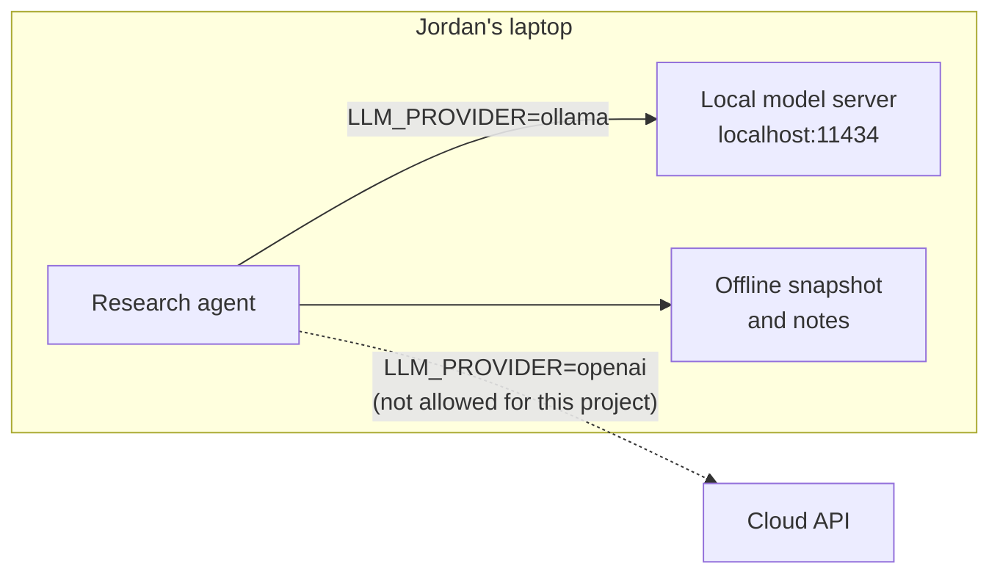
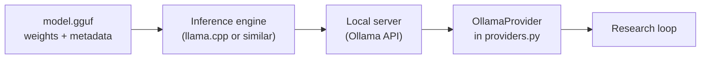
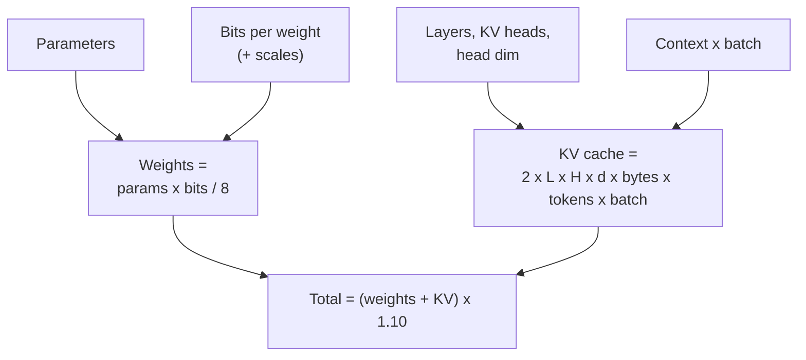
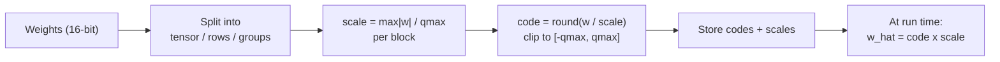
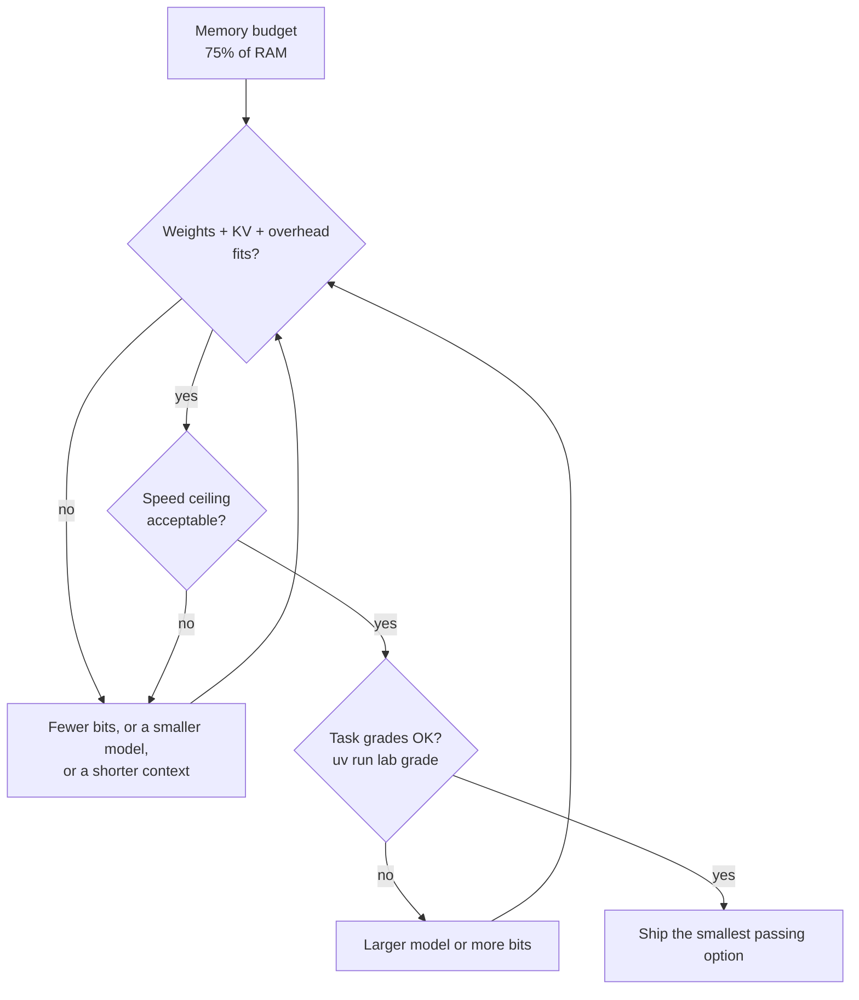

🌐 English · [Español](03-running-models-locally.es.md)

# Lesson 10.3 — Running models locally

> **Module 10 · Lesson 3 of 4** · ⏱️ about 55 min · 🧪 Lab: [step 6](lab/README.md#step-6--size-a-model-for-a-laptop)

## 📨 Situation

> **From:** Noor Haddad · Security and Privacy Lead
> **Channel:** #ai-security
>
> Jordan's research questions name markets we have not announced. That makes the prompts as
> confidential as the answers. So the rule for this project is simple: market data, prompts and
> notes never leave the laptop. That means a local model, not an API. Jordan's laptop has 16 GB of
> memory and Sam will ask, within the hour, which model fits and how fast it will be. I would like
> you to answer before Sam asks. And tell me honestly: what does "local" protect, and what does it
> not? What's the blast radius if someone points the agent at a cloud endpoint by mistake?

## 🎯 Objectives

By the end of this lesson you can:

- Explain what Ollama and llama.cpp do and what a GGUF model file contains.
- Compute the memory a model needs from its parameters, bits per weight, key-value cache shape and an overhead margin.
- Compare per-tensor, per-channel and per-group quantisation and explain why finer scales reduce error.
- Choose a model size and bit width for a 16 GB laptop and estimate an upper bound on its speed.
- State what local inference protects and what it does not.

## 🤔 Predict first

Write your answers down before reading on. You will check them in the self-check.

1. How much memory does an 8-billion-parameter model need at 4 bits per weight, with an 8,192-token context: about 4 GB, about 6 GB or about 16 GB?
2. Going from 4-bit to 8-bit weights, or going from an 8,192-token to a 32,768-token context: which adds more memory for that model?
3. Is 8-bit quantisation always "safe enough" if you use one scale for the whole tensor?

## 1. Why run a model locally

Every lesson so far could run with an application programming interface (API): you send a prompt
to a provider's server and get text back. Running **locally** means the weights of the large
language model (LLM) sit on your machine and inference happens there. For Noor's rule, that is the whole point: the prompt never crosses the network.

| Reason | What you gain | What you pay |
|---|---|---|
| Privacy | Prompts, notes and outputs stay on the device | You own security of that device |
| Offline | Works on a plane, in a client's building, during an outage | You must download models in advance |
| Predictable cost | No per-token bill | Hardware, power, your time |
| Control | Fixed model version, no silent upgrades | No silent fixes either; you update by hand |
| Quality | Good enough for many tasks with small models | The largest models do not fit on a laptop |

**Analogy:** an API is a restaurant: excellent food, but your order is read by the kitchen. Local
inference is cooking at home: the recipe stays in your kitchen, and so does the washing up.

In the lab, the switch between the two is one environment variable, because every component talks to
the same provider interface. The default is the offline FakeProvider. Setting `LLM_PROVIDER=ollama`
sends the planner, reader and writer calls to a local Ollama server, by default at
`http://localhost:11434`, and nowhere else.



```bash
# Default: offline, deterministic, no model needed
uv run lab research rq1
# Local model (needs Ollama running and the model pulled first)
LLM_PROVIDER=ollama OLLAMA_MODEL=llama3.2:1b uv run lab research rq1
```

> ⚠️ **Common mistake:** assuming "local" is a property of the code. It is a property of the
> configuration. One environment variable pointing at a cloud endpoint sends every confidential
> prompt out. Pin the provider in the project's configuration and add a check that refuses
> non-local hosts for this project.

## 2. The local toolchain: llama.cpp, GGUF and Ollama

Three pieces usually work together on a laptop:

| Piece | What it is | Your interaction |
|---|---|---|
| **llama.cpp** | An open-source inference engine written in C and C++ that runs language models on central processing units (CPUs) and graphics processing units (GPUs), with strong support for quantised weights | Build it or use a packaged binary; it includes a command-line tool and an HTTP (hypertext transfer protocol) server |
| **GGUF** | The name of the single-file model format defined by the llama.cpp project: tensors plus metadata such as architecture, tokenizer and quantisation type | You download a `.gguf` file; one file is one model at one quantisation |
| **Ollama** | A tool that downloads, stores and serves models locally behind a simple command line and an HTTP API | `ollama pull`, `ollama run`, and an API on localhost that the lab's provider calls |

You do not need to know llama.cpp's internals to use
Ollama, but knowing the layers helps you debug. If a model will not load, it is usually memory
(this lesson). If it loads but answers badly, it is usually the model or its quantisation. If the
lab cannot reach it, it is the server or the host setting.

**Analogy:** GGUF is a sealed meal kit with the recipe card inside, llama.cpp is the stove, and
Ollama is the kitchen assistant who fetches kits from the shop and turns the stove on.



The lab's provider talks to that API with the standard library only. This is the request it builds
(an excerpt of the copied `providers.py`):

```python
options: dict[str, Any] = {"temperature": temperature, "num_predict": max_tokens}
if seed is not None:
    options["seed"] = seed
payload = {"model": self.model, "messages": msgs, "stream": False, "options": options}
data = _post_json(f"{self.host}/api/chat", payload, {}, self.timeout)
```

> 💡 **Production tip:** record the exact model file (name, quantisation and a checksum) next to
> every report. "The local model" is not a version; a specific GGUF file is.

## 3. Memory maths: weights, key-value cache, overhead

Before downloading anything, compute whether it fits. Three terms add up.

**Weights.** Parameters times bytes per parameter. At 16 bits a parameter takes 2 bytes; at 8 bits,
1 byte; at 4 bits, half a byte. Quantised formats also store **scales** (section 4). With one 16-bit
scale per group of 32 weights, 4-bit really costs 4 + 16/32 = 4.5 bits per weight.

**Key-value (KV) cache.** During generation, each layer stores a key vector and a value vector for
every token in the context, so the model does not recompute them for each new token. Its size is:

`2 x layers x KV heads x head dimension x bytes per value x tokens x batch`

Many recent models use **grouped-query attention** (GQA): several query heads share one key-value
head, so there are fewer KV heads than attention heads and the cache shrinks.

**Overhead.** Activations, buffers and the runtime itself. The lab uses 10% of weights plus cache as
a planning margin. It is an assumption; measure yours.

Here is the worked example for an illustrative shape we chose for this lab (32 layers, 8 KV heads,
head dimension 128; not the configuration of any particular released model), by our formula:

| Item | Calculation | Result |
|---|---|---|
| Weights, 4-bit with group-32 scales | 8 billion x 4.5 bits / 8 | 4.50 GB |
| KV cache per token, 16-bit | 2 x 32 x 8 x 128 x 2 bytes | 128 KiB |
| KV cache, 8,192 tokens | 128 KiB x 8,192 | 1.07 GB |
| Overhead | 10% of 5.57 GB | 0.56 GB |
| **Total** | | **6.13 GB** |

GB here means 10^9 bytes; KiB means 1,024 bytes. Now change one thing at a time with the estimator:

| Change | KV cache | Total |
|---|---|---|
| Baseline above | 1.07 GB | 6.13 GB |
| 16-bit weights | 1.07 GB | 18.78 GB |
| 32 KV heads (no grouping) | 4.29 GB | 9.67 GB |
| 32,768-token context | 4.29 GB | 9.67 GB |
| 8 parallel conversations (batch 8) | 8.59 GB | 14.40 GB |

The KV cache is small for one user and a short context, and it grows linearly with both. That is
why a model that "fits" for one chat can run out of memory when the agent sends a long research
context, and why serving many users (next lesson) is mostly a KV-cache problem.

**Analogy:** weights are the books you own; the KV cache is the pile of open books on your desk for
the current conversation. A bigger library needs more shelves, but more conversations need more desk.



```python
def kv_bytes_per_token(layers: int, kv_heads: int, head_dim: int, kv_bits: int = 16) -> float:
    """Each layer stores one key and one value vector per KV head for every token."""
    return 2 * layers * kv_heads * head_dim * kv_bits / 8

w = weight_bytes(params, bits, group_size)
kv = kv_cache_bytes(layers, kv_heads, head_dim, context, batch, kv_bits)
return MemoryEstimate(round(w / GB, 2), round(kv / GB, 2), round(overhead * (w + kv) / GB, 2))
```

> ⚠️ **Common mistake:** sizing a model from the download size alone. The file holds the weights;
> the running process also needs the KV cache and overhead, and the operating system needs its
> share of memory too.

## 4. Quantisation: fewer bits, controlled error

**Quantisation** stores each weight as a small integer plus a shared **scale**. With symmetric
8-bit quantisation, a block of weights is divided by `scale = max|w| / 127`, rounded to an integer
between -127 and 127, and multiplied back by the scale when used. At 4 bits the integers only go
from -7 to 7, so the rounding steps are much coarser.

The crucial choice is **how many weights share one scale**:

- **Per-tensor:** one scale for the whole matrix. Cheapest, but one large outlier sets the scale for everyone, and small weights round to zero.
- **Per-channel:** one scale per output row. Rows with small weights get a small scale.
- **Per-group:** one scale per block of, say, 32 or 128 consecutive weights in a row. More scales, more storage, much smaller error.

The lab quantises a seeded 256 x 1024 matrix whose rows have uneven scales and where 0.1% of the
weights are outliers, because real weight matrices have both. It reports the relative error of the
weights, the relative error of the layer's outputs on random inputs, and the share of non-zero
weights that became exactly zero:

```text
scheme             bits/weight  weight err  output err   zeroed
int8 per-tensor          8.000      0.1299      0.1291    26.4%
int8 per-channel         8.016      0.0219      0.0221     2.5%
int4 per-tensor          4.000      0.9246      0.9209    99.6%
int4 per-channel         4.016      0.3743      0.3781    40.2%
int4 group-128           4.125      0.1743      0.1749    19.4%
int4 group-32            4.500      0.1154      0.1141    14.1%
```

Read the extremes. With one scale for the whole tensor at 4 bits, 99.6% of the weights round to
zero and the output error is 0.92: the layer is destroyed. Group-32 scales cost half a bit per
weight more and bring the error down to 0.11. Even at 8 bits, a single scale gives 0.13 error,
about six times the per-channel error of 0.022. This synthetic matrix exaggerates outliers on purpose,
but the ranking is the lesson: **granularity matters as much as bit width**.

Methods such as GPTQ (post-training quantisation for generative pre-trained transformers) and AWQ
(activation-aware weight quantization) go further: they use a little calibration data to decide how
to round, so that the *outputs* stay close rather than each weight separately.

**Analogy:** describing everyone's height with one ruler marked only in metres works for a crowd of
adults, but when a basketball player and a toddler share the ruler, the toddler measures zero.



```python
qmax = 2 ** (bits - 1) - 1
if granularity == "tensor":
    blocks = w.reshape(1, -1)
elif granularity == "channel":
    blocks = w
else:
    blocks = w.reshape(-1, group_size)
scale = np.abs(blocks).max(axis=1, keepdims=True) / qmax
codes = np.clip(np.round(blocks / scale), -qmax, qmax)
w_hat = (codes * scale).reshape(rows, cols)
```

> 💡 **Production tip:** never judge a quantised model by weight error alone. Run your own task
> evaluation (for this module, `uv run lab grade` with a real model) on the 4-bit and 8-bit files and
> keep the smallest one whose grades do not drop.

## 5. CPU or GPU, and picking a size for the laptop

To generate one token for one user, a dense model reads every weight once. So for a single
conversation, speed is limited mostly by **memory bandwidth**: how many gigabytes per second the
processor can read. That gives a simple ceiling:

`tokens per second <= memory bandwidth / weight bytes`

With a machine that reads 100 GB/s (an assumed figure for the exercise, not a benchmark), our
formula gives:

| Model, by our formula | Weights | Ceiling at 100 GB/s |
|---|---|---|
| 3 billion parameters, 4-bit | 1.69 GB | 59.2 tokens/s |
| 8 billion parameters, 4-bit | 4.50 GB | 22.2 tokens/s |
| 8 billion parameters, 8-bit | 8.50 GB | 11.8 tokens/s |
| 8 billion parameters, 16-bit | 16.00 GB | 6.2 tokens/s |

Real speed is lower, but the ratios hold: halving the bytes roughly doubles the ceiling. This is
why quantisation helps speed as well as memory, and why GPUs, which have much higher memory
bandwidth than typical laptop CPUs, generate faster. On laptops where the CPU and GPU share memory,
the same RAM (random-access memory) holds the model for both.

Now combine fit and speed. The estimator's sweep uses 75% of 16 GB, 12 GB, as the budget, leaving
the rest to the operating system and Jordan's other applications:

```text
  params    16-bit     8-bit     4-bit
      1B      3.4       2.3       1.8 
      3B      7.8       4.7       3.0 
      8B     18.8✗     10.5       6.1 
     14B     32.0✗     17.5✗      9.8 
     32B     71.6✗     38.6✗     21.0✗
     70B    155.2✗     83.0✗     44.5✗
```

A reasonable plan for Jordan's laptop: start with an 8-billion-parameter model at 4 bits (6.1 GB,
room left for longer contexts), compare it with a 3-billion one (3.0 GB, faster), and keep the
smallest that passes `uv run lab grade` on the research questions. A 14-billion model at 4 bits
(9.8 GB) fits on paper but leaves little room for a long research context. The sweep keeps one
example shape for every size; bigger models usually have more layers and therefore bigger KV
caches, so treat the large rows as optimistic.

**Analogy:** choosing a model for a laptop is like choosing a suitcase for a budget airline: first
check it fits the size limit, then pick the lightest one that still holds what you need.



> ⚠️ **Common mistake:** picking the biggest model that loads. A model that fills memory leaves no
> room for the KV cache of a long research run and slows the whole machine. Leave headroom.

### What "local" protects, and what it does not

| Local inference protects | Local inference does not protect |
|---|---|
| Prompts and outputs from the model provider | A laptop that is stolen, unencrypted or shared |
| Data from network interception on the way to an API | Logs, swap files and backups that copy prompts elsewhere |
| Against a provider changing retention terms | A model file downloaded from an untrusted source |
| | A local server exposed to the whole office network |
| | The research agent's own web searches, which still reveal what you are interested in |

That last row matters for Jordan: the lab's web is an offline snapshot, but a live research agent
sends its sub-queries to a search engine. "Mexico smart thermostat market" is itself a signal.
Local inference keeps the *model* traffic private, not the *search* traffic.

## 🧪 Try it

1. Estimate the baseline and check it against a 16 GB laptop:

   ```bash
   cd modules/10-deep-research-and-local-deployment/lab
   uv run lab memory --ram 16
   ```

   ```text
   model: 8B parameters at 4-bit (4.5 bits per weight with scales)
   weights      4.50 GB
   KV cache     1.07 GB  (128 KiB per token x 8192 tokens x batch 1)
   overhead     0.56 GB  (10% planning margin)
   total        6.13 GB
   fits in 12 GB (75% of 16 GB RAM)
   ```

2. Try `--bits 16`, `--kv-heads 32`, `--context 32768` and `--batch 8` one at a time and fill in the
   "change one thing" table yourself.
3. Print the sweep: `uv run lab memory --sweep --ram 16`.
4. Compare quantisation schemes: `uv run lab quantize`, then try `--seed 1` and check that the
   ranking of the schemes stays the same.
5. Add a speed ceiling: `uv run lab memory --bandwidth 100` should end with
   `decode ceiling 22.2 tokens/s for one user at 100 GB/s memory bandwidth (upper bound)`.

## 🏭 In the real world

- **Teams standardise on a few model files.** One small model for extraction, one larger for planning and writing, each at a quantisation that passed their evaluation. Every file is pinned by checksum.
- **Memory headroom is monitored.** On shared machines, a long context can push a model out of memory or into swap, which makes generation crawl. Watch resident memory, not only the model size.
- **Quantisation is evaluated per task.** A 4-bit model may be fine for extraction and worse at multi-step reasoning; teams keep a higher-precision model for the steps that need it.
- **Local is part of a policy.** Disk encryption, no prompt logging by default, a local server bound to the loopback interface, and an allowlist of providers per project.
- **Downloads are a supply chain.** Model files come from the internet. Teams download from known publishers, verify checksums and scan the metadata before use.

## ✅ Self-check

**1. Revisit prediction 1: how much memory does the 8-billion, 4-bit model need with an 8,192-token context?**

<details><summary>Answer</summary>

About 6 GB by our formula: 4.50 GB of weights (4.5 bits per weight once you count the group scales),
1.07 GB of KV cache and 0.56 GB of overhead, 6.13 GB in total. "About 4 GB" counts only the 4-bit
integers and forgets the scales, the cache and the overhead.

</details>

**2. Revisit prediction 2: what adds more memory, 8-bit weights or a 4x longer context?**

<details><summary>Answer</summary>

For this shape, 8-bit weights: 8.50 GB instead of 4.50 GB, 4 GB more. The 32,768-token context adds
4.29 - 1.07 = 3.22 GB of KV cache. Close, and the answer flips for longer contexts or larger
batches, which is why you compute rather than guess.

</details>

**3. Revisit prediction 3: is 8-bit per-tensor quantisation always safe?**

<details><summary>Answer</summary>

No. On the lab's matrix with outliers it gives a relative output error of 0.13, against 0.022 for
per-channel at almost the same storage (8.016 bits per weight). Bits alone do not decide quality;
the granularity of the scales does.

</details>

**4. Why does halving the bytes per weight roughly double the single-user speed ceiling?**

<details><summary>Answer</summary>

Generating one token reads every weight once, so for one user the time per token is dominated by
reading the weights from memory. Half the bytes means half the reading time. Compute and KV-cache
reads make real speed lower, but the ratio holds.

</details>

**5. Name two things local inference does not protect.**

<details><summary>Answer</summary>

Any two of: a stolen or unencrypted laptop, prompts copied into logs, swap or backups, an untrusted
model file, a local server reachable from the network, and the web searches a live research agent
sends to a search engine.

</details>

## 💬 Explain it in your own words

1. Sam asks: "Why can't we just take the biggest model that fits in 16 GB?" Explain with the
   estimator's numbers and the speed ceiling.
2. Explain to Noor why "the data never leaves the laptop" is true for model calls but needs care
   for logs, model downloads and web searches.

## 🔑 Key ideas

- Local inference keeps prompts on the device; it shifts security, updates and capacity to you.
- llama.cpp is an inference engine, GGUF is its single-file model format, and Ollama manages and serves models locally.
- Memory = weights (params x bits / 8, plus scales) + KV cache (grows with context and batch) + overhead.
- Quantisation granularity matters as much as bit width: per-group scales cut error at a small storage cost.
- Single-user speed is roughly bounded by memory bandwidth divided by weight bytes.
- Pick the smallest model and bit width that pass your own task grades, with memory headroom left.

## 📚 Go deeper

- ⭐ [llama.cpp](https://github.com/ggml-org/llama.cpp) — the engine and the GGUF format; the documentation explains the quantisation types and the server.
- [Ollama](https://ollama.com) — installing, pulling and serving models locally.
- [GPTQ](https://arxiv.org/abs/2210.17323) — accurate post-training quantisation using calibration data.
- [AWQ](https://arxiv.org/abs/2306.00978) — protecting the weights that matter most for activations.
- [QLoRA](https://arxiv.org/abs/2305.14314) — 4-bit quantisation used for efficient fine-tuning, a useful complement to inference-only quantisation.

---

[← Previous: 10.2 Building the research loop](02-building-the-research-loop.md) · [🏠 Module 10](README.md) · [Next: 10.4 Serving and operating LLMs →](04-serving-and-operating-llms.md)
