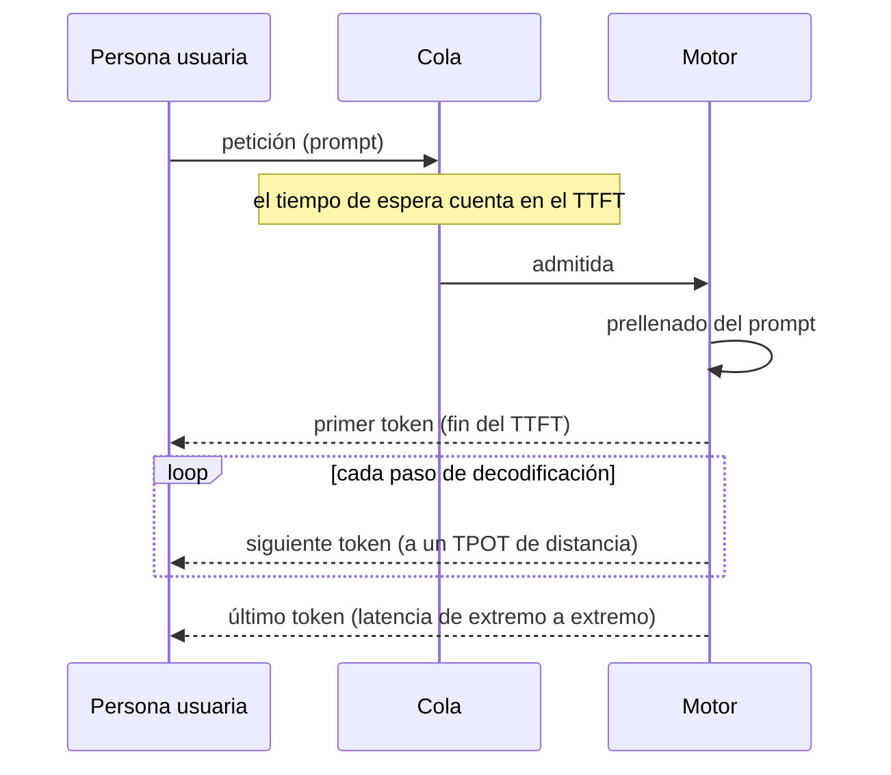
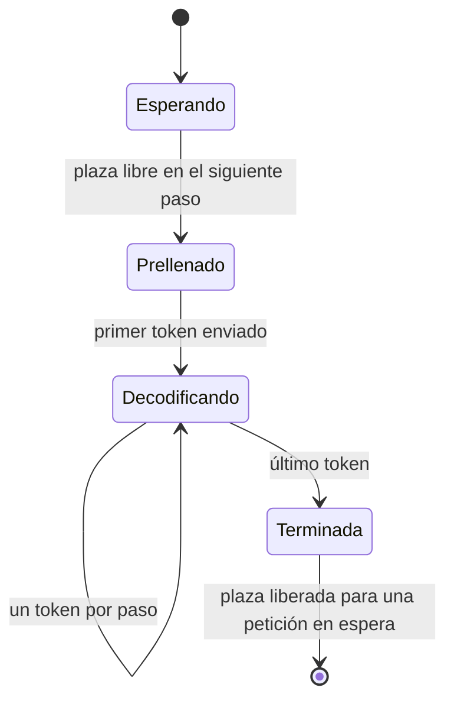
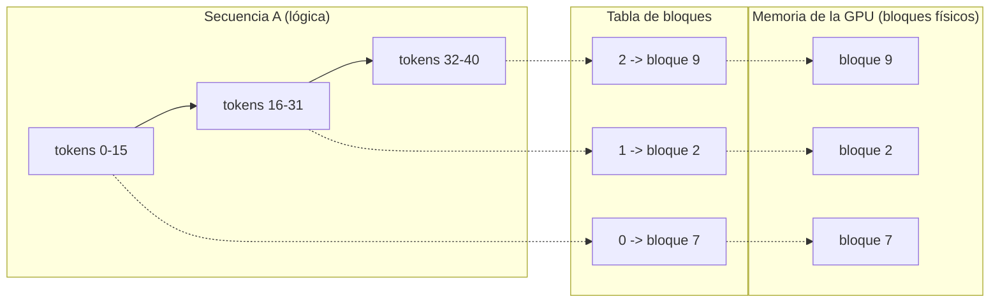
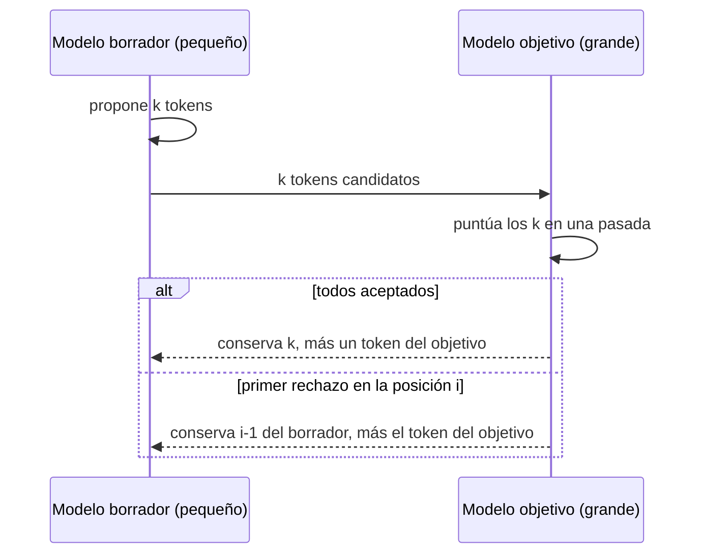
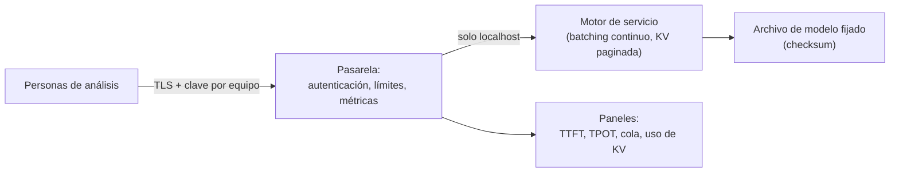

🌐 [English](04-serving-and-operating-llms.md) · Español

# Lección 10.4 — Servir y operar LLM

> **Módulo 10 · Lección 4 de 4** · ⏱️ unos 55 min · 🧪 Lab: [paso 8](lab/README.es.md#paso-8--simula-un-motor-de-servicio)

## 📨 Situación

> **De:** Sam Adeyemi · Ingeniería de fiabilidad (SRE)
> **Canal:** #platform
>
> Primero los números. El equipo de Jordan tiene 6 personas de análisis, y soporte también quiere
> probar el agente. La regla de Noor sigue en pie, así que nada de API en la nube: una máquina
> compartida en nuestra oficina. Antes de pedir nada necesito cuatro números: tiempo hasta el primer
> *token*, *tokens* por segundo por persona, cuánta gente puede usarlo a la vez antes de que se caiga
> y cuánto cuesta al día en comparación con una API. Además, "está en la red de la oficina" no es un
> modelo de seguridad. Ya me he quemado antes con "es interno". Dos veces. La misma persona.

## 🎯 Objetivos

Al terminar esta lección puedes:

- Definir el tiempo hasta el primer *token*, el tiempo por *token* de salida y el rendimiento (*throughput*), y explicar cómo el *batching* sacrifica uno a cambio de otro.
- Explicar el *batching* continuo y PagedAttention, y cuantificar su efecto con el simulador del lab.
- Estimar la aceleración de la decodificación especulativa a partir de la tasa de aceptación y el coste del modelo borrador.
- Comparar el coste local y el de una interfaz de programación de aplicaciones (API, *application programming interface*) con los precios como parámetros, y dimensionar la capacidad con margen.
- Enumerar las señales de observabilidad y los controles de seguridad que necesita un *endpoint* de modelo autoalojado.

## 🤔 Predice primero

Apunta tus respuestas antes de seguir leyendo. Las comprobarás en la autoevaluación.

1. Cuando un servidor procesa 16 peticiones juntas en lugar de una a una, ¿cada persona ve aparecer los *tokens* más rápido o más despacio?
2. Si el servidor reserva espacio para el contexto máximo (8.192 *tokens*) en cada petición, ¿qué proporción aproximada de esa memoria de caché de claves y valores queda sin usar en las peticiones típicas?
3. ¿Un modelo autoalojado es siempre más barato al día que pagar una API por *token*?

## 1. Métricas de latencia que se notan

Un servidor de modelo de lenguaje grande (LLM, *large language model*) responde en dos fases. El
**prellenado** (*prefill*) lee todo el *prompt* y produce el primer *token*. La **decodificación**
(*decode*) produce los *tokens* restantes de uno en uno. Quien usa el sistema nota las dos fases de
forma distinta, así que las mides por separado.

| Métrica | Definición | Lo que nota quien lo usa |
|---|---|---|
| Tiempo hasta el primer *token* (TTFT, *time to first token*) | Desde que llega la petición hasta el primer *token* de salida | "¿Está haciendo algo?" Incluye el tiempo en cola |
| Tiempo por *token* de salida (TPOT, *time per output token*) | Separación media entre los *tokens* de salida después del primero | La velocidad de lectura de la respuesta en *streaming* |
| Latencia de extremo a extremo | TTFT + TPOT x (*tokens* de salida - 1) | Cuánto falta para que la respuesta esté completa |
| Rendimiento (*throughput*) | *Tokens* de salida por segundo sumando a todas las personas usuarias | A cuántas personas puede atender un servidor |

Informa de percentiles, no de medias. El percentil 50 (p50) es la persona usuaria típica; el percentil
95 (p95) es quien presenta la queja. Un servidor puede tener un p50 correcto y un p95 terrible por
culpa de las colas.

**Analogía:** un restaurante. El TTFT es lo que tarda en llegar el primer plato, y depende sobre todo
de la cola en la puerta. El TPOT es el ritmo de los platos siguientes. El rendimiento es cuántas
comidas saca la cocina por hora.



El simulador calcula estas métricas para cada petición y las resume:

```python
ttft = sorted(first[r.id] - r.arrival_ms for r in reqs)
tpot = [(done[r.id] - first[r.id]) / (r.output_tokens - 1) for r in reqs]
span_s = (max(done.values()) - min(r.arrival_ms for r in reqs)) / 1000
throughput = sum(r.output_tokens for r in reqs) / span_s
```

> ⚠️ **Error común:** medir solo la latencia total en una prueba de carga. Una interfaz de chat o de
> investigación muestra los *tokens* en *streaming*, así que una respuesta de 10 segundos que empieza a
> los 200 ms se siente bien, mientras que una que no muestra nada durante 8 segundos parece rota. Sigue
> el TTFT por separado.

## 2. Batching: estático frente a continuo

Un paso de decodificación lee todos los pesos una vez (lección 10.3). Leerlos para 16 secuencias a la
vez cuesta solo un poco más que para una, así que los motores de servicio agrupan las peticiones en
lotes (*batching*). Cómo las agrupan marca una gran diferencia.

- **Sin *batching*:** una petición cada vez. Cada *token* es rápido, pero todos los demás esperan.
- ***Batching* estático:** se toman las peticiones en espera, se ejecutan juntas hasta que termina la *más larga* y después se toma el siguiente grupo. Las respuestas cortas se quedan inactivas en su plaza, y las peticiones nuevas esperan a que termine todo el lote.
- ***Batching* continuo:** después de cada paso de decodificación, las secuencias terminadas salen y las peticiones en espera entran. El lote está siempre tan lleno como lo permite la cola.

El lab simula los tres con un modelo ilustrativo del tiempo por paso (un paso de decodificación cuesta
25 ms más 1 ms por secuencia del lote; el prellenado cuesta 0,1 ms por *token* del *prompt*). La carga
de trabajo son 64 peticiones generadas con semilla que llegan, de media, cada 1.500 ms, con *prompts*
de 100 a 1.000 *tokens* y respuestas de 16 a 512 *tokens*. Son números simulados, no mediciones de
ningún motor ni *hardware*:

```text
scheduler                  TTFT p50   TTFT p95    TPOT  tokens/s
no batching                242552ms   414066ms  26.0ms      38.3
static (batch 16)           10453ms    17260ms  36.8ms     167.4
continuous (batch 16)          98ms      155ms  34.1ms     195.7
```

En esta tabla se esconden tres lecciones. Sin *batching*, el servidor produce 38,3 *tokens* por
segundo mientras las peticiones llegan más deprisa, así que la cola crece y la persona usuaria típica
espera unos cuatro minutos al primer *token*. El *batching* estático arregla el rendimiento, pero no la
espera: una petición nueva sigue esperando a la respuesta más lenta del lote actual, unos 10 segundos
en el p50. El *batching* continuo la admite en el siguiente paso: 98 ms. Y el TPOT *sube* con el
*batching*, de 26,0 ms a 34,1 ms. Cada persona lee un poco más despacio para que se pueda atender a
muchas más.

**Analogía:** el *batching* estático es un autobús turístico que solo sale cuando la visita ha
terminado para todo el grupo. El *batching* continuo es un tranvía: la gente sube y baja en cada
parada.



```python
while pending or running:
    if not running and pending and pending[0].arrival_ms > clock:
        clock = pending[0].arrival_ms
    joining = []
    while pending and pending[0].arrival_ms <= clock and len(running) + len(joining) < max_batch:
        joining.append(pending.popleft())
    step = model.prefill(sum(r.prompt_tokens for r in joining))
    if running:
        step += model.decode(len(running))
    clock += step
    # ...decrement every running sequence, free the finished ones, start the joiners
```

> 💡 **Consejo de producción:** fija el tamaño máximo de lote a partir de tu objetivo de TPOT, no solo
> de la memoria. Con lotes de 8 en lugar de 16 en el simulador, el p95 del TTFT del *batching* continuo
> sube de 155 ms a 6.227 ms porque las peticiones hacen cola para conseguir una plaza. Haz pruebas de
> carga con tu patrón real de llegadas.

## 3. Gestión de la caché de claves y valores y PagedAttention

El *batching* necesita memoria para la caché de claves y valores (caché KV, *key-value cache*) de cada
secuencia. Con la forma de ejemplo de la lección 10.3, cada *token* cuesta 128 KiB de caché. El
enfoque simple reserva un bloque contiguo por petición, del tamaño del contexto máximo, porque el motor
no sabe de antemano cuánto durará la respuesta. La mayoría de las peticiones son mucho más cortas, así
que la mayor parte de esa reserva se desperdicia.

**PagedAttention**, presentado junto con el motor de servicio vLLM, guarda la caché en bloques pequeños
de tamaño fijo, como las páginas de la memoria virtual de un sistema operativo. Una petición recibe un
bloque nuevo solo cuando lo necesita, y una tabla de bloques asigna las posiciones lógicas de cada
secuencia a bloques físicos situados en cualquier parte de la memoria de la unidad de procesamiento
gráfico (GPU, *graphics processing unit*), donde los motores de servicio suelen guardar la caché.

El lab compara las dos estrategias con las mismas 64 peticiones, un presupuesto de caché de 8 GB, una
longitud máxima de 8.192 *tokens* y páginas de 16 *tokens*:

```text
KV budget 8 GB, 128 KiB per token, max length 8192, page size 16 tokens
strategy       reserved     used   waste  fit at once
contiguous      524,288   54,923   89.5%        7/64
paged            55,440   54,923    0.9%       64/64
```

Reservar el máximo desperdicia el 89,5 % de la memoria, así que solo caben 7 peticiones a la vez. La
paginación desperdicia el 0,9 %, la cola sin usar de la última página de cada petición, y caben las
64. Más secuencias en memoria significan lotes más grandes, y lotes más grandes significan el
rendimiento de la sección 2.

**Analogía:** un hotel que reserva la suite presidencial a cada huésped "por si la necesita" se llena
con 7 huéspedes. Un hotel que da habitaciones estándar y añade otra cuando una familia crece atiende a
todo el mundo.



```python
for name, need in (("contiguous", [max_seq_len] * len(used)),
                   ("paged", [math.ceil(u / block) * block for u in used])):
    fit, total = 0, 0
    for n in need:
        if total + n > budget_tokens:
            break
        fit, total = fit + 1, total + n
    plans.append(KVPlan(name, sum(need), sum(used), fit))
```

> ⚠️ **Error común:** subir el contexto máximo "por si acaso". Con la reserva contigua, el número de
> personas usuarias simultáneas baja en la misma proporción. Incluso con paginación, un solo contexto
> de investigación muy largo puede ocupar la memoria que usarían docenas de chats cortos. Fija límites
> por ruta.

## 4. Decodificación especulativa

La decodificación es lenta porque cada paso lee el modelo grande entero para producir un solo
*token*. La **decodificación especulativa** (*speculative decoding*) deja que un modelo *borrador*
pequeño y rápido adivine los siguientes k *tokens*, y el modelo *objetivo* grande comprueba las k
apuestas en una sola pasada. Las apuestas aceptadas se conservan; en el primer rechazo se usa el
*token* propio del objetivo y el borrador vuelve a empezar. El método del artículo original mantiene
sin cambios la distribución de salida del modelo objetivo, así que la calidad no baja; solo cambia la
velocidad.

El artículo deduce dos valores esperados. Con una tasa de aceptación α (alfa, la probabilidad de que el
objetivo acepte un *token* del borrador), k *tokens* de borrador por ronda y c, el coste de un paso del
borrador en relación con un paso del objetivo:

- *tokens* por pasada del objetivo = (1 - α^(k+1)) / (1 - α)
- aceleración en tiempo real = *tokens* por pasada / (k x c + 1)

Para k = 4 y un borrador que cuesta el 5 % del objetivo:

```text
acceptance  draft k  tokens/pass  speed-up
      0.50        4        1.938     1.61x
      0.70        4        2.773     2.31x
      0.90        4        4.095     3.41x
```

La tasa de aceptación depende de lo bien que el borrador imite al objetivo con *tu* tráfico. El texto
predecible, como copiar frases de evidencia o rellenar una plantilla de informe, acepta más borradores
que el texto creativo.

**Analogía:** una persona júnior escribe el siguiente párrafo, la persona sénior lo lee y conserva
todo hasta la primera frase que habría escrito de otra manera. Cuando quien escribe el borrador conoce
el estilo de quien lo revisa, sobrevive la mayor parte del párrafo.



```python
def speculative(alpha: float, k: int, cost_ratio: float) -> tuple[float, float]:
    tokens = (1 - alpha ** (k + 1)) / (1 - alpha) if alpha < 1 else k + 1.0
    return round(tokens, 3), round(tokens / (k * cost_ratio + 1), 3)
```

## 5. Planificación de coste y capacidad

Sam preguntó cuánto cuesta la máquina en comparación con una API. No respondas nunca con un precio que
recuerdes de memoria: los precios cambian y varían según el proveedor y el modelo. Escribe la fórmula, convierte
cada precio en un parámetro y pon los números de hoy.

- Coste de la API al día = *tokens* de entrada / 1M x precio por millón de *tokens* de entrada + *tokens* de salida / 1M x precio por millón de *tokens* de salida.
- Coste local al día = precio del *hardware* / (meses de amortización x 30) + potencia (kW) x horas de uso x precio por kWh.

Con valores de ejemplo (1 millón de *tokens* de entrada y 200.000 de salida al día a 1 € y 4 € por
millón; una máquina de 2.500 € amortizada en 36 meses que consume 150 W durante 8 horas al día, a los
0,19 € por kWh de España que figuran en el dataset de Hearthwise):

```text
All prices are inputs you supply; the defaults are placeholders, not real quotes.
API:       1.80 EUR/day
local:     2.54 EUR/day  (hardware 2.31 + energy 0.23)
local becomes cheaper at 1.4x today's tokens
```

Con este volumen, la API es más barata, y lo local solo gana a partir de 1,4 veces el tráfico. Hay dos
cosas que cambian el panorama. Si el *hardware* ya existe (el portátil de Jordan), el coste local
marginal es solo la energía, 0,23 € al día. Y en este proyecto el coste no es el factor decisivo: la
regla de Noor descarta la API. La función del modelo de costes es decirle a Jordan cuánto cuesta la
privacidad, no decidir si tenerla.

La **capacidad** se deduce de la demanda pico y del rendimiento por servidor, con margen para que el
servidor nunca funcione al 100 %: servidores = techo(*tokens*/s en el pico x (1 + margen) /
*tokens*/s por servidor). Para un pico de 400 *tokens* por segundo, 150 *tokens* por segundo por
servidor y un 30 % de margen, salen 4 servidores. Mide la cifra por servidor con una prueba de carga en
tu propio *hardware* y con tu propio tráfico; el simulador solo muestra la forma de la curva.

```python
def daily_cost(c: CostInputs) -> CostResult:
    api = c.tokens_in_per_day / 1e6 * c.api_eur_per_m_in + c.tokens_out_per_day / 1e6 * c.api_eur_per_m_out
    hardware = c.hardware_eur / (c.amortisation_months * 30)
    energy = c.power_watts / 1000 * c.busy_hours_per_day * c.eur_per_kwh
    local = hardware + energy
    breakeven = local / api if api else math.inf
    ...
```

> 💡 **Consejo de producción:** mide los *tokens* por tarea antes de modelar el coste. El medidor del
> lab los cuenta: una ejecución sin conexión de `rq1` usó 4.082 *tokens* de *prompt* y 1.603 de
> respuesta. Las páginas web reales son mucho más largas que las de la copia, así que mide con tráfico
> real antes de fiarte de cualquier modelo de costes.

## 6. Operar un endpoint autoalojado

En cuanto la máquina atiende a personas reales, necesita los mismos cuidados que cualquier servicio en
producción, más algunas cuestiones propias de los modelos.

**Observabilidad.** Recoge estas señales por modelo y por ruta:

| Señal | Por qué |
|---|---|
| TTFT y TPOT, p50 y p95 | Experiencia de uso; las colas aparecen primero en el TTFT |
| Profundidad de la cola y tamaño del lote | Aviso temprano antes de que empeore la latencia |
| Uso de la caché KV | Cerca del 100 % significa que las peticiones nuevas esperan o se expulsan |
| *Tokens* por segundo, peticiones por segundo | Capacidad y coste |
| Errores, tiempos de espera agotados, salidas truncadas | Fiabilidad; el truncamiento suele indicar un límite de contexto |
| Métricas por informe del evaluador | Calidad: validez de las citas y fuentes por informe |

Registra metadatos, no contenido: tamaño de la petición, latencia, versión del modelo, grupo de
personas usuarias. Los *prompts* de este proyecto son confidenciales, así que por defecto no van a los
registros.

**Seguridad.** Un servidor de modelos es una API que convierte texto en acciones y datos. Trátalo como
tal:

- Ligarlo a la interfaz de *loopback* o ponerlo detrás de una pasarela (*gateway*); no exponerlo nunca directamente a una red.
- Exigir autenticación y dar a cada equipo su propia clave con límites de peticiones.
- Usar TLS (*Transport Layer Security*) para todo lo que salga de la máquina.
- Fijar los archivos de modelo con su *checksum* y descargarlos solo de fuentes de confianza.
- Mantener al mínimo las herramientas del agente: un agente de investigación necesita buscar y leer, no correo electrónico ni borrar archivos.
- Aplicar parches al software de servicio como a cualquier otra dependencia expuesta a internet.

**Analogía:** un servidor de modelos sin autenticación en la red de la oficina es una impresora a la
que cualquiera puede enviar trabajos, salvo que a esta impresora también se la puede convencer de que
revele lo que imprimió para otras personas.



> ⚠️ **Error común:** confiar en la red como frontera de seguridad. A los *endpoints* "internos"
> acaban llegando *scripts* de prueba, portátiles comprometidos y colegas con buenas intenciones.
> Autentica cada petición.

## 🧪 Pruébalo

1. Compara los planificadores de *batching*:

   ```bash
   cd modules/10-deep-research-and-local-deployment/lab
   uv run lab serve-sim
   ```

   Después ejecuta `uv run lab serve-sim --batch 8` y explica por qué el p95 del TTFT del *batching*
   continuo salta a 6.227 ms.

2. Compara las estrategias de caché KV y después prueba `uv run lab kv-cache --block 8`: el
   desperdicio paginado baja del 0,9 % al 0,4 %. ¿Qué te haría elegir páginas más grandes de todos
   modos?

   ```bash
   uv run lab kv-cache
   ```

3. Explora la decodificación especulativa: `uv run lab speculate --alpha 0.6 0.8 --k 8`. ¿Con qué tasa
   de aceptación merece la pena un borrador más largo?
4. Modela el coste y la capacidad con tus propios precios:

   ```bash
   uv run lab cost --peak-tokens-s 400
   ```

   ```text
   All prices are inputs you supply; the defaults are placeholders, not real quotes.
   API:       1.80 EUR/day
   local:     2.54 EUR/day  (hardware 2.31 + energy 0.23)
   local becomes cheaper at 1.4x today's tokens
   capacity: 4 server(s) for a peak of 400 tokens/s at 150 tokens/s each with 30% headroom
   ```

## 🏭 En el mundo real

- **Los motores hacen la parte difícil.** vLLM y motores similares implementan el *batching* continuo, las cachés KV paginadas y la decodificación especulativa; tu trabajo es configurar los límites, medir y planificar la capacidad.
- **Los objetivos guían la configuración.** Un objetivo de nivel de servicio (SLO, *service-level objective*) como "p95 del TTFT por debajo de 1 segundo" decide el tamaño del lote, el contexto máximo por ruta y cuándo añadir una réplica.
- **El tráfico mixto necesita separación.** Los contextos de investigación largos y los chats cortos compiten por la misma caché KV. Los equipos los envían a grupos de servidores distintos o limitan el contexto por ruta.
- **Las revisiones de costes son periódicas.** Los volúmenes de *tokens*, los precios y el *hardware* cambian; vuelve a ejecutar el modelo de costes cada trimestre con números medidos.
- **Los incidentes se parecen entre sí.** Colas que crecen tras un pico de tráfico, errores de falta de memoria después de que alguien suba el límite de contexto y una caída de calidad tras un cambio silencioso del archivo de modelo. Cada uno tiene una métrica que te habría avisado.

## ✅ Autoevaluación

**1. Retoma la predicción 1: con lotes de 16, ¿cada persona ve los *tokens* más rápido o más despacio?**

<details><summary>Respuesta</summary>

Un poco más despacio por *token* (TPOT de 34,1 ms frente a 26,0 ms en el simulador), pero el primer
*token* llega muchísimo antes (p50 del TTFT de 98 ms frente a unos cuatro minutos), porque sin
*batching* la cola nunca se vacía. "Más rápido" y "más despacio" tienen las dos algo de verdad; las
métricas las separan.

</details>

**2. Retoma la predicción 2: ¿cuánta memoria reservada de la caché KV queda sin usar con la reserva contigua?**

<details><summary>Respuesta</summary>

El 89,5 % en las peticiones simuladas: usaron 54.923 *tokens* de los 524.288 reservados. Solo caben 7
peticiones a la vez en 8 GB. Con páginas de 16 *tokens*, el desperdicio es del 0,9 % y caben las 64.

</details>

**3. Retoma la predicción 3: ¿autoalojar es siempre más barato?**

<details><summary>Respuesta</summary>

No. Con los valores de ejemplo, la API cuesta 1,80 € al día y la máquina local 2,54 €, así que lo
local solo gana por encima de 1,4 veces el volumen, o cuando el *hardware* ya existe. En este proyecto
decide la privacidad, no el precio; el modelo de costes le dice a Jordan cuánto cuesta esa decisión.

</details>

**4. ¿Por qué la decodificación especulativa no reduce la calidad de la salida, y qué limita su aceleración?**

<details><summary>Respuesta</summary>

El modelo objetivo comprueba cada *token* del borrador y la regla de aceptación conserva su
distribución de salida, así que el texto tiene la misma calidad que con el objetivo solo. La
aceleración está limitada por la tasa de aceptación y por el coste del borrador: con α = 0,5 y k = 4,
la ganancia es de 1,61x; con α = 0,9, de 3,41x.

</details>

**5. Nombra tres controles que pondrías delante de un servidor de modelos autoalojado.**

<details><summary>Respuesta</summary>

Tres cualesquiera de estos: ligarlo a localhost detrás de una pasarela, autenticación con claves por
equipo, límites de peticiones, TLS, archivos de modelo fijados con *checksums*, herramientas mínimas
para el agente, registros solo de metadatos y parches. La respuesta tentadora, "está en la red
interna", no es un control.

</details>

## 💬 Explícalo con tus palabras

1. Sam pide "la" latencia de la máquina. Explica por qué responderás con el TTFT y el TPOT en p50 y
   p95, y qué le dice cada uno.
2. Explica a Jordan, sin jerga, por qué el *batching* continuo y la paginación permiten que seis
   personas de análisis compartan una sola máquina.

## 🔑 Ideas clave

- Mide el TTFT, el TPOT y el rendimiento por separado, en p50 y p95; las colas aparecen en el TTFT.
- El *batching* continuo admite y libera peticiones en cada paso; el estático espera a la respuesta más lenta.
- La caché KV limita la concurrencia; paginarla en bloques pequeños elimina la mayor parte del desperdicio de reservar el máximo.
- La decodificación especulativa cambia un borrador barato por menos pasadas caras, sin cambiar la distribución de salida.
- El coste y la capacidad son fórmulas con tus datos medidos; los precios son parámetros, nunca constantes.
- Un *endpoint* autoalojado necesita autenticación, una exposición de red mínima, modelos fijados y registros solo de metadatos.

## 📚 Profundiza

- ⭐ [Efficient memory management for LLM serving with PagedAttention](https://arxiv.org/abs/2309.06180) — el artículo de vLLM: la paginación de la caché KV y por qué aumenta el rendimiento.
- [Documentación de vLLM](https://docs.vllm.ai) — configurar un motor de servicio para producción, incluido su servidor compatible con OpenAI.
- [Fast inference from transformers via speculative decoding](https://arxiv.org/abs/2211.17192) — el origen de las fórmulas de aceleración de la sección 4.
- [FlashAttention](https://arxiv.org/abs/2205.14135) — hacer que la propia atención sea más rápida y ligera en memoria.

---

[← Anterior: 10.3 Ejecutar modelos en local](03-running-models-locally.es.md) · [🏠 Módulo 10](README.es.md) · [Siguiente: Lab →](lab/README.es.md)
