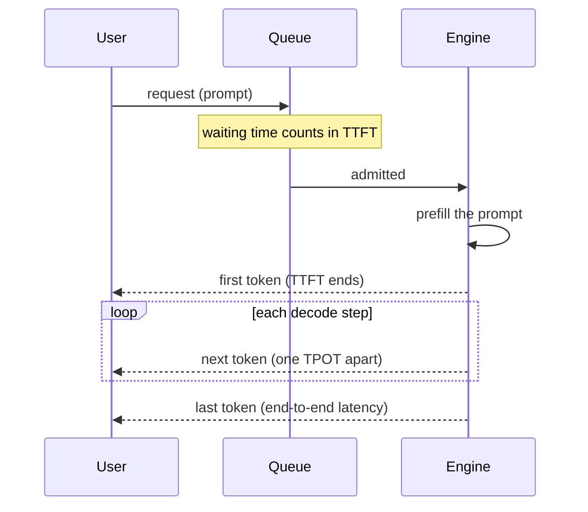
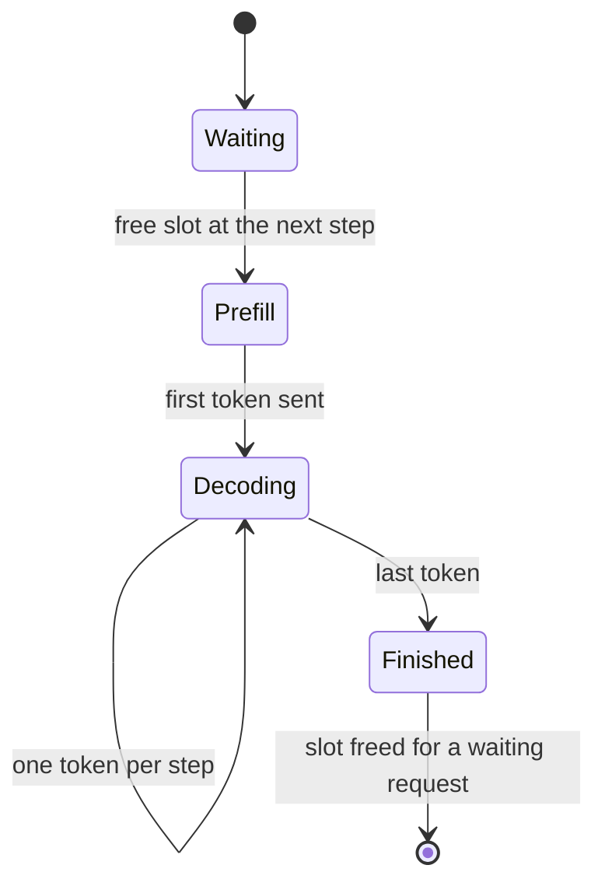
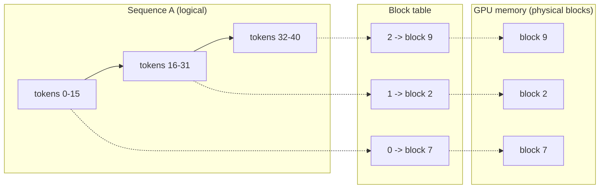
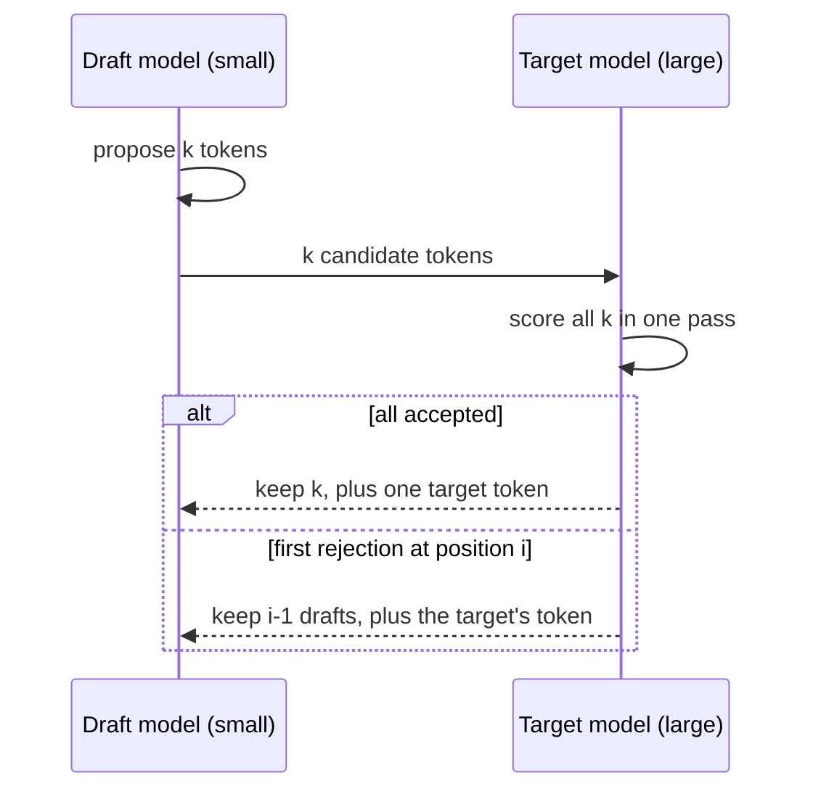
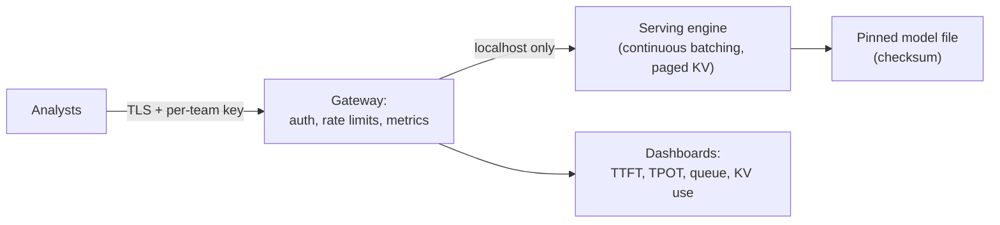

🌐 English · [Español](04-serving-and-operating-llms.es.md)

# Lesson 10.4 — Serving and operating LLMs

> **Module 10 · Lesson 4 of 4** · ⏱️ about 55 min · 🧪 Lab: [step 8](lab/README.md#step-8--simulate-a-serving-engine)

## 📨 Situation

> **From:** Sam Adeyemi · Site Reliability Engineer (SRE)
> **Channel:** #platform
>
> Numbers first. Jordan's team has 6 analysts, and support wants to try the agent too. Noor's rule
> stands, so no cloud API: one shared box in our office. Before I order anything I need four
> numbers: time to first token, tokens per second per user, how many people can use it at once
> before it falls over, and what it costs per day compared with an API. Also, "it's on the office
> network" is not a security model. I have been burned by "it's internal" before. Twice. Same
> person.

## 🎯 Objectives

By the end of this lesson you can:

- Define time to first token, time per output token and throughput, and explain how batching trades one against another.
- Explain continuous batching and PagedAttention, and quantify their effect with the lab's simulator.
- Estimate the speed-up of speculative decoding from the acceptance rate and the cost of the draft model.
- Compare local and application programming interface (API) cost with prices as parameters, and size capacity with headroom.
- List the observability signals and security controls a self-hosted model endpoint needs.

## 🤔 Predict first

Write your answers down before reading on. You will check them in the self-check.

1. When a server processes 16 requests together instead of one at a time, does each user see tokens appear faster or slower?
2. If the server reserves room for the maximum context (8,192 tokens) for every request, roughly what share of that key-value cache memory goes unused for typical requests?
3. Is a self-hosted model always cheaper per day than paying an API per token?

## 1. Latency metrics that users feel

A large language model (LLM) server answers in two phases. **Prefill** reads the whole prompt and
produces the first token. **Decode** produces the remaining tokens one at a time. Users feel the
two phases differently, so you measure them separately.

| Metric | Definition | What the user feels |
|---|---|---|
| Time to first token (TTFT) | From request arrival to the first output token | "Is it doing anything?" Includes queueing time |
| Time per output token (TPOT) | Average gap between output tokens after the first | Reading speed of the streamed answer |
| End-to-end latency | TTFT + TPOT x (output tokens - 1) | How long until the answer is complete |
| Throughput | Output tokens per second across all users | How many users one server can carry |

Report percentiles, not averages. The 50th percentile (p50) is the typical user; the 95th
percentile (p95) is the user who files the complaint. A server can have a fine p50 and a terrible
p95 because of queueing.

**Analogy:** a restaurant. TTFT is how long until the first plate arrives, which depends mostly on
the queue at the door. TPOT is the pace of the following courses. Throughput is how many meals the
kitchen sends out per hour.



The simulator computes these metrics for every request and summarises them:

```python
ttft = sorted(first[r.id] - r.arrival_ms for r in reqs)
tpot = [(done[r.id] - first[r.id]) / (r.output_tokens - 1) for r in reqs]
span_s = (max(done.values()) - min(r.arrival_ms for r in reqs)) / 1000
throughput = sum(r.output_tokens for r in reqs) / span_s
```

> ⚠️ **Common mistake:** measuring only total latency in a load test. A chat or research interface
> streams tokens, so a 10-second answer that starts in 200 ms feels fine, while one that shows
> nothing for 8 seconds feels broken. Track TTFT on its own.

## 2. Batching: static versus continuous

A decode step reads all the weights once (lesson 10.3). Reading them for 16 sequences at once costs
only a little more than for one, so serving engines **batch** requests. How they batch makes a large
difference.

- **No batching:** one request at a time. Each token is fast, but everyone else waits.
- **Static batching:** take the requests waiting, run them together until the *longest* one finishes, then take the next group. Short answers sit idle in their slot, and new arrivals wait for the whole batch.
- **Continuous batching:** after every decode step, finished sequences leave and waiting requests join. The batch is always as full as the queue allows.

The lab simulates the three with an illustrative step-time model (a decode step costs 25 ms plus
1 ms per sequence in the batch; prefill costs 0.1 ms per prompt token). The workload is 64 seeded
requests arriving on average every 1,500 ms, with prompts of 100 to 1,000 tokens and answers of
16 to 512 tokens. These are simulated numbers, not benchmarks of any engine or hardware:

```text
scheduler                  TTFT p50   TTFT p95    TPOT  tokens/s
no batching                242552ms   414066ms  26.0ms      38.3
static (batch 16)           10453ms    17260ms  36.8ms     167.4
continuous (batch 16)          98ms      155ms  34.1ms     195.7
```

Three lessons hide in this table. Without batching, the server makes 38.3 tokens per second while
requests arrive faster than that, so the queue grows and the typical user waits about four minutes
for the first token. Static batching fixes throughput but not waiting: a new request still waits
for the slowest answer in the current batch, about 10 seconds at p50. Continuous batching admits it
at the next step: 98 ms. And TPOT goes *up* with batching, from 26.0 ms to 34.1 ms. Each user reads
a little slower so that many more users are served at all.

**Analogy:** static batching is a tour bus that only leaves when the tour is over for everyone.
Continuous batching is a tram: people get on and off at every stop.



```python
while pending or running:
    if not running and pending and pending[0].arrival_ms > clock:
        clock = pending[0].arrival_ms
    joining = []
    while pending and pending[0].arrival_ms <= clock and len(running) + len(joining) < max_batch:
        joining.append(pending.popleft())
    step = model.prefill(sum(r.prompt_tokens for r in joining))
    if running:
        step += model.decode(len(running))
    clock += step
    # ...decrement every running sequence, free the finished ones, start the joiners
```

> 💡 **Production tip:** set the maximum batch size from your TPOT target, not from memory alone.
> With batch 8 instead of 16 in the simulator, p95 TTFT for continuous batching rises from 155 ms to
> 6,227 ms because requests queue for a slot. Load-test with your real arrival pattern.

## 3. Key-value cache management and PagedAttention

Batching needs memory for every sequence's key-value (KV) cache. With the example shape from lesson
10.3, each token costs 128 KiB of cache. The simple approach reserves one contiguous block per
request, sized for the maximum context, because the engine does not know in advance how long the
answer will be. Most requests are far shorter, so most of that reservation is wasted.

**PagedAttention**, introduced with the vLLM serving engine, stores the cache in small fixed-size
blocks, like pages of virtual memory in an operating system. A request gets a new block only when it
needs one, and a block table maps each sequence's logical positions to physical blocks anywhere in
the memory of the graphics processing unit (GPU), where serving engines usually keep the cache.

The lab compares the two on the same 64 requests with an 8 GB cache budget, a maximum length of
8,192 tokens and 16-token pages:

```text
KV budget 8 GB, 128 KiB per token, max length 8192, page size 16 tokens
strategy       reserved     used   waste  fit at once
contiguous      524,288   54,923   89.5%        7/64
paged            55,440   54,923    0.9%       64/64
```

Reserving the maximum wastes 89.5% of the memory, so only 7 requests fit at once. Paging wastes
0.9%, the unused tail of each request's last page, and all 64 fit. More sequences in memory means
bigger batches, and bigger batches mean the throughput of section 2.

**Analogy:** a hotel that books every guest the presidential suite "in case they need it" fills up
after 7 guests. A hotel that gives standard rooms and adds a room when a family grows serves
everyone.



```python
for name, need in (("contiguous", [max_seq_len] * len(used)),
                   ("paged", [math.ceil(u / block) * block for u in used])):
    fit, total = 0, 0
    for n in need:
        if total + n > budget_tokens:
            break
        fit, total = fit + 1, total + n
    plans.append(KVPlan(name, sum(need), sum(used), fit))
```

> ⚠️ **Common mistake:** raising the maximum context "to be safe". With contiguous reservation, the
> number of concurrent users drops in proportion. Even with paging, one very long research context
> can take memory that dozens of short chats would use. Set per-route limits.

## 4. Speculative decoding

Decode is slow because each step reads the whole large model to produce one token. **Speculative
decoding** lets a small, fast *draft* model guess the next k tokens, and the large *target* model
checks all k guesses in one pass. Accepted guesses are kept; at the first rejection, the target's
own token is used and drafting restarts. The method in the original paper keeps the target model's
output distribution unchanged, so quality does not drop; only speed changes.

The paper derives two expected values. With acceptance rate α (alpha, the chance the target accepts
a draft token), k draft tokens per round and c, the cost of a draft step relative to a target step:

- tokens per target pass = (1 - α^(k+1)) / (1 - α)
- wall-time speed-up = tokens per pass / (k x c + 1)

For k = 4 and a draft costing 5% of the target:

```text
acceptance  draft k  tokens/pass  speed-up
      0.50        4        1.938     1.61x
      0.70        4        2.773     2.31x
      0.90        4        4.095     3.41x
```

The acceptance rate depends on how well the draft imitates the target on *your* traffic. Predictable
text, such as copying evidence sentences or filling a report template, accepts more drafts than
creative text.

**Analogy:** a junior writes the next paragraph, the senior reads it and keeps everything up to the
first sentence they would have written differently. When the junior knows the senior's style, most
of the paragraph survives.



```python
def speculative(alpha: float, k: int, cost_ratio: float) -> tuple[float, float]:
    tokens = (1 - alpha ** (k + 1)) / (1 - alpha) if alpha < 1 else k + 1.0
    return round(tokens, 3), round(tokens / (k * cost_ratio + 1), 3)
```

## 5. Cost and capacity planning

Sam asked what the box costs compared with an API. Never answer with a remembered price: prices
change, and they differ by provider and model. Write the formula, make every price a parameter, and
plug in today's numbers.

- API cost per day = input tokens / 1M x price per million input tokens + output tokens / 1M x price per million output tokens.
- Local cost per day = hardware price / (amortisation months x 30) + power (kW) x busy hours x price per kWh.

With placeholder inputs (1 million input and 200,000 output tokens a day at €1 and €4 per million;
a €2,500 machine over 36 months drawing 150 W for 8 hours a day, at Spain's €0.19 per kWh from the
Hearthwise dataset):

```text
All prices are inputs you supply; the defaults are placeholders, not real quotes.
API:       1.80 EUR/day
local:     2.54 EUR/day  (hardware 2.31 + energy 0.23)
local becomes cheaper at 1.4x today's tokens
```

At this volume the API is cheaper, and local wins only at 1.4 times the traffic. Two things change
the picture. If the hardware already exists (Jordan's laptop), the marginal local cost is energy
alone, €0.23 a day. And for this project cost is not the deciding factor: Noor's rule rules out the
API. The model's job is to tell Jordan what privacy costs, not to decide whether to have it.

**Capacity** follows from peak demand and per-server throughput, with headroom so the server never
runs at 100%: servers = ceiling(peak tokens/s x (1 + headroom) / tokens/s per server). For a peak of
400 tokens per second, 150 tokens per second per server and 30% headroom, that is 4 servers. Measure
the per-server number with a load test on your own hardware and traffic; the simulator only shows
the shape of the curve.

```python
def daily_cost(c: CostInputs) -> CostResult:
    api = c.tokens_in_per_day / 1e6 * c.api_eur_per_m_in + c.tokens_out_per_day / 1e6 * c.api_eur_per_m_out
    hardware = c.hardware_eur / (c.amortisation_months * 30)
    energy = c.power_watts / 1000 * c.busy_hours_per_day * c.eur_per_kwh
    local = hardware + energy
    breakeven = local / api if api else math.inf
    ...
```

> 💡 **Production tip:** measure tokens per task before you model cost. The lab's meter counts
> them: one offline `rq1` run used 4,082 prompt and 1,603 completion tokens. Real web pages are much
> longer than the snapshot's, so measure on real traffic before you trust any cost model.

## 6. Operating a self-hosted endpoint

Once the box serves real users, it needs the same care as any production service, plus some
concerns specific to models.

**Observability.** Collect these per model and per route:

| Signal | Why |
|---|---|
| TTFT and TPOT, p50 and p95 | User experience; queueing shows up in TTFT first |
| Queue depth and batch size | Early warning before latency degrades |
| KV-cache usage | Near 100% means new requests wait or get evicted |
| Tokens per second, requests per second | Capacity and cost |
| Errors, timeouts, truncated outputs | Reliability; truncation often means a context limit |
| Report-level metrics from the grader | Quality: citation validity and sources per report |

Log metadata, not content: request size, latency, model version, user group. Prompts in this
project are confidential, so they do not go into logs by default.

**Security.** A model server is an API that turns text into actions and data. Treat it like one:

- Bind to the loopback interface, or put it behind a gateway; never expose it bare to a network.
- Require authentication and give each team its own key with rate limits.
- Use TLS (Transport Layer Security) for anything that leaves the machine.
- Pin model files by checksum and download only from trusted sources.
- Keep the agent's tools minimal: a research agent needs search and read, not e-mail or file deletion.
- Patch the serving software like any other internet-facing dependency.

**Analogy:** an unauthenticated model server on the office network is a printer that anyone can send
jobs to, except that this printer can also be talked into revealing what it printed for others.



> ⚠️ **Common mistake:** trusting the network as the security boundary. "Internal" endpoints get
> reached by test scripts, compromised laptops and well-meaning colleagues. Authenticate every
> request.

## 🧪 Try it

1. Compare schedulers:

   ```bash
   cd modules/10-deep-research-and-local-deployment/lab
   uv run lab serve-sim
   ```

   Then run `uv run lab serve-sim --batch 8` and explain why p95 TTFT for continuous batching jumps
   to 6,227 ms.

2. Compare KV-cache strategies, then try `uv run lab kv-cache --block 8`: the paged waste drops
   from 0.9% to 0.4%. What would make you choose bigger pages anyway?

   ```bash
   uv run lab kv-cache
   ```

3. Explore speculative decoding: `uv run lab speculate --alpha 0.6 0.8 --k 8`. Which acceptance
   rate makes a longer draft worth it?
4. Model cost and capacity with your own prices:

   ```bash
   uv run lab cost --peak-tokens-s 400
   ```

   ```text
   All prices are inputs you supply; the defaults are placeholders, not real quotes.
   API:       1.80 EUR/day
   local:     2.54 EUR/day  (hardware 2.31 + energy 0.23)
   local becomes cheaper at 1.4x today's tokens
   capacity: 4 server(s) for a peak of 400 tokens/s at 150 tokens/s each with 30% headroom
   ```

## 🏭 In the real world

- **Engines do the hard parts.** vLLM and similar engines implement continuous batching, paged KV caches and speculative decoding; your job is to configure limits, measure and capacity-plan.
- **Objectives drive configuration.** A service-level objective (SLO) such as "p95 TTFT under 1 second" decides batch size, maximum context per route and when to add a replica.
- **Mixed traffic needs separation.** Long research contexts and short chats compete for the same KV cache. Teams route them to different pools or cap context per route.
- **Cost reviews are recurring.** Token volumes, prices and hardware change; re-run the cost model quarterly with measured numbers.
- **Incidents look familiar.** Queue build-up after a traffic spike, out-of-memory errors after someone raises the context limit, and a quality drop after a silent model-file change. Each has a metric that would have warned you.

## ✅ Self-check

**1. Revisit prediction 1: with batch 16, does each user see tokens faster or slower?**

<details><summary>Answer</summary>

Slightly slower per token (TPOT 34.1 ms against 26.0 ms in the simulator), but the first token
arrives far sooner (p50 TTFT 98 ms against about four minutes), because without batching the queue
never drains. "Faster" and "slower" both have a grain of truth; the metrics separate them.

</details>

**2. Revisit prediction 2: how much reserved KV-cache memory goes unused with contiguous reservation?**

<details><summary>Answer</summary>

89.5% for the simulated requests: they used 54,923 tokens of the 524,288 reserved. Only 7 requests
fit in 8 GB at once. With 16-token pages the waste is 0.9% and all 64 fit.

</details>

**3. Revisit prediction 3: is self-hosting always cheaper?**

<details><summary>Answer</summary>

No. With the placeholder inputs the API costs €1.80 a day and the local box €2.54, so local only
wins above 1.4 times the volume, or when the hardware already exists. For this project privacy, not
price, decides; the cost model tells Jordan the price of that decision.

</details>

**4. Why does speculative decoding not reduce output quality, and what limits its speed-up?**

<details><summary>Answer</summary>

The target model checks every drafted token and the acceptance rule preserves its output
distribution, so the text has the same quality as the target alone. The speed-up is limited by the
acceptance rate and by the draft's cost: at α = 0.5 with k = 4 the gain is 1.61x, at α = 0.9 it is
3.41x.

</details>

**5. Name three controls you would put in front of a self-hosted model server.**

<details><summary>Answer</summary>

Any three of: bind to localhost behind a gateway, authentication with per-team keys, rate limits,
TLS, pinned model files with checksums, minimal agent tools, metadata-only logging, patching. The
tempting answer "it is on the internal network" is not a control.

</details>

## 💬 Explain it in your own words

1. Sam asks for "the" latency of the box. Explain why you will answer with TTFT and TPOT at p50 and
   p95, and what each tells them.
2. Explain to Jordan, without jargon, why continuous batching and paging let six analysts share one
   machine.

## 🔑 Key ideas

- Measure TTFT, TPOT and throughput separately, at p50 and p95; queueing shows up in TTFT.
- Continuous batching admits and releases requests at every step; static batching waits for the slowest answer.
- The KV cache limits concurrency; paging it in small blocks removes most of the waste of reserving the maximum.
- Speculative decoding trades a cheap draft for fewer expensive passes without changing the output distribution.
- Cost and capacity are formulas with your measured inputs; prices are parameters, never constants.
- A self-hosted endpoint needs authentication, a narrow network exposure, pinned models and metadata-only logs.

## 📚 Go deeper

- ⭐ [Efficient memory management for LLM serving with PagedAttention](https://arxiv.org/abs/2309.06180) — the vLLM paper: KV-cache paging and why it raises throughput.
- [vLLM documentation](https://docs.vllm.ai) — configuring a production serving engine, including its OpenAI-compatible server.
- [Fast inference from transformers via speculative decoding](https://arxiv.org/abs/2211.17192) — the source of the speed-up formulas in section 4.
- [FlashAttention](https://arxiv.org/abs/2205.14135) — making attention itself faster and lighter on memory.

---

[← Previous: 10.3 Running models locally](03-running-models-locally.md) · [🏠 Module 10](README.md) · [Next: Lab →](lab/README.md)
