🌐 [English](README.md) · Español

# Módulo 10 — *Deep research* y despliegue local

> Construye un agente que investiga una pregunta de negocio en muchas fuentes y escribe un informe con
> citas que puedes defender, y después planifica cómo ejecutarlo en un modelo local que mantiene los
> datos confidenciales en la máquina.

## 🗺️ Mapa del curso

```mermaid
flowchart LR
    subgraph P1["Parte 1 · Fundamentos"]
        M01["01 · Cómo se construyen los LLM"] --> M02["02 · Del modelo base al asistente"] --> M03["03 · Playground de LLM"]
    end
    subgraph P2["Parte 2 · Adaptación y RAG"]
        M04["04 · Prompting y fine-tuning"] --> M05["05 · RAG I: recuperación"] --> M06["06 · RAG II: bot de soporte"]
    end
    subgraph P3["Parte 3 · Agentes"]
        M07["07 · Workflows y herramientas"] --> M08["08 · Agente Ask-the-Web"]
    end
    subgraph P4["Parte 4 · Razonamiento"]
        M09["09 · Modelos de razonamiento"] --> M10["10 · Deep research y local"]
    end
    M03 --> M04
    M06 --> M07
    M08 --> M09
    M10 --> CAP["🎓 Proyecto final"]
    classDef current fill:#ffb300,stroke:#e65100,stroke-width:3px,color:#000
    class M10 current
```



## 📖 La historia

Jordan Kim tiene una reunión del consejo de administración dentro de dos semanas y una sola pregunta:
¿debería Hearthwise lanzar el Ember T3 primero en México, Colombia o Chile? El agente Ask-the-Web del
módulo 08 responde una pregunta cada vez, y las técnicas de razonamiento del módulo 09 ayudan en cada
paso, pero esto exige decenas de búsquedas, un cuaderno de evidencias con sus fuentes y un informe
escrito que diga qué se sabe, qué no y en qué fuentes no se confió.

Noor Haddad añade una restricción: las propias preguntas revelan planes que no se han anunciado, así
que los datos de mercado, los *prompts* y las notas no deben salir nunca del portátil. Eso significa
un modelo local. Sam Adeyemi quiere números de inmediato: qué modelo cabe en 16 GB, qué velocidad
tendrá, cuántas personas analistas pueden compartir una máquina y cuánto cuesta en comparación con una
interfaz de programación de aplicaciones (API, *application programming interface*).

En este módulo construyes el agente de *deep research* sobre la copia sin conexión de la web,
demuestras que cada una de sus defensas sirve para algo y, después, dimensionas, cuantizas, sirves y
calculas el coste del modelo local en el que se ejecutará.

## 🎯 Objetivos de aprendizaje

Al terminar este módulo puedes:

- Diseñar un *pipeline* de *deep research* (planificar, buscar, leer, reflexionar, sintetizar) con presupuestos y reglas de parada.
- Construir el seguimiento de fuentes, la puntuación de credibilidad, el tratamiento de la actualidad, la deduplicación, la sanitización y la compactación del contexto, y medir cada uno con ablaciones.
- Calificar informes de investigación según la cobertura de hechos clave, la validez de las citas, la calidad de las fuentes y las trampas filtradas.
- Estimar la memoria y el techo de velocidad de un modelo local, y comparar esquemas de cuantización.
- Explicar el *batching* continuo, PagedAttention y la decodificación especulativa, y planificar el coste, la capacidad, la observabilidad y la seguridad de un *endpoint* autoalojado.

## 🗂️ Lecciones

| # | Lección | Tiempo | Qué aprenderás |
|---|---|---|---|
| 10.1 | [Arquitectura de *deep research*](01-deep-research-architecture.es.md) | 50 min | El bucle de investigación, sus componentes, dónde encaja un modelo de razonamiento, los presupuestos y cinco modos de fallo |
| 10.2 | [Construir el bucle de investigación](02-building-the-research-loop.es.md) | 60 min | Descomposición, credibilidad, actualidad, sanitización, notas, compactación, redacción con citas, calificación y ablaciones |
| 10.3 | [Ejecutar modelos en local](03-running-models-locally.es.md) | 55 min | llama.cpp, el formato de modelo GGUF y Ollama, cálculo de memoria, cuantización, unidades centrales de procesamiento frente a unidades de procesamiento gráfico (CPU y GPU), elegir un modelo para un portátil |
| 10.4 | [Servir y operar LLM](04-serving-and-operating-llms.es.md) | 55 min | Tiempo hasta el primer *token* (TTFT) y tiempo por *token* de salida (TPOT), *batching* continuo, PagedAttention, decodificación especulativa, coste, capacidad y seguridad |

## 🧪 Lab

Construyes un agente de *deep research* sobre `datasets/web` que responde las cuatro preguntas de
`datasets/agent_tasks/research_questions.jsonl` y escribe informes en Markdown con citas, un evaluador
que los comprueba, un arnés de ablaciones y las calculadoras de despliegue: estimador de memoria,
cuantización con numpy, simulador de *batching*, paginación de la caché de claves y valores (KV,
*key-value*), decodificación especulativa y coste. Todo funciona sin conexión y es determinista; un
modelo local real es opcional.

```bash
cd modules/10-deep-research-and-local-deployment/lab
uv sync && uv run pytest
uv run lab research rq1 --trace
uv run lab ablate
uv run lab memory --ram 16
```

Instrucciones completas: [lab/README.es.md](lab/README.es.md).

Definición de terminado (*Definition of Done*):

- [ ] Todos los tests pasan y ejecutaste las cuatro preguntas de investigación.
- [ ] Puedes explicar cada fila de la tabla de ablaciones.
- [ ] Atrapaste un número inventado con `uv run lab grade-file`.
- [ ] Dimensionaste un modelo para un portátil de 16 GB a mano y con el estimador.
- [ ] Comparaste los tres planificadores de *batching* y las dos estrategias de caché KV.
- [ ] Escribiste una comparación de costes con tus propios precios.

## 📏 Rúbrica de autoevaluación

| Criterio | 1 Inicial | 2 En desarrollo | 3 Competente | 4 Avanzado |
|---|---|---|---|---|
| Arquitectura de investigación | Nombra las etapas | Ejecuta el bucle y lee su traza | Adapta los presupuestos y las reglas de parada a una pregunta nueva | Diseña un *pipeline* para un dominio nuevo y defiende la elección de modelo en cada etapa |
| Calidad de las fuentes | Sabe que existen fuentes malas | Explica la puntuación de credibilidad de una página | Ajusta la política y las señales y mide el efecto | Diseña una política de fuentes por capas con monitorización |
| Evaluación | Sabe qué es una cita | Ejecuta el evaluador | Interpreta las ablaciones, incluidas las defensas que solo importan en conjunto | Construye un conjunto de preguntas calificadas y lo usa para elegir modelos |
| Inferencia local | Sabe que un modelo puede ejecutarse en local | Usa el estimador de memoria | Elige el tamaño del modelo y la cuantización para una máquina y explica por qué | Planifica modelos por rol con cuantización evaluada y archivos fijados |
| Servicio y operaciones | Sabe que la latencia importa | Define TTFT, TPOT y rendimiento (*throughput*) | Explica el *batching*, la paginación y la decodificación especulativa con números | Elabora un plan de capacidad, coste, observabilidad y seguridad |

## 🎤 Rincón de entrevistas

**1. ¿En qué se diferencia un agente de *deep research* de la generación aumentada por recuperación?**

<details><summary>Respuesta</summary>

La generación aumentada por recuperación recupera una vez y responde. Un agente de *deep research*
planifica subconsultas, busca y lee a lo largo de varias iteraciones, guarda notas con su fuente,
reflexiona sobre lo que falta y escribe un informe estructurado con citas y lagunas explícitas. Cuesta
muchas más llamadas al modelo, la mayoría para leer, así que importan la elección de modelo en cada
etapa y los presupuestos.

</details>

**2. ¿Cómo evitas que un agente de investigación cite fuentes que no respaldan sus afirmaciones?**

<details><summary>Respuesta</summary>

Conserva la fuente en cada nota, da al redactor solo notas numeradas, elimina los marcadores de cita
que no apuntan a ninguna fuente y verifica en código que cada número de una línea con cita aparece en
la página citada. No dejes nunca que el modelo califique sus propias citas. Mide los hechos
"respaldados", no solo los "cubiertos".

</details>

**3. Tu ablación muestra que quitar el sanitizador no cambia nada. ¿Lo quitas?**

<details><summary>Respuesta</summary>

No. En este lab, el filtro de credibilidad descarta la página del foro antes de que el sanitizador
llegue a verla, así que el sanitizador parece inútil. Quita los dos y la instrucción inyectada y los
datos personales llegan al informe. Las defensas en profundidad parecen redundantes hasta que una
falla; prueba cada una por separado y en combinación.

</details>

**4. ¿Cuánta memoria necesita un modelo de 8.000 millones de parámetros a 4 bits?**

<details><summary>Respuesta</summary>

Haz la cuenta en lugar de citar el tamaño de un archivo: los pesos son los parámetros por los bits por
peso divididos entre 8, más el coste de las escalas (4,5 bits por peso con una escala de 16 bits por
cada 32 pesos, es decir, 4,5 GB). Suma la caché KV, que crece con las capas, las cabezas KV, la
dimensión de cabeza, el contexto y el lote, y un margen para el resto. Con la forma de ejemplo del lab
y un contexto de 8.192 *tokens*, la fórmula da unos 6,1 GB.

</details>

**5. ¿Por qué el *batching* continuo supera al estático?**

<details><summary>Respuesta</summary>

El *batching* estático mantiene ocupadas todas las plazas hasta que termina la respuesta más larga,
así que las respuestas cortas quedan inactivas y las peticiones nuevas esperan a que acabe todo el
lote. El *batching* continuo libera y ocupa plazas en cada paso de decodificación, lo que mantiene el
lote lleno y permite que las peticiones nuevas empiecen casi de inmediato. La asignación paginada de la
caché KV es lo que permite que los lotes más grandes quepan en memoria.

</details>

## ✅ Antes de seguir

- Haz el [quiz del módulo](quiz.es.md).
- Ten la [chuleta](cheatsheet.es.md) a mano para el proyecto final.

---

[← Módulo 09](../09-reasoning-models/README.es.md) · [🏠 Inicio del curso](../../README.es.md) · [Empieza: Lección 10.1 →](01-deep-research-architecture.es.md)
