🌐 English · [Español](README.es.md)

# Module 10 — Deep Research and Local Deployment

> Build an agent that researches a business question across many sources and writes a cited report
> you can defend, then plan how to run it on a local model that keeps confidential data on the machine.

## 🗺️ Course map

```mermaid
flowchart LR
    subgraph P1["Part 1 · Foundations"]
        M01["01 · How LLMs are built"] --> M02["02 · Base model to assistant"] --> M03["03 · LLM playground"]
    end
    subgraph P2["Part 2 · Adapting and RAG"]
        M04["04 · Prompting and fine-tuning"] --> M05["05 · RAG I: retrieval"] --> M06["06 · RAG II: support bot"]
    end
    subgraph P3["Part 3 · Agents"]
        M07["07 · Workflows and tools"] --> M08["08 · Ask-the-Web agent"]
    end
    subgraph P4["Part 4 · Reasoning"]
        M09["09 · Reasoning models"] --> M10["10 · Deep research and local"]
    end
    M03 --> M04
    M06 --> M07
    M08 --> M09
    M10 --> CAP["🎓 Capstone"]
    classDef current fill:#ffb300,stroke:#e65100,stroke-width:3px,color:#000
    class M10 current
```



## 📖 The story

Jordan Kim has a board meeting in two weeks and one question: should Hearthwise launch the Ember T3
in Mexico, Colombia or Chile first? The Ask-the-Web agent from module 08 answers one question at a
time, and the reasoning techniques of module 09 help with each step, but this needs dozens of
searches, a notebook of sourced evidence and a written report that says what is known, what is not,
and which sources were not trusted.

Noor Haddad adds a constraint: the questions themselves reveal unannounced plans, so market data,
prompts and notes must never leave the laptop. That means a local model. Sam Adeyemi immediately
wants numbers: which model fits in 16 GB, how fast it will be, how many analysts can share one box
and what that costs compared with an application programming interface (API).

In this module you build the deep-research agent over the offline web snapshot, prove that each of
its defences does something, and then size, quantise, serve and cost the local model it will run on.

## 🎯 Learning objectives

By the end of this module you can:

- Design a deep-research pipeline (plan, search, read, reflect, synthesise) with budgets and stopping rules.
- Build source tracking, credibility scoring, recency handling, deduplication, sanitising and context compaction, and measure each with ablations.
- Grade research reports for key-fact coverage, citation validity, source quality and leaked traps.
- Estimate the memory and speed ceiling of a local model, and compare quantisation schemes.
- Explain continuous batching, PagedAttention and speculative decoding, and plan cost, capacity, observability and security for a self-hosted endpoint.

## 🗂️ Lessons

| # | Lesson | Time | You will learn |
|---|---|---|---|
| 10.1 | [Deep research architecture](01-deep-research-architecture.md) | 50 min | The research loop, its components, where a reasoning model fits, budgets and five failure modes |
| 10.2 | [Building the research loop](02-building-the-research-loop.md) | 60 min | Decomposition, credibility, recency, sanitising, notes, compaction, cited writing, grading and ablations |
| 10.3 | [Running models locally](03-running-models-locally.md) | 55 min | llama.cpp, the GGUF model format and Ollama, memory maths, quantisation, central versus graphics processing units (CPU and GPU), choosing a laptop model |
| 10.4 | [Serving and operating LLMs](04-serving-and-operating-llms.md) | 55 min | Time to first token (TTFT) and time per output token (TPOT), continuous batching, PagedAttention, speculative decoding, cost, capacity and security |

## 🧪 Lab

You build a deep-research agent over `datasets/web` that answers the four questions in
`datasets/agent_tasks/research_questions.jsonl` and writes cited Markdown reports, a grader that
checks them, an ablation harness, and the deployment calculators: memory estimator, numpy
quantisation, batching simulator, key-value (KV) cache paging, speculative decoding and cost. Everything is
offline and deterministic; a real local model is optional.

```bash
cd modules/10-deep-research-and-local-deployment/lab
uv sync && uv run pytest
uv run lab research rq1 --trace
uv run lab ablate
uv run lab memory --ram 16
```

Full instructions: [lab/README.md](lab/README.md).

Definition of Done:

- [ ] All tests pass and you ran the four research questions.
- [ ] You can explain every row of the ablation table.
- [ ] You caught an invented number with `uv run lab grade-file`.
- [ ] You sized a model for a 16 GB laptop by hand and with the estimator.
- [ ] You compared the three batching schedulers and the two KV-cache strategies.
- [ ] You wrote a cost comparison with your own prices.

## 📏 Self-assessment rubric

| Criterion | 1 Beginning | 2 Developing | 3 Proficient | 4 Advanced |
|---|---|---|---|---|
| Research architecture | Names the stages | Runs the loop and reads its trace | Adapts budgets and stopping rules to a new question | Designs a pipeline for a new domain and defends model choices per stage |
| Source quality | Knows bad sources exist | Explains the credibility score of a page | Tunes policy and signals and measures the effect | Designs a layered source policy with monitoring |
| Evaluation | Knows what a citation is | Runs the grader | Interprets ablations, including defences that only matter together | Builds a graded question set and uses it to choose models |
| Local inference | Knows a model can run locally | Uses the memory estimator | Picks model size and quantisation for a machine and explains why | Plans models per role with evaluated quantisation and pinned files |
| Serving and operations | Knows latency matters | Defines TTFT, TPOT and throughput | Explains batching, paging and speculative decoding with numbers | Produces a capacity, cost, observability and security plan |

## 🎤 Interview corner

**1. How is a deep-research agent different from retrieval-augmented generation?**

<details><summary>Answer</summary>

Retrieval-augmented generation retrieves once and answers. A deep-research agent plans sub-queries,
searches and reads over several iterations, keeps sourced notes, reflects on what is missing and
writes a structured report with citations and explicit gaps. It costs many more model calls, most
of them for reading, so model choice per stage and budgets matter.

</details>

**2. How do you stop a research agent from citing sources that do not support its claims?**

<details><summary>Answer</summary>

Keep the source on every note, give the writer only numbered notes, drop citation markers that point
to no source, and verify in code that every number on a cited line appears in the cited page. Never
let the model grade its own citations. Measure "supported" facts, not only "covered" ones.

</details>

**3. Your ablation shows that removing the sanitiser changes nothing. Do you remove it?**

<details><summary>Answer</summary>

No. In this lab the credibility filter skips the forum page before the sanitiser ever sees it, so
the sanitiser looks useless. Remove both and the injected instruction and personal data reach the
report. Defences in depth look redundant until one fails; test each alone and in combination.

</details>

**4. How much memory does an 8-billion-parameter model need at 4 bits?**

<details><summary>Answer</summary>

Do the sum rather than quote a file size: weights are parameters times bits per weight divided by
8, plus scale overhead (4.5 bits per weight with one 16-bit scale per 32 weights, so 4.5 GB). Add
the KV cache, which grows with layers, KV heads, head dimension, context and batch, and an overhead
margin. With the lab's example shape and an 8,192-token context, the formula gives about 6.1 GB.

</details>

**5. Why does continuous batching beat static batching?**

<details><summary>Answer</summary>

Static batching keeps every slot busy until the longest answer finishes, so short answers idle and
new requests wait for the whole batch. Continuous batching frees and fills slots at every decode
step, which keeps the batch full and lets new requests start almost immediately. Paged KV-cache
allocation is what makes the larger batches fit in memory.

</details>

## ✅ Before you move on

- Take the [module quiz](quiz.md).
- Keep the [cheatsheet](cheatsheet.md) next to you for the capstone.

---

[← Module 09](../09-reasoning-models/README.md) · [🏠 Course home](../../README.md) · [Start: Lesson 10.1 →](01-deep-research-architecture.md)
