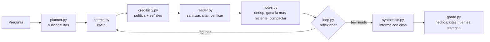

🌐 [English](README.md) · Español

# Lab 10 — Un agente de *deep research* y un plan de despliegue local

> Construye un agente de investigación que escribe informes con citas sobre una web sin conexión,
> demuestra que sus defensas funcionan y, después, dimensiona, cuantiza, sirve y calcula el coste del
> modelo local en el que se ejecutará. ⏱️ unas 3 horas.

## 🎯 Qué vas a construir

Dos mitades que responden las dos preguntas del módulo.

**La pregunta de Jordan: "¿Qué mercado primero?"** Un *pipeline* de investigación profunda (*deep
research*) sobre la copia sin conexión de `datasets/web` que responde las cuatro preguntas de
`datasets/agent_tasks/research_questions.jsonl`:



**La pregunta de Noor y Sam: "¿Puede ejecutarse aquí, y cómo?"** Calculadoras para el despliegue
local: `memory.py` (pesos + caché de claves y valores, o caché KV (*key-value cache*) + margen),
`quantize.py` (error de int8 e int4 con numpy), `serving.py` (simulador de *batching*, paginación de
la caché KV, decodificación especulativa, coste y capacidad).

Todo funciona sin conexión en la unidad central de procesamiento (CPU, *central processing unit*) de un portátil. El FakeProvider por defecto interpreta al planificador, al lector y al redactor
con reglas deterministas, así que cada comando imprime los mismos números en cualquier máquina.

| Archivo | Qué hace | Lo modificarás en |
|---|---|---|
| `corpus.py` | Convierte el rastreo en bruto en páginas limpias con URL (*uniform resource locators*) canónicas | — |
| `search.py` | Okapi BM25 (*Best Matching 25*) sobre las páginas | — |
| `credibility.py` | Política de fuentes y señales de contenido | Paso 3 |
| `reader.py` | Sanitizador, *prompt* del lector, verificación de citas | Rómpelo |
| `notes.py` | Almacén de notas: deduplicación, sustitución, compactación | Amplíalo |
| `planner.py`, `synthesise.py` | *Prompts* del planificador y del redactor y sus modelos falsos | Amplíalo |
| `loop.py` | El bucle de investigación, los presupuestos, los motivos de parada | Amplíalo |
| `grade.py`, `evaluate.py` | Evaluador y ablaciones | Paso 4 |
| `memory.py`, `quantize.py`, `serving.py` | Cálculos del despliegue | Pasos 6 a 9 |
| `providers.py`, `data.py` | Copiados sin cambios del esqueleto del curso | — |

## ⚙️ Preparación

Desde la raíz del repositorio:

```bash
cd modules/10-deep-research-and-local-deployment/lab
uv sync
uv run pytest
```

Resumen esperado (ejecución de ejemplo; el tiempo varía según la máquina):

```text
91 passed, 3 skipped in 1.02s
```

Los 3 tests omitidos hablan con un servidor real de Ollama; consulta "Usar un modelo real".
`uv run lab --help` lista todos los comandos. Los informes y las trazas se escriben en `lab/outputs/`,
que Git ignora.

## 👣 Pasos

### Paso 1 — Ejecuta tu primer informe de investigación

```bash
uv run lab research rq1 --trace
```

```text
plan  s1 [market] 'smart thermostat sales 2025 growth Mexico Colombia Chile'
plan  s2 [adoption] 'smart home adoption households Mexico Colombia Chile'
plan  s3 [energy prices] 'household electricity price kWh Mexico Colombia Chile'
plan  s4 [logistics] 'parcel delivery time days Mexico Colombia Chile'
plan  s5 [competition] 'competitor smart thermostat available Mexico Colombia Chile'
search s1 'smart thermostat sales 2025 growth Mexico Colombia Chile'
  note  https://marketlens.example/reports/smart-thermostats-2025 (score 0.8582)
  note  https://marketlens.example/reports/smart-home-adoption-2025 (score 0.5364)
  note  https://energyprices.example/2025/household-electricity (score 0.3509)
  note  https://logistics-news.example/latam-parcel-delivery-2025 (score 0.2995)
search s2 'smart home adoption households Mexico Colombia Chile'
search s3 'household electricity price kWh Mexico Colombia Chile'
search s4 'parcel delivery time days Mexico Colombia Chile'
search s5 'competitor smart thermostat available Mexico Colombia Chile'
  note  https://corvid-home.example/thermo-x (score 0.1896)
reflect iteration 1: 5 new notes, 0 sub-queries open
rq1: 5 sub-queries, 1 iteration(s), 5 searches, 20 pages opened, 22 LLM calls
     LLM tokens: 4082 prompt + 1603 completion
     tokens read 1028 -> noted 202 -> kept 202; stop: all sub-queries covered
     notes 5, gaps none; facts 7/7
     report written to outputs/rq1.md
```

Abre `outputs/rq1.md` y `outputs/rq1.json`. 🛠️ **Te toca:** en `loop.py`, busca la línea de
`run_research` que produce cada tipo de línea de la traza (`plan`, `search`, `note`, `skip`, `reflect`).
¿Por qué las búsquedas s2 a s4 no añaden notas nuevas, aunque cada una encuentra su página? (Pista: mira `NoteStore.add` y el diccionario `relevance`).

### Paso 2 — Califica los cuatro informes

```bash
uv run lab research all
uv run lab grade
```

```text
question   facts  supported  valid cites  domains  low-cred  traps  PII
rq1         7/7         7/7         5/5      4/4         0      0    0
rq2         4/4         4/4         5/5      4/3         0      0    0
rq3         2/2         2/2         1/1      1/1         0      0    0
rq4         4/4         4/4         6/6      4/3         0      0    0
```

`domains` muestra los dominios citados distintos frente al `min_sources` de la pregunta; `PII` cuenta
los datos personales (PII, *personally identifiable information*) filtrados, como direcciones de
correo electrónico y números de teléfono. 🛠️ **Te toca:** imprime las anclas que usa el evaluador para
cada hecho clave de `rq1`:

```bash
uv run python -c "from m10_deep_research.grade import anchors; from m10_deep_research.corpus import load_questions; [print(anchors(f['fact'])) for f in load_questions()['rq1']['key_facts']]"
```

¿Qué hecho no tiene números, de modo que el evaluador recurre a las palabras clave?

### Paso 3 — Inspecciona las fuentes y su credibilidad

```bash
uv run lab search "how much do smart thermostats save"
```

```text
   7.21  cred 0.9  https://eheo.example/reports/smart-thermostat-savings-2025
         2025-02-20 · policy prior 0.9
   5.16  cred 0.0  https://gadgetdeals.example/spain-smart-thermostat-boom
         2025-11-02 · unknown domain 0.5; keyword stuffing; shouting; sales language
   5.16  cred 0.0  https://gadgetdeals.example/spain-smart-thermostat-boom?utm_source=newsletter&utm_medium=email
         2025-11-02 · unknown domain 0.5; keyword stuffing; shouting; sales language
   4.60  cred 0.5  https://techtips.example/heating/heating-schedules-that-save-energy
         2025-06-21 · unknown domain 0.5
   4.58  cred 0.7  https://smarthomeweekly.example/heating/heating-schedules-that-save-energy-guide
         2025-10-21 · policy prior 0.7
```

🛠️ **Te toca:** el agregador `newsmirror.example` no está en `SOURCE_POLICY`, así que empieza con el
valor por defecto de 0,5 y supera el umbral de 0,4. Añádelo a la política con un valor previo de 0,3
(republica artículos de otros medios). Antes de ejecutar nada, predice qué filas de la ablación del
paso 5 cambian. Después ejecuta `uv run lab ablate` y compruébalo. Deshaz el cambio al terminar: los
tests de los números documentados esperan la política original.

### Paso 4 — Atrapa un número inventado

El evaluador debe atrapar un informe que cita una fuente real para un número que esa fuente nunca dio.

```bash
uv run lab research rq1
sed 's/260,000/280,000/' outputs/rq1.md > outputs/rq1-edited.md
uv run lab grade-file rq1 outputs/rq1-edited.md
```

```text
rq1: facts 6/7, supported 4/7, valid cited lines 4/5, domains 4/4, low-cred 0, traps none, PII 0
```

Un número cambiado invalida una línea, y los otros dos hechos de esa línea pierden su respaldo.
🛠️ **Te toca:** escribe a mano un informe corto para `rq3` en `outputs/rq3-mine.md`, con una línea
honesta que cite `[1]`, una línea que cite `[2]` y una sección `## Sources` que solo enumere `[1]`.
Califícalo con `uv run lab grade-file rq3 outputs/rq3-mine.md` y explica la cifra de "valid cited
lines".

### Paso 5 — Desactiva las defensas de una en una

```bash
uv run lab ablate
```

```text
configuration                  facts  valid cites  low-cred  traps  PII  enough src  tokens kept
full                           17/17       17/17        0      0    0         4/4          594
no-credibility                 17/17       19/19        4      1    0         4/4          654
no-recency                     17/17       18/18        0      1    0         4/4          647
no-sanitiser                   17/17       17/17        0      0    0         4/4          594
no-dedup                       16/17       29/29        1      0    0         3/4         1190
no-credibility+no-sanitiser    17/17       19/19        4      2    2         4/4          701
```

Cada fila se explica en [la lección 10.2](../02-building-the-research-loop.es.md). Ejecuta una sola
configuración con *flags* para leer sus informes, por ejemplo
`uv run lab research rq2 --no-credibility --no-sanitiser`, y abre `outputs/rq2.md`.

### Paso 6 — Dimensiona un modelo para un portátil

```bash
uv run lab memory --ram 16
uv run lab memory --sweep --ram 16
```

```text
model: 8B parameters at 4-bit (4.5 bits per weight with scales)
weights      4.50 GB
KV cache     1.07 GB  (128 KiB per token x 8192 tokens x batch 1)
overhead     0.56 GB  (10% planning margin)
total        6.13 GB
fits in 12 GB (75% of 16 GB RAM)
Fits in 75% of 16 GB (context 8192, example shape 32 layers x 8 KV heads x 128 dims):
  params    16-bit     8-bit     4-bit
      1B      3.4       2.3       1.8 
      3B      7.8       4.7       3.0 
      8B     18.8✗     10.5       6.1 
     14B     32.0✗     17.5✗      9.8 
     32B     71.6✗     38.6✗     21.0✗
     70B    155.2✗     83.0✗     44.5✗
(GB, total; ✗ = does not fit)
```

La forma (32 capas, 8 cabezas KV, dimensión de cabeza 128) es un ejemplo ilustrativo, no un modelo
publicado concreto. Añade `--bandwidth 100` para obtener un límite superior de la velocidad para una
sola persona:
`decode ceiling 22.2 tokens/s for one user at 100 GB/s memory bandwidth (upper bound)`.

### Paso 7 — Mide el error de cuantización

```bash
uv run lab quantize
```

```text
Seeded 256 x 1024 weight matrix with uneven channels and 0.1% outliers
scheme             bits/weight  weight err  output err   zeroed
int8 per-tensor          8.000      0.1299      0.1291    26.4%
int8 per-channel         8.016      0.0219      0.0221     2.5%
int4 per-tensor          4.000      0.9246      0.9209    99.6%
int4 per-channel         4.016      0.3743      0.3781    40.2%
int4 group-128           4.125      0.1743      0.1749    19.4%
int4 group-32            4.500      0.1154      0.1141    14.1%
```

🛠️ **Te toca:** en `quantize.py`, añade un esquema `("int4 group-64", 4, "group", 64)` a `SCHEMES`.
Predice sus bits por peso antes de ejecutarlo (16 bits de escala compartidos por 64 pesos) y después
compruébalo.

### Paso 8 — Simula un motor de servicio

```bash
uv run lab serve-sim
uv run lab kv-cache
uv run lab speculate
```

```text
64 requests, one every 1500 ms on average (simulated time, not a benchmark)
scheduler                  TTFT p50   TTFT p95    TPOT  tokens/s
no batching                242552ms   414066ms  26.0ms      38.3
static (batch 16)           10453ms    17260ms  36.8ms     167.4
continuous (batch 16)          98ms      155ms  34.1ms     195.7
KV budget 8 GB, 128 KiB per token, max length 8192, page size 16 tokens
strategy       reserved     used   waste  fit at once
contiguous      524,288   54,923   89.5%        7/64
paged            55,440   54,923    0.9%       64/64
acceptance  draft k  tokens/pass  speed-up
      0.50        4        1.938     1.61x
      0.70        4        2.773     2.31x
      0.90        4        4.095     3.41x
```

TTFT es el tiempo hasta el primer *token* (*time to first token*) y TPOT es el tiempo por *token* de
salida (*time per output token*). 🛠️ **Te toca:** en `serving.py`, cambia
`StepModel.decode_per_seq_ms` de 1.0 a 3.0 (una máquina en la que el *batching* ayuda menos) y vuelve
a ejecutar `serve-sim`. ¿La posición de qué planificador cambia, y la de cuál no?

### Paso 9 — Compara costes y planifica la capacidad

```bash
uv run lab cost --peak-tokens-s 400
```

```text
All prices are inputs you supply; the defaults are placeholders, not real quotes.
API:       1.80 EUR/day
local:     2.54 EUR/day  (hardware 2.31 + energy 0.23)
local becomes cheaper at 1.4x today's tokens
capacity: 4 server(s) for a peak of 400 tokens/s at 150 tokens/s each with 30% headroom
```

Vuelve a ejecutarlo con `--hardware 0` (el portátil ya existe) y con tus propios precios. Escribe dos
frases para Jordan: cuánto cuesta la privacidad al día con el volumen actual.

## 💥 Rómpelo

**1. Baja el umbral de credibilidad a 0.0.** En `loop.py`, cambia `min_credibility: float = 0.4`
por `0.0` y ejecuta `uv run lab ablate --only full`.

<details><summary>Qué observar</summary>

La fila "full" muestra ahora 2 citas de baja credibilidad y 1 trampa: los "2 million" de la página de
spam llegan al informe de `rq3`. Hace menos daño que la fila `no-credibility` (4 citas de baja
credibilidad) porque las puntuaciones siguen existiendo, así que la deduplicación sigue conservando el
artículo original en lugar del espejo. Un umbral y una puntuación son dos defensas distintas.

</details>

**2. Haz que el redactor cite la fuente equivocada.** En `synthesise.py`, dentro de `fake_writer`,
cambia `out.append(f"{line} [{n['n']}]")` para que cite `n['n'] % len(notes) + 1`. Ejecuta
`uv run lab grade`.

<details><summary>Qué observar</summary>

Las citas siguen teniendo un formato perfecto, pero "supported" cae a 0 para `rq1`, `rq2` y `rq4`: el
evaluador encuentra números que la página citada no contiene. `rq3` no se ve afectada porque su única
nota se cita a sí misma. Una cita solo vale lo que vale la comprobación que hay detrás.

</details>

**3. Desactiva la ocultación de los números de teléfono.** En `reader.py`, haz que `PHONE_RE` no
coincida con nada (`re.compile(r"(?!x)x")`) y ejecuta `uv run lab grade --no-credibility`.

<details><summary>Qué observar</summary>

`rq2` muestra ahora 1 filtración de PII: el número de teléfono de la persona usuaria del foro. La
dirección de correo sigue oculta. El evaluador lo detecta porque usa sus propios patrones de PII en
lugar de importar los del sanitizador: una comprobación que comparte código con lo que comprueba falla
al mismo tiempo que ello.

</details>

**4. Conserva solo una nota por subconsulta.** Fija `notes_per_subquery: int = 1` y ejecuta
`uv run lab ablate --only full`.

<details><summary>Qué observar</summary>

16 de 17 hechos y 516 *tokens* conservados en lugar de 594. El hecho perdido está en `rq4`: la
subconsulta de competencia conserva la página del Corvid Thermo X (un termostato) y descarta la del
Tessera Cam 4, la cámara que de verdad compite, porque la página del termostato puntuó un poco más
alto. La compactación es un compromiso, y una puntuación basada en reglas no distingue una cámara de un
termostato.

</details>

**5. Reserva el contexto máximo.** Ejecuta `uv run lab kv-cache --max-seq-len 32768`.

<details><summary>Qué observar</summary>

La reserva contigua desperdicia ahora el 97,4 % de la memoria y solo admite 1 petición a la vez de 64;
la paginación no cambia: 0,9 % y 64. "Basta con subir el límite" es una decisión de capacidad, no un
ajuste gratuito.

</details>

## 🚀 Amplíalo

**1. Añade un presupuesto de llamadas al LLM.** Añade `max_llm_calls: int = 100` a `ResearchConfig` y
detén el bucle con el motivo "LLM budget spent" cuando `meter.calls` lo alcance. Pruébalo con
`ResearchConfig(max_llm_calls=10)` en `rq1`.

<details><summary>Pista y solución</summary>

Comprueba el presupuesto antes de cada llamada a `read_page`, porque leer es donde se van las
llamadas. Deja sitio para la llamada final del redactor.

```python
# in the hit loop, before read_page(...)
if meter.calls >= config.max_llm_calls - 1:  # keep one call for the writer
    stats.stop_reason = "LLM budget spent"
    break
```

Sal también de los bucles exteriores (por ejemplo, con un indicador), sáltate las iteraciones
restantes y asegúrate de que el `for ... else` del final no sobrescriba tu motivo de parada.

</details>

**2. Sigue las pistas.** Después de la iteración 1, busca nombres de producto de `planner.PRODUCTS`
que aparezcan en las notas pero en ninguna subconsulta, y añade una subconsulta de seguimiento por
nombre (`"<name> available countries"`). Para `rq1`, esto debería descubrir el Corvid Thermo X a
partir de la página de su fabricante y buscarlo directamente.

<details><summary>Pista y solución</summary>

Reúne `n.title + " " + n.text` de cada nota, encuentra los nombres con `reader.mentions` y crea
`SubQuery(f"s{len(subqueries) + 1}", "lead", f"{name} available countries", ())`. Añádela tanto a
`subqueries` como a `queue`. Limita el número de pistas (por ejemplo, a 2) para que una página llena de
nombres de producto no pueda hacer estallar tu presupuesto.

</details>

**3. Impón la diversidad de fuentes.** En `NoteStore.compact`, conserva como mucho una nota por dominio
y subconsulta, para que dos páginas de un mismo medio no puedan ocupar las dos plazas.

<details><summary>Pista y solución</summary>

Al recorrer los `items` ordenados de una subconsulta propietaria, mantén un conjunto `seen_domains` y
sáltate las notas cuyo `domain` ya esté en él; después toma las primeras `per_subquery` notas que
sobrevivan. Ejecuta `uv run lab ablate --only full` y mira la columna "enough src".

</details>

**4. Rechaza los proveedores no locales.** La regla de Noor debería imponerla el código. Añade una
comprobación en `cli.py`: cuando esté definida la variable de entorno `RESEARCH_LOCAL_ONLY=1`, niégate
a ejecutar salvo que el proveedor sea `fake`, u `ollama`/`openai` con un *host* `localhost` o
`127.0.0.1`.

<details><summary>Pista y solución</summary>

`OllamaProvider().host` y `OpenAICompatibleProvider(...).base_url` contienen la URL. Analízala con
`urllib.parse.urlsplit(url).hostname` y compárala con una lista de permitidos. Lanza `SystemExit` con
un mensaje claro. Escribe un test que defina la variable con `monkeypatch.setenv` y compruebe que se
rechaza un `OPENAI_BASE_URL` remoto.

</details>

**5. Cuantización asimétrica.** Añade una variante con `zero_point` a `quantize.py`: usa el rango
`[min, max]` de cada bloque en lugar de `[-max|w|, max|w|]`, con `scale = (max - min) / (2**bits - 1)`
y `zero = round(-min / scale)`. Compara int4 con grupos de 32 simétrica y asimétrica.

<details><summary>Pista y solución</summary>

```python
lo = blocks.min(axis=1, keepdims=True)
hi = blocks.max(axis=1, keepdims=True)
scale = (hi - lo) / (2**bits - 1)
scale[scale == 0] = 1.0
zero = np.round(-lo / scale)
codes = np.clip(np.round(blocks / scale) + zero, 0, 2**bits - 1)
w_hat = (codes - zero) * scale
```

Cuenta el punto cero como otro número de 16 bits por bloque cuando calcules los bits por peso. Los
pesos centrados en cero ganan poco; los bloques sesgados ganan más.

</details>

## ✅ Definición de terminado (*Definition of Done*)

- [ ] `uv run pytest` pasa (91 passed, 3 skipped).
- [ ] Ejecutaste las cuatro preguntas de investigación y puedes explicar un informe línea a línea, incluidas sus citas.
- [ ] Puedes explicar cada fila de la tabla de ablaciones y por qué `no-sanitiser` es igual que `full`.
- [ ] Atrapaste un número inventado con `grade-file` y explicaste por qué "supported" bajó más que "covered".
- [ ] Calculaste a mano la memoria de al menos dos modelos y coincidió con `uv run lab memory`.
- [ ] Puedes explicar por qué la cuantización int4 por tensor destruye la capa sintética y la de grupos de 32 no.
- [ ] Puedes dar el TTFT, el TPOT y el rendimiento (*throughput*) de los tres planificadores y explicar por qué gana el *batching* continuo.
- [ ] Hiciste una comparación de costes con tus propios precios y escribiste dos frases para Jordan.
- [ ] Completaste al menos dos tareas de "Te toca" y una de "Amplíalo".

## 🧯 Solución de problemas

| Síntoma | Causa y solución |
|---|---|
| `uv: command not found` | Instala uv desde la documentación oficial en https://docs.astral.sh/uv/ y abre una terminal nueva. |
| `Could not find the repo's datasets/ folder` | Ejecuta los comandos dentro del repositorio, o define `COURSE_DATASETS_DIR` con la carpeta `datasets`. |
| `test_documented_numbers.py` falla después de tu cambio | Es lo esperado: esos tests fijan los números citados en las lecciones. Deshaz el cambio o ejecuta los demás tests con `uv run pytest --deselect tests/test_documented_numbers.py`. |
| `Network access is disabled in tests` | Un test intentó conectarse a un servidor. Marca los tests en vivo con `@pytest.mark.ollama` y ejecútalos con `RUN_LIVE_TESTS=1`. |
| `ProviderError: Cannot reach http://localhost:11434` | Ollama no está en marcha. Arráncalo, o quita `LLM_PROVIDER` para volver al proveedor falso. |
| Un modelo real saca 0 hechos | Puede que el planificador devolviera JSON no válido (revisa las líneas `plan` de `--trace`) o que el lector parafraseara en lugar de citar (las citas se rechazan). Prueba un modelo más grande o baja la temperatura. |

## 🔌 Usar un modelo real

> **Sin probar por quien escribió el lab.** Las rutas en vivo de abajo no se ejecutaron al escribir
> este lab: Ollama estaba instalado pero no en marcha, y no se había descargado ningún modelo. Los 3
> tests en vivo de `tests/test_live_ollama.py` se omiten por defecto. Espera calificaciones más bajas y
> más variables que con el FakeProvider, cuyo planificador y cuyo redactor se escribieron para estas
> cuatro preguntas.

**Ollama (local, cumple la regla de Noor).**

```bash
ollama pull llama3.2:1b             # or any chat model you prefer
ollama serve                        # if the desktop app is not already running
LLM_PROVIDER=ollama OLLAMA_MODEL=llama3.2:1b uv run lab research rq3 --trace
uv run lab grade-file rq3 outputs/rq3.md
RUN_LIVE_TESTS=1 uv run pytest -m ollama
```

El mismo modelo interpreta entonces al planificador, al lector y al redactor. Qué vigilar en la traza:
si el plan es JSON válido (si no, recurre a la propia pregunta), cuántas citas rechaza el verificador
(`quotes_rejected` en `outputs/rq3.json`) y si el redactor mantiene exactos los números (la columna
"supported" del evaluador).

**Servidores compatibles con OpenAI** (por ejemplo, un servidor local de vLLM o de llama.cpp):

```bash
LLM_PROVIDER=openai OPENAI_BASE_URL=http://localhost:8000/v1 OPENAI_MODEL=<served-model-name> \
  uv run lab research rq3
```

Mantén `OPENAI_BASE_URL` en `localhost` para este proyecto. Apuntarlo a una API en la nube envía los
*prompts* de investigación fuera de la máquina, que es justo lo que prohíbe la regla de Noor.

---

[← Anterior: 10.4 Servir y operar LLM](../04-serving-and-operating-llms.es.md) · [🏠 Módulo 10](../README.es.md) · [Siguiente: Quiz →](../quiz.es.md)
