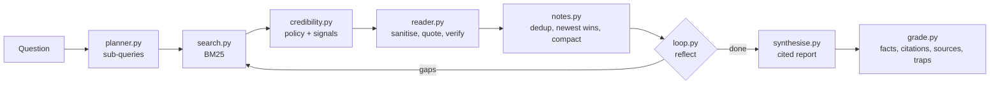

🌐 English · [Español](README.es.md)

# Lab 10 — A deep-research agent and a local deployment plan

> Build a research agent that writes cited reports over an offline web, prove that its defences
> work, then size, quantise, serve and cost the local model it will run on. ⏱️ about 3 hours.

## 🎯 What you will build

Two halves that answer the module's two questions.

**Jordan's question: "Which market first?"** A deep-research pipeline over the offline snapshot in
`datasets/web` that answers the four questions in `datasets/agent_tasks/research_questions.jsonl`:



**Noor's and Sam's question: "Can it run here, and how?"** Calculators for local deployment:
`memory.py` (weights + key-value (KV) cache + overhead), `quantize.py` (int8 and int4 error with numpy),
`serving.py` (batching simulator, KV-cache paging, speculative decoding, cost and capacity).

Everything runs offline on a laptop's central processing unit (CPU). The default FakeProvider plays the planner, reader and writer
with deterministic rules, so every command prints the same numbers on every machine.

| File | What it does | You will modify |
|---|---|---|
| `corpus.py` | Parses the raw crawl into clean pages with canonical URLs (uniform resource locators) | — |
| `search.py` | Okapi BM25 (Best Matching 25) over pages | — |
| `credibility.py` | Source policy and content signals | Step 3 |
| `reader.py` | Sanitiser, reader prompt, quote verification | Break it |
| `notes.py` | Note store: dedup, supersession, compaction | Extend it |
| `planner.py`, `synthesise.py` | Planner and writer prompts and their fake models | Extend it |
| `loop.py` | The research loop, budgets, stop reasons | Extend it |
| `grade.py`, `evaluate.py` | Grader and ablations | Step 4 |
| `memory.py`, `quantize.py`, `serving.py` | Deployment maths | Steps 6 to 9 |
| `providers.py`, `data.py` | Copied unchanged from the course skeleton | — |

## ⚙️ Setup

From the repository root:

```bash
cd modules/10-deep-research-and-local-deployment/lab
uv sync
uv run pytest
```

Expected summary (example run; the time varies by machine):

```text
91 passed, 3 skipped in 1.02s
```

The 3 skipped tests talk to a real Ollama server; see "Using a real model". `uv run lab --help`
lists every command. Reports and traces are written to `lab/outputs/`, which Git ignores.

## 👣 Steps

### Step 1 — Run your first research report

```bash
uv run lab research rq1 --trace
```

```text
plan  s1 [market] 'smart thermostat sales 2025 growth Mexico Colombia Chile'
plan  s2 [adoption] 'smart home adoption households Mexico Colombia Chile'
plan  s3 [energy prices] 'household electricity price kWh Mexico Colombia Chile'
plan  s4 [logistics] 'parcel delivery time days Mexico Colombia Chile'
plan  s5 [competition] 'competitor smart thermostat available Mexico Colombia Chile'
search s1 'smart thermostat sales 2025 growth Mexico Colombia Chile'
  note  https://marketlens.example/reports/smart-thermostats-2025 (score 0.8582)
  note  https://marketlens.example/reports/smart-home-adoption-2025 (score 0.5364)
  note  https://energyprices.example/2025/household-electricity (score 0.3509)
  note  https://logistics-news.example/latam-parcel-delivery-2025 (score 0.2995)
search s2 'smart home adoption households Mexico Colombia Chile'
search s3 'household electricity price kWh Mexico Colombia Chile'
search s4 'parcel delivery time days Mexico Colombia Chile'
search s5 'competitor smart thermostat available Mexico Colombia Chile'
  note  https://corvid-home.example/thermo-x (score 0.1896)
reflect iteration 1: 5 new notes, 0 sub-queries open
rq1: 5 sub-queries, 1 iteration(s), 5 searches, 20 pages opened, 22 LLM calls
     LLM tokens: 4082 prompt + 1603 completion
     tokens read 1028 -> noted 202 -> kept 202; stop: all sub-queries covered
     notes 5, gaps none; facts 7/7
     report written to outputs/rq1.md
```

Open `outputs/rq1.md` and `outputs/rq1.json`. 🛠️ **Your turn:** in `loop.py`, find the line of
`run_research` that produces each kind of trace line (`plan`, `search`, `note`, `skip`, `reflect`).
Why do searches s2 to s4 add no new notes, although each finds its page? (Hint: look at `NoteStore.add` and the `relevance` dict.)

### Step 2 — Grade the four reports

```bash
uv run lab research all
uv run lab grade
```

```text
question   facts  supported  valid cites  domains  low-cred  traps  PII
rq1         7/7         7/7         5/5      4/4         0      0    0
rq2         4/4         4/4         5/5      4/3         0      0    0
rq3         2/2         2/2         1/1      1/1         0      0    0
rq4         4/4         4/4         6/6      4/3         0      0    0
```

`domains` shows distinct cited domains against the question's `min_sources`; `PII` counts leaked
personally identifiable information such as e-mail addresses and phone numbers. 🛠️ **Your turn:** print
the anchors the grader uses for every key fact of `rq1`:

```bash
uv run python -c "from m10_deep_research.grade import anchors; from m10_deep_research.corpus import load_questions; [print(anchors(f['fact'])) for f in load_questions()['rq1']['key_facts']]"
```

Which fact has no numbers, so that the grader falls back to keywords?

### Step 3 — Inspect sources and credibility

```bash
uv run lab search "how much do smart thermostats save"
```

```text
   7.21  cred 0.9  https://eheo.example/reports/smart-thermostat-savings-2025
         2025-02-20 · policy prior 0.9
   5.16  cred 0.0  https://gadgetdeals.example/spain-smart-thermostat-boom
         2025-11-02 · unknown domain 0.5; keyword stuffing; shouting; sales language
   5.16  cred 0.0  https://gadgetdeals.example/spain-smart-thermostat-boom?utm_source=newsletter&utm_medium=email
         2025-11-02 · unknown domain 0.5; keyword stuffing; shouting; sales language
   4.60  cred 0.5  https://techtips.example/heating/heating-schedules-that-save-energy
         2025-06-21 · unknown domain 0.5
   4.58  cred 0.7  https://smarthomeweekly.example/heating/heating-schedules-that-save-energy-guide
         2025-10-21 · policy prior 0.7
```

🛠️ **Your turn:** the aggregator `newsmirror.example` is not in `SOURCE_POLICY`, so it starts at the
default 0.5 and passes the 0.4 threshold. Add it to the policy with a prior of 0.3 (it republishes
other people's articles). Before running anything, predict which ablation rows of step 5 change.
Then run `uv run lab ablate` and check. Revert the change afterwards: the documented-number tests
expect the original policy.

### Step 4 — Catch an invented number

The grader must catch a report that cites a real source for a number the source never gave.

```bash
uv run lab research rq1
sed 's/260,000/280,000/' outputs/rq1.md > outputs/rq1-edited.md
uv run lab grade-file rq1 outputs/rq1-edited.md
```

```text
rq1: facts 6/7, supported 4/7, valid cited lines 4/5, domains 4/4, low-cred 0, traps none, PII 0
```

One changed number makes one line invalid, and the two other facts on that line lose their support.
🛠️ **Your turn:** write a short report for `rq3` by hand in `outputs/rq3-mine.md`, with one honest
line citing `[1]`, one line citing `[2]` and a `## Sources` section that lists only `[1]`. Grade it
with `uv run lab grade-file rq3 outputs/rq3-mine.md` and explain the "valid cited lines" figure.

### Step 5 — Switch defences off one at a time

```bash
uv run lab ablate
```

```text
configuration                  facts  valid cites  low-cred  traps  PII  enough src  tokens kept
full                           17/17       17/17        0      0    0         4/4          594
no-credibility                 17/17       19/19        4      1    0         4/4          654
no-recency                     17/17       18/18        0      1    0         4/4          647
no-sanitiser                   17/17       17/17        0      0    0         4/4          594
no-dedup                       16/17       29/29        1      0    0         3/4         1190
no-credibility+no-sanitiser    17/17       19/19        4      2    2         4/4          701
```

Every row is explained in [lesson 10.2](../02-building-the-research-loop.md). Run a single
configuration with flags to read its reports, for example
`uv run lab research rq2 --no-credibility --no-sanitiser` and open `outputs/rq2.md`.

### Step 6 — Size a model for a laptop

```bash
uv run lab memory --ram 16
uv run lab memory --sweep --ram 16
```

```text
model: 8B parameters at 4-bit (4.5 bits per weight with scales)
weights      4.50 GB
KV cache     1.07 GB  (128 KiB per token x 8192 tokens x batch 1)
overhead     0.56 GB  (10% planning margin)
total        6.13 GB
fits in 12 GB (75% of 16 GB RAM)
Fits in 75% of 16 GB (context 8192, example shape 32 layers x 8 KV heads x 128 dims):
  params    16-bit     8-bit     4-bit
      1B      3.4       2.3       1.8 
      3B      7.8       4.7       3.0 
      8B     18.8✗     10.5       6.1 
     14B     32.0✗     17.5✗      9.8 
     32B     71.6✗     38.6✗     21.0✗
     70B    155.2✗     83.0✗     44.5✗
(GB, total; ✗ = does not fit)
```

The shape (32 layers, 8 KV heads, head dimension 128) is an illustrative example, not a specific
released model. Add `--bandwidth 100` to get an upper bound on single-user speed:
`decode ceiling 22.2 tokens/s for one user at 100 GB/s memory bandwidth (upper bound)`.

### Step 7 — Measure quantisation error

```bash
uv run lab quantize
```

```text
Seeded 256 x 1024 weight matrix with uneven channels and 0.1% outliers
scheme             bits/weight  weight err  output err   zeroed
int8 per-tensor          8.000      0.1299      0.1291    26.4%
int8 per-channel         8.016      0.0219      0.0221     2.5%
int4 per-tensor          4.000      0.9246      0.9209    99.6%
int4 per-channel         4.016      0.3743      0.3781    40.2%
int4 group-128           4.125      0.1743      0.1749    19.4%
int4 group-32            4.500      0.1154      0.1141    14.1%
```

🛠️ **Your turn:** in `quantize.py`, add a scheme `("int4 group-64", 4, "group", 64)` to `SCHEMES`.
Predict its bits per weight before you run it (16 bits of scale shared by 64 weights), then check.

### Step 8 — Simulate a serving engine

```bash
uv run lab serve-sim
uv run lab kv-cache
uv run lab speculate
```

```text
64 requests, one every 1500 ms on average (simulated time, not a benchmark)
scheduler                  TTFT p50   TTFT p95    TPOT  tokens/s
no batching                242552ms   414066ms  26.0ms      38.3
static (batch 16)           10453ms    17260ms  36.8ms     167.4
continuous (batch 16)          98ms      155ms  34.1ms     195.7
KV budget 8 GB, 128 KiB per token, max length 8192, page size 16 tokens
strategy       reserved     used   waste  fit at once
contiguous      524,288   54,923   89.5%        7/64
paged            55,440   54,923    0.9%       64/64
acceptance  draft k  tokens/pass  speed-up
      0.50        4        1.938     1.61x
      0.70        4        2.773     2.31x
      0.90        4        4.095     3.41x
```

TTFT is time to first token and TPOT is time per output token. 🛠️ **Your turn:** in `serving.py`,
change `StepModel.decode_per_seq_ms` from 1.0 to 3.0 (a machine where batching helps less) and rerun
`serve-sim`. Which scheduler's ranking changes, and which does not?

### Step 9 — Compare cost and plan capacity

```bash
uv run lab cost --peak-tokens-s 400
```

```text
All prices are inputs you supply; the defaults are placeholders, not real quotes.
API:       1.80 EUR/day
local:     2.54 EUR/day  (hardware 2.31 + energy 0.23)
local becomes cheaper at 1.4x today's tokens
capacity: 4 server(s) for a peak of 400 tokens/s at 150 tokens/s each with 30% headroom
```

Rerun with `--hardware 0` (the laptop already exists) and with your own prices. Write two sentences
for Jordan: what privacy costs per day at today's volume.

## 💥 Break it

**1. Lower the credibility threshold to 0.0.** In `loop.py`, change `min_credibility: float = 0.4`
to `0.0` and run `uv run lab ablate --only full`.

<details><summary>What to observe</summary>

The "full" row now shows 2 low-credibility citations and 1 trap: the spam page's "2 million" reaches
the `rq3` report. It is less damaging than the `no-credibility` row (4 low-credibility citations)
because the scores still exist, so deduplication still keeps the original article rather than the
mirror. A threshold and a score are two different defences.

</details>

**2. Make the writer cite the wrong source.** In `synthesise.py`, in `fake_writer`, change
`out.append(f"{line} [{n['n']}]")` to cite `n['n'] % len(notes) + 1`. Run `uv run lab grade`.

<details><summary>What to observe</summary>

The citations still look perfectly formatted, but "supported" falls to 0 for `rq1`, `rq2` and `rq4`:
the grader finds numbers that the cited page does not contain. `rq3` is unaffected because its
single note cites itself. A citation is only as good as the check behind it.

</details>

**3. Turn off phone-number redaction.** In `reader.py`, make `PHONE_RE` match nothing
(`re.compile(r"(?!x)x")`) and run `uv run lab grade --no-credibility`.

<details><summary>What to observe</summary>

`rq2` now shows 1 PII leak: the forum user's phone number. The e-mail address is still redacted.
The grader catches it because it uses its own PII patterns instead of importing the sanitiser's:
a check that shares code with the thing it checks fails at the same time.

</details>

**4. Keep only one note per sub-query.** Set `notes_per_subquery: int = 1` and run
`uv run lab ablate --only full`.

<details><summary>What to observe</summary>

16 of 17 facts and 516 tokens kept instead of 594. The lost fact is in `rq4`: the competition
sub-query keeps the Corvid Thermo X page (a thermostat) and drops the Tessera Cam 4 page, the actual
camera competitor, because the thermostat page scored slightly higher. Compaction is a trade-off,
and a rule-based score cannot tell a camera from a thermostat.

</details>

**5. Reserve the maximum context.** Run `uv run lab kv-cache --max-seq-len 32768`.

<details><summary>What to observe</summary>

Contiguous reservation now wastes 97.4% of the memory and fits 1 request at a time out of 64; paging
is unchanged at 0.9% and 64. "Just raise the limit" is a capacity decision, not a free setting.

</details>

## 🚀 Extend it

**1. Add an LLM-call budget.** Add `max_llm_calls: int = 100` to `ResearchConfig` and stop the loop
with the reason "LLM budget spent" when `meter.calls` reaches it. Test it with
`ResearchConfig(max_llm_calls=10)` on `rq1`.

<details><summary>Hint and solution</summary>

Check the budget before each `read_page` call, because reading is where the calls go. Leave room
for the writer's final call.

```python
# in the hit loop, before read_page(...)
if meter.calls >= config.max_llm_calls - 1:  # keep one call for the writer
    stats.stop_reason = "LLM budget spent"
    break
```

Break out of the outer loops too (for example with a flag), skip the remaining iterations, and make
sure the `for ... else` at the end does not overwrite your stop reason.

</details>

**2. Follow leads.** After iteration 1, look for product names from `planner.PRODUCTS` that appear
in the notes but in no sub-query, and add one follow-up sub-query per name
(`"<name> available countries"`). For `rq1` this should discover the Corvid Thermo X from its
vendor page and search for it directly.

<details><summary>Hint and solution</summary>

Collect `n.title + " " + n.text` for every note, find the names with `reader.mentions`, and create
`SubQuery(f"s{len(subqueries) + 1}", "lead", f"{name} available countries", ())`. Append it to both
`subqueries` and `queue`. Cap the number of leads (for example 2) so a page full of product names
cannot explode your budget.

</details>

**3. Enforce source diversity.** In `NoteStore.compact`, keep at most one note per domain per
sub-query, so two pages from one publisher cannot fill both slots.

<details><summary>Hint and solution</summary>

When you walk the sorted `items` for an owner, keep a `seen_domains` set and skip a note whose
`domain` is already in it, then take the first `per_subquery` notes that survive. Run
`uv run lab ablate --only full` and check the "enough src" column.

</details>

**4. Refuse non-local providers.** Noor's rule should be enforced by code. Add a check in
`cli.py`: when the environment variable `RESEARCH_LOCAL_ONLY=1` is set, refuse to run unless the
provider is `fake`, or `ollama`/`openai` with a host of `localhost` or `127.0.0.1`.

<details><summary>Hint and solution</summary>

`OllamaProvider().host` and `OpenAICompatibleProvider(...).base_url` hold the URL. Parse it with
`urllib.parse.urlsplit(url).hostname` and compare with an allowlist. Raise `SystemExit` with a clear
message. Write a test that sets the variable with `monkeypatch.setenv` and checks that a remote
`OPENAI_BASE_URL` is refused.

</details>

**5. Asymmetric quantisation.** Add a `zero_point` variant to `quantize.py`: use the range
`[min, max]` of each block instead of `[-max|w|, max|w|]`, with `scale = (max - min) / (2**bits - 1)`
and `zero = round(-min / scale)`. Compare int4 group-32 symmetric and asymmetric.

<details><summary>Hint and solution</summary>

```python
lo = blocks.min(axis=1, keepdims=True)
hi = blocks.max(axis=1, keepdims=True)
scale = (hi - lo) / (2**bits - 1)
scale[scale == 0] = 1.0
zero = np.round(-lo / scale)
codes = np.clip(np.round(blocks / scale) + zero, 0, 2**bits - 1)
w_hat = (codes - zero) * scale
```

Count the zero point as another 16-bit number per block when you compute bits per weight. Weights
centred on zero gain little; skewed blocks gain more.

</details>

## ✅ Definition of Done

- [ ] `uv run pytest` passes (91 passed, 3 skipped).
- [ ] You ran all four research questions and can explain one report line by line, including its citations.
- [ ] You can explain every row of the ablation table and why `no-sanitiser` equals `full`.
- [ ] You caught an invented number with `grade-file` and explained why "supported" dropped more than "covered".
- [ ] You computed the memory of at least two models by hand and matched `uv run lab memory`.
- [ ] You can explain why int4 per-tensor quantisation destroys the synthetic layer and group-32 does not.
- [ ] You can state TTFT, TPOT and throughput for the three schedulers and why continuous batching wins.
- [ ] You produced a cost comparison with your own prices and wrote two sentences for Jordan.
- [ ] You completed at least two "Your turn" tasks and one Extend it item.

## 🧯 Troubleshooting

| Symptom | Cause and fix |
|---|---|
| `uv: command not found` | Install uv from the official documentation at https://docs.astral.sh/uv/ and open a new terminal. |
| `Could not find the repo's datasets/ folder` | Run commands inside the repository, or set `COURSE_DATASETS_DIR` to the `datasets` folder. |
| `test_documented_numbers.py` fails after your change | Expected: those tests pin the numbers quoted in the lessons. Revert the change or run the other tests with `uv run pytest --deselect tests/test_documented_numbers.py`. |
| `Network access is disabled in tests` | A test tried to reach a server. Mark live tests with `@pytest.mark.ollama` and run them with `RUN_LIVE_TESTS=1`. |
| `ProviderError: Cannot reach http://localhost:11434` | Ollama is not running. Start it, or unset `LLM_PROVIDER` to go back to the fake provider. |
| A real model gives 0 facts | The planner may have returned invalid JSON (check the `plan` lines in `--trace`) or the reader paraphrased instead of quoting (quotes are rejected). Try a larger model or lower the temperature. |

## 🔌 Using a real model

> **Not tested by the author.** The live paths below were not run when this lab was written:
> Ollama was installed but not running and no model was pulled. The 3 live tests in
> `tests/test_live_ollama.py` are skipped by default. Expect lower and more variable grades than
> with the FakeProvider, whose planner and writer were written for these four questions.

**Ollama (local, matches Noor's rule).**

```bash
ollama pull llama3.2:1b             # or any chat model you prefer
ollama serve                        # if the desktop app is not already running
LLM_PROVIDER=ollama OLLAMA_MODEL=llama3.2:1b uv run lab research rq3 --trace
uv run lab grade-file rq3 outputs/rq3.md
RUN_LIVE_TESTS=1 uv run pytest -m ollama
```

The same model then plays planner, reader and writer. Things to watch in the trace: whether the
plan is valid JSON (otherwise it falls back to the question), how many quotes the verifier rejects
(`quotes_rejected` in `outputs/rq3.json`), and whether the writer keeps numbers exact (the grader's
"supported" column).

**OpenAI-compatible servers** (for example a local vLLM or llama.cpp server):

```bash
LLM_PROVIDER=openai OPENAI_BASE_URL=http://localhost:8000/v1 OPENAI_MODEL=<served-model-name> \
  uv run lab research rq3
```

Keep `OPENAI_BASE_URL` on `localhost` for this project. Pointing it at a cloud API sends the
research prompts off the machine, which is exactly what Noor's rule forbids.

---

[← Previous: 10.4 Serving and operating LLMs](../04-serving-and-operating-llms.md) · [🏠 Module 10](../README.md) · [Next: Quiz →](../quiz.md)
