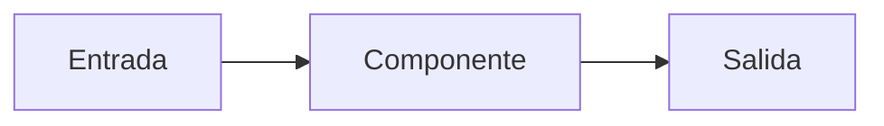

🌐 [English](design-doc.md) · Español

# Documento de diseño (*design doc*): <nombre del sistema>

> Copia esta plantilla, sustituye los `<marcadores>` y borra las pistas en cursiva. Un buen documento
> de diseño es corto (de dos a cinco páginas) y hace explícitos los compromisos para que quien revisa
> pueda discrepar pronto.

| Campo | Valor |
|---|---|
| Autoría | `<nombre>` |
| Revisión | `<nombres, por ejemplo la persona de SRE y la persona responsable de seguridad>` |
| Estado | Borrador · En revisión · Aprobado · Sustituido |
| Última actualización | `<AAAA-MM-DD>` |

## 1. Contexto y problema

*¿Qué problema resolvemos, para quién y por qué ahora? Enlaza la petición (por ejemplo, un mensaje de
Alex sobre el volumen de tickets). Incluye un ejemplo concreto de entrada y la salida que queremos.*

## 2. Objetivos y no objetivos

| Objetivos (medibles) | No objetivos |
|---|---|
| *Por ejemplo: responder el 80 % de las preguntas sobre devoluciones con una cita correcta* | *Por ejemplo: gestionar pagos* |

## 3. Requisitos

| Tipo | Requisito | Cómo lo comprobaremos |
|---|---|---|
| Calidad | | *Conjunto de evaluación y métrica* |
| Latencia | | *Objetivo p50 / p95* |
| Coste | | *Coste por petición o por mes* |
| Privacidad y seguridad | | *Datos que nunca deben salir, permisos* |
| Idiomas | | *Inglés, español...* |

## 4. Diseño propuesto

*Primero un diagrama, después los componentes. Indica qué* back-end *de modelo, qué método de
recuperación, qué herramientas y dónde vive el estado.*

| Componente | Responsabilidad | Tecnología | Responsable |
|---|---|---|---|
| | | | |

## 5. Alternativas consideradas

| Opción | Ventajas | Inconvenientes | Por qué no se eligió |
|---|---|---|---|
| *Fine-tuning en lugar de RAG* | | | |

## 6. Plan de evaluación

- **Dataset:** *origen, tamaño, cómo se etiquetó, cómo se evita la fuga de datos (¿partición temporal?)*
- **Métricas:** *por ejemplo exactitud, fidelidad, acierto al abstenerse, éxito de la tarea*
- **Línea base:** *lo más sencillo que podría funcionar y su puntuación*
- **Umbral de lanzamiento:** *los números que hay que alcanzar antes de lanzar*
- **Tests de regresión:** *qué se ejecuta en CI*

## 7. Riesgos y mitigaciones

| Riesgo | Probabilidad | Impacto | Mitigación |
|---|---|---|---|
| *Inyección de prompts en páginas recuperadas* | | | |
| *Documentos desactualizados* | | | |

## 8. Operación

- **Observabilidad:** *trazas, métricas, paneles*
- **Coste y capacidad:** *volumen esperado, tokens por petición, alarmas de presupuesto*
- **Despliegue:** *modo sombra, despliegue por porcentaje, interruptor de apagado*
- **Runbook:** *enlace*

## 9. Preguntas abiertas

1. *Pregunta, y quién puede responderla*

---

[🏠 Inicio del curso](../README.es.md) · [Plantilla de ADR →](adr.es.md)
