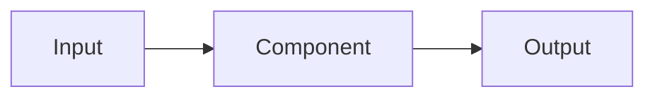

🌐 English · [Español](design-doc.es.md)

# Design doc: <system name>

> Copy this template, replace the `<placeholders>` and delete the hints in italics. A good design doc
> is short (two to five pages) and makes the trade-offs explicit so reviewers can disagree early.

| Field | Value |
|---|---|
| Author(s) | `<name>` |
| Reviewers | `<names, for example the SRE and the security lead>` |
| Status | Draft · In review · Approved · Superseded |
| Last updated | `<YYYY-MM-DD>` |

## 1. Context and problem

*What problem are we solving, for whom, and why now? Link the request (for example a message from
Alex about ticket volume). Include one concrete example input and the output we want.*

## 2. Goals and non-goals

| Goals (measurable) | Non-goals |
|---|---|
| *For example: answer 80% of returns questions with a correct citation* | *For example: handle payments* |

## 3. Requirements

| Type | Requirement | How we will check it |
|---|---|---|
| Quality | | *Evaluation set and metric* |
| Latency | | *p50 / p95 target* |
| Cost | | *Cost per request or per month* |
| Privacy and security | | *Data that must never leave, permissions* |
| Languages | | *English, Spanish...* |

## 4. Proposed design

*A diagram first, then the components. Say which model back-end, which retrieval method, which tools,
and where state lives.*

| Component | Responsibility | Technology | Owner |
|---|---|---|---|
| | | | |

## 5. Alternatives considered

| Option | Pros | Cons | Why not chosen |
|---|---|---|---|
| *Fine-tuning instead of RAG* | | | |

## 6. Evaluation plan

- **Dataset:** *source, size, how it was labelled, how leakage is prevented (temporal split?)*
- **Metrics:** *for example correctness, faithfulness, abstention accuracy, task success*
- **Baseline:** *the simplest thing that could work, and its score*
- **Launch bar:** *the numbers we must reach before shipping*
- **Regression tests:** *what runs in CI*

## 7. Risks and mitigations

| Risk | Likelihood | Impact | Mitigation |
|---|---|---|---|
| *Prompt injection in retrieved pages* | | | |
| *Outdated documents* | | | |

## 8. Operations

- **Observability:** *traces, metrics, dashboards*
- **Cost and capacity:** *expected volume, tokens per request, budget alarms*
- **Rollout:** *shadow mode, percentage rollout, kill switch*
- **Runbook:** *link*

## 9. Open questions

1. *Question, and who can answer it*

---

[🏠 Course home](../README.md) · [ADR template →](adr.md)
